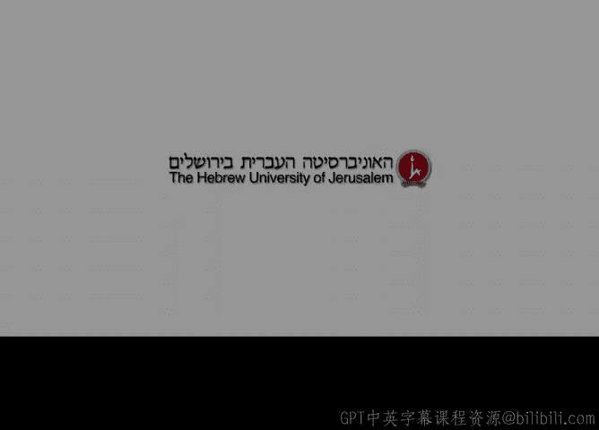

# 从零开始构建现代计算机：6：项目6概述（非编程选项）📝

在本节课中，我们将学习如何在不编写程序的情况下，完成汇编器项目的核心任务。我们将通过手动翻译的方式，将汇编语言程序转换为机器语言程序。

上一节我们介绍了如何编写一个汇编器程序。现在，我们来看看为没有编程经验的学习者提供的替代方案。

## 项目目标

本项目的目标与编写汇编器程序的目标完全相同：**输入**一个汇编语言文件，**输出**一个机器语言文件，后者是前者的精确翻译。唯一的区别在于，程序员会编写一个程序来自动完成这个翻译，而您需要手动完成。

您需要获取左侧格式的文件，并生成一个在右侧格式上与之等效的文件。

## 具体任务说明

以下是具体任务说明：
*   我们将在课程网站上提供几个用汇编语言编写的简短程序。
*   每个程序文件的后缀是 `.asm`，表示这是一个汇编语言程序。
*   对于每个名为 `XXX.asm` 的文件，您需要创建一个名为 `XXX.hack` 的新文件。
*   `.hack` 文件应包含与原始 `.asm` 文件等价的二进制机器码。

## 如何创建文件

您需要使用文本编辑器（例如记事本或WordPad）来创建和编辑 `.hack` 文件。这些工具允许您输入字符并将其保存为文件。

## 翻译方法概述

我们已经在本周详细解释了汇编器程序应该做什么。您可以模拟程序的行为，手动完成翻译，而无需知道如何编程。

为了使任务更简单，建议将整个过程分为两个阶段。

## 第一阶段：处理无符号程序

第一阶段是简单情况，即处理不包含任何符号的汇编语言程序。我们提供的练习程序中就有一个这样的例子。

以下是处理无符号程序的步骤：
*   从翻译一个没有任何符号的程序开始。
*   翻译过程是逐行进行的。
*   对于每一行，将其分解为各个部分，并按照第6.3单元讲解的规则进行翻译。
*   您需要查阅与程序相同的对照表（如指令表），手动完成翻译。

## 第二阶段：处理含符号程序

第二阶段更具一般性，也更困难，即处理包含符号的程序。正如我们所说，第一阶段是消除符号。一旦消除了符号，您就知道如何继续了。

以下是消除符号的步骤：
*   回顾第6.4单元，其中详细解释了Hack汇编语言中符号的含义、种类以及处理规则。
*   符号主要分为三类：**变量**、**程序标签**和一些**预定义符号**。
*   翻译时仍需逐行进行，但需要识别和处理不同类型的符号。

对于不同类型的行，处理方式如下：
*   **不含符号的指令**：例如 `M=1`，无需翻译，直接复制即可。注意，左侧的注释可以忽略。
*   **变量**：需要根据规则为变量分配内存地址。例如，第一个变量总是分配在地址16。之后每次看到同一个变量名，都必须将其翻译为同一个地址。
*   **标签**：首先需要确定标签在程序中的地址（即标签后第一条指令所在的内存位置）。然后，在程序中所有引用该标签的地方，用这个地址数值替换标签符号。标签声明本身（如 `(LOOP)`）不占用内存位置。

## 如何验证翻译结果

完成翻译后，您可以通过以下几种方式验证结果是否正确。

以下是验证翻译结果的几种方法：
*   **使用CPU和硬件模拟器**：将您设计的CPU加载到硬件模拟器中，然后加载您刚刚创建的二进制程序文件，观察它是否能正确运行。
*   **使用Hack计算机模拟器**：我们提供了另一个工具，可以直接模拟Hack计算机，您无需加载自己的CPU设计，即可在该模拟器中运行您的程序。
*   **使用我们提供的汇编器工具**：我们的汇编器工具不仅可以自动、正确地翻译任何程序，还可以在您进行手动翻译时，将您的翻译结果与工具自动生成的结果进行比较，从而验证您的翻译是否正确。

## 工具使用示例

我们提供的汇编器工具运行界面截图展示了这一比较过程。左侧是汇编语言程序，右侧是您提供的翻译文件，中间是我们的汇编器自动生成的机器语言文件。如果两边的输出一致，则说明您的翻译是正确的。

本节课中，我们一起学习了如何通过手动翻译的方式完成汇编器项目。我们明确了项目目标，将翻译过程分解为处理无符号程序和处理含符号程序两个阶段，并介绍了验证翻译结果的几种方法。这为非编程背景的学习者提供了完成课程核心实践内容的有效途径。