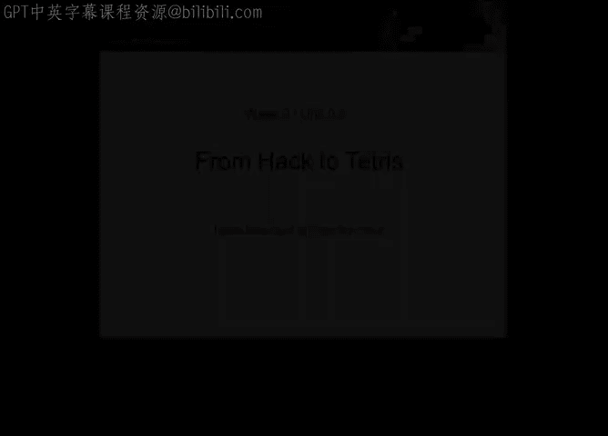
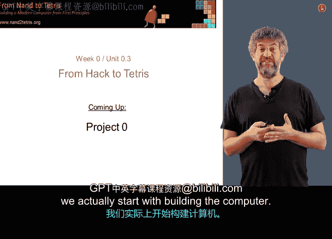

# 耶路撒冷希伯来大学《从零开始构建现代计算机｜Build a Modern Computer from First Principles》中英 - P4：04_01_05_单元-0-3-从Hack到俄罗斯方块.zh_en - GPT中英字幕课程资源 - BV1Zp421y7Ex

In the next unit， you heard about what we're going to do in this court in part one of the course。

 Now I'm going to very shortly tell you what still remains for the second part of the course for Nantoteris part 2 that is not currently offered。

Well， in the first part， in this course， you're going to start with very simple mandates。

 as you've heard， and you get all the way to a working computer system on which you can run any program。

 for example， Teris that gives this course a name。 So what remains。

 What are we going to do in the second part。Well， the question is really the kind of programming that one does on that computer。

In the computers that we're going to finish building in this course。

 you're also going to build a computer language that you can run on it。

 But it's a very low level assembly language。 If you look at the assembly language。

 it does not look nice。 It's certainly not what you start using in programming one on1 courses。

 It's a very low level language， very inconvenient。Most programmers。

 they really want to work with a high levell language， something like this。

 the example that is very typical of what you see in introduction to programming course。

 So the kind of things that you have in such highlevel language includes a rich language， loops。

 data types， methods， abstraction， many things that do not appear in the assembly language that is the end of this course。

 Also， there are very high many highlevel operation。 for example， mass operation。 for example。

 input and output operation that are primitive and are expected by any programmers that wants to write to print hello world and expect hello world to appear on the screen。

😊，And in fact， in the second part of the course where we deal with the software hierarchy。

 This is exactly what we're going to implement。 We're going to present a high levell language called Jack。

 And we're going to write a compiler to it for it using several layers of abstraction， of course。

 because that's a complicated thing building a compiler。 Similarlyly。

 we're going to build a standard library and， in fact。

 a mini operating system that gives you all the high-leve services that programmers expect。😊。

Once you have these two things， then you're basically say it a starting point of an introduction to programming course because you have a highle language that you can use normally。

 and now this hopefully closes all the gap between the very basics of how computers are built all the way to how the programming language and operating system and standard library that you expect to get as atroductory computer programmer。

As we said， part two of Nantte risk is not yet offered。 we plan to offer it in the future。

 but if you cannot wait， it's already ready in the website and in the coursebook。In the next unit。

 we just want to talk we will tell you a little bit about the first project or actually the zeroest project。

 we just wants to make sure that you're up to date， you found our website。

 you know how to submit exercises in Coursera and once we finished with that the next week we actually start with building the computer。

