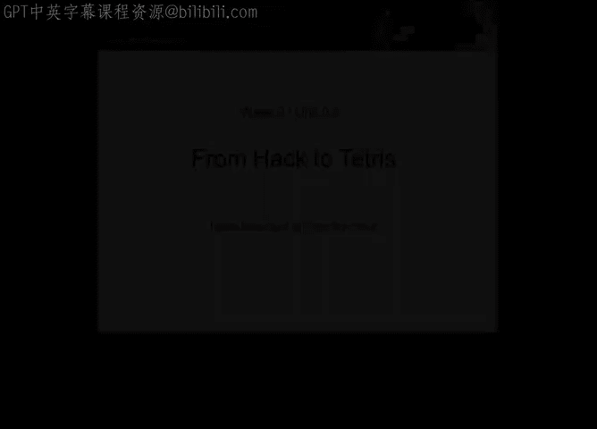
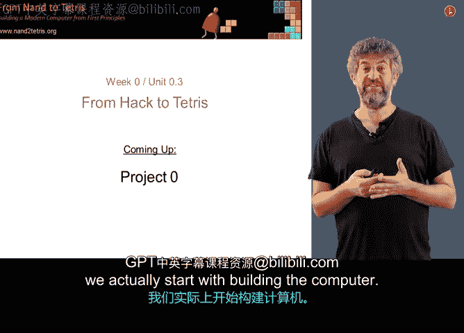

# 从零开始构建现代计算机：P4：04_01_05_单元-0-3-从Hack到俄罗斯方块 🎮



在本节课中，我们将了解本课程第一部分的最终目标，并展望第二部分（尚未正式开设）的宏伟蓝图。我们将看到如何从一个简单的逻辑门开始，最终构建出一台能够运行复杂程序（如俄罗斯方块）的完整计算机系统。

## 课程第一部分回顾 🧱

上一节我们介绍了课程的基本结构。现在，我们来具体看看第一部分的终点。

在课程的第一部分，你将从非常简单的逻辑门开始。正如你所听到的，你将最终构建出一个可以运行任何程序的、可工作的计算机系统。例如，本课程名称中的“俄罗斯方块”就可以在这台计算机上运行。

## 课程第二部分展望 🔮

那么，第一部分之后还剩下什么？我们将在第二部分做什么呢？

核心问题在于，在我们于本课程中构建完成的计算机上，人们会进行何种编程。在这台计算机上，你也会构建一种可以在其上运行的语言。但这是一种非常低级的汇编语言。如果你查看汇编语言，它看起来并不友好。它肯定不是你在一对一编程入门课程中开始使用的那种语言。它是一种非常低级、非常不方便的语言。

大多数程序员真正希望使用的是高级语言，就像下面这个例子。这是编程入门课程中非常典型的代码。

```java
// 一个典型的高级语言代码示例
class Main {
    function void main() {
        do Output.printString("Hello World");
        do Output.println();
        return;
    }
}
```

在这种高级语言中包含了许多特性：丰富的语言结构、循环、数据类型、方法、抽象等等。这些特性在本课程结束时介绍的汇编语言中并不存在。

此外，高级语言还包含许多高级操作。例如，数学运算、输入和输出操作。这些是基本的，也是任何想要编写程序（比如打印“Hello World”并期望它在屏幕上显示）的程序员所期望的。

## 软件层级的构建 🏗️

事实上，在课程的第二部分，也就是我们处理软件层级的部分，这正是我们要实现的内容。

我们将介绍一种名为 **Jack** 的高级语言。并且，我们将使用多层抽象为它编写一个编译器。当然，因为构建编译器是一件复杂的事情。同样地，我们还将构建一个标准库，事实上，是一个迷你操作系统，它提供程序员期望的所有高级服务。

一旦你拥有了这两样东西（高级语言和操作系统），那么你基本上就站在了编程入门课程的起点。因为你拥有了一个可以正常使用的高级语言。现在，这有望弥合从计算机构建的基础知识，到作为一名入门计算机程序员所期望获得的编程语言、操作系统和标准库之间的所有鸿沟。

## 关于第二部分课程 📚

如前所述，Nand to Tetris 的第二部分尚未正式开设。我们计划在未来提供。但如果你等不及，它已经在我们的网站和课程用书中准备就绪。

## 下一单元预告 🚀

在下一个单元，我们将简要介绍第一个项目，或者实际上是第零个项目。我们只是想确保你已经准备就绪，找到了我们的网站，并且知道如何在 Coursera 上提交练习。一旦我们完成这些，下周我们就将真正开始构建计算机。

---



**本节课总结**：本节课我们一起回顾了课程第一部分的终极目标——构建一台能运行“俄罗斯方块”的计算机，并展望了第二部分的核心内容：在硬件之上构建软件层级，包括 **Jack** 高级语言及其编译器、标准库和迷你操作系统，从而搭建起从硬件到现代软件开发的完整桥梁。