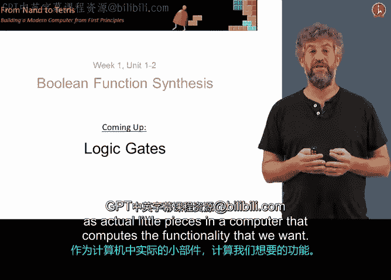

# 耶路撒冷希伯来大学《从零开始构建现代计算机｜Build a Modern Computer from First Principles》中英 - P6：06_02_03_单元-1-2-布尔函数综合.zh_en - GPT中英字幕课程资源 - BV1Zp421y7Ex

So in the last unit， we talked about what are Boolean functions， Boolean values， Boolean algebra。

 Boolean formulas。 What we want to do now is actually how talk about how we can construct Boolean functions from more primitive operations。

So we already still saw two ways to represent a Boolean function。

 a boolean expression and a truth table。 we also know how already know how to go from the expression to the truth table。

 you take the expression， evaluate it for each possible values of the input bits。

 get and then you can fill the truth table。😊，What we want to do now is exactly the opposite。

 You start with a description of a function， let's say given is a true stable。

 and our challenge is to come up with a formula that computes the same Boolean function。😊。

Why do we need to do that？ Well， that's exactly what we have to do when we go come to design a computer。

 We know what we want to do。 We know what we want a certain unit to do。

 But then we actually have to actually compose it from primitive gate， from primitive operations。

So let's see how we can do it。 So again， we continue with our abstract treatment。

 We're trying to see what is a basic， logical way we can actually construct such a boolean function from primitive operations。

 Later， once we actually talk about practically constructing them。

 we will be more practical oriented， we will go step by step and so on， At this point。

 we just want to make sure what are the principles。😊。

So let us start with a specification of a Boolean function， given as a through table。

 how can we construct it？Well， here's what I'm going to describe to is a standard way of what's called constructing a dejunctive normal form formula for it。

 and it goes like this。We actually go row by row in the truth table。

 We focus only at the rows that have a value of one。 For example。

 the first row here is the value of one。Now what we can do is we write an expression that basically gets a value of one only at this row。

 for example， so in particular， since here in this row， the values of x y and z are 0，0 and0。

 if we look at the expression， not x and not y and not z， that is going to be a Boolean function。

 the green Boolean function that only gets a value1 on this row。😊。

So now we have one boolean function。 We do the same thing。 We construct another boolean function。

 another clause for for each row that has a value of one。 So， for example。

 there is another second row with a value of one。 This time in here this row y equals to1 while x and z equal to0。

 So the clause we write here is not x and y and not z。 Again。

 this is something that completely gets the value of one only on this row and gets the value of0 everywhere else。

😊，We do that for every possible row that has a value of one。 Now the purple row。

Now we have a bunch of different functions。That each one of them gets a value of one only at its row and gets a value of 0 and all other rows。

But we desire a single function， a single expression that gets exactly the value 1。

 exactly on all of these rows and0 on the other rows。 How do we do that？ Well， that's very simple。

 We just or them together， And now we get a single expression。

 a single boolean function that gets value 1 exactly on the rows for which we build clauses for and get zero everywhere else。

😊，And now we've basically constructed our function as a boolean expression， only using ans。

 knots and ors。Now， of course， once we have this expression， we can start manipulating in very ways。

 This is one way to write the function as an expression。 But if you actually look at it。

 you can see that we can start changing start changing its format。 For example。

 if you look at the first two clauses， you can see that one of them is not x and not y and not z。

 while the other is not x and y and not Z。 notice that we have both possibilities for y and exactly the same fixed value for x。

 So instead of these two clauses， we can combine them into one clauses。

 which does not ask about y and only ask about not X and not z。😊。

So we get an equivalent expression that's slightly shorter。

 There are more manipulations that we can do。 Let's not go into them。

 but we can actually write the same expression in many different ways。

 Some of them will be shorter than others。 Some of them be might be more efficient in terms of when we actually go to implement in a computer。

 But the point is logically， they're all completely equivalent。😊，Now， you might wonder。

 how do you actually find the shortest or most efficient formula that's equivalent to the one we've just arrived。

 Well， that's not an easy problem in general。 It's not easy for humans。

 nor is there any algorithm that can do that efficiently。 In fact。

 this is an NP complete hard problem to actually find the shortest expression that's equivalent to a given one。

 or even to verify if the expression that you're given is just a constant zero or one。😊。

What's more interesting， What I really want to focus at this point is that we've really proved the really remarkable mathematical theorem that any Boolean function。

 it doesn't really matter on how many variables and what the Boolean function is。

 can be represented in an expression using only the operations and or and not。😊，Now。

 to notice how remarkable that is， just think about just think about bullet functions and integers。

 integer functions that you've learned in an elementary school。😊，Not every element。

 not every function on integer numbers can be presented using， let's say， additionalplication。

 In fact， most functions cannot be represented just by arithmetic operations。

 Yet because of the finite world that we live in in the Boolean algebra。

 every Boolean function can just be represented with and or the knots。

And that is exactly what gives us the basic power to actually construct computers only with these possible gates。

 only with these possible operations and or not。😊，But do we really need all of them。Well。

 here's a better theorem if you wish。We don't really need or gates。Just with and and knots。

 we can construct an boolean function。 How can we prove that？ Well。

 we already know that if we have ors， we can do everything。 We've just seen that。

 And now the only thing that we need to show is that we can actually compute an or with n the not gate。

 But we know how to do that already。 We remember we recall the Morgan formulas that exactly give us formula for or that only uses not and end gate。

😊，So now we have a really more remarkable theorems that we only need these two basic operations to actually compute every every boolean function。

 Can we go even less， Can we give up， let's say the end gate， Well。

 that doesn't make sense because not only takes one value to one value doesn't even allow us to combine anything。

😊，Can we give up the knot gate， Well， not really， because ans has this property that if you only feed at zeros。

 it will always have zero with output。And there are boolean functions that when you feed them 0 give you one is output。

 so and by itself wouldn't suffice。But it turns out that there is yet another operation that by itself does suffice to actually compute everything。

 So let we introduce the Nant function。 So the Nant function here is a true table。

 It gives0 only if both of its inputs are one and every other possibility it gives one。😊，Lologically。

 x N y is defined to be the negation of x and y。So what's so remarkable about this Boolean function。

Well， the nice thing is that we can prove the following theorem that if you only have Nand gates。

 you can already compute every Boolean function， you can already represent every Boolean function as an expression using just these N gates。

😊，How do we prove that， Well， we know that if you can do not and if you can do and you can do everything。

 So we just have to show how to do not with Nand gates and how to do and with Nand gates。

So here's how you do not。 If you just look what happens when you feed x to both inputs of the Nand gate。

 you plug it into the truth table in the previous slide。

 and you can see that not x is really represented by x Nand x。That's part one。

 The second part we need to show how do we do n。 Well， x and y turns out to be not of x n y。

 but how do we have not。 Well， weve just seen that you can do not with Nand itself。

 So now we've basically reduce effect instead of using knots and ends。 We're just using Nand gates。

 and we got our amazing theorem that just if you have a Nand gate， you can compute everything。

 And this is exactly what is going to be our approach when we actually go to build a computer。

 We will give you a basic， a primitive Nand gate operation。

 And you will basically build the whole computer， all the complicated logic that will actually ask you to build using just from these basic Nand operations。

😊，So at this point， we've just finished our abstract point of view about Boolean logic。

 and now we're doing a really interesting shift of perspective from the abstract logical operations to the actual gates and the actual gates from which we build computers。

 This switch really has no there's no actual difference between the two two different things in terms of the kind of things that we do。

 but it's just in the way that we're thinking about them until now。

 we ask you to think about everything as abstract Boolean logic。 from now。

 we're going to start asking you to think about everything as actual little pieces in a computer that computes the functionality that we want。

😊。

