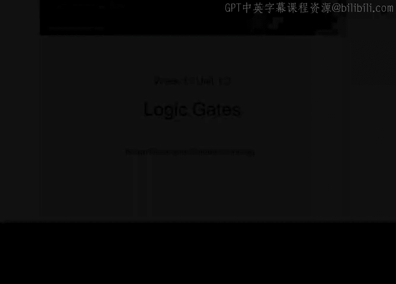
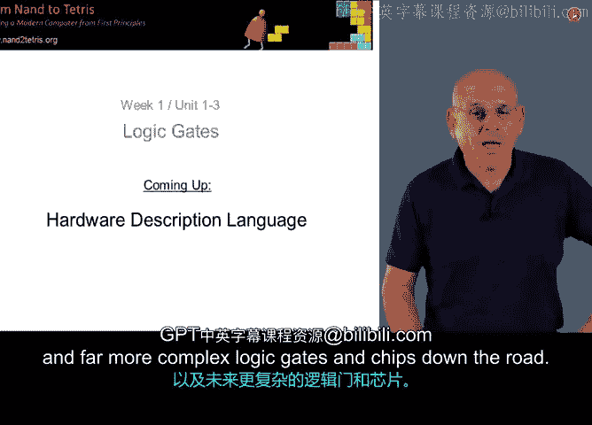

# 耶路撒冷希伯来大学《从零开始构建现代计算机｜Build a Modern Computer from First Principles》中英 - P7：07_02_04_单元-1-3-逻辑门.zh_en - GPT中英字幕课程资源 - BV1Zp421y7Ex

In the previous two units。 in this week， we talked about Boolean functions。

And most of this discussion has been theoretical。Starting with this unit。

 we are going to talk about how we actually implement these boolean functions using hardware。

 In particular， we're going to talk about a general technique called a gate logic， which， you know。

 loosely speaking。 It's a technique for implementing Boolean functions using logic gates。 Now。

 what is a logic gate。 Well， a logic gate is a standalone chip or you know。

 a very simple chip or an elementary chip， which is designed to deliver。A well defined functionality。

 you know， something like N functionality and functionality or and so on。

What is a composite logic gate， A composite logicgate is one which is made up from elementary logicgate and other composite logicgates。

 Or simply it's a more complex gate than the elementary ones and in this course we'll develop things like multiplexes and others and obviously most of you don't know what these terms mean。

 don't worry about it。 you will get acquainted with them and actually build them in the next few weeks in the course。

 All right， so let us begin with the most fundamental logic gates that we use in this course called Nand。

Here's the definition of an end。 you know this is actually the standard diagram that we use to describe an end gate。

 it has two inputs in a single output， everything here is binary。

 so A B and out are either0 and or one。Here is the functional description of this gate if both inputs are one。

 we output zero under any other circumstance we output one and here' is also a truth table description of the same functional specification any one of these descriptions is fine taken together what we have here is an obstruction of the end gate。

 we didn't say word about how this thing is actually working。

 we just describe what kind of functionality we can expect it to deliver。Okay moving forward。

 here are three classical gates that pop up in every digital design project。

 we have an end gate which outputs one when both its inputs are1 and0 elsewhere， we have an or gate。

 which outputs one， when either one of its inputs are one and zero elsewhere。

 and we have a not gate that operates as a converter。

And we can put these gates together to create more complex functionality。

 as well illustrate later on。In particular， we can use these gates to create composite ones。

 So for example， here's a three way end which is an extension， if you will。

 of of the simple two way end and one way to build it is to use this trick here we can take the output of one end and feed it into one of the inputs of another end gate and if we wire everything correctly this gate is supposed to deliver the required functionality。

 what we see in the dashed line rectangle around the implementation is a documentation of the interface of this chip So the user lives outside the dashed rectangle and so the user sees only the three inputs and the output as you see。

In the left hand side of the gate description， if you want to go in or to sort of open up the black box。

 you have to see what is documented and done inside the dashed rectangle。 So with that。

 I would like to say a few words about the notion of interface and implementation。

The gate interface is the gate abstractstruction。 You know。

 this is how the user thinks about what the gate is supposed to do。

Interface answers the question what at the same time。

 if you want to understand how the chip is doing， what it's doing， you have to go deeper and go in。

 Well， I'm not sure the deeper is the right word， but you have to go to another level of detail in which you actually the black box opens up and you see how the chip is actually constructed or you do it yourself。

 You know， if if your job is to be the person who is actually realizing this abstractstruction。那。

The interface of the gate is unique。 There's only one way to describe the gate functionality。

 Otherwise， you know， if theres more than one way， either you're not describing it well。

 or you're confusing the user because， you know， there should be only one unique way to describe what a gate is supposed to do。

 at the same time， there may be several different implementations that realize the same abstractstruction。

 And sign implementations may be， you know， more elegant， they may use less energy。

 they may be less or more expensive and so on。 So one abstractstruction。

Many different implementations。 This is very typical in in computer science。

 Whenever you build a large system， you have this， this duality。Alright， now， moving along。

 So we talked about the gate interface and the data implementation。

 Let's talk about something known as circuit implementations， if I want。

I can realize these gates using hardwired circuits like this one。

And there's a certain sort of graphical language here that describes what's going on。

 when we want to represent the fact that the gate outputs 1。

 we assume that a light bulb will be turned on。 and when the gate delivers output 0。

 the light bulb will be off。So if we look at this implementation of an end circuit。

We see that because of the architecture of this circuit。

 the light bulb will will be on only if the two relays， both relays are latched。

Under any other circumstance， the light bulb will go off。

 And that's that's exactly what I want to do when I represent the end logic。What about or logic Well。

 once again if I have to build a circuit circuit implementation of or。

 I can realize it using this particular architecture in here it takes only one latch to close the circuit and turn on the light bulb and once again this is consistent with the desired obstruction of an or circuit。

Moving along， here is a circuit implementation of a three way end。And you can easily， I think。

 convince yourself that it will deliver the， the required functionality。And yet。

 I want to remind you that earlier in this unit， we also presented this implementation of an end gate。

 if you recall， so I'd like to say a few words about these two different approaches to designing hardware。

And。I want to start by saying that， in this particular course。

We don't deal with physical implementations。 And therefore， this whole discussion of circuits。

 transistors， relays and so on， you know， all this stuff and what you see in the top left corner of the screen here。

 This is electrical engineering。 It's not computer science。

 And the people who build these gates using circuits and similar technologies。

 some of them are far more advanced and sophisticated。 Well。

 these people are called electrical engineers， God bless their souls， you know。

 we have enough problems in computer science to worry about。

 So we are not going to worry at all about physical implementations。

 and all the designs that we are going to use in our course are going to be similar to what we did here at the bottom right of the screen。

 We are going to take existing logic gates beginning with Nand and beginning with。And only。

 and we're going to piece them together in some clever ways in order to generate and produce the required functionality。

So this has been a unit in which we gave you a first brief introduction of Logates。

 and in the next unit we are going to introduce to you a language some sort of a programming language called HDL or how description language with which you can actually build logicgates like the ones you saw in this unit and far more complex logicgates and chips down the road。

