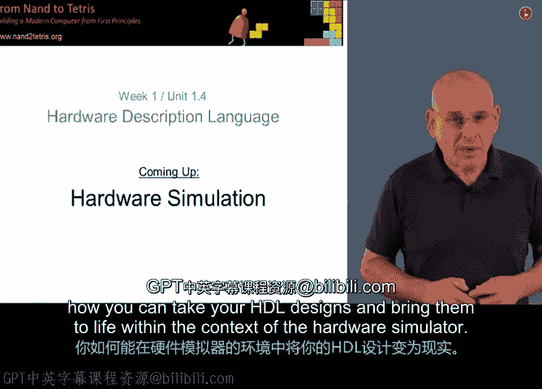

# 耶路撒冷希伯来大学《从零开始构建现代计算机｜Build a Modern Computer from First Principles》中英 - P8：08_02_05_单元-1-4-硬件描述语言.zh_en - GPT中英字幕课程资源 - BV1Zp421y7Ex

In previous units， we talked about how Boolean functions can be realized using logic gates and。

In this unit， we're going to talk about how we can actually build and implement the logicgates using a formalism called how descriptionscription language or HDL。

Once you build a logic gate in HDL， you can actually simulate it， test it。

 and finally build it in hardware as we now turn to describe。Alright。

 so let's begin this journey from obstruction to implementation。

The first thing that you have to do as a gate architect， is demand。

A full and complete description of the desired gate behavior。 And in this case。

 what we need is some sort of a truth table in the case of So it's a very simple truth table。

 And the truth table， along with a gate diagram， gives you everything that you need in order to understand what this chip is supposed to do。

And what we see here is also sometimes called the chips interface and indeed using this information。

 you can start writing an HDL file that will look something like this example here。

 so we start the HDL program or the HDL file with some documentation， free form。

 you know you can write whatever you want there which describes what the gate is supposed to do。

 and then we specify the name of the chip the names of the inputs of the chips and the names of the chips output。

And all this information， by the way， the name of the chip and the names of its its inputs and outputs is typically given to you。

 You know， it's not something that you decide。 It's something which is part of the chips contract。

 if you will。 So you simply write it up using the syntax。

 and then you write the magic word parts which describes that here begins the segment of your program in which you're going to describe how this chip。

Is actually designed。Now。When you use such a chip， such a saw chip。

 what we've seen so far is called the gate interface。

 and notice that this is everything I need in order to use Xor gate。 However。

 if I have to build this gate。 Well， that's a different story。

 now I have to open up the black box and actually design it。 So when we use chips。

 we always wear two different hats。 There's the hat of the programmer who uses the chip at the chip part。

 And for this， all we need to know is the chip interface。

 And there is the other hat of the chips builder， which is what we' are going to do now。

 So moving along， let's discuss how we actually build this chip from scratch。 Allright， so actually。

 we are not going to build it from scratch。 we can， if we。

 if we need if we need to we can build it from an end gates only。😊，However， let us assume that we。

 we've already built an end gate， an or gate， and a not gate。Well。

 if we built these gates or if someone gave us these gates that we can freely use。

 here is what we can do。 We can inspect the truth table。And figure out from the truth table。

That the Xor functionality can be described as follows。 I mean， look at the look at the truth table。

 The gate outputs one in two cases only if if A and not B or if B and not A。

 that is if A is true and B is false or if B is through and and A is false。 This sort of comes out。

 jumps out from the truth table， you can either see it on your own or is norm I'm described in one of the previous units。

 you can synthesize this this insight or this Boolean function from the table itself。

So once you come up with this insight， the next thing that you do is you think about it for a little while and you come up with a gate logic diagram that describes how we can build this boolean function using basic logic gates that we already have to our disposal。

Now， developing such diagrams is a matter of experience and the only way to gain this expertise is to see many many examples like like this one。

 So let's take this example and explain it in detail。

 So the first thing that we can do is draw the boundary of the chip diagram or the gate diagram。

So we use this dashed outline for this purpose， and。

What remains outside the boundary is the user's view of this gate。 In other way， the gate interface。

 all the users knows is that he or she has a gate that has two inputs A and B。

 an output called out and all together they somehow this chip as if by magic delivers the so functionality。

 So we draw this diagram and this interface and now we can delve more into into the inner architecture。

So notice how the a signal is being copied and sent simultaneously into two different destinations。

 One of them is the end gate and the other one is and not gate This is perfectly okay in a chip diagrams and we see that the B signal undergoes same the same treatment and in general when you write HDL code。

 you are allowed to take any signal and distribute as many copies as you want of this signal into as many destinations as you want this wiring or these dispatching is done simultaneously so to use a formal language HDL has unlimited thin out you can thin out any given signal to as many destinations as you want and we do it we always do it。

When we write HDL code。All right， moving along。Notice that we're using some off the shelf gates and not and or Now。

 whenever you use an off the shelf gate， you are bound to use the names of the gates input and output as advertised。

 so to speak。 In other words， when you take the gate off the shelf。

 the gate comes along with what can be called the gate signature or the gates API。

 So we have no degrees of freedom here。 We have to use the official names of the input and outputs of every one of our chip parts。

Now， the next thing that we do is let's focus on the red connections that we see here。

 These are the connections that we draw in order to connect the different chip partss together。 Now。

 the rule is that。Every one of these connections has to be named。

 and it's our responsibility to come up with a sensible name。 So that's what we do。

 we can call this particular connection， not A， which is a sensible name， I think。

 a selfdescriptive name， we'll do the same thing with a not B。 We can call this one A and not B。

 We can call this one， not B， not A and B。 and and that's it。 we。

 we have named all the internal connections in our architecture。

 and we can actually now move on to describe this diagram in HDL。

 So now we can actually move on and implement this diagram using HDL。

So we return to the HDL stub file that we had before。

 and I use the term stub file to describe a partial HDL implementation。

 so to speak that actually describes only the chips interface。

 and typically it comes with the statement implementation missing or put your code here and so on and so forth。

 So this is the contract that we actually have to implement。And now， indeed。

 we are going to focus on the implementation section of this file。 And basically， what we do。

Is we begin to describe the gate diagram one chip part at a time and for each one of the chip parts that we have。

 we write a single HDL statement that describes the chip along with all its connections So we have two we happen to have two not chip parts So we describe them the first not has n equals a。

 this is the input you know the in input of the chip receives the a signal and the out output of the chip goes into not a we do something similar with with the other not chip then we describe the two n chips and finally we describe the the or chip notice by the way that I use the words gate and chip interchangeably and that's perfectly okay。

A gate for me is simply a simple chip。Alright， So this HDL diagram。

Is nothing more than a textual description of the gate diagram。 Did I say HDl diagram。

 I mean the HDL file is a textual description of， of the gate diagram that we see at the top of the slide。

 Now， I'd like to to notice that once again， we have interface web implementation。

 And also note that the interface of the chip is unique。 You know。

 there's only one way to describe this chip。 And this is typically。

Given to us by whoever you know commissioned us to implement this chip at the same time。

 the implementation is not unique and the same interface can be implemented in typically in many。

 many different ways， for example， in the case ofR。

 we can implement Excel chip using three log gates only。So。

 and it doesn't really matter how exactly we do it。

 can you can think about it on your own if you want。 But in general。

 there may be different implementations， and some of them will be less expensive。

 They will contain less chip parts， less connections， Con less energy and so on and so forth。

 So the interface is unique， and the implementation varies。Now。

 I'd like to use this opportunity to make some general observations about， about HDL。

 And for ease of reference， I have。Placed in front of you what we saw earlier in this unit。

 the the gate diagram on the right hand hand side and its HD DL description on the left。 So what。

 what can we say about， about H DL， First of all， we see that。There are certain issues in HDL。

 which are very similar to what we normally do in other programming languages。

We have to worry about good documentation of our HDL program。

 just like we do when we write a program in Java or Python。

We have to come up with good descriptive names， both to the chips that we use and to the connections that we that we create within the architecture。

 So readability is terribly important。 You know， we have to make sure that HDL code is self descriptive and readable。

And in order to do it， we also use indentation， you know and make the code look real nice。

 So all these things are expected from you when you write your own HDL programs。In addition。

 there are certain things which are really unique to HDL。 First of all。

 HDL is a functional or declarative language。 There's no procedure going on。

 There's no program execution going on。 It is nothing more than a static description of the gate diagram。

At the same time， you know， we assume that at some point this descriptive code will go into some interpreter。

 you know， will go into in our case， into a hardware simulator that that can actually take this description and start to sort of pipe values from the bottom all the way to the end。

 so we assume that there is some agent that will turn this implementation into something that is actually working。

But this procedural part is not part of the HDL code。 You know， it's external to the HDL code。

 So because HDL is a functional language， we can actually write those HDL statements in any order that we wish。

 you know， it doesn't matter if you begin to describe either the node gate or the or gate。

It's completely up to you， but it is typically。It's a customary to begin to describe your diagram from left to right。

 and this also makes the code more readable。Also， note that each time we use an off the shelf gate。

 we commit ourselves to using the gate interface。 That is the names of the inputs and outputs that come along with the gate documentation。

Now， in the hec computer that we are going to build in this course。

We decided as a matter of convention to almost always use the letters A and B for a two input chip and out for a single output chip。

And therefore， we are going to have。Many chip connections that look like a equals a and out equals out。

Now， at the beginning， you know， this formalism， these conventions will look a little bit strange。

 You know， what does it mean a equals a out equals R？

If you think about it a little bit and if you go back to consult these diagrams。

 you will see that these connections make a lot of sense and actually they are very convenient from a programming perspective。

 you will realize that once you get your hands dirty and write some HDL code of your own。

So I'd like to end with some comments about how the description language is in general。

 there are many of them out there， and yet the two most popular HDLs that at least I know of are VHDL and very log。

These are the languages which are used， I think， in 90% of hardware design projects。

 but there are many other HDLs out there that can be used as well。

 our own HDL is very similar in its spirit to the industrial strength HDLs that I mentioned earlier。

 VHDL and very log and yet it is a very minimal and simple version of these HDLs。

 and for this reason， you can master it in something like one hour of reading a tutorial and beginning to write some HDL code of your own。

 and most importantly， our HDL along with our hardware as simulator gives you everything that you need in order to build the computer described in this course。

 and actually any other computer that you may want to build using the knowledge that you will gain in the Nantterisco。

Yes。So。If you want to read more about HDL and you should take a look at appendix A in the textbook and also read the HDL survival guide in our Ntetri's website。

 both are actually available in the website。And you may want to also take the hardware simulator tutorial and learn how to actually read HDL descriptions and execute the underlying logic of these HDL using sim。

 so this has been the unit in which we gave you a primer of HDL and in the next unit well describe once again how you can take your HDL designs and bring them to life within the context of the hardware simulator。

