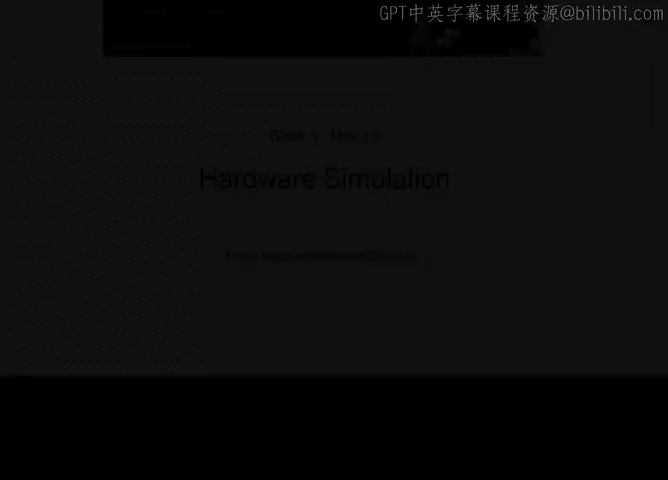
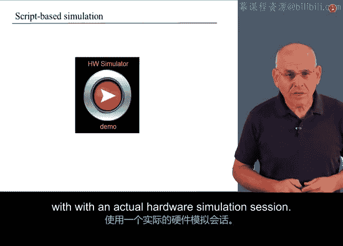
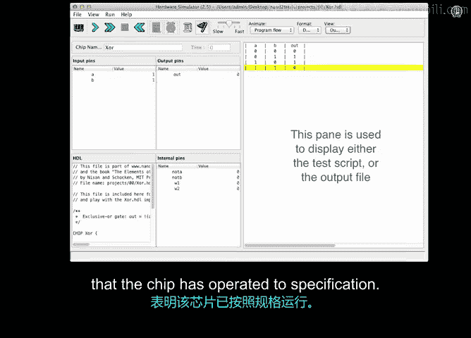
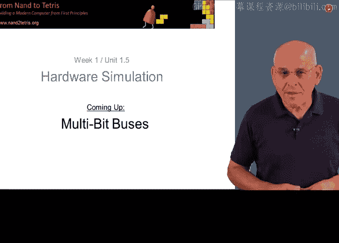

# 耶路撒冷希伯来大学《从零开始构建现代计算机｜Build a Modern Computer from First Principles》中英 - P9：09_02_06_单元-1-5-硬件仿真.zh_en - GPT中英字幕课程资源 - BV1Zp421y7Ex

In the previous unit， we learned how to implement a gate logic using HDL。However。

 nothing in what we did guarantees that the HDL code that we wrote is actually correct。

We have no idea if this architecture that we put together delivers the intended results of the chip that we seek to design。

So in this unit we will close this gap and we will learn how we can take an HDL program and verify to the best of our ability that the program or the HDL file delivers the intended functionality of the underlying chip。

Now， here is the big picture of what were going to do。

Given that we have a particular HDL file and we want to test it。

 we can load it into a special program called hardware simulator。

 we have written such program and made it available to you in our website this program happens to be written in Java in this program is designed to simulate and test HDL files。

 so we load it into this program we interactively test all sorts of operations on this chip and we call this mode of testing interactive simulation alternative we can write another file and using a special language that we designed which we call testing language。

Something that you can learn in a few minutes。 We can put together a set of replicable tests that are predetermined。

So we don't have to do things interactively， we can think ahead of how we can systematically test the underlying chip。

 we write it in what is called a test script， and then we load into the simulator two separate files。

 we load the HDL code， we load the test script， and then we send the simulator to work the simulator goes through every step in the test script and subjects the HDL code to the specified tests in this supplied script。

We call this mode of operation script based simulation。And finally， if we want。

 we can record the output of the simulation on something called an output file。

 and we can even compare the results of the simulation to a desired output which is stored in yet another file called Compare file。

So as you see， there are many new concepts and techniques involved in this practice of hardware stimulation。

And the purpose of this unit is to make all this new information concrete by walking you through a step by step process of testing a working example that will accompany us throughout this unit。

Now， throughout this unit， we are going to present several software tools。

 actually just one software tool， the hardware simulator。

 and you are more than welcome to stop the video， invoke this hardware simulator on your own computer and make sure that what we do can be done also on your machine。

You can do all this if you have downloaded the software suite at the beginning of the course and if so the harderest simulator should be available on your computer and everything that we do in the lecture can be done by you as well。

 so we encourage you to kick tires as much as you please。

So let's go on and start with some concrete examples。

So heres the example that I'm going to use throughout this unit It's an HDL file describing the SR chip that we talked about in the previous unit。

 so the code itself should be familiar to you even though it's not terribly important for understanding this particular unit All right so once again the fact that we wrote this very nice piece of code does not imply in any way that the code is actually correct in fact most likely it contains some errors。

 either syntax errors or logical errors or whatnot so how do we test it well here's what we can do。

We can invoke the hardware simulator， the program starts running。

 We can load the HDL file into this simulator and we can then enter zeros and ones into the A and B inputs and observe what is going on inside the chip Now how do we observe what is going on well。

 we have to tell the simulator to evaluate the chips logic。

 the simulator will not do anything until we we tell it to actually consider the new inputs that we entered and evaluate the chips logic and if we do this the simulator will take these values。

 these zeros and ones or whatever we entered and well kind of pipe them through the architecture and at some point something will come out from the from the output pin of the chip so at that point we can inspect what actually。

Materialized so we can observe the outputs of the chip in this particular case。

 the value of the outputpin， and if we want we can also inspect the values of the internal pins。

 pins like not B， not a and so on。And the simulator gives us all these all these nice capabilities。

 In particular， here's an example or a screenshot of the hard hardware simulator in action。

 And the simulator contains or features， several different panes。

 So let's talk about each one of these pain in isolation。 first of all。😊。

At the bottom left of the screen， we see the HDL code that we have loaded into the simulator。

 This is a static view。 We cannot manipulate or edit this code if we want to edit anything。

 we have to use an external text editor， change the HDL code and reload it。

 So this paine just you gives us an idea of is what is it exactly that we load it into the simulator。

Here we can actually interact with the input pins of the simulator。

 we can click them and change the values， we have four different possibilities of zeros and ones in this particular example。

 this is a very simple chip。😊，And once we do this， we can click this icon。

 which looks like a calculator and once we click it。

 we basically tell the simulator to evaluate the chips logic on the supplied inputs at this point。

 the simulator will spin its wheels。 it will take a fraction of a second and something will come out we can then evaluate the output of the chip in this particular case。

 we have only one output called out and once again， if we want。

 we can also inspect the current values of the internal pins。 So altogether。

 this guui gives us everything that we need in order to carry out sort of hands-on interactive simulation of exor chip or any other chip for this matter。

😊，All right， moving along， I would like now to give you actually a hands on example of the hardware simulator in action。

 so let's do that and then go back to the lecture。This is the hardware simulator。

And in order to use it， we have to first of all， load an HDL program into the simulator。

And we do it by clicking this icon here。 So let us do it。

And we see that we are in the Nant totetriris folder。 So within this folder。

 we're going to select projects。And within projects， we'll select Project 0。

And we see that we have a single HDL file here， so let us select it。

 This is a SOR file that we discussed before。🤧And we loaded the chip into the simulator。Now。

 the pain at the bottom left right here。Gives me a display of the file that I just loaded。

 I can scroll back and forth。 It's not separate。 It's not。Terribly useful。

 but this pane is actually just a read only display there's no way to actually change the code when you are inside the simulator。

 if you want to change the code， you have to do it using an external text editor。

 and then you have to reload of course， the file that you changed and saved elsewhere。

So let us assume that we are happy with this file and I want to actually simulate the chip logic。

 Well I do this by first of all， looking at the current input values and we see that the default values of the A and B inputs of the X chip。

happened to be zero。 so if they want， they can go ahead and change one of them or both of them to some other values。

 so let us change a to1。And let us change also B1。And， and notice that。

Nothing yet happened in order to see how the chip responds to these changes。

 I have to realuate the chip logic and I do it by clicking this icon here， the calculator icon。

 so let us do it and we see that once we click this icon，The output becomes0。And indeed。

 so of one and one is 0。 If we want to see some other possibilities， we can。Once again。

 manipulate one of the input pans， click the calculator and we see that theor now emits one instead of  zero。

Another thing that we can do is inspect the values of the internal pins。

 which gives us yet another level of scrutiny in particular when we try to debug the chip and understand why it is misbehaving for some reason。

So this has been a very brief description of the first thing that you do when you use the simulator。

 you load the chip， you play with the input pins， you inspect the outputs and the internal pins。

 and this is the ABC of chip debugging and testing。

I wish to remind you in closing that if you want to change the chip logic。

 you have to edit the HDL file using some external text editor， save the new file。

 reload it into the simulator and rerun the tests in order to test the new chip design。Now。

 interactive simulation is very nice indeed， but at some point it can become rather tedious。

 especially if you have you know lots of bugs in your design and each time you have to go through the same set of tests and so on and so forth。

 So with that in mind， we are fortunate that we also have the notion of a test script available to us。

So here once again is the tested chip， and by the way。

 I allow myself to use the words chip and gate interchangeably， for me。

 a gate is simply a simple chip。So this is the tested chip。

 And here's an example of a test script designed to test exorgate。Now。

 let us go through the test script kind of line by line。

The first command in the test script instruct the simulator to load the S HDL file into the program。

 So even this step is is taken care of。 We don't have to do it ourselves。

 The test script will will load the program for us。 By the way， this is terribly important。

 if you do repetitive debugging because how do you debug gate。

 you use an external text editor you know， to change the gate， and then you click save。

And you go back to the simulator， So it's important to remember to reload the new version of the edited chip。

 So that's why we added this commander to the test script。 Now。

 once the test once the HDDL is loaded into the simulator。

 the test script begins a process of subjecting the chip to to four different tests。

The semico represents the ending of one particular test， if you will。

We set the input values of the chip to 0 and 0。 We evaluate the chip logic， and。Observe the results。

 And then we go through the next test and and so on and so forth until we complete all the possible all。

 all the input possibilities for this particular chip。

So this is how we carry out script based script based testing。 and it has many benefits。

 And far and foremost， is the fact that we don't have to do anything laboriously， you know。

 using our own sort of。Intuition， because everything is predetermined。

 We have a set of replicable tests， and we just use the same tests over and over whenever we we debug the chip。

 which can be， you know， two weeks or two months from now。

 So it's good to know that we can always repeat the same set of tests。So altogether。

 we will try to always use a test script and the good news is that you don't really have to worry about how to write test scripts because we are going to supply to you all the test scripts that you need in order to test the chips that you are going to design in HDL。

 so you worry about the HDL and we are going to worry about the testing of your work。

Another thing that we can do is keep track of the outputs of the simulation。 So in particular。

 we can augment our basic test scripts with something like the following commands we can at the beginning of the of the test when we initialize things。

 We can instruct the simulator to create an output file which in this example。

 we happen to callor dota out。And as we go through through the testing， at the end of each test。

 we tell the simulator to output to the output file。 a set of values。

 which is determined in the preamble of the script。

 So as you see the third line of the script says the output list is a， B and out。

 and so whenever the simulator will see the directive output， it will write to the output file。

 the current values of a B and out。 And at the end of the sim。

 we can simply inspect the result of the output file and convince ourselves that the chip has actually behaved according to expectations。

 In fact， in this particular example， if you will inspect the output file that emerge from the simulation。

 you will notice that it is completely identical to the truth table。Of Xor gate。

 So it looks like the gate is well behaving。So here's a snapshot of the harder simulation in action using a test script and once again we have the HDL code as we did before at the bottom left of the screen。

 but we now have something new， we have a test script which can be seen on the right pane which is some sort of a multipurpose GuUI area。

 which we use for for different purposes。And after we load the script。

 we can instruct the simulator to actually execute the script。

 we do it by clicking this control and the sulator the simulator goes to work and at the end if we want。

 we can inspect the resulting output file。And here is also a demo of of the same thing with with an actual hardware simulation session。

We will now show how to use the hardware simulator in order to test an HDL program using a test script。

So the first thing that we can do is load。The HDL program into the simulator。

 So let us choose the same so HDL chip that we used before。

And then instead of playing with the input pins interactively。

 we can use this icon here to open a test script and we see that in the project zero folder we have one test script called theor dot TSD So let us load it into the simulator environment once we do it this pane in the interface shows us the contents of the currently loaded test script and we see that it begins with a few command and then following that we see the actual testing commands and the first command or the next command to be executed is highlighted by a yellow bar we can call it the cursor of the test script。

Now， we see that each command ends either with a comma or with a semi column。

And when we click the play icon。The simulator is going to execute all the testing commands until the next semicolon is encountered。

Now the first four commands in this test script set up the simulation， so to speak。

 and so let us let us execute them， so I click this icon here and we see that the cursor moved to the next batch of commands。

And this batch says set a to0， set B to0。 These are the input pins of this particular chip and then evaluate the chip logic and output the result into the output file。

 So let us execute this batch of commands。 and。We see that indeed the A and B inputs are now0 and the out of the chip happens to be0。

 which seems to be right because as we know so of0 and 0 should be 0。

So let us execute the next batch of test script commands， this batch sets a to0 and b to1。

 evaluates the chips and outputs the result， and indeed we see that score of0 and1 ended up being one。

 which seems to be correct。So executing the next batch of commands sets a to0。 I'm sorry。

 sets a to 1 and B to 0， giving the result one， which also seems to be correct。And then moving along。

 we execute the next and final batch of commands， which set both A and B to1。

 and we see that theO responds by emitting the value 0， which once again seems to be correct。Now。

 the test script for exaggate is relatively simple because basically。

 it simply executes every possible。Input combination as stated by the chip truth table。

In more complex shapes， such an exhaustive testing is less feasible。

 and therefore the testing scripts will likely be more complex。Now as we tested this script。

 the script has also written the results of every test script batch into the output file。

 this is the result of saying output in I'm sorry， this is the result of the output command。

Now if you want to inspect the output file， we can do so by going to this control here and selecting output。

 so let's do that and once we do it we see that the output file indeed looks exactly like the truth table of SR and this gives us yet another indication that the chip has operated to specification。

Before we go on with this step by step working example。

 I would like to stop for a minute or two and say some general things about the general concept of hardware simulators。

 So， first of all， there are many of them。 Some of them are free and open source。

 Other are proprietary and very sophisticated and and very expensive。And in this course。

 we use a simple how simulator， which at the same time gives you everything that you need in order to build the he computer and any other computer that you want to build using the techniques described in the course。

 so the supplied how simulator which you have on your computer now is a tool that once again gives you everything you need。

 and if you want to learn how to use it there are several places to consult with available documentation if you go to the Nanttotetriris do or website you can find。

AFu chapter， I think it's appendix A and actually Appendix A and appendix B in our book describe how to use the hardest simulator and these chapters are also available freely on the website and another thing that you should do is go through the hardest simulator tutorial which is a stack interactive slides that explain how to use the simulator as well as all the examples that you saw in this particular lecture。

 so that's the end of the commercial break about hard simulators and we return to our ongoing example。

So let us revisit what we have done so far， we looked at a particular HDL file which records the logic of QR。

 we have supplied the simulator with a test script designed to test this particular code and we also looked at the resulting output file and convinced ourselves that the HDL file is actually correct。

Now。This privilege of looking at an output file and saying， yeah。

 it works is something which is rarely available in real life testing。 Why。

 Because the chips that we normally build are far more complex than exorgate。

 And there is no way to look at an output file of， let's say。

 an A U or a CPU chip or something like that and say， yeah， it works correctly。 You know，s we。

 we have to do it in a far more systematic and planned way。 So is there a way to do it。 Well。

 you bet， And thats， that's what we are going to do next。In particular。

 we can carry out the simulation with yet another tool which is called a compare file。

 So here's an example of a compare file。 It looks exactly like an output file。 and in fact。

 in its previous incarnation。 the compare file was an output file of a wellbehaving saw chip。

 So someone and we'll talk about this someone momentarily。

 someone has written an sort chip correctly， ran it through the simulator， generated an output file。

 renamed it compare file and gave it to us and said now you go and build the or chip and compare it to what I did。

 So basically we can take the compare file and load it into the simulator and then start to do the simulator as the s as we did before。

 And now in each step of the simulation。 When we output a set of selected pin values。

 the simulator will compare the output set of values。alTo the respective line in the compare file。

 And if the two lines will not agree with each other， the simulator will throw a comparison error。

 So this gives us the ability to not only record the outputs of the chip。

 but also compare them to desired results。So。You probably ask yourself， once again。

 how do we generate these compare files to begin with right Well， we could have left it as a mystery。

 but there's no need to leave anything unexplained。 So here's how we do it。

 We do it using something called behavioral simulation。In particular。

 consider this surgate that we saw before and let us assume once again that this implementation is correct。

And。We put it into the simulator， along with the script。 We run it， We generate results。

 and then we simply rename it to be a so C， and it becomes the official compare file of this ship。

 So what is special about this slide， didn't， didn't we say everything that we said here before。

 Well， we did， But there's one detail， which is， which is remarkably interesting in this。

In this notion of behavioral simulation and and the thing which is interesting is that the chip logic can be implemented in any way that the designer wishes so we can write this chip logic in Java or some other highle language。

 We can run the program， we can generate an output file and then once again supply it as a compare file。

So this technique of。Writing gate logic， using or implementing gate logic。

 using a high level language gives you the ability to plan。

And test your hardware before you even write a single line of HDL code。Which is， you know。

 quite a sophisticated way to do things。 so know we can do everything in high level and only once the overall design of our machine works properly。

 we can begin to implement each chip at a time in HDL。All right。

 so this has been the notion of behavioral simulation。

 and I want to go on and talk about how we actually carry out hardware construction projects。

 So the cast of characters in any hardware construction project consists of several players of which I would like to talk about two。

 First we have the system architect。 Now the system architect is the person who is told you know go build a chip that supports a certain function of a digital camera or something like that or go build a chip that monitors a certain medical device。

So the architect has the exact sort of user level specifications of the chip。And。

And the other member in the team is a developer or you know。

 more than one developer or more than one architect。 And together they have to design this chip。

 So how do they do it。Well， the system architect looks at the overall desired operation of the chip and then he or she makes some decisions about how to break this overall behavior into a set of smaller chips if you will or sort of lower level chips。

 and then for each one of these chips， the architect， the architect creates a chip API。

 which consists of the name of the chip， the names of its input and output pins， a test script。

 and a compare file， you know all these things are prepared by the system architect to you know may or may not have some people to help him or hair in his work。

And finally， given these resources， the developers can actually go out and build the chip。😊。

So the architecture can do behavioral simulation。 they can do whatever they want in order to test that everything fits together nicely。

 And at some point， the developers actually build this thing using HDDO。So once again。

 that's an example of a well planned modular design and yet another example of divide and concare。

 you know， taking something very complicated and breaking it into more a set of more manageable。

 smaller modules， each of which can be created and tested in isolation。So， for example。

 the hec computer， I could have told you something like go build a computer。

 and actually that's what we do in this course， but we split this job into the construction of something like 30 30 different chips that together comprise the heck chipset。

So we Nor and I， the course instructors， we play the role of the system architects。

 and you guys are playing the roles of the actual hardware developers。Alright。

 so the developers view。Your view of a particular chip。 You know， when we tell you to build a chip。

 here's what you get。 You're going to get。A stub file that contains the documentation of the chip that you have to build。

 along with its interface。 You're also going to get a test script that we have written for you。

 You're going to get a compare file。And then。You know taken together。

 what you basically got is everything that you need in order to number one， understand the interface。

 understand what the chip is supposed to do。 The compare file and we also tell you how we are going to test it。

 All right， so what do you do with all these resources。 Well。

 what you have to do is write the missing implementation。

 the missing implementation is the HDL code that should actually drive this entire show。

So that's exactly what we're going to do in unit 1。7， but before we go on to this unit。

 we also have to say a few things about multi bit buses。

 which is a gap that we still have to close in the general description of HDL programming。

