# 【冰岛大学】云计算与大数据-｜-2025-Cloud-Computing-And-Big-Data-Course-p01-P01_讲座_0_序言_第一部分--BV14MB4BjEyZ_p1-

All right， yeah， welcome back to cloud computing and big data。

 we have our prologue lecture zero today， so sort of an informal lecture clarifying course content。

 clarifying lots of question answers that you know always be part of one of the initial parts of the course。

My name is Morris， I am around 20 years or more in cloud computing， high performance computing。

 big data， machine learning， deep learning， lots of these passwords we will materialize in the course and also make a connections of all of them。

 which of course these course entails。You see also quite a lot of logos there because I'm a heavily researcher and funded by many research projects and you know teaching here and there is of course an autogonal activity。

 we come to these logos all over the time， maybe not necessarily all of them today。

 but we will see how they play a role in the course content as well a lot。

 and also when we come to our industry project， something that you already have hopefully explored in some of the last basically course hours last week for warmup。

 looked at the web pages looked on the products they offer and so on。

So let's see a little bit about the structure of the course。

 So this is something which is similar like the 2024 course。

 So I hope all of you have looked at this， who has looked at the YouTube。Hopefully。

 all of you have used the course hours good so the course content will be very similar structured。

 but you can imagine elements like machine learning， deep learning。

 large language models evolve extremely fast right so there will be lots of updates auto to goal through all of these lectures。

 couple of slides will always change。 However， the whole idea of the course。

 The whole point of the course is very similar。You see there that we start basically with a cloud computing introduction。

 what is big data， what is cloud computing， you see also the different color coding。

 the blue where's the green， this has something to do with assignments and more practical topics so the green ones are usually somehow related to assignments or the industry project and I come to that also later in the lectures。

But we start with a very interesting small machine learning introduction， which is， let's say。

 something which you don't need any prerequisites for， right。

 so I've seen the hands where not so many used machine learning before。

 we will start with a very simple introduction into this and then we'll use in clouds already。

 let's say very simple learning models in this。The idea of putting this in the course is that it has a tremendous impact these days in computing in cloud computing。

 as well as high performance computing， which is my second field。

 basically that I also teach here at the university， and it's very important to talk about。Sona。

 could you mute， please。 Thank you。あチけかとフールコのラと要民。Oh， sorry for that。

So coming back to the structure of the course。We basically then have a very crash course in machine learning if you really want to know more about machine learning should have a proper course in machine learning。

 I mean Stanin and Haft and others here teach us as well。

 but we have that really practically applied we come then quickly back to virtualization and scalable data center design where you have some conceptual aspects how let's say cloud computing is really working and this stands largely for you know very。

 very large warehouselike buildings where lots of computing res are standing that you can easily manage and can easily access via your web browser right so this is the idea of cloud computing but how that works is virtualization how you make that scalable for so many people that are all use Facebook or whatever who is using Facebook or should I ask who is not using Facebook。

So I mean almost everyone is on social media these days， right？

This is fueled by cloud computing and we will talk about why virtualization is a necessary ingredient to this。

We then continue deep learning that is by far now the most let's say use of our highperform computing centers at fuel cloud computing data centers。

 so hence it's important to talk about this but also here you don't need to know the deep down math like in other courses when you start with machine learning deep learning you have lots of machine learning theory。

 statistical learning theory first we will do this here more practically applied in the course so don't worry and you have seen it maybe one or the other also in the YouTube recording we quickly hence come to some applications which also then gives me the opportunity to introduce a new lecture in the course the large language models as I was asking you already in the beginning here at the W up I guess every one of you on nearly everyone that let's say have used chattGT has already used one right so these chattGT and others Mial these are really onvoke and it's not the only story we have generative AI so it's not only about language text and so on it can generate image video but also。

Audre and so on and we will have a full lecture on it。

 but connecting it why cloud computing is necessary for it right without cloud computing。

 LLMs would not exist， So this is an necessary ingredient and V GPUs play all a big role in it things we teach more in the HPC course to the detail here we keep it as a small introduction in the cloud computing course。

We then come to something we call a classic paradigm shift， which stands for something like map Red。

 I don't know if someone have heard mapre before， mapre。 Okay， some of you， Apache Spark。

The chance Spark is sort of the next evolution of Hadoop and Spk we will talk about this and in connecting the docs why it's different to high performance computing and lots of GPUs at scale that we need for large language model training and why this is related to high throughput computing right so in this mapreduce we are much more interested in throughput of data then let's say really number crunching and we will make the point for it when we come to lecture8。

However， there are three， let's say， paradigms in cloud computing that you should all know。Hence。

 after lots of practical steps here in the beginning of the course that which you know basically connects us nicely to the industry project I will talk about because there are the idea to use some deep learning in clouds and to you。

 You know， your elements you learn also with some of the companies we will learn on Thursday， right。

 on Thursday， I can already talk to you here。 will be not a lecture again。

 There will be two companies Inoverver， We have two convert。Two SMEs coming here， talking to you。

 presenting their ideas and so on， so this greenfish and。O green end。

And get that yeah okay so we have several ones already prepared for you and us so basically this will be a stepwise process。

 but I encourage you also to really start this industry project early。

 hence we took also many of these that say more practical topics early you see the green instead of just you know starting with infrastructure as a service platform as a service software as a service conceptual aspects and then teaching you the basics the idea to use the course project not three days before the end of the course so our experience is a little bit from the last years that students start very late with it and then come in really time pressure Christmas problems and so on hence we start here the industry project early and we start on Thursday and all of you have hopefully already let's say explore a little bit the websites right on the industry project it's 50% of the course hence very important and you know that's why we have also no exam and originally students were asking for a project so we turn the exam into a project based on exempt。

Your student feedback。However， these three conceptual topics are really necessary。

 you need to go out of a cloud computing to know what the AAS stands for today you see an inflation of terms you have database as a service。

 you have everything as a service， we talk about this in these lectures。

Then connecting the dots a bit maybe with mapre and then Apache Spar again。

 big data analytics is a term， I don't know if you heard it， it's a bit different than analysis。

It's a term where we the technology matters a lot and data mining。

 where we will have a couple of applications which are more recommended， you know engines。

 but also something which is related to shopping baskets analysis just to make the case of scalability。

And basically， also， where you can use cloud computing again with big data。

Then when we let's say shift the view a little bit to more advanced topics in cloud computing towards the end of the course there are two more practical ones Docker container management and I've heard Kubernetes Docker okay says to a few this includes obtainer which is another container technology we talk about much more in hyperper computing use but let's say can be complementary use with Docker files and so on so this is how you manage read the cloud computing environment。

 if you are basically more or less in charge or want to use some ready to run applications we call basically containerized applications and that's what we will do in lecture 13 lecture 14 then picks on one important part of machine learning called hyperpyid optimization or to ML so very advanced technique has someone used that。

Not really。Okay， set is also a bit you know important to have in this course because it needs heavily computing。

But every machine learner needs it basically。 So the key is that you have these hyperparmeter and machine learning。

 we will talk about this， you know， the learning rate and lots of parameters that you pick。

 but not systematically。 And when we do this with cloud computing and highperform computing across thousand GPUs。

 we can do this systematically。 hence we tune these parameters and opt bio fashionion and get much more accuracy out of the machine learning models and less error from these machine learning models in most of the cases。

 not in all。 but that's why it's also part of this course that needs heavily computing。

 it's really related to also some of the cutting edge Amazon you know web services that you have there and other topics we will talk about with autogloom。

Then OpensStack cloud operating system is again a little bit a change of the view that is something like when your boss will ask you。

 can you cloud， you know， can you provide a cloud in house？

So you basically started as a software engineer somewhere。

And then Nebosk knocks on the door and said， I want an internal cloud， right， there's a public cloud。

 a private cloud， a hybrid cloud all terms we will have in the introduction。

And there the OpenSt cloud operating system gives you the LeO pieces。

 the building blocks to build an in house cloud。RightAnd this is something where I don't have to reinvent and redevelop the wheel。

 This has been already developed， is open source and available。

 And you see that many cloud offerings are based on Openstack， not the whole set。

 They pick the Lego pieces as they want in order to make that happening。

And the AP look is really just we look at together at job descriptions to see that the content of the course really matters for you in job applications and jobs around cloud computing so that you see that the course really has now the right content。

Here and there， there will be additional practical lectures。 You will see also。

 basically in the YouTube course， you know， we had last year， there's also 3。

1 is a practical lecture on Azure or something like this。 So this will， of course， continue。

 including also invited lectures from my PhD students。

 from my collaborators and maybe even from industry。Right。

 so having said this and we will have the second part of the course as a flight plan of today to go into each of these lectures in a bit more depth right I gave you an overview glance now in the first part of the lecture and you know just let you know rid bit what's coming and lets us come a little bit to the course motivation and in the second half of the course I will take lecture by lecture and see then you know how we do some details in this。

So the motivation of the course。Is obviously a key that you see also represented in the logo big data。

 So big data is a term fueld， you know since a long time now with any different vs。

 they call it volume， veracity， variety etc etc。 but the more big data is available。

 the more we can do with machine learning with analysis of data also in cloud computing and at high performance computing and it stands not on itself。

 it has a large infrastructure around it。 And this is what we build up in the course material that you see around it also in this diagram。

 you cannot just throw machine learning on the big pile of data and then get something out。

 you need the computing。 you need the tool sets， you need a lot of let's say expertise and skill sets。

 However， all of this cutting edge material is part of the course that at least gets you right away started when you start with industry。

 and this includes really the right facet not to be tool theoretical on the one hand。

 but also having， let's say。A bit of practical impacts in really commercial cloud providers。

 as I said in the beginning， we look at Google， Amazon Web Services and also MSs Asia。

 these are the three， let's say， major cloud providers that you have around。

 but also of course there are a lot of them in the academic field or very specialized one that we will also look at。

There's also one element again where we have one lecture。

 but it will be stretching here and there again to others is the idea of large language models again。

 what we will do with this as a very attractive new topic。Having done this。

 the learning outcomes is hopefully that you understand something about parallel processing。

And this is by far something which is underlying the cloud computing per set because many people at once will use a computer at the same time right we don't we use the laptop as a web server with a website but the services that you have in a cloud are used by many。

 many users in parallel at the same time hence the whole course will leverage distributed computing parallel processing but it's abstracting from it so when you basically have the HPC course we do this much more low level we program distribute computing and so on in cloud computing。

 we take this a 10，000 feet perspective and have basically the web browser as an interface however。

 you will understand that underneath really from these cloud service offerings there's a lot of computing a lot of data happening and with this also let's say many automatic approaches that we will reveal in the course and cutting edge technologies like GPus who have heard from GPUus。

Or gaming。We have heard from GPPUs for science and Cloud and machine learning。Good， okay。

 it actually converged and we will learn this a lecture one。quiteite nicely these days。

 although there are different types of GPU still， but we will see how that materializes in the later topic of the course。

Oops， so just let you know a little bit about me with the let's say。

 Ho to stand in front of you and perhaps also the right。I do these topics since 20 years。

 I have a PhD in this topic from the Culture Institute of Technology in Germany。

And I'm around 20 years in the Yuli supercomputing Center。

 this will appear again and again it' a big large research center in Germany。

 but I'm also 10 years professor here and we have a joint collaboration and Woodll partnership。

Because we are basically just a national lab， but not a university。

 so we team up as many universities internationally。

And we have also the largest and biggest European supercomputer right Upiter which will be now basically opened in two weeks and around it is something we call a Upiter AI factory which is almost like a cloud right in the academic sense。

 however， based on these activities I did lots of research projects in the past some people may have familiar with CEern I don' know CEern。

Had high energy physics center Okay， I was there a little bit of while also in the context of computing。

 doing their middleware when we found the Higgs boson so exciting time also in US。

But I do still largely research projects here in Iceland a lot with industry。

 also with Ingoville here， he is on the left here， so shyi。

 some of you may know him from another course， but he works with me also in the whole industry projects we will talk about also on Thursday and reveal that a little bit here today。

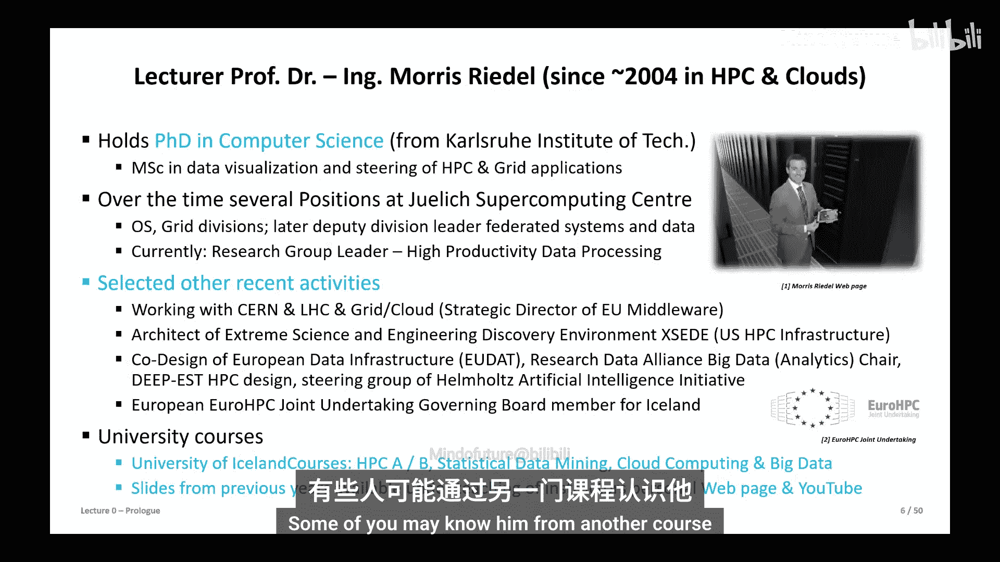

🤧嗯。Just a bit about Yuli supercomputing center in Germany。

 this is basically a national lab as I said in the middle of nowhere was a nuclear research facility。

 that's why is it in the middle of nowhere but you see there a large hall where basically the first European Exscale system will be deployed and we have many cloud services around it which are very analoglooked like the ones that you have in Amazon。

 MSs Asia and Google right so we have Upiter notebooks。

 have you heard from Upiter notebookbooks per chance good if you use Google Collllaaboratory for instance it's very similar and based on the same technology。

So these are things which we will ava， and this gives us a little bit the infrastructure to play around here and there with assignments。

Univers of Iceland， I perhaps don't have to say too much because you already here sitting that means theres some interest of you of the sake of experience。

 who is aasmus Boundy student who have always quite a fraction on this， Erassmus exchange program。

Okay， if you， okay。Interesting。From US someone。Now。

 sometimes we have even people from yes because it's so close to the yes。

 to Boston and so on and much more cheaper to study here apparently。Okay， so。Yeah。

 we have a large footprint in remote sensing。 So that is maybe perhaps something to say。

 Also from our research。 We publish a lot in remote sensing。

 And this also is related to lots of computing needs。 So satellite images analyzing this。

 I come back to this in a minute。So this is yeah something which is related to our fact that Iceland has also a national competence center for HPC and AI。

 but it covers also cloud topics and I'm the head of this one and you see here lots of our research projects I miss a bit the European Digital innovationno H but you for you the takeaway messages we really always at the cutting edge of computing exploring what's happening Xscalers in the moment our you know aim to really have the most computing power in Europe。

 we have also the idea of this Uex to have our own chips in Europe the rehabships and so on so that we are a bit more independent from other providers outside Europe and yeah a couple of things which are relevant again for the course will be the trust andM project we look into this much more when we have the large language model lecture but there's a large research project I have together with Hastein Ion。

 the NLP professor here Natural language Prom also doing with me this research project。

A new term which coming up is European AI factories。

 I'm not sure have you heard from European AI factories by chance in the media。

There's an amazing pot of money， basically set free for AI in Europe。

To really help SMEs to help the public sector adopt AI。

 but also know about the dangers of AI for to we talked about chat UBT large language models。

 if you're in a hospital， you don't want to use that right to put all the medical data of your you know kind of patients into the cloud and let them store somewhere to analyze it or to translate it So there are also some issues about it we will talk about but we would also talk about the AI factories。

 what services they built because they are basically very cloudlike interfaces again。

And finally the European Open science Cl is more or less for researchers but had also interesting let's say services for big data management data sharing things you know from a dropropbox someone knows a dropropbox or Onerive probably you know all and stuff like this right so these are similar services in the let's say academic fashion there will be also several events from this community。

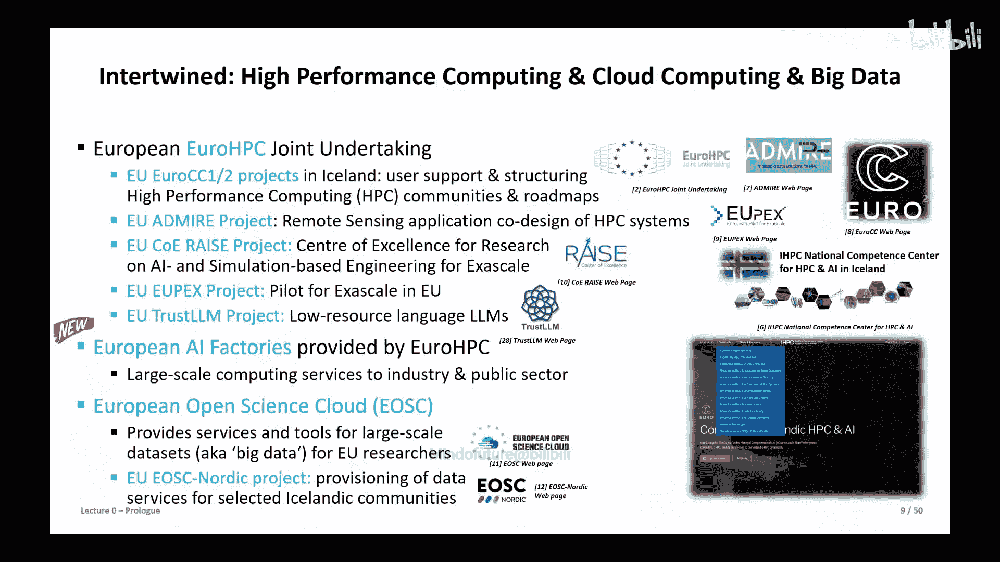

The E and HPPC and cloud community is based on simulation and data labs。

That you hear I'm easily in the health care lab but we have several other ones as well。

 and we have huge industry collaborations ongoing hence we have also now this link to this course that we do this 50% of the course in terms of you know this industry projects and we receive lots of good testimonial so they like to work with us。

Also with students， so you see here lots of good feedback we got over the years。

 I mean Ingo collected them bravely with many of them there are probably a couple of them missing。

 but several of those names will also reappear in the list that you should check for your partner industry project。

RightSo I mean the slides will be shared， you can read the details on it， but in other words。

 this kind of course interaction with these will go back on a trusted relationship with our let's say close collaboration partners that'd like to work with us and this is what we also would like to involve students more closer basically to industry and you see here on the top right also the Candace list right on some of the websites that is something what we already provided and you probably have seen already at Cargiiff and others before。

And last week based in the preparation。Just an example how such a data lab and simulation data lab looks like you see here an example of the remote sensing one it's really strong our rector or let's say the previous rector was part of it Jonataley Benedictson is basically one of the most distinguished experts in this field in Iceland so and we are basically also part of this group nowadays also professors interestingly enough so Gabrielle you see there on the left he was my first PhD so now he's also professor here at the University of Iceland in the meantime。

And this is by large fueled by high performance computing。

 We look at the satellite images when the satellite goes over the earth has lots of。

 let's say we call that hyperpectral multispectral data sets going into the earth so basically as a cube right so see different spectrums of lights and then we want。

 for instance， land cover to analyze how much trees are there。

 how much water and so on and all basically remote sensed by the yeah by the satellite and then we use a lot of deep learning machine learning and cloud computing and high performance computing resources with it so this will become as examples throughout the course again and again to make the case that we always look in our course more or less beyond one GPU right so I think it's a key message to take away that we are not concerned about one laptop also that we have a big data center hall where we use multiple GPUs together to solve a problem。

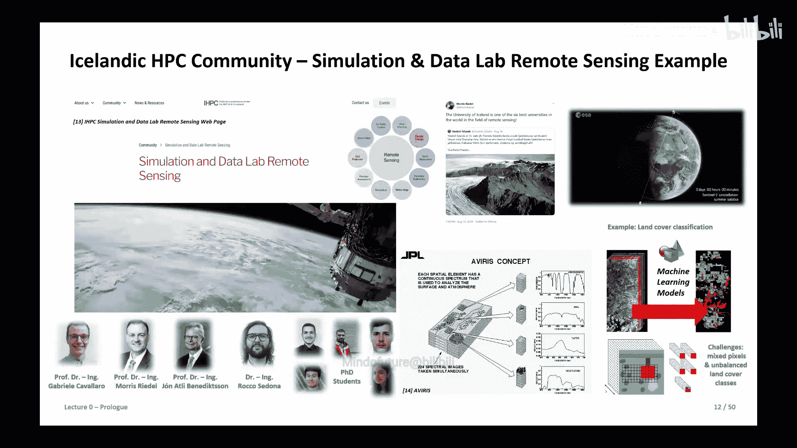

Now usually what questions are is how is AI MLL， DL related， right so machine learning。

 deep learning， one way of looking at it is that artificial intelligence is really huge。

iss a field which entails robotics， cognitive systems much more than this course entails。

 We always talk about AI， But when we have a concrete term， something algorithms。

 we really execute on the computer， we talk about machine learning， deep learning， right。

 So this is mostly real essence of it。And when you come to machine learning。

 it stands mostly for data， learning from data。There are distinguished algorithms that have been standing the test of time support vector machines。

 random forests and so on， so this is something but we still use so we'll make a point why we still use them。

And deep learning is now more or less a little bit a newer concept where you have also feature learning insight。

 so you have something which is much more interesting in terms of what you can actually learn from data and terms of automatic approaches。

 what you get out of the data so hence they are not really in competition with each other so rather complement each other and we will talk about why in a moment。

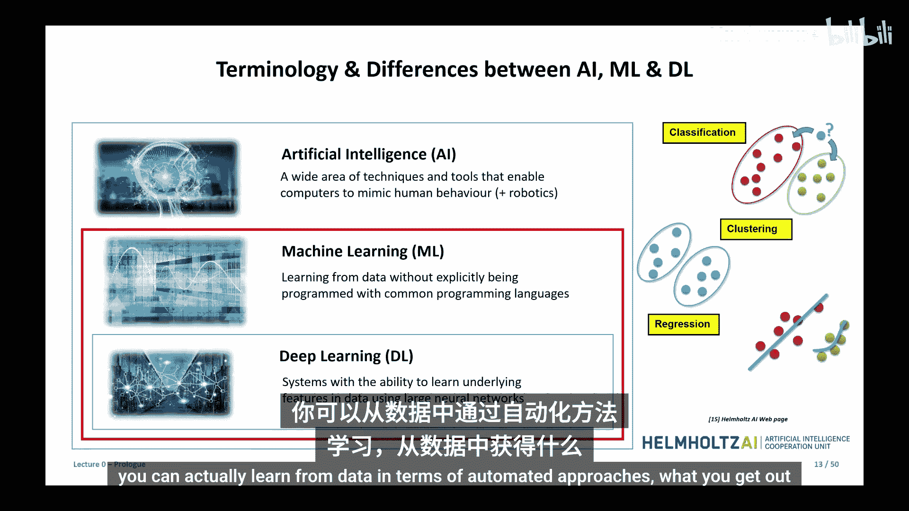

Just 10。Sort of a recommendation why machine learning is necessary， right？

 So what are the prerequisites in a way， you see here the three。

 So that is always that there should be some pattern exists。

 That's why we go for machine learning and deep learning and don't worry if you don't understand all of that indeed detail。

 right we will have lecture 2，3， much more on machine learning。

 deep learning and then later deep learning again and again So we will use it again and again just as a appetizer for the course in the prologue。

 This is what we will talk about the second ingredient is when we know that there's a pattern。

 we also know that there's maybe no physical formula for it， like weather prediction。

 right this is something what we rather do with physical formulas， we know how it's recently works。

 we have numers and use it， although they also some aha these days that you can actually learn from data complementary。

And the third ingredient is then that there are some data sets existing and there should be of course reasonable large and there has this overlap in a way which we call today maybe data science which is not only fueled by this different areas you maybe have heard from before also for the online audience I should do this here with the。

Go to here， so this overlap I'm meaning here in the middle。

And this data science is also fueled these days by heavily computing。

 so everyone who is using machine learning or deep learning was really cutting edge algorithms with cutting edge approaches usually needs also a computing infrastructure right Google Colllaboratories very quick at the end。

But there are also several challenges around it， so machine learning is not the simplest topic。

 we have to learn a little bit of skill set around it and of course the data is not always so beautiful and nice as we will see in lecture two and three when we go through some examples。

 but it is possible and largely successful。

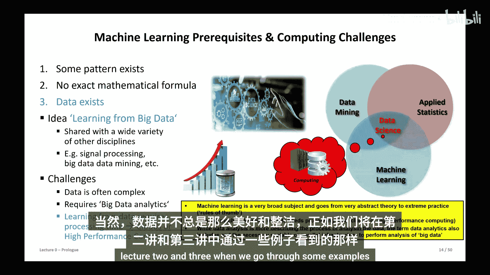

And has lead us nowadays to innovative deep learning techniques。

 so if you want a difference between deep learning and normal machine learning you see this a little bit here as I mentioned。

 that in previous times we have really handcrafted features in order to learn a model from the data so basically had some features feature engineering done in order to learn a model。

And deep learning now can have feature learning inside how that looks like is now that we have some interesting deep learning iects。

 So we will talk in some of the lectures about artificial neural networks。

 I think some of you have heard from that probably ANN's artificial neural networks。

 So it's basically the basic technology of deep learning。Where you have different neurons。

 you mimic the brain and have this， but a typical neural network would be seen here on this left side。

But that's not what we do in deep learning in deep learning we just don't do more and more neurons and are happy with it。

 that's the base foundation instead we have specific eyes that you see for for instance here and very soon in the video。

In order to capture the feature of images， for instance， features could be noses， ears， eyes。

 for instance， of a human face。 And this is automatically learned in all sorts of varieties。

 forms that you see here a little bit illustrated。 And then you do at the endclass is that is。

 let's say， a human， a cow or cat and so on。Hence， I wanted to just already materialize start that deep learning is much more richer than just using artificial neural networks like you see under the。

Top left here。🎼And put more and more neurons together。 You have very specific architecture detectors。

 And you see that a little bit in here in the。🎼Video。

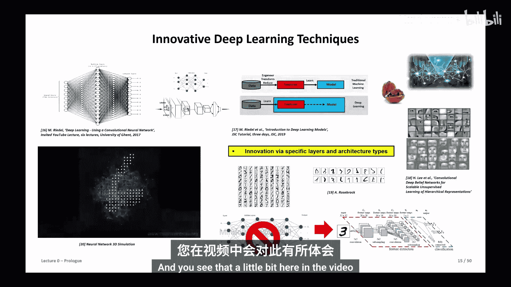

🎼Yeah。🎼Yeah。🎼Yeah。🎼，🎼Yeah。🎼，🎼It all begins from a single origin。🎼A unique point in space and time。

🎼Yeah。

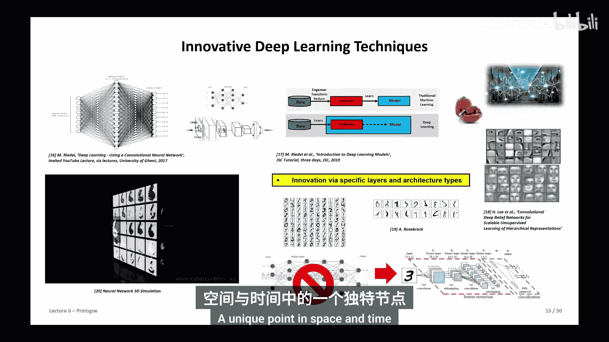

We come now also to the， to the point again of the computing footprint and the。

The the reasoning why we need still the combination of all of these， right？

 So we see traditional learning models like machine learning models。

 we know from the past report vector machines， random forests are very good models。

 but they are only work when the data is reasonably small。Basically， when you have in big data。

 your laptoppto will already crunch with all the tools， right， so you need a bigger system。

 then you maybe go to small neural networks。 if you don't have a lot of data。

 then these models are still the best you can have， right。

 because deep learning what we will talk in the course， neural networks。

 deep learning models out encode codes and so on。There need lots of you know computing power。

 but also big data hence a connection to the course right。

 but the problem is you get much more accuracy out of this large deep learning models today than we have in the past from this random forest and whatever。

But you have a big price to pay， which is a training time of these models requiring lots of computing power。

 hence this is all connected these topics and that's why we talked about in the course。

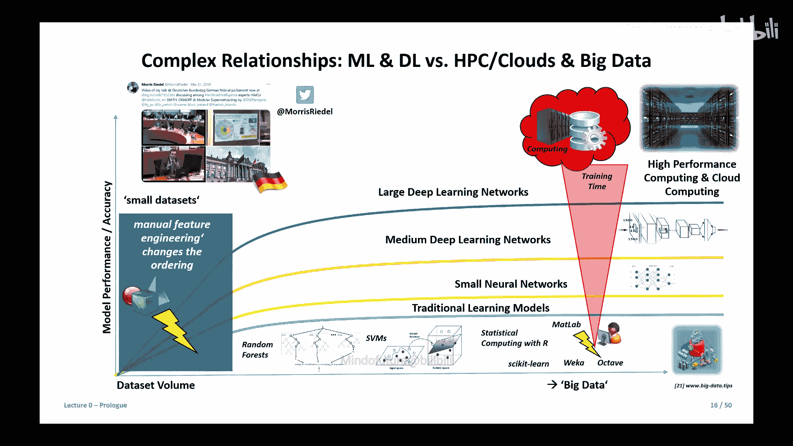

And of course， there's a， let's say another paradigm to it。

 which is not only the data we talked about anti hardware， where we have now GPUs。

 we have better computing power available， there's also the software。Nowadays。

 we have lots of open source software that makes it possible to have these packages like Ptorrch。

 Tens of flow。 have you from Pytorrch， Tens of flow by chance。

 So these are popular deep learning packages， which are open source and also fueled a little bit this hype in deep learning that we have today。

 And with this also fueled the whole aspect of more development and hardware technology and so。

 So there's a lot you know timeline coming back to the beginning of machine learning。

 And by having all these three ingredients now， we have lots of startups。

 lots of in our industries that we also will learn about that all want to adopt deep learning。

 basically then in our second part and on Thursday。Just at the end of the first lecture。

 a couple of things that you also want to know about the course。

 I mean this is pretty obvious I guess by now almost all professors do the course in Canva so I guess all of you have seen it there will be always announcement assignments handed over it some of you contacted me already the best chances to do this via my assistant which is basically Ser that you can reach with email address she will be again and again coming up in the course so I don't have chance to look at my emails anymore but she will handle it。

And can also direct office hours， for instance， if you want。She。We have three assignments at 2，20%。

1 is a 10% warmup， which is the 50% of the course in terms of grades。

But also we have this industry project I mentioned before 50% of the grade which is very interactive right in order to do the assignments and also the industry project it's good to build groups to two to three people become to this on Thursday much more in the course hours so maybe make yourself already let's say aware that you have two to three people you maybe want to work with and get to know each other maybe after this course or in the break because usually we want to have also group work encouraged right alone work in industry is basically a nogo you will always work in teams。

You see the yellow blocks are essentially something you should take away from the course that were mostly exam material now we don't have an exam。

 but of course I would encourage you to understand this yellow blocks that are really。

 let's say the essence of the course elements that should be now sticking to you in your head after this course。

And all other things are again， via canvas， the assignment project upload will be mostly PDFfs。

 sometimes source code upload via assignments and yeah this is。Nothing new I would say。

 the only chance is that we don't have the a tool for discussions。

 so we don't do the subscription anymore for some reason， but we will introduce some other tool。

 I know Ingo is there some other tool already in discussion。Yeah。

 so we will come to this that we have， of course， also discussion tool。

This was a bit surprising we use it a couple of years now。

And everything else you already know from the recording。

 I mean the recordings are online 200224 is maybe the most up to date。

 2022 is still onvo I mean the most lectures will be still relatively serious and you see we got quite good feedback。

That why we do this also on YouTube you see that on the top。

 not only the feedback from many people looking at it。

 we're using it also a lot in research projects to distribute our let's say research work and our activities and elements of this so in this sense there will be a new 2025 course list suitcom and you can expect that each lecture will be recorded right if you don't make to the university don't worry about this each lecture will be recorded not so in the industry ones and in the assignment onces these will be internally recorded for Panopto right there will be only accessible in Canva so not on YouTube。

I'm also heavily on social media because these days EU projects。

 European projects count more the followers and the likes than website hits。

 the websites are basically old and not so much important anymore hence if you want。

 we can connect on social media。Some question about reading material I would not suggest to buy a book in code Cloud computing。

 this will be outdated in a week。I have， however， some books I give you as references and all lectures will have also significant lecture bibliography at the end。

 right， you have seen this already every now and then I have here references and at the end of the course。

 you have like three， four pages really just of references。

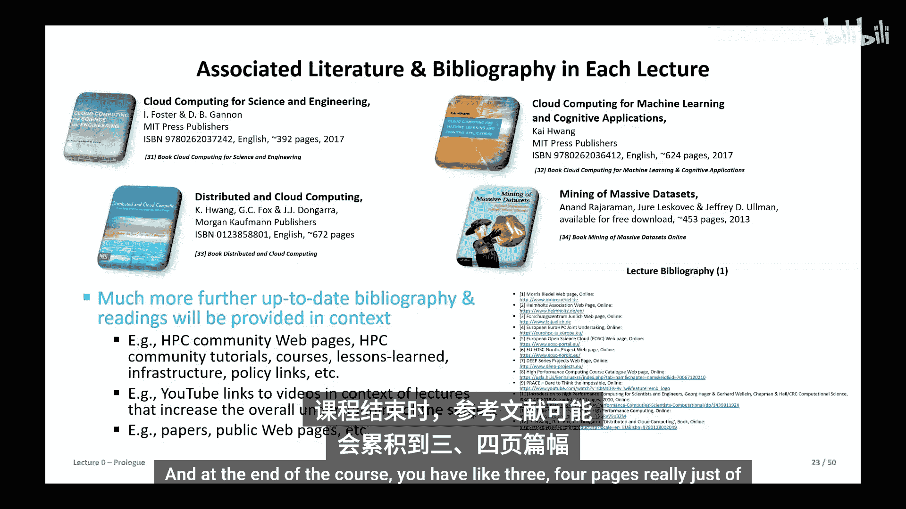

Finally， an appetizer， if you like the content of the course and want to go perhaps a little bit deeper。

 more technical。We have also next spring and 202060 high performance computing course。

 this looks a bit more empower parallel processing， MPI programming， again machine learning， yes。

 also partly， but also much more physics applications。

 you see that here a little bit like car crashes or computational fluid dynamics。

 smoke evolution like here in a tube and things like that which are much more physical laws driven on numerical methods based on known physical laws。

 I should say。

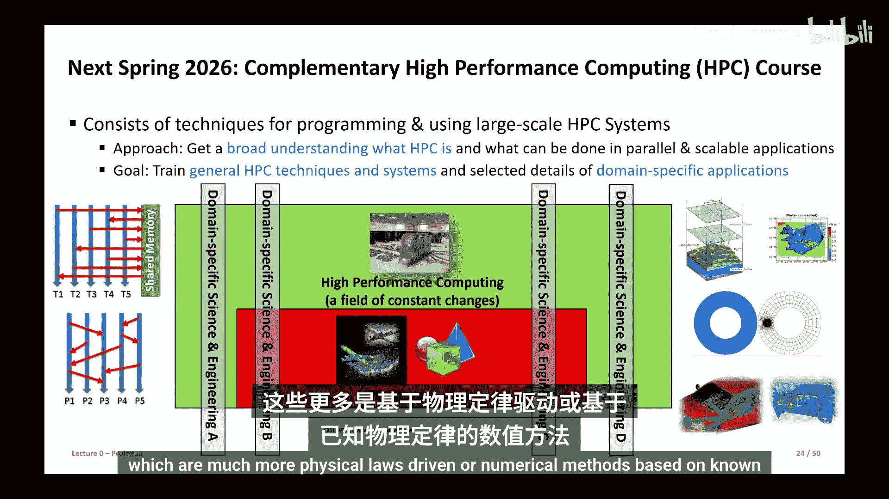

し。This is all for now， I would say we stopped the recording here。

 I give always video basically for you as a sort of homework， I will not play it now。

I can do it during the break， but not for the YouTube recording but I encourage you to look at it。

 so not only look my vision of cloud computing but also a little bit connect what others think about the topic so it's also a good resource to learn。

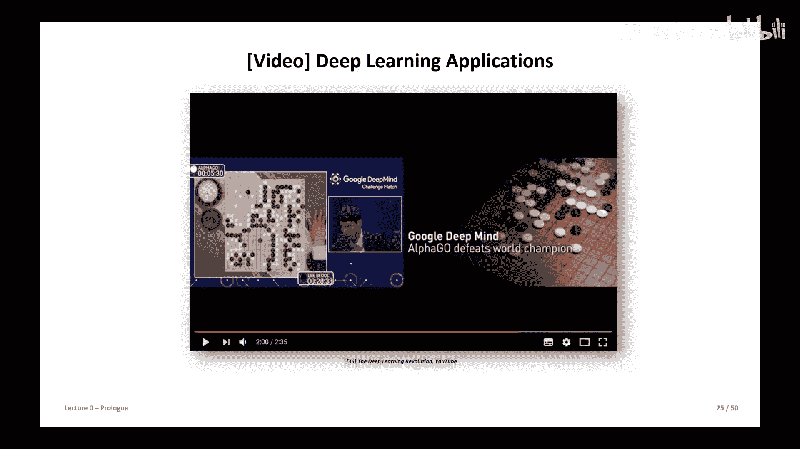

So thanks， and we do a small break and continue with a second part then in 10 minutes。

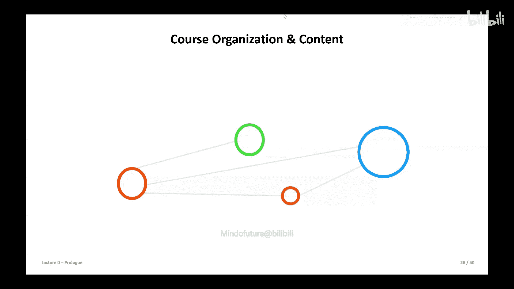