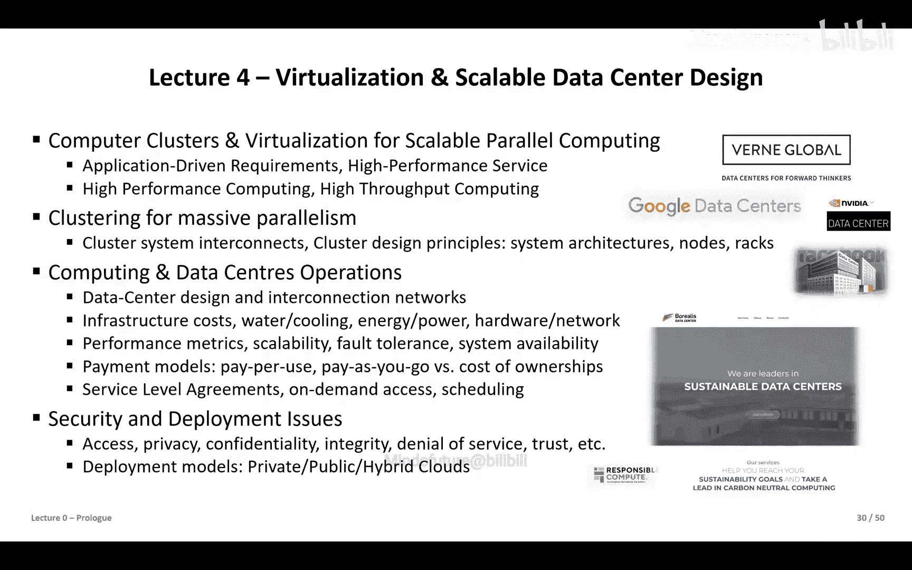
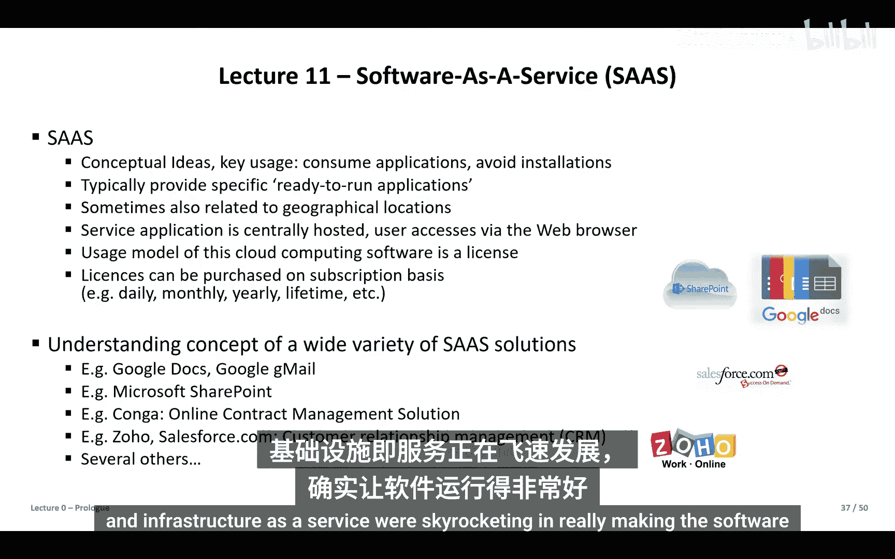
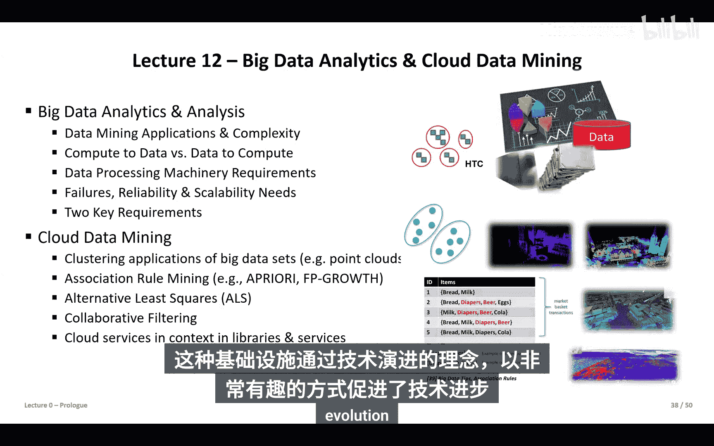
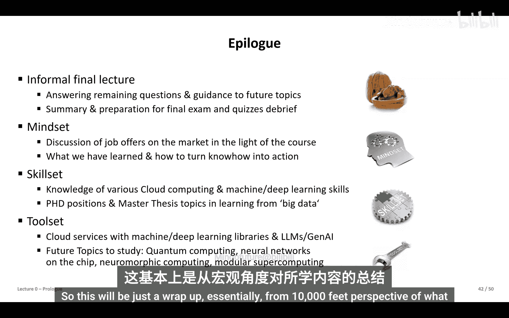
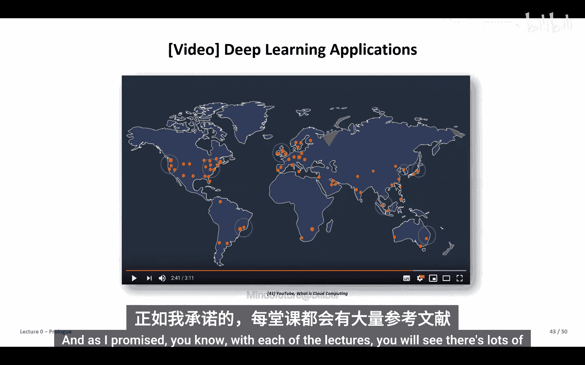
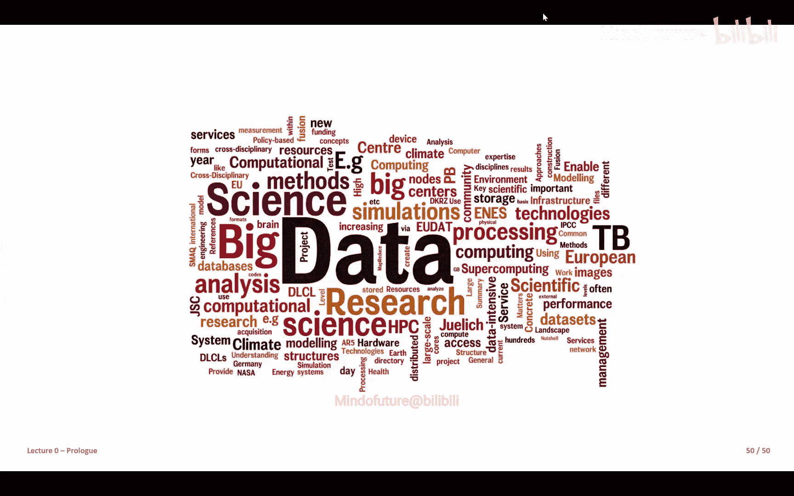

# 【冰岛大学】云计算与大数据-｜-2025-Cloud-Computing-And-Big-Data-Course-p02-P02_讲座_0_序言_第二部分--BV14MB4BjEyZ_p2-

Okay， so welcome back to cloud computingut and big data lecture 0， the second part of it。

 the prologue。 So if you want a little bit an informal start of the course again to see what to expect from the course。

 clarify question answers。 And I hope the first part already clarified the most questions how the course operates。

So via canvass， assignments， industry projects， and so on and so on。

So the second part here now is the idea of really go again into context。

 you know what we mean with all of these passwordwords I gave you as a heading of these lectures right and of course there's very much more deeper they entail more technologies。

 more let's say details what really the individual lectures entail and also how we connect this to some practical topics really where you face and cloud computing services or let's say technologies and products。

🤧。Coming to lecture one， as the name suggests this is really again an introduction。

 it's a little bit different than the prologue， it doesn't talk about the course anymore and we will dive in some of the topics deeper but it also gives the opportunity to clarify base terminology so things you'll just have to know what is a CPU what's the difference to a GP right who knows the difference CPU versus GPU。

Okay should be hopefully in one or one computer Ingoview is here gone but I hope that is these days teach is is a very important distinction we will talk about this again at least briefly and then make also the core elements dots why GPUs are necessary for machine learning deep learning today and how it basically also connects to cloud computing offer service that you have in Amazon。

 Google and wherever you go chances are there is really powerful computing and storage underneath it。

We also connected the bit to the history， of course that we have in cloud computing。

 it came not out of nowhere， it came out of grid computing that we had at CEern at the time when I was saying I was there。

A little bit the strategic director of middleware so this has a long history。

 the idea of distributed computing all what cloud computing was doing doing it much more in industry。

 commercialized service offering so it's an interesting let's say element and by far all of you have now experienced it how it is growing in the internet I mean the early days of Google or Facebook beta who remember this where this will beta technology right Google beta so we would not use it you would use Yahoo a search engine now everybody Googles everything and basically now we YouTube everything and in 10 years or five years we chat GT everything or so so basically this is is' an interesting thing to see how these applications evolve。

While not forgetting that all of that is fueled by cloud computing underneath。

 these are all just services underneath fueling these technologies and the hardwares giving rise to it。

So this will be lecture  one。Lecture2 then will be， as I promised a very。

Let's say simple introduction to machine learning， some of you that have never heard from machine learning doesn't know any prerequisites。

 not even much linear Al， I mean， a couple of dot you maybe know already maybe on your math。Memories。

 hopefully。But this is an introduction which should be relatively straightforward with some examples。

 what we will do in order to form binary classification first with a perceptron learning model is's the simplest learning model you can have。

 actually dates back to the 60s。 quite interesting and is' a base foundation of deep learning today was a neuron。

 something we have in the human brain。 It's a simplified neuron。 It's basically not。

 let's say exactly mirrored like the human， but a simplified version of it if you want。

 You see here one picture on this。So we start with this and then we'll basically add on to multiclass perceptionceptron this kind of thing learning model will be extended more and more step by step so that you can basically track this The reason why we do this is that many of the services you have in Microsoft。

 Asia will offer this in cloud solutions like logistic regression， for instance。

 or these simple classification mechanisms are still used a lot in cloud computing offers and we will make the case when I give you some examples of the AWS。

And you see also Upiter again this will be a technology with us that is really let's say indicated by the service corrector so you think you are editing a browser web browser like interface thiss a Upiter notebook and I think many of you have basically seen that but in the back basically you can have very powerful computing as well so this is now the interesting thing that you can port applications very easily between Google collaboratory and the very let's say cutting edge cloud provider for instance。

 so this is an interesting technology we will look in Python handson。As well。

Then we may very fast see the move to Apache Spark I mean some of you know Areuce and Apache Spark is let's say from Hadoop the next generation fueling a lot of cloud service offerings today used with different types of applications。

 but these are remaining very important applications like structured  queryer languages or databases。

 how you put them into the cloud and how you accessemlish machine learning streaming is something we don't do too much in the course but has something to do with data streams that are coming up from sensor devices。

 measurement devices maybe。And then the machine learning library is something we will touch upon is to make the case again with big data and so on that this is all scalable right so this is an interesting term that we will explore more and more ending in lecture four where you then understand how we can quickly go from1 GPU2000 and so on in this cloud paradigm and using these libraries and this machine learning libraries。

Are done in parallel fashions they're implemented and parallellyzed already hence parallel processing distribute computing that I said at the basic is at the heart of these if you let's say download R statistical computing is R is a tool or Matlab or many others Skype could learn I mean some people and maybe know that Skype could learn a machine learning package in Python。

 these are not for parallel processing so if you throw these to the cloud it will not work。

Because they don't use more than one GPU quickly， Hence you need something like Pytorch， Tens offlow。

 Pytorch， DDG， we all cover in the course and inherented that are then also this libraries。

 which are already for power computing and scalable computing optimized。

There are also some graph applications， some of you know that from Facebook。

 if you see Facebook in the end is just a big graph right it's a big graph database behind it and so on which likes and you know links between all the different nodes and entities。

 we will talk about this briefly in the course。We had last year one on social networking and so on。

 we had dropped this year because of large language models。

 but you can still look at 2024 if you have interest to look at these。

And this is basically a groundbreaking technology patchache Spk。

 which is in almost all cloud vendors today， including also Google which is somehow a missing Google Proc。

But this is also important to know it is basically cloud computing technology。

Then it's time for a little bit of a conceptual review。

 so we have done machine learning a little bit so understanding why we want to learn from big data and why we need lots of computing。

 so now we have to conceptualize a little bit how we actually realize all of that and we come quickly to something called virtualization did you used images。

 VM technologies already virtualization some of you。

Should be also one on one computing but don't worry we also don't do too much of it。

 It's just important to understand that virtualization is fueling a lot of these ideas of data centers today right and this is an important factor also for scalability So scalability is a term we will conceptualize there where we then really think that you're starting to grow maybe collecting data like apps right So if you have maybe something like angry birds or so and you are a little small startup and failing with a computing game which was a soccer game and then suddenly you start something with angry birds funny enough there were let's say not successful in the beginning。

 but suddenly angry birds baum was a huge success but with this the users skyrocketed the data skyrocketed and this is scalability right to take the users with you right on this now everybody plays numerous apps on angry birds even movies about it and whatever。

But this was successful to this operation to do this。

 and we will talk again and again in this course again about these application examples again。

How this is then fueled by let's say prize offerings because of course you see now Google Docs you use this probably or Google collaboratory for free for free Facebook for free the ads and so on but how is the money coming in right and we will learn something like pay per use have you heard this paper per use perhaps subscription models I guess if you have more advanced cloud services you usually have 30 days free and then spe the credit card that's usually the model right and so we talk a little bit about this and how this also affects service level agreementvance and so on hence we look a little bit how Google data centers operate Facebook data centers and video data centers operate we have also one player here in Iceland where we will try to visit so this will be one opportunity for you to touch metal as I say so that we go at Corputtorrque that's with outside in Reykjaic or I should say most elsewhere for the locals。

Where we usually every year go in every course and touch metal in the sense of we go really inside and you see the rear Res right standing in a bit data center its still a small data center not like Google and so on。

 but it captures the essence of res of you know the air cooling the sound that you have from the many。

 many， many GPUs operating the second floors， all the kind of infrastructure you have we will organize this as a trip and we will have an invitation there during the course。

So that you get a better meaning how really a data center looks like from inside。

Then in lecture5 we go back to deep learning and connect the dots we left with a peseron basically the simplest learning model if you want is linear learning model and now basically go bigger and bigger by using the single ingredient that we model as a neuron and connect many neurons in many layers together and go quickly from artificial neural networks to something we call deep learning。

 hence there will be some foundations， artificial neural networks。

 back propagation of errors or some learning algorithms but also we keep that to moderate degree in order to understand a little bit how deep learning works this will be not so much let's say cloud computing in the sense it is more rather introducing you know different models。

 different technologies but many people know things for image analysis like convolution neural networks outenrs but we use for instance。

 also long short term memory gated recurrent units。

 many of the let's say deep learning models for time serious data which are not image。

Just for instance， and so on and so on。 So itll be a sort of foundational lecture to understand deep learning better because some of the industry partners will ask you to work with them in deep learning。

RightSo hence it will also have relevance for the industry， Of course。

 hence we put it also more and more early in the course。To give you some examples。

 what you can do in deep learning， we lose a little bit something out of our research and remote sensing as examples of cutting edge learning models where we really use thousand GPUs in parallel to understand data to learn from data。

And then of course， also some sequence data that is text， but also let's say measurement， you know。

 numbers， values， measurements of any kind， so this is something where you understand we have always these different types of data。

 hopefully。And you have specific learning models for it。

And this is sort of the difference between you would say maybe this term deep learning of saying just different neurons。

 you would have different type of eyes of deep learning used for very specific problems right and this is something which is also fueling large language models out in coders and so on and we will talk about this in lecture six。

Also connect the dots a little bit why computing power is of course essential in these and basically this would be not possible the large language models would be not possible without cloud computing GPUs and the computing we have today hence there's something we call about parameters that we will review。

In deep learning， the learnable parameters they will grow and grow， the bigger the model。

 the more parameters to learn， the more computing power you need basically。And this has， let's say。

 the major impact that we know these days in large language models right you have used some of this in chattGBT。

 what you don't know is maybe here's some of the examples you see out of our research。

When we have here， you know 7。8 billion powermeter model。This is not obvious to you。

 we see how that materializes when we start from neural networks very small with thousands of parameters to large language models we have today with 7。

8 billion and more actually in TT5 and so on。Hence， this will be。Nicely a example of generative A。

 So large language models are one example of it。 but of course， as I said。

 we will do a couple of other examples for images， videos and so on as well。

And also connect the dots why it's important now for AI factories in Europes to offer this to public sectors I mean you are basically the first wave that will encounter this in all public sector organizations all over in Europe that you will have not only chatbox but automatic filling of forums。

 large language models doing all your text reimbursements and stuff like this so many of the services from the public sector to save costs will be transformed in AI。

Right， and of course， this has also dangerous as it was alluding to with hospitals， for instance。

 right， giving our medical data out to some。Cloud vendor somewhere in US。

 it's something we don't want。 Hence， there are also lots of AI laws and AI acts， GDPR。

 different law mechanisms in place where the AI factories in Europe will be then taking place in order to protect us。

 maybe from other， let's say， non Europeop solutions。This will be also a theme in this。

 but of course， we will always take the most impact into the technology right， I'm not a lawyer。

 I just say you there's an AI act。 We cannot do everything with the data and so on。

 We are protected here and thereby by law， but this should be also mentioned in that。At the point。

So this is a new lecture I hope that will be attractive， it has lots of news of AI。

 cloud computing and specifically generative AI much interestingly enough this is a more traditional model mapreuce。

 but I have seen many of you know that already and it's also no wonder because it basically reflects the paradigm in one0 one computer science again divide and conquer right so here were talking now interesting enough not necessarily about the training of the biggest perfect model that we have seen the large language model here talking we talk about the throughput。

So we want to very quickly go through a very big bunch of big data right and how you would do this if you now have。

 let's say very many newspapers and you want to say， okay。

 we have this many stacks of newspapers and we want to have all on political sciences extracted and looked at if a particular president is done。

 you know and mentioned。How we do this in the class？Any idea？We would divide， right。

 so I'm not interested in looking through all this pile alone， so I will give you 100， 100， 100， 100。

 100。And this is a problem which is not connected during we look for that article in political science right so this can be done independently as we call it。

 that's why it is independent parallel。And this is different from machine learning。

 deep learning where we massively parallel update the gradients of learning every time step or weather prediction。

 the weather next to us left and right on the GPOs coordinate affects me in my coordinate。

 that's why basically in high performance computing course and indeed these you need this kind of high performance interconnect。

Here we talk about mapRuce is really something you have a big problem like the newspapers we distribute it on all of us。

And then we collect just few results back in the Con step and say， okay。

 how many articles were the political science， how many political science。

 what the president mentioned， okay， and then we have the result and report it。By this。

 we have lots of time gained rather than one is looking through it。Hence。

 there's a sort of scalability again。Of these so-called workers。Of course。

 if you have a very big problem， our class might be not enough。

 so we should maybe have the class fellows from all other than our professors。

This is of course an analogy right now if you have something like a company and you basically growing your data pile more and more。

 then you basically have the trouble that maybe transporting your data is also a problem。

So this is a paradigm mapRuce we will learn that is a bit data centric。

 put the computing to the data， small high throughput computing tasks。

 summarizing identifying patterns and so on， and we will have some applications for it。

And by famous implementation is had do， but Apache Spark is basically the kind of next transition to it。

 and we will also make the case for it。Then back to more conceptual topics， as I said。

 we put the practical topics first with big data and so on that we use in the industry projects and the infrastructure as a service is now something where you talk about plain metal provisioning that means a computing is there you maybe have some virtualization layer on it。

 but no big services on it right so this is in cloud computing called the infrastructure as a service level。

 you would have computing entities they're virtualized。

 but you can still switch many of them on and off to a problem。

By this comes this idea of cloud right the scalability。

 the cloud is you know big cloud a small cloud， big cloud。

 you can basically justify the amounts of computing very flexible and also just with resource sharing and the same is true as you see there for different storage options hence this coin the term cloud computing that on demand you can have computing tomorrow by swiping the credit card much more than for instance buying your own computer maybe a high performanceform computing machine down in your cell with six GPUs。

When your six GPUs are fully used， but you need more。

 you just cannot just buy three or four more get them into the system for tomorrow in the cloud you can just order more four GPUs tomorrow the day after eight GPUs and so on so this flexible computing model was was basically coining this cloud computing term in the beginning on this lowest layer you can have infrastructure is a service。

 a basic infrastructure of computing storage。We will talk about this， what then will happen。

Is the platform as a service level which was much more oriented towards developers and you know in computing when you create an app and we were talking then about app design and apps。

 now if someone is in app development here， there some apps。

 I know maybe software engineers do these these days。

So we learn a bit how you do this in the cloud basically with a development cycle。

're using the infrastructure as a service components with some services and that's where the service idea comes again in。

 So we have some computing。Elements which are always the same in computing games， for instance。

 a charging module， right， Swiping the credit card it's always the same no matter if you do angry birds or another game。

 somewhere must be some functionality in software to charge people and to get the credit card。

 So there's a platform approach to it。 You need basically something else that you also want to have in this and maybe kind of storage that you put in。

 you know， user data for a game for something what you have。And in a flexible manner。

 so the Google platform we're going to use there as an example that you see that the platform has a service level。

 which is a little bit higher。Then essentially the infrastructure level gives you distinctive services to really leverage the cloud。

 but it's not really completely user facing in the sense of， you know。

 justwiipping the credit card and use software。This would be rather the idea of then the last layer and then the lecture one。

 we connect this all a little bit together so that you see that infrastructure is a service。

 platform mass service and software as a service is the highest now of the ideas of services is where you don't think about any development anymore。

You just use what's existing。 But， of course， this often comes for a price。

 maybe indirectly by watching ads or swiping the credit card that you already know from Zho projects or Google Docs。

 I think， you know， the game from Facebook and others。

 So this is all examples of software as a service。 But。

 and that's now the point they use platform as a service and infrastructure as a service components for all of their offerings。

 right， It's not just visible to us because as user， we're not interested in that。But of course。

 when we do Google Docs， when we edit our document and then suddenly 20 and 40 people edit it or proposal。

 maybe or whatever we we do in science or you basically is assignments growing。

 you want to have good performance of this， so they automatically add more computing and more storage if needed。

So these are all concepts where essentially this was perfectly flying。Also。

 think about back in times where， you know， you had really software shops。

 I'm not sure you probably didn't experience that anymore。 But you know， when I was young。

 I had game shops where we go in and get a Cd or something and not even a Cd was not there。

 It was discs right Monkey Island and whatever。 So you have 30 disks go to a shop and you get a package and that was your software。

 Now everything is online right you basically just get everything。

 was it called steam right then you go to steam， you get your game。

 you basically download everything from the Internet。 Also that had lots of implications。

 The online game world ands on scale with amount of users right a good example is CCP games here next door。

 they have a kind of space game， maybe it's good to look at this one。

But they have to also have intrinsically the scaling of users again。

 and this is also where software is a service and the underlying platform and infrastructure is a service where skyrocketeting and really making the software working。

Coming back then a little bit to the benefits of scalability also for data analysis for analytics。

 as we call it， is basically the data analysis on steroids a little bit combined with。

 you would say cutting edge technology， like mapRduce maybe frameworks that enable it or Pytorrch and others。

And we will have some， let's say， easy applications that you know。

 like shopping basket analysis here， diapers and beer， they always brought together。

 we will find out why this rule exists。In in shopping basket analysis。

 but also simple data mining algorithms like clustering。

 you see here basically a kind of point cloud from an inner city when you cluster this with cluster algorithms and you come back and can reconstruct whole cities or countries。

 you see the Netherlands here。As a point cloud remote sensed。

 and you can reluster this by clustering algorithms。

 data mining algorithms as they're called by having back buildings Now the point is that this is so much data that you cannot do this on a laptop right you have to do this in the cloud with high performance computing and much。

 much more computing needs。Also， when we come to recommendation engines， I mean。

 all of you know that by now I think Amazon， if you buy something right。

 and now I'm not talking about the Amazon web services。

 but the Amazon bookstore is not anymore more just a bookstore。But also。

 their success was largely their AWS， they had internally。

And then exposed to basically people a cloud infrastructure right so Amazon in a sense was not really a bookstore。

 it was a cloud company before and then basically we are the bookstore and we the scalability could now do everything and this was all fueled by this infrastructure that you have in this cloud。

Very interesting ways， also how this was fueling basically the concept of technology evolution because money was available to really advance in technology like GPUs。

 right many people buy more and more GPUs， that means that video gets more money to do more exciting things。

 more specified chips and so on， we will talk in the course as well。

Now switching perhaps a little bit of view when you now talked about how we use the cloud。

 what are machine learning algorithms in the cloud。

 this is one step further where you maybe also think about management already right if you have maybe dropped later as a software in our consultant somewhere here in Iceland or wherever in Europe and they will say to you we have five people doing data analysis and our your data all the time。

 they have always the same requirements these in these tools， these in these data。

 perhaps you containerize their applications on an infrastructure might be an internal cloud or an external cloud。

 these are all terms that maybe don't mean anything to you just individual but we will see how that materialize when we come to this that means that basically a very simple approach to have all the right tools and data way labeled exists and you can nicely shift them so if you have a Docker image basically you can shift them between Microsoft Asia and to Amazon they're all based on Docker so you can basically shift them。

and the offerings a bit counterfighting if you want the kind of vendor lock that you have sometimes in this cloud offerings right if you have your management on these applications containerized or based on these technologies chances are that you much easier can prevent a vendor lock。

 which is important So let's say with one of your cloud vendor will go bankrupt。Then basically。

 everything is lost what you create for them very specifically。

 or they're getting too expensive for your company， right。

 So this is an approach basically where you can see。

 you can quickly move to another cloud vendor where this comes again as a very handy tool。

And there will be lots of details we talk about there's obtaintainer。

 some people may know it from singularity in the past。

 it was another Docker like let's say containerization technology that now switch to uper but in the end they enable the same and are often also deployed in our HPPC systems so that's why we also talk a bit about obtaintainer it's a bit less common in real cloud vendors or AWS Google and MS Asia are rather built on Docker and Docker H and existing images。

And so on we will learn about this， that there are also lots of lots of services around that in the public cloud vendors right so hence when you become a cloud engineer or so in a company then chances are that you use many of these services。

She。Then as a very， let's say， advanced because we approach in the end of the lecture。

 this lecture 14。At the end of the course this is an advanced topic for machine learning。

 I basically already motivated this a bit in the beginning where I said the performance of what you have seen by now。

 machine learning， deep learning， everything is largely driven by the effect of so-cal hyperpar right the best model has no chance if you have the wrong learning rate and learning rate is a parameter and we have a couple of more how many neurons and one layer。

 how many layers there are lots of this what optimization algorithm I use to addtochastic gradientidian tocent Adamom optimizer。

 whatever these are all details。But the point is the right combination makes it possible to achieve the best performance and you as a human can't do this systematically。

 you just pick some out of your gut， you would say the learning rate will be 0。3。

And this has something to do with say how the optimization algorithm works and to really systematically check all of these values。

 yeah， 0。5 0。51 0。520。53， and we were show in this lecture that just a difference of a couple of commas can make a difference of 40% performance improvement of machine learning just because we hit basically the lowest error。

So it has something also to do with optimization， we will talk about this。

 but this is a tool which should be in the pocket of each let's say sophisticated machine learning engineer today。

 but the point to the course is it needs significant computing right instead of you as a human now use all the different combinations。

 maybe not all the the comma values for the learning rate。

 also the combination with the atom optimizer with the SGD with other optimization algorithms。

Give you then in the end a huge search space of the parameter set which is impossible for humans to do there are some gut let's say values you can take from previous running models and machine learning that st the test of time and have a chance here and there to report already good accuracy。

 but you can always improve this hyperparameter optimization techniques and we have shown though in many。

 many times。And we're coming actually close to the end of the course so fits。Hi， Es， good to see you。

Thanks for coming。So some SME partner already came here and we will have soon close here with the lecture just a couple of things more AutoL is very related to it there we talk about a bigger story it's not just hyperparameters to optimize basically massaging a little bit let's say how this simple learning model or the big learning model。

 whatever in the optimization take place here we also change let's say layers we also change the type of model maybe let's say in LSTM something for sequence analysis it's not good enough we' change a glue and this is all auto other topics like autoglu on use foundation models someone already heard foundation models in science and engineering。

Outside， so this is something where lots of data was already trained on basic stuff that is essentially not as stuff related to your problem。

 but has some basic foundation。 So Autogluon， for instance。

 is a tool has been trained on all public existing tables。Somewhere。

 so this is a foundation models that know tables better than any human could ever envisage and you use this basic tool。

To find tune to your table and table data you need。With this。

 you need some computing power hence the relationship to the course。And of course， good data sets。

 But this has a chance to report much more accuracy than you could ever do by manually feature engineer and so on do machine learning data mining。

But many of these tools， of course， have the footprint like Raune is a very good tool。

 but it needs computing power， out computing and high performance computing。Then as a last。

 let's say， formal lecture I told in the beginning a little bit we were in the structure change the view now again a bit to the situation that you know your boss comes into your office and then we'll ask you。

 can we have a cloud in house？And you build it because you are having trained this at the University of Iceland。

And then they will say， well， we need this and this and this computing and nice storage here。

 but we don't want to use Amazon something to the outside because we have patient data or we have some other bank data trading data we don't want to expose。

 should be in house， we buy you everything。Now then you should not start in getting 10 software engineers that reinvent the wheel and create hand services and services。

 you basically say then okay， I learned about OpenStack。

So OpenStack is something which I would refer to like a very big Lego box would say Lego is known to everyone these days here。

 Lego， Dlo good。So and talk about these bricks that you need right and today you see Lego evolved to extremely funny bricks。

 but they might be interesting for something。 So hence Openstack has a large portfolio of already technologies implemented software you just put together like Lego bricks to create a cloud offering which is like Amazon or MSs Asia for certain parts of the game Of course you have to have the hardware still right you have to have the own computing the own storage in house。

But it's still scalable so you can extend to the number of GPUs you may be deploy over the next years and so on。

 so fascinating technology basically to。Now， to think about how you do it your own。

Then we close the course with the epipilogue I already said this is sort of let's say a very informal lecture I sit just in front show you job description that all the buzzwords I have in the course of course are exactly mirror to job description so why you we also have this in the course you need to know about Docker you need to know about you know deep learning techniques of sort so this will be just to wrap up essentially from 10。

000 feet perspective of what you learned。

Again I give you one video as homework， it has another perspective on it。

 it is fueled by Amazon and you know I'm not paid by Amazon but still it has a good introduction video to really summarize cloud computing again so it give you this as homework and as I promised you know with each of the lectures you will see there's lots of Bblography you know we said we don't do a book in the course because it will be outdated tomorrow but there's lots of references where you can always learn more European AI factories for instance that I mentioned is one part of it and you go again and again you find these references mostly in context to each slide right and this would be also my recommendation to you here and there maybe look down into this references to understand more and this gives me also the opportunity to do two things firstly I have a large team。

 many PhDs finished and a large research group that lots of this material see on the slides is fueled by their results in the course and gives me secondly also the introduction。

I mean， many of you maybe know him already from some course， but。Inoverver， the floor is yours。

 maybe say one， you know one minute about use something and then we come to Ys and SME and so on。

All right。Hi everyone， my name is Jean Colber here lives on and I am a second teacher in this course a first time teacher in the course that says。

 and so I will be leading and assisting you with the industrial project so the 50% of the course we will start on Thursday。

And we have introduction to what two companies。 one of them is standing here behind。

 this is Orb Green or orb EHF， and they will introduce their project for you。

 which you can assign up to as a group three to four people or two to three people depends to four。

 I think will be a best limit， and there can be more than one group hopefully， right。

And then there's a second company called the Cateralgi， a retail company in the clouds。

 and they will also introduce their projects and the same more than one group is available so two or three groups with two to two to four people pay group。

And then there are three more companies to come will be introduced the week after， hopefully。

And that would be。Well travel is one of the acoustic company we haven't。

 we haven't yet got notice from， But the greenfish is the second one。

 which is more like an image processing， using image AI models， etc cetera。

 So all these groups are using all this project are using AI more or less in their project。

And the cloud of service and Amazon services， hopefully as well。So this is a very short overview。

 Thank you， Morrisice， and we will see you on Thursday。免飞咧。有。Okay， good， yeah， you're hurt Inoverver。

 the second basicallyley teacher here，'m also part of my research group。

 really an industry specialist， all the testimonials you have seen from the companies。

 we work on this together also with many of these ladies and gentlemen you have here。Basically。

 that doing then the work we see companies all the time。So we stop here the recording and have time。

 of course， afterwards for question and answers。

