# 【冰岛大学】云计算与大数据-｜-2025-Cloud-Computing-And-Big-Data-Course-p03-P03_讲座_1_云计算_大数据_导论_第一部分--BV14MB4BjEyZ_p3-

Welcome back to cloud computinguting and big Data， our course today in lecture one。

And this will be a lecture where we you know have still relatively an overview of the whole course。

 but instead of you know clarifying assignments and of course content indifferent。

 let's say individual lectures already， that we did in the last time in the prologue。

 this will be really going already in some technology aspects like GPs versus the CPUs what did this about this interesting term big data。

 is it about volume or is there other ingredients that coined this term big data。

 so this will be all materialize during our lecture one today。

 but before we dive into the material of this lecture， let us review what we had the last time。

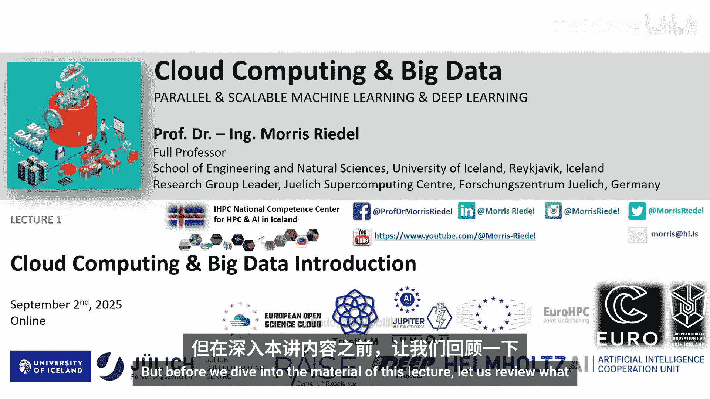

And lecture 0， which was a prologue， and you will see throughout the course that I always will give a review of the last lecture that we had。

 And this is usually a quite nice executive summary， if you want。

 So what are really the key essence elements that you had in all of the different lectures。

 So in lecture 0 which was really just the warm of the course。

 prologue general understanding what to expect in the course。

 we learned a little bit how these different terms really interact with each other。

 which sort of also motivates the course， right， particularly when you think about this parallel and scalable machine learning。

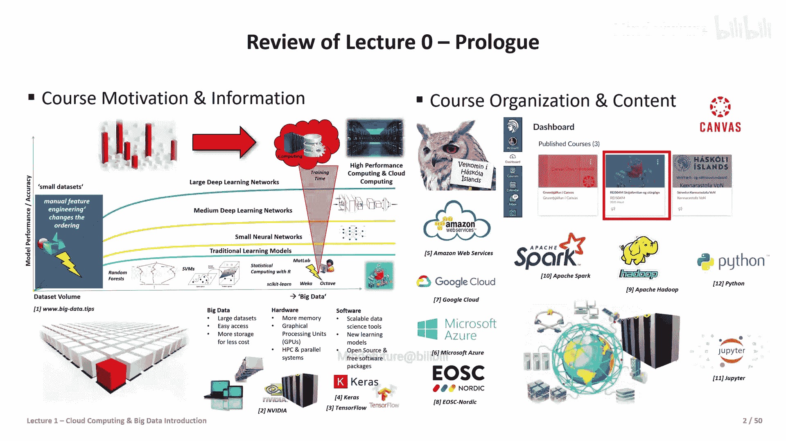

So we see here on this graph that we had the last time we have really the data set volume。

 which is ever increasing with measurement devices that we also will learn today to something we call big data。

And there has been lots of， let's say general purpose AI models in the past which are not deep learning but random forest support vector machines and they do a really good job if your data volume is。

 let's say adequate and if you let's say you know your computing is enough for that but if you go in the realm of big data you will find that many of the serial tools we were using with these like Skyki learn are Matlab and so on and so on have a problem on your laptop to work really and the key essence of takeaway is really then this is the idea where you then have to move to a remote computing paradigm。

 let it be cloud computing or high performance computing could be also so they're basically standing for similar elements in terms of machine learning and deep learning cloud computing in this course means we have a much more let's say seamless way of getting to computing resources because we have lots of services。

And these services will be also throughout the course coming from， you know。

 typical cloud vendors like Amazon， Google Cloud， Microsoft， Asia， and even scientific one like Eosk。

And the other aspect we had to learn really about this and this is also now something that you already learned。

 I think from the media， the new H on AI was large， deep learning models。

 large language models this is all of the real that you see here on the top so for this to work。

 you're not only need， let's say big data because there's acuracies that you see here that the large deep learning networks like large language models and so on that you know from the media you not also training time and big footprint of computing to train them。

So hence this kind of footprint here， this red thing means the better the neural network model。

 or let's say the bigger the boldulder， which gives us today cutting edge performance， right。

 That's what we are after model performance accuracy， that's what we want to achieve。

 So but here you have to pay the price if you want and you have to really use cloud computing in high performance computing。

 you cannot use these models just in a little laptop anymore。 maybe for inference。

 that's a different story。 So you don't have to train it。

 Basically if someone already trained it and you just use it， you know that from ChetyptT and on。

 that's a different story than you do inference and so on。And we come to this all over the course。

 there have several terms that of course you cannot know in detail， lecture2 will continue。

 for instance， with a machine learning interaction where we will then also talk about training versus inference and all of that。

Another element that I wanted to bring to your mind as a course motivation is really the flexibility we have today in creating new tools。

 new software， and this is basically the ingredient。

 these three factors right that really coin or basically where the success of cloud computing if you wanted the last 10 years really scaling up and we will have the term scalability again today when it comes to big data。

 so more and more large data sets will be available we have examples today in lecture1。

 but also the cost of it is less and less that means we can store more we can provide it openly for free and these are all new ingredients to new startups。

 new SMEs you know really working with this data to do new ideas with machine learning and deep learning by opening up data like high value data sets for instance we have in you public sector organizations like Staistic Iceland。

Now another element is the hardware right so many of you know and remember from the last course I hope that GPUs were 20 years ago not in a HPC system。

 not in a cloud system because it was for gaming gaming computers now we have this general purpose GPUs really fueling computing by orders of magnitudes of scale and you see this training time here again to make the connection is really fueled by GPUs these days so has not only in Vdia is also AMD GPUs these days but the hardware。

 let's say technology evolution was really key ingredient as well， why machine learning。

 deep learning in cloud computing is these days really onvoke and finally let's not forget open source software a large movement in the last 10 years again more and more tools are open source you know known fellows like Tenorflowlow Pytorch cars。

 you name it these are all publicly available。So， you know， when I started in that。

 we had to develop our parallel SVM on our own， there was just no tool on it。

Right so we basically have created it on our own on neural networks。 We started with some master。

 for instance， implementing parallel neural networks 15 years ago。 Now。

 this is all brilliantly implemented， I have to say in pie towards Tensorflow and also with high performance leveraging the hardware and being able to scale on big data。

 And then with this， all this three key ingredients。 We see more and more breakthroughs in science。

 engineering， but also new business evolving and new facets may be also on on this learning strategy that you have seen again with CheBT and so generative AI modeling is also fueled by these three factors。

Now then the other part of the prologue was a course organization and content that is sort of the idea what to expect in all over the course。

 you know everything is will be managed via Canvas in certain cases via Ugla。

 but Canvas is really where we notify you about special IH you see workshops that were coming and thanks for all of you that participated。

 but also you know say something about the lectures when we have our course hours and so on。

 and of course most notably also to the industry project which is 50% of the course。

Throughout this let's say， journey in the course we will have not only this deep learning packages and so on。

 so of course we also have general services that we will look at。

 but we have always a special let's say emphasis on this machine learning and deep learning or data analytics。

 which you see a little bit here， big data analytics driven bypy Spark or Hadooper were also part of the course coming back to high throughput computing approaches divide and conquer approaches and of course many things are heed with Python and Upiter notebooks as you will explore。

 especially in the practicals。Now let's come to the lecture today。

 so again it's more or less an introduction， but on a different thought that you had in the prologue。

 which was giving you much more course overview here。

 we tried to connect already the different lectures I will give lots of pointers already to some of the lectures that will follow all over the course to make the connection really where are all these topics somehow combined So you see it's more or less again a conceptual topic。

 but it links nicely to many of the practical topics we will see and get you a better understanding of cloud computing as a whole。

Now the outline today then is really going to the foundations of cloud computing understand why parallel distributed computing is so essential in this and what does it really mean to have internet cloud systems so you know browsers we can have nice services you know access but underlying is a lot of technology and this technology advances we will talk about enabling parallel computing at scale that it also scales up not only to let's say one big large language model that you want to train also too many different users right we will talk about this that is a multi-us environment the services are used worldwide。

 perhaps in Amazon by thousands of users so how do you scale up will be another technology andprint we will talk about and how this is fueled with let's say technology foundations that you really need to know by hearts so the difference between the multico CPU and many core GPU for instance should be something you really get out of this course topic today as well as the idea of having a as a service。

Approach with examples， while we of course， if you remember the outline have later also several different lectures on it right where we talk about infrastructures of service。

 platform as a service， software as a service， so these are key ingredients really where lots of these cloud vendors have services。

The second part really be then shifting the focus a bit to the second emphasis of the course of big data aspect。

 so what it is， why it is termed like this， what is the challenges。

 when you work with let's say machine learning deep learning with big data。

 then we come to several limitations quickly you know。

 not only in terms of storage and storing everything what we maybe need to store today but also the problem of the let's say throughput between this storage and memory。

And then we will also explore quickly how clouds try to solve it， have scalability approaches。

 have bucket stores and things you maybe already know from the MP3 collection。

 you have already maybe somewhere uploaded in the cloud or you know today probably many people use us to service Spotify。

Hence， we will talk a lot of these ideas how now clouds getting scalable again。

 making really connections to different materials in the course。

 lots of these things are really fundamentals， and you know also in and less shaping again。

 terminologies like， for instance， bigate analytics and what is machine learning。

 deep learning in clouds， what technologies can help and so on。

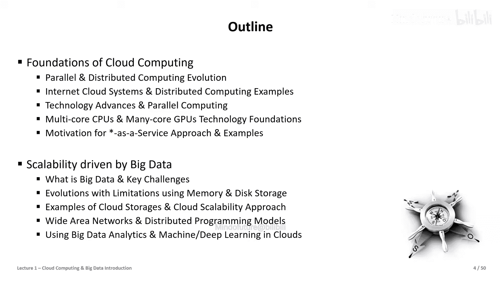

So let's start by the foundations of cloud computing this is all fueled by large data centers and this is not obvious to you we will see all that material lies in lecture for actually there will be a complete lecture on data centers how they look on and also you know as I promise in the prologue every year we usually go to one of the data centers here in Iceland with a course we will visit basically one center and also touch metal as we will say you know really look at all the racks。

 how a data center operates and where you can have also questions and so on and we'll also see that this is a large amount of infrastructure parts where virtualized resources are there that you can access remotely right this is of course a key element in the course and in cloud computing you have your laptop that is you have bravely at home or here in the course and whenever you use a cloud you would have some request to it shaping this interesting name cloud right so it's dynamic and we will see how that material lies。

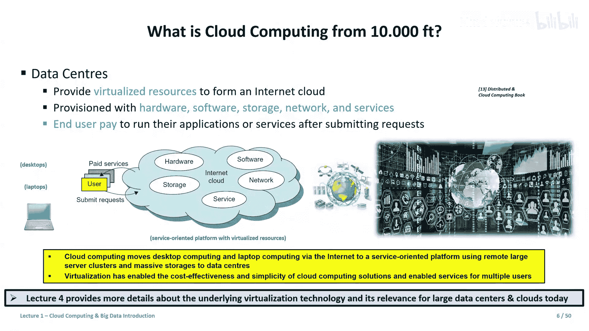

When we for instance add more storage or remove some storage。

 add some computing hardware or remove some computing hardware usually this costs right you will see there I will always in the coursework connections and make examples to of course the costs that you have in Amazon Web services Amazon。

 Asia， Google Cloud when you use these services which is of course a business model right but the service character is really important and another thing。

That is really important in this is the sort of idea that you you really can easily access it with the web browser。

 you know with all this different services and that you can basically bind these services together on the infrastructure as a service layer。

 connecting it to platform as a service layer components and then you know create a software as a service layer approach。

For all of that to work virtualization is a very important term。

 this is now in one on1 computer science so many of you should know already about sort virtualization。

 but we will also pick it up again lecture 4 and well also show you why this is basically you know the case at virtualization fueled so many aspects of this and this is a bit out of syncoo because normally would have continued with this lecture4 already at lecture2 but to give the assignments early out we had you know feedback from students would be nice to start early with the machine learning elements and a little bit on Apache Sp and clouds before we can come back to some of the fundamentals in data centers。

So。😊，When you think now about cloud computing， it looks like it has been always there。

 but there was lot of evolutions in the past that really fueled it in parallel and distributed computing。

 really complicated technology round on high performance computing， as we call。

 where you have basically the idea of the difference that high performance computing usually stands for these large supercomps。

 which are really having， you know very good interconnect between the different notes while high throughput computing usually you see here。

 a little bit of boxes， smaller computing entities that have not really a very good interconnect。

 Both paradigms we will see remain throughout the course and essentially our paradigms given that name。

 So you cannot exchange the one with the other。 right， otherwise， it doesn't make sense。

 So high throughput computing as another goal that high performance computing has and we will also see the applications here in the course。

 we perhaps a little bit moreiented on H TC every now and then， although we also use some HC。

techhniques especially when we train deep learning networks because elements like Ho that are then doing you know distributed deep learning also rely on some of the HPC and MPI techniques things we teach rather in the other HPC course but some of it will be coming back here so hence instead of using you know a very big computer only in the cloud the data centers are all connected and the data centers are really few but different let's say sort of entities and with this giving you access to basically these paradigms you have heard now HPC and high throughput computing again it's often HTC but however the underlying techniques like using JPUs at scale and so on are often also really highper computing techniques and again the difference is very nicely visualized here HC is mostly characterized by having a very good interconnect between the nodes while rather HTC。

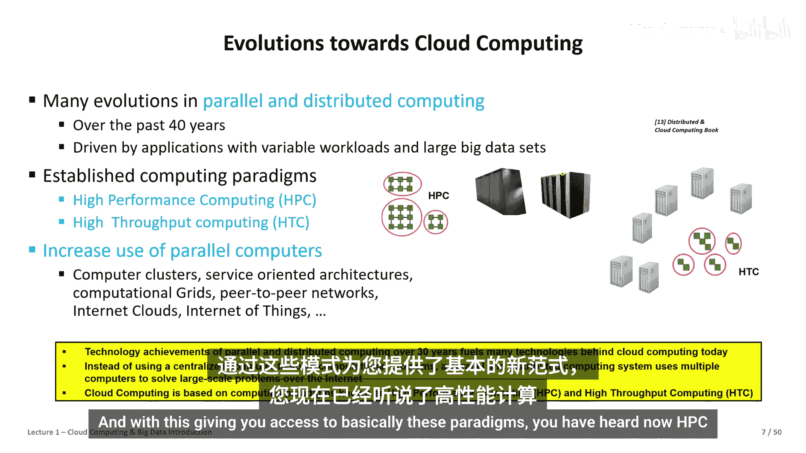

in the past， maybe commodity PCs or so we will learn about this a bit about Boeing and so on。

 where at least the idea is that the network connection is not so important you solve the task individually and then combine maybe the results。

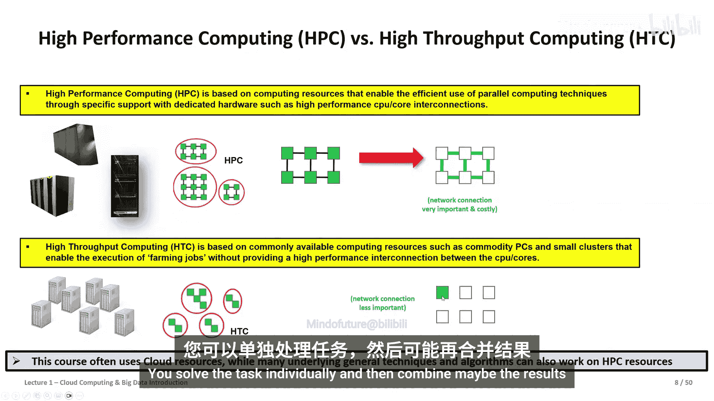

When we see this in a bigger picture and again we come back to this in lecture four。

 there's really this convergence in a way where you say internet clouds have been let's say formed by more and more convergence of this technology。

 there was always a world of HPC very costly systems where the interconnect is very expensive。

You and then you have clusters and so on that really had done you know lots of scientific computing in the past less maybe an industry or some industry engineering application perhaps while the HTC systems have been a long time around for P2 P networks distributed computing in a very much more high throughput computing fashion。

 so really data analysis at scale or data analytics at scale。

 and by bringing them together to something which was coined computational grids right so grid computing。

 there was sort of a convergence more or less of these two systems by really connecting them together。

And you know building these cloudlike things that you see already emerging here very dynamic。

 So depending on the user needs， a serviceoriented architecture can give you many things。

 you just swipe your credit card and you get maybe a small HpC cluster than the cloud a couple of GPUs you need you swipe your credit card or you have apache spark which is usually more rather on HTC is mapre techniques So in the end。

 and then of course， let's say the internet itself evolved with 2。

0 internet clouds in of things even have more more measurement devices sensors you know this now from Philips basically right from your light that you can steer with a simple app at home while you're not even there So lots of these movements together coined in a way now what we have the clouds and that you know which was not so obvious 20 years ago when I started in the field right so the systems to use you see here the yellow ones HpC H systems were relatively hard to use setting。

But mapreduce cluster was very hard， lots of different configurations using HPC systems dispatch systems。

 scripts and you know lots of interesting you know libraries is also not the simplest but the idea of the Internet cloud is then really to abstract from all of that and make it much more easier for services and hence this was also coining now the big jump into the industry work because it has to be simple when people pay for it right scientists may be working on a job script for two。

 three hours still loving that subject while users it' the credit card can expect the high level of service quality and hence the service needs to be simple good examples you see here all over the place where I believe that most of you you know or some of you have even used。

 I guess the Google Cloud for your Google Docs document some of you may be even in Facebook if not all of you and Amazon rep services chances are that you have at least used S3 somehow a storage into。

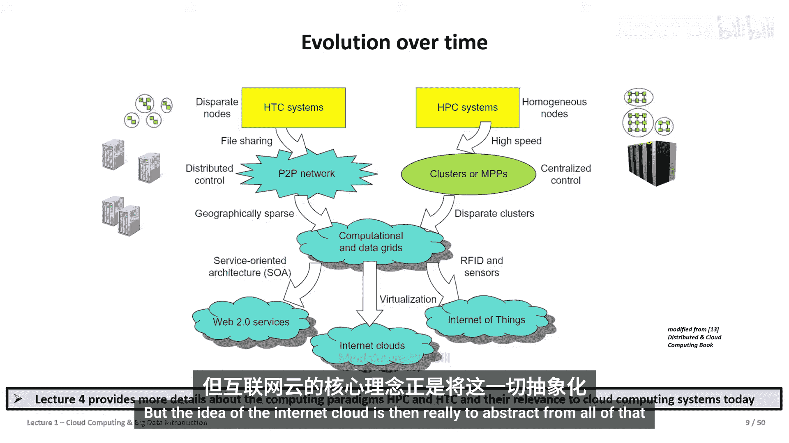

Pse that we will also cover in the course。I will not go into the detail of all of them。

 we actually pick many of those all over the course。

 and there are some of them very specialized while some of them are very general and we come to this。

But this is really the idea。That fuels you know the internet today， many of the， let's say。

 service offerings we had in the past are now cloudified or in the cloud。

 and we make the case for it all over the course。Then more on terminology that you really see the differences and a little bit the ideas of the terminology because they need to be understood when you have cloud computing even on a 10。

000 feet perspective。So。When you think about a centralized computing service or computing entity。

 you would see you know， basically one big physical system。

 it would be rather a HPC system standing and one data center somewhere， and that's it。Right。

 so and many of the data centers and supercomputers are centralized systems。

 but the cloud vendors connect them in different data centers。

 We will see this in Amazon where you can even pick the region， the location。

 which data centers where you want to have the services hosted。

 So cloud computing is larger than this。 It's not centralized computing talk about one big HPC system that is just rather something we do in the HPC course where we use。

 you know， one big large supercomputer， which has000 GPs。

And the trend there is even moving to modular supercomputing right so you see that a little bit was a deep projectject space here cluster module so these are lots of CPUs for high signals rate performance number crunching while an extreme scale booster is viewed theres lots of GPUs so let's say moderate performance of the processor but then many of them hence we talk then also very soon about many core and multicore and then data analytics modules need lots of memories will come to this with the difference between Apache had do Pepache Sp why memory is an important part and then you can imagine service at storage plays a better role this is extended these days even with concepts of quantum computing something we don't cover in the course here but a little bit in the HPC course so that their new models on you know quantum computing that we use for instance already in publications and in our research for optimizing machine learning so quantum machine learning is already an application and quantum computing we actually use。

In quantum Mans。But let's go back to the cloud computing course here。

 but you see both of these courses are a little bit connected。 They talk about similar technologies。

And hence power computing has fueled both。Right， so paracomputing can be on different scales。

 So if you use it tightly covered using shared memory， really writing， you know。

 to the same shared address space， or you have distributed memory。

 and you do message passing between them。 These are all topics that are actually again。

 more in HPC covered。 But many of the algorithms we will see in deep learning， for instance。

 are in a way， paralyed with this。 So you will see， for instance， as I mentioned。

 horror what is one technology for， let's say， scaling up deep learning， really with multiple GPUus。

 we call that distributed deep learning。 And we will learn this in the course。

Then you need the message passing， you have to exchange the gradients。

 the gradients is a learning of deep learning models， and we come to that over time。

 but this is still an important technology。

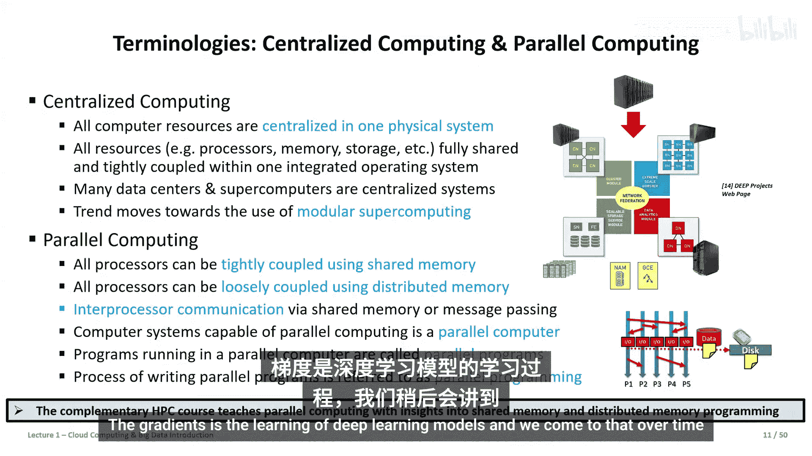

And， let's say to see the difference， to distribute computing then you would say rather it's power computing across computers。

 right， the analogy you see here from the computational grid then coined a little bit also the cloud computing these days and also more and more internet of things with more and more measurement devices coming in and basically fueling also cloud services。

 this is something where we leave the idea of one data center。

 we have multiple data centers connected， many of them have maybe different services and we even connect to these let's say via the internet today also these measurement devices I talked about and this is of course really something that applied to all the cloud computing vendors。

 they do power computing， they do distribute computing at scale really like well also see in the AWS and MS Asia and Google Cloud。

So the early examples of this， just to give you also in history on this。

 this was a little bit before cloud computing existed where the Boeing idea example for research here which also helped in CoID-19 but the idea of Boeing was really to have。

 let's say idle computers right you have these computers maybe here in ISN somewhere in a faculty then in our U supercomp center。

 someone has a desktop computer running a long time and doing nothing so this kind of resources that were unused。

this is something where people have said well， that's a tragedy while people are not using it。

 let's bring them together and this free unused computing power can at least help a little bit with some you know elements that we use in science and there were lots of them you know basically building on the Boeing infrastructure really in terms of you know which kind of different science problem you want to solve。

 we see here the example that you know CoVId-19 outbreak was used with this Boeing so it's still onvogue is still used a term that we call CPU scavenging right so basically that means this free unused computing power this is a little bit let's say in controversy more and more especially if you think about now you need large scale GPUus for many things because largely you would say that the energy for running them here idle and so on。

 usually there new techniques to really getting them let's say deactivated or maybe you know。

Shutting them off until they're not used because of the energy。 Hence， this is a more older topic。

 but it fuels the idea where then cloud computing came from in the past before it existed。

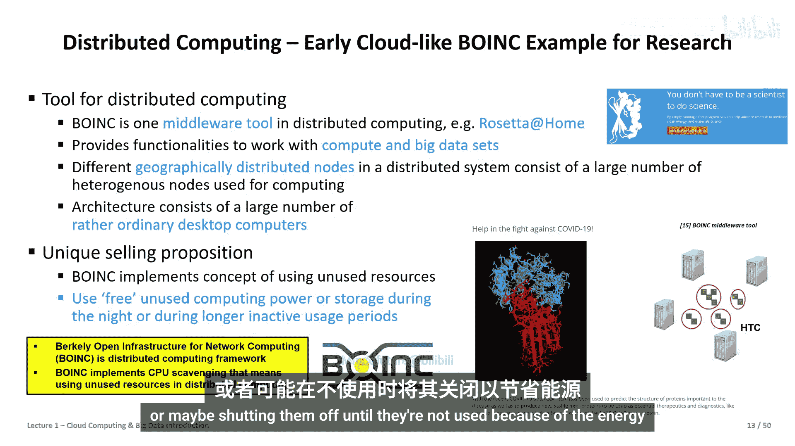

And then one of the first really key services that you could say count。

Coun in the naming of this computing cloud， which is the elasticity， right， elastic computing cloud。

 the E C2 services that have been coming from Amazon very early， while Amazon， many of you know。

 as a bookstore。 They had already a very fantastic cloud infrastructure underneath。

 which they also gave out for computing needs。 So this is an interesting approach where directly。

 you know， you again， as a customer somewhere want to access some remote， you know， computing power。

 but sometimes you would say it's enough to have， let's say one rack。

 But many times you have something what we call maybe， you know。

 for tax reasons or so you have to have big computing pikes。

Or you have a large workshop where many people try out your products a demo session for your game。

 and suddenly you need much， much more computing。Instead of putting this in your own cellar。

RightIn the company， this is just a period of maybe one month。

 It does make sense to do this just for Christmas shopping of your customers and say， well。

 after this Christmas， you know， my load on all of these different services will go significantly down So the elasticity enabled the cloud to say。

 you can always have more resources or less depending on what you need。 of course。

 you swipe the credit card for it or you you know save money if you take less services。

 but it's a way label。 And this on a basically clickbas。

 we will learn in Amazon and Google and MS Asia， how this is actually true。

 It's very simple these days to create this so-called E C2 instances that you see here。

 which are then， of course， leverage also many of the others that are existing in the Amazon Web services cloud。

 like， for instance， storage you see the S3 stands for storage interface will come to that later in the second part。

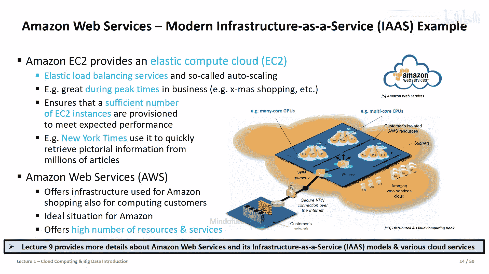

Now， also， the types of computing is， of course， a very important factor。 You know。

 the E tools would be giving you the possibility to have multico CPUs， but also many core GPs。

 And the same is also true in all other cloud vendors。

 So we have to talk a little bit about now what are these differences， right。

 So you cannot leave a cloud computing course without knowing multi core CPU and many core GP。

 So in in one respect， I hope it is already part of computer science  one or one。

 So everybody who starts in computer science should at least know that。 Now。

 when we talk about multi core CPUus。We have largely， you know， lots of different chips。

 or let's say， lots of different processor on one chip。

Right and you basically have them with a very high clock frequency， they are really number crunches。

 very good in computing and different cashier he。 But the trouble is you cannot get the clock frequency higher and higher and higher because then basically it's getting too hot and you have more and more arrows on the chip and so on in computing。

 So hence。This was giving us a limitation at some point in time that we cannot have just you know thousands of multico high you know high high frequency that is a problem that was basically coming up largely in the you know last 10 years than solve is this technology called GPGUs in a way so not truly because the problem remains that you cannot put just you know processor with high clock frequency again and again more and more and more on the chip up to the scale of GPU so hence as the name suggests here we have really not multiple processor。

 we have many very many of these and the reason why we can do is that we say each of the different clock frequency is basically lower。

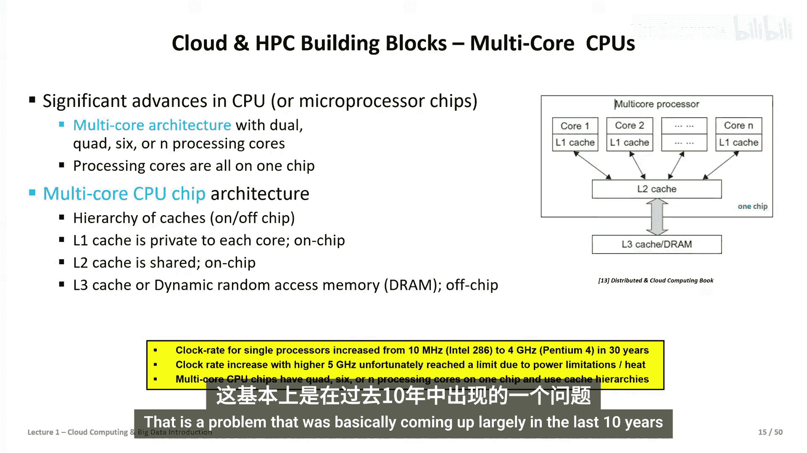

You know basically yeah you heard correctly so basically this is you know moderate threat performance in all of these processes。

 the reasoning is that you can now because the ship is not getting too hot then put really thousands on a GPU chip。

And this was sort of a breakthrough， really to enable， again， computing at scale because。

Many of the problems where GPUs come from were amazingly much more an idea of a task base or data parallel approach。

 right rather than this number crunching that we have in CPUUs。

 you can remember or some of you remember that GPUs came from the graphic industry and basically there。

 you know they have sort of a vector approach， many of the。

 let's say visualization engine parts that we're using and leveraging GPUs are using the same paradigms。

 but just with different data。And and basically in these days。

 many of the packages we have leveraged GPUs as well， so again。

 you would still maybe need a CPU for it， but you connect them as main memory and device memory in order to get to the GPU and fuel it data come back to the host CPUU。

 but there are also new elements where you can have much more GPU to GPU interaction and so on。

 So for you here in the cloud course that's the scale we're talking about we're not going much more deeper like in the HPC course。

 but it's important to understand related the differences between those。

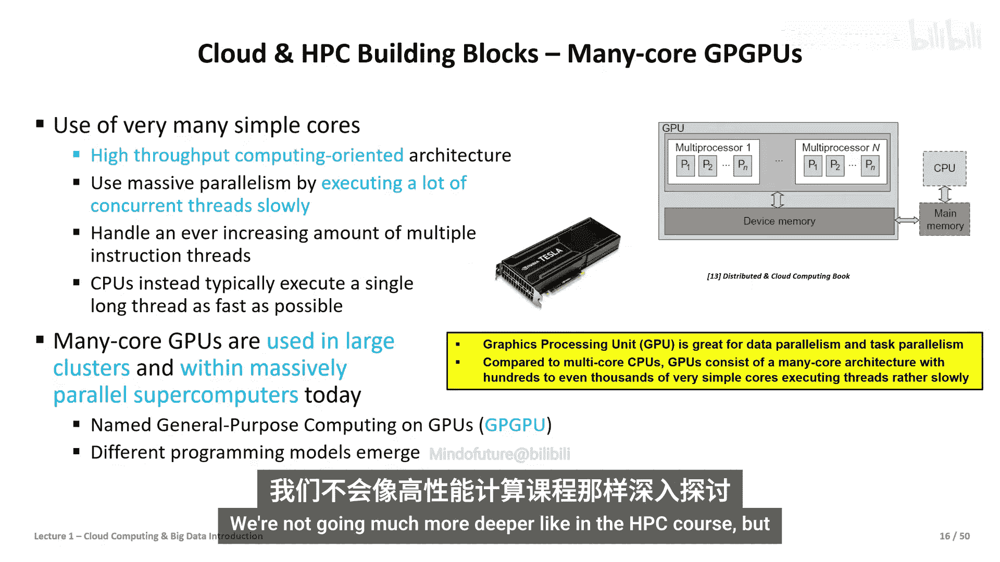

Now。You can imagine that this is now the lowest ground that we discuss the infrastructures the service with the EC2 and then the storages。

 But what about developers right that now want to do something in the cloud and develop their own product。

And you know， here， for instance， Phils， we already talked about the lightning approach， you know。

 basically at home Lightning， but you have also all the gaming industry now doing apps and so on。

 right， angryngry B is something what we will discuss in the course and so on。

 and they need a engine。 They need to know how to use a cloud at all。

 The Google cloud is here just for an example， but it nicely stands for the fact that you as a developer need a whole cycle。

 right， You need a software development kit here to build your apps to test your apps and deploy it really in the cloud at scale。

Right so upload and then you start with thinking how many computing I need。

 how much data my app needs or my game needs for user data， but also for the game data。

And then you basically upgrade this over time so it's as right so have a new version。

 A Birs2 Bordea whatever， and then you know you make a local development。

 of course with you know tools you know， but if you really want to test it and then give it of course at scale to your users you put your service in the cloud and the Google Cloud is quite nice with it we will talk about in lecture 10 much more about it。

 why this is then considered as a platform as a service platform essentially standing for it gives you already lots of services you need like for instance。

 a credit card component that you know you don't have to reinvent the wheel and program all of that。

RightSo if you want to have a game where people swipe their credit card， they are already modules。

 They're already elements like Lego breaks existing。 The same is true for a bucket store。

 we will understand， right by doing these different services together。

 using essentially the cloud as a platform， you have really offerings like the Google Cloud platform that helps you significantly and are perhaps a little bit oriented also to cloud developers and users。

 right。

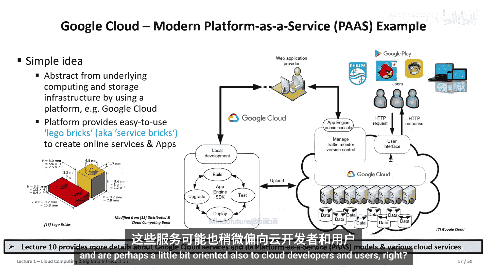

However， of course we go into some details then in lecture 10 just to give you an appetizer if you think about that。

 you know angry Bs was first failure， they had a， you know soccer game that didn't work really the team and then they started with angry birds and this was suddenly a success right the business case you already all know I don't have to talk much about it I think everybody knows angry birds but it has been quite a interesting story because it was growing rapidly right now we have movies。

 we have lots of different franchises around it but this scalability was kind of a really hard element in all of that and without cloud computing this would have never taken off right basically somehow 140 million downloads and users suddenly need to be catered in computing right if you as a company that then was a small server you know downstairs in your own sellers。

 I would say host your apps there， your data there and whatever。You know。

 then you don't have any scalability that went overnight or let's say in a week。

 millions of users suddenly want to donor it play a game。

 I mean you would be happy more users maybe more swiping the credit card， yes。

 but your server significantly fail to deal with this load hence you need this kind of infrastructure remotely and we will talk about this why this might be also better costs invested right obviously buying your own infrastructure costs but also using it remotely costs so there is a tradeoff。

But you will also see that the infrastructure is continuing remotely also to advance new GPUus comes and your own infrastructure would be older and et cetera。

 et cetera。 So we talk about this a lot in throughout the course in we also sometimes call that economics of scale。

 why cloud computing was really taking off。

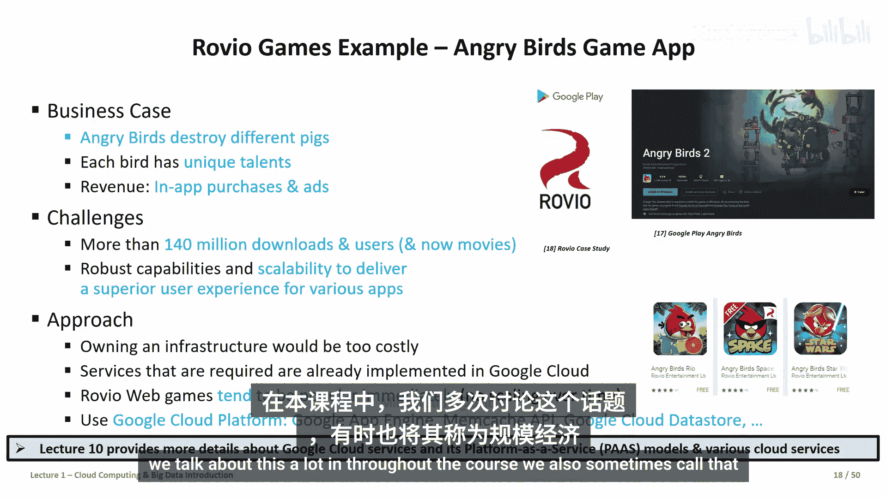

Then on the highest service layer really we talked then about Amazon Web services here again as an example just for the SAIS with a tool called sageMaker。

 we will also have in lecture 11 much more this enables you really to train machine learning models at scale again fully managed basically very easy to use while it took a lot of efforts for you to do this in your own seller if you have your own infrastructure created because lots of software needs to be built on top in order to make this happen and hence the software as a service is very attractive let's say way to bring software now to consumers to people that actually use the service and with this basically coining really on this level。

 I think the major successes of cloud computing in a way however being built still on the successes of the infrastructure is a service and platform as a service models often we see them as a layered cake right so people use EIS and pass。

Services。But yeah in a way that was really all I wanted to bring on the you know lecture first。

 know the overview lecture here in the first part where we talk much more about computing we basically clarified hopefully for you some essential technologies many core again multicore but also done the other technology elements like parallel distributed computing versus centralized computing perhaps so all of that basically enable us to do cloud computing at scale together with all of these brilliant services and this YouTube video here I don't want to play it now of course but you can have that at home to see another perspective on cloud computing so what is a cloud and so on from another one so that gives you a fresh view on the subject。

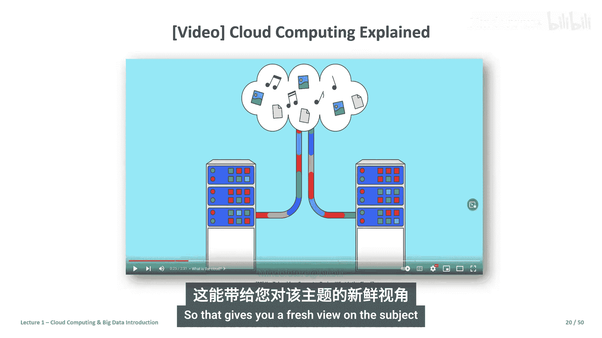

Hence now after 10 minutes of break， I think we are ready for entering the second。

 let's say area of the court， which is basically on big data and the scalability around it。

 so we break here for 10 minutes and see you then back。

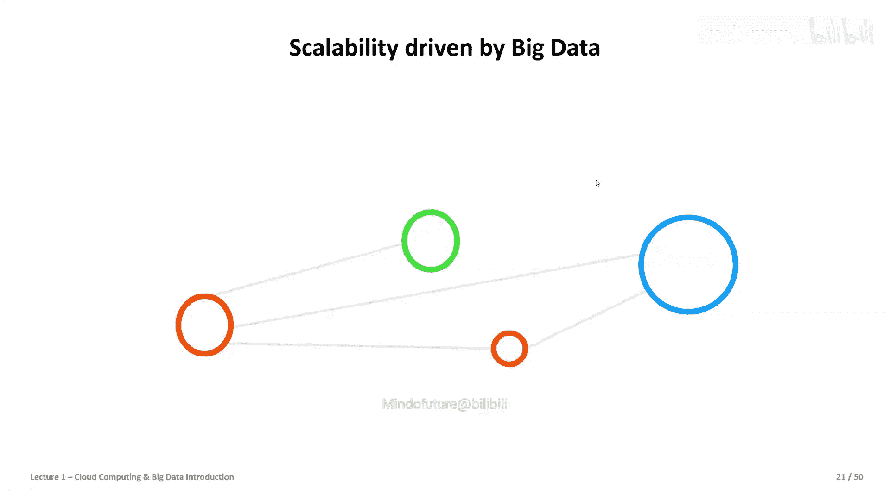