# 【冰岛大学】云计算与大数据-｜-2025-Cloud-Computing-And-Big-Data-Course-p04-P04_讲座_1_云计算_大数据_导论_第二部分--BV14MB4BjEyZ_p4-

Welcome back to cloud computing and big data today we have the lecture one cloud computing and big data introduction and it's really part two now of this lecture。

 so in part one we learned a little bit about the foundations of cloud computing。

 what fueled with grid computing， paradigms like high performance computing and high throughput computing fueled with internet clouds these days and internet of things。

 but also other elements like centralized computing versus distributed computing versus pile computing。

 lots of terminologies that then are really ingredients to cloud computing today and many basics in computing like GPUs for instance CPUs and their differences。

So the second part here today in the second part of lecture one will be driven much more on the data side。

 so we will talk also about the services again， which was a very important part in part one。

 we learned a little bit that of course cloud computing is vieweded by the service on different layers infrastructures a service platform as a service software as a service。

 but these days you would find even database as a service and other as a service let's say paradigms。

 however these extend the test of time and you will see that the service in this cloud vendors here and there can be a little bit put into this different categories。

 although I think the boundary is a little bit like you know not so clear all the time if it is an infrastructure service or for some others it's a platform as a service already however。

We will talk about this also in the second part， but think about that we now talk more about the data site and when we talk about the data site。

 we accumulate data more and more， hence the term scalability will be an important factor right so how we scale up with the data you more and more measure from satellites。

 how you scale up with data of your users in apps maybe or other software service offerings you have you have more and more data to use so how this is scaling up also when you think again putting it in the light of deep learning machine learning again。

 this will be an important factor So let's start a little bit by understanding the term big data。

 we had this a little bit already in the first part also in the prologue if you remember where we said a little bit again big data stands for more more volume for instance。

 but you see also that different factors。

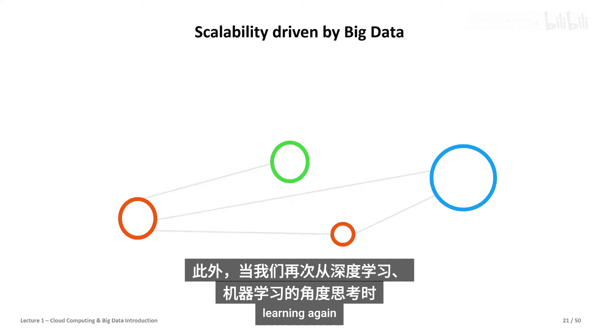

And this really fuels deep learning these days at scale when you have the right computing infrastructure。

 right otherwise you're in trouble because your little laptop is not handling terabytes or exabytes anymore on payabytes。

 So when you really talk about large language models training this on a little laptop this would fail you can use them for inference that's what you will all do basically with Chet UPT and other things。

 but of course， training them so preparing them learning from data。

 something which is not not obvious to you， but we see how that materializes in lecture too when we have a machine learning introduction very briefly on a moderate scale。

 but then you understand the different phases of machine learning much better than just training。

But long story short big data in a sense is volume right so a that's what all were from us somehow understood a good examples are satellite data you see that here from the sentinels that we have basically in the orbits producing you know of terabytes and petabytes and if you then you know take let's say the different images that you obtain that are not actually just photos theyre also you know different spectrums of light hyperpectral multispectral data sets that you can find so all of that is actually much more data than you think and with this we're talking quickly about you know data in terms of volume so growing to exabyte these days and even more in the future however。

It's not only volume， so initially big data was referred to as the TriVs， volume velocity Va。

RightSo it's not a problem， you know， to store maybe one petabyte。

 but one petabyte per every second is a problem。Right and if you think about now that the satellites are always going over the earth right in a constant orbit again and again。

 taking data， taking data constantly， we talk about a growing rate。

 accumulation of data and there the velocity matters as well。

 it's not only the volume it end up to more volume。

 but the velocity to handle lot of this complexity in different measurement devices for example are a very important part then over time there came more more views variety。

 veracity， validity， then for a little bit of the data challenges really than also that you had with it that the data more speak yes。

 but you know you have lots of different types of data you have image data you have you know sequence data sets or language data sets are sequences of characters but also measurement and there are not only images that could be also let's say measurement devices of values so lots of variety that you have to put together in order to。

 for instance， use machine learning to make something useful。

Lo of this modalities of data some people also call it so hence it in a way over years came up to a sort of inflation of the Vs and there are many attempts for definitions of big data it's very essentially hard to say what is now the perfect definition but I think one that is quite nice in context of the course is the one that you see here big data is data that becomes large enough that it cannot be processed using conventional methods so this stands for things where we have a serial implementation of SVMs for instance。

 let's say something on your laptop。And then you want to have you know classification with SVM so basically understanding different classes in your data。

 different types of your data so and you can't do it because the data is just too big your laptop breaks so this is where in a sense big data starts it's a little bit illustrated here again。

Right， so this could be a definition of big data and one respect which fills now the idea of the course。

 why we need cloud computing resources， why we need basically that remote access to services and。

Also， of course， think about now that all the corra for text data that you have in countries might be very huge in IceN that's not so huge we talk about a low resource language unfortunately。

 but many others have lots of data and storing that all on your little laptop and then computed on one GPU maybe for hours and hours and days and weeks and so on will not the way to go hence cloud computing to the rescue。

 four big data and order also to trend deep learning models as an example and large language models we will have as one lecture。

 but also you can consider this is just one example for this area here where we really need lots of computing and data satellite data is another example I will bring often because we also do lots of research in it。

So hence。There are really challenges around this topic and several of ones means again。

 the idea that I just alluded to so volume yes， that's tough， I said， okay， one petabytes。

 this is a square kilometer array， a scientific device is built。Um。

 that is basically out of the course idea， what is its about。

 take away the message that will generate data of one petabyte。

And now you would say well we have tape archives， we have large disease days one petabyte doesn't seem to be a problem and in fact it is not a problem for supercomputing centers we had that over years now the trouble that you have usually is 20 seconds that comes afterwards so the velocity combined is a volume right again one petabyte every 20 seconds is a challenge even for supercomputers today to see what of those data we have to keep right so what of these data is actually useful to keep analyzes data then the next you know petabyte arrives and the next petabyte arrives so hence this has become a challenge much more that the variety and the velocity and all these different Vs come together in a way making it a challenge and you see a different devices if you know go to the measurement devices in satellite data if you have the large headron colllideide certain they have similar problems of basically you know the particles that they search in their run。

Is really large data that have HPC system very close to it to basically boil down the data and then store just the data that is you know required for further analysis the human brain is one of the biggest largest challenges for us right to really tackle this challenge if you go down in the you know cuts here of human brain images。

 you see interesting facets we were talking here and there about it。

 why this is also a large challenge today and you can go on and go on the data produced by simulations maybe like here weather simulation or climate forecast if you go into more and more detail what these is you know suggesting here on the let's say squares you see that from fine grain。

Or basically from coar grain up to fine grain will have more more volume right and again you want to have more details in it let's say you also want to understand an oil disaster So you put an oil platform in an oil and the climate and you know the movement of oil in water than you want to have wildlife so basically the details you put more and more add also more and more volume。

So another aspect that is actually fueled in context of this is the idea of also having this data open accessible so we talk about being fair Findable。

 accessible， interpreterable and reusable the key message to take away here that many of the taxpayers' money go into scientific apparatus like you see here the kilometer array but also in many of the devices that we have in HPC doing climate simulation so the idea is to have this data really for all accessible so that we can you know build on that data。

 build on the shoulder of giants you don't have to start from scratch is all of that and again coming maybe to the large language models we will talk about this trust LM project for instance is one project about large language models and there's the idea of having for instance the large language models trained on large scale HPC resources but then also making the trustL models open accessible so that others can can use basically the language models for downstream tasks so basically。

le。Training them maybe as a chatbot for a particular company in a specific language。

 We will talk about this in lecture 7 and why it's so important for fair to do this。

 Because you can imagine that the training a large language model as an example or doing a human brain simulation or basically。

 you know， analyzing satellite data， this costs energy。

RightAnd foundation models we will talk about in the course， large language models。

 those that let's say models that we will share and the data that it gave rise to it that is shared has the potential also to save orders of magnitudes of energy because people don't have to retrain on the same data。

 they just use the same data and model that is already there and can basically build on that。

So we will talk about this more and more。And obviously this is also， let's say。

 a small contradictory topic you see that here， you see that in increasing degrees。

 but unfortunately many， let's say scientific groups here and there are still having problems of making the data open some of that is a bit obvious in the medical domain you can imagine patient data has to be handled with care so putting that open is a bit tricky you have to do you anmization an animmization taking and so on。

 but the world is getting there， but however， very much people also spend a lot of time in data generation。

 so they want to publish on their own for quite a while to get the credit for it and not just putting it in the open However。

 the European Commission is quite keen on driving open data open publications in order to make the fair as much as possible。

Knowing now that there's challenges this big data， you would say， okay。

 but we have more and more computing， we have more and more， you know。

 interesting iPhones which are almost like a supercomputer， why is there a problem？

And this is sort of the Hi he problem that you see， so when you have this tapes， the large let's say。

 really quantities we can store is usually stored in something which is much slower than things like main memory catches or caches or registers。

 right very close to the CPU。Hence， when you have exabytes and petabytes now and perhaps exabytes more and more in the future。

 it's getting more and more difficult to get this to the CPU at scale， right。

 so because of this the scale is not large a forbic data and one of the reasons is you would say you can just employ more right put more main memory to it。

 I mean， main memory， as many of you will know， is one of the fastest right what you can get in terms of storage apart from。

 of course， and the deep down details in a CPU is cash and registers。

But it is extremely expensive compared to tape archives。Hence。

 many of the petabytes and exabytes are， of course， in tape archives， right。

 and only those that say bits and bytes， if you want that you really want to work on。

 you will basically put out on the disk and then put domain memory， etctera， etca， and compute on it。

Hence。😊，There's a little bit of a problem that in， although we advance a lot in， let's say。

 computing。And of course， in capacity in one respect。

 because many of you will have maybe a home heart， this was for terabytes already， right。

 which would be funny if you think about it 20 years ago。

 we still didn't manage to advance significantly in the bandwidth of this。

 So GPU's advanced a little bit in this。 So we will see a very interesting numbers to come basically from GPU memory to the GPU course later in the course。

 but still， we are not there at full scale everywhere。

 and hence the big data problem in a way still persists。

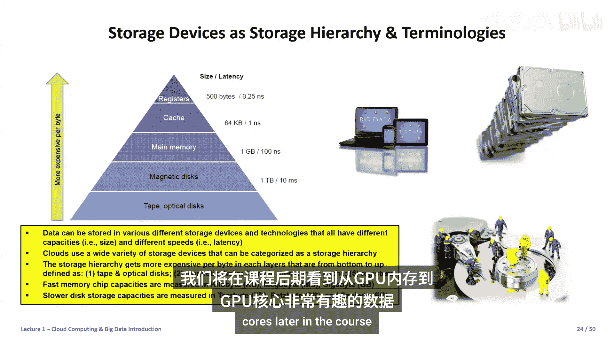

And can be considered a little bit as a memory wall So hence for us。

 the biggest challenge right now is not just to put more and more computers to it。

 but the problem is rather that you know the storage is not keeping pace or let's say to fuel the CPU with data has become basically the biggest challenge these days right you need very fast storage if you talk about exabytes you need extremely fast storage closer to CPU。

 this would be very expensive in the order of capacity we're talking about in exabytes hence this is still a problem today especially if you think about you want to learn from big data。

 you don't want to， let's say you know have just you know a fraction of the data looked at know when some of the language model really counts how much you know corporate you really have as text there so you don't want to you know basically。

Have less and less data because machine learning， as we will also see later。

 and the proper machine learning course tells you， the more data usually the better if it's high quality data。

 right， if you're swimming in data， it's always nice， unfortunately。

 there's some other problems in it， there's often noise in the data and other aspects we will see also lecture2 and the remainder of the course。

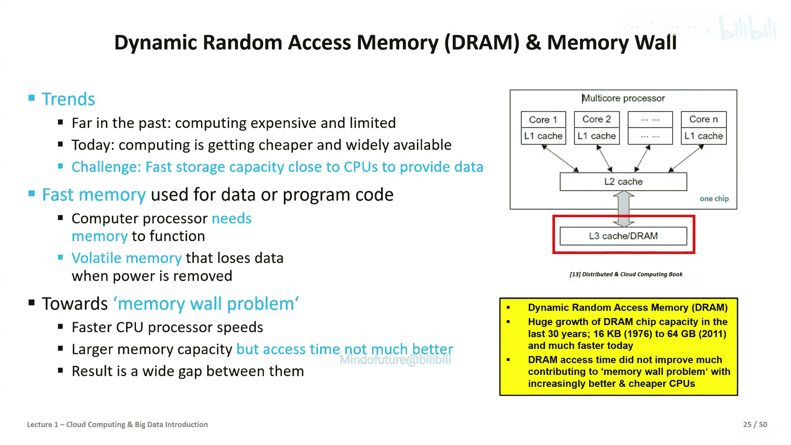

But take away the message of this sort of Dram gap。

 which is a little bit also characterized with this one here just that you have another view on this problem。

 so here we are with a big gap that you know here we are inside a CPU。

 this is working nicely and we can put more and more CPUs， yes。

 but the main memory and so on and all of that is really costly to do really at scale in orders of petabytes like the tape archives or disk here in terms of you know large terabytes and so on。

It is basically， you know。In a way all too slow and too costly to employ that at scale that we need of course。

 people have dealt with this in the past and basically also now come more and more to solutions。

 we will see some of the GPUs today are quite nice already working with this still it coins also the essence why we need this more and more data centers that you see everywhere right whether they really work with big data they have lots of capacity petabytes。

 exabytes and here and there do it also in a way that you can at least you know go quickly to the computing。

 but usually also you have to pay the price for it right so you have services that you have to pay for instance in Amazon you will see different services the glacier for instance。

 is something which is sort of an archive where you can easily store petabytes you know with a fraction of the cost of putting it just on normal S storage where it's accessible directly and then you really survivewi the credit。

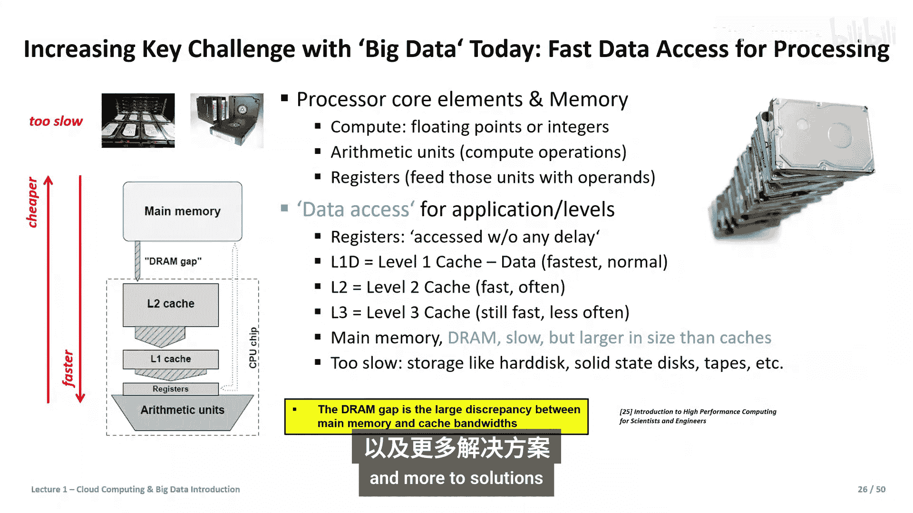

But these are things not maybe obvious to you， but think about that the scale matters and also with this the let's say access to computing needed or let's say the response time in computing when you have to think about everything should be as a service model。

We come to this again also back in lecture 4 so how we deal with this。

 especially if you think about that disk will fail in operation computing will fail in operation。

 so if you have let's say an example of this disk area there and one of the disk is failing so how you deal with this in a data center and so on these were all topics of lecture4 and also how they really scale up so much。

Then coming to the idea of， you know basically what's happening with many of the big data and storage again that we had in this measurement devices I told you from the scientific and engineering domain but also covering more and more the industrial domains we have something called the European Open Science cloud that really drive some of the fair actions in the European Commission space or in Europe and the European E area where Iceland is in that different projects underway that really fuel this technology so that you know researchers have really。

 let's say a place to store data。And we had our Eos Nordtic project where Ion was in and we had in part in UdD。

 a European data infrastructure， for instance， where we developed B2 stage， B2 save， B2 drop。

 there were different services that all basically their different cloud services for researchers and for engineers to store data。

And they have the same， let's say here and there Mooforandi that you would expect basically from cloud vendors so you know B to drop is in a sense。

 a Dropbox right so Dropbox was cloud service here in the more industry domain and research is needed so they created something which is of less cost because otherwise the scientific you know the scientists and the researchers need to have large credit cards and you can imagine that's not the case。

 on the other hand， they create often foundational data that can be used by SMEs by industry to basically get you know better services out for the people and of course get good revenues So hence there's lots of activities underway and I will also talk lecture 11 much more about your service landscape a little bit know all this is also fueled by software service。

As a let's say amplification factor， if you want to all SMEs and public sector organizations that really。

 you know develop and can build on these data sets。When we come to the industry domain。

There are also of course lots of interesting services available。

 one of the most popular one and some of the people quoted even as a de facto standard in you know basically this storage as a service if you want is the S3 interface sos a rest API there's a soap API these days rest is probably much more used to access a sort of bucket store。

RightSo this stands for something we call object storage。

 just because you don't care anymore in which let's say directory or where on which disks it's really stored。

 you just want to store something an object right and it has somehow a key to find it again。

 it has some certain value in order to find it you need some metadata and you don't want to share it with everyone。

 So there's some access control related to it So but the bucket store should make it very simple to just drop data and then share perhaps with some others or with your ion applications and this is a very popular service that has been built for in the Amazon infrastructure you see here。

 many of the people and in infrastructures and others that say industry partners are using it from Netflix Airbnb up to even scientific ones like great scope。

 some of you know is basically also using here and there some S3 at least in the past。And now。

 think about that。 You could do the same in your own seller again， right。

 You see nothing else is underneath in a virtualization layer。 You can do this。

 createate your own virtualization。 Let's say product on top and buy this all in your cell。

But what do you have then is a trouble in these elements right you would say scalable so let's say suddenly you need much more objects to store we have discussed these possibilities with you know basically end of the year for taxes or Christmas shopping much more you know users much more activity in your shopping。

 whatever it is what you do as a product chances are theres some peaks in load。And you know。

 when you do this， scalability is a big problem， you cannot just you know。

 have an optimal infrastructure， add resources， remove them because it takes a lot of time for your SME。

 for your startup， whatever you have， for your app development， team away to do hardware stuff。

So you basically take away the focus of what you maybe want to work on。

That might be maybe at the beginning， quite interesting to do when you have the very early concepts。

 but very quickly， you run in the scalability problem， but also the durability problem。 So you see。

 as I told you， many of the things fail all the time。 You know。

 basically hardware will overheat if you're running at 247 in a service character as clouds do。

 you can see that mostly many of these hardware will fail。

 but still Amazon and other cloud providers can offer it at the 99。

9% availability because they have virtualization can do swapping and have different mechanisms in place to really get rid quickly on。

 you know， the damaged hardware by having， let's say。

 different data backups and can host the service and on another device。

So hence you have really a very， let's say， high durable high scalable approach there and let's not forget that configuring today security is also not the easiest we have seen many of the hackAs cybersecur is on work with this even ethical hacking。

 but unfortunately also lots of unethical hacking happening， so security is also key。

 especially if you talk about your customer data。Remember the Garmin case。

 right where all Garmin users， you know， have been exposed because they were a hacked。

And then ransom and so on。 So this is something where you company is also a threat。

 I don't talk much about this。 You have my fellow professors， Tom Welsh， for instance。

 or Noke talking about this in other courses and you know。

 also we have a national Compnce center for cybersecurity。

 which I would recommend to talk to you there。 But you can imagine that you know。

 the cloud service providers， Amazon， Amazon， Asia， Google Cloud platform。

 they really put lots of emphasis of making it really secure， right。

 and also think about that the data center where the data is in the end stored， right。

 We always talk about that in the end， theres a physical hardware somewhere。

This is usually very well protected and we will also go to a data center in the course where we will see the data center is not just you know next to bonus。

 next to a supermarket， it has been quite some protection mechanisms around in professional ones receiving see man traps and so on。

And then the easy migration with APIs is another part， you know。

 these days you have lots of service based developments。

 you use lots of interfaces and for this you also need lots of service characters combining them which are then automatically integrated and can easily migrate from one service to another。

So many of these factors basically means that it is hard to beat。

 you know these kind of services by own infrastructure in the cellar。

Unless you really have a very big HPC requirement， you know running a large HPC cluster where you have also economics of scale。

 you have already people that are administrators and do this daily， otherwise it is tough to do。

Another element I wanted to show you is theSt cloud operating system as I thought already a little bit in the prologue。

 this is changing the view a little bit when you now think about that your boss is coming into the office and you says create an in-house cloud please Also Opentack has cloud software not only for computing you see your containers virtual machines and so on in the compute area of OpensStack and we will talk in lecture 15 about it。

 it has also basically already everything you need similar like Amazon object storage block storage and file storage with different that say components that you have an openstack that you just have to put together in order to get you know a distributed you know kind of cloud platform on your own this can be useful as just said to you maybe it's not useful to have own cloud and your own hardware but think about that you have a couple of servers with very sensitive data that you want to work on here and there but you don't want to share openly the cloud。

We call that a hybrid cloud then you keep private data more inhouse， for instance。

 a hospital and then you know for some of the data analysis you would consider AWS when it's ananymized pseudoized via APIs and so on to share it still you need a proper way to store it and so on and needless to say it had also other components like networking infrastructure and so on。

 but this is something what we will also talk about in lecture 15 at the end of the course because really sort of a special needs topic。

 you know， but you see also that many of the services we have these days are basically built on Opentack。

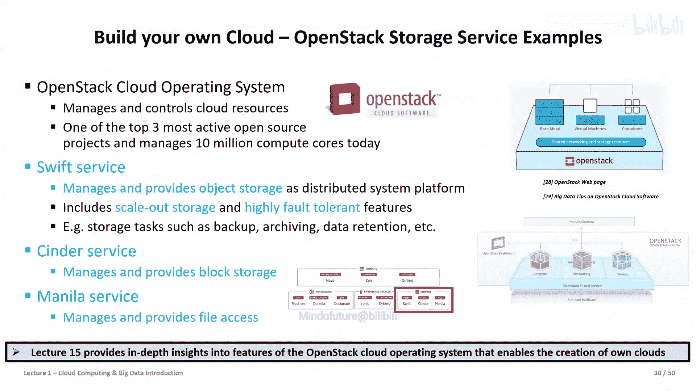

Then for big data examples this is of course something where you may say。

 no who is generating all of this data， I mean this goes without saying Facebook， YouTube。

 maybe even Instagram these days is much more like Twitter in terms of content generation and this is really something where the data is growing very unhomogeneous right it's not like a relational database that you maybe had another courses where every field you know of a person is filled。

 everybody has the same type of information hence you need much more different let's say areas to handle it in one respect online social networking aspects can be seen as a big mesh you know with all the likes and all the you know tagged and interactions that you have with the content and the people using it so hence it is building let's say something like this。

 growing really unhomogeneous you never know could be a big event you know which suddenly。

Go viral and everything grows into this direction in the trees and in the you know kind of areas of the mesh。

 So this is something where your infrastructure need to work on and Facebook has managed us quite well with basically an own database strategy which is more or less a graph database right so capturing this and their graph databases around capturing this problem much better than perhaps for instance a relational database could use us。

 but they are also key value stores things we will come back a little bit when we talk about mapre and other aspects in the cloud that enable us you know basically to use these。

Big data elements and you know basically have a very interesting technology for it so this is a new element that we don't have this more in detail in this course like in the previous years。

 but if you go back to the last year course you will see in the YouTube playlist lecture on it this year we basically exchange this lecture as a large language model because this becomes much more popular these days also in the light of ChetUBT and many other large language models which are around this trial and so on hence I will reference you here please if you want to know more about this graph databases and Facebook and all of that please go than to the last year lecture。

So with all of that said， coming back to some of the ideas again for foundations right so the scalability and why basically this is now an important factor that you know we need good networks。

And one of the points is the accumulation of data again， right so while in HPC。

 many people maybe transfer the data then to the HPC device in a big cluster， take it away again。

 we talk about now that many of the data is just growing right in the silos， as you see here。

 more and more with more users of your app with more data analysis that you do on， you know。

 your science or engineering activities， whatever it is。And hence。

 the data locality becomes a major cloud factor。Where you know once you are in a cloud and you accumulate your data there it's very hard to get it out and in again also this is actually related to costs right so this is another element where we will talk about in the course so network interface costs or putting data in and out in is usually not so much a problem but out again and so on。

So。Hence， this was fueling another sort of paradigm which we will talk about in the course in lecture 8 well start with this with mapreuce many of you will know that that you have maybe a rather high throughput computing problem and you would say you would put smaller computing tasks to it which was fueling the cloud again so you maybe don't have a cloud Xscale HPC system everywhere in Amazon but you have smaller computing entities that you can easily do some summarization summary statistics or as we discussed in the prolo last time you know the newspapers say in newspapers we have all newspapers of particular brand and then we want to go through that and see what of those have been on politics which articles and it a specific name mentioned there So this is a high throughput computing problem we don't need to interact on this unless at the end we want to know how many then we can give it to many different tasks and computing on it and this was basically fueling the idea at the same。

Time growing to big data。The momentum called big data analytics。

 write over the ideas you have a scalable programming model。

Wwhichch says we want to have more and more tasks close to the data instead of moving the data again and again to the computing it's maybe not totally obvious we will see all that material realize when we have lecture8。

 when we talk more about the mapreuce approach divide and conquer essentially。

 but it gives me also the important opportunity to really show you a little bit also on the differences on this because many of the data analytics frameworks are driven by very correlation that you feel a lot of data in and then you know you analyze this data。

 you have novel patterns and you see that what happens is much more quickly。

 but be careful on this right I mean often the data speaks for itself， yes， so if you have。

 let's say， for instance， now you know the correlation that this particular politician is always in this particular newspaper we know that already some in the politics the newspapers are a little bit driven by particular political opinions。

 but you would say it's not really causality。In a sense right so describing why something is happening and there's this important。

 I think example that I also quote you often is the idea between you know Hamburg and I think there was this idea that the birds that give the babies you know they are suddenly and a very high number seen in the city and you can see in the data based on correlation that basically this goes together with a birth rate right in some point in time in history but I think we all know that the birds probably didn't gave the baby right or I mean didn't bring the baby it was probably someone else so but for correlation。

 this would be some interesting finding would say wow suddenly you know these birds really have something to do with it and then you know。

 this is different from causality where you really describe exactly why something is happening and this is still the data analysis that also needs to happen right and this is。

Of course， often something which could be a whole PhD theater is really， you know。

 sometimes going to the wrong pass， so you know you analyze a date instead of， you know。

 maybe initially look at least at correlation， so they help each other。And in one way。

 you basically have the data analysis， which describes usually something which is really based on methods。

 again summary statistics， regression techniques， lots of this is data analysis。

 you would even say machine learning right is a sort of data analysis technique。

 but you don't have the infrastructure for it， this is what big data analytics and provides you right and enabling infrastructure that often includes technologies and the infrastructure to make then correlation at scale happening。

 but you use this infrastructure then also for causalality。

So these are very important different terms， which could be sometimes misleading and have been in the past also。

 let's say the big data breakthroughs and at the same time show stoppers because you know you see here very well known example Google in the flu because there's a Google flu because basically Google could quicker you know explain because of the all their Google search engine data。

 you know you know the national scale where down to regions basically is the epidemic he just because people are googling of course。

 about this virus。

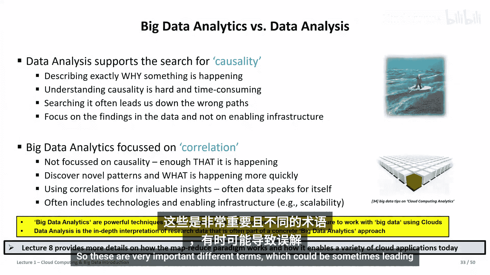

In 2009， but then they were also basically later papers that showed that these predictions。

 you know in the flu predictions were really full of  errors because essentially you know you have also someone。

 for instance from the West Coast and the East Coast and in US you know phoning a lot ass just a major example right and would say。

 okay， you have the flu， I have to Google the flu， what is this and you're basically complete different region。

 you don't have the flu， but your relative has。So there are lots of errors in this correlation just because。

 you know， there's more happening。 So hence， the data analysis still needs to happen。

 And what's a big making it difficult is then that you don't have the algorithms。

 Maybe they keep changing。In order to scale， we will see in lecture three very shortly that there's a very nice architecture for this initially called Hadoop and bringing us back to Mareduce。

 which we have done in a later case， but here we will focus really on Apache Sp。

 which does a lot of in memorymory processing。And these are really optimized for the elements we were talking about so high throughput computing。

 having smaller tasks doing particular jobs， and the difference between Hadoop and Spar is quite nice。

 so Hadoop was first sparked became more recently than their you know some interesting technology because it leverages in memory much more。

And many of the problems we even do today， like here's an example of using basically remote sensing data in the cloud。

Where encode and decoder infrastructures can also use Apache Sp for certain amounts of work and we will talk about this very soon。

 just take away the measures that this is really built on what I said earlier。

 the divide and conquer foundation computer science again here the revisit。

 although I believe that many of you will already know this problem from  one01 computer science or your part problem。

 you have many different workers and these workers scale。

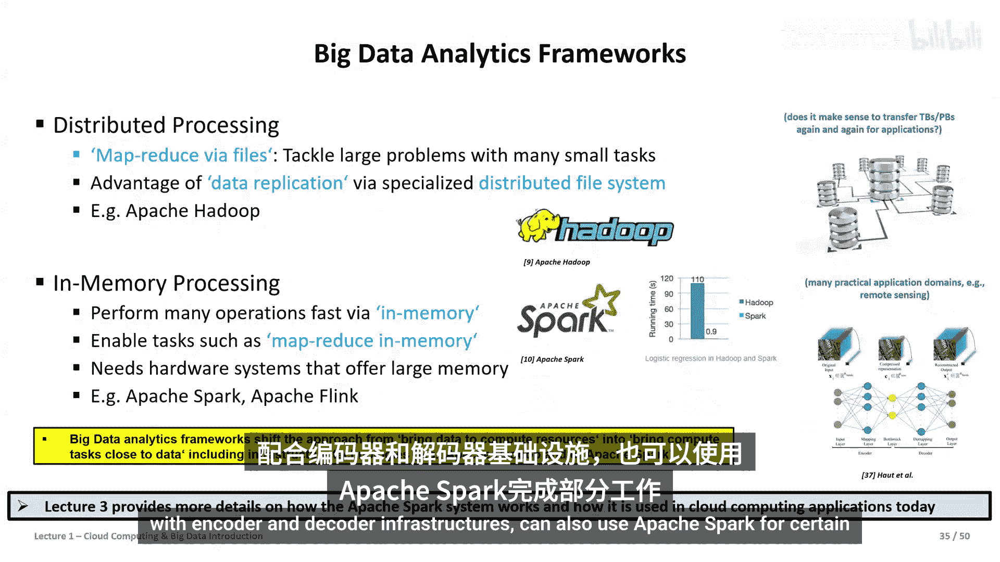

Right you can have more or less workers。And then you have combine the result and the same way map reduce works you see here different map tasks with key value pairs will then group by keys。

 and then you have this reduce summarization combined output。

 We'll talk about this explicitly also why we sometimes say map reduce is not just map reduce。

 but the framework is actually map sort， shuffle reduce。

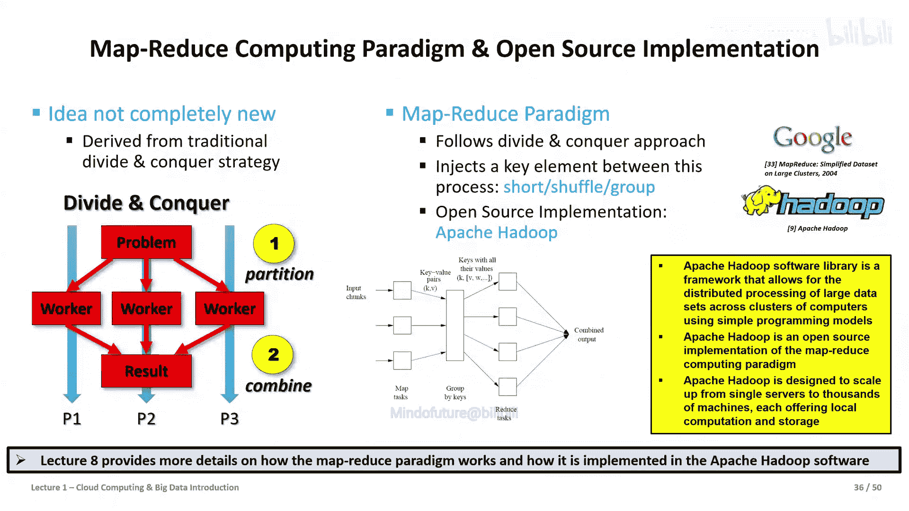

So it has three steps， this grouping， sorting， shuffling by keys is an important step。

 and we will talk about it in basically lecture 8。So coming quickly to the couple of next lectures。

 also we will go into a HD In Apache Spark， we'll do our first let's say machine learning models hence we will learn some of these different interesting libraries on top of Apache Spark and how also the Apache Spark general engine is dealing with this distributed computing and parallel computing at scale。

 with storage withIS data but also with the computing。

 so doing this data analytics will be one of the first assignments also for you working on。

And yeah so the big data motivation then which we will continue in the next lecture will be then also these different machine learning models and deep learning models we will start with a very simple model on regression but it captures also the essence of classification。

 clustering and regressions of those of you that never have machine learning this is basically the way it can have many machine learning techniques let's say group by they have a new data item you want to understand is it this or that class and we will make examples in the last lecture in the next lecture clustering you don't have basically different classes but let's say the Euclidean distance or you know distance measures of sort will give you an indicator that this might be different classes right or human eye already tells us but if you have multidimensional the data you need also you know clustering algorithms in order to find this this already leaves a little bits of space sometimes for machine learning predicting modeling rather to data mining approaches right。

s K means clustering or H D scan or David scan algorithms。

 we will talk about this and then regression is rather a trend analysis。

 usually regression stands for real valued outcome we will also have there some some different logistic regression methods that then again can be used for classification and you know bear with me this will all come in lecture too just giving you again the motivation now for big data learning from this big data sets for these types of let's say applications in many different types of data。

So this will be really a key element， right， where you have these different types of analysis techniques。

 but you have many different algorithms for it。And your infrastructure should scale no matter what you want to do tomorrow you want to do classification。

 the day after clustering and maybe then the day after again， deep learning classification。

 So this is something where your infrastructure needs to provide different algorithms and in Sky could learn and all。

 you know mapla and all of the serial ones。 This is not basically a problem because you have just one shared address space。

 you have a computer， a laptop， you have all data and one space。

 But if you go distribute it in HPC or Apache Spark you will see many different challenges arise。

 You know， we suddenly have to talk about messages。

 you have to talk about where is the data actually we learn from etca， etc。

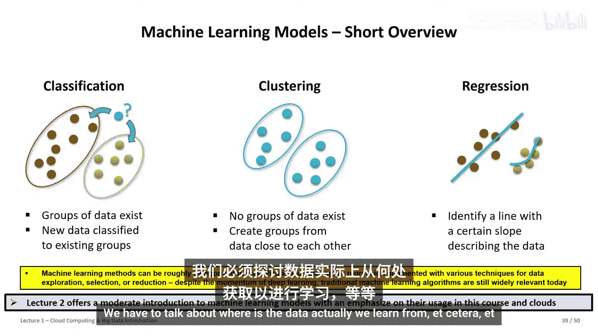

We will start moderately with an example of flowers in lecture2。And then in lecture 14。

 we will also have， let's say， a very advanced lecture where we see that many of these algorithms we talk about will have many different parameters to train and many parameters to choose from as human。

 like the learning rate， for instance， hence there's also techniques like you know machine learning models。

 you know， tuned by hyperparameter optimization or using automan tools you see that a little bit here。

 when you have， let's say different images that might be very specific eyes that can actually then predict these。

 you know different images better。We will start however。

 because this is really new for many of you I know， we will start with a very simple algorithm。

 you know， starting next time versus perceptual learning algorithm。

 really to differentiateiate flowers， you see they look all very similar but eittoa。

 esoogenicica so when you think about this flower what type of flower it is right if you tell me then I think very good in image recognition。

So then also think about that the data is not so trivial usually， I talked about satellite data。

 right， when we want to understand land cover。 This is a cube basically really with different spectrums of light hyperpectral data。

 multipectral data of sort that needs much more advanced algorithm and again， is big data to digest。

The different learning approaches， I put a red mark here because we're focusing a little bit on supervised learning in the beginning。

 become a little bit to unsupervised learning later when we talk about large language models。

 geneative AI and so on and foundation models。 But this is much say in the next couple of weeks。

 we mostly deal with supervised learning。Again， we will use a little bit the Microsoft Azure cloud so soon we will also have some practical lectures on showing you how to do this。

 you will get access to this through the course so of course for you you don't have to swipe the credit card in the course right so there will be ways how you can access it and use a cloud of course free of charge here in the course。

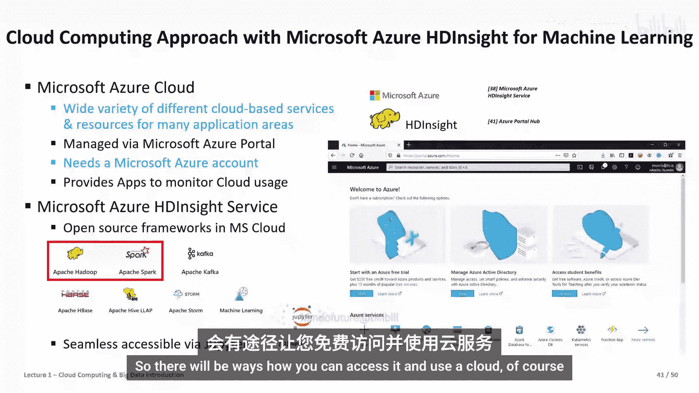

Finally， just a little bit， you know， the reasoning for using this was a stepwise approach here。

 just that you know how it works usually and we will come to this recipe again and again。Again。

 you have the problems that your laptop might be too slow， right， or have not enough， you know。

 data to store。Then you would say the stepwise approaches usually have sort of a subscription model。

 you pay pay use of resources， then you will deploy a cluster like Spark， for instance。

 right and then then you use something called Upiter notebooks with a Pypark kernel to use it。

 then you have a certain session with your machine learning。

 let's say code which you have implemented in Python then it's already time to check the application data So what data you want to learn from and then you do already an initial data analysis。

 visualization and so on maybe to understand the data better and to also prepare it for machine learning。

And then really learn the machine learning model on the spark cluster and then of course at the end you usually have some sort of an evaluation of it on maybe also refinement of your model。

So this is roughly a recipe that stands a test of time， right。

 you could also exchange a spark cluster with a deep learning Tensorflow element。

 and then you have a deep learning problem， but roughly this is a stepwise approach。

I hope this data related aspect to the cloud computing is more obvious to you。

 there are more examples of let's say big data analytics and elements of big data in this particular video which I give you as a homework of today lots of different lectures and again the thanks to my big team I help bring me a lot with research and the teaching materials so thank you very much for today and we will hear us again in lecture too where we talk a bit about machine learning and a moderate introduction see you then。

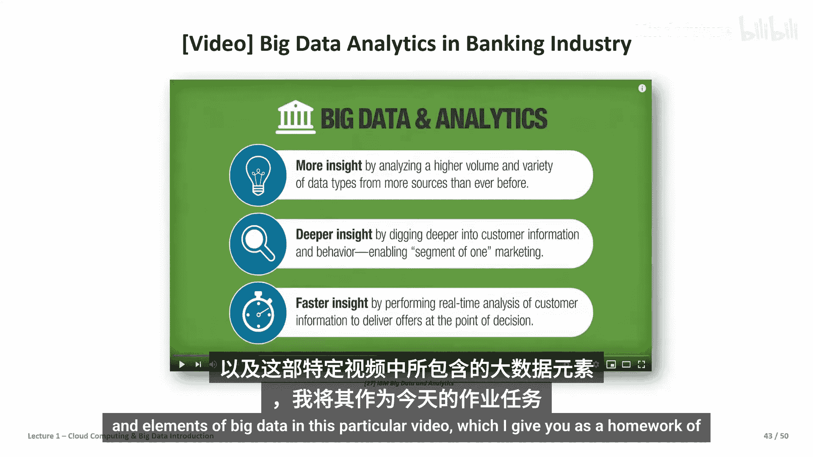

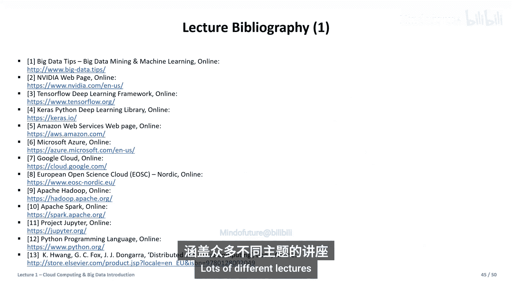

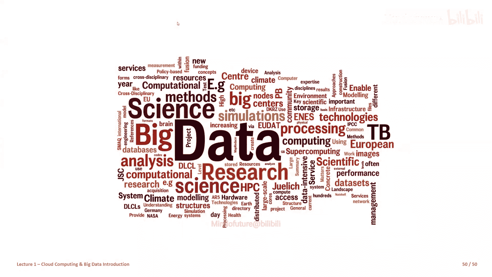