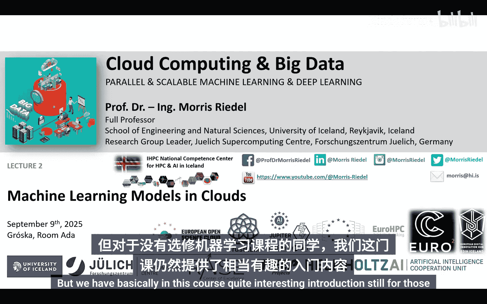
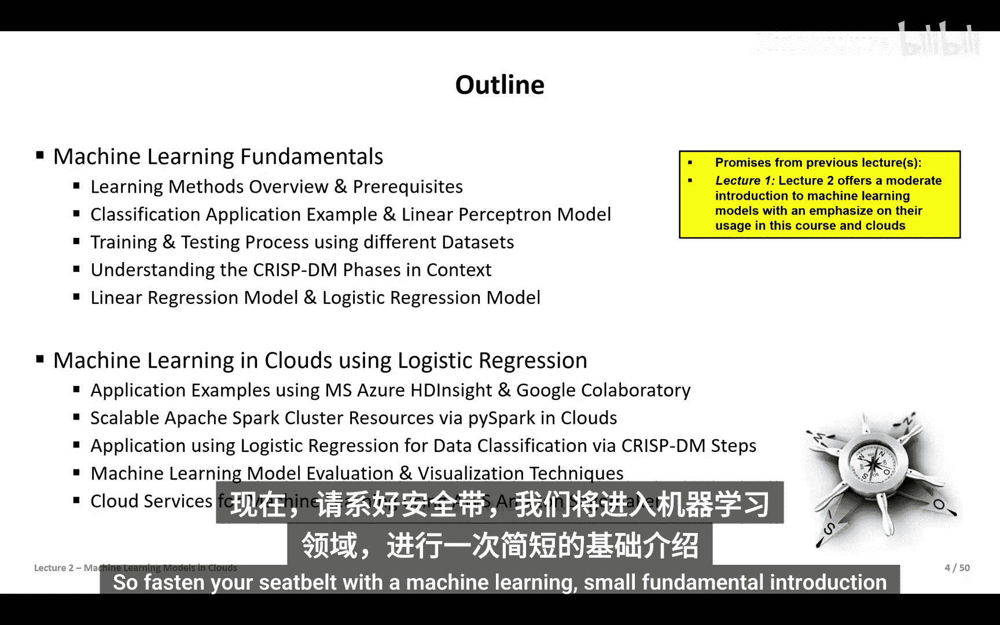
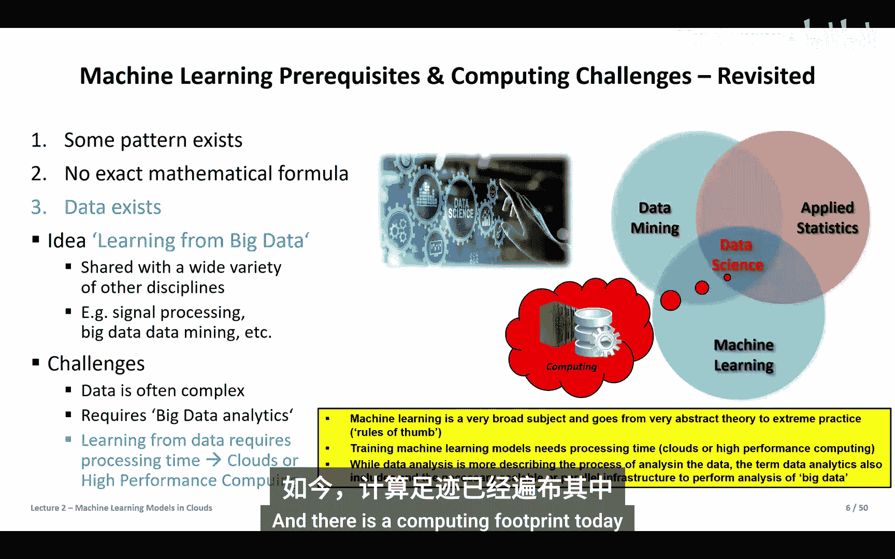
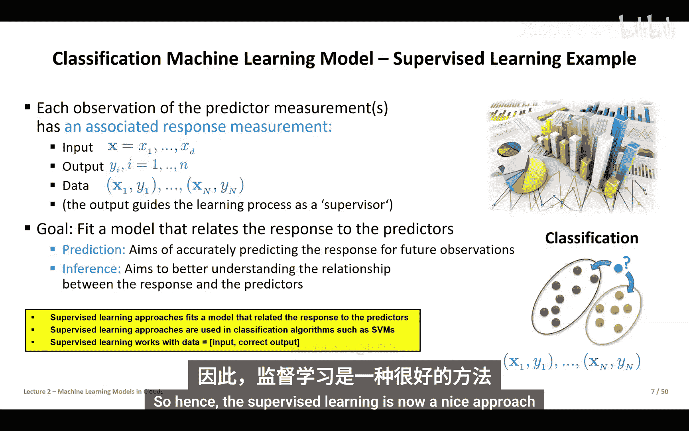
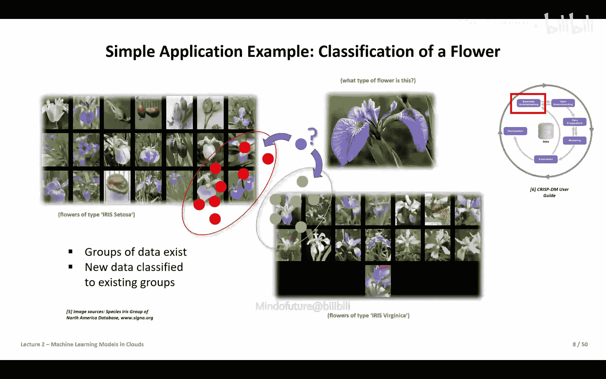
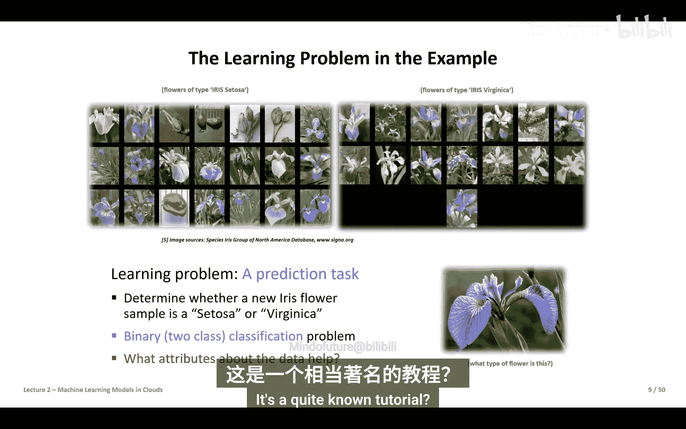
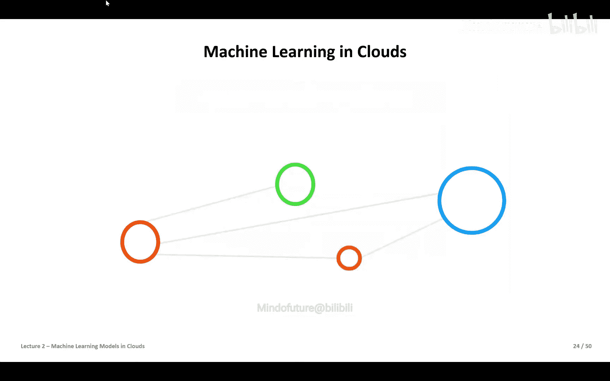

# 【冰岛大学】云计算与大数据-｜-2025-Cloud-Computing-And-Big-Data-Course-p05-P05_讲座_2_云中的机器学习模型_第一部分--BV14MB4BjEyZ_p5-

Welcome everyone to Cloud Computing and Big Data Leture2， Maine learninging Models in Clouds。

And the topic of today is really to have a very very no slow introduction to machine learning。

 we will start with a very fundamental basics interestingly enough this linear learning models we talk about and so on will be later on in deep learning the foundation of building in neuron and then you build up many neurons to artificial neural networks and on top of that you put them in a very interesting fashion than to leverage them for deep learning hence what you learn in the basics today has basically relevance throughout machine learning and I heard that some of you have a machine learning course right I some of you exactly so this should be quite good complementary so he should be really getting you to the let's say more lowerle basics of mathematics he should be the one talk about chain rule stochastic gradient interscent much more leverly then I will do here today but we have basically in this course quite interesting introduction still for those that don't do the machine learning course so don't worry about it。

But before we dive into the material of that， of course， today。

 let us just quickly review what we had the last time， which was really a kind of 10。

000 feet introduction for cloud computing and big data。

We learned that the foundations is a run and only name service， right。

 So you would say the clouds is really made up of services。

Paid services usually in the academic field， we have other services which are not so。

 let's say necessary paid， but in other ways。And the idea is that you basically abstract away all the hardware details the storage details and have also this sort of flexibility if you remember。

 right the cloud idea of you know shrinking clouds expanding clouds as they are on the sky in Iceland you can see there could be sunshine now in five minutes of top rain so I came from Kelovic on Saturday we had I think ice。

 we had rain， we had sun and everything you basicallyzily could have except really snow lying on the street and there were different clouds responsible for that you saw that。

So this flexibility term really coined this cloud computing term with services and I mean many of them you know here on the bottom。

 I don't think I have to repeat all of this， the Google Cloud many of you use for many documents。

 they have different vendors specializing like Facebook on online social media and know connections。

 LinkedIn S Uba Cloud for engineers， ES Nordic more for the academics is open science data。

So the key message to take away this has been now as an impact in our life。

 which is tremendous of basically all the apps that you have on your iPhones or Samss or whatever Google Pixel are also fueled by cloud computing in the back。

And we're starting more and more over the last， let's say， decade also to connect more devices。

 you know， not only satellites so internet of things and so on。

 but also measurement devices that you have on scale。

So the reason is that the cloud is really interconnected right which is another element when you see now one of these clouds and in lecture four we will talk about this more when we have data centers。

 these data centers are interconnected and when we will look in web services you can even select which data centers in which locations。

Based on data rules and so on， so hence the the cloud is really something where you don't even see necessarily in which region you are unless you pick it right for a specific reason that's say Europe for a GDPR general data protection relations。

But this is also something which differentiates it significantly from high performance computing。

 Maybe some of you have heard from Friday from Upiter， the Excelscale system in Yuli。

It was the first one in our Europe， which is a that， let's say size。

 I was there on site it transor Mertz， so it was quite interesting event。

 really bombastic for us because it's really the biggest computer in a large hall。

 but this is a computer in one location you can copy the data to others。

 but this really you need to know the deep down details to program it。

So the cloud computing ideas just abstract from many of these complicated elements in it and use services instead and we see how that materializes throughout the course。

Then the other I said last time was big data and this is something where we said。

 well today we learned you know big data， if you see the petabytes that are actually available in UPter。

 it's quite interesting。Also on disk so you can really actively work on it on computing or NVM。

 is it called sometimes even these days non volatile memory。But then for us。

 the more big data challenge。For some of the measurement devices is not that we cannot deal with petabytes but what the measurement devices in the future will be is one petabyte for 20 seconds。

 or that is a number which quickly grows to a problem。

 as you can imagine if we have even tape archives or whatever capacity of 300 petabytes it will not take long。

Hence， there's still a challenge in all of this。 And we talked also about that the volume is not the only problem。

 There's also veracity is very different data types。

 If you have satellite data or basically data that you have at the hospital。

 maybe from X-ray analysis。 there's all a little bit of veracity in the data。 So the analysis。

 this machine learning is also different。 you cannot just throw an algorithms machine learning。

 like a transform on it， please do your magical thing and done。

 you need always a little bit of knowledge of the data。

 which we also will explore basically today when I involve you a little bit into the CR DM model。

However， then again， the idea was。That clouds in a way can cope with this big data because they can scale it up down and up as required。

 right， Of course， you have to swipe the credit card every now and then for it。

 right as you see here with the AWS as an example of the EC2 on the right side。

Where you have essentially now computing capacity virtualized available and we look into this more and more。

 of course， there a complete lecture infrastructure as a service where we talk about this in detail but take away the message that you can take as many of the computing you want and combine it with the many stories you want and you have your dyn cloudout and maybe in December nobodys working a new company and you shrink it down to let's say one server and in January you shrink it up again to the full production for development so hence this kind of flexibility is really an important concern also when we talked about the example I gave you with you know Roo games with angry B in the beginning right so that this was a little computer game but then skyrocketed so in a very short amount of time is exponential growth you have to cope with so many users。

RightAnd this is also something what you can have in the cloud if you have it in your own cell with a cluster。

 you first have to get the knowledge to really install the cluster and then easily get the tiles。

 installation done this sometimes can take like in Upiter1 and a half years right so to really have that there and being able to then cope with so many users as an example so these timelines don't fit to your app business right of growing users and in the cloud it's basically provisioned you can swipe the credit card for it。

 of course， but you put it also to the users you know subscription model and then you basically find in many of the cases。

One more thing， because that's important， who knows the difference between GPU and CPU right now？

Okay， I hope I see everyone， everyone。😊，Okay， I mean it's a simplified term here now with many core GPUs yeah online audience of course yes yes。

 so it's good that you also mentioned that you that you understand it so if you don't understand it please have a look again on lecture one or have let's say YouTube a little bit looking at it Of course there's lots of development in the field many core GPUs evolve significantly I have been you know doing machine learning tutorials on Pascala Hes and Bdia then we have Volta pair you know now we have Grace Hopper and soon blackwell and they have different core。

 Tens of core specialized now for machine learning and so on things that you don't need to know in the moment。

But these are things which really make the field very fast paced， but the general principle of a GP。

 like many course， not， let's say， very power horses like the CPU is still very moderate course。

 but then very， very many of it as a name suggests is' important。

 And the CPU is really the number crunch a high single performance， right。

 the heartbeat of the CPU is still really needed for some of the applications。

 and this is important to understand。 Both you can swipe the credit card for in the cloud。

 you will notice throughout our journey when we go more into deep learning。 that GPs。

Are very expensive right so hence your HPC joint undertaking and so on that provides us to SMEs and let's say startups relatively for free。

 at least in the research and development part， which we also talk about that this is of course now becoming a hindrance for very much let's say smaller organizations to enter the game of large language models of transformers because there you need already quite a capacity of GPUs。

So much for the review。Let's go to the course today and this is really a machine learning。

 let's say introduction with some examples also how we do this in cloud computing。

 it's indirectly also connected basically to everything else we see in 5，6，7，8 later。

 but also in lecture 3 that is directly related So basically as I told you also normally would now potter off and do infrastructure as a service platform as a service software as a service。

 but in order to you know give out the assignments early。

 we take no some practical topics in front that are the assignments essentially or the topics will be around that so that you can start early in the course as well and not you know have to deal first so much conceptual topics。

Hence we will start now with machine learning and this will be simple linear learning models。

 linear and weights we will talk about that then the perceptual models really that is you know fueling the neurons today as I said so it's good to know it a little bit we will do some quite examples so that you I think can easily follow there's one interesting thing that I would like to give you as a practical point at hand and this is a crisp DM someone heard about this。

Common reference。Now， industry process model。There are different you know steps for the data analysis and several of my mathha sees and even doal teachers are working along that way。

 so it's a quite of practical way how you structure your data science projects and also something what I would recommend you for the industry project however this is not what we can focus on detail is I just take you through it so that you understand the practical you know knowledge about it。

Then when we have the fundamentals right and you understand a little bit about machine learning。

 again we're not doing the mathematical approach of having now let's say 30。

 4080 you know kind of lectures just mathematical basics we will go much more to applied approach again staying and the course has a much more mathematical point behind it but you can also use machine learning by not knowing the deep down details。

 however again here goes a disclaimer to this there are things like I can't cover validation you know regulation very important in the pocket of machine learners usually of us that you need to learn right also in addition to this course so not overfit and so on we do a little bit of case for it when we come to cross validation because there are HPC and cloud computing is very much needed again。

In the second part， we talk about something from logistic regression。

 have you heard that already in Stas course or so some people。

OkayAlso the related gradient descent stochastic gradient descent optimization mechanisms today we would add maybe Adamom or minister of momentum so okay some people know some people not don't worry about it we still keep it you know to a degree that you can hopefully follow everything again I do the examples here and there and as I said it's connected to lecture 3 and your practical lecture 31 which then builds your assignment and so on so today we cannot cover the whole world of machine learning from the basics to the very end and clouds so we have a journey of two lecture3 and then lecture 3。

1 as a practical lecture and your assignment to really graph the story behind it。

So fast new seatbed is a machine learning small fundamental interaction coming back to our like we said。

 where the computing footprint is now basically machine learning。

 what is the prerequisites when you want to。

Dive into this journey。 You always want to have， let's say， a meaning of a pattern。

 There must must be some pattern。 if you want to learn a， you know。

 kind of random number crunching or a number generator that doesn't help or physical formula like whether forecast some formulas。

 This is something where you nott necessarily need machine learning。

 It can complement the approach of physics， maybe。But the third one is something that you can't live without。

 which is learning from data， so we need to have data right。

 machine learning means essentially nothing else and learning from data。

The point is now that the data setss getting bigger as are' already alluding to and of course。

 this field of machine learning overlaps with statistics， data mining with many other fields。

 and there is a computing footprint today。

So when you now think what we do today as an introduction is supervised learning right so you' have heard probably that is unsupervised learning supervised learning and there's sort of a reinforcement learning。

 which you can also say as agents so there's sort of three major classes you can put them all in the ideas here is that you basically as a supervised learning problem have always a guiding label why。

So you have some input data where you have your different attributes in the data。

 which makes up your vectorx of the input data。But the cool thing in supervised learning that's why it's also basically in a ways's simplest way of learning right and also understanding machine learning is that you have a guided output so someone already annotated the data put in which classes it belongs to and what you do now and want to do is from this data set you want to you know have a system developed so that you know for future let's say points if you do classification here。

In which class you can put it in， obviously you don't have always two。

 but we start today only with a binary classification problem， two classes very simple。

And then you want not to understand the data like sometimes statistics。

 They want to explain the data， summary statistics and machine learning。

 We want to do future out of sample data， right。 So basically data we don't seem yet。

And for that is this point here， the guiding factor， but in order to find a mechanism or a formula。

 if you will a little bit， it's something like some people would to know from action approximation it goes a little bit into this area but a little bit more is needed。

 dealing with noise and so on， we will come to this in the practical lectures。So hence。

 the supervised learning is now a nice approach that helps us in the guiding way of creating a classification system。

When you now take the analogluy of the ChristM， basically you see here on the top right。

 also for the online audience we are here talk about this。

 this is a CRM model with a different stages， business understanding number one。

 then you want to understand the data， prepare the data。

Then you do some machine learning model or data mining modeling and then you evaluate。

 but if you see in the evolution well the model will maybe not good enough。

 you maybe better understand your business or prepare the data differently and have to have better understanding of data and then you evaluate again and maybe you go back and forth and then finally you deploy it in a bank and hand in your check and get you know the revenue for all your work what I want to say with this is that machine learning is a process right It's not like we program let's say in software engineering something down。

And then it's that's access to relation database or that's a particular software program machine learning is a process。

 we have many parameters we always have to change we come through this when we talk about hyperparmeter optimization。

 out nanotechs， how the structure of the neural network should be。So hence。

 you have always this idea。Also throwing data to it as it is like now is usually also not what we do in machine learning。

 we look at it， we inspect the data and then we do some feature engineering。

 we you know subtract some features， so there's some elements into it that really you know means more work on data as you think it's just lots of algorithms and machine learning but there's only one half of the equation。

 they're not working well if you don't understand the data well。So here， for instance。

 to understand the data well this may be something which some expert from you from biology or from plant sciences can tell me。

 so we want a classification of a flower that is here in this picture and it there someone in class who can tell me now is that this a Sitoza or E viita。

No one from plant sights。I had one in all the 20 years， basically， in all this teachings。

 who actually could tell it and was an expert in plant sciences， that's why I'm asking。

Nobody has an idea if it is this or that， and of course， if you just guess。

 you have to explain me why so there's also no guessing。No， the point is here。

We want to classify the flower and obviously when you see the other types of flowers in these different classes red and green。

 you sort of a little bit lost if you're not the planned science expert that does it every day。

 right of course that's a different story， but we also can understand hopefully there's a pattern。

 otherwise other people would have not put it in different classes。And you know。

 we want to have now this idea that you know a new data point comes this new picture。

 maybe an app photo right， and now I want to know is it Irisittoza or E is Virginiaica？

Now when I continue this， we call that a prediction task。

 we want to predict if this new picture that we have is of type Irisytoa or arisogenicica。

So hence we would look a little bit more on the image right to understand the data more and what we find is basically firstly。

 it's a two class classification problem because we know already from our supervised problem。

 there are just two classes Irisittoa， Iugogenicica。

And we basically see that there is something maybe in the flower so what attributes about the data should help here？

Someone has a guess or did this tutorial maybe already again， it's a quite known tutorial。No。

Okay， it's actually these Cal and Payal links， so basically you see that I put a picture here from Wikipedia so that you know what it is。

Basically， on the side with length from these， you can distinguish if it's Iittoa or Iris vica。

 So based on this pattern of belief that there's a pitter length pitter with。

We go for machine learning and say there's a pattern， that's what we can learn。Second。

 we know there's no mathematical formula yet right so if you go to Wikipedia it doesn't say us just put the physics formula this and then you know from this image it is that so we have to learn something like a formula。

Luckily， we have some data available， this is actually a UCI data set called the Eris data set and one short disclaimer you see now 50 samples per class。

But there are 150 samples。That means I put out one class， right。

 the original problem is three classes。 so it's in another eraIS class。And with this。

 you have the challenge， you know sometimes which we talk about linear separability。

 so for the sake of making a very simple machine learning introduction today。

 I actually have put that out for you， so we come to this later in the point where you know the Vei Colloa has a little bit an interesting action。

 which then makes a simple learning models to fail。However， to capture the essence。

 we are now in the CRP in the data understanding and data preparation part。

 so we have now the understanding that the pay length and pay width seem to have an option。

 so let's focus on one pay width pay length， we can plot the data set。

 that's what we call inspection， visualization of the data， summary statistics。

 whatever is needed to understand your data better。RightAnd this is something what you see here。

 We just plotted it， but this is not the full story。

 We are luckily also are in a supervised learning field。 So what guess we can do。😊。

We can also color them， right based on the classes。And here you see clearly。

 already sort of two clusters， right， emerging from this pay length and pay width when we now have Irisits and Irisvienica。

 And this is， you know， basically now the point of these two classes and it's not machine learning at all right now。

 right， we talk about data understanding data preparation， data visualization。

 but machine learning is now the next step of understanding， you know。

 where can we maybe put something called a decision boundary between these two classes where we could decide whenever a new point arrives with a certain pay length and pay width。

Where should we now draw the boundary of saying， you know， when I know make this。

Is it a esittoa or is it vica？Right so this is a key essence of classifications in a way if you support vector machines。

 if you use neural networks that draw something called a decision boundary。

 capturing also decision spaces。You're with me so far。Okay， good， right。

 So still not much machine learning， but that is our goal now in machine learning to create such a decision boundary。

And obviously a line， you can imagine in mathematics， now we start a little bit the modeling。

A line is a very simple idea right is a simple learning model。

 you know is something which we can put in our pocket as some interesting， you know。

Equation that we know hopefully from Mar was intercept and slope， right。

 you remember a little bit of basic mathematics。But here we want to search now something which is。

 you know， a decision boundary of saying if everything above the line would be， you know。

 itto are everything below the line， so some threshold is there for， you know。

 basically you know the line on the slope and so on。And we want to find this out， hence。

 we sum basically the data up linearly using weights。

So and the weights will steer now the line right so this red thing that you see here on this particular slide is now what we need to learn。

And what you learn there is nothing else than the line， right in the space。So。

It's a bit more you know compact notions for mathematics and for mathematic convenience of the algorithms。

 but it's nothing else that you know from basically， let's say， mental school and math about a line。

 and then we add some small element sign right which now tells us basically a sine function。

 is it plus one or minus-1。So this is something which helps us to determine then a class notation。

Hence， we're still in the idea of now thinking to have this line。

 but of course there could be many lines。Now which line we pick。

 which line to choose is now exactly the idea where machine learning starts。

 a simple linear learning model called the perceptron。So you here have the idea of a neuron。

 really in a very basic fashion， you see it's coming out in the 50 or 60s。

The linear learning model perceptrum， which you have the inputs of the attributes of your input data。

 right， These are constants， right， This is what we know from the data sets。

And we also know why that's why they're not rent right so this is our supervised helper saying us for this particular data set it should be Irisittoa。

 for this one should be I reica， etc cea， etc ce， so we know these we don't know Ws right so this is now the point of learning this weights that you have here。

And you sum them up linearly using weights and then you have a sort of activation function usually we have here adjust the sign to understand now is it basically a plus one and minus1？

And this is what you need to train now and hence with one model and we come to this in the next couple of lectures with every machine learning model is also a learning algorithm right which you connect support vector machines quadratic programming you have neural networks spec propagation of error。

 they have all specific algorithms how you learn the machine learning models。

 One example for you just to you know follow。If you have the right combination of W learned。

 we didn't learn yet， but you see the results would be you can compute this through with some data that you have there on the left side。

 you can make it happen that with these weights you can actually fit to the data because it sometimes also fit the data and in this particular example it's supervised at linearly separable so the perceptron learning model has also a chance to do this。

And。What to do essentially with doing now this learning with the Ws is you do nothing else and changing the decision space。

 You see that a little bit here and the colors I put。So when you put in this line。

 you have a bigger green line， a green space， maybe or bigger blue space。

And this is what we then call all hypothesis right it's a different hypothesis in the field of really using that and you play around with lines and it's a really simple algorithm in the end which mathematical convenience you can use the dot product or the W transpose X so basically putting the vectors together。

 so the hypothesis is depending on how we pick now the weights。

So it's just basically what we have seen on the previous slides。

 edit with a hypothesis and the space and what you do now and learn is to shift this line in the space。

Now， essentially this is something which we then now want to model that means we need an algorithm visit。

 which is this perceptionceptual learning algorithm we talk about。

And this algorithm has just very simple rules， right as pick any misclassified point that you have and you can always see if you misclassifyified because you have the guiding label why。

You pick one。And then you basically add or subtract a vector。And to continue with this。

 that's a very simple algorithm。Depending on what you do and update the weight vector and shift around。

 I gave you a basically simple visualization here。That you can easily see it converges indeed if the data is linearly separable。

 hence you see here clearly。Theyre overlapping， right， blue and red is separate。

That's why I also put the other Es out because the Eris vogenicica class is overlapping。

it test points basically in the space of the other from petal grid and so on。Hence。

 it would be not possible to use a perceptual learning algorithm again for you。

 this is just possible because and it actually has proved to be converging if the datas linear is sparable and by playing just by adding subtracting vectors all the time。

If you do this long enough， you go get you coffee， right， drink your coffee。

 then it converges if the data is linearly separable， so there other。

 let's say advancements of the algorithm， the pocket algorithm and so on where you can then essentially also work a little bit with。

 let's say， non nonlinearly separable data。Is that a bit clear now？

This is one of the simplest learning algorithms you can find。Admitably。

 the data needs to be simple too。But it captures a s the essence of machine learning。

 so what we did with this， we always updated W， we played just with a line and at the end we have a W that actually fits exactly and there's no misclassified point anymore。

 they're all on the right side。Hence， this is a learning step。😊，And there's a fixed W。

We can now plot essentially this into space and would have the answer。What is the decision boundary？

Now， when we do now inference on it or the prediction。

 hence we use now this new point that is coming， not one we learn from a new point， an unseen point。

 we call that out of sample。We want to get the out of sample performance right。

 we can now see is this point below the student boundary or a above and then classify the new point and hopefully are right with our thinking。

Good and this is already part of the evolution and obviously there are more evaluations possible。

 I summarize a bit because we're also close to the end of the first part。Admitably。

 many of the things should be a bit more deeper looked at。

 but I think this is a very simple learning algorithm that many of you can follow。Again。

 for machine learning， it's this interesting thing， which is very important for us。

 We are not like statisticians。We don't want to explain the data。

 we don't want to have summary statistics and have regression on saying its this much sales you get this is this revenue maybe with regression models。

 this machine learning you have really sophisticated models getting the out of sample right right from the land cover we have now on satellite data and we have basically other land cover we never learn from we want to determine is this land cover water。

 this is trees， bridges， whatever。So get the out of sample right。Now。

 an important distinguish in this will be the training set and test set that will come to us again and again in all of the lectures around machine learning。

 right， There's a training set and a test set。 You should train your data basically as a name suggests of the training set and then test your data evaluatete the data on the test set。

 because this， let's say， shows you then data that you have never seen。

But then this is also not the end of the story we want to have new data right。

 which is not part of the training and test set to have the right boundary between them how much you use for train。

 how much for tests is basically often an application domain problem。

 but it's also very important to notice and we will make many。

 many practice examples in the next couple of lectures about it。

Just maybe a short hint also for the next in our lecture part when we basically are in part two of the lecture。

 we will talk much more about logistic regression and some of you have heard about the regression term。

 I guess， right so real world。Or real valued it's just a sophisticated name for real value in a way right so logistic regression will leave that space and will'll basically crunch a little bit。

 you know everything between 0。0 and1 and have a sort of probability with it right so if you see a linear regression and take that a real value and you would not take the sign function or logistic function we will talk about in the second part you have a real value and can do something with it right and examples are usually you know how much advertising you do then you get sales of your products like this as a sort of interesting slope that you have。

So。All of that is still the idea of linear learning models， linear and weights。

 this is also space we will leave when we have not nonlinear activation functions later。

 deep learning and other things， but let's put this as a beginning here at the course at the very lowest level。

 so hence what we want to understand is then in the second part here can we use what we learned versus kind of idea also for binary classification by using logistic regression of not let's say the perceptron learning model that we had before because this allows us also to work with data which is maybe not necessarily linear is separable。

You see my pointers lecture three and six will actually talk again about logistic regression because we have SGD。

 GD， all the optimization process behind it， what we will also reveal now in the second part of the lecture。

For all of those of you that never have been done logistic regression。

 we will make an example again in the second part， I would recommend you also at home to look a video。

Other than this， I would say we have a break now， I guess， or let's say。

 10 minutes and then we continue。See you then。

