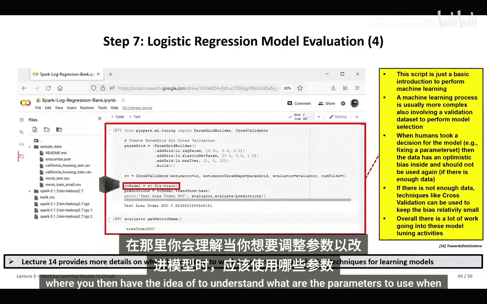
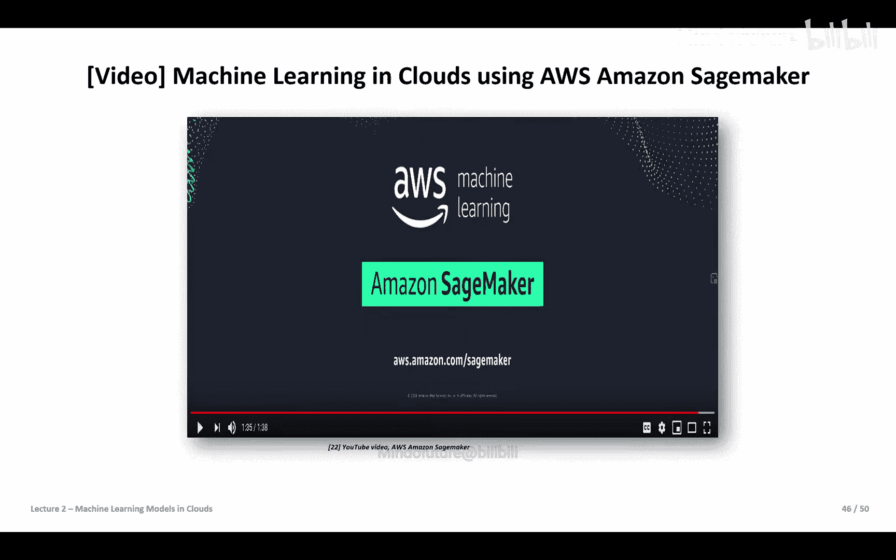
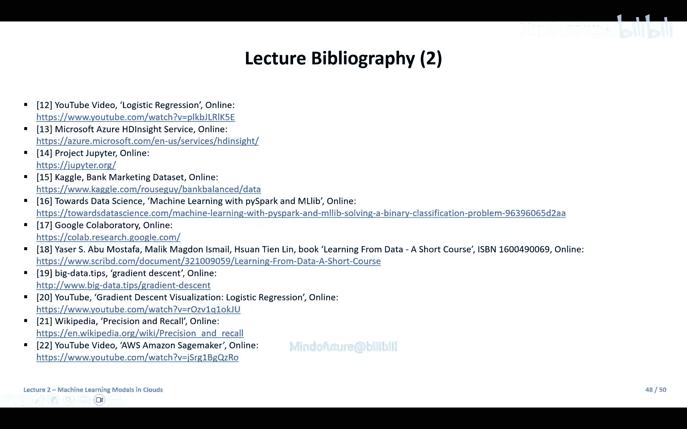

# 【冰岛大学】云计算与大数据-｜-2025-Cloud-Computing-And-Big-Data-Course-p06-P06_讲座_2_云中的机器学习模型_第二部分--BV14MB4BjEyZ_p6-

。Yeah， welcome everyone for cloud computingut and big data， we have our lecture2 today。

 the second part of it， and in the first part we learned really machine learning fundamentals。

 very basics when we start with a linear perception model。

It's a model that extend the test of time in a way， if you want。

 it's one of the earliest machine learning models existing。

 but it captures the essence of machine learning， learning from data。

Admitably in part one we had a very simple problem， we call that linear separable data。

 so two data sets of two classes where you can easily make a decision boundary through unfortunately I already have to tell you if you have your industry projects it will not look like this。

hence advanced machine learning algorithms can deal with this。

 there are different algorithms which go much far beyond what the perceptron can do and basically can then deal with basically this kind of non linearably separable data sets。

We go the first steps now in advancing a little bit when we had， let's say the last time。

 just a very， let's say linear learning model linear in weights。

 So then we want to advance a little bit with something called logistic regression now And by this。

 we continue a little bit with a ChristM model in context so that you get this by heart。 So again。

 for the industry project you do I recommend that you structured it along that way in your simple report that you have to do for it and also for the way how you work and make your notes and so on。

 So it's a very practical advice。 And I did several masters already on it and which actually dear exactly with these steps and it's quite a let's say industrypro mechanism of how to deal with data。

 The modeling is sometimes data mining in the literature。

 if you look up the ChristM more they will talk a lot about data mining hence Christ DM data mining。

But you can nicely use it for ba learning as well， and as I said at some of the slides。

 there's a significant overlap for instance some clustering algorithms considered to be data mining。

 but D scan already goes to some other areas。However。

 now when we go back to our ideas of having more application examples and then also gradually with this showing you why then the cloud's becoming more and more interesting right so we have something today like Google Colllup some of you know Google Col probably from other courses or so it's let's say very simple mechanism of the cloud where you can have a GPU but then we go quickly in the next area of Spar because Google Colllup doesn't scale right you can just have to on GPU or one TU and you don't even which GPU and what we talk about is we want to scale with multiple GPUs or multiple services。

 hence Apache Spark the technology we will also end up today and then introduce in lecture3 I talk to you that lecture2 and3 are sort of you know closely combined is then the idea of scaling and this means really leaving the Google Colllup you know power and really have in theory limit less in our scalability with Apache Spar you can add more more。

Workers and so on and and so on we will talk about this now to go a bit from the flowers example that you had。

Again， so get it in your mind the three steps， why you want to do machine learning。

So the idea is youll believe in a pattern and here you have the application example of Chicago food inspections as an example right so there's a big report from someone investigated this and I don't know if you have been in the US sometimes but they're in restaurants that have sometimes C and B and A quality you know in New York even D or so and I was wondering why you want to eat at a restaurant with D quality but。

Sometimes there are long lines in front of it， so this is really happening in US it's quite interesting and here you would basically determine is there a pattern that is that people have lots of words in it。

 you know and that words probably so the kitchen is unclean and whatever can you have a let's say machine learning mechanism that you know would predict this food inspection will probably fail or basically would you know be satisfied。

And you know you can imagine this is an example again that there's no basically formula for it right this is basically handwritten。

 there's some reports about it， maybe some ratings how clean as a kitchen。

 but there's no mathematical physics formula about it hence this must be something what you will inspect and will look at。

Just to give you a sneak preview really also for the next couple of lectures。

And here the machine learning example would be again， you know。

 can you categorize and find from these inputs of the data that existing from this inspection data。

 you know these restaurants that will probably fail the inspection or basically will pass the inspection。

So this is a bit loaded also you will see because then the data might be not directly linearly separable。

 so it would be kind of mixed interesting values in it just to give you a kind of practical application problem。

So then the next steps when you have this would be immediately these things that we had already established in the first lecture I bring it now again into the practice right of thinking about the steps you need now in terms of using cloud computing and there's lots of flexibility in this。

 of course we have many different cloud vendors， you learn them already AWS， for instance。

 MSs Asiaure， Google Cloud， ProC and you name it there even the specialized ones。

And usually would go that way when your laptop is not making it anymore， right。

 or Google Colllup is maybe you know an example now that we want to go through later。But still。

 when you think about your laptop， you will be at some point at the end with your data sets。

 hence the first step maybe to Google Col is useful， I'm not paid by Google， but it's a good service。

 so it's just all not really scaling， but it's still a good system to have。

And when you want to scale， then you basically use something called you know a cloud provider and then you have to look for something。

 for instance like here Apache Spark clusters right so this is a particular way of using it in scale which called big data analytics and as I said also in the course I put this now a bit earlier in the course and later so hence you don't know much about Apache Spark yet we will see how that material lies in lecture3 we talk then about Apache Spark much more in detail whys scaling and also contrast it to Google Col why it's not scaling So and it's always similar steps you always would check the subscription model we will see that when you go to AWS do you have a student subscription pay as you go you know credit cuts wiping and so on so these is all what the cloud vendors have something in common with it different financial models we will come to this also during the course and Hardi In is for instance one service you would pick here because it has a whole let's say open source system。

Ecosystem around it。 Sopache Spark essentially stands for not only one big data technology。

 but a whole ecosystem around it。 We will talk about it much more because you can imagine we need firstly algorithm that are able to be parallel computed。

Major difference too let's say Google Colab and others right we need something which can be working in parallel。

 really scalable and that is what the HD insights and Apache Spark runtime enables us and the ML library of it it has parallel algorithms to deal with it。

And this is a big distinction。Then the second， of course， you can imagine machine learning is。

Learning from data。 So we need data sets maybe out of an SQl engine of so called you know。

 table stores， column stores， no SQL， as we call that。

 have you used that maybe already in computer sciences or no SQL stores becoming more popular。

 some of you。So hence there's a whole ecosystem around it of this Apache spark of lots of open source projects which enables us。

 you know doing this， there's lots of data and machine learning libraries and so on。

 but I don't want to take the you know drag the attention away。

 but if you go to Microsoft Azure now you have this basically service available and the benefit you would have there and I'm not paid by Microsoft just saying it's one of the service you could use。

It has all these different templates where you have all the different versions of these open source projects already nicely combined that they work with each other because if you do your own cloud at home。

 you know in the seller on your own system you have to make sure that you know basically the H base you have works nicely with the real engine of Apache Spark works nicely with Apache hive another one and so basically have different open source projects in different versions that all need to play nicely and then you want to have nice things like you put the notebooks connecting right you put the notebooks。

 I think the majority of you knew last time right this nice way of accessing lets you also know from Google Colup So hence that is now the first move of thinking。

 I want to go to the cloud because everything is so nicely conveniently already working together right if you do this your own with a project of open source have this done once with Savania created it on their own cloud20 or whatever open source projects to deal with this in the right versions。

At the right time together is already significant work to work on hence this is already a time saver if you just go there as a company and say。

 well， let's use Apache spark and hence the In and we have this already in lecture 3 again lecture 31 you see that you click the different versions and get more an understanding of this then you start up sort of you put a notebookbook usually order or Google callup right some way of accessing it you will create a Pi Sp kernel that's then the runtime behind it from there you can do different things。

And then also this captures essentially then the idea of going to scalability or going local and we also come to that so this spark session will be important。

 everything is triggered from it and we will learn this again electricity three much more than today and then you can do your crispPM steps you start you know with loading data inspect the data hence data understanding maybe data preparation。

 you delete some attributes if you remember from the flower。

 we deleted some attributes or some classes even maybe don't had representative numbers in classes so hence your work starts and this is spark session and then it will be some point in time where you now search a modeling step in this crispPM if you remember where you know would truth and say well what algorithm I want to use is it linear regression。

 logistic regression support vector machines although pilot support vector machine is not in Sp I tell you that already but random forest let's say different decision trees that you can use quite nicely also in Apache spark to make it。

ableHence this is all a process again right again it's not the one and only solution we have this problem of Chicago food inspection that' throw that on and it works hence you have to massage the data and the idea of the next couple of lectures and your assignment there assignment two is basically something where you learn exactly these steps and then also that machine learning is essentially not really just throwing an algorithm to it at the end there are lots of evaluation mechanisms you know there are different F1 scores and so on we come to a couple of them at the end of today。

So basically， this is something which we will always modify this couple of seven steps and the problem usually remains but you see on the top。

 the sky could learn or so on your on your little laptop or on acon and all of these are usually at the end。

And Azure is one of the specific one we were deal with。🤧Be。So now by starting， however， a little bit。

 let's say back to the bottom line right because you don't know so much about Spark yet。

 so we do a very let's say easy introduction on this on another application come back to these when we have Apache Spark establish lecture3 right so we focus a little bit on the machine learning point now。

But we already use some aspects of Spark， which will be more explained in lecture 3。

 that's why they're both quite connected。So this example I have for you now that you also will experience in practice is basically then these bank deposits right so it's nothing special you say you have have certain properties probably in all the different people that you have as customers of a bank。

 a musician， a scientist or businessman， just to have three。And of course， there are many more。

 they have some certain， let's say attributes which makes them either safer。

 so want to have term deposits in the bank or not。RightSo this is something where we think when we know people。

And you know some people in Germany know from Stutgart right we call them the Schwaan they are good for saving money right there's something in this area you know every German knows they save a lot so there's something in the attributes that makes them a saving person or not so we believe there's a pattern hence we check this second。

 okay， again for you and your boss comes in do machine learning please you say okay。

 let's check if there's a mathematical formula on this to the best of our knowledge if you correct me if I'm wrong。

There's probably not any formula that can just look at people and say you're a saver。

So its also not existing， but we want to develop something similar to it with machine Learn。

And the third one is then of course the idea is that data existing and here we are lucky to have something from Keegel。

 so this is now not the data or the data repository I mentioned from the flower right the UCI data set I think some of you maybe know Kegel if not as verse to look there's lots of data sets already prepared if you want to learn about machine learning it's quite nice to experiment。

 a bit with Keeggel data sets quite of them are let's say already a bit more nicer prepared then you would have really natural in live data so let's say classes which have almost no representatives are gone are basically outsampled and some things things like that。

However， so it's an example that you have from Kegel and we can basically model this and understand now the business what we want to do。

 hence a CRDM in context， and feel free to raise your hand if you don't follow we go one step deeper now with logistic regression。

 optimization and so on。Then we would say， okay， we learned what we just had on a couple of flats before。

 but now we changed a story just to see that this blueprint that you have of accessing the cloud is very let's say。

 interchangeable， but the same principle remains。 So we would again， we would say okay。

 we have the bank and assume okay it' to slow runtime。 we want to use a cloud。

So we check the subscription and if you go now for instance and say， well。

 I want to use a Google callllup and see and several of you have already used the system you see essentially it's free for some of you I would even recommend if you do the machine learning course so to use a premium and I think it's not expensive it's like in $9 I think or something then you get a better let's say availability of the resources but essentially this is a sort of subscription again right in much more advanced clouds like AWS Google Google Cloud and so on not Google Col。

 Google Cloud and Google Colll as a small difference you will notice and also MS is Azure of course a subscription is much more expensive right than Google Colllup because then it also depends on how many GPUs you use maybe4 or 10。

Don't worry here in the course we don't charge you， right。

 this is of course clear that we all provide you with the necessary credits for it。Then。😊。

Similar steps that we had before we want to use Apache Spark to be scalable right So then really have。

 let's say big data sets if the bank data comes you know more and more。

 we want to have a Ubitter notebook if you remember Google call a little bit looks like a Ubitter notebook it has a sort of feeling for it so we kind of use this and then the same steps come again。

 you create the spark session and so on and that's what we're going to do now in this example in detail step by step so that you get your first practical view on it。

And the same things apply with Christ DM， as you will see and then do evaluation later。So hence。

 yeah， this is something we will come to basically with a Google call up thing。

 there's just one big problem with it， you need to have a Google account。RightSo in this sense。

 there is another problem， maybe in some regard， but please let me know every now and then people that don't like to have a Google account。

 then we will find another solution for it。But otherwise， the service is quite interesting。

And when we start with this an Apache spark， let's say from a higher level perspective。

 you have now the steps I was alluding to， we prepare now。

 basically the package by having spark essentially with Java and all the necessary underlying technology installed。

 something what you can use is you know P install and so on。

And then we have essentially here Spk unpressed。 And so this is all things which you have to do to make your environment right to use Spk。

When you go now basically to professional cloud preventers like MSs Asia， the HD Insight Service。

 this is all already there right these steps you don't need to do。

 This is just because Google Colllop is sort of a very let's say yeah fundamental cloud service for beginners and education so that you don't you know have all the different services you need already there and you have to install a lot。

 but if you go to Google you know BC or AWS， all these different services around Spark and also the different open source packages right I talked about the data storages and so on would be also available there。

Still， we have to do this basically to get this park environment right。And again。

 lecture three will be explaining some of the similar elements here we see also that we basically have a fine Spk can we create sort of the basically Spar session in the end and you need to know a little bit about Python。

 but I think that's sort of obvious in the course and again you don't need to have to program anything in the course just follow the source code a little bit where we then have several points you also see one trick essentially that we have their local master in other words we don't have really a big Apache cluster。

RightAnd this is now one thing of this Google callll we will understand better N3 and practical N 3 one when we use a real cloud。

 right the Google callll now is basically just one resource you have。

And you cannot be doing something like this。So basically like this picture lookss to。

 but this is our goal。However， it can do the same technology on top and basically have a local master and workers。

 we will talk about this and you know make it as if you would work with a big spark cluster。Hence。

 it is our first step to the cloud to have already remote computing。 That is for many people。

 something they never did before。 they mostly work on their own， you know cluster or computer。 Hence。

 this is already a first step。 But when you then look in Ms Asia when we look in H inside。

 you will see we can steer the number of workers to really get to a real scalable solutions。

 And this is essentially what I'm talking about the scalability of adding or removing more and more computing capacity。

 You can't do this with Google call， right， You just ask for one GPU，1 GPU。 That's it。Hence。😊。

Is sort of a little bit of fake if you want， just to get to know a little bit。

Spark and how it works with Pi Sp。Then we have one data file that will be also available to you when we have the assignment。

 the bank CSV right that you can now look in has all the data and the features we want to now look at and want to learn from and we can nicely load that up I mean the majority of you know that you can。

Upload data if it's not big data where it comes the next limitation of this tool right we cannot have let's say terabytes update uploaded via a browser。

 hence this is still digestible data for the first steps of your experience。

Then we go into the step four as I mentioned now we have the subscription we have you know the Pipark session on so we have something to grab on so that's important Spark that's our tool we learn more about in lecture3 and a couple of things here today and there are a couple of helper tools around it one is the data frame from Spark but some of you maybe know puns or data puns Python bro you learn this in computer science 101 already or these days puns no but it's it's very popular like that this is good you see the second part this is also used right so it has a much more beautiful interface in data frames and so on and what you also expect now is basically coming back now to our CR model which are also going to bring you to heart。

Is really the first step now data understanding machine learning makes no sense if you don't have any idea about the data right。

 you have to know your data， you don't need to know your data by heart， every single line。

 but you have to know something， you know， for instance what features are there。

 you see here quite when we you know explain a person。What could be interesting features， H。

 obviously， we can imagine this has an impact on saving patterns。

Then you know what time of education may be then we have maybe a different loan statistics or housing or no housing can also mean savings or no because you basically want to get your house quickly owned so you see obviously there are several attributes we call them like the payal width payal length of the flowers that is now exactly the same idea attributes in the person just a different application So what of these might be interesting there are a couple of them that seems to be a bit nonsense so day and month so this doesn't give us any information apparently five5th of May okay so should that be so we maybe think about this already in our head and would say okay that makes no sense。

However。😊，One important point is there as well， and this makes it supervised learning。

And this is the last line there， which is， again， now this idea from the Iriscitoza and Irisveica。

Right， so we had the class in the flowers。And exactly here， we have also the class。

 if they have deposit or not binary， right， Hence we can learn from the data the bank has。 Obviously。

 it has data from， you know， previous customers that already are supervised learning models possible to use being because we have this guiding output why。

That we need。 So theres some people in the past have deposit， some people not。

 So we learn from this and we have all the features available label。

 which is beauty for now for applying the supervised learning you know， approaches。

 And this gives us a data understanding phase。 So we know okay， it's supervised， we have a label。

 we found something which is a guiding label。 If you don't have that you can still do something called clustering。

 you can do other unsupervised mechanisms。And today is actually good chances with， let's say。

 quite big machine learning models， but they would be also not necessarily working with this little data set here。

 right This is also something which is based more in machine learning theory。

 the law of large numbers and statistical learning theory， you need， you know。

 a sort of balance of data you have and the machine learning power in parameters like transformers needs to be equal or basically at the same level。

 right if you have this bank data， which is almost no data， but you want to have a transformer model。

 which has lots of lots of parameters。That doesn't work right。

 so this is something which statistical learning theory so state in his course。

 I think there you should learn these things。Not here， however。

 for us it's important now to understand click in the data understanding phase we have guided outputs y and the rest is basically just using you know Python a little bit you will do that yourself in the assignment hence you will also get more the grip of it then I talk a lot about this pandas and data frames。

Now interesting could be in this data understanding phase still to group。

 one important thing for classification usually is class balance right， for instance remote sensing。

 when we do satellite data land cover， we have maybe 40， 50 classes。

 you know as a trees this type of tree or as a type of corn， we have lots of interesting problems。

But some of the classes have just 16。Or you know， while others have thousand。Of you know。

 basically representatives in the class， hence these are would be things where we usually have to drop this class because you have just not enough data to learn from。

Right hence it's a first click again， so here you say okay。

We have deposit and not deposit is almost the same level right so the class amount of those that deposit and those not is similar when there would be someone having。

 you know in this problem now10 that did a deposit but you know the rest like 10。

000 almost did no deposit there's nothing to learn from the machine learning would fail because we have no or basically would have a class bias if you want also basically failing this problem。

You can then of course misly get get you know kind of sub features or get an amount of data that is more similar。

 you can drop some if you want to make it similar but this is already one of the important points again the class balance。

Now when we think about features， this is one of the interesting things is that here this line is a bit complicated。

 the interesting thing is that for a mathematical model we don't need to describe it so beautifully with age balance。

 you know and then having already a loan or not loan housing。Basically。

 we have lots of mathematical models and they can deal with it in mathematical values。

 Hence there's no point of saying H or something。 we need to know it， of course， to interpret it。

 but here we create a feature vector out of these essentially that we can then use essentially out of this much more easier。

And with this having so called data pipelines， which play a role in using it for training and later on for testing。

Other elements we have here is of course summary statistics which are important like the Minm values and so on also again data understanding would be important and you see also that maybe some of these data like month or day apparently would be having not much value as to tell right what's the entry of this so hence we would do something called feature selection and you know remove these two features out before we now basically create this nice feature vector in the next slide but this also means we have the next step in CRP right so we go from the data understanding phase now to something we call the data preparation phase。

The data preparation phase means we change the data set。

 we make it more convenient for the machine learning model。 We basically do something with the data。

 we modify it。And you see here now we have this data that we have there and for the data preparation。

 we now basically do this kind of trick asset for the mathematical convenience。

 we have rather an index basically here that you have this hot one hot encoding of a very large feature vector that you create instead of keeping all of these different data right so this is one step what you could do for mathematicalematic convenience that you have just one value that is hot encoding you know basically the values of all of these different elements and we just pick some of these columns as I said that maybe make more interesting you know for us to look at and this would be let's say job and meritital status and education and so on。

So with this you basically you know have this data preparation trace。

 you put that now into a machine learning model would be the next and you have a sort of nice feature vector。

 but it also captures the way the message that Pispark and Spark and all of these data analyticss engines give you a lot of technologies and tools to massage the data to work on the data to index data transpose data sometimes so lots of different elements to really prepare these data sets for machine learning and One hott encoding is one of that。

This will be coming incredibly often if you do machine learning to make， let's say。

 out of a problem that is really not， let's say， more like a normal relational database table sort of thing。

 a much more compact version to analyze and to work with machine learning models。And。

By this you basically have then essentially this label that you have there which captures now our the top basically created our deposit。

 you know basically yes or no the guided label， we just basically renamed this for our convenience but the key point is now this second feature you see that we created ourselves we call that feature engineering right so we engineered our own feature based on the others but it makes it much more compact to have now this long feature vector instead of all these different ones。

You've with me so far again， I know it's getting a bit more complicated like the first part that's the idea moving towards machine learning because usually you massage as we call the data quite heavily before you ever touch a machine learning algorithm。

Good by having done so data preparation， the idea is now to have a so called pipeline。

And the pipeline is important for you to think now。

 and this is really something what you learn in industry。

I you have the same problem right when new data arrives from perhaps another department in a relational database。

 it will always be the case that they give you data。

 which is a table right with a Matro status education。

 the same old data that you now actually feature engineered that you looked at that you understand that you you know drop some。

 so what you want to establish is a pipeline that when new data comes。

This is always happening no matter if you train a new system。

This is the first step right training to have a machine learning model。

 or you use it for inference later， just you know， basically for daily life。

You want to have the same massaging of the data， because if you put the other data in for a machine learning model that。

 for instance， doesn't care about months and day， then it's， you know。

 stupid data and cannot be understand。You have basically this tool usage models of this machine learning model。

 you want to train it in the beginning， put the same features in。

Once its trains is lying there and then you put it。

 you know deployed in the bank and other people where use it。

 but they need to say have the same massaging of the data happening， right the same feature vector。

 the same dropping of Monday。 And with this， you have a kind of pipeline that always should be working on the data。

 and there Apache spark as you see here on the top slide is also giving you lots of lots of helppa tools where you essentially see that we have the selected column label features that we created basically as a columns。

We work on， and this gives you another feature of a combined feature set that maybe is really giving us。

 let's say， a strong expression out for the machine learning model。

We will have this also in lecture  three again， so lecture 3。1。

 so don't worry if you don't follow completely with everything。

When we now look on the initial data analysis and data preparation we have something that looks like this right this is maybe now better to understand versus label deposit yes and no for mathematic convenience we have set basically one and zero。

Then we assess combined features from all of the different columns and then of course。

 the typical rest of the columns。So then they have some pandas you know。

 basically commands here to show you there's this P five。

And now the first thing starts with the Apache Spar cluster。 We want to train the model， right。

 So the pipeline is used to train the model for this。

 We have the training set and the test set load in。It's in the first place。And basically。

 by using this， we have then， you know， something nicely also from Spar called the ML library。

 where we have logistic regression， right that we want to use。

 So hence another machine learning algorithm we want to fit This features and versus labor。

 and we learn in 10 iteration。 So this is one parameter you can steer。

And then you fit this model with a training set， you don't use a test set， right just a training set。

 you have splited it。And then you get some， you know。Data。

 so basically the coefficients of this linear learning model， right。

 similar like we had Bri of flowers， right， This Ws we trained。

Existing and you can show a little bit there and going from the modeling step。

 then slowly over to the evaluation step。So when you do logistic regression just in short and usually it would be almost one lecture maybe in a university。

 you do nothing else that we did basically with a sine function with the flowers。

 if you remember from the W transpose x or the dot product。

 but instead of having the hypothesis set being the sign so plus one or minus one we squeeze everything in the so-called logistic function so put it in between zero and1 making it a probability expression instead of a real value。

 hence we lose a little bit this know real value element by doing so we have a probability if it then would be class zero or class one。

So this is basically the key essence of this logistic regression again I brought you also a YouTube video if you can have a longer look into it。

And the other aspect into it is that we use now something called optimization as an error function。

Or a loss function， as it is sometimes called that you see here。

Maybe we can always have the point by error measure because it's supervised right。

 I can always use essentially the machine learning model。

 as we have yet done here and see the why is not fitting。As we should。

 so we have to change the weights again and to change the weights again is a basically minimization of error problem。

 which brings us to a more complicated topic called optimization right so we have a space to look at。

And this is now something where really， you know， stoholastic gradient descent gradient in descent comes in again。

 maybe how many people of you have gradient descent are already hurt？

Quite a big fraction right so this is something where you deal essentially with this  error function disappointed by this arrow and then can basically take the gradient and go down the error slope。

So this is something which you know， basically should be looked at much more deeper if you're in a proper machine learning course。

 we do this here in a very short manner。Because again， it would take a whole， I mean。

 basically university lecture usually to go to， but I brought you also some， let's say。

 visualization a little bit how you can imagine this is working。So by evaluating always the error。

 you can then have a function plot the arrow and take the de of the let's say。

 slowest or the basically the lowest slope。 So by this， you go， the lowest slope of error。

Again and again down by doing this iteratively is this gradient descent right， but gradient。

 if you remember from a line that we have showing us in which you know direction we go。

And the hopefully element is that you reach something called the global minimum of error right of the error space and basically again and can take the derivative until you're satisfied hopefully in a global minimum the trouble is you maybe sometimes I let's say local minimum to deal with this is one very interesting parameter called the learning rate where you can steer how much you go faster or let's say it was less space downhill。

And the steps you take， so hence it's a quite advanced topic where we come back to in hyperpyymeter optimization。

 how you pick the learning rate， because if you pick it unwisely。

 you will always end up in let's say local minima and with this have not the best solution you could have in machine learning。

And。Again， I would say for some of you that maybe not are so keen and gradient in descent yet I would recommend to look into this a little bit deeper。

 It's however， not a prerequisite in this course to understand it to the detail。

 right But if you maybe look again on some elements。

 you will see it's it's actually not so hard to understand。

 And I guess Dame and the machine learning course is also more that same material around it if you're interested。

Now then you have this model evaluation， you would say the area under rock Co。

 for instance is a good indicator， there are several other ones。

 but all of that is now the interesting thing is also supported by the engine。

 so all of these evaluation mechanisms are basically able to be used in this kind of Python environment and with this have also the chance of seeing issue model good enough or not。

Or maybe you want to retrain， right and do something more。

And you introduce it then maybe also this unseen data。

 so now we use a test set out of our pocket that we throw in the corner that we never used to do a proper evaluation to basically what we say fake our out of sample performance right so this is something what we never used touched in training and this is important machine learning to do so。

Otherwise you have an optimistic bias inside and the machine learning model would be much more higher reporting 99% when you learn from the training and test set as well。

 so keep the test that separate using it then and then the real evaluation will basically come through and that different ones like F measure and so on that we will revisit also in the evaluation during your assignment so this will be one part of it to explain and basically also describe it a bit more。

So so much for today in this， let's say introduction， you have now the opportunity， of course。

 then to。Use this pipeline again and again， do some differences in terms of you know the training。

 you can have an iteration of 20 and these are， of course you can imagine assignment points so you should play around a little bit with this when you you know work with this and not forgetting lecture3 where will come back to similar elements and where you learn more and more and understand a little bit then more these elements and by doing so you will get an understanding of those people that actually have a deposit or not as it is suggested here and then are ready for those that are not in the training or in the test set right so this would be then getting future customers of the bank right。

 that's why we do it when the let's say area and that Ro Cor is good enough。

And in order to get to the best parameters and to really you know work with the data。

 there's elements also where we have this you know this gridit here for cross validation。

 also something where you want to play with in the assignment because this is also now where we you know use the data set multiple times again and again and where high performforms computing cloud computing also can make a big difference whichs very computing intensive if you do for instance onefold cross validation it's the most best you can do but on the other hand very time consuming so the rule of sum is tenfold but you see also here that people you know try this with different parameters。

And this will be also a little bit part of the assignment and we come actually back in lecture 14 about it as well。

So hence lots of points to this logistic regression model。

 although it's one of the most simplest learning models again right wait until you basically see in deep learning transformer models or U encoders or things we do really in research right I have seen the question one minute。

And then we basically can say， even with the simplest model， like logistic regression。

 you have already the learning rate，1 parameter the human steers as already a problem， right。

 So hence we have to do it systematically in lecture 14。

 and many others to choose from where then have the idea of to understand what other parameters to use when you want to tune it to make it better the model。

That's it and I come to the question in a moment， Ill just give you this a little bit as another tool in the cloud right sageMaker I know if you have heard for it。

 some of you maybe also auto to glue on or as a similar tool。You effort for it。 Yeah， Okay， good。

So question before we stop。Well， if I capture the question right is how much basically the algorithm parameters depend on the data size and the data itself and how much。

And how it reacts。I mean， it depends a bit on the data to be saying， right， I mean， obviously。

 it should be similar data from the same probability distribution。

 If you put completely different data to it， let's say you have Netflix ratings and you put the ratings of complete different engine。

Chances are that the accuracy is totally disturbed right because it not gave race from the same probability distribution。

 we come to this。 That's why we don't do function approximation， although it looks a bit like this。

 but in machine learning we do noise around it， Hence we call that probabilistic approximate learning。

Because we could not learn a function and our data we have the same ratings but different inputs。

 so it would be not a function right if the same inputs， different output is not a function。

 hence in machineino we go one step more and put the probabilistic assumptions to it。

And with this comes a data point， if the data stays in the same region of data。

 the size volume attributes， accuracy levels will follow right other points when you change however the parameters。

 just one spot in learning rate from 0。1 to 0。15 could make an extreme difference could be meaning that you do this gradient descent and you basically get lost in the minimum which is local instead of having maybe with the learning rate or the ops you do。

A bit higher and you jump over the minimum boombers just local and then you have the global and then suddenly less error and your accuracy will。

Go up。So there are different points and lecture 140 will be all about this exactly right to see that a human cannot do all of these different examples。

 but we have systematics in cloud computing and HPC how to do this and pick the systematically to find the best values。

 but of course this is a computing footprint to have。But good question， yeah。Hence。

 there are lots of hiccups in machine learning it's not that easy。

 but I hope you had a little bit of glimpse now what machine learning is if you don't understood all of it。

 don't worry about it， not the requirement of the course。

 you know we you come back to this and be in lecture three， Pra lecture 3 one， your assignment two。

 etc， etc。Any final question？Yeah。😊，そから。Okay， so it's an interesting question in class about visualization。

 so data inspection， data understanding of data， which is high dimensional。Actually。

 there are some mechanisms， we will have one， I think even in lecture 3。 one if I remember correctly。

 but it's possible。Support vector machines are for instance。

 a very good example in this where they basically take you to a high level feature space。

 but the support vectors are in sample quantities right so basically in other words。

 that give rise to a nonlinearar decision boundaries。

 the support vectors you can project that on the real data and have another understanding of a high dimension data set and where the decision boundaries but that is absolutely not obvious so there are different mechanisms for doing it and it usually projects a lot or lower space obviously for us humans right because we cannot think in in 1D of course but you know exactly you've seen it in the bank data it starts already with lots of attributes where this may be necessary and helpful to do so and we will come to some mechanisms later in the course。

All right。😊，Any other question， maybe to the online audience？Any questions？Going once。Twice。Okay。

 if that's not the case， then thank you very much。 We continue with lecture 3 and the industry project on Thursday。

 remember。Time to choose and look at the Smes。 Finally， we want to start next week。

 really with a real work。So thank you very much for today and we continue with lecture3 next time。

