# 【冰岛大学】云计算与大数据-｜-2025-Cloud-Computing-And-Big-Data-Course-p07-P07_讲座_3_面向云应用的Apache-Spark_第一部分--BV14MB4BjEyZ_p7-

Welcome， everyone for cloud computing and big data today we have our lecture 3。

 and after quite some time of having now spent with， you know。

 an invited lecture as Andreas Lindndaman last week covering actually a lot of fundamental concepts in machine learning in parallel and distribute computing。

 which in one way or another is all related to your industry projects。

 especially when you think about transformer models and the more cutting edge。

 let's say AI that was covered。 it's time for us to also come back a little bit to the lecture series。

 and don't worry， I mean， the industry project is very important for us So that's why we spend a lot of time having lectures on agile project management with Ingover。

 but also now with Andreas， some let's say a glance of lots of different methods that you may use in your industry project。

😊，So for cloud computing itself today we will basically continue what we had in lecture two and now looking a bit more what Apache Spark can do for cloud applications when it brings us to pipelines and etc。

 etc。But before we dive into the material of today day。

 let us review what we had then the last time in our lecture 2。

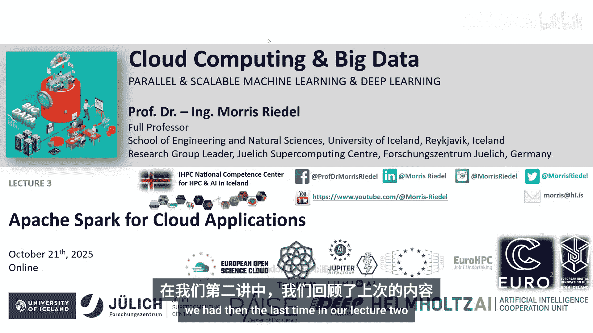

And lecture 2 was really about a machine learning fundamentals。 So we。

Start this a little bit with having an overview of machine learning。 If you remember。

 where you can all algorithms in a way put in a bucket。 and most of them。

 which are best understood are supervised learning classification models these days。

 But there's also clustering， if you don't know classes yet。In know。

 you can do some similarity measures in order to find out where are classes or potential groups of data。

 And then there are sort of real valued regression tasks where you can have certain trends analysis and so on。

 But another fundamental aspect， if you remember， was always this three ingredients for a machine learning problem。

 which is basically that you have a feeling for a pattern， right， So a pattern must exist。

 If theres no pattern， there's nothing to look for in the data。

 if you remember machine learning means learning from data and learning patterns from data。

So then the second point would be if theres already an exact mathematical formula。

 there is in a way not really a point of learning from data again。

 because this mathematical formula that solves your problem might be straightforward to implement。

 Use it done。So it's also no reasoning in a way for doing machine learning necessarily。

 And then the third one， is' really something you can't live without。

 And this is definitelyly data exists because we learning from data。

So this was basically the fundamentals and also today in lecture3 we will cover more and more fundamentals。

 will also give you a little bit an overview where the different elements of machine learning sit that we used along these lines that we just discussed。

And。What we then had was say essentially the simplest machine learning problem that you can have a binary classification problem。

 And then we had also a very simple learning model。

 and perhaps also one of the simplest learning models you can have。

 which is the perceptron learning model。And the idea was here to mimic a little bit of very。

 let's say， easy way of a neuron， really， to have in our different signals in our data set X is different attributes。

 And then the supervised mode have gives us a clusterp here， basically Y， where we can learn from。

 And the idea is then to learn these red weights， right that you have up。

 So you sum them up linearly using weights。 These inputs。And at a bias。

 And then you have your first signal that's going through。

 And you can always determine if that's correct or not by looking at this Y。

 And if you remember for mathematicale convenience， we have put the same that we see here。

 using the sine function for， you know， binary classification plus-1。

 And then essentially what we see here the you know， basically the input data。

 the attributes somelinely using weights and basically putting the bias in that we also can then learn with。

 you know， this wy for mathematicalematic convenience。

 we have here the vector notation W transpose X。 So there is also nothing very special So it's just a little bit。

 you know， if you remember from your mathematical basics。 However。

 intuitively what we do with this Ws and changing them。

 And this brings us back to the hypothesis set is， you know。

 that we have different hypothesis and this are characterized by these lines。😊，So first。

 we have a hypothesis of saying it's a perceptionceptron learning model。

 but how the weights are and how the weights will end are all very different。

 So these are all different hypothesises。 And， of course， we want to get the， you know。

 decision space right of this blue and green colour。

 So what actually happening was the preceptron learning algorithm that are don't picked it here now。

 but was essentially shifting this W by adding and subtracting a vector through the space in order to get all the。

 let's say， items right。 you see here， the blue point misclassified。

 So the algorithm will shift and will work on the weights。😊，As you have seen lecture， too。

 until everything is correctly classified。And this is a goal。

 And this is also the limit of the perceptron learning algorithm in a way。

 So it has to be linearly separable。 and also un last time in last week's was talking about this from the more practical perspective。

 Of course， linear separability is something which you not necessarily can assume in data。

 hence to day， we have much more sophisticated algorithm， not just not using one perceptron。 But。

 you know， combining this different ideas of a neuraln to neural networks。

 what we have seen last week。 And we also will come back to this and then using that in clouds。Then。

When we want to be a little bit more sophisticated instead of the s function。

 we have used binary classification a so-called logistic regression。

 So we put it through the logistic function， having then every signal that comes out basically of the same idea that we had is a linear learning model here。

 So you see the dot product is nothing else。 And you see here with W transpose X。

 but we bring it through the you know through this logistic function。

 which means essentially that every value will be in a way squashed between0 and1 again。

 but we have let's say more smoother past to it in this logistic regression model we use some optimization we will also come back today。

 and then from the application， you have seen this can be already quite different。

 although we have in state in the realm of linear learning models we have this binary classification we started from basically from the classification of a flowers。

 erisittoa eloggenicica if you know what is a new flower about。

And we want to know and experts in machine learning。 you know， use send this algorithms to say， okay。

 this is a erissittoa erisitogenicica， and hardly any human can tell that Hence we go for machine learning。

 right， to help and support the humans。 Maybe some experts and plans can tell you about this。

 You know， Sa power wish and Sa pal length and so on。

 But usually that's the idea of using machine learning。And。

This was even more obvious if you said there are lots of， you know， basically properties in humans。

 no matter what their profession， if they want to have a bank deposit or not。

 if they are savers or not。 So this is something where also than humans basically have maybe some gut feeling about some persons and I don't share which profession maybe would do that。

 But in the end， you would say that the machine learning can actually capture these different。

 let's say properties or attributes of a person。 much better than maybe human from education。

 merit status to job。 you know， et cetera， et cetera。 So we worked on this a little bit also。

 if you remember and the ideas also to do this a little bit in your assignments。

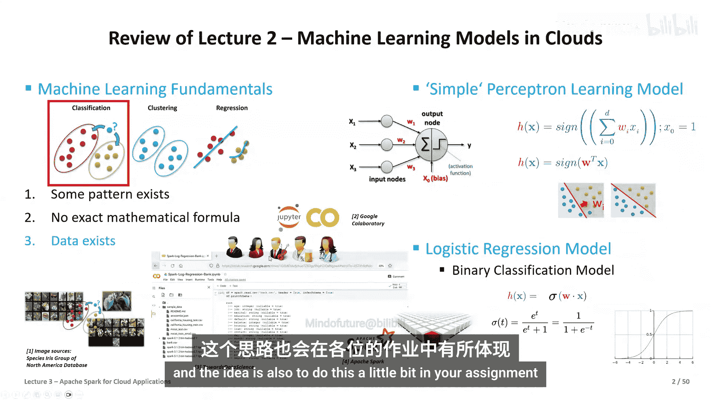

But let us come now to lecture 3 today。 If we continue basically along these lines with machine learning。

 but more and more we will add now cloud computing， cloud applications。

 because we're not a machine learning course alone。

 We want to blend this with computing needs with storage needs。 and I will make a big case for it。

 especially in lecture 3 when we start today day， when we have real data science examples。

 And then you will quickly realize that some solution tools we gave you in the beginning of the course like Google call up。

 And some of you using this for the industry。 there also have their limits and we will explore that。

😊。

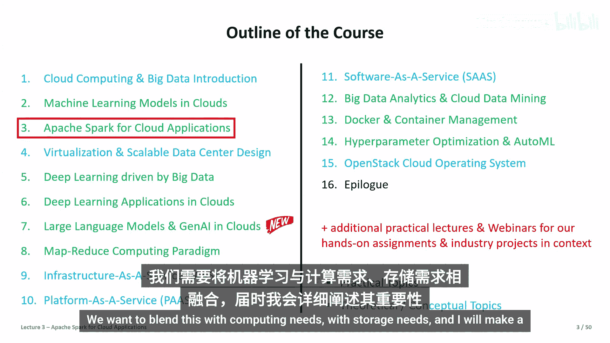

And then we come quickly to the idea of using Apache Spark at scale。

 It's a data analytics framework that' is really scalable with so-called worker notes。

 and we will make a case for it， and will also basically then update our practical stepwise approach by using not Google Col anymore。

 as we had before， but using the Ms Asia H insight， which is a cloud service。

 One of many we will also explore in the remainder of the course AWS services。

 which are very similar also a Google service， which are also very similar。😊，Then， of course。

 we take another idea of a new application， the food inspection that we have here as an examples。

 and throughout the course in part 1 and 2 today， the idea is that you get a better understanding。

 Also of the mathematic building blocks of machine learning。 So whereas the test set。

 whereas the training set， where the algorithms， where the models， whereas a computing。

 So all of these different mathematicale building blocks will be more or less put in a systematic fashion in some of the slides that you have a better understanding as well。

😊，等。😊，We continue with this， of course， in the second part。

 where we then will move more and more to a systematic use of cloud computing。

 The industry wording for this is also often using， you know。

 pipelines where you essentially use the same pipeline that you use for training。 So maybe， you know。

 if you remember the crisp the M process we had， you know， work on the data， data preparation。

 data understanding。 then you okay， go back to data preparation。 I don't need this attributes。

 So you form essentially a small part of a pipeline where you prepare the data for the machine learning。

 Then you have the machine learning as well。 Which algorithm， you know， by now。

 there's not only the perceptron learning algorithm to pick or the perceptron learning model。

 there are white verity of AI models to choose from。 And， you know。

 the ones you choose is another part of the pipeline。

 Where do you compute another part of the pipeline， which optimizer to use another part， et cetera。

 et cetera。 So this is。Something where， you know， this is in a way。

 another approach of having a systematic way of doing machine learning and a later lecture will be also more open。

 And， you know can we call them basically MLlops tools。

 which are also systematically working on this。 But here is also the idea that you use the same pipeline that you use for training and testing and we will make a case for it。

 and also well see how this is nicely supported with Pispar。

 when you use cloud computing resources like H insight。 But in a very similar way。

 it works also AWS services in the cloud and also even Google Proc services。

 These will come in later lectures。 So today， we really focus on this one and H insight。

 also because it's related to your last assignment in a way。

 apart from the hackathton that you will student also start。

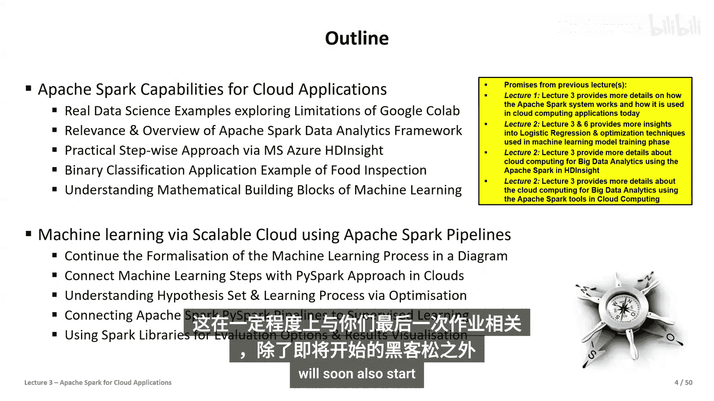

So fast new seatbed for， let's say， another way of seeing you know machine learning。

 starting perhaps from one of the challenges， and also understanding why machine learning these days needs cloud computing。

 why it needs high performance computing， which is usually also underneath cloud computing。

So in lecture 2， we had already the Google Col cloud， which is sort of nice。

 and it has a Upiter notebook interface， a very nice Gui， if you want in the web browser。

 And we had this interesting， you know step where you can even have a subscription of this。

 But in the end， you know， you have just one resource of available。 we come to that in a moment。

 We deploy a spark cluster in Google Col。 we have done that。

 And use basically this Uer notebook like interface， really。

 to you know code our Python code around the application problem that we have， which was in our case。

 then perhaps the Irisitor as our Irisogenicica idea or others。 It doesn't matter。😊。

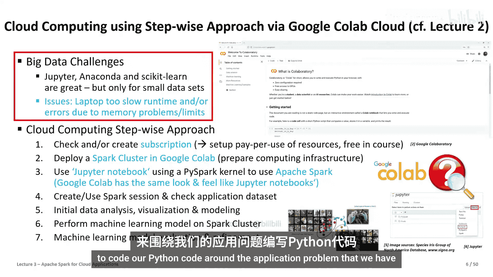

And then you know you have a Sp session， you would， you know inspect your data set， loading it。

 running it， maybe perhaps even visualizing it to understanding better。

 and then you would perform machine learning remotely right on the Spark cluster。Now。

 we will realize that the collaboratory is hardly a cluster。 right。

 So all you can choose is there1 GP， and even that is not。

 Let's say did a mystic always the same one。 And you cannot have more than one。

 And this is the idea of the course today to make you feel a little bit what it really means to use cloud computing at scale。

Google Col is a good way of starting。 It's a good way of being in a way in a cloud already。

 It's very closely collected， Of course， to the Google services and so on。 But it not at all。

 let's say， a scalable H D inside server in spark that you will explore today。😊。

So when we now look in some application problem and some of you are actually involved in this。

 I mean， some of you do， as our SME greenfish or partners in industry， for instance， one of them。

 you know， the industry project。 So， you know when you use a Coannics Marina data store and also for the others to know that is an open open data set。

Repositories， so there are a wide variety of data sets available label that people can use。

 and Copennicus is a large European， let's say， endeavoreav to really open up more data。

 And this is to speak the foundation of the team behind SME greenfish right。

 They have different products they're growing significantly。

 they're using hand performance computing in a way with this also the cloud computing resources。

 And they make use of this Coannicuss marine data store。 For instance。

 as some of you know from the industry project， they use a global ocean seaurface temperature。

 And if you want to data access it， you have to register a little bit， but it's all free of charge。

 which of course， helps SMs today like greenfish to really strive。

And they combine not only the sea surface， of course， have obvious much more data。

 available satellite image data and use machine learning algorithms all with this combined to enable a precise phish forecast。

 So in one respect， you， reducing diesel fuel in this large chip fleets that are really fishing globally today。

 So it's a huge market， very interesting use of high performance computing for us。 And for you。

 an obvious reason to understand a little bit more the quantities of data we talk with as one of the motivator。

 where are the limits of going away from Google Col to others。

 Now for some of your industry projects， it is has been downscaled。

 But if you really want to do a production project， if you want to be you know an SME。

 like SME greenfish you have to have the resources and one best way to understand this is if you just pick maybe the data from the last five years。

 available as the you global ocean sea surface。😊，Temperature which is important for the fishing use case。

 you suddenly end up with 370 gigabyte。Well then good luck to just you know upload this in your Google call I have an example just actually of 2。

8 gigabytes and this already took you know almost infinite time so using this was a drag and drop idea with 370 gigabytes not a good idea。

There are APIs around let you make it a use， some of you know that from the industry project with Ecoannics data。

 but then you also quickly have the trouble that actually you have maybe not enough gigabytes available anyway right on this Google call with 68 gigytes。

So 370 again 68， there are some， you know， basically subscription mechanisms that you can look in where you maybe have a little bit more of storage where you get better computing。

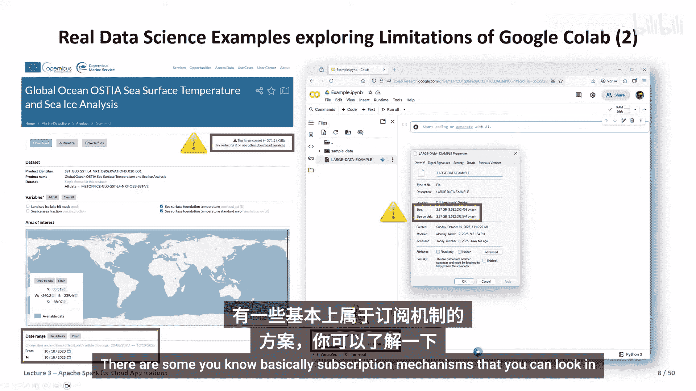

But you can quickly realize when you do more data analysis like things we do， for instance。

 also in the HPC goes like the wave propagation right on an ocean and you want to have for initialization and for you know validation if your modelling is correct。

 all the sea surface waves and so on， you quickly end up with 5。8 terabyte。Repeat ter of data。

 So there is really then where you 60 GB or something which is here remaining maybe in one of the Google Clouds Iruuse is quickly at the end。

 even if you subscribe to more storage， you hardly get， you know， basically quickly up to 5。8 TB。

So hence storage is a big problem here right so for real production problems。

 it's usually boiled down for early machine learning courses， it's good for small data analysis。

But when you do really large runs， this is not an idea in terms of storage。

 but let us come to compute， which is equally limiting， right。

 You see here what happens if you change a runtime and if you do the practicals。

 you will basically understand a bit more。 what this means you can pick it between different types of GPus and a 100 here and so on。

 while here it's even not any more vla， you have to subscribe to call poor and pay the price for it。

 starting already with the idea， of course， at cloud computing services cost right So this is something to realize。

 And of course， it starts even with a free Google Colup， which essentially。

 if you want to really use it for， let's say cutting edge machine learning today is not any more free。

 you have to already pay Google Col Pro and even then you get faster GPUus。

 let's say from T4 generation GPU to an a 100 and media card。 this is not at all。

 you know what you need maybe in an application。ProbleYou see here one examples of our satellite image analysis for Land cover。

 we use different HPpZ resources where， you know， basically。

 we have this 24 nodes in Jewveals as an example， here and the blue one to really get the time to solution really down。

 So we use 24 nodes。 But each of the nodes has 4 GPUus。 And then you have。

 let's say 96 GPpUus in parallel use to solve that problem。 So good luck for Google call up there。

 So in the end。It is a good tool， but this also motivates us to look at other solutions。

 So what happens if people have this demand like we have seen in SM E greenfish。

 how you actually get along with having much more computing needs。

 And this is something what we want to explore。 a little bit today and， of course。

 in the remainder of the course in general。So and of course。

 for some of you that are interested much more in these larger scales or the waves that we discussed and so on。

 feel free to join us in the complimentary HPC course， right， that will be coming again in spring。

 next year for those of you that have this course not taken yet。

But let us come then back to it to our stepwise approach had in the cloud computing course。

 Now we update this a little bit using an interesting cloud service code MS Asiaure H In。

 And obviously this is already a paid service， So we also have to pay here。

 but the benefit is really you can scale up as many GPUus you need。

And using an interesting technology that we already know， A patchache spark at scale。

The stepwise approach is very similar。 So you still， you know。

 need a subscription that's not relevant for your assignment because they say， essentially。

 we have done the subscription for you， and you can just use the H inside cluster。

 But when you want to do it yourself， you have to have a subscription， like pay per use。

 which is quite attractive。 So you just really pay for the resources you use。

 but you have also the drawback to always， you know， have to stop your cluster。 you don't use it。

 You have to manage your cluster。 Otherwise， you're running quickly into to quite some cost。

There's a deploying of the spark cluster very similar that we。

Where like we basically require to get to the Piypark kernel to really use the functionalities of Mactypark and to create a Sp session and so on here we use some you know specific resource manager template and when you have then you know the interface of this you used from HD insight。

 you can again also get some Upiter notebook basically interface。

 which is the similar one that you' are familiar with with Google Colllup and then start crafting your let's say Python application and this goes the same way and some of these scripts are even very portable meaning that when you have a Google Colop script with some modification。

 you can maybe quickly get it also running in HD In because the steps that you do for data analysis visual is Python is also maybe parts already of the Ppark session when you especially to the machine learning as we will explore today and then also the evaluation refinements。

 So this course is hardly this course of。That you thrift to do there is hardly changed。

 If you want to use H insight。 So let us look a little bit。 Now。

 what is this fantastic impety spark framework。So this is coming out of a more。

 let's say data analytics idea that constantly data is growing right and you try to have decentralized data stores here and there all used in order to perform you machine learning have a decentralized way instead of just high-perform computing one big cluster at some location you know offering 5000 GPUs。

 so here the idea of distributed computing was much more in actually have carved first something called Hadoop which would come up in later lectures for the sake of getting the assignment out earlier and not at the end of the course completely we wanted to have this in memory processing with Apache Sp first。

 which is more or less also much more used perhaps today because it has really this benefit of optimizing many of the steps that you have inside the Sp execution for this inmemory task like the mapre task and so on。

と？Hence， citizen is a framework which tend a test of time。

 and you see an example when you perform logistic regression with Hadoop versus Apache Spark Spark is much more faster using this in memory benefit。

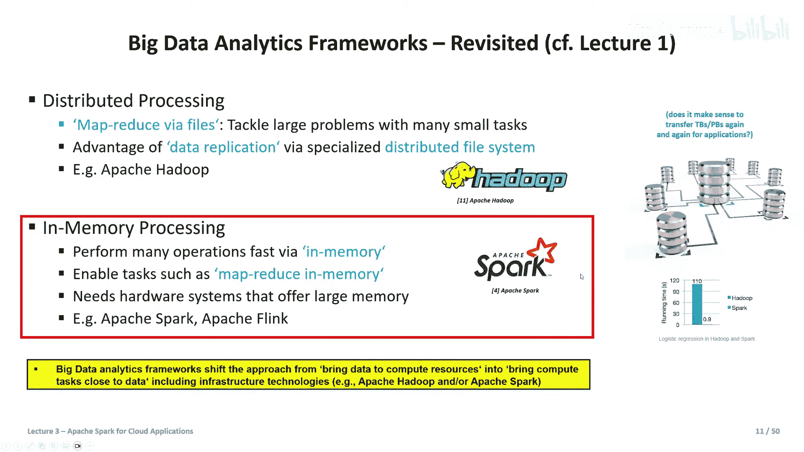

Now， when we now look essentially， what what does Apache Spark really enable。

 it's much larger as you think。 So theres a huge ecosystem around the open source of Apache Spark of Apache Hadoop and many of the Apache projects。

 And， you know those that are also doing， you know keyvalue stores like you have your Cassandra。

 for instance， Apache airflow enables you workflows， Kubernetes distributed basically deployment。

 We will talk about this Kubernetes and even Kafcal later or all in the course， Mongo database。

 You see many of these players just for storage are very well working together with a Spark engine。

 and then Spark itself is really designed for doing data science at scale。

 has many machine learning algorithms， which have a parallel execution inherited in the MLl lipss that you can use because you cannot just use Skyid learn or other machine learning algorithms out of the。

tool boxes and throw them at a cluster to be paralyzed。 You need a parallel execution。

 You need a parallel algorithm to make that happening， to really work in a distributed fashion。

So Housepark is doing this is by having essentially the Pipark session。

 creating a spa context and then have a cluster manager that you basically can choose from like Hadoop Bs of news leveraging those from Hadoop enabling really a multi use of this cluster and the multiuse will come more and lecture4 when we talk about data center design and multitens by different people at the same time use one cluster and hence virtualization to the rescue we will talk about this in lecture 4 more but then also at scale in lecture 13 about Kubernetes for instance。

And the cluster managers will then schedule。 and in our control and operate with socalled worker notes。

 right， And these worker notes is now the inherent principle why this is all scalable。

 So you can add or remove worker notes to your problem when you start a spark application and the whole framework is able to in our work with much more worker notes or less。

 depending of what you configure。 And in this other machine learning tasks and you know。

 combined that you we know basicallyily can stretch across different worker notes contributing to one big machine learning model。

So this is something know which is know very often used when you go to the Spark website。

 you will see it's also interoperable with many of the elements that you know maybe from other lectures like pandas or basically even know SQl structured queryer language for database access Spk SQL is there So it has really an idea of working distributed with things you already know and of course。

 not all machine learning algorithms are paralyzed here right So this is also another point some of them are paralyzed So mechanisms you already know by Pythtorch。

 maybe deep learning packages and so and on Mflows and MLlOs package was alluding to and you go on and create basically the problem that you want in Python for instance。

 it has different other languages but it's really interoperable and know as I said in the cloud computing offerings Apache Spark is essentially in all the big cloud vendors。

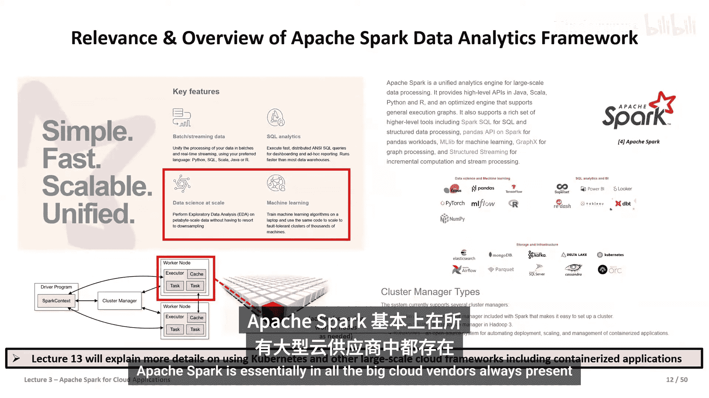

Always present。We use M S Azure H D insight for this。 So hence。

 this lecture should be showing you a little bit how that works step by step。

 So we start with the first step saying， you know， we need a subscription and。

There are some aha effects。 I wanted to give you alongside。 for instance。

 if you have a pay as you go subscription， you go there， you basically need to register。

 then which exact service you want to use。 And this is an interesting insight that you have to configure for。

 So if you swipe the credit card in a way have pay as you go。 you know， create it。

 So you're registered in this， you still can't use the H insight per se directly。

 It takes some configuration if you want to do it。 And you see here how that works。

 you basically have to create a H insight cluster And before that。

 you really have to register essentially this resource provider。 and this H In cluster。

 So being even able to create one。And this is an important aspect to really also make you realize this is very costly if you use this。

 so there's some way also for people to really understand when they do this。

 that they could be massive costs and that the registration makes you aware that now you're entering really a production service。

 247 available， but with this， of course you have to be very careful because the costs can skyrocket。

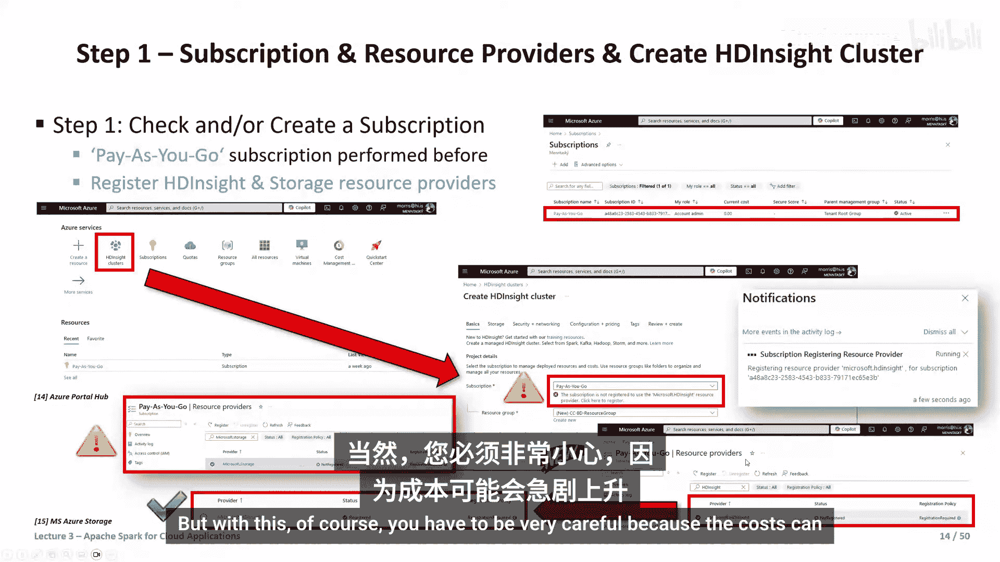

And the reasoning for this is that， of course， you are in a way now responsible to think how many of these worker notes you need。

 So how scalable your application should be。 So here's a good illustration。

 how it works a little bit。 not all of that is obvious to you。

 We have to do the step by step in the course。 virtual machines。

 virtualrualization will come in lecture 4 a little bit。

 But if you have this kind of idea of in this M Asiaure cloud。 And there's someone， you know。

 going with a Web browser or yes SS H2 this cluster， you have the headnot， either the managers of。

 you know， busily within Spark dealing with all the workload。 And you have usually too， you know。

 for， let's say， let's say really operational issues。 If one gets down。

 the other one can take over and so on。And then you have some zookeeper notes。

 which essentially is another project from Apache taking care of what the distribution。

 taking care about， you know， managing the whole cluster load and particularly also your number of worker notes。

And you see that the zukeeperer notes are relatively free and don't need to be necessarily those which have a large you memory because the more memory you want to use for it In these course of Gerobay labored。

 the more costly the estimated costs， right， memorym is very expensive。

 Hence a cost per resource can quickly skyrocket。 If you have just4 It' two70 as an example here。

 But this is power， right， And if you know want to have for one month，24，7。

 you do the math times 30 or something then you basically have quickly constantcent Ken skyrocket。

 and four worker knows it's not really a big cluster。😊，Right， some have 20， some of hundred， right。

 that youems A Pey sparked on a daily basis。 So hence a costs can quickly accumulate， But， of course。

 you get also then a very scaleal of a solution。 very quick answers。 then again， basically。

 essentially， for your machine learning problem。

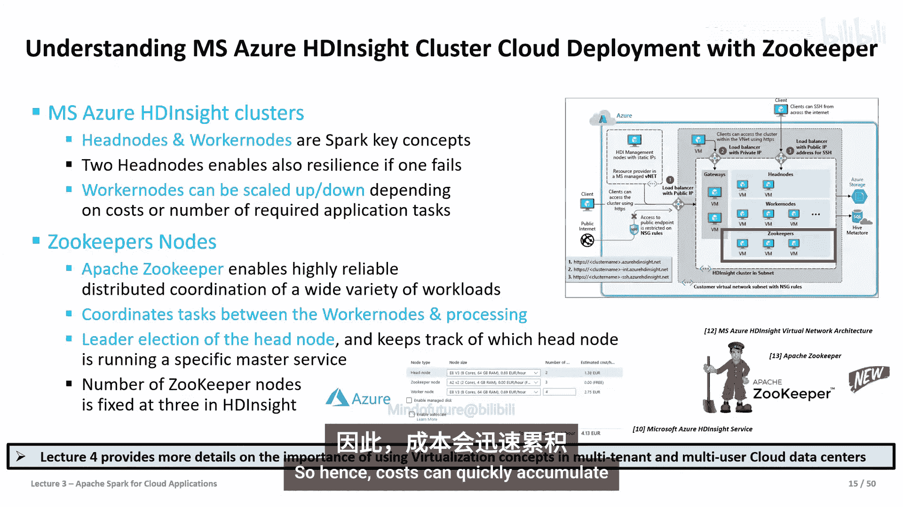

Hence， you see it's in your hands a little bit。 How big the cluster should be。

 And that brings us to the scale of cloud computing， right， And some occasions， you need a cluster。

 maybe with 100 worker notes at the end of the year where you want to process lots of data for maybe some text purposes。

 Some builds。 you want to accumulate machine learning to some trends。 But then， you know。

 during the year， maybe in summer occasion， you want to boil down your cluster to couple of resources。

 Hence the cloud idea。 Exp， shrinking， right， the idea of cloud。

 So you can really modify this by the number of worker notes。 Hence。

 I said the head note is relatively fixed with two should not be one usually and the zookeeperer notes。

 But the worker note enables， you know， the flexibility of the whole cluster and about this H D insight service。

😊，Now， the other end， when you think about that in the end， one work or note is of course。

 something which relates to power， GPs， CPUUs， something we discussed in terms of you computing power in the beginning of the course。

There you can have， of course， also change the different core types， right。

 They have all different price ratios。 You can look on the website and H the insight。

 So this is how many core they have。 But in order to leverage spark。

 you would use something which has large quantities of， you know， Ram。

 you see the zooopkeeper anomeob has here a very interesting resource which costs almost nothing because there's also nothing much Ram needed。

 It's more managing you know， node， really。But if you go and make the Mars and see here 64 GBb per ra and the even more powerful ones。

 you quickly come into， you know much more cost power。

And then when you to register this particular type of CPU。

 you also maybe don't have them directly available。

 Another thing that you see here as an example before you just that you realizes for some of them you have to even ask right？

 So you have the quota also to protect you in a way， right。

 If you have the quo always unlimited and by accident。

 you put 400 worker notes and you quickly see that， you know。

 your manager runs in your office and would cry and say， well。

 what would you do here with the cost of the cloud， Are you crazy。

 So the quo also enables you a little bit to be very。

 let's say precise about the amount of resources you need it and to prevent here and their accidents and people。

 you know， have， let's say mysterious wishes in terms of how many worker notes or whatever they need。

 Hence you have to ask about specific quo increases manually in order to get。

 let's say in your subscription pays you go then you know， the computing resources。You need。

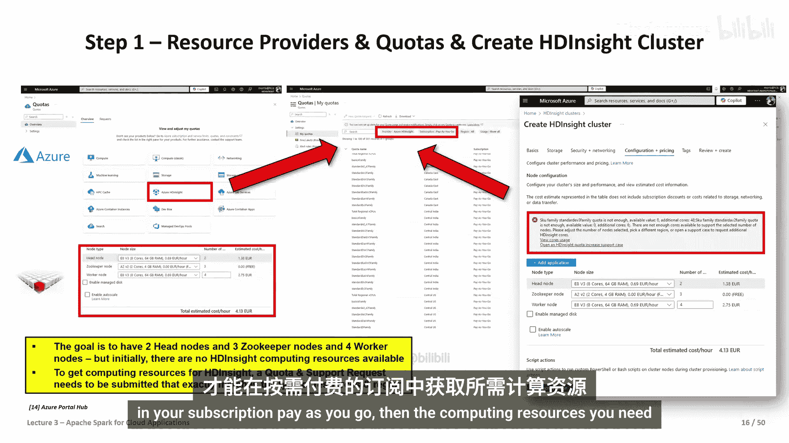

Hence， for people that use a spark cluster， maybe some application domain experts and so on。

 this is already something where you go below， let's say the level of detail that maybe they need to know。

 Hence in application domains and so on and and companies which are an application domain like let's pick greenfish as an example。

 you have little one like Siki， who's really in technical expert， right。

 while others maybe more the phishing experts and do other things usually it is good to have someone who knows a little bit more what's really behind it to understand the cost and to understand also lots of the technology you need。

 and what is a available labor， you see here， we can pick spark。

 we can pick Hadoop hitspace when you start a certain cluster type。

 you have to you know use a subscription there， have a resource group and all of that you will also explore a little bit when it comes to our assignmentment。

 So then it's a bit more easier to realize。But you use an existing resource group and an existing cluster in order to execute in the cloud something。

And， you know， then you can pick Spark for an example。 and， you know， others， if you want。

 speak specific versions。 which have， you know， specific properties So another thing which goes a little bit more to technical detail。

But once you basically agree on the resources we discussed this already。

 And you see here the contribution is 54 of 78 available course。 We have asked for it。 We get it。

 Then you know， basically have a deployment in progress。

 This could actually take some time couple of minutes to it be deployed。

 And once it deployed it in this time。 Then， you know， the money accumulates also for your costs。

 So be very careful if you use that within your own company。

 or basically outside in a company where you employ for。

 make sure you have a very good overview of the costs。 actually good cost explorers。

 it enables you to understand better this。

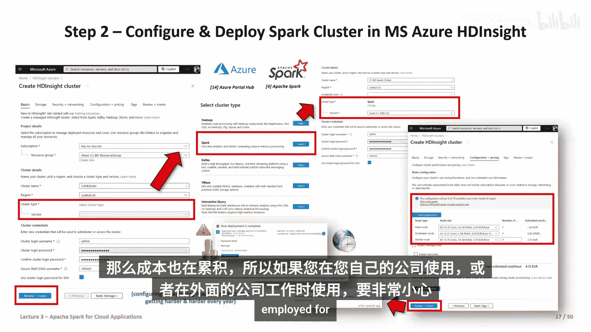

In our accumulating costs。Also， remember， and this is a very important takeaway message。 You know。

 although now the Google call up， you have actually started this and then have the youidda notebook environment very conveniently。

 Don't care much about costs here。 The cluster is running。If you use you betterter or not。

Right so it ends the Upiter is just the interface to the cluster which you can then use using the pi spark kernel here in this uter that you can quickly and nicely actually connect with your executed square cluster。

 but the message is if you essentially close Upiter。The cluster is still running。

 and was his cluster still running。The money is still accumulating。Hence。

 this is a bit disconnected from the Google call experience you have， right。

 So the clusters running all the time。 Some people may use the Upiter notebook。

 The application experts have don't have to care about the cluster at all。 and just click on Upiter。

 get the application interface run it in the cloud。 And， you know， we will see some examples later。

 But this is something which you really need to be aware of。 I mean。

 you and your assignment in this course， you don't have to， right。

 We have created the cluster for you。 The deployment and so on。 And the cost is not for you。

 But essentially when K can sent to to a company。 And you're running this 24 7 and is never used。

 It's also course that you don't need。End with this。It's also， you know。

 get the message out there for you。 very important。

 always think of maybe shut down the spark cluster。 That is possible without destroying it in a way。

 so you can major also stop the cluster。 then the resources are not used any more。

 but can be reactivated with the same， you know， configuration and so。

 And this is an important part to really get into into your head from the practical experience。

 especially if you grow with a number of node with your worker notes， be careful。

 be mindful of the costs。

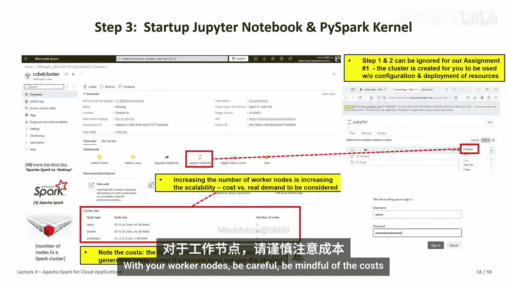

So motivating a little bit our application problem that we want to analyze a little bit。

 we want to have an advanced application example This time we use something called binary classification of C if they really will pass or fail with the food inspection of some restaurants that we already discussed briefly before we go along the line of CRDM。

 but this time in lecture 3， we also want to systematically create thismatic and building blocks right so we don't overdo it with going back again to crisp all the time and we'll make some connections but by now although do the industry project that you know you should model a little bit along these lines you learned already was CR DM we put an emphasis rather on the mathematical building blocks。

 but of course the whole ideas following roughly the CRM model。

So what we have here is lots of text data from the food inspection from the city of Chicago as an example here。

 this is also available for you online the original data and you know sort of the violations and of the food kitchen quality of you know being clean uncle cleanan and so on all of this will give us maybe indicate if the overall judgment is that basically the restaurant should be closed and basically the food inspection failed so this is an interesting use case bringing us to the supervised learning example so there's already lots of data available that we have the training examples if you remember and luckily someone has already labeled this。

 giving us the opportunity to learn from existing cases if the food inspection failed or not so we will learn on this making it the training examples so the attributes you have here for each individual restaurant and then know。

ComAnd we have all the restaurants and all the data， essentially here。

 So we want to find out some essentially target function in a way that really created this。

 But the target function we， we will never know， right， If we would know it。

 we would just head and implement it to get the next food inspectionor right。 So hence。

 machine learning starts from this， This kind of data that we have examples that we have。

 So let's put that in our systematic overview。

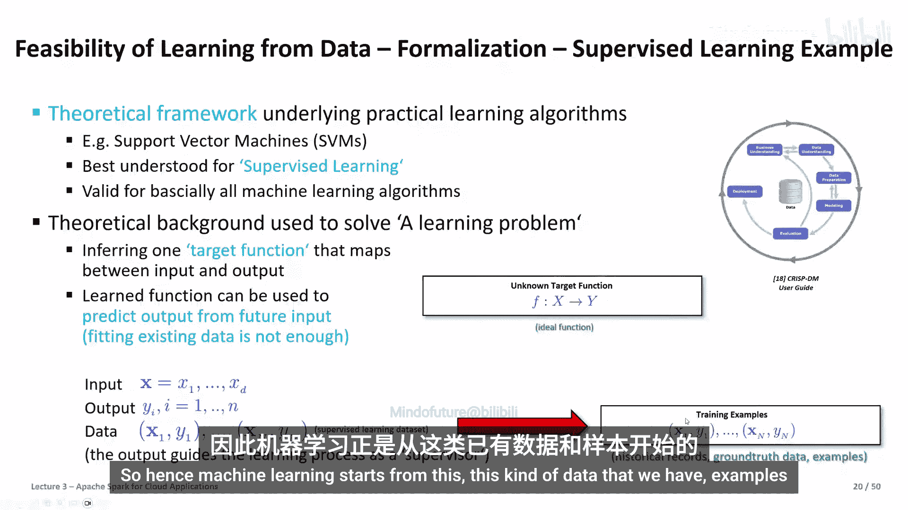

Which is now really a practical machine learning overview for you at hand to see and understand a little bit where the different building blocks are。

So there was in some way or another some ideal function that was creating this training examples that。

 you know， we will never know exactly。 And we don't need to know。 That's the beauty of it。

 And we will create a much more mathematical building blocks to get the machine learning right today day。

 So we start with the strain examples， right， As I said earlier。

 connected to the things without data。 Theres no machine learning。 right。

 So this is really something you must have。 And， of course， here are the the big demands for storage。

 You have seen the Coannicosmar data， right， quickly going to terabytes of data。

So this is our first formalism。

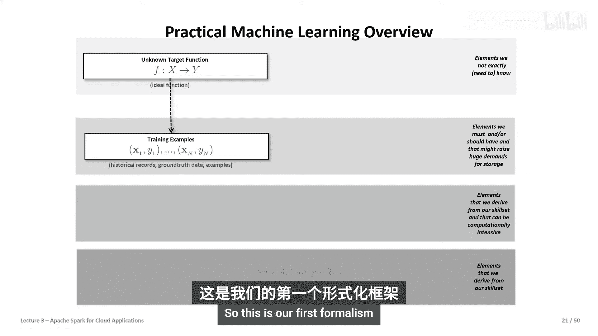

And we build on this throughout， you know， the lecture 2 part or lecture 3， the second part of it。

 So given the time we will stop here， make a break。

 Also to understand a bit more the runtime architecture of Spk applications。

 Here was a YouTube video for you to look。 and then we' continue with a second part of a course after five minutes break。

 So see you then。

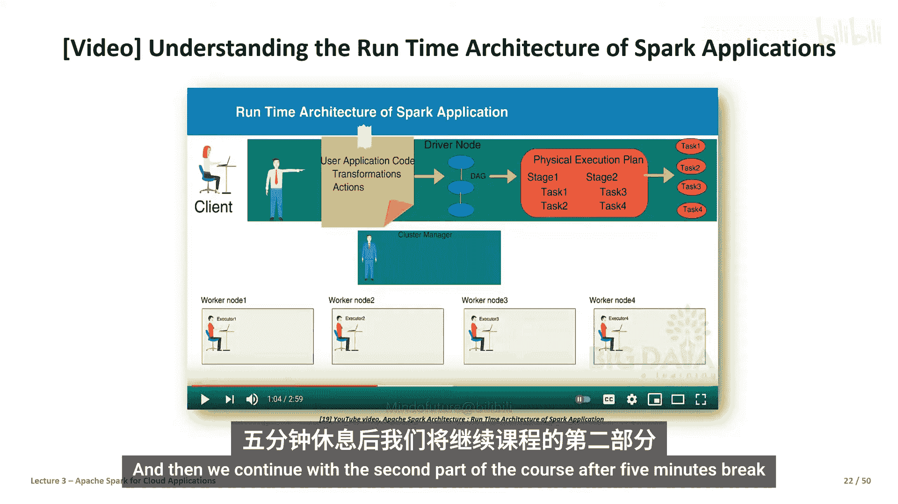

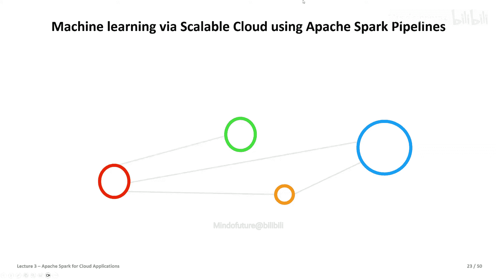