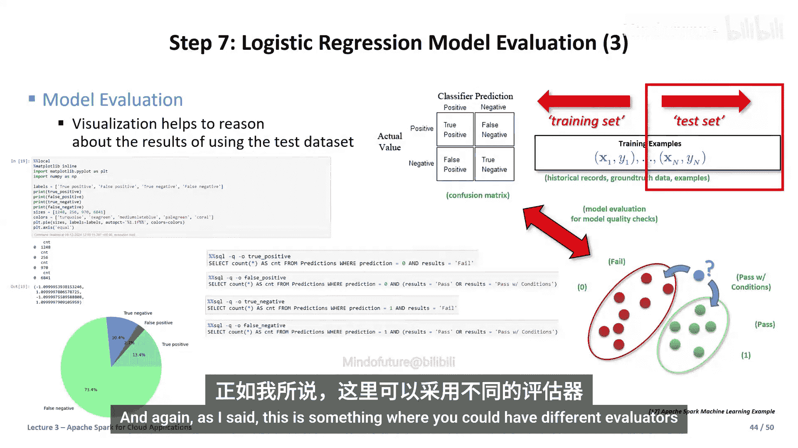
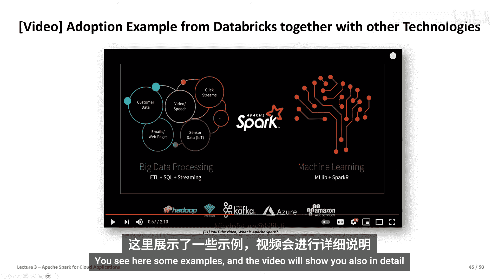
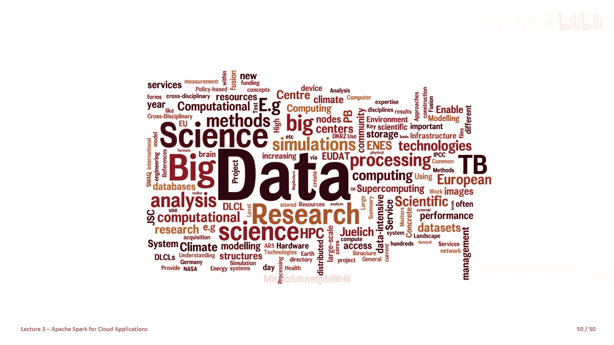

# 【冰岛大学】云计算与大数据-｜-2025-Cloud-Computing-And-Big-Data-Course-p08-P08_讲座_3_面向云应用的Apache-Spark_第二部分--BV14MB4BjEyZ_p8-

Welcome back to cloud computinguting and Big Data， our lecture 3 Apache Spar for cloud applications。

 the second part of it。And the first part was really thinking about what we had in lecture to。

 so building on the idea of really machine learning fundamentals， linear learning models。

 so linear in the weights。And essentially having done something where we gradually build up the idea of using these kind of very simple models。

 you know with machine learning， logistic regression was one of the very simple models building on the linear learning models and using the logistic function。

 you know to determine which class it is， so binary classification problems。

So blended with the idea of machine learning， of course。

 we want to motivate why we want to do cloud computing and I think essentially in part one。

 we explore this a little bit by using the Coannicsmar data repository whereas some of our application use cases that we have really in research。

 which is the SME greenfish with some of you also use in your industry project。

 So this is really interesting because you have seen quickly by accumulating some of these data sets which are relevant like sea surfaceface temperature or maybe for some advanced studies which we use maybe in high performance computing you want to have the ocean waves data。

 then you quickly come from a couple of gigabytes to the hundreds of gigabytes and terabytes。

And that is usually something where Google Colop is not working anymore very nicely and also we have explored in addition to that that you the GPUs you acquire are always changing and if you want to have really let's say more powerful GPUs and a more deterministic way of getting them you really have to subscribe。

 so you pay already for Google Col Pro and so on to get some more resources。

 but you essentially stack with one GPU with one resource and then the idea of the initial part of lecture three part1 was really to think about scalability。

 So how we leave that space from Google Colop and rather use something called Microsoft Azure Cloud computing know vendor there are many of them and the service they offer is H insight is just one of an example we could do several similar things in AWS and actually Google Proc services but here we want to have some practical detail shared so。

TheH the insight to set up an Apache Spark cluster。

 quickly realizing that it's in our hands to think the scalability， right。

 So how many worker notes you really need for your application domain problem。

 Everything else is given by Spark， the M L library in a machine learning library that you need for the algorithms。

 The whole engine of distributing task across your different worker notes。

 managing them with zookeeper， managing them with head notes。 This is all given by Apache Spark and。

Then we also realize that depending on the scalability we need， we can scale up， get down， you know。

 shrink the cluster， expand the cluster of his worker nodes。

 We realize that the costs are then accumulating。 And this is even true if you use yourbiter or not on it。

 So this is in important fact， also differentiating a lot from this Google will call up that in the background。

 the cluster is still running every single day，24，7 accumulating costs。Whether you use it or not。

And this is something important， you know， when you go to the production。

 when you want to take this know that you get here from the course and put it to recomp。

 just be careful on it。 And in order to， you know。You know， be a little bit aware of this。

 there's a way of getting quota so that you really understand， okay， now increasing my quotas。

 I use these quotas， meaning also that more and more costs will come。

We also ended off with the idea in basically the first part to have a bit more systematics of machine learning by now you have seen many different lectures by And。

 you have seen the agile project management from Ingover。

 you have seen the industry project with some data here and they available and potentially already initial idea of machine learning algorithms。

 but where does it fit altogether together， right So where where all these mathematical building blocks that we now abstractly put here on slides。

 that is something what also will be the goal of the second part here in lecture 3 to advance from this。

 if you remember or if you have seen the first part。

 we essentially started just with a training set with a data set that we have available。

 and now we would put around this all other elements that we need like machine learning models。

 machine learning algorithms， they always go a little bit together。 Then of course。

 we will have hypothesises。 So in all different ways of modeling and we maybe put one hypothesis。

out of many to be the final model。So lots of these elements which are relevant for us。

 also blending in it， essentially of course what you do in scalable cloud computing。

 hence we talk about pipelines and so on， connecting more to our application domain。

 you know example that we had from the food inspection。So let's go with the second part。

 basically starting now with the Spark session。If you remember we have created the subscription。

 we have basically also you know created the spark cluster， it's no running。

And then you press on Upiter， and then you want to start， you know。

 having your pie your pie spark session created。On this cluster， then connecting it。

And here if you do this in step one， you see we import here different parts of the spark distribution of the Apches Sp you know basically tool。

 the open source tool is a machine learning library。

 we impart their pipelines and a classifier for logistic regression。

 this is all what you know a little bit new would be perhaps a hesing and the tokenizer will talk about because we have some text data and we want to have a let's say dense representation of the text So we will do there a bit what we would call feature engineering。

 and then from SQl we have some data sets we want to work on So hence there several different functions we want to work。

So when you start this。And execute it in your Upiter notebook in this H In。 And as I said。

 you will also do this practically is one of your assignment。

 then you basically suddenly see also of difference very quickly to you know Google Col。

 for instance， you see here yarn application ID meaning that your application is now connected to the scheduler right that I was mentioning all the cluster manager yarn right that you have here。

 that is now managing all your different worker notes。

 And if you remember we had said we had three worker notes。

 though they are accumulating bravely costs， as we discussed theyre running there。

 and then we want to do something with it。 and you know this is now something where this is starting the sparkar application and the key thing out of this would be that Spk is just a availablela now you in your session what you can then nicely use。

 for instance here Python in the Uter notebook environment。Again。

 I mean there is now a lot of elements where you know we can you know use build on what we know from Google Colllop so you operate essentially the kind of idea of this you know like you had had in Google collop the same idea was using Python but in the back you will operate on you know this cluster element and sometimes you would have you know also opportunities to use see Hadoop distributed file system in production that is something what we leave out here a little bit because this will be coming later and we talk about mapreduce and Hadoop So in the moment we focus a little bit much more on the execution of machine learning using this worker notes and so on。

So。Also， if you remember the application dataset would be now something you want to analyze。

 you remember the CRP you know DM process we see application we have already a business understanding。

 which is the first phase now what we have to do is to load the data to check the application dataset and then also determine a little bit you know what could be training examples and what could be test examples right we have in machine learning always is kind of element we have training and test sets If you go to more advanced machine learning courses。

 you would also set aside some validation test if you can right if you have lots of data available for the sake of this course we don't go in too many details but this is really important for machine learning experts to realize it's not just training and test sets。

So。There are two files available from our application perspective and these are available in the you know sample files here so we use a food inspection data 1。

 which is a comma separated file and we parsees here with a small helper function that you have here using the string IO and so on so it' is not rocket science really but you have to execute it in order to have this food inspections。

And this is really just the training set we will now work on。

 There's another data set available that we so to speak S in the corner that we don't really know about just at the end。

 when we have built the model we want to evaluate if our model is very good Then we take back the test set and so on。

 So we ignore the test set， part of the training examples in the way in the beginning to really learn from data from the training set。

😊，this has many different reasons， you know basically we have to really keep these separate in order to make a honest prediction what we can do with our model with unseen data right if you would use the whole training examples。

 you know your modeling and your training has seen all the examples that there's nothing to test with for unseen data and you remember what we said in the beginning of the course。

 machine learning is not explaining the existing data it's rather creating a model from the you know parts of the existing data really to get unseen data right that's a very important difference。

So。Here we could use a spark context you know S that we have now available。

 the Sp session connecting to it， which in our case here is actually connecting us with is HD samples in a Windows asz your storage b that is a kind of other service that is available that we come later also in the course when we talk about more services and in a similar fish you would do it in Amazon where you have essentially the S3 interface。

 we will also talk about and having similar aspects really done。

 you would you know go back to your crisp the M model you would think about okay now I need to have a data understanding。

 So what data is there。 So usually would you know take maybe an inspection you would print it out to understand it you will not learn all the inspections were heart and you should not because a human also is learning from data in a way So idea is to really don't contaminate this data is it but you know get a structured feeling about the data。

 So what attributes are there。What， what are generally the people talking about you see a wall ceiling。

 attached equipment， good repair， surfaces clean， dustless cleaning。

 There are lots of elements inside that gets you a little bit now in understanding。

 but you should also do a near assignment on that。 And to basically， you know。

 understand what data you， you basically work with。And when you now。

 take the inspections that we just loaded and take one here。

 you see also then suddenly the job will be executed on a cluster， of course， right。

 also a different story than you had before when you could do school call up。

 So here you see Spark has 6 executors，15 course running， you know。

 one job is running to really take this inspections and print it out。 So hence。

 you see the more you do， really。😊，And execute some some really you know more or less computing task。

 even if it's very simple with take one， the cluster is active right and basically execute even if it's just a printout here。

So from that， we also understand really the data set better， right， in the sake of time。

 I go north not through everything here。 It's also part of your assignment to understand this。

 but a couple of fields which are very valuable to us in part in addition to the idea and the name there。

 of course， results and violations because this gives us also some indicator。

 where probably the food inspection will go wrong， right， if we have violations。

 obviously this has some role to play in our final in our classification of saying yes。

 food inspection was working， food inspection was failing。

And we have a little bit here a attempt tos count the results。So when we look at this。

 we want to see here a little bit of class distribution that's why we do this right some of you is also important in the industry project to consider this where we want to understand here so how much actually we have around in the idea of you know the number of classes and interesting for us is also you know what we would understand in a way if we have a binary classification problem we need a fail and the pass class。

Right， and if you look on the data sets now， I name results， what other violations。

 dishwashing facilities， whatever too dirty， whatever。 So this is now a better data understanding。

 So we're quite deep nowadays here in this， but we also have to start thinking a bit about data preparation here。

 if you want to have a binary classification problem。 So crude inspection fails or passes。

What data is available there， And is it really true that we have these two data classes， right。Hence。

This is another part now where we have to do the data preparatory step。

 already thinking more about the modelling。 So we connect in a way also these three and think about。

 okay， what would be now a solution tool we can use a hypothesis set。In order to to mo this， right？

 And you do binary classification， in many ways， you can use support vector machines with two classes。

 You can use neural networks with two classes。 In our case。

 we use the logistic regression model and all of these are different hypothesises that you can use。

 right， And the weights let's say here in the neural networks on the logistic regression。

 All the different。 Now numbers， values of the weights will be also different hypothesis。 Hence。

 a lot of hypothesis in our hypothesises set。That we can pick。 We as a human pick already。

 the logistic regression， but this is still a very high level pick。

 because the correct Ws all mean H1， H2， H3， et well， et cetera。 So first。

 have the model and then in within the model， the different Ws will also be different hypothesis set。

 However， what we want to achieve is from all of this learning。 you know。

 which is basically more or less an infinite M different hypothesis。 we want to pick one。 That is。

 you know， we we say G， that reasonably approximate F， which was， you know。

 we remember our a target function that we will never learn。

 But at least approximates this function relatively well。😊。

So this would be next mathematical building book to think about that you have a huge level degree of freedom to pick support vector machines。

 logistic regression artificial networks。 And within this， you would have artificial networks。

 lots of layers support vectors of some kind。 There are lots of ways how we can influence the hypothesis essentially and how it's trained。

 And then even every trained version of it would be another hypothesis。

 Hence we come quickly to this M more or less infinite ones。

 But we will find some solutions where we can get them to one that we can pick， which is N G。

 So let's put that in our practical machine learning overview。 right。

 So this is something what we have definitely from our skill set as machine learner。

 You know what is the side of ideas， formulas， if you want。😊，Where we start from。

 So support vector machines， artificial networks， Transer models， all of these different models。

 they live in this space， and we have to pick one G out of this that hopefully approximates F well to get the data right。

 Obviously， here's something missing， which is a learning。 right， And we will come to that。

 But this is the next basic ingredients that you have seen now。

 that also is relevant a little bit for your data preparation again because you have to model the data According to what the。

 you know， basically， the model can really take as an input。😊，Let's have that as an example now。

 So we said we have a binary classification problem。

 we said we want to use logistic regression for it。

 so it's a two- class problem we can use a logistic function and then wed now look at the data set and the data samples a bit more careful by using you know different you know data frame outputs here to see the distinctness So what is with the results with the results as a label right。

 which we expect to be pass and fail。But if we look on the data， it suddenly gives us five classes。

 fail business， not located pass， but mis conditionsditions out of business already pass， et cetera。

 So five classes will not work with our。AClifying problem。 hence in the crisp。

 there's now a mismatch of thing。 We have a good data understanding。

 but the model we only want to use and the data preparation I have to do for it。

 It doesn't match was the idea。😊，Hence， we have to do data preparation。

 now to actually get these classes right to have a concrete pass or fail。

 I'm not interested in say past conditions in this kind of idea。 even as the data says it。 Hence。

 what we can do is， then， of course， get a better understanding of the class distribution。

 you would do this in the practical application problem to really understand， is this significant。

 So are really so many out of business are so many， you know， just passing it with conditions。

 And I think here that the pie chart in a way gives you a very good indicator that essentially these。

 let's say classes are any way a little bit underrepresented， right in the overall picture。

 many of them pass， many of them fail。 But these three， let's say specific classes。

 we are not at all so interested about。 And in one respect。

 we can even say that the pass with conditions， right， which is quite here。

 could be even modeled with past because the past in the end， so。😊。

Once you do this and I think and not explaining this a lot。

 But you see that Spark is always using this execution， distributed with different tasks。

 and and essentially， you know， once you do the practical， you get a better feeling for it。

 get your understanding of this remote execution and scalability because now， if you would have。

 let's say terabytes of data to get this results would fill the cluster quite some time， right。

 So the duration would be perhaps not six seconds for one。

 So it would be maybe an hour or two to go through terabytes of data to find out other different results。

 then you know， just pass and fail， because essentially we command here to go through the or in our data sense。

And there are different tricks， you know lazy loading。

 some of you know from the industry project and so on， et cea， et cetera， pans tricks。

 to get this data frame right， especially if you don't have， let's say。

 just a couple of you know megaytes like in this application problem。

 but if you quickly go to gigabytes and so on。But long story short。5 classes will not work。

 We have to think about that， you know how many are there really giving the pie chart and we see that out of business pass this conditions may be still a little bit significant。

 but business not located are just six So this is almost a digital in our problem so we can do some data preparation now to join these classes and and basically drop some if you want。

 so basically you see that here the labor for results that we are doing here in the in the code from Pibar is essentially now collecting some of the data where it says fair it will be zero and where it's pass this conditions or pass we give one and all the others are minus1。

 So hence what I thought you know are taught to you let's say less significant ones。And then。

 you know， you just basically you know， drop the others， select those results which are。

 you know above zero， In other words， we we don't care about the minus- one types like the business not located and so on with this。

 I create basically what you see here， the binary classification problem again by modeling this a little bit for mathematical convenience here is0 and one right as different labels fail and pass and I merge with the pass conditions because I think the usually the restaurant owners will probably also do anything to stay in business to the pass。

So this is a typical data preparation step， so that was an example of class imbalance where you would say some of these classes are not important for us。

 you would sample them out， you would re prepare the data set again in the ChristTM idea to do the modeling step。

So once done this， you know it's good to have an understanding now that， you know we have really。

 of course， you know， removed some samples which is always handled to be careful in machine learning because it could be you know something which is of value。

 but we did visualization we did the data analysis and learned that actually just six out of business cannot make a big picture or a big problem。

And by having now something what we have in the data， then we have this pass and fail， the 0 and 1。

 we need now a binary classifier。 So hence we come in this step 5 now， after all this data。

 in our analysis and visualization process now to the idea of picking one of the hypothesis， right？

 And this is modeled in rat， in a sense， because every time we change the W。

 we have another hypothesises。Right， so we said before the logistic regression is actually still。

 you know， relatively simple。 It's a simple linear learning model which we put now with this。

 you know idea through this logistic function and you know then you have some couple of parameters that you can use and is nicely already provided to you in the Apache spark implementation。

 So hence the whole algorithm the model as well， you know。

 as optimizes is something where we have already array label。

 So we just pick the logistic regression now and say that is an overallval hypothesis set understanding that within this when W changes I have lots of these logistic regression outputs right。

 So hence we have to find let's say learning algorithm that gets the w is right in order to determine what is now the final model。

To put that more in a production way of thinking in cloud computing。

 we also add something what we now say is something very useful if you want to， you know。

 put that in a deployment and step 6 right in in the crisp in the last one where you really want to do it and execute on a daily fashion。

 So you don't want to play around again and again with the Python script Maaging the data again。

 inspecting the data again， So here you have a certain pipeline。

 which is relevant for the training and for the testing process。 right for training and testing。

 we will start with the training process that you have here on the upper part and then come back later to the testing。

 But this is something what you want to systematically create with your Python in our script so that it can be executed maybe always on a daily basis with new unseen data。

😊，But the idea how you transform the data， right， for instance， from the rawtex of the violations。

We go with a tokenizer to words。 You have this a little bit here in the， you know。

 hashing tokenizer idea in the Pyson code here on the top。 and is also executed on the cluster。

 But you see a kind of nice visual representation， how it works。

 you create a socalled feature vector out of this。 So to understand， you know， clean， clean， clean。

 this might be very good， but also dirty， dirty， dirty can mean for the feature vectors。

 and the words you actually get out of the text quite bad。

 So hence this feature vector will influence。 you know， a lot。

 And because we for mathematicalematic convenience don't want to really work with the words。

 You know， and this dirty and clean and so， we have this hashing function we put over it， making。

 let's say， more mathematicalematic， convenient idea how to work with this， let's say feature vector。

😊，And then the whole process starts when you put it into a logistic regression model， right。

 This is just a model， which is a linear learning model we have said and then putting it into a logistic function。

 But we need also something to learn， right， So for each of these different machine learning models。

 So the blue one here。We will have usually something rat。

 which is then the algorithm which in our cases and also the logistic regression idea of doing。

 let's say iteratively optimization。 And this is something we the last time already， you know。

 Beijing taking derivatives here and which is known you know at gradient descent more let's say faster version is to gradient descent the new opts like Adamom。

 which takes a momentum and so on we go downhill thearrows will face。

 So this is also something where we cannot spend very much time on it because machine learning courses firstly should do a hell lot of this and optimization is also in other courses。

 So this is something we can take out of the box is also a bay label already in the Apches spark distribution and we can just simply reuse it。

What's missing there is， of course， the arrow function。Hence， when we， you know want to learn。

 it's a very important measurement for us right， so we start with of training examples。 Okay。

 yes thanks， thank you very much。 We know。 then we said we picked the optimizer， which could be S GD。

 let's say as an example for doing what we see here， always taking， you know。

 for odds of the different values then the derivative and then updating essentially the weights always with。

 you know， certain times of learning rate and the factor， how much you want to learn from the。

 you know going down thearrowero slope。But what what's missing there is， of course。

 then the error function， right that we want to achieve on it。

 So here is a logistic loss function that is typically used like this。 And， you know。

 evaluated also on the on the why on the label that basically gives us then an expression of saying how wrong are we And。

 and this is a sort of thing that you also have to pick and it needs to fit a little bit to your application domain problem。

 right， But so hence， the machine learning inherently here is nothing as an optimization problem of。

 you know， basically getting less loss or basically getting less error。

And instead of the perceptual learning， I if you remember， add subtractive vector。

 add a vector subtract vector， which was， let's say a little bit simplistic。 And， as I told you。

 also just works actually， if the data is linear separatepar。

 we want to have here some some way of really having a more professional approach。

 which is then this optimization， which is a little bit mathematicale more elaborate and， of course。

 taking derivative。 This evolution is then also where the computational footprint is increasing。😊。

Hence。😊，If you now have lots of dataset sets you know in the gigabyte regime。

 this is something which you also have learned， I hope。

 I guess more or less in the lectures from Andy， this is increasing factor， right。

 So you have learned the artificial neural network。

 back propagation of error going through the different layers。

 And there you do also taking derivatives。 and， you know， update the weight vectors。

 It's the same process here we stay very simple in the logistic regression。

 But for Andy's back propagation of error through a multi， let's say layered neural network。

 this could mean a lot of computing already。 And this is something which we will later on connect also to the GPus again。

 That's why in machine learning， it is nicely computed on GPus and some。So now we have。Picked a lot。

 We have worked a lot。And we have seen that Spark gives us lots of tools。

 So the sttokenizer to create this interesting， nice pipeline where we use logistic regression with。

 So you see the pipeline comes all together that first getting from the words to this idea of a hesing in our function。

 And you put this all in this pipeline that we now can execute in with pipeline fit on the label data that we created before in our basically getting the data together with fail and pass and pass conditions。

😊，So hence these violations are now really a condensed feature and what we steer here a little bit is the iterations of the logistic regression。

 So how often I go through it and regularization parameters as basically the margin of error and so on you allow to know not learn by heart regularization and validation also topics that need to be teach by machine learning course is much more longer than I can do here。

 but let's say the professional people always more or less use regularization validation。

 So it's a very important topic and you see we even use it here。And it has something to do with data。

 not overfitting。 So in a way you can say regular and validation combat。

 essentially overfitting off data， So to not report something which is really not really learned。

But again， the machine learning courses need to go there if you are interested in this much more deeper。

 really to the to the bottom of this for us， it's important now to say in Apache Sp。

 we have this nice pipeline and now actually you see that here the Sp is very busy executing 13 jobs completed because theres now of course。

 much more things to do hence the jobs are much more and you know。

 there are many different task executing。Again， I think when you use it in a practical way。

 you will see and get the heck of it。 Now， we can also model this a little bit more explicitly in our practical overview。

 So we have an hypothesis set where we said， okay， logistic regression model， perfect。😊。

And we have this learning algorithm， which was as optimize as to the logistic learning model。

 We had this in our linear example before， right There was a perceptron learning model that we had the hypothesisis。

And then we picked the preceptrum learning algorithm in all this adding subtracting a。

 This is an example。 Now we have logistic regression。

 and we add the logistic loss function that will be still missing a little bit。

 an arrow value that will come next。 But we already know that we can use optimization with logistic regression here。

 in order to be our solution tools to get from the training examples to one hypothesis set。

 if we optimized well at the end and pick the one that is。

 in our trained after 10 iterations to be ideally the one that approximates F the original target function very well。

 And with this， the data and unseen data。 So let's put that in our practical overview。

 the hypothesis set here， the learning algorithm that also something we have to， of course， pick。

 But in addition， and this is important for you， the process now getting from this learning algorithm to the final hypothesis can be computation intensive。

 right， while the training examples put demands in cloud computing for storage。😊。

That the learning algorithm， right， So would youff seen maybe also as un vision transformers。

 transformers， out and codes， attention mechanisms。

These are all computation intensive but orders of magnitudes will need a lot of GPus to get going for logistic regression。

 or course assignment that's relatively easy。 Still。

 you see already an intensified more use of computing power。😊，However， wed not done yet。

One of the things I left a little bit out here in this was the error measure， right。

 which was a logistic loss we have to have in order to optimize， because we want to have less。

 you know， basically error， Hence in the iteration of this 10。

 we always will evaluate against this error function。

 which you know is also nicely given by the Apache runtime。

 and should fit a little bit to the model you use， which in our case was very clear we use a logistic in our ideallog function with a linear learning model。

 but we could have picked support vector machines， for instance。

 And then you would have the a quadratic optimization， right。

 a different way to do optimization with high level feature space。

 So it really has something which you have to pick depending on this and you will also carefully notice that usually Apache spark will have not a parallel and support vector machine。

 We do this in HPC and have one available PSVM， which is then parallel。

 So basically support vector machines are not really available in。

She's sparked but logistic regressionist and， you know， trees。

 random forests are and many others as well。So。😊，This is all important。

 hence we have to add this to our way of how we see the practically machine learning problem because the error measure might be also very application specifically。

 you want to have maybe some error measure that says you know when you break into some huge house and the error might be know which is a very sensitive you know much more tuned to to the break in of data analysis you know in all the historical break ins because this is something you really want to avoid or let's say in healthcare right one error in having a patient analysis wrong。

 might be life， So this error measure is a bit flexible and again。

 machine learning courses should talk much more about it。

 but this gives you a relatively good picture where all the different parts are adding also a pro distribution that in a sense what I'm showing you here is the so-called packuck learning probabilistic approximately correct learning。

 assuming that the training samples we have。That was given by this unknown target function comes out of the same probability distribution on X。

 so hence when you do Netflix， movies don't， you know necessarily do them with some other streaming provider and analysis because there's a different probability distribution other people may be looking this and so on and so on。

However。😊，These are the constants and learning given to us。 and we have to work with us。

 And this makes it working。All right， so just to understand also that the target distribution is never correct。

 you know， from Netflix as well， you know， some people or， you know。

 you can even be the same person So the same X in， you know， same person， same movie。

 saying the movie is fantastic and you look at the same way maybe after two years and you don't like the movie。

 Its still the same X the same person， the same movie doesn't like the movie。

 So hence this would be not a function anymore。 hence you put the probabilistic assumption plus noise around it to be。

 let's say save with practical data， right。At the end， we want to you know。

 analyze then what we have done with。 So in this regard， we come to the next step。

 which we now pull in our， you know， back of the class in the corner somewhere， this rusty test set。

 We didn't use。 So we have trained the data with logistic regression。 with he know。

 stoastic gradient decent。 We have a good model now， we think is a fit， right。

 It was one of the Python elements on it and out of it comes a model。 Now， we have to learn。

 basically， if that's really true and evaluateval。 Hence we look at the test set。Now。

 the test set is something here。 what you see again， you know， is is another data set。

 food inspections too， but of course it's inherently the same way structured， right。

 hence if you inspect it， if you look at it， it has the same results， fail， pass， etc cetera。

 probability vector that we create now， basically here。

 gives us in the opportunity to understand a little bit， you know， again。

 what was essentially the the label right， So what is a prediction pass or fail。So。

 this is something where。We now take a complete different set of unseen data， but， of course。

 it should be structured the same way。 And as we said with a probability distribution。

 it should be not now maybe you know， food inspections of New York because we have the data from Chicago。

 However， chances are that this might be still related。 And our pipeline analogy。

 we now want to see if we cannot use essentially then this pipeline again， right。

 So do this kind of idea with the a whole process going through the data again by using then this text file that we have before fitting it with new data and using the transform function。

 So this gives us an opportunity to essentially use then this kind of pipeline we have created again。

 But the difference now is， of course， we have the model。Ava labor right， we trained that already。

 Hence he will reuse the moral in Python。Transform， of course。

 in the test data frame we have used here。And essentially。

 then have to know the prediction that is getting out with new unseen data。

 which is our test set and can now evaluatevalate and work with it。

And that's in a way how the machine learning works， right in and basically in the background。

 you will see now many jobs。You know， when you execute this also with your assignment and so on that will now get for the statistics and for the evaluations。

 some， you know， true positives， false positives and so on。

 This is one of the metrics that you can look at if your modelling is correct。

 But there are lots of model evaluations。 Hence， this crisp the M step if you want is very rich。

 you can have lots of different evaluations， depending on the application domain problem。

 at one score， etc， etc cetera。 Also， this is， of course。

 something what a machine learning course can teach you much better。 And also is going into it。

 we take a very simple one called the confusion metrics here is true positives， false negatives。

 false positives， true negatives， you see that here。

 if your classifier prediction is actually from the label data， correct or not。Or if it's basically。

 you know， correct。 But in our prediction， unfortunately wrongly classified， Hence。

 you would have interestings like the true positive， which should be like this。

 and the true negative， which is， of course， then true or really good learnt。 But unfortunately。

 we will find out there also false negatives and false positives。

 Then you can put that into a sort of ratio， right， So how much are really， you know。

 basically done here。 And this is something also you should explore a little bit in your assignments。

 I will be a bit quicker here。 And again， as I've said。

 this is something where you could have different evaluators。😊。

But you have seen that everything is basically done in the cloud remotely。

That we used the Pey Sp quite conveniently， right， So the machine learning algorithm was already there。

 We don't have to implement it。 The loss is already there。 The loss function definition。

 We had the optimizes S G D and others already available label in Apy Spark。

 And all of that is now independent in a way from the size of the data。

 This was very simple data sets。But Apache Spark can do much more and I think this video shows you a little bit what more you can do essentially when you go to the production field and you will also learn more and more that Apache Spark is used quite broadly here as an example from databs in practical applications on a daily basis for very different data analysis right you see here some examples and the video will show you also in detail。

So we leave here today also to have to understand you know better virtualization。

 multi tenantant clusters， cloud computing topics we will actually explore in lecture for that we will have on Thursday。

 so talk to you then。

