# 【冰岛大学】云计算与大数据-｜-2025-Cloud-Computing-And-Big-Data-Course-p09-P09_讲座_4_虚拟化_可扩展数据中心设计_第一部分--BV14MB4BjEyZ_p9-

Welcome everyone for cloud computinguting and big Data Today we have lecture 4 on Viualization and scalable data centre design。

😊，So today we're going to will you know review some of the basics of virtualization。

 which should be in the pocket of every computer scientist or computer engineer these days。

 and I surely also teach， I think in one of Inary courses in the university So we keep it very brief with the view really how virtualization fueled cloud computing how it enabled essentially multi user。

 multiten data centers and so on。But before we go into the material of to day。

 let us review what we had the last time。

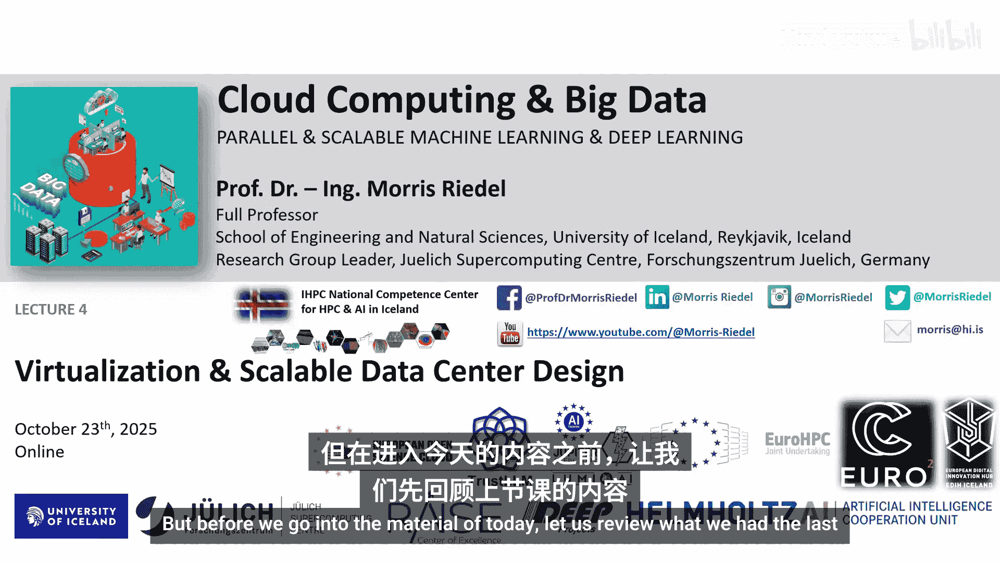

The last time was really formalizing a little bit machine learning with the aim， of course。

 of using it in cloud applications， but to get a better understanding of all the different mathematical building blocks。

 right， where you may be a little bit confused if you don't had a proper machine learning course before。

 there are many， many different wordings， training examples， learning algorithm， the hypothesis set。

 final hypothesis， et cetera， et cetera。 So the last time we try to blend this a little bit with one practical application。

 you know， the violations in a restaurant in terms of cleanliness or know。

 lots of violations of the food inspection gives you an indicator if the food inspectionable paths or fails。

 So we thought about it。As a binary classification problem you have that here fail and pass。

 so we looked in the data and we transformed the data。

 did some data preparation also if you remember there were actually five classes but we merged them more less than two also learned a little bit about class imbalance。

However， long story short， we had this binary classification problem。So this is now the idea。

 the business understanding what we want to achieve with the data set， and we were very lucky。

 we had the supervised learning example。 So it means for every of the input。

 we have about the restaurants。 we have also then the results， which will then pass or fail or。

 as I said， transform from five classes into these two。😊。

So that is an important part leading into data inspection。

 then understanding what data I have the business understanding。And。Now。

 when we start with machine learning， you know， one of the most key elements is a training examples。

 right， So this is something that we must have。Right， and this could be， of course。

 huge demand for storage。 Hence we go for cloud computing。

 which was one part of review of the lecture3 as well。 if you think in the beginning， right。

 when we talked about greenfish， for example， and using the Coannicos marine datasets with terabytes and gigabytes。

 is is something where you quickly end up on high performance computing resources or cloud computing resources。

That's where it starts。 If you remember， we picked a little bit one part out of the overall data called the training sets。

 That's where we train the modelling on， which we basically give a first place as an input to a learning algorithm。

 But before we go there， we also have to think about that， you know。

 we have to pick some specific hypothesis set out of our skill set。What does it mean。

 It means like we are having a lot of machine learning models at our disposal。Right， you see here。

 for instance， support vector machines。 You have essentially logistic regression that's the one we wanted to pick because we have a binary classification problem relatively simple。

 So no need maybe to go to support vector machines nor to artificial neural networks that you see here that could be another hypothesis。

 So each of those restraintrain weights， know like logistic regression here。

 you say the weights for the inputs and linearly and then you know having the logistic function， etc。

 etc ceter。 This weights changes means also another hypothesis。

 Hence we have more less infinite amount of those in the hypothesis set。

 but we want to pick1 G out of this。 there should be then our final hypothesis approximates F very well。

So F wasn' in our idea， initially an unknown， let's say。

 target function mapping you all from the Space X to y。

But here you see it's an unknown target distribution because learning is basically not possible with function approximation because sometimes in the data set you would have。

 for instance， the supervised one or whatever you would have something which breaks a function right and we had the example of movie rating if's the same mix goes in and you like the movie and say yes。

 it's a perfect movie， but the same person looks at two years later and then suddenly says no。

 this movie is not any more interesting So this is not a function。

 hence we have a probability assumption around it， model it with noise P or Y gave mix and this brings us into this probability distribution that in a way we assume that this training examples that have been created from a target function or an ideal function that some people say that actually not really exists right but we basically assume there's something there in nature that it created this and the probability distribution is basically to the rescue it also。

Stands for a socal PAC statement partly now staying probability approximately correct learning so that we assume the training examples come out of the same probability distribution。

 so when you have Netflix ratings， you look on this， you work on this。

 you don't go maybe to a bakery rating right so this is different probability distributions。

 different elements。And maybe even attributes， but the attributes can be the same important is that the probability distribution is they don't assume to be the same。

Then for the formalization， it's very clear to say that our vector X with all the attributes we have about some certain person。

 about some certain bakery or movie。 These are the constants in learning。

 So that's the interesting thing for us。 It's a data given to us。 Hence they're constant。 All we do。

Like you see here in the aly hypothesis about the logistic regression。

 we changed the weights with a learning algorithm。And that's where we come now to the lower part here。

 right， where we think about that the learning algorithm always goes together with a certain。

 you know， model you pick support vector machines。 You use quadratic programming in artificial networks。

 you have heard from Andreas Literman， you use back propagation of error through the layers。😊。

And logistic regression has now an error function that we define here that helps us a little bit you know。

 with optimization， as we had said the last time， to iteratively solve you know this problem going closer and closer by minimizing the error measure。

 so it's an optim problem by picking the right Ws， taking gradients， which is computation expensive。

 if you remember， to in a way going， you know， time after time with a iteration to the hopefully lowest  error that we have。

Then。That is what we added also to the error measure， and this is also something we have to have。

 you know， to see if you're getting better in learning。

And this could be also very application specific， right。

 so the error measure should fit a little bit to your application problem。

But in a way you have all learned this now and it's make the bridge then why we basically do this also in cloud computing we see that Apache Spark is basically I'm supporting this very well and also in a production sense for you know industry projects and so on with pipelines and the pipeline idea was essentially that you basically train a model with this idea of the learning algorithm。

 you know you have them the same steps for working on the data。

 if you remember the violations where text， raw text， then we go to words。

 then we have a feature vector， you know and this tells us probably a lot like dirty clean these indicators of some famous words。

 you would say that in the violations or basically not in the violations。

 So basically giving us a positive feedback about restaurants。

This is something very important for the classifier here that we want to have in the binary classification。

 so the feature vector then is working with ws that we give in。

Right this input with the ws to make these more and more correct using the arrow function and coming out with a logistic regression model。

 this red thing here， right， So now this is， you know。

 this is algorithm trade and in created the blue model， sorry， this is the algorithm。

 This is logistic regression model that comes out。And then， you know。

 we have seen this is scalable even with sparkk， right so we can add more more worker notes。Or less。

 depending on the amount of data we have or on the complexity of the computing we want。

 So if we have more data， more complicated modeling。

 we maybe want to go to artificial neural networks Here you go。

 you need probably much more worker node， maybe even GPUs attached to it。So。

In the same idea of the pipeline。 and then we end the review， I think。

 is still very important here to understand。 in know， this aspect。

 we can now take this logistic regression model and give it to the same idea of the pipeline using the。

 you know， tokenizer word hesing function。 But， of course， here， we don't train any more。

 This is now the testing phase。 Hence we use the test set。 The other part of the data set。

 we didn't touched。 And then， you know， fit with the label data and understand， really， you know。

 if our model works well， basically with unseen data。So again。

This one slide might be a sort of crash course for machine learning as a whole。

 especially in the supervised learning setup， right， So hence。

 for those that are really seriously interested， you need to learn a bit more about machine learning。

 Each of this mathematical building blocks is a bit loaded。 So how I pick， you know。

 the training set and tests at the ratio。 Maybe 80% training，20% tests or 60%，40%。

 This is all not obvious in machine learning courses help you。

 What we left out is a bit regularization， validation， right。

 These are things that should be also in the pocket to combat overfitting of machine learning models。

 Also something I don't really touch。 So there's lots of these things。😊。

You know behind this mathematical building blocks learning algorithm and so on so that learning is just feasible in a probabilistic sense giving the you know probabilistic distribution and other elements coming back to Hfting's inequality and so on and so however we made the case for a pettry we have seen it was very nicely supported。

But we， we basically jumped ahead a bit with practical topics to get you now to the final assignment。

 essentially here in the course。And that's why we put it a bit earlier。

But we left out a little bit why data centers now can scale， know also in a way in a physical sense。

 right， So how does it work， We need physical data centers with lots of。

 you know resources and why I can add and remove so quickly。

 And there's virtualization to the rescue。 And that's what we talk about today。

 So this is a little bit intertwined， But as I said also earlier virtualization of something which is so basic。

 I will just highlight here， very important concepts。

 which are sort of you know pointing us to the idea why cloud data centers need virtualization。

 why it is basically today in necessary ingredient of having socalled virtualized service in contrast to the physical service。

 And we will go to some terminologies really like virtual machines， virtual machine images。

 instances， what other difference of those because this is also very nicely support in almost all cloud computing offers today。

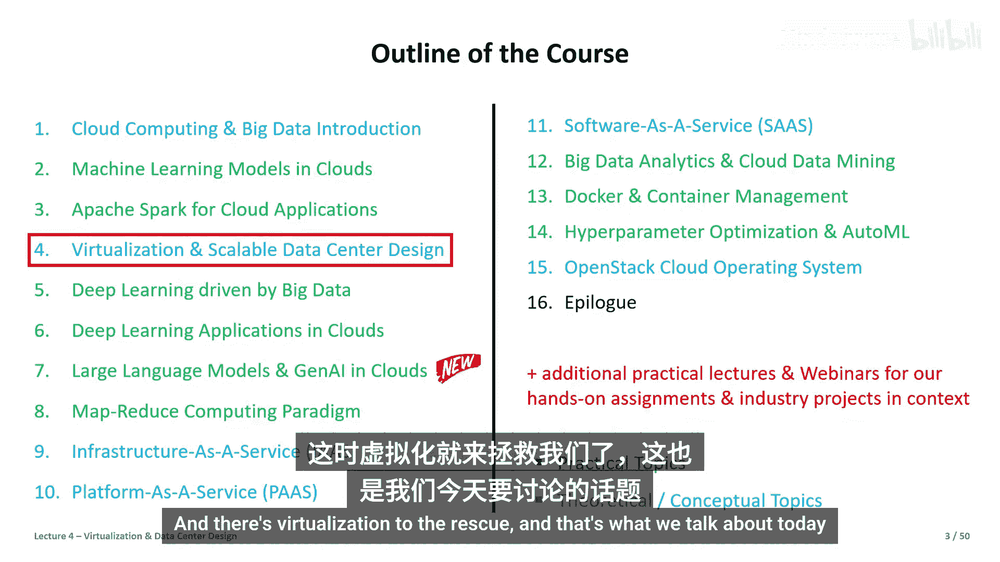

We'll look a little bit on MS Asia， but you find the same idea of this virtual appliances， images。

 instances， also in AWS and Google。Cloud， so this is pretty basic。Then。😊。

When we come to the cloud data center design。We take some of these aspects in the second part today。

 and we'll look on a broader scale， really， to think about， okay。

 how we have the idea of having multiple data centres， What happens with， you know。

 metrics in this failures， how we actually go with the idea that you know。

 all of this is generating a lot of heat to put this big data centres。

 So we need some cooling and certain you have heard about this， especially in Iceland here。

 we have ambient air cooling， which is quite good。And we will look in this a little bit with Icelandic data centres。

 as well。So。

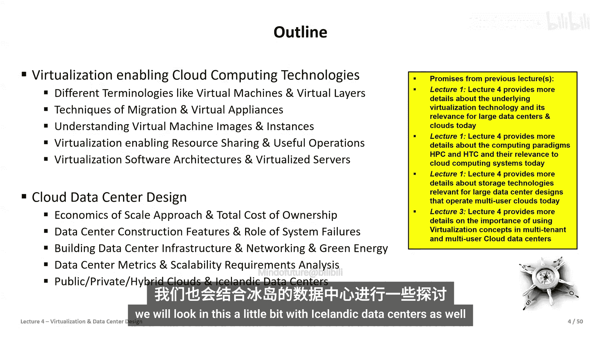

Then let's go to the virtualization technology and look a little bit about what you maybe already know from other courses。

 but we review here some of the terminology to put it in the context of cloud computing。

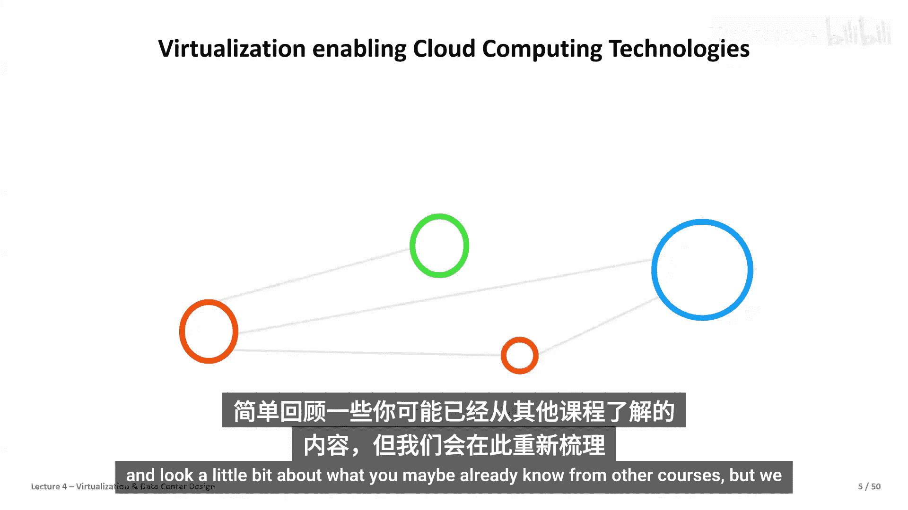

And we start here with a slide which really shows you nicely an evolution over time for cloud computing。

RightSo but 20 years ago when Im starting lots of things were very different。

 there were no computational clouds， so we had high throughput computing systems。

 you know some P boxes as people would say smaller computing powers that have been put together doing。

 let's say， P2 P networks and so on on the other side。

 we had already some of these costly HPC machines but not at all with GPUs and not at all at the scale we have today 20 years later。

So this is high performance computing systems at that time still。

 they were already quite powerful number crunchers put together in clusters and were more or less really centralized yet really one data center or computing center that hosts this HPC machine while the P2P network the idea of having really more distributed control and really geographically。

 you know， basically disperse and everywhere put together and this was also the coin of the idea but having more and more the HPC systems around。

 you know， in different geolocations， but also having this P2P networks。

 really you know in also different geolocations。The idea was born also closely related to Cern。

 you know， basically to the La Hadron Collider， searching for the Higgs boson for physical。

 let's say， phenomena。 The idea was to put computing together in a way worldwide。

 which was a worldwide large Hadron Collider grit and so on and we had in previous lectures。

 we had still some lectures on it。 If you go back in the history in the YouTube。

 Or if you look know it gridit computing was a big hype，10 years， maybe 15 years ago。And。

 and this is something where this was a birth in the sense of the of the foundations of the Internet clouds he had today。

So what was missing there still was the big bold virtualization。 So Vmware just was starting。

 you know， virtualization was not commonly operated。 It was， you know， here and there。

 lacking performance。 So I mean， you have a virtualization layer。

 we will explore very soon on top of these resources。 So this took away performance。 but nowadays。

 this technology has been so much advanced。 And and this is why we also will review virtualization today。

 because essentially the grid computing was already cloud computing。

 but with added virtualization and industry interest。 if I say so， this was really thriving。

 And maybe along with it， you would have the tool web tool that old service。

 a service oriented architectures， you remember， maybe some of you web services so there was not even rest at that time。

 So rest is also relatively new the representational state transfers。At the same time。

 more and more other sensors came in， integrated into grid computing。

 but also nowadays in clouds and， and many of these things。 So to sum up。

You would say without virtualization there would be also no really cloud computing today and we want to explore why is that the case and obviously if we want to read more。

 you see that AWS and others here MSs Asiaure and whatever cloud provider there is。

 they usually also talk a lot about virtualization and have you know their clusters virtualized。

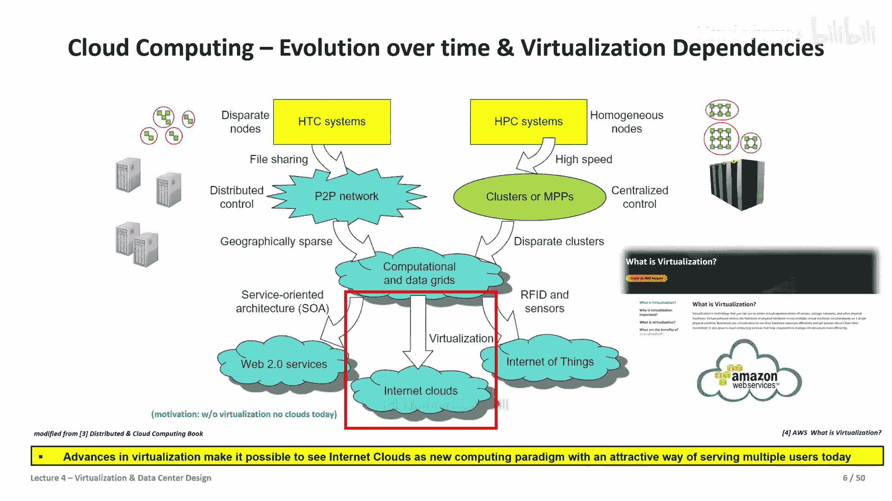

So from the concept perspective， I think again， very quickly because I think that is sort of basic computer science which many of you should already know you have a traditional computer with lots of hardware。

 physical hardware that's now important to understand。And you would have a host operating system。

 some Linux derivative Windows。 And within it， there are different applications that will be run。

 And the basically， the host operating system has full control over the hardware， right。

 So reading from disks and you know， et cetera， et cetera。 So after virtualization。

 you see that is a little bit different。 So you have still， of course。

 physical hardware without physical hardware nothing would work。 even a cloud computing would work。

 right， there's no chance clouds appear virtual and is nice and somewhere but in some point in time。

 even a cloud needs physical resource or some hardware somewhere in a data centre running。

To basically have all these applications， spotpotifies， whatever we have in terms of apps。

 All the mobile phones these days also supported it。 You've heard from the recent incident。

 perhaps that， you know， Spoti was not reachable， you know。

 because there was a problem in one of the data centres from these providers。

 I willll not go into details。 But you see then quickly that these errors will materialise。

 And then the whole service is not reachable any more， because you need the hardware。 Now。

 Viization helps us still to get quickly you know， on on， on track again if there is an error。

 and we will explore that in a minute。But let us just think about now how this virtualization layer that you introduce there。

 You know， on top of the hardware now changes a bit the picture。

 So you would have a virtualized set of hardware that you share with different。

 Let's say potential guest operating systems， which means you could have a Linuxos derivative。

 you could have in our windows in parallel。 And some of you may even have that on your laptop here。

 And then， you know， serve different applications。 And this is a concept we are known as virtual machines。

 right， you can fire them up。 You can stop them。 but gives you much more flexibility on your own little hardware if it is a。

 let's say， traditional computer or laptop， whatever。😊，So this is still very nice。

 it gives you quite flexibility and for us it's also a better system efficiency that we can get out there and that is something what we want to explore especially when we go to the larger scale。

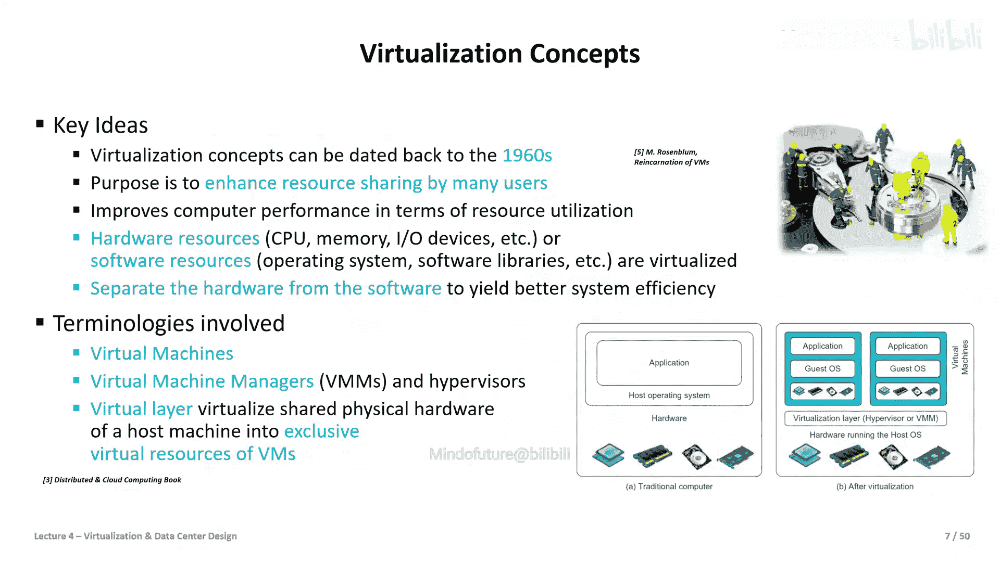

Hence when we revise this a little bit， you know we have here this physical machine with the hardware and you have this operating system and the application we just explored and what we now have to see is like when you have this native VM space that you know this is another wording we should just you know remember a little bit that you would have so-called privileges that you know this hypervisor can do now with the hardware that the operating system cannot do anymore。

Again， I think it is important to understand that the operating system has full control on the physical machine on the hardware。

 given the operating system is， you know， just on top of the hypervissor， basically。

 you leave a little bit this， you know， privileged space to access your hardware， how you like it。

Though hences bare metal bear hardware is a little bit virtualized in this guest operating system。

 and you potentially share it with many others to have your guest operations application supported。

And this is sort of。As there is an important concept here that does also reaching into in our security in a way to not control the hardware as any in our non privilegevileged users in space of this in our baseziily virtual machines。

the different ways how you could you know model this and in a way I think that's not so important to always you know have this in your head now we see different layers。

 but it's important to understand that you know it's a big difference between having the operating system on the physical machine hardware or basically having this abstraction layer right and that this abstraction layer is really something that of course can be put to different layers in a way inside this stack that you see on the right side right so this virtualization is here very closely on top of the hardware but you find in real virtualization solution that some people have really done this in different you know parts of it now for us when we have now this virtual machine manager right which does this abstraction for the guest operating system。

That enables us， of course， something quite nice so that we are basically independent of an operating system。

 we are independent of the applications。So was hosting them this Vms or multiple Vms that are isolated from each other。

You can add more and more if for instance， the hardware is not， you know utilized enough。

And this pinpoints us already to something called multius。Right in the moment。

 you're very much focusing thinking， that's my laptop。 no one else is about to touch it， which is。

 of course， understandable。 But when we move to data centres。 Then， of course。

 we want to support many， many different users at the same time with the same hardware。

And this is something where really sort of is a breakthrough now。

 right with this kind of virtual machine layer and the abstraction。

 because through this you can really increase the server utilization being totally safe because everybody has its own Vm。

Right， and all the users have different bands。And you know。

 this is something where you see here one claim from VMware， for instance。

 one of the providers where you can you know， increase the server utilization instead of 5 to 50% to 60 to 80%。

If you have a normal server， now， if you do this in a bigger scale in a data centre。

 you can imagine how the weight of these percentages are。 So hence。This was really fueling。 Now。

 the idea of thinking， okay， when I have virtualization， I can actually share this much more。😊。

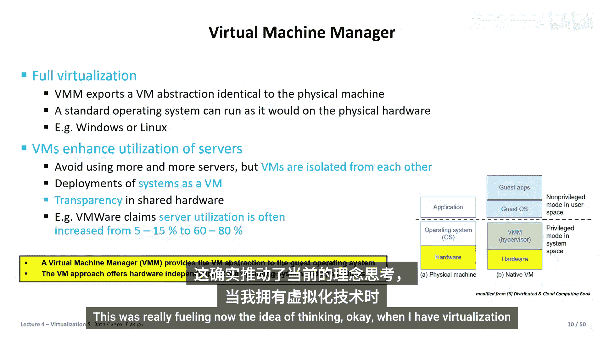

But there were other factors that also then you know basically coined really the breakthrough for VMs within the data centers without the large service and this is the interesting idea of what you can do then now suddenly when you are working in the VM space and this was before not really you know used a lot when you have just you know a plain operating system on top here you see one of the things we just discussed multiplexed VMs is a word for it you would say many different applications with different operating systems can use one virtual machine manager and then you know you can even you know access the same storage and you have another you know idea of combining this potentially then with a data center with other hardware another rack etc etc So this idea of sharing the same hardware with different applications and here I already put to you now this different uses This is a key concept right for the data。

ent not at all at the order of scale right here we have to think about data centers are thousands of users。

 so you need much more hardware， but still basically the concept is the same。

The interesting thing what Vms give you is also this instances of a VM that you can actually just suspend and store right status of the operating system of the application can be completely as it is completely virtualized stored to disk and reactivate it。

 So you see there in C is a basically counterpart enabling also porting which is a bit hidden here right so you can port it potentially to another hardware system because you have anyway。

 the hardware virtualized with the operating system。

 so you can you do something which then eudes also to this D part。

 which is now a key concept and you have errors and which is in data center is very common。

 So basically data centers operate under the assumption there is always errors。

 some hardware will overheat some networking will occur you know in terms of problems you know and throughput and so。

 And when this is failing， we have something called live migration。 So during the。

time you can even port the Vms to another hardware， which is actually operating quite nice。

 So all of these combined in a way enables us then to keep the app time very high。

 right for data centers， you know， and this is important because in their SLs and their service level agreements。

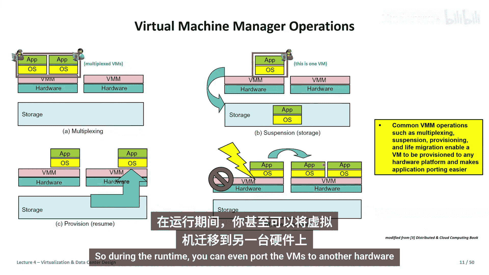

They usually state this， you know we have a 99。9 up time or 99。9 or 99。

6 up time you can review this in the recent incident that we have seen now as a networking that Spotify was not reach and so on and these kind of things means that now the provider is essentially you know。

 giving you a service level agreement。And， you know， this is what they operate。

 And never it's 100 per cent because arrows always will happen。

 So nobody will give you 100 per cent S A， Usually， right， So it's always 99% something。

 And you see here the time how that works in practice。 I don't go to the details。 I mean。

 this is pretty clear for those that don't really understood it yet。 Please review that。But。

 you know， you see a little bit here how little time，165 millisecond， total down time。

 how this can work when one certain host is failing and you just life migrate to another one。

 Of course， this is here and there may be idealized conditions。But still。

 this shows you that for a user it might be not really even in visibleible， the service interrupt。

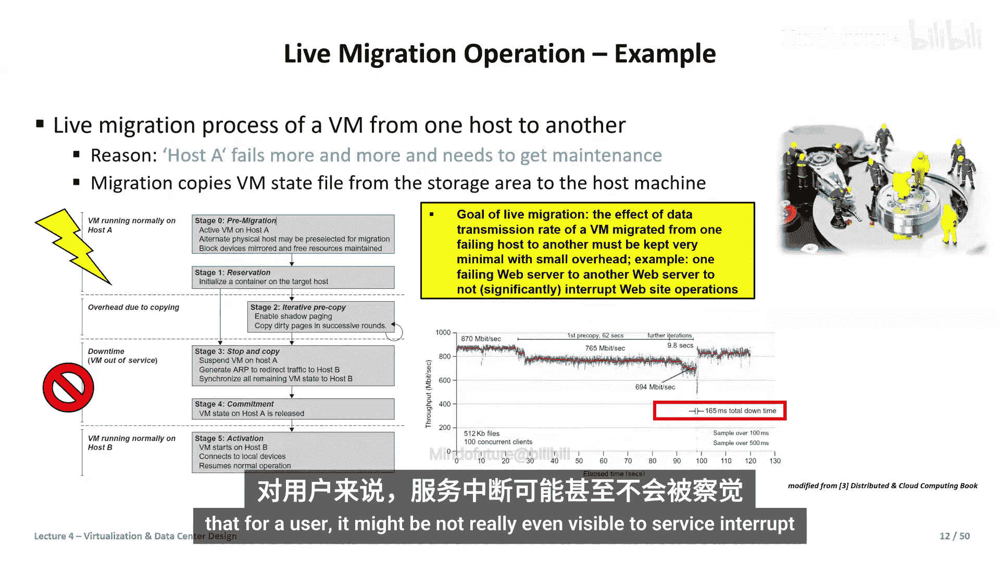

So then。This brings us more and more to the idea when we have this various VM instances。

Right then we can maybe fine tune in this already and say， well， why should we as users get a plane。

 let's say operating system without any applications？But why we cannot just bundle that already。

 you know， and some of you know that so some people of you are actually Uunntu users， some more。

 you know， Zusa Linux users， some actually other Windows users。 So， but you know， what about having。

 if we can store if you remember， we can store and resume these。

 we can build so called virtual appliances。That basically can bundle all the applications。

 your operating system and so on and so on。 and make it ready to run。

 And if you see here on Asia as an example， that's how it could look like。

 right So you basically in Asia can just pick an virtual appliance with a virtual machine that has already installed a bunnto service has already installed you a Sousza Windows service of some kind that you can then use instantiate and you don't need to install or the operating system or even some applications with it。

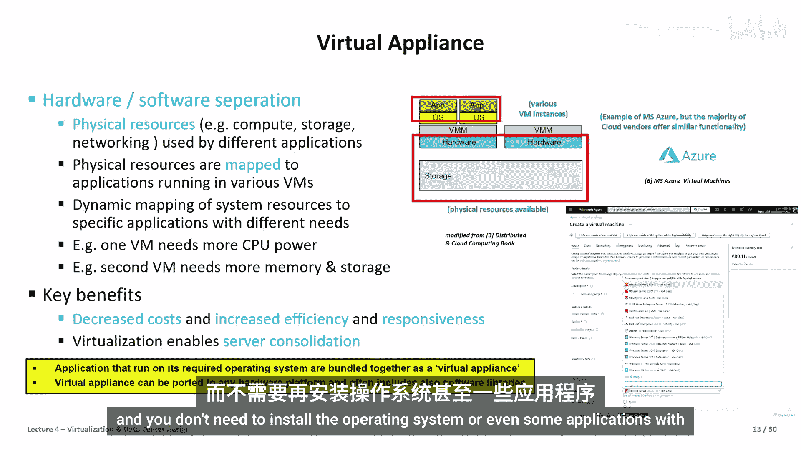

And this is now， of course， something where you have these images then there on storage and you can create another one and another one out of this and create instances as you like。

 you can modify these images， of course， up to your you know basically requirements or maybe adding some specific applications that you want to have on your Uuntu server and have this VM instance ready to run on a virtual machine server。

Of course you see here also this estimated monthly cost again。

 the short disclaimer if you go to commercial cloud providers。

 you to have to pay for the service right but this of course comes as a very high up time and the way you see here it in MSs Asia it also is a bay label in you know Amazon EC2 instances。

 these are not obvious to you we will see all that materialized when we talk about you know lectures on infrastructures of service and so on and these will also have you say VM instances ready to run on all these different service and the same as in Google。

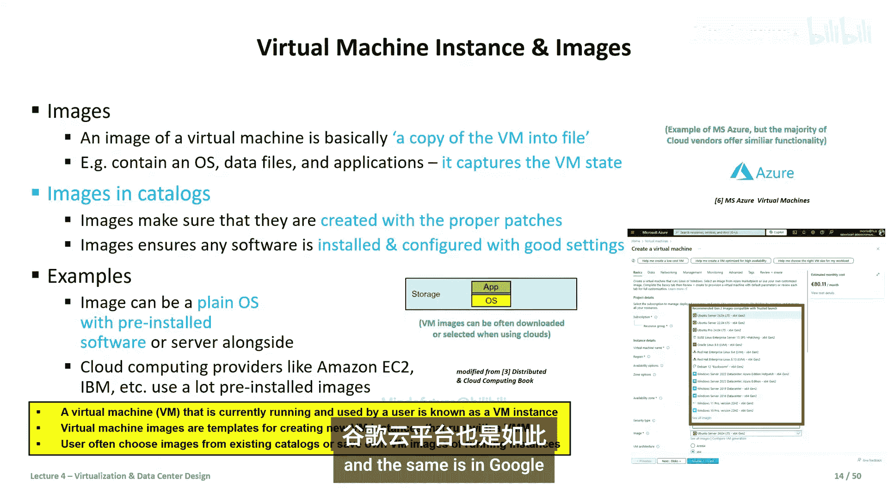

Hence。😊，This is sort of of a key basics that you know fuels cloud computing today from the very。

 let's say basic services and for some of you who are a little bit advanced in maybe computer science now will already smell something which brings us to a very later lecture meaning containers right so containerized applications are a little bit of competitive you want to this visualization concept in some way。

And I just note that here so that some of you know we don't ignore that fact。

 so we will come back to you know basically containerized applications and Docker and all of that and obtainer late and of course and you know it also is important because today the data center industry is going you know also to this kind of aspects but still is virtualization of course inherently in it right many of the you know instances。

 all of this is basically done today。So the rest of today's lecture here in this part one was just more or less a bit of a walkthrough that you know some concrete。

 let's say examples send very you know known for being for instance。

 an open source hypervisor I was quoting VMware so that you have some real products which are using。

 let's say this kind of technology virtualization out in the field。

 you can go to Queen and basically see very similar concepts here that you have you know that we discussed before you so you have your kind of physical hardware devices the see hypervisor or the virtual machine manager。

 you have now the opportunity to have different， let's say operating systems or as we said guest operating systems and then different applications also with it。

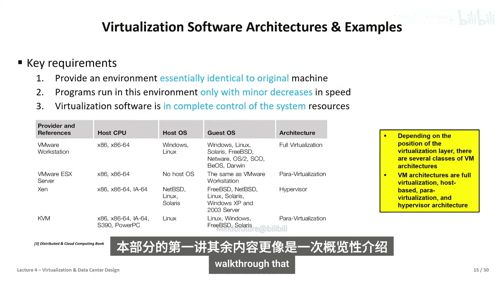

And you will see that every of these softwares， Zen and others。

 apart from just being open source or commercial like we am there， they here。

 and there are some very specific features， right， So， for instance。

 here we have this so called domain0， which is a very specific one， you know， in other words。

 that there are some that are not really completely equal from the guest operating system。

 So there could be some domain， which is， let's say， still very prominent。And then you know。

 doing certain aspects that the other aspects or the other。

 let's say virtualizations you put here on the right side don't have。

But this is a very very specific thing and S I don't want to lose much more time on that just let you know that。

 of course each of these different technologies coming also quickly to VMware。

 which is now by broadcom， basically acquired So then you have different features and all of these different technologies and of course obviously some of these technologies of course are very much also oriented to your own laptop still to your operating system for a traditional computer not all of these virtualization technologies are in cloud computing today some of the players are so VMware is also big server installation and so on and again a bit how it works here you see essentially here we have discussed this already and here it just shows you that some of you know these commands normally you should always go via these layers。

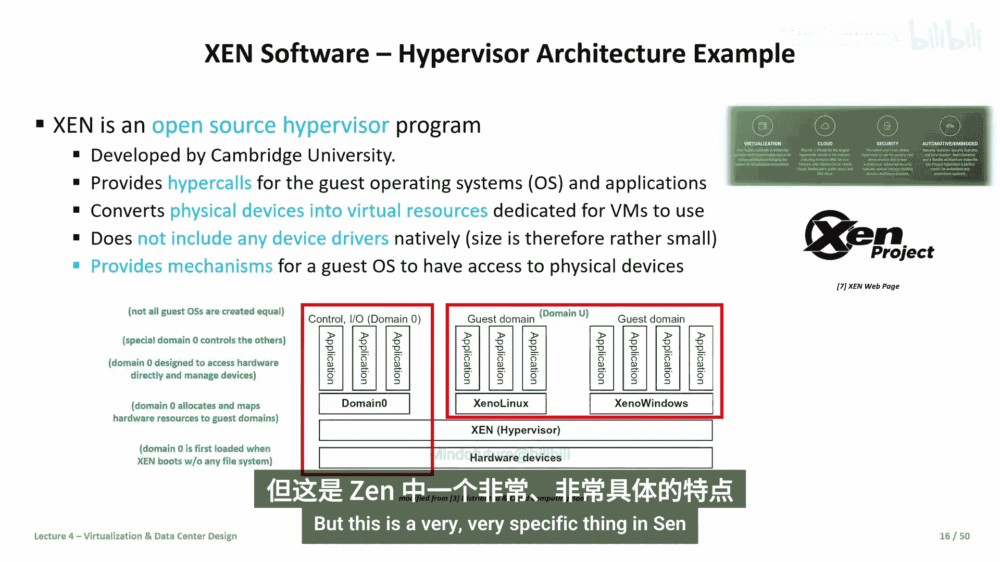

You know， the guest operating system has to operate with CBbMm to actually then go to the real hardware in the。

 you know sort of mode of the supervisor。And this， you basically you know， have a way as users。

Thinking about directly going to the hardware there are some exceptions to this which would be now much more important to to look in a virtualization let's say course or so and in the end I leave it at this that you also understand a little bit that know some concepts between full virtualization architectures and so on。

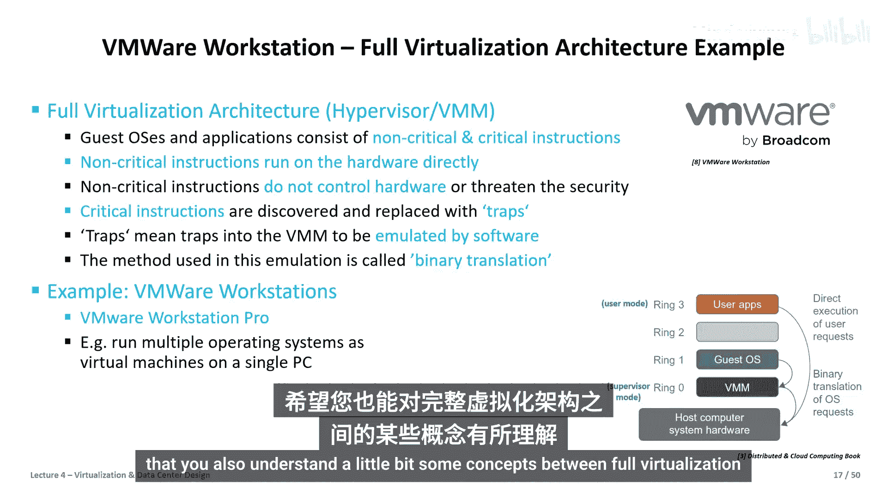

So hostbased virtualization architectures， just for the name of it is a little bit an interesting aspect that some of you maybe have already also on your laptop when you say you have your typical physical hardware we discussed before but you would not have the virtualization layer directly you would have a host operating system and I know some of you do always Linux first and then put the virtualization layer on top and then have something like in guest operating like Linux like Windows in it there's applications or you have your applications directly on the host operating system like Linux so this is possible you know some people you know know that very well you set concept and this is different from power virtualization examples for instance where you have then essentially the traditional model that we just set you say hardware。

 you have a hypervisor here that is essentially then have the guest operating systems。

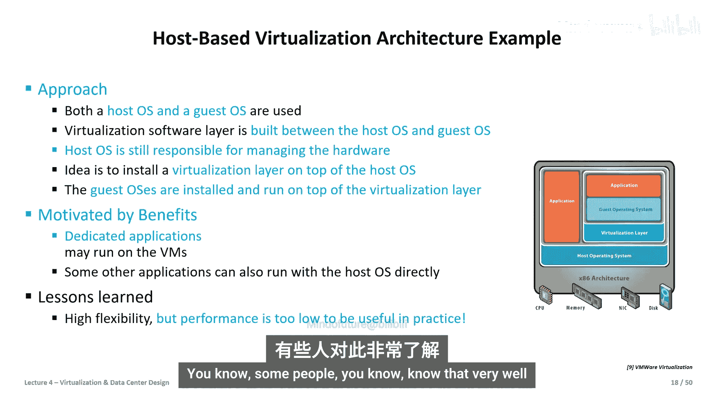

Virtualize it already means that some of the requests directly you know basically can go to the hardware。

 in other words， it's not simulated， it's not virtualized， which is let's say。

 also something you can look at in KVM if you want so again。

 something which is you know very specific to the different distributions perhaps as well。

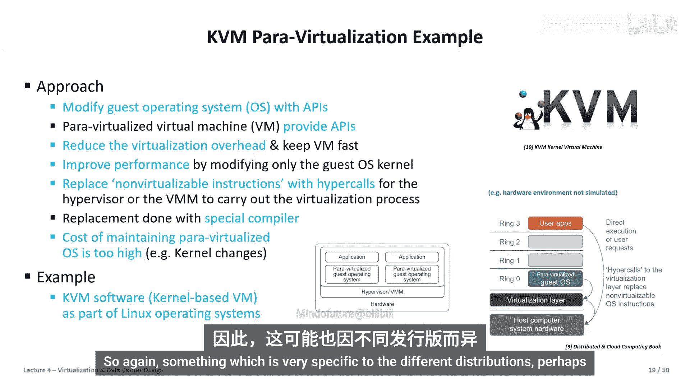

It's also not so important to know these difference by heart right so obviously you can imagine data centers operate in a way that it fits best to the users and maybe also to the best of the profits。

So in the end， from our 10000 feet perspective， again， for us。

 it's important to understand that all these large data centers you see use really as virtualized resources。

 So， and you see， again， how that fes here， there's hardware storage， you think it's one big cloud。

 But even in Amazon， you have to pick which region， Virginia or other parts。 you know。

 Europe and so on。 So in the end， these are all looking nicely virtualized and somewhere in the cloud。

 But they will come back to some virtual data center somewhere， giving you all these resources。Right。

 and and this is something what is really important to understand。 And in the course。

 you will also know we will go to one of the data centres so that you really touch metal。

 as I would say， important is for you to understand the physical heart that we see a little bit on this。

 And we will do this more or less to the end of the course。Together。So in this is of course。

 lots of management and a huge virtualization infrastructure means also a lot of， you know。

Possibilities in order to fine tune for users in order to monitor infrastructure and so on and so on。

There are lots of building blocks that we will also look in lecture 150 on how you do with cloud with' a cloud operating systems and so on。

 and let's not forget the security aspects that we really don't have herees in this particular slide。

 which which is equally important。So here's a good example of you know。

 more or less going to a really data center scale away from what you just saw with all the different laptop computer oriented ones with the basics。

 but in the same way you would say the data centers have to realize this cloud， you know。

 really somewhere physical resources， right？And this basic is really not changed。

 All what is changed at the virtualized platforms on top of it are much more scale level larger and maybe also geographically distributed。

 not only one laptop in one room， right， So there's a big rack somewhere in Virginia。

 a big Re somewhere in Europe and so on and so on and a big data center。

 perhaps even if you think about the Amazon scale and Microsoft and so on。

 they still operate on the concepts of different virtual solutions could be virtual machine with different agents and solutions which are basically then give solutions for the customers。

 right， So whatever there is running it， a data center in the end knows it's important that the applications。

 but you know， they also don't necessarily need to know what's running in it。

 but they have to do lots of management here。 So the virtual management means a lot of security data management resource provisioning where are we we physical resources。

 are they really utilized enough。And so on and on， we will review this results in the second part of this course today much more when we talk about data centers in depth。

And with this， you basically have an infrastructure provided for your users as a data center and this is。

 let's say totally independent for what you see here in on the bottom right the user will not necessarily know that this is a server there and here So the whole stack basically that you have here。

 hence opent is also one of the cloudbo systems talk about the big stack of services you have to create the infrastructure services and something where if you use system basically the counting billing right Sp the credit card iss a very important concept Mi management。

 So data security， data backups data duplication and so on and so on so。

You have to think now that this is really on an infrastructure scale in a data center。

 Hence you know this is something where you have an order of magnitudes of scale。

 But when we come now then to the idea of sharing these resources。

 This is all what it enables right Because now we have this large scale we can say this green user group gets these resources is cluster and then there's another red user group these are should getting these kind part of a service。

 So it can， you know have a very flexible resource sharing and can can change this over time very quickly。

 and this helps us also very quickly for the live migration right when we have， again。

 a problem and error full to runs， This is alludding already to something。

 And you know this is also a concept then that needs to be integrated with your scheduler right when you think about Baci spa cluster deployment when we have this yarn scheduler right？

 So basically the yarn what's already doing what you see here。

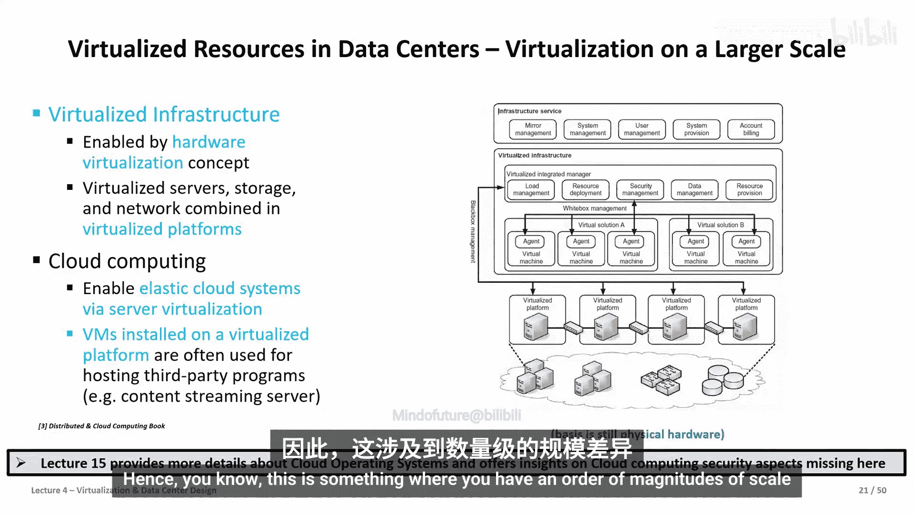

The jobs of different customers are different。Places within the cluster。

And you have seen this in the Upiter， of course， it was just for your jobs。

 But if you think about it makes a step in your mind that you have in a multi-us environment。

 this is now for different users， and you have to do this。

 So it's a very relatively complex mechanism to share the cluster with so many users in a secure your way。

 which is not only something where you need a scheduler。

 but where you need the whole concept of virtualization quickly where you need let's say different privileges who is allowed to do what on the hardware。

 and this is all vieweded by essentially this virtualization concepts that we heard and by using the Ms more easily around。

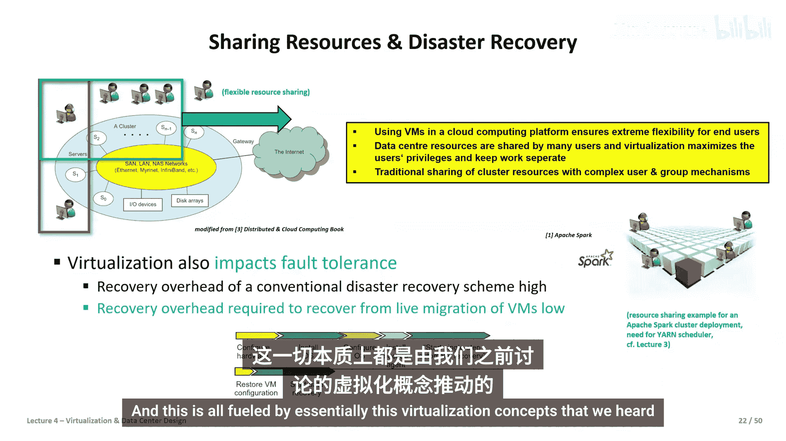

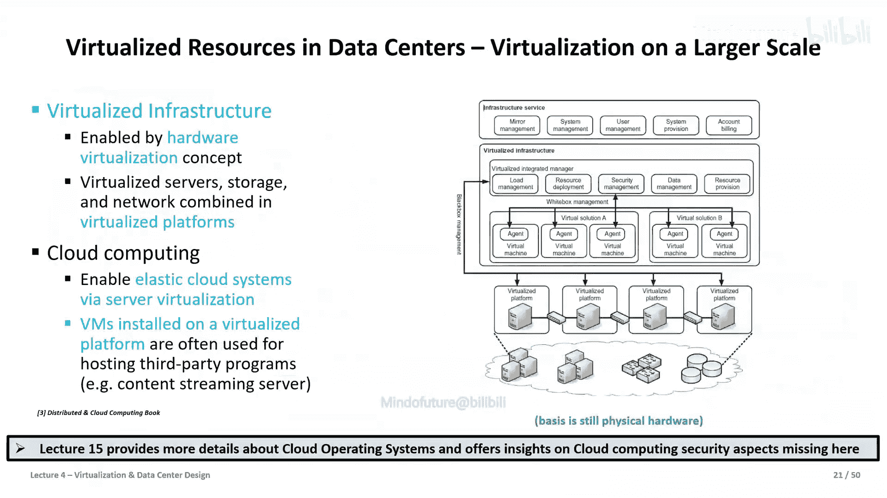

Now when we now go towards this step and again， the second part will be more of it。

 think about that there's this idea that you have then this large data centers which essentially pick up the same concept we had before so we have hardware then there's a device drivers and the IOt to get to the hardware and they have device drive in the guest operating system。

 so this is what you would know on a lower let's say small scale if you take the same concepts and putting it now to a really large let's say data center you will end up like this right so it would have a very fragmented way of looking in it that you know basically inside the data center。

 some are using you know Vm zero for a database some are actually hosting web service another one is again a database。

 others have hosted middlewares So the application concept that you have here and the different needs of users which is a bit explained here。

You know， means now you have a mapping to do inside your really physical space of a data center。

And this is something where， of course now lots of these aspects are growing in complexity as we have more GPUs。

 not only CPUs， any more different types of GPUs， which may be important for our AI we need sometimes maybe cutting edge ships versuss。

 sometimes just number crunches for clusters instead of cutting edge GPUs and so on and so on。

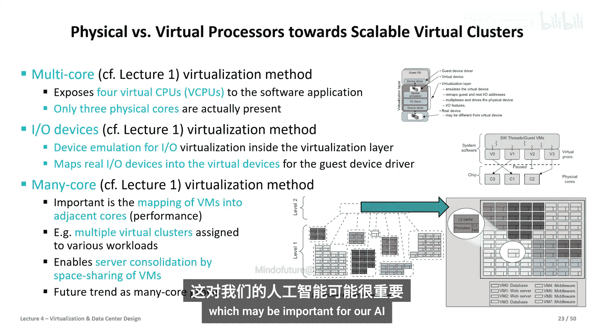

So。There software enabling this。 So for instance， a VMware XV service here。

 there's something also that you could look up。 It just shows you that of course the commercial players and the industry is aware that there's something more than laptop and this is already a scale which is larger so really service this virtualized software and many people have this in production。

 So just that you see it is also considered already a cloud infrastructure mostly inside these kind of different let's say providers and if you go then on a bigger scale really this VM where we swear and they have wecentus use a lot of things which will cannot go into all the detail because this will fill not one lecture but many lectures they have lots of functionalities today just that you understand in the idea of cloud computing and the idea really operating these kind of clouds and we still have to talk about private clouds。

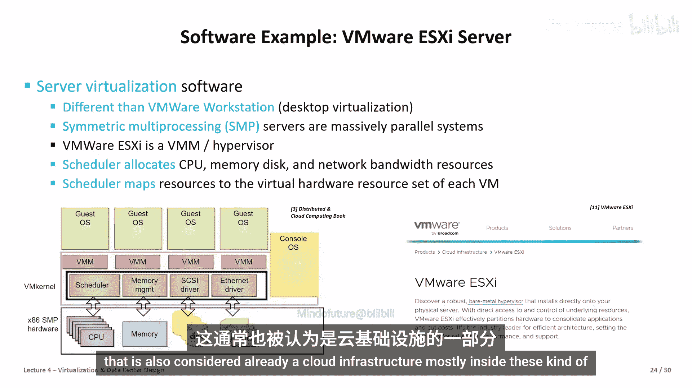

Public clouds， hybrid clouds later in the course， where it maybe becomes also for a company important to have interning the cloud and then at some point in time。

 bridging together with MSs Asia or AWS， something we called a hybrid cloud。

 So this will all come later。 but this shows you that this is really a hot topic in the commercial domain not only at La data center scale already at servers。

 maybe for a company， this might be really relevant to think about virtualization。

 because it cs a utilization and has many other benefits。

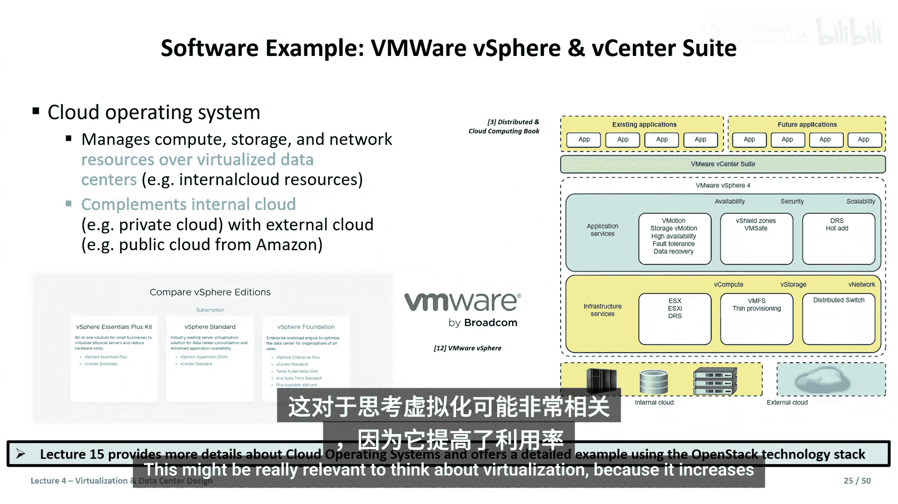

And a little bit this standardization and so on around it， I will leave you to the video。

 which is of course also very nice if we can port applications more easily with VVMs and so on similar like Docker containers we will basically learn at the end of the course。

 so I encourage you to look the video and we break here for 10 minutes and then come back refreshed for the second part where we look much more in cloud data center design。

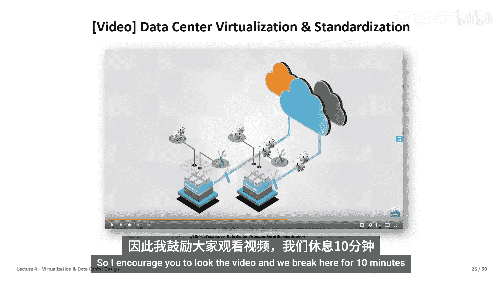

读啲数。

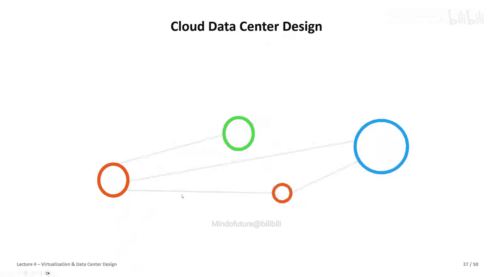