# 【冰岛大学】云计算与大数据-｜-2025-Cloud-Computing-And-Big-Data-Course-p10-P10_讲座_4_虚拟化_可扩展数据中心设计_第二部分--BV14MB4BjEyZ_p10-

Welcome everyone for cloud computinguting and Big Data。

 or lecturec4 on virtualualization and data center design and the second part of it。

So the first part was really reviewing a little bit on you know virtualization the basic technology。

 if you want in computer science and computer engineering today。

 so we didn't cover all the basics but the general idea of technology， you know virtual machines。

 virtual appliances， hypervises and so we reviewed again for those of you where this you know basic knowledge is maybe forgotten a little bit。

But of course， there's much more visualization that we could cover， however。For us in this course。

 it was important to understand that the same principal ideas that we took from virtualization you know on your little laptop or on your traditional computer PC。

 etc。 we basically moved from this to larger and larger data centers and the second party here now we will pick upon some of these concepts but also put it in the abroad a concepts So basically we will see how data center is also created。

 you know second floors， gas for you know fire protection and whatever So these are all concepts where you know this sort of the 80% mainstream data centers while the data center design today can be really vary also obviously is very related to where the data center is so one example Lommi kyanni you know one supercomputer in the union is essentially in Kayanni very much up north in Finland with lots of ambient air。

Cooling， you know， cold areas and still the data center is designed in a way to fuel with a waste heat and everything which comes out of it a whole district next to it。

 So other data centers might be close， you know， to some other that say。

Spot where you have maybe hydrorowpower resources， so long story short。

 even if you're in countries where obviously ambient air is hotter。

 there could be also warm water cooling。 there are lots of different concepts that I cannot let's say or go into detail here just that you know that the cloud data center design are some principles that you know stand the test of time。

And as is community is flow really flourishing， right。

 So we see data centres growing not only in Iland in the Nordics generally around the world because we need them。

 So basically， this means there are more and more specialized data centre designs also for the scale we're talking about。

😊，So let's go a little bit with the data center design then in terms of principles and again we have to start a little bit from terminology。

Some of you know that already a bit from the high performance computing course。

 but here we will look at this again， so many of you know that there's usually here and there's some server around universities large organizations will always have some server you know that give multi users already some you know development platform or something which they host there。

 for instance data which is relevant for the analysis within the company and this is something which you know where it all starts from but when you come to a more professionally hosted data center。

You would say it's not like you just put these servers and put them all in a row。

 And then you have a whole room full of， you know， this smaller service running around。 So basically。

 we're talking about racks at a certain number of scale， right， And in one respect。

 this interesting graphic that you always have seen abstractly with Apache spark and already early and the course is a bit representing this。

 right， So you basically have lots of these racks， which are also lots of servers in。

 but they're much more condensed。 Theres much more compact designs these days， right。

 that you have available in these racks and the better concept for cooling。 you know， overall。

 we will look at at some so。And these are very well interconnected as well， right。

 So you will see in one of the videos and one of the pictures， of course。

 a network interconnect is another important principle。

 making these now Res really tightly integrated and then enables really something we call economics of scale。

 So you fit much more in a data center and so on and so on。

 So this is important to realize so that on this scale of data centers。

 you're not talking about smaller servers usually anymore。 And I think we see how that， you know。

 materializes when we will do the visit in one of the data centers within the course。

 they have lots of res while。😊，The applications within it might be very different。

 might be basically just one customer that has a rack in a data centre。

 very secured and runs its operations， while another rack or a couple of other racks might be more to use。

 So many users from different organizations are using it。So of course。

 the Res are basically an abstract principle to say there's a condensed or really compact way of computing and storage available in data centers。

So。

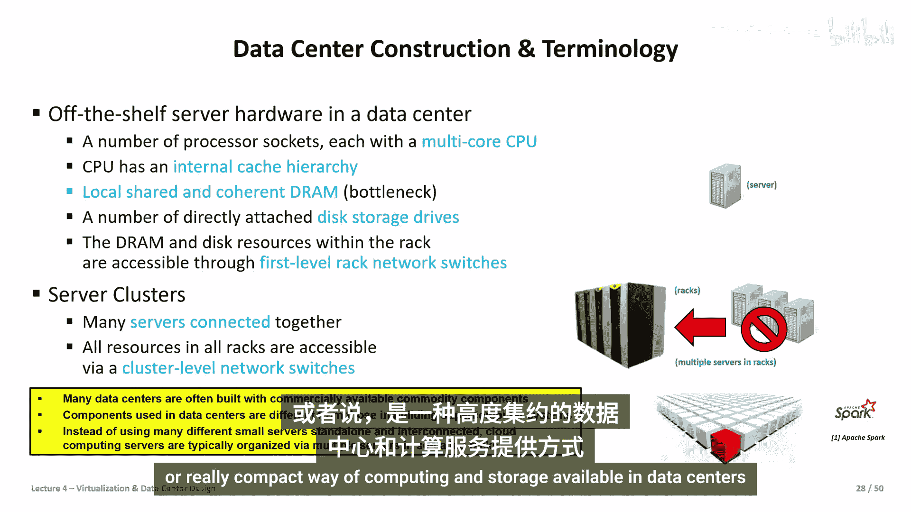

And this enables and also the scale and I think here you see the scale we're talking about now when we also have our left picture again from the Apache spark right so this is one example of a data center So this is something like around 1 million server somewhere around this in this housing of you know 11 times football field which gives you sort of the indicator now how sizes are there and you know what we're talking about and you see here the space。

 the floor space， as we say there are multiple racks here in there inside storages you see also something what we call the dops or diesel engines and you know basically probably the fewer for the diesel engines in case the electricity goes off the data center can operate a little bit more but in an increasing size like this it's getting more rare that these can actually operate without electricity very long so the operators。

Talk about also in the second part， you know， I'm more and more。Let's say limited by the scale。

 however， this is of course really something where economiclics of scale is essentially the term because here you would have that。

 you know the larger the data center is the better it is， the lower the operational cost。

 you the whole infrastructure there， the cooling infrastructure we talk about what infrastructure means in a minute。

But there are lots of different aspects to it than having， for instance， let's say 11 times you know。

 this data center， you know， let's say each one of a football field。

 where we say we have 11 data centers that just one big one here。

 but they would operate not on the same economics of scale that would be you know the infrastructure is helping here to realize this concept and this means for cloud computing providers like Microsoft and others having then 100 of such you know large and small distributor around the globe that they can you know work on a much lower operational costs right so this is an important takeaway message that's why theres a move towards greater and bigger data centers because they are basically cheaper to operate。

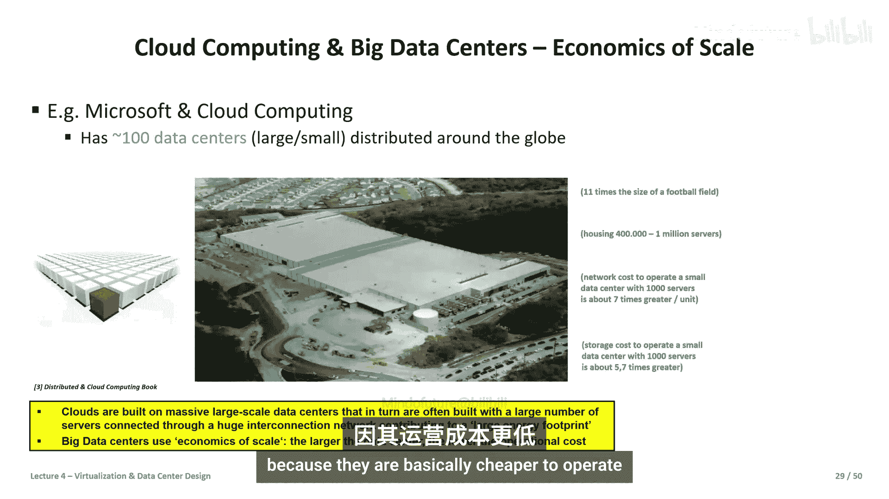

So how this works now to use this， let's say in a maximum utilization is again our virtualization example。

 so within this big building you have seen which we abstractly model as this aspect here where you maybe want to run a patchache spark on right？

Though you have many different physical services in a row。Now these are basically modeled like this。

 but the way how it used its actually quite different， G our virtualization design。

 So you have virtualized clusters that could be。Essentially modeled in different ways。

 is see one virtual cluster may be you know stretched across different three physical ones。

You have one virtual cluster that may be dedicated to each of those。

 so it really depends also using just part of it， just showing you。

That there's a lots of flexibility in this and this of course。

 drives now the utilization because users have different requirements， which VMs they want a host。

 which of the applications need a very high up time that say a physical cluster would go down because of network issues then you see that this virtual cluster will fail or it would be live migrated maybe but still you know have some issues while this virtual cluster can have maybe better up time having some of the applications replicated on different physical clusters。

So they are different properties。 And if you have here。

 Prince instance the Apache Spark again you now you would say that the if you remember a little bit from lecture 3。

 right， we had the head nodes of worker nodes， you would say that the virtualless cluster we talk about can be also extended。

 you know， like virtualt cluster 2 could be here that we have a head node， we have two worker nodes。

 but if needed， we can expand the virtualt cluster to this free space here in a data center and add more three worker nodes。

 I mean， in a very abstract notation now， but again。

 coming to the shrinking and expanding concept of a cloud right。And this is fueled by virtualization。

Of course， you would say it's also limited by the physical availability right So if you say Spk again and now I have a super duper job。

 I need thousand worker notes， let's say in the cluster like this。

 which is already fully loaded then here you go there's just no availability of thousands right so hence you would maybe consider to go to another data center or maybe even stretch your offering across different data centers right so obviously。

In some point in time， even you know these large data centers are just fully loaded and in a way that's also their goal right of course they always provision resources in a way that users can add resources。

 also on the principle that some others maybe remove resources。

And there's concepts like over provisioning here and there to keep the utilization and so on really in a manner that it's for them a very good renewal return of investment of these big data centers。

 you don't want to have a whole data center empty and just waiting for some users to add thousand worker nodes in a batteryy spot。

 So these servers should be running 99。9%。 So what I said to you 10 percent is usually very tricky because of。

 you know， standard maintenance already。 So every now and then， you know。

 you will see that some of the physical clusters need maintenance。

 you maybe you know have to renew some of the you know kind of rec parts。

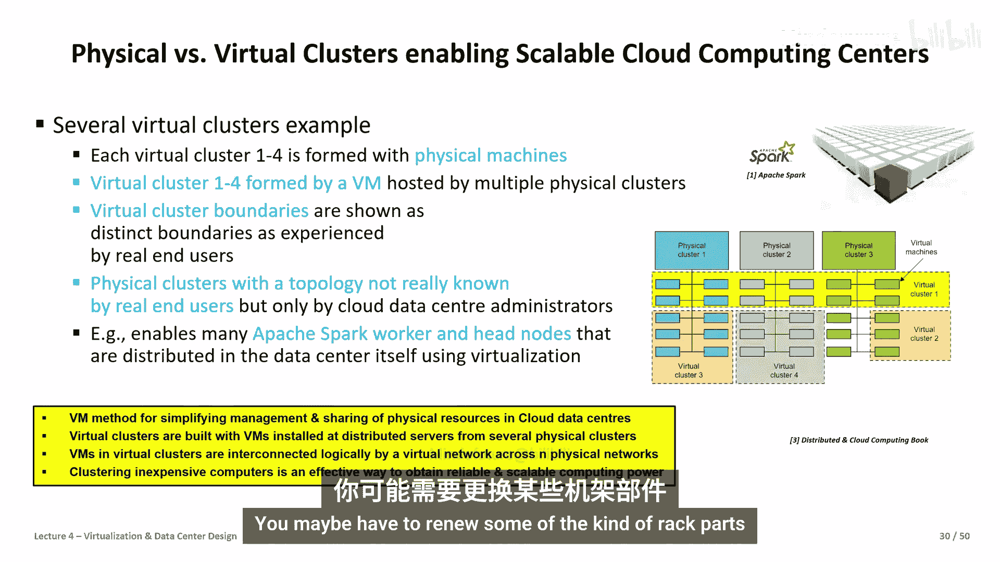

So。But hence this enables us out of the scalability we were talking about earlier。

 right by using a patchy spark the resources have to come somewhere from。

And by partitioning this with applications， you know， across also different application spaces。

 multiple users， these data centers can also serve different application communities。

This is a very important part as well， so hence they're not only multi user。

 also multi let's say application domains in a way everybody can use a data center so to speak right no matter what applications。

 important thing that it fits somehow in a VM。And you can use virtualized resources in a way and。

 you know， computing power， and you know that already from a little bit the starting of the course。

 where we have said some requirements for neural networks will be GPUus。

So some virtual clusters offer their notes for， let's say。

 application A with and having some specializedised GPs that we want。

 And some others have maybe even cutting at GPs where we have to pay a lot。

 but it's not needed for everyone。 But for some。 So you see also。You know， this is something where。

There's a flexible demand。 but there's also flexible offer。 And if you see that later in our lecture。

 we will come and review this a lot， that this is， of course， directly related to the cost。

 what you want in terms of GPU A GPUB you go there and pay the price for it。

 So other concepts here is， of course， the operating systems we already discuss。

 but also the replication scheme。 something we will also review a little bit in the next lecture。

 basically when we come back to you know， basically data needs to be fueled to neural networks and so on。

 but also very later when we talk about mapre Hadoop distributeded file system that you have a replication scheme of data around and in this。

 of course， Hs also for the uptime disaster recovery。

 let's say really one of the data centers will completely go off。

 then we would have the data maybe with a replication in another data centers and users can still work on the data。

So。Hence this is you know also from the application perspective very flexible often used and in this sense you know with combining then this different loads of applications you usually get this wide variety of cloud you know tools services applications very high server utilization of your data center and this enables us then as data center operators to really you know offer these services on a let's say relatively okay price because we have to also think about that in some occasions if you really need that computing。

 you can go ahead and create your own right would that entail you would need a cluster somewhere in your cell okay that might be not cooled enough so you need a cooling infrastructure。

 okay the network connectivity might be not good enough so you need a better network well。

Maybe not everybody should enter the seller overnight and gets all the data by stealing so you need a proper protection mechanism。

 you can go on and go on that of course we know that the price for a GPU can be quite high。

 let's say $24 for in or one hour， but then equally have also an infrastructure problem if you want to do it your own。

For some occasions， this might be viable， let's say hospitals that host patient data is a very common use case where you want to have maybe the servers in house。

 right， on a still very protected way of， you know， having this in house。 But this comes for a price。

 And this is， of course， something we should review a little bit。

 And it's a bit shown in this slide here where you see the fixed costs in the in the capital equipment that you are have to buy。

Right and and in high performance computing cloud computing this。

 let's say every three to five years where you have to rebuy or update your cluster is maybe not any more completely accurate。

 I would even say these days if you see the NviDdia GPU generations you know going from Keplline Ampe or Ghopper now to Blackwell architectures。

 which is a cutting edge this is not anymore you would say even every two to three years if maybe every year in some of the applications need to be an update of your fixed costs。

 so that means basically if you put it in your own data center in your own seller after one or two years your GPUs are already old or your network interconnect is not anymore more up to date。

Or， I mean， you can come up to many examples where you see that these days。

The I T technology is moving at an unprecedented scale in terms of performance。

 in terms of aability potentials， right， So if you see about what Nvidia can do with Tenza course versus what we had 20 years ago with CPUus and then slowly coming up with better。

 better CPUus， GPus changed the whole idea， the whole setup。So this would be another fixed costs。

 And then within even the GPUs， the generations matter a lot More HM I bandwidth with memory changes a story for lots of different applications。

 So you can go on and go on that essentially what you as a user will earn is that you basically have just the variable costs in the operational expenses when you buy cloud computing resources。

Right， and and this is something where that cloud computing cost model comes in and which makes it so attractive for several people。

 you know， in the industry to really go there。 And then once they have tried it。

 once they have looked in it， stay there and even scale out。

 So this idea was born in that effect of saying just just pay what you use right。

 So the cloud provider， Amazon， they care about， okay。

 getting new GPUus and offer it for you and you just pay for you right。

 likepe the credit card so and so much per hour。 So this gives you， of course， then especially。

 let's say for SMme， smaller medium enterprises， startups。

 really smaller companies a really nice opportunity to tap into that computing space。

 which would be otherwise not possible， right， You cannot just create quickly with some startup money。

 a big data center。And if you need cutting edge AI， you need this。

 let's say large language models will be old with review very soon in the course。

 So this is something where this not upfront costs as then or was in a sense。

 Also another breakthrough of this cloud computing cost model， right。

 where a little bit more in comparison， maybe with grid computing which had similar ideas。

 there was never really a cost to it and basically with this industry commercial partners nor really had had an idea of how to really run a data centres make profit because others had a win of not any more have to spend the fixed costs and could turn that into the variable costs。

 And with this， of course， shrinking up and down。So when then look on infrastructure costs and this is something which varies really from large to small data centers。

 it really depends on which region which geographical location you have I was alluding to Lommi for instance。

 which is you know the data center or the supercomputer in Kiyani way up in the north is completely different of hosting it somewhere let's say in the middle of US so there's one thing that always goes in common。

 you have to spend a lot of thinking on cooling right so hence you will see some statements that many of the data centers you know the main concern is cooling so Chiing cooling is quite some costs for the data center。

 hence you can understand why many people go to the north right and why at North Boreales data centers here in Iceland and maybe even Verne and they're all located more or less in you know Norway and Finland in you know you go there。

So basically this north of ambient air cooling of colder climate is of course， something important。

Then the whole aspects on electricity， right power distribution and so on is also something what you have to do to think about。

 especially when you want to have emergency power。 This is needed to keep your SLs。

 your service level agreements， right， especially if you think about that， you know。

 there's suddenly no electricity。 you want to keep the applications running。 There's U。

 So diesel engines and so on can， at least for a couple of hours， you know。

 generate enough electricity to keep some operations running。

 which is a matter than of your SL A negotiation。But。

You know this kind of element is something where you know infrastructure costs also play in and of course then the costs for the IT equipment is another factor and there we have seen that the increased costs over years is now definitive related to more and more GPUs right cutting edge GPs like you know the grayhopper chips or things we will also later look up in the course but then also blackwell perhaps now right so these cutting edge and media chips are enormously expensive so also this IT equipment is costly but don't forget that we also said many of these Res are interconnected with good network equipment so not only the data center has a good network you know basically it's within the racks very high bandwidth connections which is also very costly so also coming back to the IT equipment combined then maybe with computing network we have of course storage。

Right， so storage these days is also something where you have to think about you want to have active storage。

 not， you know， tape archives where you have to wait a long time to migrate that out on a disk and then work on it。

 You want to have basicallyly active storage。 And this is also something to review in the coursey a little bit more in the couple of next lectures when we come to it。

So。And many of the things I have already said to you and this basically the interesting thing is then to think about that the allocation to management and the maintenance of all these infrastructures I think is here the 60% right and this is something where this variesries obviously again from data center to data center。

 but this is also now something where you have to think about when you are in a company do you really want this right so the data center running itself is a business。

That is often overlooked these days， and I here don't even mention certifications。

 We will review this briefly with a Borealis data centre coming in one of the slides now。

 but you know， they have lots of lots of aspects today that。

 you know really says that data centres is a business or hence Borealis right is's nothing else in hosting data centres is a business but being professional in。

So when you are in a company and you want to do it on your own。

 youll really have to think there's lots of course related it， plus of course， what we said。

 the electricity location aspects in the north， where to put it， etc， etc。Good。

 but I think this is explaining also more and more you know with the costs why Iceland is more and more attractive and I have here a video I don't play it because of YouTube。

 you know I don't want to have a problem here in copyrights or so。

 but I encourage you to look at this video data centerus by Iceland showing you all the benefits。

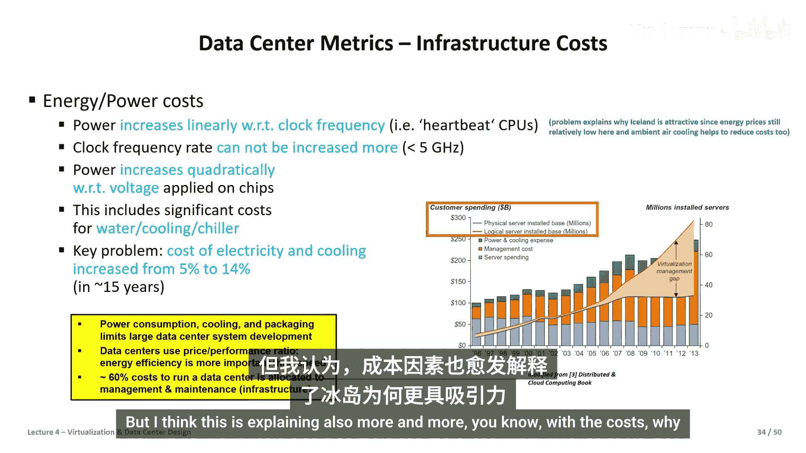

You know， from from this and we work closely together with you the data center industry in Iceland。

 as I said， my students regularly go to the data centers。

To touch metal but also we do lots of events together to promote Icelandic data centers。

 of course you see here some of the data centers in Iceland some of them they are very well known as at North and Borealis perhaps also Vern Global and they all have some cloud offeringss here and there there's also something to understand there's also some application business part or if you go to Boreales or ego they have some responsible compute joint partnership enabling more into towards the application area and。

You can imagine that with this， you have， let's say， already idealized conditions。

But what we didn't touched upon yet is and of course， is green energy movement。Now。

 needless to say that， you know data centers in Germany don't have so much geothermal resources don't have so much hydro power resources。

 This is still a lot of coal right behind it and of course there's a movement now that you know essentially in the next years more and more this should be transformed to you know green and clean energy。

 which is for I absolutely not a problem now this is you know 100% of Iiselandic's electricity is really a mix if you want from from geothermal hydro power and so So this is then not only the ambient echoing。

 which is a benefit here， but you can also say that in the long run you have green solutions and I just want to give you another example here。

 so as I said， we not play the video here that you have lots of benefits of thinking about this。

And when we then come to maybe some of the data centers even just to say here。

 they maybe even duplicate resources， you know， one of the data centers we work with， for instance。

 in our commercial partners again from Boreal's data centers and Bos。You know。

 they're close to power plant there， but they essentially have two different independent hydropower resources in a way they can tap on。

 So this gives you another， let's say， protection mechanism of having green and clean energy。

 not only from one source for many。But yeah， I stop here in the moment just to again thinking about also the green aspect from another point of perspective。

 you will see that with NVdia GPUs， the efficiency really and the performance and it would say performance and power ratio if you think about the flops floating point operations per second per what it takes is also something which has been improved more and more。

 so you would say from getting 20 years ago from the CPUU with cache memory and this is now with the optimized throughput in GPUs quite interesting because the power consumption is essentially something which is getting very green in a way to NVD GPUs but also other GPU architectures。

 so there's also the sudden movement when you think about this cutting its CPU high signals as that performance the power requires。

So this is also understood that with GPs， which perhaps force fueling also bit the advantage right。

 why GPs are suddenly so invogue is also that it is basically quite a good power efficiency as well。

And this goes along。 and he is a nice area of， you know， having the Keli。

 he textures up topascal Volai， he textures Iair。 And， as I said。

 the Hopper ships and great hoas and so on。 And here what's missing is a bit the black wh。

 which is now there。 But， I mean， they all getting more and the powerful， of course， in this sense。

 consumer power。 But you have to also think， the on the ratio， right。

 how much computing it gets of lots per but。 And this is quite an interesting factor。

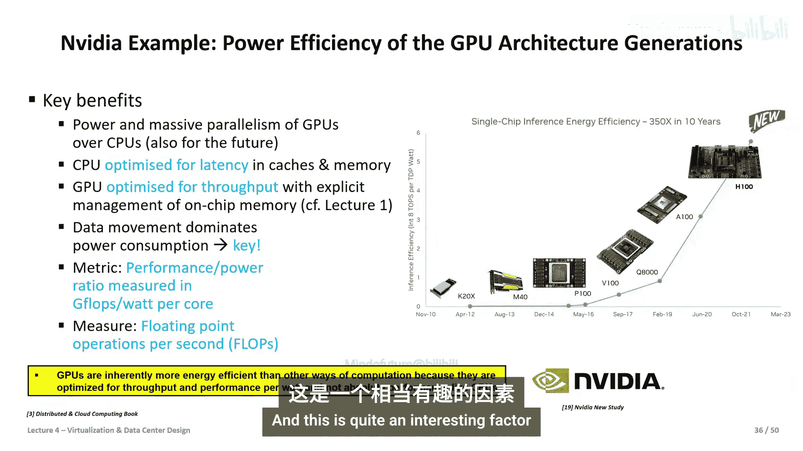

So那个。Haette we have to talk about in this larger data centre is then that you assume failure by design。

What doesn't mean。 So you see here quite interesting all of a Google data center。

 which one doesn't matter。 You have tons of these racks。 You have the infrastructure， you know。

 up here here with all the cables interconnecting it and so on and so on。

 So you with this amount of hardware and you would say， maybe。

 as we said 11 times football field as the other example there you know， on this scale。

 you can assume that there will be some CPU failing。 there will be some storage failing。

 there will be some network problem。 this is always happening right So you have to scale in this area and by providing more computing here also have to swallow the drawback and say hardware will fail。

 It will overheat there will be other problems。 So hence again。

 the idea is that all of these data centers today they operated with this in mind。

 there have already mechanisms in place and we will talk about， for instance， just about HDfs。

how you do data replication with some software you know that you can use Apache Sparqui for instance。

 so that you can use a computing you know basically still and the failureer situation will be automatically you know recognized and perhaps your job your application will be automatically using data from another data center then or your job will be relocated or we have this。

 you know live migration of a VM as another example。

 your server will be automatically starting the live migration and your operation is working again。

So Apeache spark， for instance， as many of these functionalities inherently in the design that。

 you know， basically， it will work with these kind of errors。If of course。

 the data center is prepared for this， and this is just something that you really have to to know by heart that you know these large data centers will have problems。

So when you have then， you know， these  errors and one of these big errors could be that there's no。

 let's say power we does guess this already before that is called troopss， diesel rotary UPS。

 standing for uninterruptible power supplies， UPS。And you have them usually a couple of those close to the data center and there will be somewhere a kind of you know probably small tank for fuel very close to it and the idea is here that as I said when there's no external electricity coming into the data center anymore for some reason could be whatever cutted lines could be and a reason where of course a data center is not responsible so they are responsible to their clients they have to respond to SLAs。

 so in this sense they to do everything basically to really you know yeah。

 basically operate these UPSSs。At the scale we're talking about more and more。

 if we have excessscale performance now even in Euro HPpC right so starting with this large scale。

 we see consumption of having thousands of GPUs and lots of CPUs alongside so it's getting more and more。

 let's say a bit unrealistic to have so many UPSss close to it so that the crash can hold for many。

 many hours right so usually it's not really a long- termm solution， I mean。

 in theory you could say it works， but then you need a diesel fuel tanker from the sea or basically lots of trucks coming and delivering new diesel fuel and I mean diesel suggests already what I mentioned when we talk about green energy right if you have here example of the Bles compass was alluding to in the earlier light which is Boreis data center here just as an example that can you know going up to maybe around how 100。

Go whats？And。They are source by to who power of resources， but when， you know。

 these would be going off， which is very unlikely。And they would use then diesel fuel you know this would be very soon getting not any more green and clean right and this is of course something which is usually prevented and that's why this particular data center as an example would be interesting to think about because they're too independent green energy resources so that there's something happening with the energy resource is fairly unlikely。

It also shows you that you know basically for these data centers you see quite an important factor。

 I cannot cover much in this course， but you see also for the marketing around it。

 not only the location is important and of course the what's capacity that you may be interested in when you use data centers and want to then host your reps in this data center。

 there's also certain certifications， you know you have to adhere to adding to the complexities。

 so if you want to operate data centers your own in your own industry or in your company。

 these certification can be also quite elaborate。And， you know， sometimes even related to security。

 So man traps needs to be installed if you want to have certain ones or whatever。

 So this is a huge element on its own。So yeah the power usage effectiveness is basically something you want to review as well。

 it's a factor that should be close to one。You know， something you see here Bs， for instance。

 is something which is really 1。03， so this is something which is very very good in terms of you know usage of the effectiveness and this matrix are of course very important for the data centers to get customers and so on。

Then when you think about the whole cooling again， when you want to create your own data centre somewhere in the seller for one company。

 good luck， you have to actually consider quite some other important stuff and。From this， you know。

 you see a little bit how the circle works a bit。 You would have， you know。

 something which is normal air， maybe going through Rex， but you end up with lots of lots of hot。

 hot air。You know， this is something then of course this depends now on the new technologies with warm liquid cooling and there are let's say different aspects around。

 but the key problem remained that you know basically the hardware will generate a lot of heat。

You have even these days cooling options where the whole hardware is actually within water。

 So it's quite interesting。 is it not really water。 It's a very specific liquid， right。

 not really water。 But you know， see here at second floor， for instance。

 you will notice is basically in very many data centres。 So what you see here is just a fake floor。

 essentially underneath is much more here， this kind of second floor where could be cables where it could be the cooling infrastructure varies from the different know aspects。

 but the key problem remains once you have put， you know cold air through the racks。

 there will be heating up and then you have some sort of cooling mechanism that， you know。

 put the flow back into the circularism and gets it cool again。

 And this could be one way of doing it。 And the second floor is， I think， an important concept。

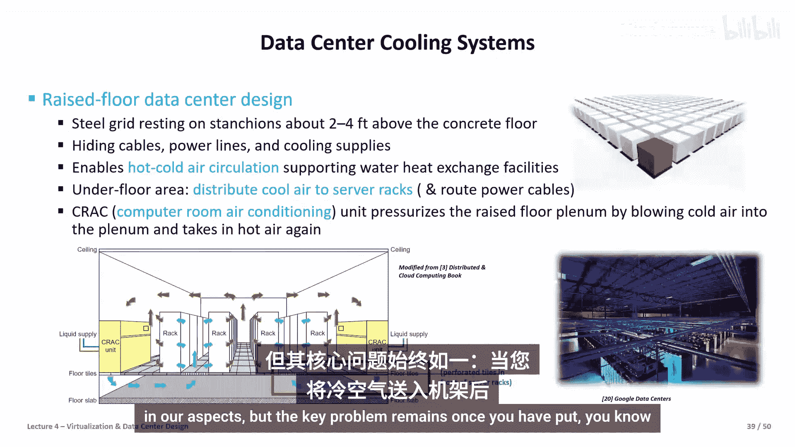

Also， when you think here the installation of UW， this is another video I would recommend you to look in。

 there's of course， many of the things I don't talk about for this would be network。

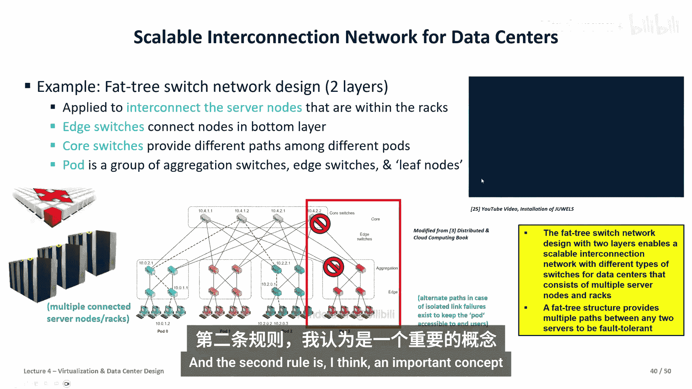

Essentially， you see here it starts always a second floor。 and then very quickly。

 you will see many hectic people opening the second floor putting lots of cables in， As I said。

 these res are extremely well interconnected。 So this is huge work as well。

 and there are different apologies these days， how you would do this you know， and of course。

 this is depending again on what you want to achieve in terms of a data center。

 what applications you have， He has a effect three structure also alluding to the fact that if maybe one part fails。

 you know， some of these corrections， then some others could take still over some of the work。

 So it really depends also on what uptime you want to give but of course。

 take away the message that the switches you see here in this。

 let's say setup means also more payment switches are also a cost factor within all of that。

I will say I give you this video here as a look if you want to you know look at completion at some point in time you see the res will appear。

 they will be positioned on that and then connected to the network。

 think about that this whole hall is basically I think argon gas protected so obviously you don't want to have sprinklers with water so if there's a fire。

 then the gas will putting it out and leave some of these gentlemen here running around also in our life in our survival percentage so they're not directly you know was the gas are in our dead。

ide conditions are of course before the fire that people can run out。

But you know you never know what happens in such big data centers。

 so some of the gases are not completely lethal to humans。

 especially not you know in the first couple of you know time periods where they're exposed to it。

 but this shows you more and more that the data center is a very complex endeavor and this is the idea of it and then depends also when you have the whole let's say idea of interconnecting these you know then thinking about what we want to achieve is data throughput right you see also we don't talk about here a disc or there you have large areas of storage disks maybe connected also to some tape archives somewhere this is still of course in practice when you have large quantities of data petabytes remember one of the earlier course parts you know then there's basically another chance of going to tape archives but。

You always have to think to migrate this somewhere close to the computing in order to get the good。

 let's say， throughput of computing， right done。

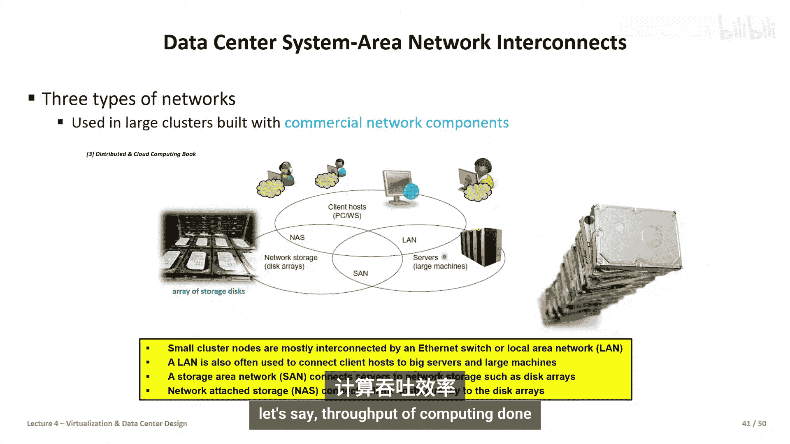

So there are lots of these aspects which you know is an important part for data centers of Nolook。

 perhaps for people that don't know， and the scalability。

 which is now really the word which comes with the data centers enabled in a way by economics of scale that it really works。

Is that there are different scalability factors we will briefly review before we close today， right。

 So， I mean， one of the things is really that you just want to go to data centers。

 if you're interested in this， you know， if you want to scale up。

 we talked about angry birds as the example， right， You have a couple of users， Nobodys interested。

 suddenly bang。 It goes， you know， viral and everybody wants to play angry birds。

 So your infrastructure needs to be scalable for this。 So these people are interested。

 But if you have， let's say， a database， which is always used every single day by one user。

 then chances are you better put a server in your own company。 right here。

 we talk about scalability is your requirement， and that's why you go to data centers usually。

It's not the only requirement you can also say data protection redundancy we have said replication right that might be another type of sort of scalability。

 however， so I think the size scalability is very obvious to you hence where the name also came for shrinking up and down based on the demand I can really increase suddenly very quickly my capability of storage。

 my capability of processing also was cutting edgeGPUs maybe if needed for AI which wasn't there five years ago so and you don't have that in your seller。

So this is， of course， something which， you know， is very nice。 Then think about the whole ecosystem。

 perhaps as an example that you had from Apache Spark， the whole ecosystem， right。

 I want to have a hive database， I want to have you know。

 basically Apache Sp in the latest greatest versions across the different cluster。

 I want to have this connect with deep learning using Pytorch or Tens offlow So you have lots of software。

 you know， that that needs to be dealt with if you do your own data centre in different versions that only play together in different versions。

 right， ever， if I may quote， say a nightmare of different software versions that need to be deployed on all of these different systems have to work together with different programming environment。

 different operating systems， different compilers， right？ So some of the H world where no waterron。

 you know， its still there。 C is still there。 So it's not only interpretation languages and Python everywhere。

😊，So hence this is something where you usually get this data send us also very quickly a software scalability aspect。

 so you can switch more quickly to the newest version of Apache Spark if needed and things like that and we would talk about this also more in lecture 15 when we heard this openSt cloud operating system。

 what sort of different parts enable you quickly as an operating system in the cloud to scale up with it。

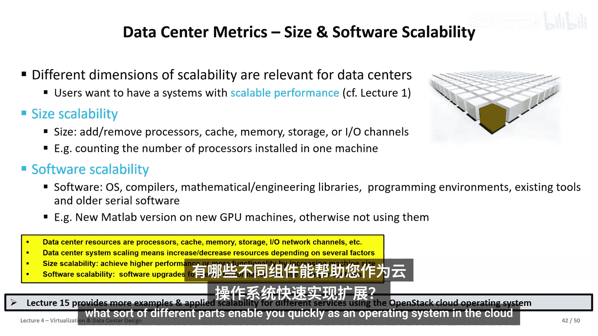

And then we talked about application scalability as well， of course。Again。

 you know you want to have different applications and you know on running on this。

 you want to have not only different applications， but one application， as we said， for instance。

 angryngry B is just used by one user and suddenly bang it is actually increasing so then you can very quickly go up and basically then you know scale with a number of users or let's say if you go to the spark domain again or Hadoop domain as we will know have also and lecture8 and others where you are interested in looking maybe a documents at high throughput。

 you have a you know kind of application that is you know countting words and newspapers and suddenly someone gives you a contract with you know having not only newspapers but lots of magazines and your orders of magnitudes of data suddenly scaling from gigabytes to terabytes and potentially petabytes so this is also where the application can relatively easy scale in this cluster。

you have also the necessary hardware around it， but also the mechanism of adding to the application again。

 more basically flexible data and perhaps also the processing power。

And then the technology scalability is， I think， very important for us to understand。

 particularly for AI。GPUus now， especially from NVdia and not paid by NVdia， I should say。

 but you know it's one of the dominant technologies we have to agree on and the Nvidia generations that you have just seen in one of the slides reaching from Kepler where did my first machine learning tutorials with power support vector machines on now working on you know cutting edgeships was a100 H100 H200 and Blackwell soon is an order of magnitude that it's so much advancements in technology right and this is not long time this is something like the 10 years maybe from Kepler。

 Now if you think about ampe was still know cutting edge5 years ago or three years ago and many of the different service and now there are very new nice GPus A label And if you now put this into the whole domain of switches of networking as well and also some improvements in the storage field。

 this means that technology scalability can much more。

pt to new you know elements that coming up and by reaching perhaps a bit far would be also quantum computing right so in your HPpC。

 we have already the first quantum computers。 we deploy next or basically in collaboration with the HPpC systems So next technology is in front of the door called quantum computing right so we do lots of publications with it。

 It's not mainstream like perhaps HPC becomes more and more but this is another area of scale where perhaps in the future we see also Amazon and Microsoft more and more adding then these quantum computers to the scale。

 but quantum computers can do， for instance， they would be having the and quite some impact in quantum machine learning when you do optimization the thingware says to rust the gradient descent some of the quantum computers can really put let's say water over the error of surface and find the minimum much more quicker in our click of the finger in terms of time instead of going iteratively it。

taking derivatives and the old way， as we would say。

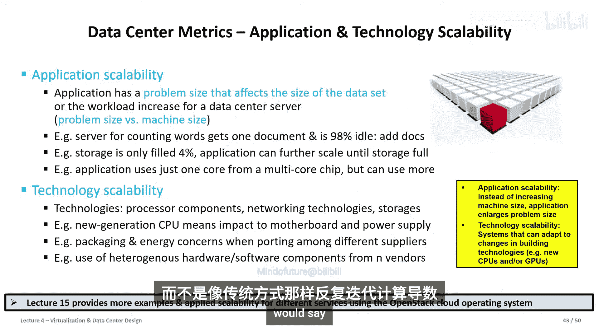

However， quantum computing is in a way still in its infancy， but we have。

 if you want to look at the U HBC joint undertaking website already several quantum computers。

 which shows you that the technology is never standing still。 we going already apart。

 People talk about quantum internet already in all complete secure connections and to end form。

 But this leaves a bit the domain of the course。 So we will not go into quantum computing a lot just at the end。

 some。Some kind of other you know appetizers of the material that were coming up and when we talk about infrastructure service。

 platform service software as or service， why you would be interested in different layers there。

 something we will discuss and also the motivation why perhaps some people would be still interested to create a small private cloud private means that essentially have it in-house right so hence we talked a little bit about if you remember the hospital use case is patient data this might be a perfect example where you know you have this private clouds you know and there's something very sensitive in terms of data that you never want to share it it could be also governmental right so it should be not leaving let's say the country for some reasons these kind of restrict with some of the data。

But for some reasons， these organizations also here and there want to combine it with public clouds。

 So public clouds is something you already learned now。

 we have talked about in our basically the famous ones are basically shown here。

 and then there's something like hybrid clouds where you want to connect both of these worlds together to form your solutions。

 Let's say the hospital would always keep the data， in itself。

 but for some applications in terms of computing for maybe anonymized data， so anymized data。

 they maybe want to in now work with the public cloud vendors to get a order of magnitudes of compute。

 which perhaps own hospital cannot afford to create， right， let's say lots of lots of GPUus。

And these are topics also fueling the data center's industry again。

 this kind of hybrid clouds and the idea that goes along with it。

But I think you get the idea very quickly with this and with this we also at the end of the course today。

 I still encourage you to look inside this you know video， it's an interesting way again。

 having come back to many of the things you discussed failure you see you already the many Res the many technology deployed there to form a data center and I hope you have now a but better idea how complexity is really know driving this and of course giving us a nice opportunity these days because data centers to operate them alone in your cell is something I would not really recommend unless you're really a very large company。

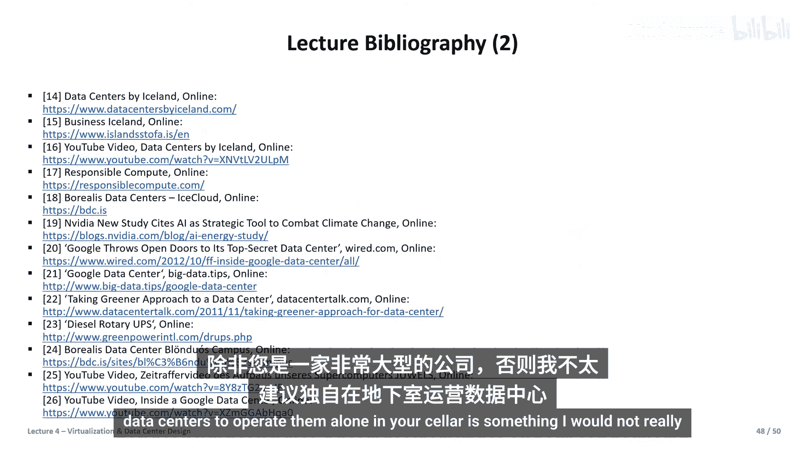

But yeah， even then you may reconsider using professional data centers。

In this end we end with lecture four and we will continue with lecture five next week。

 so have a good weekend， talk to you soon。

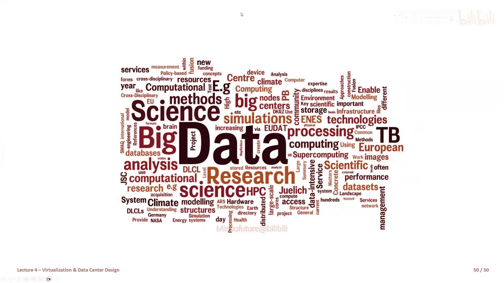