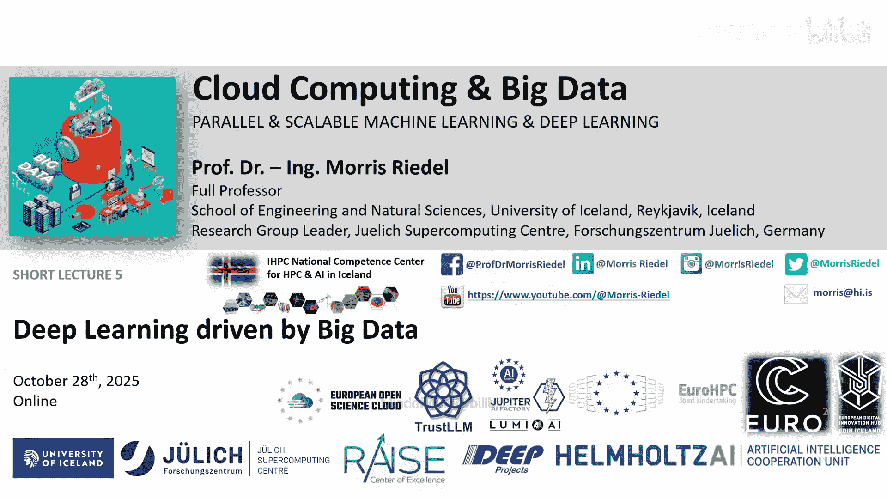
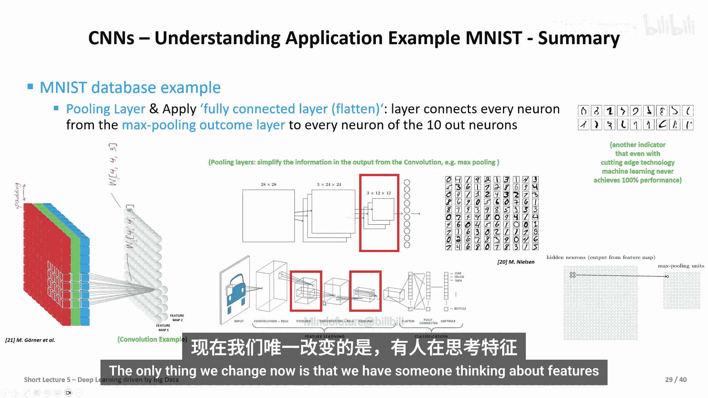
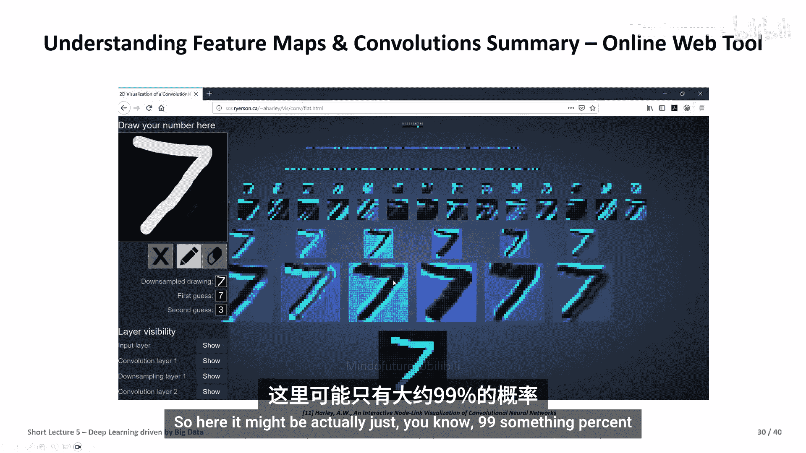
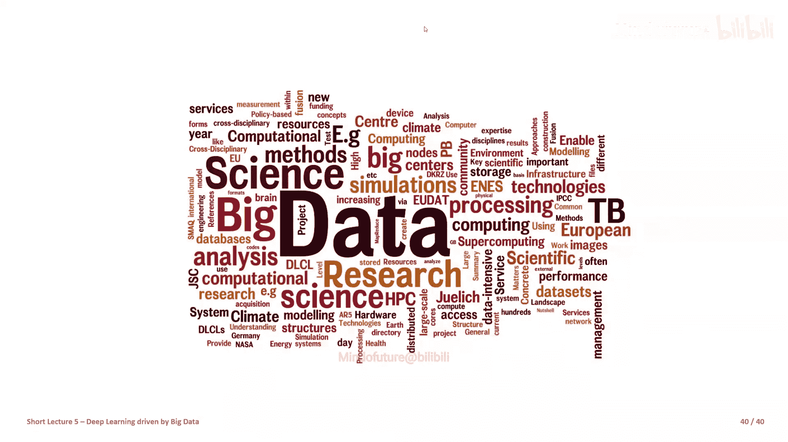

# 【冰岛大学】云计算与大数据-｜-2025-Cloud-Computing-And-Big-Data-Course-p11-P11_讲座_5_大数据驱动的深度学习--BV14MB4BjEyZ_p11-

Welcome everyone for cloud computing and big data Today we have our short lecture 5 deep learning driven by big data and we start now with a series of short lectures because we basically have used lots of material already for the industry project with Ingover we have seen the invited lecture series from Andreas Literman that I heard was very good in your opinion and everybody like the material and many of the materials we would have in the consecutive lectures now will basically introduce similar things that's where we can shorten a little bit to avoid repetition in the course so the short lecture5 will be basically just one course hour and hence we have today also short lecture 6。

 but before we dive into the material of short lecture 5 let us review what we had the last time。

And the last time was really a short introduction again into virtualization。

 which in the most eyes of computer scientists and computer engineer should rather be the lecture of one01 computer science today。

 so essentially virtualization is a basic technology today that we will use and of course scale up but if you recall a little bit what the traditional computer is looking like with lots of hardware is a similar things with your laptop you have the hardware directly accessible from the host operating system and many several different applications running there。

And the virtualization changes this a little bit in introducing this so-called virtualization layer。

 some of you know that from hypervisors or virtual machine manager there are different terms for it。

 but basically you know we have VMB and other you know players that provide products。

That then abstract from the real hardware underneath and create socalled virtualized hardware。

 right that you see here。 And this is something then where guest operating systems。

 it could be Windows， could be Linux derivative of some kind。

 can host different types of applications using the concept of socalled virtual machines。

The virtual machines come back to us today， so we will learn how deep learning can be used in virtual machines。

And we will do this in cloud computing on scale and this brings us also already to the next topic where we set here in lecture 4K virtualization to the rescue。

 but how does it look like if you have a large， large data center and you want to maybe have some spark workloads that we already know from our initial lectures run on it。

In many ways you see this a little bit abstracted here is that you have this physical cluster that's always something what you need lots of racks right and you have seen a little bit how the construction of the data center looks like in the last lecture but you see that the physical cluster is all the racks be even in different let's say physical locations maybe you know somewhere differently in the US several different regions or you basically have here one which models all the Rex。

 so the concept still is that you have this virtual clusters spanning then there's different physical clusters and you know have different virtual clusters instantiateated on this physical clusters of course depending on your availability of you know capacity you see here here basically maybe room for another type of virtual cluster two but there's no place anymore for virtual cluster4 right and this is of course something which alludes to some of the challenges if you scale up with different uses。

 multitenant multi-user environments you have。Schededule jobs you have to schedule the cluster capacity and this does very early on also in the next the last course to the concept of resource sharing。

 which is of course there then much more easier having this virtualization concept because now you don't have to give it' say for the green user group physical cluster one over the red one physical cluster2 you can basically based on the applications and services you have you know schedule this and you know then ending up perhaps that the green ones here get some part of this virtual cluster4 and the red team which is overlapping with some of the user get virtual cluster 3 So in this。

You have a much better control， much better flexible resource sharing if you want。

 which then if you remember from the last time was really the first idea then of getting to this cloud computing。

 so there was grid computing in the past where you know we had also services but not really over the internet also not really so scalable in the end as it is today。

 so realizing this idea of economics of scale， large data centers and so on and really using different data centers and different regions and so on to fuel。

 let's say AWS Google data centers and so on。So in the end， you have also many benefits。

Apart from resource sharing one of it is here the live migration in terms of errors， right。

 let's say that some hardware is overheated somewhere here in the wreck。

 So what you can do with this virtual machines and general concept of virtualization is very quickly migrate the application to another hardware that is still running。

 And with this reduce the downtime of the services that you offer here in the cloud。

When you have a real implementation view you see that this is of course an idealized picture right that's what the user sees if you're really。

 you know more into the backbone and see how the cloud is really working you see lots of different physical hardware as I said that's always what we need that's why also promised you we will visit one data center together and then you have a virtualized platform on top which essentially then abstract C hardware gives the platform then to different let's say virtual solutions and here you have the whole virtual infrastructure now that you see a little bit here alluding to its different virtual clusters and you have lots of different services that you already need in order to manage this right load management resource provisioning scheduling security very important as well and。

The whole infrastructure system services which then goes even into billing。

 you know and having user management， meaning you want to have some users， you know。

 edit or removed over time， revoke excess， grant access。

 there's lots of infrastructure services needed to realize the cloud that you see today。

So in many ways， most really then a quick summary of virtualization and then with data centers and today we will go to the short lecture deep learning which directly gives me a disclaimer that the short lecture is could of course something which you can imagine that a complete introduction to deep learning needs a complete course right or at least substantial training courses。

 we have a deep learning course in the university so this is by more means a whole machine learning。

 deep learning course art the point of this lecture is to connect what you know Dr。

 Andreas Litherman has put you know in there in his slides you know a bit conceptually in this invited lectures and now put it a bit practically into cloud offerings so we will revisit artificial neural networks。

 we will revisit deep learning networks， particularly convolutional networks and we' put that into the idea of the you know handwritten character recognition of very let's say benchmark idea of having machine learning。

Dataets analyzed for classification of digits。And then we basically。

See how that can be done in the cloud also then in short lecture6。So with this。

 let's start and one thing I wanted to convey with this is the increasing computing complexity。

So you will notice that when we come to deep learning。

 there's an amazing computing complexity that we basically leave the realm of CPUs and that is something you also should learn by this lecture as an autoagonal endeavor。

 not only cloud computing， basically and their solutions and how basically deep learning works and maybe artificial neural networks works。

 also the idea that this growing trainable parameters that we will explore together now is's really the computing complexity。

 why we need HPC， why we need cloud computing。So connecting to a little bit what we had also in our lecture。

 you know， basically two， three and so on this machine learning。

 remember we have the basic simple linear percepttra model linear because linearity and weights you see here。

 so that means we have， let's say a very simple model where we have a certain activation function where we have our basically data set going in。

And， you know， we sum them up linearly using weights and this weights is then the trainable weights。

 right， So we'll have an emphasis today on looking on this。

 how this is actually increasing when you have a typical perceptron that we will extend to， you know。

 multiclass perceptron， but then go quickly to artificial networks as an explosion and trainable weight parameters and then even go to deep learning where this is enormously。

So in a way that's a simple model for the data set we have the handwritten character recognition IniIS maybe some of you are familiar with this the idea here that you basically have a 28 by 28 pixel of handwritten character and you would understand or would like to understand is this you know one of the digits zero to nine so 10 different digits it's now a 10 class classification problem and this extends our idea of having binary classification we had before to now multi-class classification saying 10 class classification problems the data sets is quite handy it's sort of a benchmark very much not big data as you can see but it makes the point of having a training set and test set again and it's nicely conve you know accessible also via cares already one of the let's say deep learning frameworks and it's widely known to be always let's say used in training。

Teaching。So when we want to look at this。We want to look a little bit how it looks like in the data you remember the CRM in the beginning data understanding first now that we have the business understanding of to the 10 class classification。

 we have to understand how the data really looks like handwritten characters okay so we look here that basically you have the different let's say gray values of the characters encoded here。

And the beauty is when we look in the data we come back to our point that it is actually a supervised learning problem right so you see here someone labeled this as a5。

 someone labeled this as a zero and song and so on so for us that means it's a little bit easier to do supervised classification than perhaps doing other measures it's very good and the other part is what we would do connect to is that we have of course the idea of a training set a test set right that this is already nicely given if I come back to the last light now we have around 60000 for training 10000 for test and this is a very nice beauty idea to learn from so also there we on the safe side and the data understanding but there has more to explore。

Particularly when we want to use now， let's say concrete frameworks and I think Andy already made a point with several deep learning frameworks and I will not repeat again and again here on the slides what he was presenting so I would like just to point to you that they are different frameworks pietorrch is another one tens of flows of news and teaching combined this caras because Kas carries like a very nice idea of layered way of looking at deep learning exactly how he would let's say visualizes that's why it's a bit more easy accessible for you let's say users or beginners of deep learning and so on so by using these tools they are basically available in the cloud and the way how we look at this is to look at the so-called Amazon machine images。

And this is something where I just pick AWS right now right so there's Google providing with a similar set you have seen an HD insight they already virtualization solutions。

 so basically what you see here is just one example how to do it in the Amazon Web Services cloud。

When you go there。And you have the Amazon machine images。

 it directly reminds you to the idea we had the lecture for before right so virtualization to the rescue these are basically virtual machine images where you have already lots of software installed。

 which is a big benefit right when we just explore the one here that you see in the Amazon Linux way with the different operating systems here。

You see deep learning AmiI， right， and you see here Tensorflow。

 the packagesarrow rose alluding to in different versions， Pytorch， another deep learning package。

 neurourn and others。 But you see also nicely， you know。

 the underlying libraries to work Where with Nvidia， GPus like Kuda， for instance。

 or QDNN and Nikckel， These are all required to have a high performance let's say GPU computing done。

 if you want to lose you know deep learning on GPUus。

 and we will explore that we really need to do this。Hence， deep learning is at large。

 very nicely supported in many different ways in AWS in Google Cloud and HD Insight。

 using virtualization， which is sort of in the infrastructures of service level。

 some sales in the platformau as a service level， perhaps。

 but there are also other services we will explore later in lecture 6， for instance。

 where we use an AWS Sage maker， which is actually on a much more higher level。

 right on the Sars level， So we will explore this as also this different levels and come back after lecture 7。

8，9，10 to also explore more on these service offerings or these levels。But this is now very nice。

 so we know。Essentially we have a cloud computing service， I can select my credit card。

 I use the Amazon AMI， so we are there on the safe side。

So but how it is with our you know data problem and again you know crisp BM to the rescue。

 we look before in the data understanding so we really look with some Python code now into the data set we can nicely print that out as we have done before with a gray values right and see that here with a couple of lines loading it nicely already with a training and test set available but we see also quite some interesting point to it when we now realize how our modeling is right we want to start with a perceptrum learning model that's what we know。

But this， what we know is that the perceptual learning model had just a one dimensional input。

 one vector。How do I do this when I have two dimensional data sets？

Hence here is already some data preparation step from CRP necessary to reshape the data in one long vector。

 Some people know that from scientific computing that is more often done， like， for instance。

 know vectorization concepts and so on。 So here what we want to do is now to get this two dimension input into a very long vector so that I can still use my perceptual model。

For some of the more advanced people in machine learning。

 you will immediately realize by doing this all in one vector， we lose information。

If I would be now in class， I would ask you what information。

And you can clearly see that when you put all in one long vector this way or that way。

 you usually will lose some of the neighborhood。Of these gray values right。

 so basically the five will be stretched across a long vector door instead of a two dimension input where the neighborhood tells you a little bit about if it's still gray or white。

This will be a key theme when we come later back to deep learning。

 So I want you to have this in your mind。You see that also bit here， you know。

 basically this is now the long vector I was talking about we require to work with the model。

We got fixed on the perceptual model。 and that's why we basically move later to other models。

 But that's what we want to start with also to compare some accuracy。 Can we have better models。

 What is the computing complexity in all of that。So here we do nothing else and have one long vector now generated out of this and now it actually fits with you know the input which is now you know one long vector and you know 28 by 28 is 784 here。

 the input， but you will also notice that when we had the old。

 let's say perceptra model it was binaryclassification。

 so we had the sine function here that was determined and saying plus1 or minus1 in the example of flowers for instance。

Now， what we need is。Sort of a multiclass 10 class problem that we can nicely you know add here with a dense layer fully basically connected。

 but essentially you're connected directly with the input so it's not yet an artificial network right there's no hidden layer if you want like you know what And was saying from the artificial networks。

So what we do here we give the input of reshaped the long vector and we have a let's say dense fully connected layer directly with the sequential input。

 so in the end it's just the input with the output together， but in a dense fashion。

 hence we have you know this times 10 for the biasers and then also you know basically plus 10 for the biasers。

 but 10 times 10 for the different you know neurons that we want to put in now so we have already quite some weights to train on here。

And this will be important for the training of a parameters because we have now around 7850， right？

So we add something called de activation Somax which gives us an output probability which class we're talking about so this is a basically machine learning toolkit idea of saying this will remain for us since quite a long time because it's squ is basically there's different values between an endal vector of this values that we need and you know basically it aggregates this what you have for 10 layers hence we can see which class of the10 it would be most probably like there's not a definitive solution like 100% but often 99% and so on and the reason is that some of the digits of course share certain properties you have a eight is similar like a zero right in one way if you think about how you write it it's just not a middle let's say connection between the left and right and things like that。

Also optimization that we had you know in Andy's lecture but also for me before is nicely supported in the cloud which is different。

 you know different tool sets like K tens of low pytorch you have several different optimizers here's the SGD so has degraded descent but you basically have also Adam and others that are very popular and they you know basically have then the idea of specifying a loss function and using then this optimizeimr to get this loss let's say minimize so the here comes to minimization problem and not go again into detail of this too much you can see that you know we want to go down the error surface by taking derivatives with a certain learning rate and the learning rate will be interesting for us later as well because here it's where we then basically can steer a little bit with a human the learning。

When we come back to the practical idea， how we now implement this in Caros？

Basically you see here the number of apos how often we want to go essentially through the data set how we crush the data set into different instances here。

 the batch size 128 the number of classes the optimizer and then we have the same what we had to before we see data inspection and data understanding and then now we say this time we want to reshape the data for mathematical convenience we also normalize the data very often machine learning you know this means there's not only more large values but rather smaller values then for computing are more convenient and then。

We give that just a number of training and test examples out。

So then combining this with what you just said we see multi output perceptionceptron。

 we basically now start with a sequential model of para adding this dense model with 10 classes with a reshaped input so having the input directed connected to the output and by doing this we use the Somax activation function basically to get the class probabilities and you will see later that this is still used also in cutting HD learning often so here's some of the basics again I think the Somax was also already explained a lot so I go here a bit faster。

Same as for the optimizer to you know minimize the loss that we specify as the categorical cross entropy that you see here This is。

 of course， something which should fit a little bit to your problem right so the loss function something what you specifically choose and here the categorical cross entropy is just very good or this multiclass log we gloss so that's why we pick that one and not you know another one。

Then we start with a real training and you will find that model put fit or model dot fit is often in many of the machine learning packages you know the function rate starts really getting interesting here's where also the computational time suddenly increases so we need the training set we have the batch size how much you know always。

Update essentially my model on depending on the batch size I'm walking through then the Ipo how many times I go through the whole data set and proposes for the output and then I can evaluate the model you know basically on the metrics we have like for instance accuracy here and then can see the tests go on the test accuracy that we are interested in so basically how well was our multi output perceptor model working。

Now， then you see that now and running this in the cloud， maybe using Upyter notebooks。

We come to this also more and more。 You can run it as a simple Python script also with the AI interface。

 like we have seen with the AI machine learning， you know， virtualization layer in essentially AWS。

 but also in others， Do you see how that works。We can see that the accuracy is quite high right off the whole code。

That means the model is already quite sufficient in a way for this， you know。

 let's say simple problem， but we can also。You know， improve probably。 So it's still， you know。

92% accuracy here。And this number of airportpos is also something that I wanted to talk to you about because。

 you know， in the normal machine learning course， you will quickly talk about socalled overfitting。

 right， or maybe even underfitting， underfitting means you rarely look at the data。

But there's a sweet spot of saying if you， you know， do the number of e too much。

 if you learn the data too much， you know， you see what's happening here。

 you more memorize where the data points are and the model will be very much occupied or optimized to these in sample performance or what we have in sample in the data set。

And then when there's a new data， it will be a large arrow。Now when you underfi。

 then there's a similar ideas or you all basically have a model that is not really trained that looked at the data。

So what you want to strive for as a so called optimum in a way， which you see here。

 and that's why you have the test set， hopefully tracking the training set。

And that's why we never use the test set in training to really evaluate what's happening。

And you can see that quite nicely that even if you do 2000 apos。

 you will get the training down and down and the arrow down。

But there's a certain sweet spot here where it starts with overfitting。

 That means if you use an unseen data data， which is not these book points。

 but new ones like this one。In the test set， then you will see it follows nicely few。

 but there will be the sweet spot where it starts to increase significantly in error again。

 a concept we called overfitting and regular and validation is basically theres two concepts in the machine learning course to combat overfitting。

Hence， we cannot do this here in a small course like you know， this cloud computing course。

 which has many other ideas what we want to teach alongside， but for you as a practical。

consideration for real practical problems， please make sure that you have always regular validation at tier to and that you have always a training set and test set。

 you know separate from each other ideally also multiple validation sets if you have the data。

Now when we review this now where we are， we have 92% now we have actually learned a little bit more this is more apoOS maybe and coming up to 91%。

 so this is a stochistic you know process the optimization so we never have necessarily the same。

 but theyre in the same mode of magnitude right with this particular model。

What can we do now and I mean with you having the lecture the brilliant lecture from And。

 you know by now what we can do， we can introduce hidden layers， maybe one or two。

 we can change essentially the activation functions in front of these layers or in this layers if you want to resolve these different neurons so what happens if we change a little bit？

And this brings us to the domain， which also， I think Andy was alluding to the non linearities。

 right， The problem of the perceptron linear learning model is， you know， the linearity。

 you see that X problem， which is very famous， would be one of the classification problems it can never solve。

RightSo if your perceptioncept and learning algorithm will never stop because one is always misclassified。

You cannot put them on one line on the other right I think the graphic shows us nicely， however。

 and that was now sort of the breakthrough if you want for the artificial networks that we will have soon you can do something called multilayer perceptron so the idea of a perceptron rate they had very early in the course remains but you add them up and you have basically connections this are also trainable weights which you then take on input from the previous layers。

Introducing， essentially， a hidden layer。Right and you can have many in layers and you can have many different neurons as you learn from And so hence this is a start where you think about now having much more interesting decision boundaries w decision spaces if you want to see that here linear activation functions。

😊，Pros linear decisions and will not catch the data very well with the nonlinearities that you now put in front or basically with alongside all the hidden layers with the activation functions that you know Andy was also introducing you to you before rectified linear unit very popular。

The Li Kio as well。 So basically， was this， you have now the power to choose what basically you want to put in front of the。

 you know， perceptron that we have still in a way， realize with all the inputs。

 but they coming from the different layers beforehand。

So hence it looks like that and I think this also is a repetition amazingly of what Andy was saying that you have always this forward pass through the data that is what you can nicely compute。

 you will initiate the weights of some kind you compute the error。

 but in the end you would still have a softm to understand essentially what is the probability now of the you know10 classes。

 which class is a winner。Given you have a supervised learning problem with your class given you basically can very quickly evaluate is that's the right class if not you start something called back propagation of error using the chain rule things like also Ry was discussing updating the weights through all of these trainable parameters when this eudeludes again to the point right now yet the weight update face。

These are all trainable parameters and you know we have seen that before we compute the gradients and this is now where where the computing comes in right that's where it's now starting to be computing intensive。

Taking derivatives， taking the gradients of all these different connections you have seen。

Right throughout a big neural network can take actually quite sort of time。

 So and then you want to update the weight vector。 and then， of course。

 you do another forward pass and see if the errorr is good or bad， go back。

 So you will come back to this loss function idea that you also see here you go down the arrow hill until you hopefully loan in a global mini mouth arrow and will basically say。

 you know， we have learned the best way we can maybe not everything perfectly。

 here's the learning rate issue in this。 you know， when you say yet the global， you know。

 minimum would be here and the learning rate can help you a little bit。

 where you say when the learning rate is let's say too small。

 you end up in a so called local manma somewhere here， perhaps。

And when you have the learning rate too tough when you basically do this error and you know the learning rate that you have here too much then you're jumping a lot with the weight updates right hence you will also miss the basically global minima so again it's a sweet spot in a way to have the stable learning rate coming in over time as this graphic suggests to the minimum of error and then reports the best let's say weights that you have to compare to the loss function to。

And I have best learned in a way。 And that's why we do come do learning。 If you remember lecture3。

 Also， the nice overview that the error measure is basically your help and learning to pick the final。

 you know， basically hypothesis G。Now let's do this in practice with Kas if you want basically here。

And of course， you can see also in the course we had last year in YouTube。

 there are extended versions of these lectures。 So if you want to see also demonstrations of this in practical lecture 7。

1， you can look to lecture 6 and 7。 There's much more material。

 I left that a bit out because Andy essentially covered many of these things already。

 But here and there we have also， let's say， spend lots of time in the industry project， right。

 So we have to continue with this as well。However， it is very similar The batch sizes。

 number of epos we have now only the new parameter number of hidden neurons in the hidden layer right that we want to do And let's assume we want to do two hidden layers that's what I do here in cares quite nicely instead of having。

 you know， basically is sequential input layer directly to the dense output layer I connected it now in a dense fashion to the hidden layers with a reshaped input that we know from the characters and have an activation function rectified linear units to basically then。

That says non linearity and then I do this twice and connect it again to the you know dense at the end and add my typical soft Max to understand the probabilities。

 so this is still there basically。Now when I run this， no surprise of it。It's a much more， let's say。

 powerful model。 The neural network is maybe one of the most powerful models。That you have。

You can basically see we increase the performanceancy of accuracy to 97%。

But what doesn't mean for computing and you know， when you do this again。

 maybe with some regularization， you come to a value which is 95% so it doesn't matter again stoistic you know processes never maybe have directly the same。

 but it's again in the same number of you know。Vals compared especially to the multi output perceptrum。

So you have already 95% performance with 20 apos。But we have to pay the price for it， right。

 as this is what you see here， the total number of parameters suddenly from 7800 was actually massively increasing with the weight herer。

Right to 118，000 roughly。And you see that a little bit here with the parameters on each of the layers but this is where the computational complexity now comes in。

 that's why for larger neural networks we really need GPUs， we really need more computing。

And when we go now one step further， going to deep learning as promised。

 we will see an explosion of his parameters and we will see why by just， you know。

 basically coming back to one of the simplest deep learning models of convolutional networks also here。

A complete introduction is given in last year。 lecturecture 6 and 7。 And touched on it。

 and some actually use it already in the industry project。

 So here we have the idea that we have still this classification layer with softmax at the end。

But instead of doing just hidden layer by hidden layer， hidden layer。

 If you remember one of the earlier cruise hours， I said deep learning is not just this。

You have specific layers， you know， which are basically doing convolution operations going through the pixel image and now the interesting thing is it keeps the 2D。

Right so we don't lose information as the vectorization was a reshape if you remember from the first modeling。

 there will be still maybe some samples that you see that we can't catch right it's very hard to determine what actually the real author of these characters wanted to have。

But still these are very powerful models that are doing basically feature extraction in a 2D way on pictures essentially right。

 and it's very good for image recognition and he goes systematically through it with a so-cal conutional filter and that's the thing that you learn them。

Now there's this filter matrix of weights。So there will be lots of trainual weights with this going through each of the different layers。

And you see how that works a bit as a convoluted feature then it multiplies in the end it stays with matrix matrix multiplication matrix vector multiplication。

 but the point here now is that you have lots of weights to train Now the nice thing is that with this you can carve out features that is a little bit explained in the idea of here with the car where you have different feature maps maybe you know recognizing rather the tires of a car or the frontless two lights of a car so these are things which are then taken by this feature maps that you learn or basically then we will see in the numbers are very similar way。

At the end you flatten all of this what you do consecutively over many different layers。

 there's also a pooling layer that that say sample out you know more the number that you have and come to a smaller set in the end to have more smaller features in the data recognize but the whole idea is to identify features right hence we call that feature learning and then you do the standard classification that you already know from the multi output perception or from the artificial neural network so there's nothing different the only thing we change now is that we have someone thinking about features feature learning what's in the data and I' brought you here this example to play around with so I would encourage you to use this reference and play with this it's an interesting nice interactive demo。

Where you can do this writing of your hand character handwritten character as well。

 and then go through all the layers and see how these feature maps are going。

And basically also in the lower layers and then recognizing the7 at the very end， right。

 if you think about the softm probability， this is highly likely a7。

 If you do this and then do8 or 9， you will see that some of the lines are overlapping。

 So the probability is not so 100% certain anymore also here it might be actually just you know。

99 something percent。

So interesting tool to learn from， but for us in the lecture we want to go on with bit and understand now what was the pre the price I pay and what the kind of ks soft you know basically ks。

Soce code looks like so we have an interesting idea again of sequential model。

 but now we add what we had seen here。In the overview， so we add a couple of convolutional 2D layers。

 So we look at the problem in 2 day2D with a certain kernel size。

 So how big should my feature map be and how much is the kernel matrix we go over。

And patting just means how I will actually end up with the ends。 So if there's not five anymore。

 do I pet some， you know， the values for it or not， And then， you know。

 to do some pooling to strengthen the signal here in a two by two fashion。

 and then you do the same thing with maybe feet 50 feature maps syncing about the smaller we've crunched down the problem。

 there may be more features we find。In now from the different handwritten characters。

Then we already flatten the whole thing in order to put it into a dense layer， if you know。

 then we have a little vectorized input again， and then I'll do our soft next probably probabilistic。

 you know output at the end。And then you can build this model that we have essentially you know in this function here。

And you know compile it and then you know run it and basically you will see it here with a number of parameters really exploding I think things like that connects nicely but Andreas were saying this is where the computing now is really required this is where parallel computing quickly comes in this is maybe just manageable on a GPU because it's a toy application problem is the10written in character recognition but if you have then really applications that And was alluding to in engineering fluid dynamics whatever then you have quickly。

 much more layers you have much more let's say neurons in each layer and then that means the train where parameters really exploding we see here an increase again from the 7800 we had with the perceptual model you know and then to the couple of thousands we had then in artificial neural networks now we have 1。

2 million or a toy problem。But of course， this helps us in a way。

 so we will see that cursia is definitelyly better。And what I have to do for it is a little bit。

 you know， similar that the things you already know。

 we introduced those a bit of validation splits here。

 which I want to put to a later lecture so validation cross validation is something where we need again HPC quite nicely and we will do this in hyperparmeter lecture at the end of the course。

 so not to do too much here today。And in a sense， the code is very similar。

 right we basically normalize the code， but you will see we don't reshape anymore。

 we have a 2D input data， which is no important for you and for the deep learning network it maybe makes sense to Adam you know which is a bit more with the adaptive learning rates。

 quite nicer idea of how to learn from and then you see what we get out of this computing complexity nicely。

 we have now 99 you know percent 99。3% it this varies a bit you will never reach 100% because of this。

Even for the human， some of these more in the data sets are not recognizable。

 and this is a typical machine learning point， you have very rarely in production really completely 100% and usually 99% is also very idealized。

Hence。This is alluding to again that it's essentially a very simple problem to solve。Right。

 it's much different when we go remote sensing the satellite datasets。

 multispectral hooppectral data sets， different bands and so on。

And this captures CSN I wanted to talk about today， let us summarize a bit。

 you can do this very nicely if you do this you know always you put the notebooks， for instance。

 use the code you have seen here upload it and the code will be available to you it will be not an assignment so it's optional for you to try out but you know we have this larger hackathton coming up where maybe some of the things you already we do similar fashion with screws and you know LSTMs and so on。

 so this time wet have time in the course for doing this with CNNNs。

 but the code will be available to you to use。And finally what I wanted to say is also this overfitting right again I'm doing here a lot of machine learning。

 deep learning， but there's lots of machine learning fundamentals you have to understand if you want to go you know in industry doing real projects one of it is really overfitting maybe the most important principle if you want to understand because this will report wrong acuracies and you see a nice video that shows it a bit with three hidden neurons you cannot do much with six hidden neurons a model complexity might be just right but if you do 20 hidden neurons so also that means to you it is not necessarily always a training time it's also a model complexity that might be you know too much and you see here in the 20 hidden neurons it's quite actually memorizes the data instead of creating some form of a decision boundary。

So I'll leave it it there and we will talk about you know， short lecture six in a moment。

 so let's have a short break。

