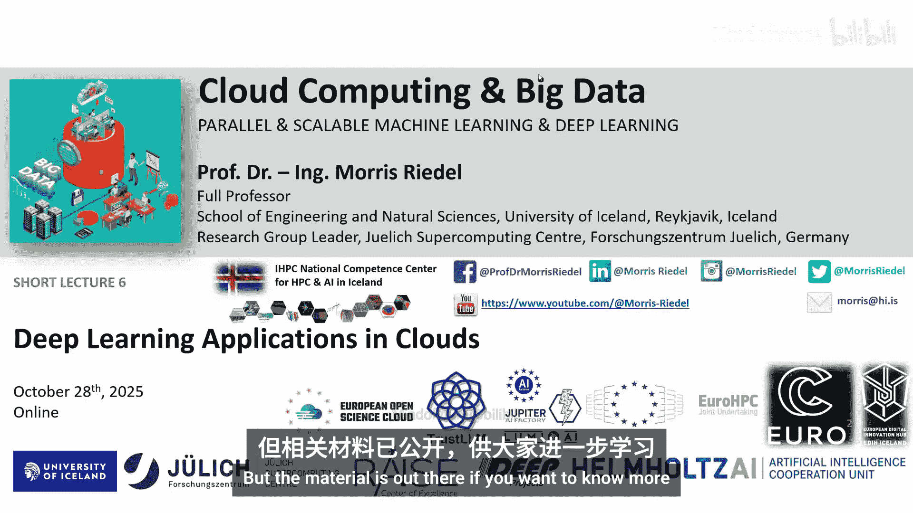
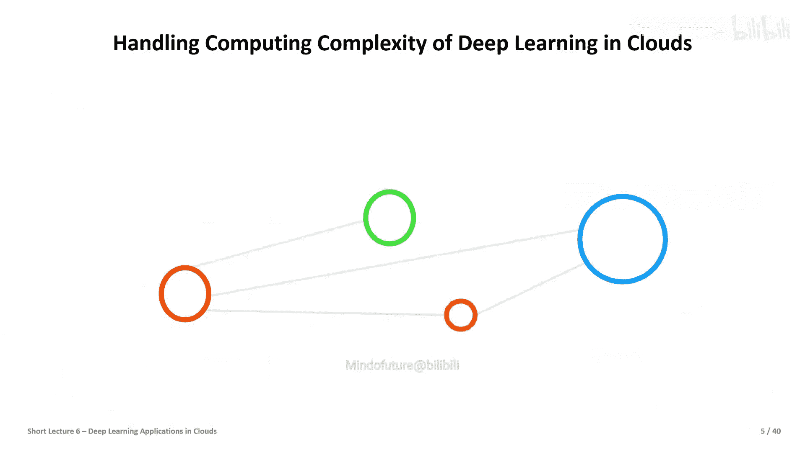
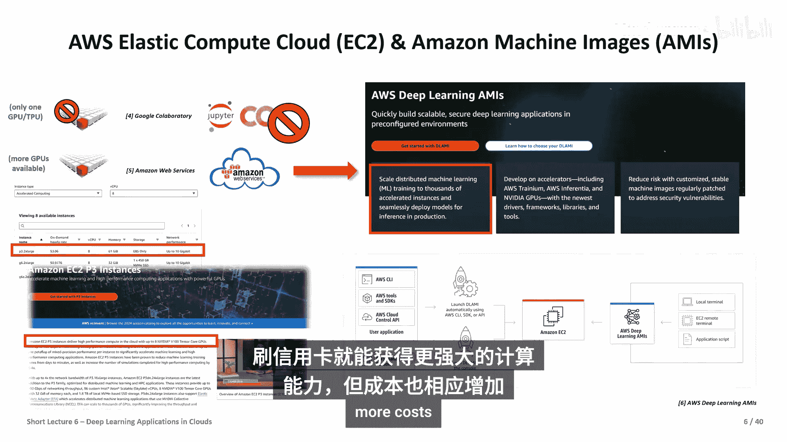
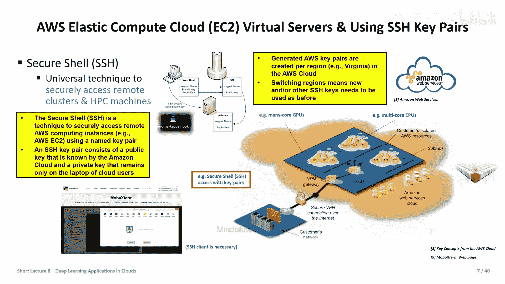
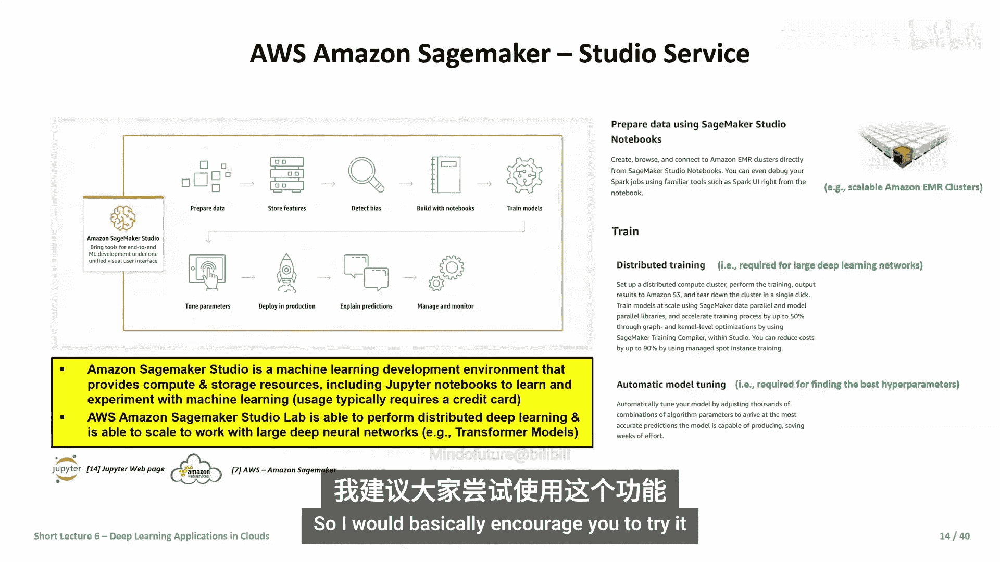
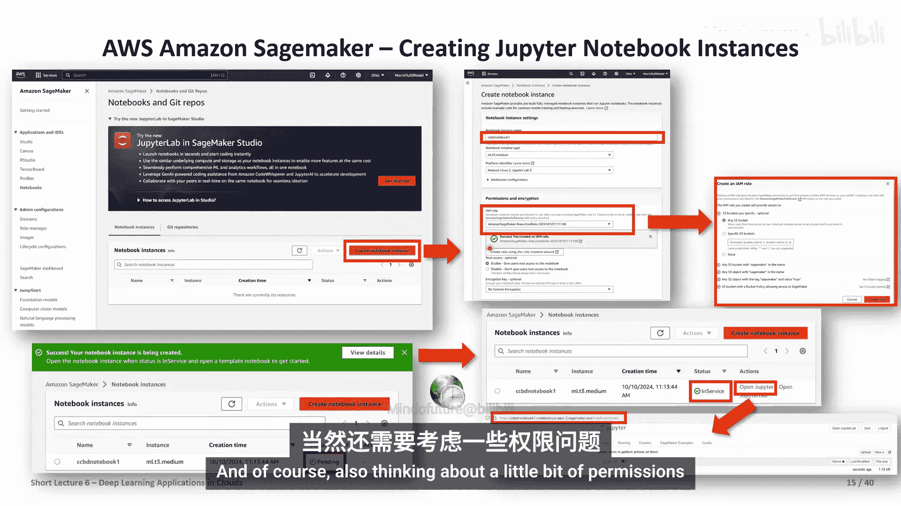
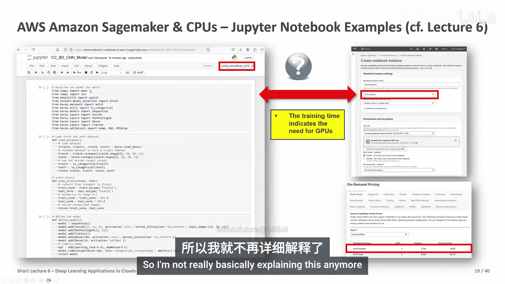
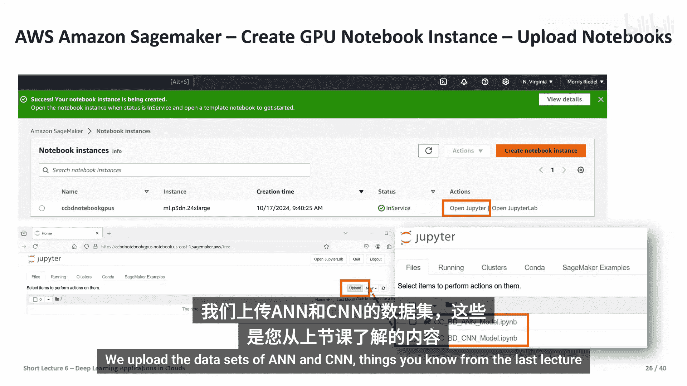
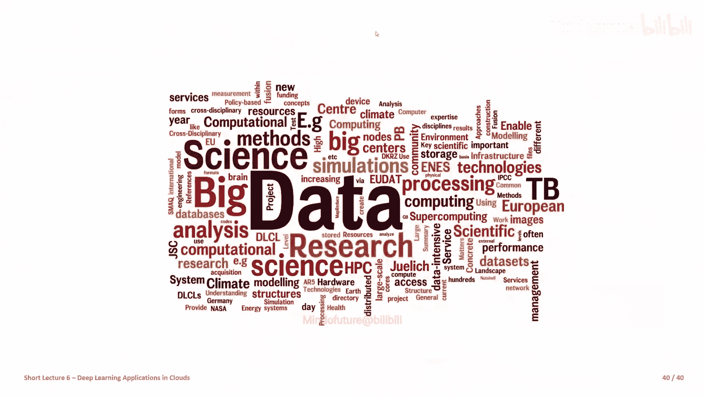

# 【冰岛大学】云计算与大数据-｜-2025-Cloud-Computing-And-Big-Data-Course-p12-P12_讲座_6_云中的深度学习应用--BV14MB4BjEyZ_p12-

Allright， welcome everyone for cloud computingut and big data。

 our short lecture6 on deep learning applications in clouds and at the earlier lecture we switched to the short lectures now because we had lots of material in the course already on you know the industry projects is agile you know basically principles from Ingogu and then we had also the invited lecture from Andreas Liintaman who has also provide many basics that we don't want to repeat and that's why we basically build on these lectures and for those of you that want to know more please look in the YouTube channel on the last year there you see a full lecture6 a full lecture 7 on these topics and the practical lecture 71 that we can't do this year。

 but the materials out there if you want to know more。

And。😊，We will go to a very quick review of lecture 5， although we just had that before。

 so let' let's look what we talked about and we basically said we had a very interesting idea of starting with a perceptron learning model we have reviewed this also and useless in earlier parts of the course。

 if you remember this one line， this linear learning model linear and weights because essentially we have here the mathematicalmatic foundation which is nothing else and the idea of the neuron if you remember right so one fellow out of here essentially this one neuron that we basically modeled like this。

And we have this idea of a non- nonlinear activation function we can do more generally now it's not only plus one minus one that we had with a signal that we get and the signal is you know basically summing up the input vectors using weights and then basically add the biasers。

And the signal will be then put to this nonlinear activation function， and there were many authors。

 also Andy was alluding to them， explaining them so let's say the rectified linear unit is something which is often used。

But also the many others are here and there for different applications。

 you know quite valuable so what you end up then in the last lecture was that we had the idea of moving from a binary classification problem to a 10 class classification problem you recognizing digits zero to nine so 10 classes that someone has written and we came up with the idea of actually extending our you know know perceptron learning world that we had instead of doing you know one neuron here that we had in the typical perceptrum we actually had 10 neurons here because it mimics what we want to learn different you know 10 digits and then the dense layer what we want to learn so that they learn of parameters that we basically then ended up and said around 8000 so something maybe don't need HPC but I want to emphasize that this is of course now the point where all the computing complexity comes。

And you go to cloud computing also maybe for data right but more data in means you compute more of this。

 so you end up again there's more computing doing it just more often with the data so the parameters are loaded right depending on which model to choose。

And if you do this here， we see parameters and you say， well， that's 8000， we said， okay。

 we can't say that's maybe the best what we can do， it's 91% if you remember from the accuracy。

 let's move to something more sophisticated right and And was already introducing your back propagation of error。

 the learning algorithm that goes with the hi layersers that you have here because you don't really connect the input to the output anymore。

 you cannot go to the error and learn from it。Right hence you have to forward compute and do backward propagation of error you know taking the derivatives。

 weight vector updates， derivatives， weight vector updates etc。

 something also alluding to the so-called chain rule another proper machine learning course actually told you about this but this is a big breakthrough because this is a very powerful model already in machine learning and was basically coming out of a winter and machine learning suddenly neural networks were supposed to solve all problems in the world reading at some point in time again to a winter and machine learning because the parameters with all of this in different neurons and the weights to train we're also suddenly increasing very much and without the time of GPs you were in a bad position of having just CPUs and。

In that sense， you know， you will understand that this was already quite some computational complexity if you have。

 let's say more neurons that we had last time right。

 I think it was 128 or so hence more parameters to train in this neural model means more computing。

 hence we go to the cloud。Or you want to have your laptop running for 24 hours or for you know 48 hours。

 maybe for this toy problem it would be still viable。

 but if you remember we do this all also having real production applications into mind also those that we had at the beginning of the course remote sensing but also those that have Andreas presented then you really put your laptop on a week on computing and the chances are that the GPU inside will be even overheat so heres something where you really nicely come then to the deep learning problem if you want or more or less a challenge because we see then the last lecture the aacies even better because we keep the 2D input we don't vectorize the input right so we keep some neighborhood that helps us maybe in the classifier here that wegene in the features。

And then have the same idea of the output probabilities and the dense layer。

 but all of these different weight connections that we learn combining also the dense layer at the end leads us to 1。

2 million trainable parameters hence more computer you notice small computer bigger computer extremely big computer and when you have here a cutting edge model that also Andreas was presenting with transformers which you know really cutting edge material that is also fueling large language models today you will see also that these number of parameters are almost laughable in comparison to this。

 but its of course a toy problem that's why we also end up with quite a nice performance after 20 a only。

That because， you know， the Ms 10 classes are relatively easy to recognize。

Now let's go to today where we want to elude a little bit more in clouds the last time I talked to you again about the AMI interface already right so we will look into this a little bit again how it works underneath was a cloud how this AMI is actually fueled then what we will do is we will also look from the infrastructure as a service level away to a software as a service level these two terms will be clarified also later in the lecture but this shows you also how we can use nicely the SageMaker service。

Essentially for uploading the Upiter notebooks again into the AWS cloud and we take your AWS just again as an example also because it shows nicely the different layers in cloud computing right so we have infrastructure and service we tackle first as elastic compute cloud then we have more or less even if you want a platform as a service level with very good Amazon machine images freeinstled configurations of deep learning you know tool sets together with operating systems etc and then you have the let's say highest layer with sageMaker in the very interesting service。

 a powerful service UPn notebooks and many more but then you have to pay the price for it of course right because each of the layers needs the other layer underneath and that's what we want to also learn today and then with this also see how we handle the computing complexity of deep learning that say if you want to add more more GPUs to the problem similar like basically Andy has done once he left the。

He came toarel computing using more GPUs for a problem。

 and we want to review this a little bit how we would do this in clouds。

But also always remember the cost factor in it right and this is something what I have here is coins in you in the lecture as well。

Again the disclaimer， we have a lecture on this from last year which is longer。

 we have you know applications of deep learning if you want't like explain again the handwritten characters here as a simple example。

 but you know this would be usually complete course using this was rear Cloud applications。

So we cannot do everything in the course， but we can show you a little bit how we move away from this thing you know could Google Collaboratory that we already。

 basically in early lecture set it's insufficient for real application problems it's very nice for let's say training teaching for smaller application problems but usually let's say if you want to use cutting edge deep learning models today you need more GPUs and basically you can get just one GPU and Google Colab as we identified and you know with the AWS deep learning AI you can really scale up scale up。

Right， you see that a little bit how that works here。

This is one of the services that is quite interesting for us。

 this AI so that's what you know from the last lecture so these are already virtualized images。

 but they have to live somewhere。Right as you know。

 they should live somewhere maybe if via on a CPU or on a GPU together when I want to do deep learning。

Hence， what you see here nicely is that one Amazon service builds on another。

The Amazon EC2 service is one of the most fundamental ones that you can have。

It stands for Elastic compute Cloud EC2， one of the most successful ones in AWS because you have lots of options to choose from right and you can see here the choosing to end up to this scale that we said。

 you know go away from Google Collaboratory of course comes with a cost right you see here quite nicely coming from you know one generation of GPUs with $3 per hour。

You know， this is already something to compute and we see much more。

And these are Nvidia you know V100 tens of course already so quite a little bit oldfashed in Vdia you know we have already the umppeair。

 we have already the you know Gracehopper chips everywhere and also Blackwell is around the corner so we will have much more powerful GPUs and there you go if you really want to have that you also pay the price for it and this is of course generally the point in cloud computing right there hence comes the return of investment for the cloud computing providers of having this services but there you go you swipe as a credit card and then have more powerful computing yes。

 but also much more costs。

But combining this now in Amazon， it's really nicely supported to scale then distributed machine learning。

 So things also Andy was alluding to， we call that distributed machine learning。

 if you basically leave the ram of one GPU right if you need eight GPUs for a problem to really compute it in an hour or two hours instead of you know running it with one GPU for you know couple of weeks and then have overheated hardware or the whole thing stops anyway because of some other issues。

So this is an interesting software service， which is on a very lower level。

Based on the infrastructures of service level EC2 service and this is what you can see basically with this elastic idea now that you have this EC2 services living in this elastic cloud from AWS as the logo suggests and you can scale it up and down right you are in charge of picking how many you need or your application problem。

You can still access it in a very let's say basic way and some of the HPVC guys here and from my course will know that there we use SSH much more its command line interface basically with you know key pairs you can have a public private key pair that's what you have to usually create if you want to use EC2 the public key you can upload to the EC2 the private key always remains at your laptop and once you connect you have to show your private key basically and it has to match the public key in order to access then these instances in the cloud。

And you know， you can nicely connect then to storage in the cloud， which you see here。

 which will come later， the S3 interface， the S3 service is also a very powerful service of Amazon scaling storage up and down。

 but here we have the emphasis on compute because you also want to see how we quickly can come now and put AMIs on it by the machine or the virtual machine images that we have and then making instances out of it。

嗯哎是。Yeah， you have different regions， something I don't explore。

 of course you have also in Amazon you can pick Virginia， you can pick Europe。

 you can pick different regions， so this cloud might be not only one location somewhere in the but also your cloud that you generate can actually span multiple geographic areas could be useful if you think for resilience if one data center。

Potentially goes down， your data will be still stored in another one。And another level of scale。

 you would say even if you're really hot， you know， in computing。

 you could say one scale or one data center it doesn't provide me the scaling I needed。

 I can go to the other data center and maybe get a better， you know， higher number of resources。

So this is all something you choose， you pick。And I will do a little bit of walkthrough here how that works once you have the EC2 available。

 you have created the private public key pair have uploaded on the EC2 that's the first thing you basically do to have an access mechanism。

You can launch instances and there are things you know already from lecture four。

 it's basically very similar， you launch an instance in this AI。

This virtual you know server in a way， so you pick some of them we had already in the last lecture。

 you know there are many of them available on different Linuxux distributions already with many of the different tools available the Tensorflow 2。

10 here for instance Pytorrch another tool set for deep learning and you can just select this right and then you know go with this。

You can also have interesting new architectures and that's interesting for us because arm is more less a new aspect based on the risk instruction set here a little bit simpler。

 but arm processor are around as well these days to make some difference to into CPUs and so on and basically it's something which also here and then in basically machine learning makes sense。

 you have here the way to pick between arm and X86 just also to show you that the cloud vendors don't stand still right they also go with the flow of the community。

 they see an increased arm is used across you know Europe。

 the world more and more different type of processes。

 So this is also basically provided perhaps not in all installations you see or in all AMs but they go also with the time。

I won't go to the extent of saying we see a quantum computer now next year in Amazon that we can quickly pick。

 but the idea in the next five years is not so absurd to think about right that you also can pick some quantum computing resources for some machine learning optimization so this will definitelyly come and where we probably also integrated at some point in time into the cloud vendors like Amazon MSs Asiaure and you know Google。

With this again， think about that I talked to you here in the Amazon way。

 but the same is actually true if you go to different MSs Asia pricing models， if you go to Google。

 they all have a pricing for the different types of CPUs and GPUs， we have a review here now。

 the EC2 instance so that you get a little bit of feeling for it。

Write what it means when you also talk about money。Again。

 also thinking always about that your cloud service may run 27， right，247。

 So that's a thing what you have to realize some of the money looks very small to you。

We see a good example right 0。01， well that's almost no thing。

 but if you now keep it running for the next five years on the 247 scale， it accumulates。

And of course， this micro interesting instance here that here and there is。

 I think even sometimes almost free in a free tier available， you know。

 this is you know not really powerful in terms of memory for instance。

 right you remember spark Sp was really powerful a memory， so I have to move here rather。

Right when you move here to 128 gigytes， then you also pay the price for it there are 2。9。Power。

This quickly makes a difference if you have a 247 servers running for the next five years。So hence。

 with this comes a performance。 and always my disclaimer here， Remember。

 even if you don't use a cloud yourself as a user。The cloud keeps running the services and if you have an instance of EC2 running。

 it's accumulating costs if you use it or not。This is an important part。

 a feature of the cloud which is of course very careful to handle if you're a startup。

 you don't review this， you don't stop the instances of EC2 and you know the money keeps accumulating in the next year you have all your startup moneymy may be fired for a cloud provider。

Luckily for startups SMEs there are some agreements with so I encourage you if you're an SME or startup or those we have you know in the course we work together with we have one example of Kirau for instance working with I think Azure so there are some agreements that you know can get some resources but also this has some limits at some point in time but let us come back to the E two instance launch right so now I basically can configure a few things like a name obviously I can pick now the instant type that I just reviewed and I want to have here the instant type micro standing for you know a very very lowperformant CPU just to make the case here and you see also my key pair that I uploaded before for specific region in Ohio in Amazon I can reuse。

And then launch the instance。 And what happens is then that you basically have here， Amy， you know。

 you register this， this Amy that you picked and inside this。

 you know E C2 environment that you have the computing itself within the cloud。

 there will be now an instance of this Amy you now launched and it's working and you can connect to the instance。

 for instance， here is a command line you see。But。Quickly， you also see it's very much。

Down to the hardware。 it's command line。 the E C2 interface， as we call it。 There's no nice。

 let's say， super duper interface in terms of graphics， talks of a you put a notebook。

 So here you on the command line and have to actually， you know。

 take the Python command and take the you put a notebooks we have seen in the last lecture。

 Take them as Python code。 Actually， you can transform。

 you put notebooks quite nicely into Python code。 there transformer helps。

 and then you basically have Python。And you have to run it yourself in the command line and observe basically how it works。

 The same is true， you know， basically for all other things you want to do if you want to switch to particular Pytorch versions or Nvi versions。

 they are all available， but you are basically， you are required to pick those and to configure those in your environment that you need。

Hence， it's a little bit， let's say more down to the hardware experts and let's say to maybe HPC administrators rather than the real machine learning expert that is focusing on the application domain problem。

Hence。😊，You can imagine a cloud provider would be very smart and saying， hey。

 instead of going to the infrastructure as a service level that we have here， a good example for。

You know， what about， you know， for a fully managed experience， check out Amazon's SageMaker？

That sounds fantastic so now I have something which is maybe much better not the command line anymore he pairs oh God what is this is as his age I don't want to know I'm just a machine learning expert in medicine。

 I'm not a hard HPC guru I don't want to know all of that。So， okay。

 there's another service offering we can maybe choose later。But before we go there。

Just some examples also on the different you know models we choose and also to connect it nicely perhaps with the overview diagram I had in lecture three if you remember right lecture three we had this overview there are different hypo that I choose and I choose here as an example or the artificial neural network that we have was to in layers remember for lecture five but it's something I pick。

But it's still not the final hypothesis in the diagram。

 because we have to train the weights to a certain values。Right。

And only then I would be able to pick 1 G that is part of the hypothesis set while all of these different ones stand for。

 you know， these different models， maybe conal network later。Or basically the same model here。

 the H1 but with different weights would be also a different model in the idea from these candidate functions and you know in the end I would pick one that approximates hopefully this you know E function well。

Just to connect it again， although this is not news to you。

 we use the handwritten character recognition to use it in the clouds， so let's go with this。

And see how we can use now this interesting idea we had the lecture five is you written notebooks inside the cloud。

And as our command line was suggesting nicely as a hidden marketing spot。

Amazon SageMaker is a very good tool， I'm not paid by Amazon so I'm able to say that。And it's。

 of course， very convenient to offer， essentially youbit an output， but the interesting thing。

 the SageMake it also able to scale。Right， so you have something which mimics a bit the call-up environment。

 if you want。It's maybe bad to say that but in the end it's very similar right so you have the Upiter overview but the underlying infrastructure something you choose you can tune you can also see here with Amazon El mapre be alluding to clusters which basically will be later coming very soon actually with mapreduce coming to you also to another form how you can connect you know different elements like Spark to a bigger cluster we have seen with all the worker nodes so this is something what you can use using Apache Spar underneath auto do distributed training with you know basically different models from Pytorch for deep learning networks so。

Quite nice tool and even on top of it comes something called automatic model tuning finding the best hyperparmeter so this is not the weights the parameters hyperparmeter stands for the learning rate and then others like this so picking the right optimizes and so on so this is something what we also will have in later lectures towards the end of the course in another short lecture。

So I would you know basically encourage you to try it， however you think about of course。

 when you want to try it， there are several challenges with it。

Firstly， of course， if you run the the instance， it has to run somewhere。Right。

 so that means underneath， you have still a fully fledged， you know， kind of instance to choose。

 which you see a little bit like is's a machine learning optimized medium instance that you should look up and see what surprising is。

And then， of course， if you want to have deep learning supported， here you go。 right。

 we see notebook instant type。You quickly offset something where deep learning is in。

And then you basically also have the price， the interface， however。

 once you have this notebook instance created this Amazon Sha maker。

It's a very familiar look at fear， you have to basically have connection to the S3 bucket。

 so somewhere needs to with storage in the cloud。And you can you know basically padre a drop do our data understandingip notebook here loaded it up。

 but you see quite nicely it's running now in US east to in the region in sageMake AWSE as an example。

 you have to wait a bit when you create this。And of course。

 also thinking about a little bit of permissions， if you use it yourself。

 you don't have to worry about this， but if you， for instance。

 want to have it in your group and industry shared then you have to have some different roles and so on。

 but this is quite nicely and once this instance is running you can open it in Upiter right and then you get the similar idea that you have basically in call-up can start then you know with having our script like the data understanding script and what it does it has a specific Upiter kernel instance。

Which you also have to always check when you are online， right。

 Because this will show you what are the features in it。 So what are the， let's say。

 already deployed。Um toolsol for deep learning like Tensorflow。

 but also maybe simple things like Numpy helper libraries that you need in order to work with your problem。

Or caras in this example， right， because we have Fucaras used。

And chances are that the Google Colll script to basically use。

 download from Google Colllop and upload it to the cloud will basically almost just work。

 There's always here and there， small change in Tensorflow versions。Here and there。

 and so some things might be a little bit outdated in your script you have to update it。

 but chances are that for 90% of the code it really works。

 you have to do just small assignments assignment tweaks。

And then you go and you know the story by now that you have。

 you know 95% accuracy instead of the multi output perception that we skipped here a little bit。

 you know we know that already， but the beauty is now that the computing right that we had maybe normally had to do with a CPU or basically was maybe just one GP it takes quite some time。

And when I can add more GPUs， it could be very quickly done with it with the artificial neural network。

 it's still let's say， relatively easy problem， so hence one GPU is basically enough。

 but here you can now scale nicely with the underlying infrastructure。

So what about if you pick another hypothesis and I mean this is alluddingino two of what we had in lecture five and also what you know basically Andreas was presenting a lot。

Where you have this new deep learning models which do lots of feature learning， perhaps like here。

 you have this with convolution neural network again。

 if you remember having a 2D input and lots of weights with the filters to create this feature maps but in this convolution operations that you do and all of this is essentially very quickly。

Adding to。Lots of computing requirements， having all the weights。

 learning from the weights and so on。Uptainating the weight vectors and made mattresses you have to really see because if you're in a multidimensional space or with matrix matrix multiplication。

 hence GPUs are very nice for it， if you remember what I said at the beginning of the course。

 why GPUs are very good in this is that matrix matrix multiplication can be very nicely paralyzed and put on a GPU and realized by independent computing。

So basically this is one of the success stories why this is working so well with GPs today and why it's so fast to compute。

the rest of the story， you know we have the Somax activation function at the end to have probability estimates of the output。

 we have the fully connected here again adding lotss of weights and parameters。

 but now we end the cloud。And that means we basically cannot use any more CPUs。For this。

 we should use， you know GPUus， that's much better to do。However。

 of course I have to pray you know then essentially the price for it and I use now and say。

 okay I will still try my luck here with this medium instance with two virtual CPUs you know because it doesn't cost me anything you can go there and you know run our script that we already had in the last time so not really you know basically explaining this anymore it's the same thing that 2D convolution network the point is rather that this could now mean quite long execution time。

Right and now what sageMaker gives you then very quickly is something which can scale really up。

And if you want to do it， let's say in an even more， let's say， simpler way。

What we often do with student groups and so on is the studio lab。Right environment。

 so this is a let's say specific Amazon SageMaker part。The Amazon Sawayker studio La。

 you can also say。It's in a way we would say a service on its own really mimicking Google Coab service so here it's much more easier you can afford our GPU session for deep learning so many of the lower level parts are already taken for you and basically this comes as a you know a free service right free again indicates already the limits right you have of course the whole cool power of the AMI that we have seen before the kernels that they prepared for this ageMaker。

So that you have really cutting edge， you know， not only the UP tool you have again everything preconfigured the different。

 you know toolkits for deep learning like Pytorch Tensorflow MXnet is another one and so on out tog on as this hyperpymit optimization and slash ensemble learning tool that is used to make let's say ensemble learning it's another idea of dual machining combining different classifiers together。

 but it's a really nice tool basically if you keep starting right and for us as students perhaps you know in the end in this course。

 there's no even a credit card requirement。RightSo similar like Google Col， as I said。

 a low entry barrier， but from there you can very quickly then go to know other areas of SageMaker where of course then you have to pay some price for it so only give you this as an example if you want to play around with the you know busy different you put a notebook that we will upload for you and if you want to try them out it's not an assignment this year basically it's still encourage you if you want to try it out then you can use it in the Em and SageMake studio lab service name。

But。😊，There are some drawbacks with it， I mean firstly you see you have today just you know four hours left。

And you have some periods to adhere to， in some cases they even ask for a phone number。

Wwhich is also very weird and we learned from the past that sometimes Icelandic phone numbers seems to be not so popular。

 so we were not phoned And with this， you don't have the service， unfortunately。

 but you see here that， you know， you can pick between compute type CPU GP almost like Google call it and then run your project basically in something very similar like Google call in a Upiter notebook。

So if that would be all what Amazons SageMaker could do then this would be not really a cloud course。

 so hence what's happening now if we talk about big data。

 if we talk about cutting edge models like you know transformer models or we want to have our convolution neural network really faster on you know cutting edge GPU resources。

You can imagine what I'm used to say then， and you see already the fantastic icon downstairs here。

Of course。That's available right so you have even H 100 cards， H 200 cards。

 which is pretty much onvo， so this is cutting edge and media material of accelerators。

 you have even a100s， we would say today is still very powerful。

 very good the V100s get a little bit of old now the Volta line。

 but the U and the HoA is still cutting edge， even there blackwell is I think coming up around the corner。

 but we don't see very many deployments yet。RightSo I think for a decent machine learning production problem where you say it's quite you know some computing power that you can have here already which for instance。

 is different instances that you can use now and we come back to the point that on the lowest infrastructure as a service level。

 you need then this EC2 to connect it to SageMaker right it's the lower level is connecting with the infrastructure as a service layer to the software as a service layer。

And when you do this and pick one of the P5 instances。You'll see here。On demand howly rate。$100。

 roughly。hand surprise there you go right of course this gives you orders of scale of computing they call it accelerated computing and the same is true for P4 p3 a little bit less you know with the generations of GPUs you see here which stands roughly for the computing you need。

For an application problem， you quickly are in higher regimes， of course， if you think about again。

 our idea， let the deep learning system train for let's say a couple of hours for the inference you maybe don't need so much you can scale the cloud down。

 but for training you need quite a lot of hell a lot of GPU power so this cost will quickly also accumulate。

There are lots of other H treasures that I can't go to in detail， like MV switch and V。

 the Nvy link capacity between the GPUs， which is also important for a real application problem。

 but this is rather something we currentlylen in the HPC course。

You can create these instances quite nicely you just have the same idea of creating a notebook。

 but instead of having this machine learning， you know CPU idea we can now use this P instances so P5 p4 p3 what do you need and connect this nicely to the underlying layer by still having the full SARS experience right and when you do this for instance here we have the P3 as we said it's still maybe relatively okay in cost relatively okay means still $31 hour。

And if you think about about a small SME or startup as a grant。

 this could quickly accumulate also to some costs。Questions are which， you know。

 of these GPU instances you really need for your application and secondly， remember。

 it is actually running all the time。Even if you don't use a Upiter。

And this is important in you know comparison maybe to call up right when you know call up you don't use it in the web browsers and it's not a big problem。

 but when you don't use it here， the you know notebook instance is running is running even if you don't use it。

Hence， we want to use it， we upload the data sets of ANN and CNNN things you know from the last lecture。

Very conveniently， at Dr and drop， for instance。And then you basically can run it in this different。

 you know kind of kernels which are already all the up before you laid out。

 so usually that's not a problem， but you know the speedup you have them。

Its really enormously right for each of the different epos when you do GPUs on deep learning and this is really the aha effect you can also try your own right which is scripts we upload you。

 it will not manage a lot difference basically if you have the kind of data understanding script the Perceptron or the ANN。

 but if you go to the CNN level。Then you really see the training time indicates the need for GPUs。

this is something what you see here a little bit of serving the speed up per oppos is very important that you see how quickly now the Apos can be computed instead of any use。

 for instance， just to bigger CPUs。So this is also important。

To realize when you see a little bit the， you know， speed up and accuracy， of course， now。

 when we do this， we we add more。Gep use of the problem。 We don't want to have more accuracy loss。

Right so you see essentially the classification accuracy over the time will you know still be getting better and better or the loss function。

 if you remember will go lower and lower no matter how much GPUs we put to the problem right this is not completely true however if you have a real big application problem you will see something we call the problem of large batch sizes。

 so this is something which is cutting edge research of one of my PhDs for instance。

 so this is something where it is true that we can keep the accuracy quite high or let's say a couple of GPUs for maybe even you know going in the ten of order of GPUs but when you have a very big application problem11000 and more GPUs or the very same deep learning problem we quickly have a bit of the problem of losing accuracy and this is an advanced topic just to make you aware of it right so this is not that we。

And throw computing in an infinite fashion through this machine learning problem or deep learning problem。

 we still have to think about the batch size problem there。

But this is advanced material that we don't really do much here in the course as I said it's more and let's say still cutting edge research。

 but this is also for real big application problems right so I think the majority of problems in the industry can maybe be solved very quickly with you know not that much of resources of thousand GPUs at parallel or someone has done this before like large language models which we will come next actually and our short lecture seven there will demonstrate billions of parameters quite interesting where you think that this parameters we had here the train or parameters of millions you know something of course where you you know will almost laugh against。

Right， so when you do this in the cloud， you see the speed up very quickly just a couple of seconds for a whole apoch to compute。

 which would be taking you with CPUs a lot time。So yeah。

 and with this basically it's something what I don't recommend is of course using NCPU right for this deep learning。

 that's something what you never should do always consider GPU。

And then when you also maybe play around a little bit with these models， if you want。

 switch back to the ANNs and say， okay， Ive done this maybe on CPUs on on this。

 let's see how it is and we use GPUs and the same effect will come true so it's not only for deep learning。

Because essentially how you do the weight updates here is still also， you know matrix。

 matrix mortplication and so on and well matrix vector morification。

 etcter for updating the weights here So this means lots of GPUus can still help you also in this let's say more trivial neural networks。

 which are not the feature maps and you know the con operations and so on so on but still can also help here So you will see definitively you know1 millisecond per e here。

Almost zero seconds here in the overall April that this is already in Upiter then also quite nice if you use a GPU underneath as a speedup。

And of course the same point remains， so of course we keep the error at that scale。

 so just because we use a complete other way of computing right so CPUs are different from GPUs remember lecture one right it's a cutting edge number cruncher with this rate performance CPU compared to the GPU more moderate performance。

 but we have thousand of course it then can tackle this matrix matrix or matrix vector multirplication a very nicely parallel way and so obtain a major speedup。

Summarizing again， for you to leave basically this in your head。

 why you want to go to cloud computing if it's not the data size。

It is often also the number of parameters a train， the number of parameters often comes with the complexity of the model right if you now go to transformers to things we have in the next lecture we will see a massive increase in learnable parameters again hence we have done this before right so this parameters are loaded this is where the computing complexity comes in the way how you do this with the matrix matrix or matrix vector multiplication is a key why GPUus can do it so quickly hence if you go to the bigger computing part make sure that you have GPUs available to solve your deep learning problem。

And with this， you can also usually keep the accuracy if you're not overdoing it and put0 GPUs to one problem。

 then you quickly are in a scale way you have to carefully observe if the accuracy is going down。

And just one final thing to mention here is remember that we talked about trainable parameters。

 the weights， right this red Ws。That we had also in the learning model right was， you know。

 basically our input transpo W， the vector we learn this is not hyperpar hyperpars are different like the。

 you know here you see the number of airports。m sorryrry， the learning rate。

And all of this what we choose as a human， essentially this is a hyperparmeter and we will learn later in lecture 14。

 you know that we can do this also in auto MLLway， automated fashion and tune there a lot。

 but this requires again lots of computing that's why it's part of the cloud course and will be not tackled today。

So by summarizing just that you know of course I showed you a lot of Amazon right so Amazon web services which is one of the major hyperscalealar one of the major cloud provider we have these days but you can do very similar things very similar things with virtualized images on the Google Cloud platform I don't have time to show you this in all the different platforms equally you can understand that MS Asia has similar solutions so if you look at this tool it's a nice video showing you how you can use also cutting HD learning in a scalable fashion using the cloud AI platform in Google。

So we stop here and come to large language models the next time， so talk to you soon。

