# 【冰岛大学】云计算与大数据-｜-2025-Cloud-Computing-And-Big-Data-Course-p13-P13_讲座_7_云中的大规模语言模型与生成式AI--BV14MB4BjEyZ_p13-

Welcome everyone for cloud computinguting and big data。

 Today we have our short lecture 7 on large language models。

 also known as LLMs and also generative AI in clouds。

So this is definitely a relatively new lecture now in the series。

 mostly because you have observed the relevance of large language models I think through JetGT and many others。

 Mitriral， etc。Over the last five years and we see now more and more that the workload in clouds and also in HPC are really increasingly large language models。

 but also foundation models and we will talk about this today。

 also leveraging then this geneative power that we will discuss today to generate really content in AI which is sort of new。

 we don't want to generateize only what we basically do in AI machine learning and deep learning before in a long time。

 now we talk about really generating text， generating images， generating sound。

 generating videos you name it。But before we talk about this。

 let us review a little bit what we had in short lecture six and this will also be one interesting connection to the you know lecture today。

 so we did the move。

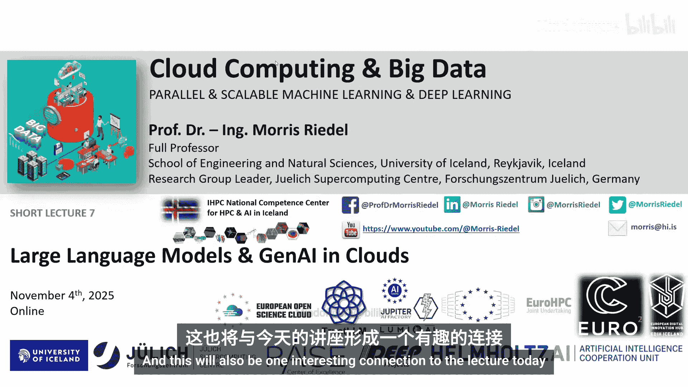

In the Deep learning applications lecture of saying， yeah。

 we had this interesting idea of a multi outputput perceptron。

 you see that here of doing then this you know handwritten character recognition by now you should know that barehar。

 I guess and we know we had around 90% performance and they really learn about parameters。

 which is also something we will rediscus today， is what you see here， the Ws， you know。

 some them are linearly using weights here。And then， you know， put it through in activation function。

 and's on the idea of one neuron in a way if you want。Will be coming back to the neural networks。

 iss coming back to the deep learning networks。 and interestingly enough。

 and we talk today about transformers is basically nothing else and also neural network so。

In the end the computing complexity however is for us the one you know which is in this particular course very important。

 so we left out several details from deep learning the last time。

 firstly because you should basically visit the real machine learning course if you're seriously interested in this topic。

 secondly， you have seen a very good introduction on the basics from Andreas Liinterman。So。

 but what we learned is the more powerful really the neural network is and you see that already here when we talked about the two two hidden layers。

 artificial neural networks trained respect propagation of error through the layers using the chain rule。

 there also really an increase in the parameters to learn， right， much more weights。

 much more connections， 120000 roughly。And you can carry on and then we said， okay。

 we have this convolutional network which is quite a very interesting it preserves a 2D input for instance。

 it carves out features pooling them for the convolutional operation strengthening this with new feature maps so in one respect we talk about feature learning。

While the last part is then really flattening and the dense layer in the output layer。

 here was a softm activation function still to make then the actual classification。

 right of the digit Spf seen。 So a bit of different system。

 And and this will eude also to the idea of deep learning that we will discuss today in large language models。

 I'd said you before， deep learning doesn't mean you put just more hidden layers and hidden layers。

 like you see， here was a part of your neural network here。

 The interesting thing is that really deep learning has evolved。😊。

Cutting with cutting edge performance， doing very specific things for very specific problems。

 And today we will talk about， you know， encoding， decoding attention mechanisms， transformer models。

 Also this only to a limited degree， because Andreas has already introduceds thoroughly。

And it would also fill to university lectures Basically if you want to introduce our transformers very well。

 It's quite an interesting topic。 But you go there and you see the parameters will rise and what for us was last time。

 really 1。2 million quite a lot。 we will laugh about that today in our lecture。 So but however。

 you will see the computing footprint for those that also want to try out these scripts we have uploaded into canvas。

 you see basically for the performance that you get better performance with deep learning 99。

3% of this toy problem is unwritten characters recognition。 then of course。

 you have to pay the price for it in computing。 So we looked at little bit what computing， you know。

 is offered in the cloud and we see very quickly， the limitations of Google collaboratory。

 Also when you think about real production data from marine data we have seen in the SMmeE greenfish example。

 right， loading up gigs and so on and terytes and so on。It's not really feasible。

 so you have to move to one of the cloud providers and we had the examples of Amazon on different cloud levels。

And this is not the only service you could pick there's you know definitelyly the HD inside。

 there's different MS Azure offerings where you can go to and have similar aspects that we saw connecting it nicely to virtualization on the infrastructure of the service level。

 so you have sort of you know virtualization to the rescue and have some prepared images that are called the Amazon machine images here。

 which already fueled with deep learning packages， which is very much on the lowest level if you want in the clouds。

 right is still have to log in with SS age。Yeah and there we have seen this some Ubitter notebook however much better。

 so then we already talked about as an SageMaker idea right so that you have a fully fledged managed service as we call that with nice tools we have seen but this is really already on the software as a service cloud and needless to say also sageMake and this higherleve service we will also basically now learn in the next couple of weeks that are left in the course they of course making use again on the infrastructure as a service on the lowest level so it's different abstraction levels we will discuss however let us come back today to a very interesting lecture you see it's new given the rise of late language models and the relevance in computing so we will talk a little bit today you know what is LLMs but as I said also earlier alone the topic LMs for this short lecture is really challenging basically we could say that large language models and generateative。

I could be a complete course， right correctly， I think there's so much fundamental。

Materials for generative AI leaving also maybe the space of languages right we will discuss this a little bit very briefly today that of course you can use generative AI also for satellite images。

 for instance in the remote sensing group in the HPC community in Iceland so huge topics however we focus here in this course on the compute and storage needs again and again which brings us quickly to the idea of this you know billion parameters you have heard probably right so we will talk about this we see how that materializes over the last couple of years and then we will here and they have good examples and also limits of large language models something you may be already hopefully aware of is hallucination but they are also other interesting challenges we will discuss and also opportunities because we will also understand more and more that basically this large language models that we have sort of foundational models as we call it for downstream tasks for task fine tuning。

You have another application and another application and another application etc， etc。

 and you reuse the foundation model again and again you just tune it for the specific task at hand with this you say computational you know footprints you have once this foundation model may be trained with lots of lots of cycles lots of power as we will also observe later but then for the task fine tuning usually it doesn't require so extreme much computing again as starting from scratch for instance。

 so this is an interesting also if you want green computing aspects we will briefly discuss。And then。

😊，Obviously， we will go through all the cloud vendors， MS Asia， AWS， Google Clouds。

 what they have to offer in the LLM space in the generative AI space and will have some application examples。

At the end， I would also give you a little bit an insight what we do in science。

 what's happening in research and also。When you think about open source models。

 we quickly talk about sovereignty of clouds today using language language models for countries for governmental。

 for the public sector， and it will also make some interesting cases why actions on regulations are really happening and necessary as we observe in the European Commission space。

 at least。So again， here this disclaimer， of course。

 some of the material like transformformers builds really on the material of Andreas。

 so there's no point of reintroducing this today， but of course this is a fundamental topic you should understand a little bit was encoding。

 decoding or this interesting attention mechanisms。

 which is really for natural language processing is here also very important part today。So， hence。

 however。Normally， this topic LLMs and generative AI would be a complete course these days。

So let's dive into it。 And I think the impact of deep learning I would like to connect to is。

 I think， pretty clear by now。 And you know this was the increase of parameters as we have seen the very specific eye detectors that we have seen this convolutional network in vision。

 for instance， but also natural speech， we have seen more and more advances。

 and I come to one concrete model called the long short term memory。

 which is also one deep learning model which spent the test of time， but was happening。

 let's say time before the trans models really came， but had really breakthroughs for instance。

 also here in liquid flow， which is LTM model generalizing well to physical problems。

 which is quite let's say remarkable because you know， usually this was more。

 the fluid gas dynamic space of the physical modeling， not of the AI learning from data。

But with these powerful models， lots of impact could have you know been performed was performed as you see here has an overview and you can look in the center of Excellence race。

 a new project we had where， for instance， talked about transformer models with some other colleagues and many other elements that may be interesting for you like out encoders Ra tune hyperparameter we come back to this a little bit graph neural networks so and all of them share。

 of course， now the interesting aspect that they need a lot of data and a lot of compute right but we have seen with this we have really done lots of breakthroughs but transformer models now stand a little bit out。

 which we will reveal today。We should not forget also that basically several of these ideas of deep learning have been around since maybe at least the 70s when neural networks were onvogue。

 but the trouble was there was not really computing powerway label so the success that we see in deep learning and also especially now today with large language models is because we have access to very powerful many core architectures I mean many of you know we use the Tesla series from NVdia a lot。

And Tensa cores these days， you know， and the key ideas really that we as you see here。

 we can as many of these deep learning， you know， layers do yeah nothing else in the convolution operation。

 for instance， and in others， you know matrix matrix morifications maybe here in their matrix vector morifications and we see that here in the color coding very beautiful how this can be nicely paralyzed right so in order to compute result。

 maybe you see that a little bit here， we don't need the whole picture。 we just can basically。

 as you maybe remember a bit from math， use this color coding here to compute this on different processes。

 which could be within nicely this you know many core architecture here in a GPU having access to the device memory where this matrix are stored and then independently compute from each other。

 the results that you see essentially here and coming and computing the overall picture and this was by far now。

One of the computing breakthroughs that also make deep learning then。

 so much advanced and also made the way also to the transformers that we saw today。

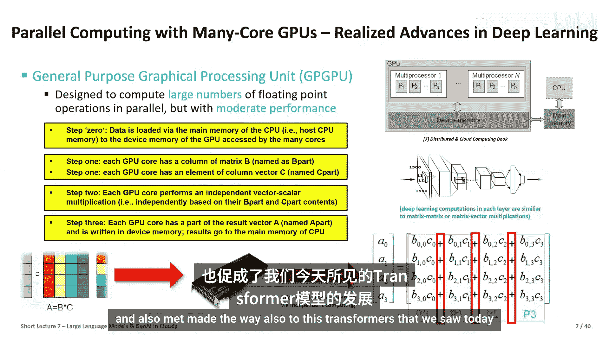

Now initial successes， however， coming slowly also to the idea of large language models。

 but something where you know the community was NLP natural language processing was longtime thinking about sentences of sequence models as we said。

 and sequence modeling was mostly recurrent neural networks which will be unrolled。

 you see here basically giving the different inputs in over time。

 or as you can imagine a text or let's say words are nothing else and a sequence of characters right you see here the hell low。

That was basically put into you know this kind of unrolled idea and then you basically compute the weights you still have weights here that you compute right it's a bit not visible here and then you could predict what's coming next after the H comes in E after the e cups probably in L So we have the probabilities here with one hot character encoding and so on and so on and initial models where recordcurrent neural networks。

 then the long short term memory came with some interesting concept of having you know borrow the idea of computer science having here a storage of memory So in the end talking about we could you know remember longer aspects in sentences in sequences and this was another sort of if you want breakthrough because these models have been quite robust also because of this memory and also have shown in many of our applications very good performance you see here Luns vacuumune for instance good predictions of power lines but also these days。

You can see them in many other elements in medical signals speech and so on so in one respect people have started then stacking these LSTMs and this was really another breakthrough for translation really that you saw also in cloud computing lots of services were based on LSTMs sometimes also on gated recurrent units they have a let's say having less you know gates here is not so elaborate like the LSTM cell that you see here but still had very good performance。

It。

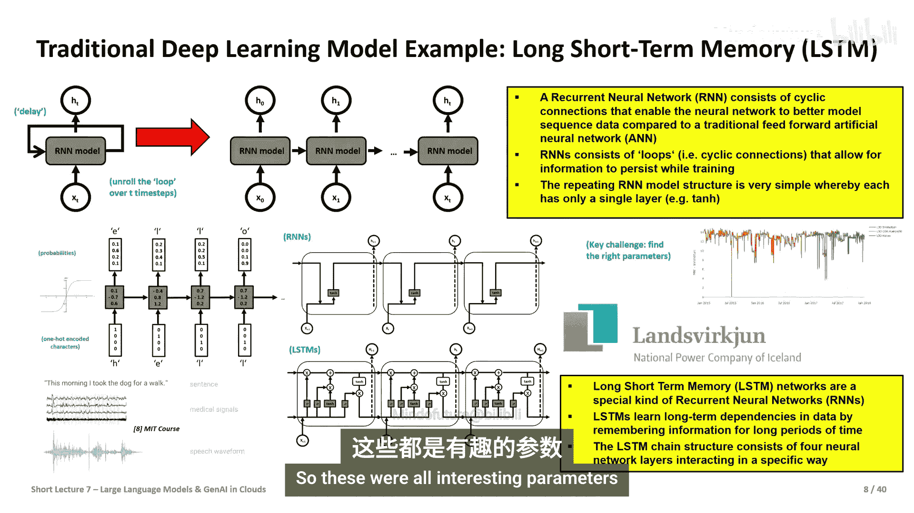

So these were all interesting parameters and here's an example of natural language processing how that was working here you see also the amount of data again suggests more toy problem to be honest but it capturees the essence that these models of sequences were also verying very well with text at least to a certain degree right and we see here sentiment analysis so we want to understand if you know someone who judges similar like our restaurant experience in the course now we're going to talk about movies here from this let's say Keeggel data set that you haveE sentiment classification just saying that my statement about the movie was positive or negative right again a binary problem here so not really let's say a large problem if you want。

 but you know this is something where LSTMs could work very well which I show you here。

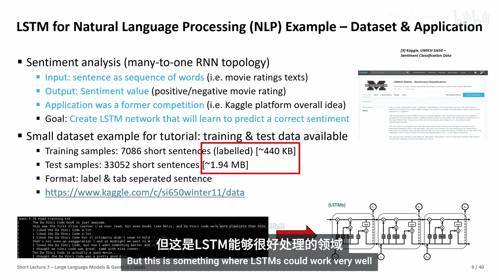

Quite nicely， when you train it and and you know， have worked with it a bit。

 you have to massage the input， obviously， so that you have sequences again。

 going in as it is unrolled here， right to predict then what would be probably coming as next and would give you also then quite nicely。

 let's say the idea of， is it a positive or a negative， you know， basically statement I did。

 And of course， it was a supervised learning problem， So in this sense。

 you remember from earlier parts of the course， even that is much more simpler than having unsupervised learning aspect that we really discover a bit this last language models today。

 because we quote them samely supervised sometimes and it will make a case for it， however。

You can see that you know this 97% performance， this was already very good。

 but what happens if you now have， let's say more and more text， what happens if you want to improve。

 you know on a larger problem like， for instance， generating text。

And this brings us to this interesting new field where you say generative AI， large language modelss。

 you remember this slide。 This is really the field of what we had here on the top in the beginning of the course。

 right， So here were talking about an huge training time footprint。

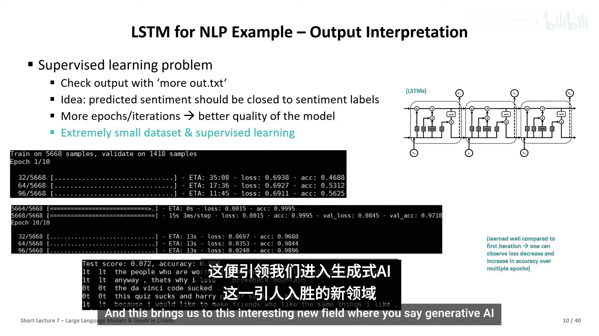

We talk， of course beautiful accuracy enabled through this interesting concept called you know selfattention mechanism and you see that a little bit here。

 we see encoder and decoder structure that you have seen also in Andy you know slides and if you want this was a really breakthrough of this from a famous Google paper in 2017 bringing then a complete new idea of modeling in although I mean basically if you see a little bit it's still of course sequences of text but now we can look at the text much more broader bigger Of course we have to pay the price for it。

 much more data is needed to fill transformer much more computing is needed to compute billions of parameter right when we talked about we had here 120000。

 we had 1。2 million and medium deep learning networks on convolutional networks now we in the billions right and this is something where high performance computing and cloud computing。

Is really needed。So let's talk about LMs briefly and I'm sure if I would stand in class today。

 I would ask you about open AI and chat GT and you know who is basically using it and who is not using it I'm very sure many of you would raise their hands and those that don't raise their hands have at least considered it trying it sometimes so this is really of course today something which is very known and you see what's happening I can actually use it like Google right if you remember Google was sometimes you know the search engine that people search something in then it became more YouTubeubing material right then people have started to use YouTube more like you know trying to understand something now we would almost say chat GT it right in order to find out what a language model is for instance。

And that is the interesting part in it， it is a very powerful tool Natural language processing seems to be the main driver。

 obviously because you know many from us are just humans and are interested in that and there are many use cases that you see nicely here from the NVdia。

😊，I idea of using this encoders and decoders with the transformer models for many downstream tasks and use cases。

 right we will explain why we call it downstream， but you see this kind of transformer model could be mostly interesting for us today。

 content generation very new right creating new sentences I mean。

 this is something where these models are now striving and also go to different modalities。

 as we say， So covering not only text images， sound video etc。

 It can summarize documents very well it can translate， I mean， Google translate， you know。

 doesn't work for everything like small countries or low resource languages。

 we will talk about that later and classification chatbots you have seen almost all big vendors today or basically professional websites have a chatbot talk to you。

 Do you need somehow。So I think this is pretty obvious。

And what is really fueling is is this transformer model that we have already learned in Andrea's life so and I was already talking about it so basically that is something we also know and for us it's important how we phrase these prompts right so what we see here prompt engineering is also something we will come later to when we want to maybe retrain and fine tune a model。

But let us， you know briefly discuss the role of trainable parameters already basically showed said to you。

 we talk about billions of parameters， and you see here quite nice overview from something which is in the in the web really information is beautiful。

 I would recommend you this website。But the interesting thing here is G5， you know， G4 things。

 you know from O AI， but also Miralal is one basically based on European values。

 we will talk about this briefly also， but here we talk about really parameters of billions with a footprint。

 right， G5 is a bit smaller。But your G4 classic here in the past was quite big。

 so you see more and more that these kind of you know。

 either they are very specifically trained for specific problems or basically they also need a lot of computing time。

And you see that a little bit why that is and heres a little bit the stage as you have so one to three billion you would say a simple natural language processing you know where you would have a shallow context understanding so these models are not very powerful but might be enough so here we talk also about a trait of using computing right。

And then when you think about 7 to 13 million， this is a normal chatbot。

 maybe you can use it already for some summarization， and then you have a moderate compute post。

 which is maybe something which many people would be already happy with right so the point to go to 30。

70 billion is really you have a very powerful machine。Coodegeneration multilingual translations。

 you know this is something where you really need lots of GPUs and what I see also at the end of the course I will show you a little bit when we go to multimodal research right we have satellite images radar images you know different types of modalities and then you really need extreme computing cost but of course it's also really reing for the community and this should be just now a feedback what we had already and when I you know talk about the last course hours I mean here we ended up as 1。

2 million now these models here LLMs and generator AI at large is in the billions and more and more right so this is a growing field。

Question is， however。You know， if you increase more and more these billions of parameters and so on。

 is it really better right or it's not data being the bottleneck you know for some of the languages it surely is right take icelandic right we cannot have more and more text corpora so having a you know billion billion hundreds of billions parameters space to learn will not work because we cannot feed it withlet's say clean data sets we don't have just enough text corpora and lowlay resource language。

And just to make it kind of you know link to the cloud course when we talk about costs right so when you want to have something very old trained a GPT3 model is 175 billion parameters me。

Then this could sw around basically $12 million in just computing right I mean in science we are lucky we have these machines for free。

 but if you're an enterprise then it's quite extremely costly to do this and hence you can imagine GP4。

 GP5 for open AI costs quite some money if you translate it you know one to one。Again。

 also the good news is that the vendors don't stop you know somewhere so we see here a quite interesting movement the last let's say five years with a100s being cutting edge from Nvidia and suddenly the grey Hopper or Hpper architecture come along and today we have even a 200s right but you see even within that's say the same hardware Nvidia doesn't stop and then' not paid by Nvidia just for the online audience right so just saying that they also don't stop to really tune and actually work also on the software on the drivers and all everything which you would say is not directed the hardware but would make it work faster and faster that you see here was the same hardware one year later you know have even more speedup available。

So that shows you a little bit and also here you see the kind of megarons but all more basically language models you know a little bit if you're in this field for you here in the course it's important in the moment to say。

 okay， not everyone can train these models， it's much more better that someone has trained it。

 put it there and I can maybe re it re unit for specific problem at hand and this brings us to the idea how essentially the LLN development work as a stepwise overview here and I want to make the connection a bit to the CRM that you already learned as a kind of models ofandi machine learning because we change a little bit here the game of saying we have let's say typical datas where we pretrain a model。

Pretrain means it's basically trained on lots of basics and lots of modalities， perhaps。

 let's say on text， tokenized text， ready for English， ready for French， whatever。

But then essentially， what we want to do is we want to have an alignment step。

 which adopts them the the basically the LM for very specific， as we call it downstream tasks。

 And this requires usually， And this is an interesting aspect here， right， You see this recycling。

 So we have this pretrain model staying there。 Being ready， being shared。

 And then we use it with some alignment data set， maybe readfin it fine tune for some specific problem at hand。

 right， Let's say you have a， you know， a language model， which is English。Generally。

 and then you would have text data a lot， you know text up down documents。

 you feed it with text documents and then you can basically have a chat box for the tax authorities online maybe giving many people let's say already basic answers to text law and text you know challenges they face as many of you know text and so on is usually a very time consuming manner but this might be one example where public organizations also can really benefit so it's not only industry but also the public sector more and more is requiring this foundation models is pre-trained models so hence we changed a picture a bit of the idea from you would say the CRTM and just that you know this RLHF reinforcement learning from human feedback stands for the fact that in this process that we did here a little bit automatically with modeling we have now some reinforcement learning in this process。

Right with human feedback if you want to find tune sometimes that really depends on the tasks there are different ways how to do it you can also basically have prompt engineering where you you know have very specific inputs again and again you know again text law。

 whatever you do in terms of a chatbot you find tune for the text at hand and then you know could be a very relevant you know suddenly language model that you deploy of course。

 you have to evaluate it with different mechanisms。

And then you have really in the deployment in the text office this， a conversation going on。

 you know， with the people maybe that want to you know。

 talk to you as a tax office or you have it in statistics， Iceland。

 let's say a statistical organization that can do lots of you know quantization of statistics can talk with you about the latest greatest ofery you know what's coming out and what's was reported without a real human being in the back。

So hence again， the point is theory really this pretraining using these sort of foundation model for a language potentially。

 and then you know reusing this， it's basically here and saving in this sense。

 it's why mark a bit green also， you know， here you save computational compute time to train these models。

If you want to put this in our practical machine learning overview。

 we also change the picture a little bit just that you know firstly you would say transformer models。

 which we would have in our hypothesis set here with lots of billions parameters do nothing else in the learning algorithm in a way like variations of back propagations and radiant descent approaches you have seen probably also with AndD so the learning algorithm stays a bit。

Similar， but we don't have necessarily always supervised input， right。

 let's say Icelandic text corpora would be something we want to maybe feed in。

 but we still want to maybe do some reinforcement learning from human feedback。

 So basically change some of these aspects want to do prompt engineering And with this also we basically have a different idea what the error measure would be。

 However， therenal models up around these days。 It's just basically that we rather have a mix of unsupervised learning。

 maybe in the beginning is not really labeled data and then you switch a bit to supervised approach is in a way you would say it's more a semi supervised approach using this attention mechanism that is you know in end in the transformer model for instance。

 and then you know changing the game a little bit by having also new aspect that human inly in this process has some insights right so and this is important。

 of course， you can imagine because human standards are usually quite good if you have a。Icelander。

 for instance， that can talk Icelandic this probably can really quickly identify if Google Trans works or not。

 and usually we see that's here and there has many flaws。Now we come to some challenges。

 I think many of you have already heard as hallucinations or references are created on the fly which are don't really exist one famous no picture is here。

 this swan from Santorini I think that's an image example of geneative eye where it really looks good and if you have been in Santorini it's really nice place I have been there I love it but this pool is not existing and not any time soon but it looks on the first plans really fantastic right I mean this is if you know it's really hot there and having water everywhere and perfect but if you zoom in。

 you see you know the photo that seems to be someone did on his vacation has really interesting humans right so some losing the hands heres a half of a body or the hands have very interesting you know artifactacts as we call it and the same is true if you look on some imagegenerated faces you see sometimes extremely many tooth。

Or teeth， right， so this is something which is not existing this person but it looks pretty real。

And here are some other， you know， let's say types of hallucination context。

 hallucination where basically the kind of the model respond completely to something from yoga going to astraprodiajection through something completely out of context than semantic hallucination where basically that you know the whole process really didn't you know is magical。

 it's really I mean basically and a real mechanism that is important and not enchantted right like magic or something so it lacks a little bit you know the real depths you know fuel mechanical processes。

 combustion all this is basically saying oh there's some magic inside with unicorns have been making this cowwork and you can go on you see content factual hallucination or a very good one is here also for lunch is certainly change here see different。

ations in a way where you go from lunch suddenly and get something for dinner。

 right recipe for dinner， that's not what I'm askedsh for。and， you know， you know。

 basically lunch at dinner is here a problem then， but also out of nothing comes to steak while basically something a chicken with mashed potatoes is provided so you see there are interesting aspects in it。

 which means we should really be careful using these。However。

 we see and I also want to make positive notes now。

 of course here that MS Asia is using this a lot in this cloud offerings。

 we will walk through a couple of them a bit faster because I mean this is sort of just showing you also what's on the websites more or less but you see here that chatt GTs is adopted by Mercedes Benz really in productions using the Microsoft Azure Cloud so hence the cloud vendors bring us now back to the cloud computing you know course really offer all these popular models inside the cloud today right and the reason is that you also need a lot of storage the reason is even for fine tuning you need some computing so you choose several models here is an example of the MS Asia Cloud to see air foundry models where you find again those that we have seen before is G5 basically from OI but also Mi based on European values and so on and so on so you choose these models and can create something out of this do you see your Google。

Cloud service here is an example which has a vertex AI studio and if you you know using this and the Gemini you know model in the back。

 you feel again like chattGT within the cloud。 So it's basically similar and you can also create your own applications based on this and combine it which is already in the Google cloud making it quite interesting to maybe move now here very quickly through some document sum because some of the aspect like big query is not obvious to you。

 but we will talk about this a cloud storage very soon but you connect nicely with AI services now for visionion for this vertex AI large language model ideas and then you have a whole cloud offering ready you know to be shipped to your customers and of course you know everything these days is also steered with a large language model helping you even what problem you're trying to solve So hence。

You can go on and go on and we will make some examples also later in the course and we talk about platform as a service where we come back to these building blocks of large language models right。

 which are now， I mean， are pretty clear， I think， right you can see that some of these large language models are just provided as a platform and then you can use it as individual tools for what you want to do do you want to do an agent assistant right or a chatbot what's the point what you want to use it for is of course depending now on your application when you use a cloud for customers you want to do and Google gives you then of course。

 also the infrastructure like Amazon like you know basically also am as Asiaure。

So let us look a little bit when we now look in this generative AI space， this is a bit broader。

 we have this basically idea again here， generative AI assistant from Amazon of course we have this close source cloud service portfolio but generative AI is now basically a little bit larger than just thinking this large language models right here now we're thinking really in embedding these aspects in different sectors in business for very different purposes。

 so you see here some of the movements like Gen AI for you from the European Commission where lots of money is actually activated to have it as a flagship initiative not only influence public sector is generative AI but as we have seen mobility car engineering business he dispens and many other aspects so one example is that the open oil LLM so it should be an open source foundation model within Europe which should be available for people to reuse without。

Now paying aspects for open AI to use chatt GT or so on or Mial， etc。 So there's a movement。

 of course， the let's say， evaluation of these models may not be as perfect as the cutting edge ones of open AI GPT which are quite good。

 but still， I mean， it's free and with this it gives us also possibilities to tune them ourselves to work with that ourselves and so on。

Another example of a cloud service which also now brings us a little bit to revealing the cost behind it right you know by now I always review that a little bit in Amazon you have something called bedrock which is then the NLM idea very similar like we have seen before in the Google Cloud with the services very similar like we have seen in MS Asia。

 you can imagine what we find here is deepse Miral AI again all these that we had before。

And recently they're available as a service， you can combine them nicely again。

 but of course you need an AI infrastructure for it。

 which is now of course also an interesting part of it。

RightSo leaving out the data for a moment because we come to that also when we talk about infrastructure as a service very soon。

But essentially， you would have here this Amazon E C2 P5 instances。

 which are very prominent because this also stands for GPus， very costly GPus。

 As you will also reveal in the next slide， because if you go there and now think about that。

 you want to train a 100 billion model yourself using Amazon。

And maybe using this interesting AI infrastructure， you would go and see and pay the price for it。

 right， essay say here， make basically also the market wing is 100 billion plus power me at scale。

 Yes， you can do this and you get actually cutting edge cards for it H 100 cards， right。

 So this is and H 200 cards is really cutting edge Blackwell is not really， you know。

 penetrated in the market yet。This is the next generation。But with these instances， you see。

 you also have to pay the price on the hourly rate， right。

 and this model to train doesn't take one hour。Right hence。

 we're talking about massive costs to do that your to train a complete 100 billion permeter model completely from scratch。

 hence the idea of pin tuning again， reusing some of the pretrained models。

 and then maybe the cost is much lower， right， So hence， and becomes much more feasible。

 you still need powerful GPUus to do that。So even fine tuning an existing pretrain model can accumulate to quite some costs in the cloud。

And of course this is pretty obvious to you right there's n the incentive of these you know to make that and when you see now that more and more of these language models come available。

 I don't go much into the aspect of how it influences teaching。

 I mean by now you all know that from assignments， but here's now an important factor if you think about for instance。

 the hospital here and you know you have Google translate and let's say there are foreign doctors in the hospital that want to translate。

Basically， metal patients records， right， And your foreign doctor， you know。

 should I really do this Because a data will then go to Google outside the country somewhere where Google data center is。

So there are lots of these aspects which is not wanted and I think you get the feeling when you want to share suddenly medical patient records of yourself with the cloud。

 their leakages， whatever。 So there's a kind of movement I would say to not only regulate this with GDPR and so on but also talk about so-called European sovereign cloud services and again this would fill a complete lecture。

 what means European values， you know copyright issues， etc。

 not using medical data sharing that in a non-ananymized fashion etc etc。

 So Tilda I here one example of this LLM model which is you know standing for the European Commission way of saying this is a large language models based on European values and in a similar fashion you have also misal here coming from France if I'm not mistaken basically a European provider as well and you know this trialal is also something which offers European host AI clouds where at least we can be。

That within the framework of the European Union， the data is relatively safer than you know maybe putting it somewhere to China in clouds basically with you know the new large language models come there or basically to the yes somewhere with Google so there are different facets on it that even Google can offer you European data centers obviously there' is some tunings in it。

 but there's a large movement that's I think also important that you know that。

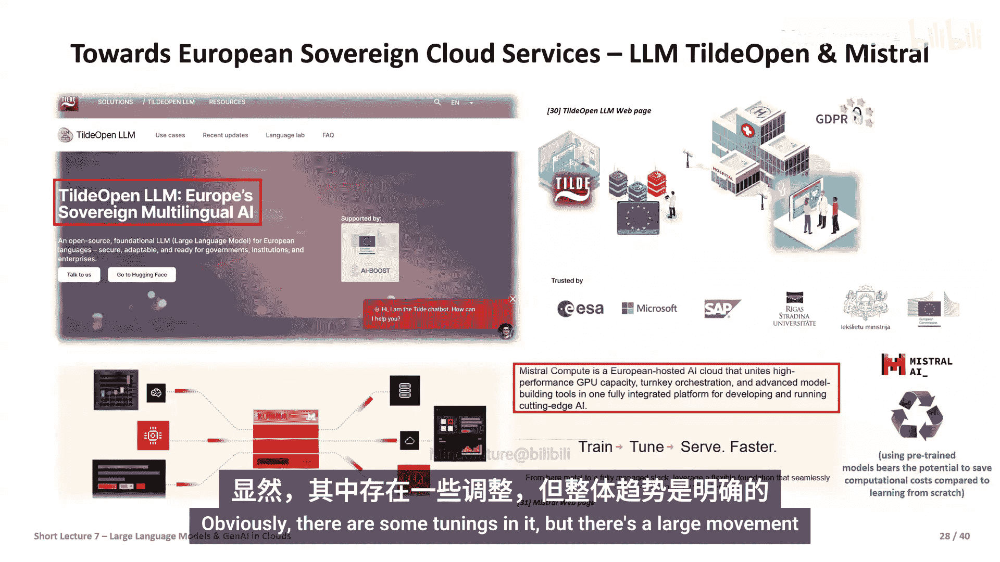

Coming a little bit to the end of the lecture， also what we do in Iceland here and also putting one point at the you know basically the problem of this LLMs and this is something what we address in the so called research project Trust LLM。

So here we have the problem where low resourcesource languages like Icelandic Fares right have basically very little text corpora to perform well in this training you have seen we talk about billions of parameters and large language models and this pays the price that means you need to have parameters fueled with data to learn right is lots of things to learn and the trouble for this low- resourcesource languages is then that you don't have enough data and you don't train these as you would perhaps to in English like English text corpora is very often available a lot and many countries have this problem even you know if you have Cypriot diallects or so you know this is something which is known and you can even top that with our hospital example right if you now have Icelandic as medical patient records and you want to keep that in Iceland and train large language model for Iceland that's okay that's already challenging but if you then。

Have rare disease patients right where medical records need to be translated for rare disease is something which almost was never seen by the large language model and training。

 Chance society will also generate very interesting stupid translations or something like this because there's just not enough data to really learn the models well。

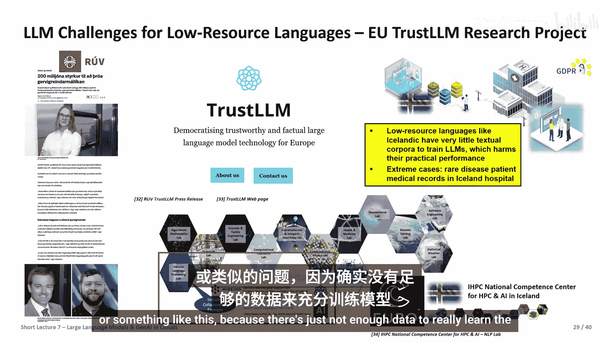

So we're working in this research project against it together with the overall community here in the natural language processing lab。

 I teamed up with Hafstein and Aserson here， one of our professors where also would recommend you if you have interest in the space of L lenss。

 he is really the experts bringing us to the next page。

 we have a couple of experts in our S HBC community in the natural language processing field in the NLP lab。

 doing PhDs and so on and teaming up also what you have seen was SMEs like me then and here you saw basically the CEO Linda here in the press release that we basically got when we earned the big European our funding。

 and by now you know that something very big for us here in Iceland having so many funds is really from Europe really again。

 hence we have talked also of course about the AI factory antenna， if you remember。

 but before we moved to this last point today I just wanted to make you aware that what we talked about languages。

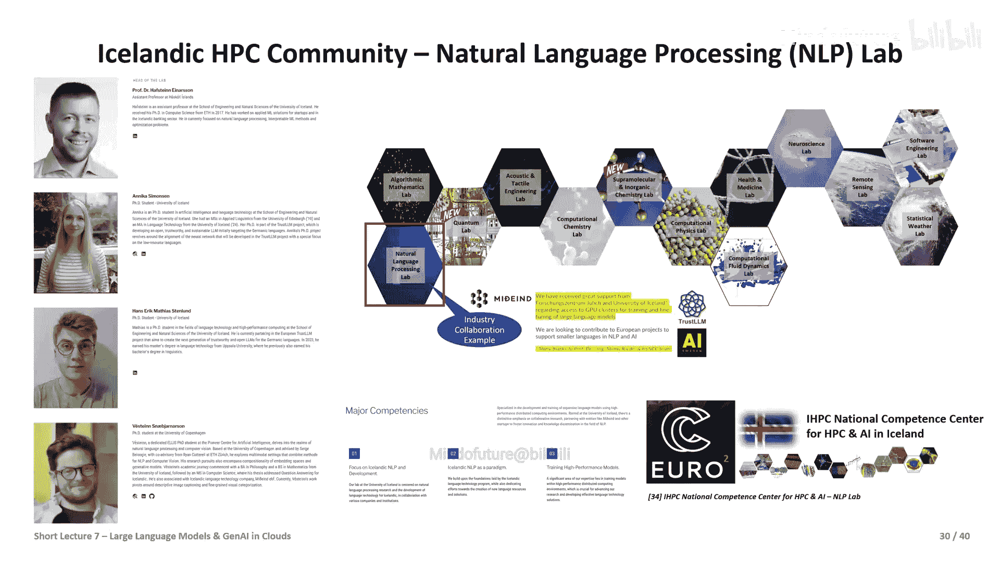

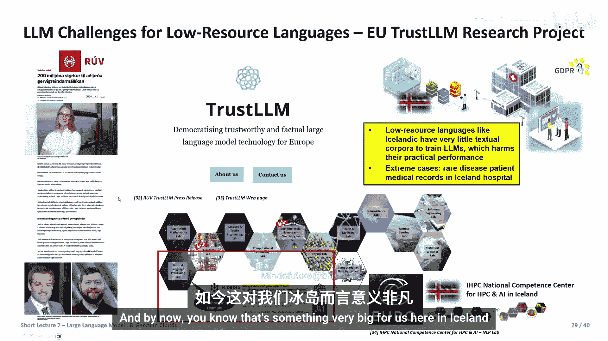

And this is another example of a generative AI service。

 basically and model where you have different modalities in different sentinel satellite data。

 but also you know different aspects from radars and so on going into it and the whole ideas that you do thinking in modality。

 so explainingterra mind，Would require a complete university lecture at least if not two right so but the remote sensing lab is basically working on this has published it together with Aza with other big players in the field you see here the lab is led by Gll Cavalarro a fellow professor in electrical engineering so there also lots of activities underway to have you know this different modalities。

 optical rather land use， whatever you have as data and generate something that is maybe missing in the downstream application。

 So if you reuse this and you would say some of the modality is perhaps not really existing that it basically learns to create some modality right hence it will generate you know modalities that maybe help them the classification offland cover I it a tree is it you know water etc。

I leave it there， it's a big topic and we see more and more things coming leaving essentially the language space a little bit right so here we're talking more about satellite imagery。

 remote sensing and so on。However， when we come back to maybe the final note today。

 when we think about you already heard that also in the I HPPC workshops， we got a very big grant。

 you know 1。4 billion krona is really very nice for us in Iceland to have this Icelandic I for us and you can see that's by bringing it here and the slides not to be proud again but much more of saying well for this 5 million euro that we obtain we basically will do also lots of large language models for the public sector in the different areas of healthcare。

 climate change environment renewable energy manufacturing engineering so basically it's an autogonal important priority we will also have other AI general purpose AI models including foundation models to do transfer learning as we discussed but here's really the key also advancing a lot in the language modeling technologies for Icelandic because if we don't do it in no one will right so it's a low resource language it needs lots of attention。

So with the press release you can learn more， we will also have a December EHPC workshop again focusing on IIs and what we will do there so there's more to come。

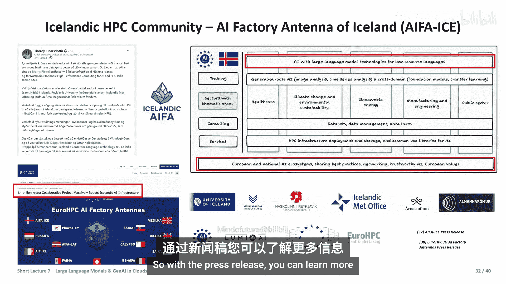

Here's an interesting final note on the video I brought you today。

 which is essentially from the EVM cloud talking to you again about GPT for generated you know pretrained transformers。

 it captures very nice three， let's say。Yeah， abbreviation parts what we discussed today。

 generative pre trained and transformer， so I would encourage you to look at and with this we will break here and well continue as a next lecture after a small break。

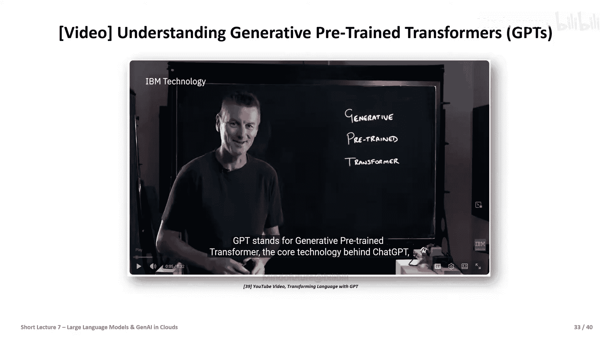

Of to you soon。

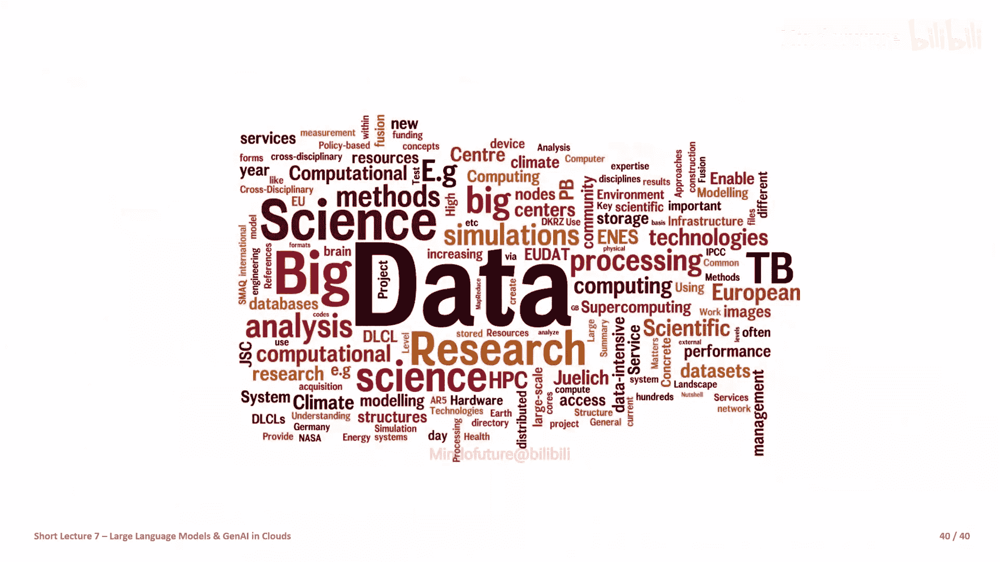