# 【冰岛大学】云计算与大数据-｜-2025-Cloud-Computing-And-Big-Data-Course-p14-P14_讲座_8_Map-Reduce计算范式--BV14MB4BjEyZ_p14-

Welcome everyone for cloud computingut and big Data Today we have our short lecture8 on mappR the computing paradigm。

 and it's a very traditional model that goes back even to one or one computer science if you think about divide and conquer。

And we also will make the case for it today， and then we'll also understand that in fact。

 map Red and the whole computing infrastructure around it is quite powerful。

 but it's really not just two steps like map Red in a way you can say it's three steps。

 It's not obvious to you。 we see how that materialize in this lecture when we talk about map sort shuffle group reduce。

But before we go into the material of today， which is sort of a classical cloud computing lecture。

 Let us review what we had the last time。

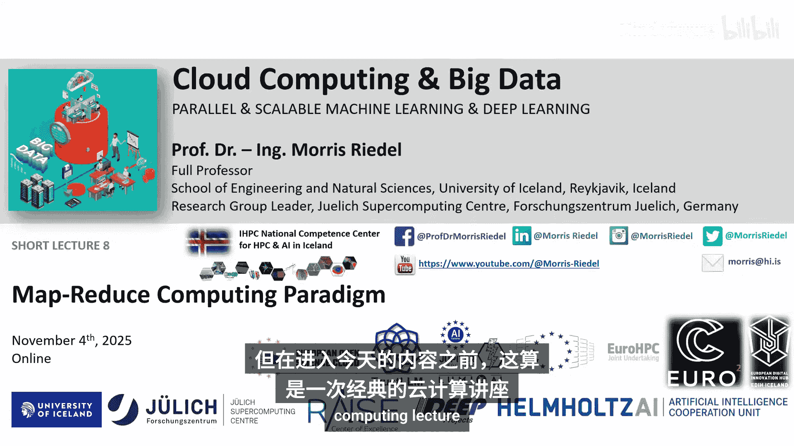

And Ch lecture 7 was really a very， let's say， quick introduction into the realm of generative modeling。

 generative AI， large language models， and of course for us here in the cloud computing course。

 the emphasis was really to understand where is computing happening。

 why large language models need high performance computing。

 why large language mergech models need cloud computing resources and storage。

 and we have best explained this by looking back to our original ideas we start from in the course thinking about the multi outputput perceptionceptron here。

 having then you know relatively simple wayss to train in the dense layer here。

 making it almost no parameters to train and hence the GPU is here， not really needed。

RightSo this was the simplest learning model that you can have if you remember the bicept learning model and then the bietron learning algorithm。

 we extended this a little bit to multiclass classification in 10 classes。

 still the number of parameters is not really very impressive。

So with this we had an idea to increase the accuracy and then you know basically thought， okay。

 let's do a two hidden layer artificial neural network by combining many of these neurons that we modeled into different layers and then do back propagation of errors as the algorithm that also Andreas was alluding to and then basically can come to quite increase in percentages but we had to play the price for it so a couple of more parameters。

 a couple is a good name， I mean basically we talk about1 or 20。

000 parameters suddenly so quite an explosion if you think。

 but it of course seriously depends on how many neurons are in each layer there's some flexibility so-called hyperpar which we also will have at the end of the course revealed again can be quite useful to use HPC and computing for to find the optimal values for that however。

Autom meditationations and these things are basically something more rather at the end of the course。

 Now we want to come back to the idea of large language models。 and in the end。

 we have seen billions of parameters and the success of deep learning。

 if you remember was that we discussed it is specific eyes or model architectures of AI And we see here a typical convolutional network。

 you have seen the benefits to the input。 It actually can be a 3D convolution network than you have even 3D and more inputs。

 So this is multidimenional arrays we're talking about。 And then you know all of these here。

 interconnections are weights that you basically want to learn and operate on。

 So hence we have more and more parameters。 even if you come to a convolutional network。Now， again。

 this was good for this handwritten character recognition。

 we got 99% almost solve it you know and we paid the price so it was 1。2 million parameters。Now。

 in lecture 7， then we came to quickly to the point that， you know。

 large language models and order of magnitude much more higher Here。

 we talking about billions of parameters， Given the transformer architecture。

 which consists of an encoding part， a decoding part and in this interesting concept called essentially attention mechanism。

 right， So this is something where。From this famous paper here in 2017。

 Google Engineers have basically created something which revolutionized a little bit this LLMs and the natural language processing that goes with it by having a model that is now really popular you know we have then an idea of pretraining if you remember we ended the short lecture 7 was GT things you know chat GT but GPT is also something of course thinking about you know pretrained transformer right and generative pretrained transformer so this is all interesting and shaked up a little bit let's say machine learning again not only with the explosion of parameters which then of course also required massive computing power right and you see here lots of these different models we started with GPT3 not so good in the human expert kind of comparison but then GPT4 was really good or。

Almost like a human expert。 And now we have specific different models， new players with deep seek。

 you have heard where other then energy is a bit more interesting to see。

 we have open access models which are more and more required。 if you remember。

 we discussed a little bit。The idea of tilde and so on and so on So long story short， however。

 these0 billion plus parameters where you have multimodal remember the remote sensing case where we have thisterin model This is really where you know cloud computing resources is definitelyly an ingredient that you can't miss also for the storage you need lots of data fueling it right hence we have also explored the low resource language problem in Icelandic that we have not enough textcobra are basically to train such models perfectly hence that's by Google translate in some of the translation engines I actually not that good as a human comparison because essentially like also you know the textcobra for it。

 but researchers is underway solving this or at least try to solve this Let us come back now to another interesting practical topic which brings us however a little bit back to the beginnings of the course right so。

In order to you know progress a little bit with deep learning more。

 we've integrated here deep learning and La language points。

 but mapreuces something which is quite important in cloud computing to understand and directly related to something we had at the beginning with Apache Spark。

 where we then broke off to explore firstly deep learning with the invited lecture of Andreas。

 but then also was a couple of those here in Clouds。So， mapduce。

It's basically it's not only an approach that we know from computer science with Biden conquer the paradigm that stands the test of time。

 it is an approach that you would say is you know very feasible for high throughput computing and we will make the case for it by this we have also several benefits like hiding the computing complexity that we would have in high performance computing for instance。

 and with this we also increase a reliability that these are all topics that made the Mareduce engines very popular hence we talk about often as an ecosystem even you will see also throughout this course that there's lots of lots of different let's say Apache projects around this Apache Hadoop implementation of Mareduce which use it for the underlying computing for doing many different things there's Apache Mahoot for machine learning there's Apache Hb for databases so big data analytics as it disraed right where perhaps it's much more let's say。

High throughput computing requirements this is what we want to understand today and also think about a different perspective what happens if data is accumulated at sites right if you see today how that works that people accumulate more and more data about almost everything or if you think about how the big guys from Facebook and so on accumulate more and more in social media platforms。

 this brings us to the idea of thinking maybe we need a distributed file system。

 maybe we need something where rather the smaller jobs come to the storage instead of you know we take now everything on big hard drives and then drive to HPC center to centralize compute。

Especially if your task is， again， high throughput nature。 and we come to this in a moment。 then。

 of course， this might be a much better way to do and also is not so intensive in computing。

 Obviously， there will be some cloud examples in between like a Me web services for Maduce this year。

 we don't have an assignment on it。 but basically。This is something where you definitely need to know about mapreuce when you leave a course here。

Needless to say Pey Spark， A Peache aobe， all this ecosystem of this mapR and you know of these cloud application could fill a whole lecture again and perhaps a whole course right if you have especially all the key value structures。

 key value stores there's lots of different projects around it that we will see also later so here comes a disclaimer right we really focus on a very small aspect of mapreuces is a really rich topic to study。

So let us look a little bit， you know what was the motivation。

 what is the idea of big data analytics when you compare a bit to data analysis right for the data analysis is something when you really deep dive deep in the data as this gentleman here on the boat and looks into the data and see you know causality is in important and hard right you want to know why something is happening so this is what we often do in science and so on but in big data analytics you're much rather on correlation focused so because data analysis can take quite some time and to find causality can be very time consuming the idea of big data analytics is a little bit can we discover novel patterns you know much more quicker right what is happening not exactly why it is happening but more that and what is happening。

So and these correlations could be very good insights， right， because of the data speaks for itself。

 there's no need for bigger data analysis， it has some dangers， right， So the big， you know。

 data analysis in depth is still very important， and and， of course。

 necessarily to understand why and the causality， but the correlation can give quick insights for many of the aspects。

 especially in business。So and when you have machine learning here and there data mining applications。

 it's oft。That you want to look on a lot of big data quickly， right， and come to initial ideas。

 initial modelings， as we discussed with the Christ M model。

And many of the examples we have in this field are also something which can be， in fact。

 independently processed， right， So if it would be independently processed。

 you would do weather forecast， you know， what you do and the different tiles next left to you over Reykbic would be all very dependent on each other。

 whereas rain whereas the wind， it affects basically the whole aspect。 But if you look， for instance。

 here on examples from the web。 the ranking of websites。

 searches and online social networking sites of you know， graph traverseoo。

 So many of these can be processed independently from each other。 You know。

 one website from the other has not really a direct connection maybe one link。 that's it。

But this is something where no communication has to take place。

 And this differentiates this also a little bit from high performance computing applications in physics that we know。

 for instance， and that we explore， usually in the other course as well In lecture 12。

 we will go more into some data analytics techniques you already know like recommendation engines and so on。

 So here we don't focus so much on the applications itself。 We'd rather focusing on the machinery。

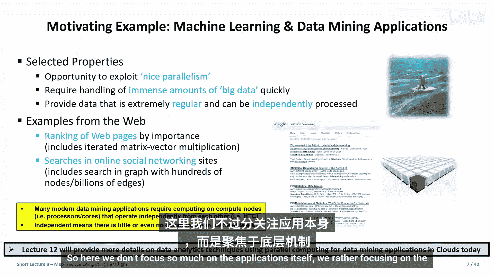

And another motivation in this was because we don't really。

I need to know perhaps always this kind of lower level that is， you know very much maybe expensive。

 the interconnects can be very complex these days in the supercomputer that you see on the top。

The interconnects between nodes is very expensive， for instance。

 in Finney bed because it should be very high performance if you have a physics problem。

 you know where each of the different parts in a room that you simulate are very interconnected are very dependent on each other。

However the programming there is also very complex right hence we learned this in HPC with MPI with openmp hybrid programming these ears also essentially combined with accelerated programming using GPU so more and more complexity and the idea now of this data processing machinery in big data analytics is to have cheaper clusters put them together have compute node you know maybe not perfectly interconnected。

 still connected that they can communicate and you know have sort of commodity rather in this sense so this was a birth more or less of the idea of this mapre and to differentiate really here again the definition right in high performance computing what we do with this large supercomputers we have a very well interconnect in Finninni band and you always communicate a lot usually between the nodes that's even true for deep learning these days so deep learning with a gradient descent doesn an MPI all reduce to update the gradient。

The learning and uses again the interconnect between all these different nodes in high throughput computing the situation is different the network is not so important it's just important that we maybe have thousand newspaper articles and we want to find a specific name in them so I can you know。

Divide basically the thousand articles by the way labor processors。

 process them independently from each other and provide at the end to statistics and how many of the thousand news articles was one specific name of a。

 you know sports guy or so so。

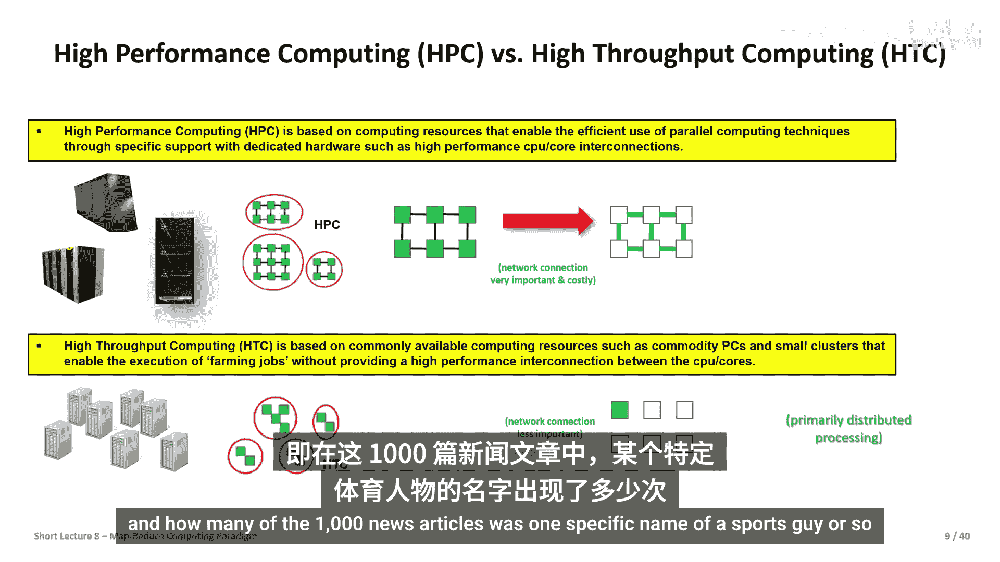

Hence， you get the story much more independent And with this also much less complex。

 because if you see now what you have here， sort of a sneak review for those of you that want to go to the HPC system。

 it can be quite complex。 You know， you have different domain decomposition as we call that because you usually use many different processor at the same time because of memory and you know。

 basically not everything， what you want to simulate like a full ocean with boats， oil platforms。

 fishing doesn't fit in one processor。 So basically you would have many different ones communicating and the communication is something you have to program。

The same is true here for this know open MP idea of a shared memories。

 there's lots of aspects of parallel programming and you would today even combine both message passing with the openmp。

 but then also the IC detectors you see here different types of Iects I don't go too much into detail because the HPC course is of course for it。

 but there are different ways how you do a you know unified memory access and nonunified memory access if have you know different ways how you do domain composition and it goes cells。

 halo cells to have physics parameters say accurately transferred for the next iterative time step。

 I can go on and go on and say HPC is getting more more complex and of course then the idea was that some of these people that use maybe more divide and conquer approaches。

 map reduce approaches like scientists， for instance。

 they don't need to know the underlying complexity necessarily of this。

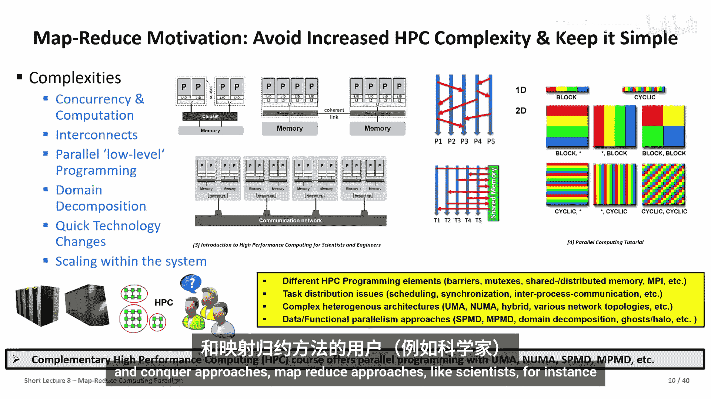

Of course。The point is that the problem needs to fit right if you still do weather forecast if you have a very physics problem very much you know requiring inter you know disciplinary communication aspects you can think about you know the climate on the different levels we have different ideas of how essentially the earth is interacting then you know with rain。

 water flow within you know the earth is different then the atmosphere etcter， etc ceter。

 so there is of course something where we have to see that the problem must fit。

And hence they call this a bit like this， keep it simple and stupid or not too simple that non technical users can use it for problems which are basically independent parallel。

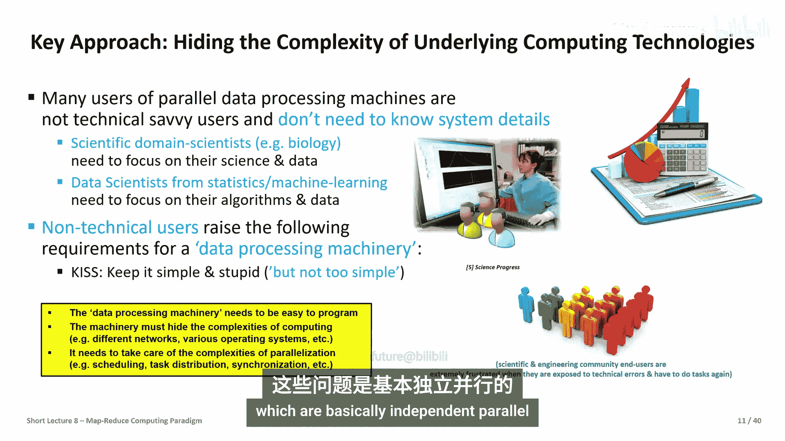

And the idea is that you see that here a little bit elaborating that some scientists just you know can use it very easily click on some tool and then basically the statistical the statistical computing is done or whatever it is what you basically want to do。

Hence， this is something where you would say firstly， we want to have less technology dependence。

 but you know or we basically want to abstract from it。

 but the reality is of course that underneath would be still hardware。

And the bigger use scale up that was another mapreuce motivation the point was that you say okay。

 I don't want to need to know that there's an overheated CPU or that the wreck is not working I just want to make sure that my software is able to then just use another node or even another system maybe so hence we have to these days in the Google data centers could be any data center in the world not only Google and also our systems here and usually supercomputers we have basically fails on a daily basis right there be scale higher and higher more and more resources I mean this is an old example here if you now go to Upiter or access scale system。

 you will see lots of technology and of course things fail and of course this could be also even operating know humans that do errors or an entire rec has network issues could be hard disk crashes etca。

 etca so many。Reasons and the consequences， of course。

 that usually parts of the system become unavail though now if you work on these parts and of course you have a problem。

 but what about if you have a software that actually can work with this right and and this brings us to the idea。

That you know more and more we need a system that is more decentralized right where you have maybe also thinking about the data more than the computing and this was another sort of motivation because data locality became more and more in the last 20 years to issue the people are actually allocating more you know resources now to data more and more and we have terabytes coming as let's say being standard these days also hard disks so exabytes and you know this whole range of scaling up more and more is another motivator if you especially think about social media platforms they have to deal with this on a daily basis right that there's lots of lots of you know storage capacity needed that is always increasing the programming tasks however you do on all this sort storage data that is there can be very simple。

 maybe simple summary statistics and so on。Right someone is liking another in Facebook。

 but the underlying system of course， is quite complex。

 while the computing thats say the real number crunching that we have seen now is the billions of parameters in the last language models is not really there。

So this was birth a bit of the idea of， instead of moving， let's say。

 the data to the big HPC systems， to the big computing engines。Let's see that some of the tasks。

 not all of them， but some of the tasks we can actually ship the computing to a relatively。

 let's say moderate processing power close to the data that will then constitute this Hadoop distributed cluster that you see a little bit here showing right because in the end what you want to avoid is to shift petabytes from one side to another this will take quite some time if you don't have the really good network interconnectivity。

And so hence it was complementary to what you already know from Apache Spark and was actually a bit earlier that Hadoop came into play as one of the implementation of mapre doing it essentially a lot via files which was incredibly slow at the time hence you know Spark had this brilliant idea of putting much more memory into the game。

 we remember this from lecture3 I hope right everybody of you where we had of course then here this comparison when you have a simple let's say classifiedifier logistic regression here you know have in Hadoop and Spark and basically you see Hadoop is quite long and running time and Spark is much more faster because it uses in memory。

 however， if you remember a little bit hopefully then remember that for this we had to have。

 let's say EC2 resources in Amazon or HD In clusters we had to have resources which offer a lot of memory otherwise as benefit。

It is lost。Right， and by doing this。Memory is， of course， very expensive。

So hence here you go with the tradeoff right of saying Hadoop can be a very。

 very cheap cluster again， the idea of almost commodity。

 something that runs every now and then you know basically are' doing simple tasks and I don't need the big inmemory aspects for machine learning for instance。

 but just more smaller stuff for summary statistics so hence what I also want to say is that of course not everything should be done you know now with you know Tensorflow pi towards deep learning。

 not everything should be done with mapreuce and so on so there are specific application problems that leverage mapre and there are some others that can use deep learning techniques that we have seen before with you know even generative modeling。

So coming back to mapre to understand that a little bit is really a change of mind。

 I would say it was always a very important part for students to understand this movement。

That you have essentially this map reduced at where we stand for and what people can imagine where you have a certain number of keys that you specify here。

 the key value pairs。And by avoiding then that you have these different steps。

Then you basically see that you have three steps instead of just two。

Because essentially what you have is that we have an insert here。

 which is taken care by the mapre engine or the implementation Haddobe if you want。And。

 and this step is sort of overlooked often where we have a map task and a reduced task。

 That is what you program。But what magically will happen is that the framework offers you a grouping。

 sorting and the shuffling。Of this， you know， basically map tasks。 So this is a bit abstract。 Now。

 we will have some examples very shortly。 But when you see the examples and when you look at it。

 please think about it that we talk about three steps。 right， map sort shuffle group。

And reduced in order to understand what we're talking about here。

Because then this enables us that the key， for instance。

 here will be grouped and that the reduced task gets already all the grouped keys together and this enables the framework to really it say do things automatically like shipping the data around in HPC。

 we would have to program the interactions between this manually right this message passing interface with shared memory processing。

You would have basically different programming models to do this。

 but the interesting thing to understand is that you are essentially thinking about that the frame of his things doing for you right it's like grouping by keys and so。

And by having this， you have a very good benefit that some of these aspects don't require yourself to program。

You essentially have the whole idea of specifying the problem， mapping it in the problem。

 and then you have a， let's say， reduce of a problem。Where you， you know。

 have lots of automatism coming in worker notes， which can be。Done。

 let's say in a scalable fashion and you don't have to do all the communication programming and so on。

And when you compare this now to traditional computer science， one0 one。

Then you will see that this is actually very close to what we know as divide and conquer and what is no sort of a life experience right you have a big problem。

 you crunch this problem into smaller pieces with worker notes。

 then you combine this again when you basically have done this in parallel with each other， you know。

 and then basically cominging result。So， for instance， you would have all ratings of a movie。

 And then you can say， well， this movie ratings don't have to interact， right。

 They are standing there。 So I can break this off into many different workers looking at this ratings。

 for instance， compute some similarity of users。Analyzese the ratings。 And then at the end。

 I combine some recommendations for a specific user。So this is inherently an HTC problem。

 a high throughput computing problem， which enables us to。

 you know having the then a completely different paradigm that we have before with highper computing。

 lots of interactions， manually programming because here we just interested in。

 let's say these steps which can be very well defined and hence the case it comes now to the idea that I was alluding to that basically mapreduce is just not。

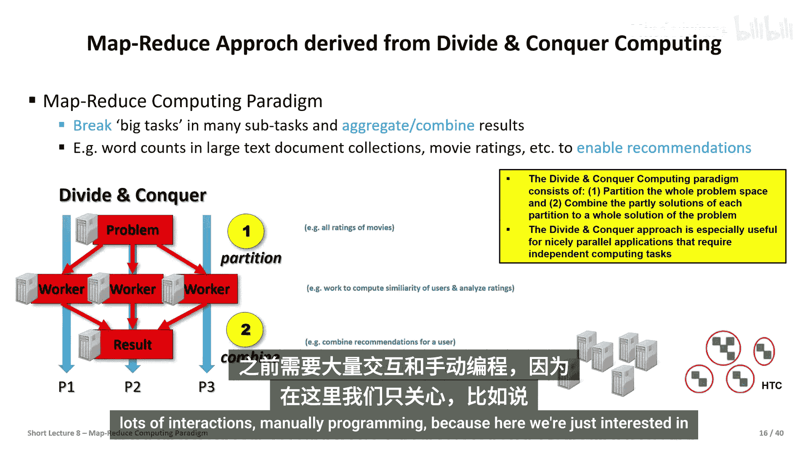

These two phases， we have actually three phases， right， We have map， Then we can group。

 We can sort and shuffle。By keys and then can reduce to a problem what you see here。

So hence for aspects like word count in lots of lots of newspapers。

 which is one of the interesting problems you have always as a tutorial here in the teaching lectures。

This is something where you can imagine there's no interaction whatsoever。

 so the input chunks you have would be of course something to consider can be also very distributed。

 can be lying around in different data repositories and you know just being you interested in the output then in the end means you have to maybe do some summary statistics and the reduced tasks。

 add them up all the words in order to know the final result。

Now what's underlying with this is also the interesting fault management， so as we said earlier。

 hardware always fails right so that's why the software has to take care of some of the aspects of thinking if hardware failures come in computation。

 then I have a reliable system at hand， I just resubmit the job to somewhere else where the data is。

And hence basically it takes the defaults and errors in execution as standard right and would resubmit tasks if necessary if it lose a cure and。

There's something where here as a video I brought for you， I don't will play it now。

 but it's something where you can really basically have mapreuce really simple understood。

So way how you program it is essentially then this kind of map and reduced task where you have a key and the value。

And then basically， what's coming out of this is then a list of keys and values。

And this is something what you give into the framework， it will sort group or shuffle by keys。

 and then the reduce has， of course then this key that's coming out here right in the second phase if you want。

 and it gets automatically the list that was coming out of the grouping sorting and shuffling。

And by this you end up with a list of this at the end where you're interested in and of course a reduced task has then to do something with it and create maybe let's say summary statistics and so on so we will do now the simple word count application this is the example that is basically always there as a tutorial you have now there's two ideas how to program it。

 you have a map and a reduce task right here and so to code but you just do it very simple as I said。

 these are simple computing step， the map task is very stupid in a way right you say just for every word make a one right for every occurrence in a word that you count just you know basically add one。

And not really as a， let's say， index array or anything。

 you just basically give that value you know word by word and you have a long text。

 maybe a non document where each word has an a comma and one came out。

So this is a very simple Mac task that doesn't need lots of computing power。

 and then the framework should perform a sort and shuffling on the key structure that you define is essentially the word。

RightBy doing this， you basically have now the kind of engine grouping by words that you counted always as one and provided with a long list of these words right always with a currentnce one。

 the currentnce one， the currentnce one。And then the idea of the reduced task is nothing else to then think。

 okay for each of these different ones because， you know， every word will be now distributed。

There you just you know add them up as you see here， pass the integer。

 add more and more for each of these values。And what you then。

 in the end have is basically then the combined output of saying so many words have been in the document。

 right from， from this particular word， from another word and so on。

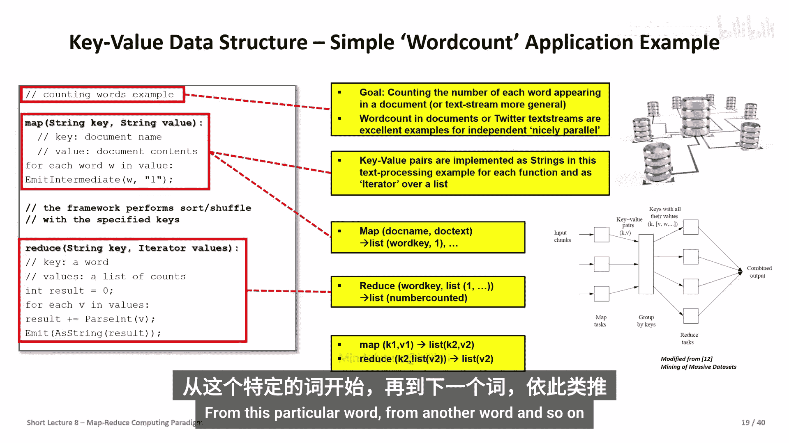

I think it's best explained if you want in a text stream processing example here this is a typical example of Twitter tweets。

 maybe for instance， analyzing sentiment analysis is someone talking about my product so there's a Twitter API that you can have and then also analyze essentially lots of these tweets。

And one idea would be， for instance， here that you use Mareduce for really analyzing it is， you know。

 Twitter tweets are not really dependent on each other。

 so you can look to many of them in parallel and you maybe want to find certain aspects of your product。

 talking badly or talking positively about the product。Now here for simplicity， we do this you know。

 texttam asfo car bar and so on this interesting things you see here that we then now configure of saying。

 well we want to chunk the problem into， let's say。

 always a configuration size of three so three words will be cut into a map task。

And what the map task is doing， as I told you before very stupidly， say fo one occurrence， car。

 one occurrence， bar， one occurrence， another map task would then take fo， one occurrence， bar。

 one occurrence， fo another occurrence， and you see immediately it's so stupid that it not even you know would say fo2。

Because that's not what I programmed， I said just occurrence to keep the computing complexity extremely simple。

And then even in the third， you maybe have another example here the dotted lines where it's car。

 car car， but the list remains 1，1，1。RightAnd basically you know as a normal computer scientist you would say。

 oh my god， that is storage too much， but the idea is to keep it simple and then the interesting thing is that this mapre sword shuffle group framework now will aggregate the values by keys and will take all the foods together all the bars and cars list together。

And that's where the reduce then we'll come in to do the summary statistics and we'll add them up。

 also very simple， basically computing， take a file thats the indicator here。

 which makes it a bit slow if you remember compared to map reduce implemented in Apache Spar。

 for instance， right？But this gives you much more an idea how it works now with an example of this map group reduce task。

 but of course you can program the map task much more sophisticated and much more know powerful。

 but the idea is still to keep it simple。

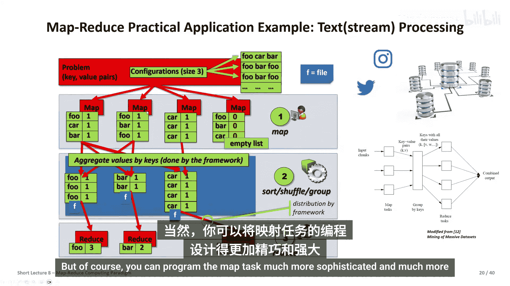

So what a Pehe Hadoop also gives you is basically a scheduler for this mapre jobs that you can schedule them across different data nodes。

 computeute nodes and so on。 You have a resource manager and different name nodes that know exactly where the data is。

 It's important for us。 And it's very similar that you remember perhaps from the spark that we had in lecture 3 together。

 right， It's a worker nodes， right， There was always a cluster manager， but also the spark context。

 someone who knows a bit on， you know， how many worker nodes are there。

 What have I configured and how much is computing there。

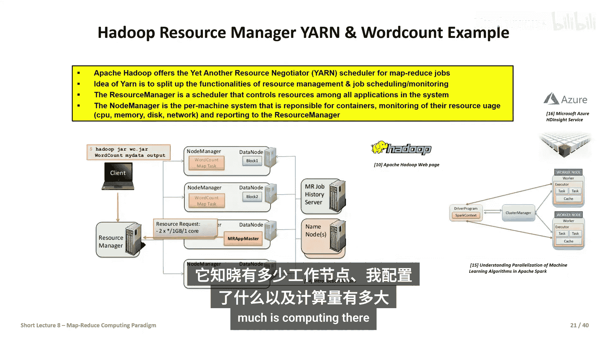

Now what we didn't touch yet on this Apache spark time when we looked at this in lecture3 was how the reliable file system view is now because this again comes more or less out of the realm of Hadoop so Hadoop is not only this computing engine。

 the implementation also constitutes and includes really a distributed file system the Hadoop distributed file system is sort of a standard which is really a specialized file system handling errors by default right you always can assume errors so what happens if the data you know is affected in this large Google data centers here you just have perhaps for instance some data replication going on to different data centers right and by doing this the cluster should know and mark and indicate okay this data center rack is not available today so don't submit to it no matter where you are and highle you are you don't need to know that even the whole software will keep。

Tracked。And by doing this， you of course should have usually multiple copies of the data in different locations。

 not all in one data center， and also this replication scheme that you then need in order to do that in an automated fashion behind the scene is also part of the Hadoop implementation and just to go through all some of these falls quickly。

 I mean we discussed many of them hardware that fails could be you know memory problems overheating of CPU。

GepU problems。Then is often also software problems maybe in the operating system here and there。

 then operation， the management of the personal， you know basically the maintenance that has to be done is maybe overlooked so sometimes this could be more human error environmental faults is very obvious I mean in Iceland here we would have even maybe problems of lava and you know earthquakes and so on abotaging a little bit our data centers。

 so hence there's a need for the specialized file systems and there's also system called rate levels redundant array of independent disks。

 which is usually performed to do replication， but the mapreduce ecosystem has a has a very specialist you know basically in this file system nature coping with his errors and this is something that we also will look here into where we essentially can see you now that the workers we discussed before on the map phase and the work。

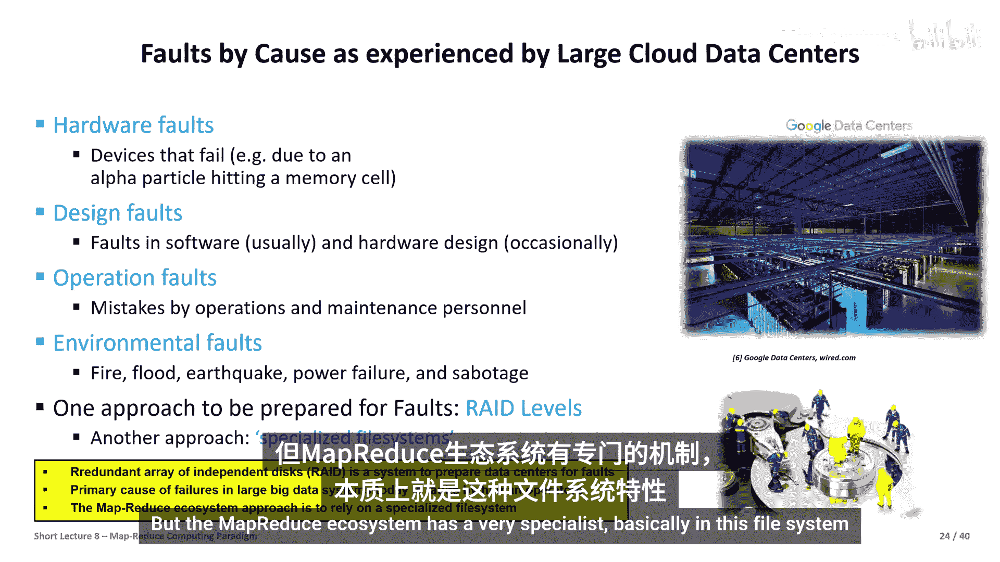

on the reduce phase， of course， need to know a little bit how I split it into the aisles the workers will work with。

 but there needs to be one master that takes care， assigned the map problem， for instance。

 to an entity or to a node where also the data resides。

And the same is actually tool for the reduce and when I want to have the output in the specific location。

 so hence says lots of smart ideas in the Hadoop distributed file system inherently where you see then you split the worker here up and there。

The beauty in it is that the data locality can be preserved so no matter how much you're growing in the different data repositories。

 this framework can make the you know scheduling in such a way that if you have some computing entity very close。

That the map tasks will be you know basically rooted to the specific in our elements that you need in the data for doing it。

 hence it really takes the data locality scheduling into account。

 which is one of the benefits for instance， in this distributed nature。In order to do this。

 you have different data notes where you do this replications of chunks。

 you see that in a little bit here the distributed file system means not anything。

 not everything of your data is anymore on one location。

 it is actually rather it's in different locations。

 potentially even in different data centers to basically have higher up time in case a data center goes out of energy or anything。

And the same replicas lived then basically in several areas， it means with there's some error here。

 let's say maintenance as a toy example here， you have still the data available somewhere else and then with this redundancy the map and reduce task in the HadoOop can actually then reassign the map task to the other location if there's narrow。

So of course this must be all a bit configured right you have the masters and the hat that then know a little bit in so-called name nodes and the name nodes are very important because essentially they know a little bit where our different chunks of data right so they know a little bit the structure where the data resides hence if you have a production operation if mapreuce usually have also a secondary name node just in case that one name node fails that the other name node can take over in one respect we call that met data so file me data you see here how we have one data file really shrouded in different pieces。

And by doing though， we can now start then you know。

 has this replication sea automatically in the background done all over the time。

 when you essentially you know don't work with a cluster。

 it will always try to get the replication scheme as you configured， like here。

 for instance always have three copies of the same data in different data repositories to enable a very high up time。

And of course this goal can be configured and you see here again the idea of the name node。

 which is really a bit important and you don't really have necessarily just files right that you basically replicate here。

 you have even blocks because files can be really huge in this big data in clouds so you would have a essentially with HDFS file and block distribution example。

 your data really shrouded across different data nodes， the different parts of it。

 and it's also scalable as you can see the more nodes you add to it。

 you know the more you could maybe also replicate， but you can imagine if you do this in a cloud。

 it will also cost you something。Just to summarize maybe a little bit the speed up compared from Apache Spark topache Hadoop。

 we have discussed this now a lot also already in the lecture3 of the course。

 but the key difference really where then Apache Spark was pointing was that you know in Hadoop many HfS reads and writes were happening so really you know and this iterative approach like machine learning ofness and logistic regression we know that the it iteration is due to the gradients to the updates of the weights learning is happening basically and by doing this in memories of course much more faster that's why essentially the Ram Re here is so fast that you know Spark is outperforming Hadoop significantly but in order to do so as you remember we need also HC resources or EC resources for instance。

 in Amazon web services that have a really good memory。

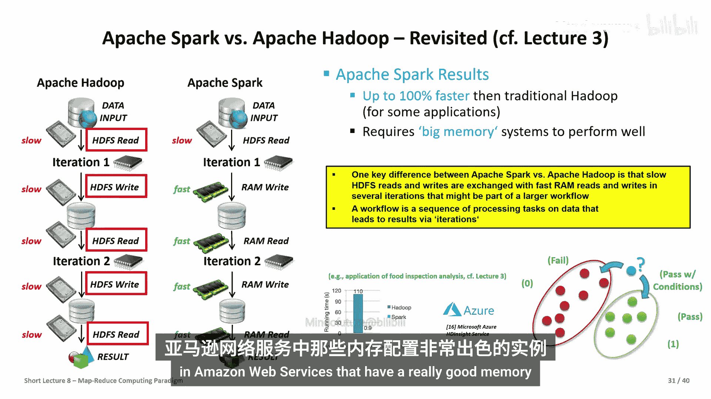

Hence it costs。And this is something you should consider if you use， for instance。

 the Amazon Elastic Mareuce Service， this is a cloud service available in Amazon for really big data processing with simple summary statistics。

 bringing me also closer to the whole， let's say， Amazon landscape of data analytics services。

 and many of them are also fueled by this Apache projects we just discussed with Apache Hive。

 Presto and other big data frameworks。So hence you have a whole ecosystem of services。

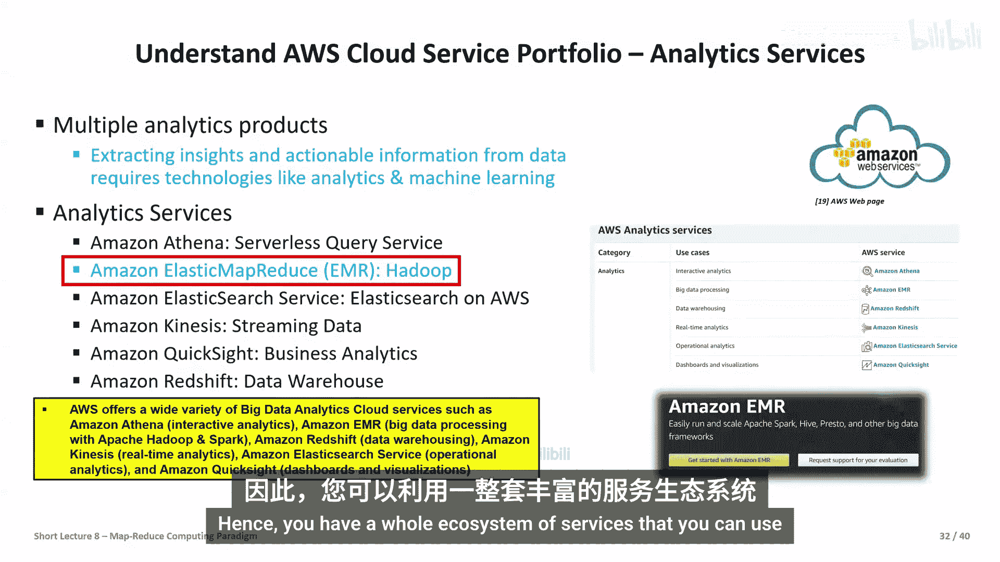

That you can use and underneath。Of course， you need still the heart that we discussed in all the course today and to make it happen。

 And， and this， of course， is something where if you go for Hadoop， it might be not so expensive。

But if you then use you know Apache Spark instead you should have you know assigned much more memory and you see here quite nicely how all these different stacks interact with each other right so this is an important part to see that MaRduce is really the parallel task execution and it has really different projects around it for SQL for scripts。

 machine learning data mining implementations that can use mapreduce not all of them can but some of them can do it and underneath is then really this HDFS as an idea but of course you can also connect to flume data streams maybe Twitter tweets and relational data sets of course are important as well NoSQ begins more and more popularity HBase is one idea of a key value store for instance that is often used today and also by Facebook and so on so I encourage you also to maybe look the longer version of the previous years to get an insight once here you see very popular let's say。

Haty projects which we cannot cover today， but which are usually always offered in the Google Cloud。

 in the Microsoft， Asia Cloud or in the Amazon Web service。

 and they're all managed together in the right versions。

 because this also means you have to have the right versions of these different tools you know that have to work together。

 and this is， of course， also a key challenge。 If you want to do that your own in your own seller is your own computer。

 you have sort of a problem。

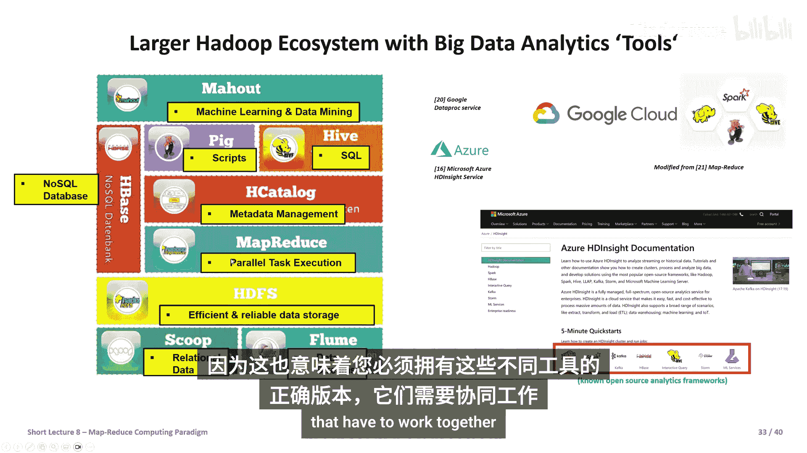

At the end of the lecture I wanted to just summarize some limits right because we talked about high performance computing it's very complex。

 it's really hard to program but of course we know that many problems on our earth right now like weather forecast with you know using physical laws。

 numerical methods they really depend on high performance computing and the idea is really there that you know when you would model this ocean from this gentleman here on the boat you would you know basically crunches into different pieces and they all have to interact with each other one wave height in one tile will basically influence a wave height of another tile that's sort of obvious with water right hence the idea is here that mapuce cannot solve all the problems it's one tool for data analytics it's a tool optimize for high throughput computing problems let's say that's what we discussed counting words。

 counting you know sorts of salary statistics。StsOf any kind and last statistical documents and newspaper articles。

 whatever it is， what you can digest， even with Twitter tweets in parallellor and nicely in parallel。

 So you don't need necessarily the information right now from the other tile。

This is very different from what we do in high performance computing with physical modeling right like weather forecast again you have also car crashes。

 you can imagine every iteration in a car crash has a massive effect on the iteration before。

 so this time aspect that we have in physics is also often here one reason why mapreduce cannot be really used。

There are some additions to mapreduce like iterative mapRuce。

 for instance where this is tried to be solved for some of the aspects like some machine learning methods that need。

 of course， iterative mapreduce， you will see that in the implementation of MaAd for instance。

 from Apache， but it's still not that the interconnect would be good enough like MPI over infinni band right where you then can raise the exchange physical parameters very。

 very fast。So that's something I wanted to just you know drop by you at the end so that you know that MaRduce cannot solve everything I have also video as usual for you explaining quite nicely from Amazon itself you know the El Mapreduce。

 but similar services are also in the Google Cloud or in Microsoft Asia。

 but this is just a good video and for those of you in the course you know I'm not paid by Amazon they just have here very good examples in the video we will continue a short lecture9 next time and talk to then。

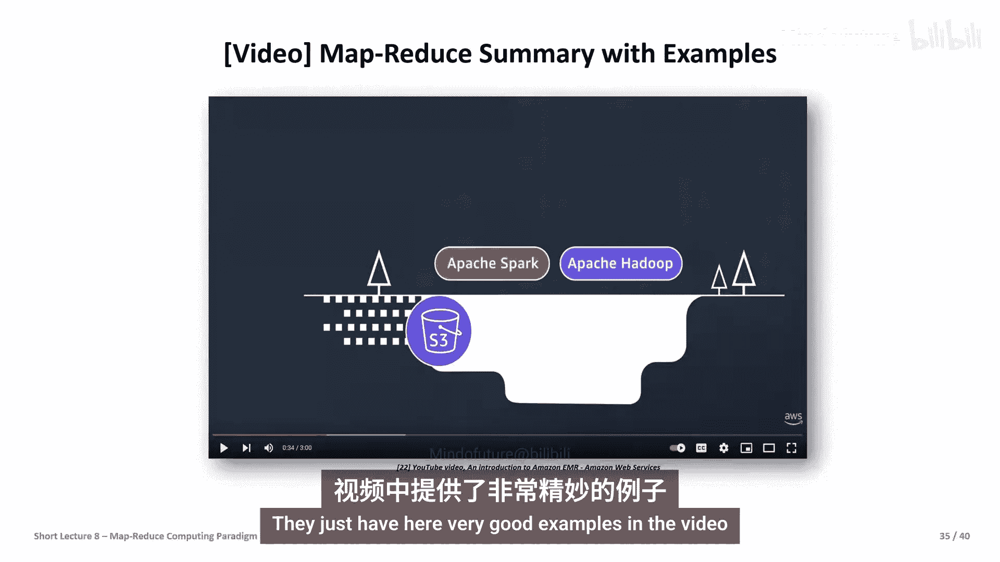

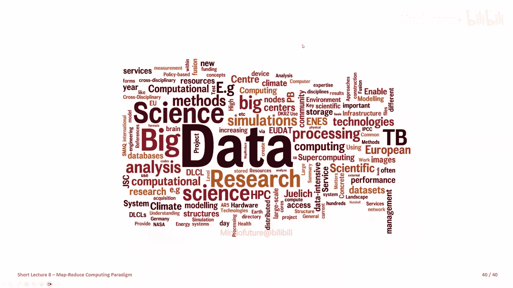