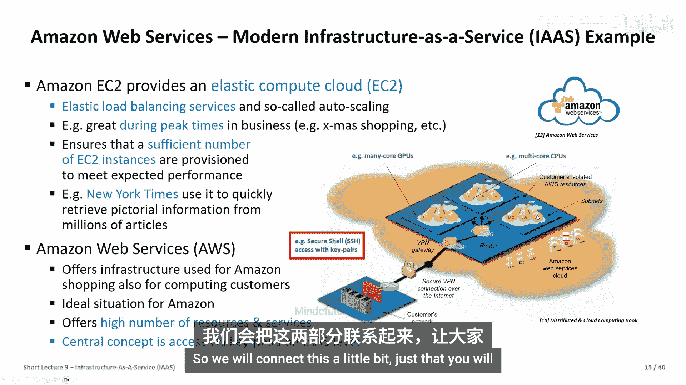
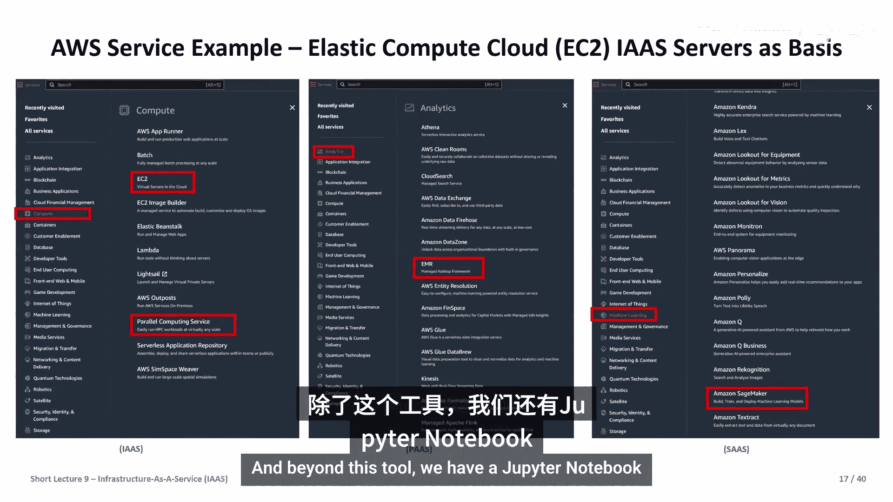
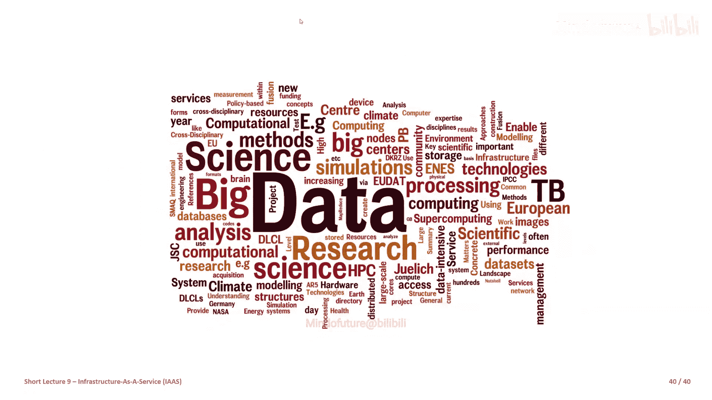

# 【冰岛大学】云计算与大数据-｜-2025-Cloud-Computing-And-Big-Data-Course-p15-P15_讲座_9_基础设施即服务(IAAS)--BV14MB4BjEyZ_p15-

Welcome back to cloud computingut and big data， our short lecture 9。

Today we have the topic of infrastructure， the service and directly or indirectly and the whole course before we touched that topic already if we talked about the virtualization approach from Amazon for instance。

 with AMIs。And many other services， S3， EC C2， these are all， you know， basically on that level。

 and we have touched on them a little bit already in the previous lectures。

And the topic of today will be also understanding these different levels that come with us as a service paradigm if you want。

we have infrastructure as a service， we have platform as a service and software a service and there's sort of an inflation as a service these days。

 so there's many services which are AAS and you know for marketing and so on。

 I think some of them you have also seen in earlier lectures。

But before we dive into these different service levels， let us review what we had the last time。

And the short lecture8 was about another computing paradigm which really then the test of time called mapRuce and the idea that we had there this course hours where that essentially this goes back to a really traditional computer science topic called divideivide and Conque。

And this is very obvious when you have a large problem to solve， big data to solve。

 to analyze and on， what you want to do is to break this big problem into smaller pieces that then can be done by different processors or different worker node。

 as we sometimes call it。And you break this problem into smaller pieces， but in the end。

 you combine the results again， hence you have this sort of two step partition the problem into smaller pieces and then combine the work that has been done in the smaller pieces to the red say some summary statistic。

 whatever it is you are interested in by doing this and。In the end。

 then an inherent scalability also in this problem when you essentially can part it up in a let's say。

 very independent manner right so you can add more more worker node depending on the resources you have available more processors and so on and so on hence the idea that we established also in this map reducedduce lecture was a little bit alluding to something we called high throughput computing。

 so this is not as much high performance computing as we do in the other course mostly because we have learned that the interconnect between the different nodes here is not as strong as you basically have in the high performance computing machine because one of the expensive parts in the HPC machine today is not only the GPUs obviously but also the infinni band interconnect for instance。

 right how you really communicate between the different nodes for weather predictions for climate predictions。

For car crashes using computation fluid dynamics。Physics， you know。

 basically many numerical methods based on known physical laws。

These are all topics which wed rather you know have in the HPC course。

 that's why he and the cloud computing and the HTC oriented course。

We talk about very different things。 And one of this is then this mapreuce approach where we really learned in the last lecture。

That mapre stands essentially for three steps right and we have the map tasks we have then also this group sorting and shuffling step which is done by the framework and then the reduced task so it is true that my role is to partition the problem and perform map tasks and I also have to combine them the problem you know basically tell the framework what to do with a reduced tasks。

 but we have seen in you know the simple program called word count for instance。

 that this can be nicely done and automated partly by the framework to sort for instance。

 all the keys and shuffling them so that the reduced tasks has a very simple job to do so much of the logic that we have and you have very smart key value pairs structures can be done by the framework automatically。

But that was not the only thing if you remember， we also said if a computing note is not available if a map task would fail。

 the framework would also see at resubmit this map task or will redo this map task in some way on the clusters to make the whole。

 let's say application go through without users really knowing what's the problem is。

 And this has also bit the difference you have on HPC right where yourself program message passing interfacepha。

 openmp shared memory， distribute memory， etc。And when there is an error on CPUs usually the whole application is a problem。

 so here the idea of map reduce and then the implementation of Hadoop was apart from this interesting map sort shuffling grouping framework for the reduced task。

Let's have， also。Failure by design， right， very full tolerant。

 a heart of parallel task execution that then can be used by lots of different other open source projects that you see essentially here in the middle again。

 right， Remember， mapreduces just the heart of all of this。 You can combine it with no SQL databases。

 no SQL stores are very onvogue， you know， document stores， etc。 we have meta data management。

 Apache picks or scripts， SQL is， of course， very much required this days as well。

 not only no SQL also SQL data of course， is lots of lots of databases are in Oracle database， etc。

 And even things like machine learning， Data mining and so on。

 as all basically can be based on this mapreduce framework。

🤧Then the other part of the lecture in analogue as we will do it today。

We'll also talk a little bit more about data。So and this was something we also had the last time started with saying we want tolerance by design and sometimes of course it could be that a data node is failing right so this is something what we then learned is the Hadoop Dis file system which is also provided essentially by this Hadoop open source framework。

In other words， you have different identities of these node that you see here as a workers where you have。

 let's say， data notes， hosting then different parts of the data。

And this usually means blocks of data， right， so not necessarily just files。

 but different blocks within a file because we essentially also think about big data sets。However。

 with a replication scheme that you then can configure in Hadoop。

 you can ensure that the data is basically sharded and then also available on different data nodes。

 so if let's say one data node fail like this one you have this first block still available on different。

 let's say data repositories and with this the map task that urgently needs。

 let's say this first file block can be also shipped then to other data nodes in order to proceed。

So this is something where this replication scheme is of course then contributing really to this for tolerance。

 but also also this idea a little bit again of this data locality approach which is also a little bit here and this map reduce one focus if you remember from the last time right so here the idea is really getting smaller computer tasks and small we mean really not number crunching you remember these are smaller computing entities。

 but very many of them in a very distributed fashion and do some smaller computing tasks as we have seen counting words。

 some statistics and so on and so on on these different notes。And。

Basically the whole lecture last time was also giving lots of examples again of Amazon Elastic mapreduce we will come back together today to see how that actually fits nicely on top of infrastructure as a service being essentially a platform as a service so hence for some you could say that mapRuce is an infrastructure but on another on one perspective you rather would see it as a platform for doing more it's quite nicely shown here right when you would say it offers you a platform to do many different things even data streaming as you heard was you know analyzing maybe Twitter streams or X streams as I said need just said today so。

This kind of open source stack is really elaborate to do it your yourself right so when you want to install it it has many different version dependencies and that's why it's also a cloud offering and available in almost all the big hypervisors we have today like Amazon Web services。

 Microsoft Asia Cloud and also the Google Cloud。And you will find them in one way or another all related to these basically Apache projects。

But let us now continue and connect some of these topics to what we have today。

 infrastructure as a service， the first level we introduce from three consecutive lectures talking about similar aspects on these different levels。

And also here this year。We have just a short lecture。

 So for those of you who are interested in much more information。

 you can always review the lecture last year， which was a full lecture four times40 minutes times2。

This year， we do just one because we have also large industry project alongside and not so much time to do with this teaching。

 but it captures the essence to understand E service provisioning and different cloud applications。

 And also these different levels as we will give you some examples before we then， you know。

 in the next lectures， go to details on passs and then also to SaRS。With this。

 we give some examples of services in AWS and MSs Asia payment models and also some applications that maybe。

 for instance， adopt different infrastructure or service deployment option when you think about mapR applications。

So let's start a little bit by understanding what we had in one of the earlier lectures that we had this idea of public。

 private and hybrid clouds and this is often by students somehow let's say misinterpreted as they being the AAS service levels and that's not really true I mean this couldn be combined on different levels we will see in a moment。

 so when we talk about public and private and hybrid clouds think about that this is a different idea of how you can structure these clouds。

As the name suggests， the public cloud vendors， right， Amazon， Amazon。

 Asia have lots of public cloud solutions that you can use in your， you know， company。 And with this。

 you usually load data up to the cloud somewhere in the US， somewhere even maybe in China， etc。

So the idea of a private cloud is then that you do this inhouse let's say a hospital with medical records。

 that is something that you don't want to load up into a public cloud。

 usually and distribute it among you know the globe。

 you rather want to keep this very safe you know in a storage under the control by the hospital itself being fully responsible for the medical I mean there's some exceptions with some replication themes maybe across hospitals but you know this is typically a sensitive point where。

 you know， even car manufacturers have private clouds because they don't want to share， of course。

 a car designs and if there's a breach in public clouds's it's very hard you know。

 basically to counterf this， however。And this brings us to the hybrid cloud term in some occasions。

 when you， let's say， have problems with a private cloud。

 you see that a little bit here as an example。You know， in some occasion。

 you maybe need more capacity of computing for very specific tasks could be， let's say。

 computing the taxes at the end of the year or a big organization could be quite a hype or as we discussed before。

 we also said that the events could be a big theme like Christmas like Easter vacation periods of some tourist organizations so here we all talk about the sort of peak in requirement of storage and peak and requirement of service capability perhaps where you would combine private clouds with public clouds。

And there it doesn't matter which ones we're talking about。

 so this could be different services from different vendors that you see here， Microsoft。

 Asia or Amazon in the graphic or even EBM， whatever。

But the idea now of the AIS levels where we start today。

 really with the infrastructure as a service level is a bit different。 Of course。

 you can combine all of these than in different private public hybrid clouds。

But the idea is different， and this is important to understand。

So essentially when you see these different levels， they are really oriented towards different users。

And we will start a little bit today with the infrastructure a service of we have compute。

 We have some block storage and the networking interconnecting all of this。

 Some would say a little bit bare metal It resources。

 something you always need right if you really want to compute in a way。

 but perhaps you're not the one that is managing this。

 you just shop this or you have an organization part。

 a division that is responsible for it while you can focus on the platform。

 The platform can be then something much more simpler a database you enter data in it could bequeuing system identity management system。

 object storage We have seen mapre can be seen as a platform for people building mapre tasks using this different Apache stack。

 A platform is something oriented much more for developers。

Right so you would say you want to have some the low-level infrastructure that's provided on top of it to have some platform that enables us to basically deploy your service little easier。

 And this could be already seen as a virtual images which are really ready to run for your application。

 This is on the boundary of infrastructure and platforms of virtualization and then having already。

 let's say， really images ready with lots of deep learning frameworks and so on insight so that AI experts don't need to know the infrastructure details。

 don't need to know maybe it necessary even the platform details just that， of course。

 it tens of flow Pytor different AI frameworks that they want to use for AI。Hence。😊。

On the top of the stack is something what the normal taxpayer does every day。

 so we have applications where software as a service is really hosting somewhere ready to run applications。

 you would say Facebook YouTube subscriptions all of these levels really software where you don't touch it anymore but theyre also very specific one which are maybe even related to geographic locations right so this is a vast space where you have usually know subscription models where you just have an application like Spotify or so whereas there's a specific software as a service and you don't need the details that maybe Sify is even based on AWSS3 which we will basically explore today the normal taxpayer that payes will not know that but of course it's based on infrastructure as a service and platform there' a service through Amazon web service as an example with Spotify so this is an interesting categorization。

also enabled the cloud service models to be mastering different levels， for instance。

 the platform as a service for app development for you know developers。So。

And you can basically see that as a line between each other。

 we try this year to show that a little bit when we start maybe from the top to the bottom now and see。

 you know， when we have a software as a service， you have a browse client interface of sort that you just use and several things of you。

 you know， SharePoin as a software as a service， Google Doc， So customer relationship management。

 enterprise resource planning systems。 there are many of these。

 you have learned about Amazon Aws SageMake before。

 These are all on the highest level of the cloudtick enabling basically just an application like a niceuppiter notebook coming out of the SageMake interface。

 enabling AI service， you know or AI services to use by AI experts without any knowing of infrastructure details beyond basically this particular application。

And with this， you can also see that sometimes the boundary between， let's say。

 these different levels， particularly between software as a service and platform as a service。

 but also platform as a service and infrastructure as a service。Is not always completely very clear。

 And now something a little bit to interpretation sometimes you could see Google Docs in one respect also as a platform。

 because it had lots of functionality now， Excel right， Excel online， basically。

 if you see Google Docs and Google spreadsheets and so on can be in one respect。

 really a kind of platform for people in the financial sector that using these spreadsheets。

 sharing them and do lots of things with this formulas So on the other hand， it's so simple。

 you know， that you maybe don't need to know much programming。

 So you would rather classify itself as a service。 So hence the border line between those is a bit dotted here。

 Or the reason that sometimes it's a matter of interpretation。 who is really using it。

The same is true then for pass。When you think about platform as a service。

 so you would see in our example and next time the platform as a service is really a lot of good examples from the Google Cloud。

 for instance， where you can have a Google app engine very quickly developing apps but it takes away you know all the burden for an app developer like billing service wipewipe your credit card monitoring the control of the users you know the whole lounge of the app scaling the apps tool something the application logic。

 which app you program is something of course， for your concern。

 that's not what Google can do but it gives you the platform to develop apps very much performant and also let's say very scalable by design right you can really scale up and down what the cloud is standing for And for this you would say the platform as a service is really oriented towards developers。

Hence if you now have our famous mapreuce example， you would say when we provide mapreuce here。

 developers now can implement their own mapre tasks as we have seen last time。

 right in lecture8 where we had the map with a vert counting and then also the reduced task programme of course this is something what again you have to do or you know use one smart Apache stack for it。

 hence you would say it is an infrastructure of sort to execute power execute all tolerance runs by design。

 so also something that maybe very much on on the boundary but usually would say this master worker paradigm that we have seen with a scalability in end you know from divide and conquer again borrowed the concept is something that we rather would put in the infrastructures a service level and that's by also we talk today a bit more about it because within these levels of service you can also have。

Of course， different deployment models where you can maybe see also who is now responsible for hosting this Meped。

 which we will end with today。So and of course the lecture today is based on EEIS so basically the infrastructures of service here I would also highlight a little bit Iceland's capabilities in the data centers here we have this here and there already we have this data centers in Iceland or by Iceland as a brand。

 we have a data center association here in Iceland。

And you see have famous players in this category like at North Boreales， for instance。

 Auburn and Global that have similar services and also you know data centers that really are attractive for infrastructures of service particularly for green computing but of course also others like Amazon Web service are very strong in this domain as you already know。

 I brought you here a video from data centers by Iceland that I will not play because you know one YouTube video should not have another one in but please have a look at this you see also all the benefits that you the data centers in Iceland can bring obviously renewable energy。

 100% from hydropower， geothermal power is an important factor but also ambient air cooling because we learned in lecture4 if you remember a little bit that data centers。

 one of their biggest cost partly is also this chillers and you know basically getting the heat down and all of that context so having it in。

 let's say called。Countries enables also the data center to save cost and have better economics of scale。

And you know there are many different factors that you can look up in this video so I will not say that and of course we promote this a little bit here in Iceland a little bit easier year here at the supercomputing conference 2021 in St Louis。

 interesting enough it's this year again in St Louis。

 but there we had a big booth you know data centers by Iceland with business Iceland together and promoting really this brand because of course that is an interesting business here in Iceland and hopefully the 1020 years even more。

Coming back then to the provider example of Amazon Web services。

 of course we have to see it's a really strong cloud provider。

 it's not just the bookstore right that people know from the past。

 they had already inherent the really good idea of this virtualized IT resources and from this had really interesting ideas of having this you infrastructure as a service provider aspect of selling also their own infrastructure for other users。

And this was sort of the success factor really of Amazon， as many of you know。

 especially really then shaping the idea really of this cloud is pay as you go， you know。

 really on demand so you can shrink your services， you can basically expand your services quickly and essentially have a whole tools to to help with the deployment and management of the infrastructure without owning it。

And this gives you， of course， lots of new business models。

 as we had already in lecture for a little with no capital investment upfront。

RightW which is very interesting for startups that need this flexibility and smaller enterprises that maybe don't have big capital at hand。

 So this is quite interesting how this model works。 And we have seen these days that we here。

 we could say that， you know， infrastructure of service and AWs。 if you look about it。

 It is around 70 different cloud services It's not only EC C2。

 very many different related services are also part of the magic we see there。

Needless to say that AWS also today provide lots of PA services and SARS services。

And the brilliant idea behind that was really spiping the credit card。

 as I always said before in the course， right it's also relatively simple right to really go online。

 you take the services you need and all you have to do is get your credit card in that's very clear and then you can start using services almost directly after five minutes。

RightSo sometimes there's some you know calls also of a verification and you have to wait， of course。

 for the quota increase we have to discuss in MSs Asia right I need maybe more and more of these computing resources and I have to communicate with them I need a couple of more but really the basics idea here in Amazon but also in MSs Asia and Google as you go online you know and pay as you go and then you can directly start with your business idea and so on you see here an example for instance。

 of course also where you have to be careful as you know from my previous lectures I also want to give you the hint always that here you see the costs canly accumulate right here just in September for $200 you know we used your SageMaker for instance。

 and this always sounds very nice when you have just a couple of cents in in the cost scheme but think about this service is running 2047 in the background in the cloud being accessible all the time So accumulateuminulating cost。

out maybe even using the service at your site so these are all important concepts and I just give you here an overview we cannot go in all the details obviously in all of these different services but they're also growing we see here the service portfolio from AWS roughly in 2018 compared to today and you see in machine learning analytics topics of the course right really the whole service landscape was exploding right and they're even more services nowadays and I have even here on the slide。

And the same is true for large language models that we had in level know based in lectures seven。

 we discussed this that large language models there were also onvoke and are integrated more and more。

So， from this。We can see that this model is really effective。

 it's really successful for many enterprises and one of the key infrastructures of service level services of AWS we have already seen before so I can go here a little bit more quicker that was the EC2 interface but today we also want to talk a little bit what's happening on the storage side so this S3 so we will connect this a little bit just that you you know remember this EC2 is really something where you can pick GPU resources。

 CPU resources you need in order to do you know different images and do different you know services on top and I want to give you an example now to combine this different infrastructures of service Pass and SARS something you already know from previous lectures。

We started early on with machine learning very quickly， also giving you examples of the sagemaker。

 right， Basically， this kind of interesting machine learning tool where you click then on your put the new bookss and to do something maybe with Apache Spark and Python。

 But what we need underneath is the infrastructure as of service。

Right so we need here this Amazon EMr as a platform， you know， whereas Apache Sp gone。

 basically map produce again on steroids。 if you remember using memory better than Apache Haddoop。

 but many other Apache project hive Presto that you see there to cope with a data or with a big data workloads。

 So here you can see a very good example of， you know。

 infrastructure as a service E2 is always on the bottom。

 even if people don't see or need to really interact with it。

We have seen we have to here and they however pick which ones we need and then of course comes the cost。

 but the EMR is really one interesting， let's say idea where you see it's basically something where you can connect to different aspects as a platform you can use Em AgeMaker but you don't have to right you can use the Amazon AMR studio or other services on top so it's out of flexibility by design of all of these three different levels that you know the infrastructure can serve very different purposes can go directly to the AMIs that we have seen and so on and so on。

So when you look at this on the so-called consoleer right from the Amazon Web services。

 then you see here the examples of the infrastructure to service level where you can easily run HC workloads in the virtual scale on EC2 resources but you can also then go one level higher with analytics services and there are many of those which are you know leveraging the infrastructure to service level for different tool sets and platforms。

 as we said before EMR is here the managed Hadoop frameworks meaning Apache Sp high pressed in all of these different tools which are this ecosystem I was alluding to when we basically reviewed the last lecture and of course on top of the stack you would say is now machine learning tools and the reasoning is that many machine learning experts or AI experts have no idea about HPC or have no idea about you know basically Hadoop frameworks。

 how to cope with big data， they want to do the AI workload， they may be even have application。

Doomain expertise， which is very important for machine learning。 So in this sense。

 you cannot be an expert necessarily everywhere。 So this is also a good model for supporting people that。

 you know， don't need to know maybe about the underlying hardware。

 They just want to scale to data and then swipe the credit card here and can use Amazon Sage maker And beyond。

 you know， this tool， we have a Upiter notebook and everything else is dealt with by Amazon itself。

Of course we have seen the costs so obviously you have to pay the price for it again。

 if you remember if we had in the earlier lecture this T2 micro which costs almost nothing。

 but it has also no memory much has also no GPUs and when you want to learn you know deep learning models。

 large language models fine tuning or something like this。

 then this instant type is not the right one for you。

 especially if you want to combine it here as we see with some of the Amazon machine images right which are here。

They are basically on the infrastructure as a service level， but once they have an instance。

 once they are basically launched and available， you can consider them also as a platform。

So it's another one of these where said it's really on the boundary， right。

 because you have preconfigured deep learning frameworks that all fit together with the underlying GPU libraries like NCel or Kuda。

 CoD and then everything you need from Nvidia。And if you want to do it all on your own to install and。

 you know， make sure that the different versions fit。

 this is already a lot of work for administrators。 Hence he has a very advantage and basically a sort of platform building happening。

Still， however， these are using the E2 and are basically nothing else and virtualization approaches。

 So you would say it's still maybe on the infrastructure as the service level。

Then you know scale up very highly and this is of course something what you can do in Amazon if you have the money。

 you can also go towards HPC here， you know you see here Amazon E2 U clusters where you know large language model building and so on becomes much more realistic right as you remember we had $100 billion parameters in multimodal models in the last lecture here on LLMs or these large models like Tilde or Mi2 and so on based on European values if you want to fine tune them for specific tasks at hand。

 you need such infrastructures really and you know by having this here if you have maybe you know really powerful resources of course you again with P5 U clusters for instance here as an example of the price you have $30 per hour。

Right so and this is just the underlying infrastructure as a service provided。

 Of course I mean you can really scale up to 4000 of NVD 100s the more recent services can actually give you Hopper so basically the next generation of NVDA cards and if some of you know the NVDA DGx units spark which you can buy now for 4000 euros or so has even one blackwell chip inside so realizing up to one payfl actually in performance so's you would say is my traditional look being in 20 years in HPC this is a small supercomputer on your desk。

And then it becomes much more realistic to train， you know， larger models， bigger models。

 and there we really lead the realm of Google Colllops and so on and so on。Right。

 so but coming back to the。Idea then of this infrastructure as a service again。

 we talk about this obviously in the HPC courses much more because there are much of elements to consider like here's a GPU peer to peer。

 what I basically put in here right when I just talked about the oops N VD DJx units being so nice and cheap of course for HPC that's not really realistic you want to combine them from GPU to GPU have really high number of GPUs interconnected and you have also this memory which is a bit you know showing you HM a very fast memory which is not a available label in this NV DJX units and the price is so low but of course still for the beginners in AI and so on this is already a very powerful tool even for I say moderate AI people that don't need to scare so highly。

So you see there's lots of details which basically people should know when we talk about people working on the infrastructure as a service。

 but once this is provided and you see here the you know the next generation of NVDs。

 basically here provided with the H100 cards and H200 cards。

 they really talk about very high performanceformant， you know clusters that you can combine。

 you can do this in Amazon， but you also then have very quickly high accumulated costs。

So talking about computing， it's also in the end of the lecture。

 perhaps a little bit good to review a bit storage as a service and I mean this is pretty simple we have also talked about this here and there a bit Yes。

 for instance， a good example of the S3 interface where you have a sort of。You know。

 storage as a service example is a bucket store that have you keyvalue store put in and you basically have on the virtualized layer on storage a really scalable storage part with a rest interface you can use the S3 interface if you want a sort of a de facto standard these days for storage used by greatco used by Sify used by many other players you see here Netflix on a daily basis to provide service provisioning and even if you want to host your own upload download services。

 you know for Nordic lights pictures or videos that you want to resell or whatever you have a you know trading platform of some sort of data S3 can be very easily with other Amazon services like a Cloudfront and others to provide your own website in a couple of minutes。

It looks maybe not perfect you have to then of course tune it and make it more beautiful if you want。

 but in the end the content delivery you can have here。

And the interesting thing underneath versus is infrastructure as a services then the inherent scalability It's not that you buy a hard disk with。

 you know，2  TBtes， put it on a desk。 That's it。 That's your maximum capacity for the Nor gls。

 you know，8K movies or 4K movies， which quickly will run full。

 So hence here you would have a service which actually scales underneath。 So of course。

 you have to pay more and more storage。 But you don't have to change， you know。

 the hardware it will be essentially something which is provided already as a hardware vendor by Amazon。

 And you can， you know， just render it。 And then maybe if it's not needed anymore shrink it down depending on your need。

This is really flexible and can grow really quickly as this kind of red block here on the bottom a bit shows because sometimes in business you don't know also which part of your business is exploding in data right especially if you think about social media platforms sometimes things go viral and when things go viral suddenly there's lots of content around it。

 but you never know exactly what is maybe going viral before so your infrastructure need to be ready to scale you know basically we will also explore that a little bit with angry birds in the platform as a service next time that you have this inherent scalability looking briefly on the cost on the different ideas also of the storage that you can have you see here the S3 could be indifferent let's say facets for instance also as a glacier storage then it's of course much more you know cheaper but means basically that it's a long you know long-term backups。

 archives and so。On service， so this is something where you can keep the cost down。

 but it also takes a long time to retrieve and restore the data。

And also the input and output in clouds could be quite expensive。

 so always think about you see here the usage of rest interfaces that some of you know is reusing the HtTP beauty by to get post and put and some。

You see a thousand requests costs something， so in other words。

 the in out can be also something that costs in cloud providers。

 something also you have to have a look on。And， of course。

 a glacier service has nothing to do with a typical S3 service， right。

 So they' where you basically can have active storage directly accessed and som。 Hence。

 you also pay much more for this for the standard storage， as you see here， per gigabyte。

So this is all to be considered if you want to combine this especially with computing。

 then it also depends a bit on what type of storage you need。

 the block storage that you have here is different from object storage。

 but also often used in cloud services there's EBS volumes in Amazon as an example here and you see there are also different cost options。

 so it really depends of what you want to do， but the interesting thing as the elasticity as the name suggests is again inherently。

So you can really scale up and down again in this beautiful infrastructure and with this。

 you can really split files into blocks and then， you know， get this really up and down。

 And if you remember， it has something a little bit very related to the do distributed files system to because also Amazon gives you then of course。

 very high guarantees and SLs up to 99。 something percent that the data will be not lost。

Similar as the elastic file system， I mean， the name suggests again， you know。

 when you think now from object storage away from Amazon3 to the elastic block storage。

 from block file data， we want to have real files with Amazon EFS。

 the same goes basically that you have a very flexible you know opportunity here ready to use this。

 you know and scale with it。Just some examples here， you know the AWs Marketplace。

 you see startup company Spotify， I would say startup company。

 it's not anymore more startup company right where they have you know 50 gigytes a day from Airbnb also the startup company Airbnb which is now I mean everybody knows Airb and Spotify right sos something that started with Amazon being very much into scalability and now very successful you know in the different sectors where they are in and also Volkswagen here you see private public clouds using Opentack and Openst is not obvious to you you know see how that materializes when we have lecture 15 provides also infrastructure building blocks so that you can build your own infrastructure as a service within Volkswagen or within your own organization and then you know do hybrid clouds potentially with public clouds together when you need it so again this might be is something we discussed later in the course just that you know。

Again， point to bringing it back to the private clothes， you can also do that in house。

And this brings us a little bit to the let's say the last bigger topic I want to cover in this lecture is the different deployment models right so when we think about the mapreuce potential now we have different ways of how we can do it on premise and our mapreuce appliances or someone is hosting mapreuce or someone is actually giving you a mapre as a service so from this were talking about you are responsible now to say what is really needed in your company and what could be the option。

So there's a wide variety of choosing deployment models and decia from data privacy up to gravity。

 increase accumulation of data， the data scientists you work with how often they use mapreduce the needs and so on so this is something where you cannot give let's say in one minute the best answer you really have to analyze your organization and then basically take decisions in which road you want to go so I will go briefly through them so that an idea what we're talking about and I mean many of them are very obvious or we can go a bit quicker here through it the very clear one is of course having a full on-premise for custom deployment right you buy the cluster you have it in house down in the seller you have to install and operate the mapreuce software you have to learn how that works quite a learning curve including all the hardware that is needed。

And then we talked about the different versioning right， of all the tools that have to fit together。

 So whole Hadoopt， Apache stack， Apache spark， etc cetera。 So quite elaborate。 But， of course。

 you have full control full security。What you may。W to use then is the virtualization technology。

 as we discussed already。 So we would have preinstalled configured Hadoop clusters available essentially as virtual appliances。

 you know， basically images that you can use。 You can use a virtual machine system that you know is compatible with them。

 and then you can set up your own， let's say reproduceuce appliances， deployment as needed。

 So you maybe don't need to know the down deepep details on Apache Sp and Hadoop anymore。

 you still have to know how to connect workers headnots， data nodes。

 So there's still some elaborate knowledge needed。 But for the， let's say。

 early start of the data analysis based on reproduceuces might be very quick option to reuse things which people have already configured。

And then you come quickly to the idea of saying， is that really something we want to do in a company right if you are a hospital。

 for instance， and your goal is to have patients and healthcare。

The question is if you should operate really a large mapre cluster or if you can leave the organizational boundary。

 it's a hot topic for a hospital because you know patient records maybe shouldn't go。

 but maybe some of the other statistical information you want to compute in can you know leave the organization boundary。

 that's why I put it right here it's something also when you go to the job market。And have your job。

 then always remember that this is also an important topic to do。

As you know here you would leave also a little bit the space of having this capitals right。

 so the capital investment will be not there needed because the hardware is now hosted by someone else。

So you as a small medium enterprise can actually gain a lot there， for instance。

 paper use only what's needed and you know， basically all the configuration and all of that is basically already provided in this hosted visualization。

 So someone hosts the whole thing for you。 You still have to do the application level。

 right and work with all the， let's say， different mapre task and to do it your own。

 Hence it's a little bit different from the final。 let's say。

Most managed solution where we have seen the best example， probably with see Amazon El Ne produce。

 which is， you know， a fully fledged service， you can buy an Amazon。

 Everything is already ready there， reconfigured the whole spark Apache stacks fit together。

 you can pick different versions even and then all the different versions of the subsequent Apache。

 you know， block or stack will be changed with it。And you know， we have， of course。

 in scalability in the hardware where I'm not paid by Amazon。

 as many of you know now from previous you know acknowledgeknowledgments in the course。

 I just say this is an example where you would say this is a mapreduce hosting deployment。

 which is then really something you know for people that don't really want to take care of the infrastructure and don't want to operate really this platform to do more workers less workers。

 adding them more virtualization here you have a fully fetched service where you can use Baby Z。

 just the paper use model and use this whole mapreduce cluster as a cloud service without thinking even much about it。

At the final point again， I would like to sell you a little bit。

 you know Iceland as a location for data centers， especially on the infrastructure or service level。

 this goes as a you know university professor in Iceland and think about also our environment we see that the carbon footprint here is really very specific interesting and TCO and you know the green energy fueling all of this is sustainable here in Iceland you see here one center from Borealis is one example in Bs which actually has I think two hydro powers you know basically sources so even let's say if one hydropower has a problem we have another source here and that center that can still operate green right and not use diesel fuel as we discuss the nurture for to keep it operating so these are all interesting concerns which maybe make it interesting to host here which you also especially the exchange students could。

Think about when you move back to your original countries and with this I'm also ending the lecture for today's thank you very much and we talk next this lecture 10 about the next level platform as a service talk to you then。

