# 【冰岛大学】云计算与大数据-｜-2025-Cloud-Computing-And-Big-Data-Course-p16-P16_讲座_10_平台即服务(PAAS)--BV14MB4BjEyZ_p16-

Welcome back to Cloud computinguting and big data， our short lecture 10 today。

The title is platformform as a service and it nicely collects basically what we had before to the infrastructure as a service lecture that we had before。

 so we build now on this idea of having this scalable infrastructure and providing more platform components。

And therefore it makes sense also， of course， to look what we had the last time。

 which was a deep infrastructure as a service。

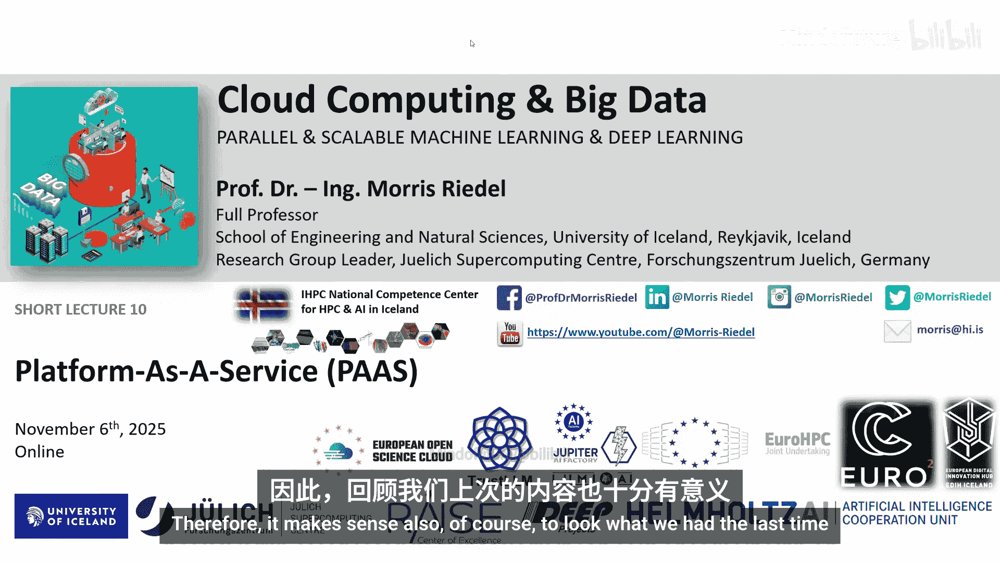

So before we diveed in this material of infrastructures。

 we also had a higher level view of this cloud service models。

 which is essentially today an inflation of everything as a service if you want。

 but there are three key terms in this course that you really need to know by heart and this is infrastructure as a service platform as a service and software as a service So this graphic here on the left hand side also shows you this quite nicely and you can interpret software as a service also application as a service of some kind because here we talking really when we talk from the top to the bottom about applications you're ready to basically swipe the credit card you you know can use the application and you know basically this could be enterprise resource planning financial applications it could be customer relationship management CRM tools like Zul。

Many of those that we will also explore in the next lecture obviously。And they， however。

 now often built。By cloud building blocks， or you would say， as if you remember。

 maybe in the first lecture， I introduced this interesting term Lego bricks， right so。

The platform gives you a lot of Lego bricks， and I think everybody's familiar with Lego， I guess。

 So in these different Lego bricks， you can build together to build your individual app。

 your individual software as a service application where you earn money with Hence we shift a bit the view when we go one step deeper to the platform as a service level what we will do today to review a little bit。

 What could be this core building blocks that you need for a cloud application It has a lot to do with data。

 I think that will be very obvious， right， you have to store data work' data an application without any data。

 No SQL SQL data stores。 we will talk about this is not obvious to you perhaps yet。

But you know an application which have no data at all is hardly possible。

 so hence today will be also a major footprint on databases， tables。

 also we look at the Google cloud with some that you maybe already know big table and so on and see how that relates and also to the web and so on。

However， the last infrastructure as a service lecture was in really thinking about the base and this constitutes really the hardware right so you can imagine this interesting flexible cloud that is hanging everywhere。

 you know everybody can use it somewhere in the net is somewhere a functionality is possible。

 yes but is rooted by some really hardware underneath so somewhere needs to be compute somewhere needs to be a real storage or networking。

And then you basically have this as a layer platform and we learned a little bit that of course the boundaries between them are not really。

 let's say very hard， you could consider some of these things and let us review a little bit what we had the last time on EC2 where you say。

 well EC2 the you know El compute cloud interface and service that is really offered by Amazon as an example。

 similar services R inMSs Asia and the Google Cloud。

 as you will reveal today these are basically the lowest level you can find。

 you can pick the service you need， you have done this now on many of the lectures， you know GPUs。

 CPUs， you pay the price for it。Then we had also the idea of S3 right so having basically a bucket store for data object storage as a discord。

 you know， you don't care exactly where it's stored。

 you don't care exactly if it's a file here and there。

 but you have a key value where you drop something in the bucket and you want to get out of it you know sub data and we talk about this a little bit more how this is also supported on the platform level but essentially you know this is something where it's underneath really a key basic service constitute your infrastructure However。

 the bucket storage again and when you look on the righthand side we said you know this is just one object storage is block storage you know as well and then this file storage。

 you could argue this is already you know on the platform level。

 the AWS storage platform as they say themselves right so it's really on the boundary of saying it's a lowle you know storage that we need but you know it's also enabling us already as sort of a platform to really drop。

Data is an object storage somewhere， maybe even with the Amazon Gacciier， if you remember。

 also long term storage in know very interesting pricing schemes。

So hence boundary between them is not really hard， but basically if you see the lecture today。

 the platform as a service will nicely collect with this and then you see also where you can draw a good boundary if you think and put more on the developer view while the infrastructures a services a lot of administration。

 administration of infrastructure， hardware provisioning where do you put which services in the really。

 let's say boil down manner to you know real computing using perhaps virtualization a lot。

This is something where you're on the infrastructure of service level as an administrator and we will change the you today to be much more a developer。

 so how do you do an app you know in the cloud that is scalable reusing this infrastructure as a service components and by this。

I just allude to what we said also with a mapreuce point， if you want to be developing apps based。

 you know on mapreuce， we will see that today。 or that materializes several partners you know。

 in industry using mapreuce on a daily basis implementing mapreuce tasks or the early developer phase。

 but you could choose in the infrastructure as a service level。

 Do you do basically the mapreuce cluster on your own in your own， let's say。

 seller somewhere in organization。And you know， using virtualization。

 then maybe a bit more and use already installed mapreduce appliances that are there that you can download and then create instances out of it。

 which makes a cluster management a bit you know easier。

 still remaining maybe with your own hardware， still using a lot virtualization。

 and then you could draw the line and maybe moving out already towards other organization and ask for a mappreduce hosting for you so you don't have the capital investment for hardware。

 you just let it host by someone else and use it。Obviously， this use maybe give you some costs。

 right？And when you then have a fully fledged service with a mapreuce as a service where you' were in have the whole stacks。

 you know basically we talked about also in lecture9 last time that you know Hadoop and the Hadoop distributed file system give race to a large ecosystem of open source software some of that you already know also connecting nicely to Apache Sp and the environment so hence this would be let's say moving from bare metal through virtualization more and more into the cloud level where you just the credit card get mapreduce as a service and many things are already implemented there。

So in a way， also， the idea of moving from infrastructure as a service more to platform as a service and then resume map produce as a service almost as a。

 you know， Sars， but， of course， more on the infrastructure perspective。

Hence today we connect nicely with this as a platform as a service and the best way to understand is is really putting on the view of a developer of clouds so a bit maybe away from an administrator of hardware and infrastructure here now we talk about more application development hence we will briefly discuss basically the different levels again but then quickly come to the idea that there are lots of legal bricks already implemented in cloud solutions so there's no point of starting an app for instance from the basics。

And everything from scratch， the same as machine learning if you want to have a machine learning app of some kind。

You basically have lots of Lego breaks which are already developed。

 And that's why we will look at the Google app engine as one example and pick some of these building blocks in the past level。

 right， It's a platform level that helps you developing。 Of course， there are very。

 very many of them。 I just pick here a few which really are very essential。 I think， for instance。

 no secret datas， key value stores， document stores and so on is a very important topic which should be in a university as well as a full course。

 right， So， and， and we can't do that really， But here we just go over Cassandra Hbase and a couple of those prominent examples which basically are not missed in in cloud developments today。

And， of course， with all of that， we have the scalability in mind。

 So why we move to the Google Cloud， we really want to scale up， maybe from  five users。

10 users to suddenly a million in a year。 Then you quickly leave the space。

Of doing this on your own in your own seller with a small server。

 Hence you have to have a professional monitoring， professional failure， management and so on。

 And this gives you all this cloud app development not only mentioning you know these errors and faults。

 also the typical versioning right an app has a life life cycle we will discuss this a little bit and of course。

 app development again would be a topic that it mean today you can have a full course on it。

 not just one lecture right so bear with me that this is only a short lecture。

 I show you some building blocks on the past level because it's important to understand。

 including some of the pricing models。To get the pointers that essentially today you just have everything almost implemented。

 you just have to put together the Lego bricks and add you a little bit of delta if you want a little bit of change。

 what is your unique selling proposition as an application maybe something like angry birds which we would you know reveal today but inherently all the computer science topic。

 how to store data， how to compute how to get graphics scalable to all this different million of users this is all solved in the cloud today and of course if you want to use it you have to pay the price for it but you can also incorporate this nicely in your app you know course that you have for your users to download so let's get started again very briefly because in a way we reviewed this already right when I reviewed lecture8 obviously lecture 9 sorry than we were on the infrastructure as a service level already talked about lots of virtualized IT resources on the boundary to。

Now basically PA is then the idea of really changing to the development the development view maybe also thinking about if you now look in the cloud app1 that you can here create on the righthand side that you have lots of let's say building blocks ready for building your own applications as we discussed and just to make the disclaimer that this is not only true for the Google app engine。

 you have also lots of building blocks in Amazon again and also in Amazon Asia and other cloud providers right we focus here perhaps a little bit on the Google app engine being quite strong with it and also having lots of development support。

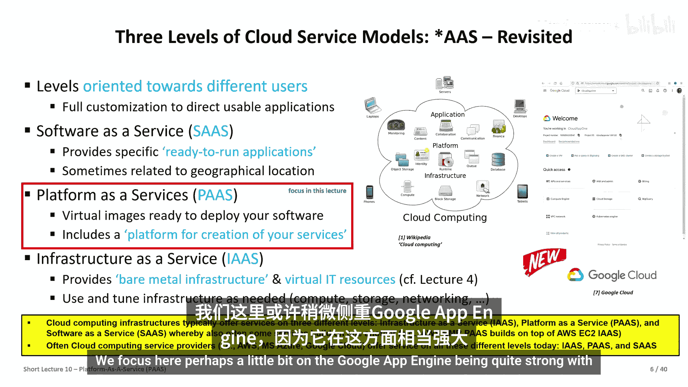

But， of course， you can also implement this in other cloud vendors。So let's review this a little bit。

 you know， when we look on the past level， you can see this here quite nicely when you have the overview what's inherently in the past is usually some sort of access to infrastructure right so service storages。

And the networking and of course let's say really physical computing somewhere。

 but the emphasis is much more broad of saying we need to operate all of this and we need lots of development tools。

 database management of top of the pure storage business analytics machine learning algorithms and so on before you come even to your complete hosted application apps that you basically development with past so we'll see many software development kits on that level of pass right application programming interfaces rest APIs you will work with and of course you can do this here and there was your favorite languages you have Java you basically Python Ruby you know and so on and so on so has lots of broad let's say development support that goes with a platform as a service level and basically also lots of data management that goes alongside it and just to give you an example which probably everybody of you know is Spotify。

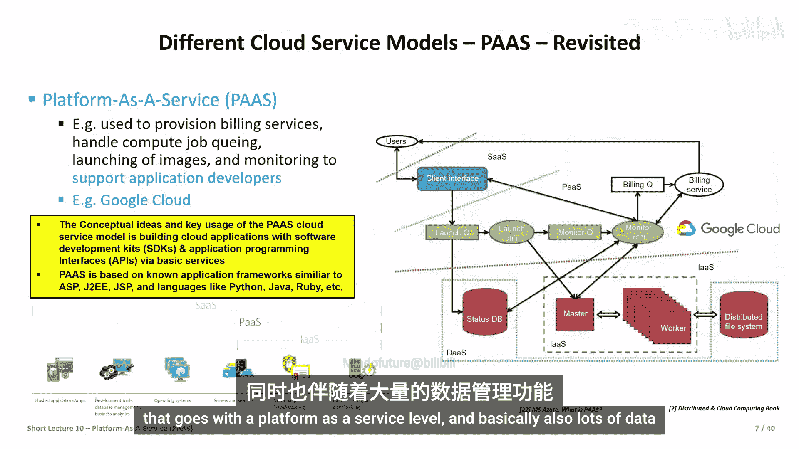

As an app that probably almost half of the course， if not more are using today is fueled by this kind of idea of having the cloud services building up。

 you know with Google Cloud versus different legal pieces。

 a service that is really scalable has huge volumes of content in Amazon S3 on the infrastructure level right but if you know。

Spotify is also a very good user interface and moved really from a startup company right so this was really a small company in the beginning and then now it has basically over and over more and more licensed songs that you can actually use so。

This is a very good example that， you know， basically the idea here of。

 you know having Spotify as a service is brilliant。

 but the overall idea of scaling to many different users right is basically by leveraging also other cloud vendors so' elastic mapre from AWS group in Spar you know this is also by Airbnb used in Spotify applications to access these maybe not really directly just limited to one cloud provider right we have to Google Cloud here with Spotify users。

 but also for some of the different services， AWS services are needed。

 So you can mix this nicely having also of course， as As available rest interfaces and and this goes into the domain of software engineering and so for people that want to be platform developers。

 app developers here I have to say you have to also of course go through proper cores in software engineering particularly on app engineering。

But always think about that the most building blocks are already there in the cloud providers to make it scalable and you have I think very good examples here of the Google Cloud in general。

 also IkeA retailers using Google a lot and you name it。

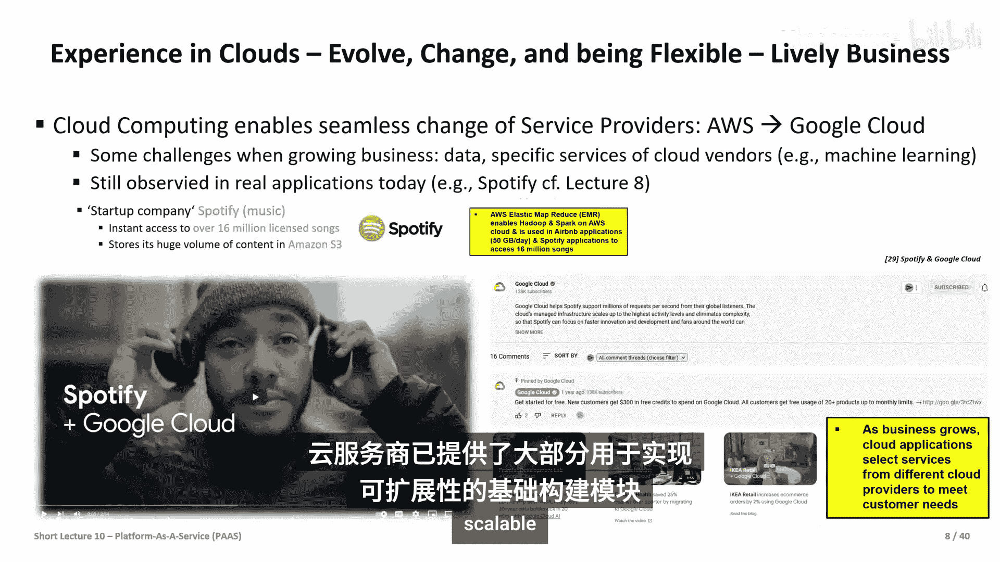

No。Obviously， down when you look in the Google cloud you have down on the basics， again。

 the infrastructure is a service level， right to connect it nicely what we had already。

 basically in another lecture last time where we said， okay， we focus a bit on AWS， of course。

 Google Cloud has also VM instances right that you put it on different， let's say CPUs。

 Here's an example of a very unique TU Tens of processing unit。

 which is basically then a very very unique idea of Google， but you have also， of course。

 typical GPUs and so on。 And you see also there's a hourly price。

 usually on all of these different let's say tools。

And this would be very similar now you have a VM instance when you create your cloud app one。

 you see everything is a bit oriented in this development engine here from Google Cloud to this app development where you then have you know the whole idea。

Of using also the infrastructure as a service in a scalable fashion underneath。

So in this in this way， you actually have this kind of idea to support the development life cycle。

 right， So， I mean， firstly， you have the app engine that you build， you test， you deploy your apps。

 you know， let it be angry birds or maybe Philips lightning or other games， whatever you want to do。

 You want to upgrade this。 You have a better version， you know， better data and so on。

And you develop this locally。 But as soon as you want to scale up， you know。

 doing basically up development all over the world。

 which you see is also quite nicely supported by the app engine here。

 you have to go to a professional cloud provider like the Google Cloud， for instance。

 it has lots of scalable infrastructures or service resources for you at hand。

 Also on the data side to， you know， for instance， basically accumulate lots of big data。

 what can be done when you have more， more users， for instance， or you have more， more levels。

 more and more game， now franchises， you know， Greek B is not just one game anymore more。

 there are many games of it。 So in a way。This is the idea of the whole development lifecycle scale to your users and without them noticing。

 of course， that suddenly you know your capacity is going to an end。

 then you use a cloud to expand on the infrastructure as a service level as I meant here。

But of course， today ideas a little bit on this lecture here to think more about the Lego breaks here。

 So when we have this lifecycle and we have already the infrastructure given to us the app engine and the whole lifecycle process that you can support which is Google app engine is then also including this Lego breaks that you need to build this apps that we will review now a couple of those but also the whole idea of new versioning monitoring the traffic right So how is your basically game used or how is the app used the version control。

 new versions coming online So all of that is beautiful supported and of course inherently highly scalable because it's basically managed via the infrastructure as a service that you have also in the Google Cloud。

And。You can really scale up， I think we have discussed this is also one of the selling propositions of the app engine and there's lots of information if you want on the Google Cloud you know app Engine webage and for those that are really into app development I encourage you to go there there's also actually some quite free credits if you want to play around and you know have you know first maybe small apps developed。

And。Just to give you more examples and motivations why you should do this is maybe here some of these kind of you know examples that you see on the right hand side。

 right so。You know， IT overheads that you usually have and you know。

 basically by storing your own storages， by stor bring your own computer connected to the storages and then compute the levels in the apps or whatever you do。

 you can cut a lot of costs。You know， because usually you have also some maintenance of people right so you have some administrators that have to have the infrastructure right you need to have some software experts to maybe deploy mapreuce to work on the different versions and you have some people that have to know something about storage and how to scale up you see also here scales to more than 30 terabyte without performance issues So this is is already some remark right so 30 terabytes is not 30 gigabytes。

As you know you can see clearly so that bes in other words you need already quite some good infrastructure to manage 30 terabytes right that's not totally obvious to do with a little hard drive somewhere that you can buy at Alco here or so so hence all of this would be of course giving you a good custom experience because that's what you want to achieve right because then the people will download the app they will write rate the app good so that other users are more likely to download the app。

And。By doing so， you're really automatically scaling to millions of users instead of doing your own app development somewhere without conserving。

 you know basically the cloud offerings。Of course needless to say I always say the disclaimer there is a cost to it right that you have to incorporate maybe in your pricing model from the app but you are on the safe side when it comes to different let's say versioning and so on that we have discussed but also then the scalable user experience and here you see nicely when you have a mobile backend for some game it does not important which one you have this building blocks I was alluding to these are the initial building blocks and legal pieces you want to have。

 you need a game map you need a game server so what does it mean you can use app engine and the specific you know data approach called MeCash and data store。

And then。Another handling of a firebase and that all the operations that you have here of cloud monitoring。

 cloud logging， error reporting， tracing what's happening with the whole operations alongside go also into the idea of creating and understanding how basically your game is used。

And then you have different building blocks of really working with the data processing the analysis now what's happening essentially with the app and have some tools we also will review like BigQury and so on and so on publish subscribe mechanisms to also understand then how you basically let's say no matter what the game is you always need these kind of building blocks right so these are LeO pieces。

That usually the user don't see right but will experience in a scalable fashion because we always will monitor we will see where we're running out of capacity very early。

 let's add automatic storage this night 2 o'clock at night so that we have still a lot of you know data storage capacity to have 500 or more user。

So。As this is of course a point in it it's not only scalable it's also many things are automated right so you don't have to deal with it and stay up at2 o'clock at night and see oh my God my storage is running out for this particular app maybe we want to add something so you can have policies in place and more storage is added it but of course you pay the price rate。

And this is also important to review this pricing options。 I mean。

 there are several different building blocks。 Again， we cannot focus on all of them。

 There are so many here， some of them， When you think about the networking， for instance， you have。

Essentially here the point that but we discussed with AWS as well。

 so maybe incoming network traffic is free， but you know migrating then to another cloud provider。

You know， having， you know， basically the data somewhere else。

 this free storage or basically free cost of transferring this offers you of course。

 the easy porting to the Google Cloud， but if you want to do all your data out。

 you have to have 12 cents right basically discouraging you again of getting the data out。

So these are examples where you have to be sometimes careful if you。

 let's say pick Google Cloud in beginning， then suddenly you want to port everything to AWS。

 all your data， all your elements and so on。Then if you think about you know specific services and I mean one thing you connect with Google is hopefully search right so there are lots of strong search services。

 legal building blocks right that we basically can use and integrate in the app again for searching within your own application or giving this opportunity to users to search in their own app。

This is already basically available with different queries with different APIs， as you see here。

 But there you go， right， if you want to perform highper search API in your app。

 you basically have then $2。 So again， this Lego blocks。

 what I want to give you here as a example is of course， that you have basically， of course。

 no cost for the upfront let's say storage you have no cost for developing a search API that is strong。

 but of course， using that comes here and there was a price。

 And these prices don't seem much in the moment $2 or here $12 cents for transfer think about that your app is running 247 and prices can accumulate。

 so be careful on that as well。So。Let us go to popular modern past building blocks。

 and some of them indirectly， I noted already。 I mean， we had， you know。

 basically big table and so on。 But also one of the elements here I wanted to bring across in this short lecture today is a nosQl databases。

As you know Le building blocks again， so these are incredibly often used mostly also because they have a let's say。

 you know a high read performance right so they are less on writings or if you want they have less constrained consistency models if you want to write to a SQL database you know you can do this but they are usually lots of checks in place you know basically in the SQL database which makes it here and they're a bit slow but here we are really with is column data stores no SQL database space interested in lots of read only operations maybe levels right that you have level data you don't want to influence the level the level is loaded for every different you know user of the game so there's lots of this is you know basically just read oriented and this enables us really increasing latency and good throughput instead of using traditional SQL databases。

However。This gives me the opportunity to also say， of course。

 you know structured query language databases are still needed right but you know not maybe for every app development So of course here it's again a kind of building block that is you know required by few and here should be nothing saying that SQl data stores are not needed anymore of course I bring you an example here was Philips I mean many of you know this Philips Hugh。

 I think this kind of idea of Philips lightning with apps very much improving your home experience with lots of lightning products which are nicely managed by apps right you can turn the intensity down even the colors change and so on and this is actually based for instance。

 here has a good example on no secret based Google Cloud data stores which are highperant and。

For Philips， of course， the benefit is that you know they serve this in a very scaleable fashion this is an example of a number it's probably much more these days。

 200 million transactions per day of users want to have their own experience better。

And of course it also enables Philips to say if you use Google Cloud， as I said to you before。

 they don't have their own IT infrastructure anymore， they're engineers working on it。

 so many of these people can be rather focusing on the real product development and Philips giving of course。

 and the interesting you advancements that you see also this Philips in this particular area。

 if you know go shopping somewhere， and maybe perhaps again Alco somewhere。

 then of course you see lots of lots of these products and they're more critical used。Behind it is。

The idea of the back end and you never know how many people use a lightning at what time at the day。

 you know， internationally， so this is also something where you need a backend for Phils that is really scaling instantly for whatever reason sometimes at some point in the world there could be lots of people suddenly needing you know this Phils and big peaks of usage。

And so you see here processing 25 million remote lightning commands per day。

You know and and you see some other benefits here where you know。

 10 times the scale of other similar projects and then not only this is one10th of the workforce right if they maybe run the platform themselves so there are big benefits in this and using it。

And， obviously。The usage experience of the users is key and if you manage as well。

 then of course more and more people will buy it， like we have seen probably here in Phils。

 but we also see it with angry birds that this game became so popular as not because it's so boring to play and has always issues because it was always interesting to see the initial games scaling up very nicely no problems in using significantly and so unlike maybe other games that didn't use much cloud features。

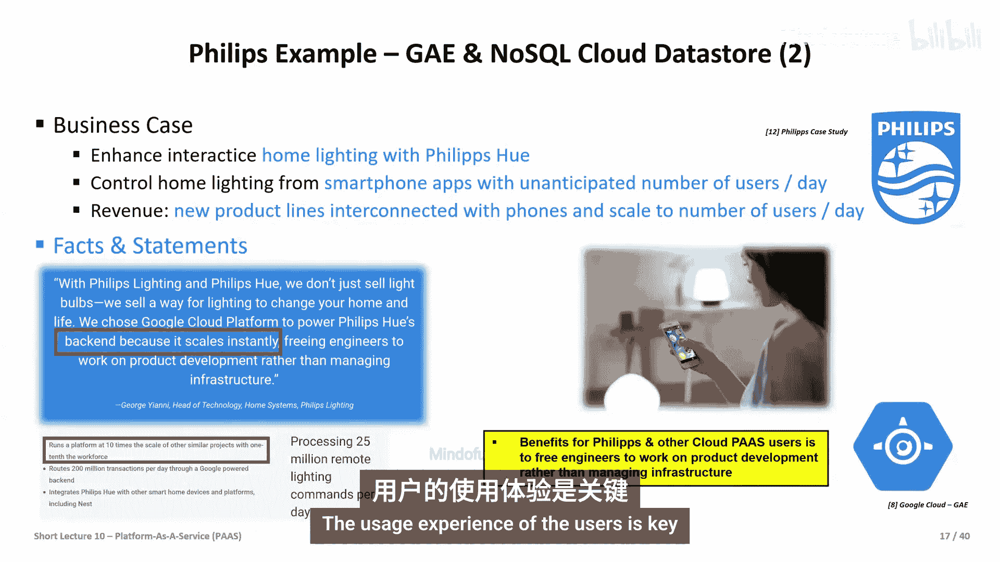

So from the NosQl features a little bit again it should fill basically a whole course in the university。

 you can have much more easy application development with it you have no big schemas an SQL you start usually with a schema you know name sure name telephone number of users etc etc here you have rather a kind of key value idea right and you have different basically ideas how you would name this where you would have in a cloud data store maybe some category of an object what you would say would be a table one object would be then one row within the table and a relational database and then for each of the objects and the data of from object you have a field in the row and you know some unique ID would be the idea of the user or so or Kennyital and Iceland primary key。

And。This is something where you know the cloud data store is a little bit doing similar things obviously it's still a database but it has basically not this kind of you know string or let's say this interesting schemas and then also this store procedures triggers that you can have in SQL so it's a different way how relationship are described in a way and you some examples in a moment and this enables you really then scaling up and scaling down and here's a good example of you know a typical user you know where you would say okay in a SQL database I have always a key always email always the ID but you see that users for instance when you see Facebook right it's a good example users give you different information some people are just having the email some are very openminded giving you know first name last name all the different let's say phone number information so。

Hence， the information collection is coming again， like you see here， not only very distributed。

 also very different。And the elements we have seen before in one of the slides that you connect now to it are these NosQl databases that gave rise to you know the Firebase that we have seen。

 which is a no secret cloud data store you know for really being active in real time so that you have real time analytics what's happening then you know Firestone is optimized as a legalgo block really for mobile and web application data and et cetera。

 etc ce， so Cloud big tablevers of course， something which is also widely known。

 no Se white column database and the column database we will review shortly。And， of course， still。

 again， think about cloud SQl is still there， right， My SQl server， Postrus SQl。

 This is also used in applications here。 I don't want to speak against that。

 I was just saying for some of the application developments and no SQl stores are much better in performance。

So。Maybe start a little bit with Cloud big table， which is quite known and was also one of the services that made it say。

Google a little bit you know prominent because it can really scale to petabytes of data right it's a little bit similar with the idea of Hadoop distributed filesson system。

 you know putting a Google file system close to it。

 but underneath is really you know it has many similar elements of traditional database of course。

 but it's more stringbased approach that we have seen before with a users a little bit in the kind of soal idea how you know this database is looking like with a name。

 phone numbers and so on。And here you see some， you know again benefit why you would do this right so you can see new data relationships and insights you know basically it's performance still with 30 years of news data that you can really quickly access again think about read only SQL is really driven also by write and think okay SQL we need the field phone number always so we have a check on it if there's this field field in the big table you wouldn't care necessarily and would say okay there's not this kind of thing。

So， hence。This is a real big Lego block which you can do many different things in app development and here's an example。

 but we had it also before， where you can have， let's say machine learning for finance application where you put again this different Lego bricks I talked to you before。

 together that are offered， let's say by the Google app Engine。

And the streaming of the financial information and you know time series processing was a so-called data flow service need to be stored somewhere where then Cloud Big table can be there。

 but then from there it's a sort of platform where you can do now many different things right you can do the processing with dataproc if you remember this where the world of Apacheia dos。

 sparks and so on you can do traditional data analysis。

 you know summary statistics and so on or you do cutting edge machine learning with the AI platform so these are all different areas where you can you know basically use this different NosQL stores。

 but they also of course queries or typically cloud data storage where you can do different things。

With in， in the application space。 and they all have their， you know， unique selling proposition。

 So let's go briefly quickly through this come to this different stores。 And。

 and by now you a little bit see this here when you have the contents。

 which are sort of the key then and an anchor from the site。

 basically looking backwards on a domain name。You can have a reversed U in a way also for storing web pages。

 but was done essentially by Google also for the quick search that you remember， right。

 was Google was once a beta service and didn't have many server。 It was just a search engine。

 So many of the concepts and on wererising from that。 And when we now compare this。

I mean we have done this already you see basically some overview we're really good for structured data you really remain for SQL databases。

 but in you know many of the apps that you developed there's really unstructured data a lot these days and weboriented data think about Facebook。

 social media platforms all different data some people post a lot some people read a lot so basically different ways how you use these and this is nicely supported。

And some of them you know are very much known probably to you， they're different varieties of them。

 one is a column based approach from HBase， for instance。

 or Mongo to be culture to be on document based， they all have the same idea of not tracking maybe all the different information exactly as a schema。

And you know， if key value based services may be used with Apache Cassandra。

 where you use some JS notations here and there or graph based approaches with Neo4j。

 just saying that the old approach of doing everything always with SQL is today not anymore more。

 you know necessary and also not used in you know， highper application。

Especially for those that scale to big data and you know basically are accessible of the web。

So when you see this conceptually like HBase， for instance。

 we have touched on this before in Apache Spark a little bit。

 you see from the conceptual point of view， you still have sort of a typical database view of a table you know。

 but there are lots of empty fields because the physical view basically says that the empty fields are not really stored like in a relational database right so in H basease you would rather see it like this so these fields that you see here are not really stored you have row keys both of them。

But sometimes the column family and column family anchor and contents will be basically stored differently so that you save the space。

 you save essentially the whole idea with this， however， you see that not every， you know。

 element in the table has an all the information， which makes it differently。For MongoDbi。

 you know the F this ja and I was alluding to a very simple notation how you do now basically let's say the data right you see also that the data can have different information right someone is in level5。

 some other has a phone number so the you have different types of documents that you can easily link to each other following let's say the JayS notation。

And this is something what usually in one01 computer science has shown this object notation。

 so I don't go much into detail in this， but you see that you know。

 this is nice how you can specify certain documents what they should entail what field they have。

And also know youre very quick， you know， creating of documents that are not so much， let's say。

 a strict like a schema you would have in the SQL world。Then you know when you have Apache Cassandra。

Another type of database it's more key valuebased example which is used by very many you know applications we will move through a little bit then you have this primary keys says hash values。

 but the interesting thing is it's already also distributed by design you see you can nicely roll that out through different it's say nodes right this different users maybe use information again demonstrating one idea which is also not so easy SQL databases to do to roll them out right to really go to a geographically distributed idea of maybe also having different nodes in different countries depending on user experiences and so on and so on。

So I want to summarize a bit because it's just a short lecture we usually would have much more time for it and for all of those that want to do this and want to learn more there's also a full version of the past lecture from last year on YouTube if you want this year we had to do it bit shorter because of a large industry project but you see you cut the coding time you have lots of development capabilities out of the box including the whole life cycle support machine learning it's all automated adding more storage。

 reducing storage to cut costs。You can do this on multiple platforms。

 usually we didn't discuss that yet。 so iPhone， you know， is there。

 but also many other providers of you know， phones today where you maybe have also some idea of managing your app that acrosses different platforms。

 maybe even including websites。And they're basically quite affordable because you have this pay as you go more can you know scale up。

 scale down to your needs and have also sophisticated tools that maybe can also give you more incentives to learn something about your users。

 how they play the game， for instance， to also let's say， alter your game into certain directions。

 making it even more popular。You can also geographically distribute often your development teams so it is all in the cloud as well to build it this software development kits here。

 for instance。We will talk a little bit about in E 13。

 how this is more supports with Kublet Kubernetes， containers， right。

 how you build then apps and so on， But the developer tools you see here are quite strong you know。

 from everything you need， essentially as a cloud developer。

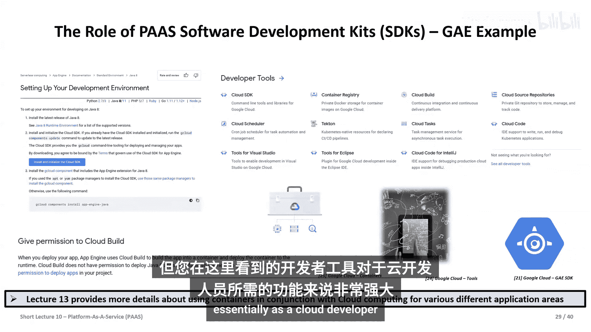

嗯。Just some other examples maybe here or you know Google Cloud examples how these different systems are used again。

 we had this you know data proc already in some of the earlier lectures with Apache Spark Apache Hadoop you know now both how they work very geographically distributed and you see that Vophone group for instance here you see an example with 600 on premises Hadoop service to the cloud so they had their own cloud in Vofo 600 on premises Hadoop service but it was more cost effective for them to go to the Google Cloud and you know you see basically 226 models running in production daily。

And to rollout to Doodle took them just basically two months right and theirre scalable Twitter is an old example。

 you know which' now called X， but also there you have examples how they now use basically moved from their on premises Hadoop so their own installation to the Google Cloud and also as cutting costs and having excess of course to many different services which is also a very key thing I promise you the example of angryry birds which I think by now I quoted often and it's very obvious here as an example that you know basically after the launch that you know this was a skyrocket application they did a football game before and it didn't work so you never know right if your game is really skyrocket didnt and you know by now everybody knows here I think in the course that angryry birdsds is extremely you know successful。

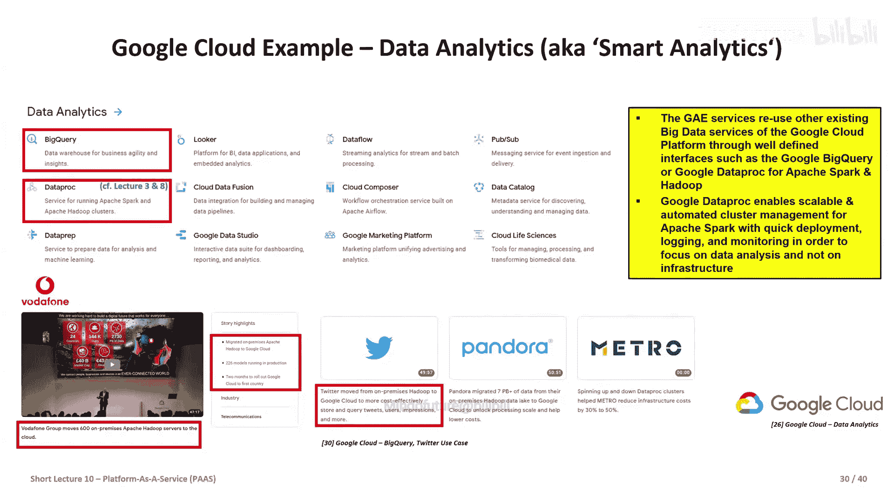

As one of Google's place best games basically and with this was more you know basically advertised and by now we have movies。

 we have different apps right and this is all basically because they directly moved onto the Google Cloud had the chance of scaling up to 140 million downloads right very quickly。

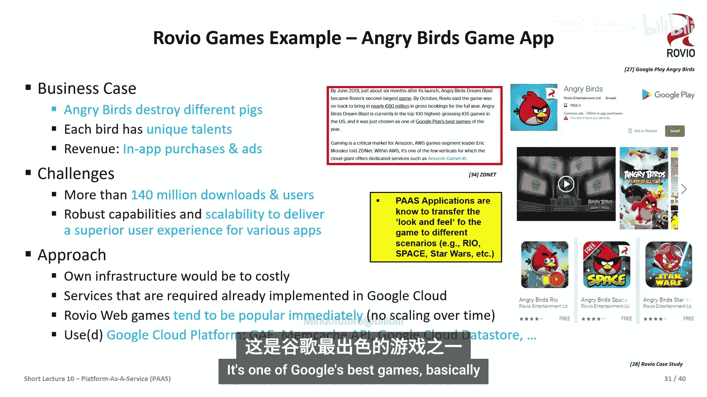

And and this is of course， something where you have more revenue channels in app purchases now。

 even increasing your revenue and if you look behind the scenes MAmCsh API was for instance used to provide temporary I speed data access。

 you know this is something what you always need if you do angry birds you will know you shoot you know the birds through the level。

And it's all basically distributed as well and you have you many different aspects which makes it quite nice to use a mamCash right where you think again and again the levels that you have in this apps there will be things coming again and again and temporary values your yes。

 no and so on because many of these things go down how this app is played but you see that instead of creating their own software they just use the Google app engine and the MAcsh services and that couldn't go on and go on and unfortunately the lecture time is already almost at the end。

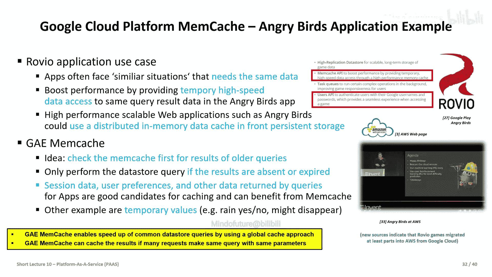

I just wanted to make the point and connect to some of the earlier lectures。

 natural language processing， you know， also the realm of large language models is now there。

 you can bring them in like for instance， for sentiment analysis in your rep。

 or for other you know analysis of data， very easily having other legal bits and pieces that you see here text to speech。

 cloud translation， cloud natural language speech to text services。

 all of that is already there as legalgo breaks， you just have to bring it to your own application。

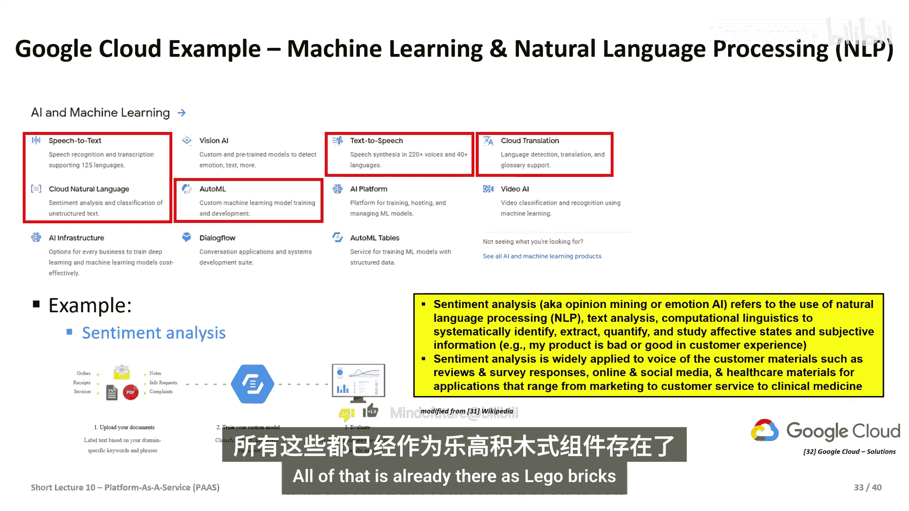

And with this I'm also closing here because in the end I could sell you much more past services。

 but I think you can look them up your own at the different cloud vendors just here I would recommend you this video wave because it nicely summarizes some of the past advantages if you know you know go to the job world。

 you have a job as a that developer always thinking about maybe there's something in the cloud for you bet us not if it's a Google Cloud or other clouds。

 but you know this video gives you quite quite good positive benefits。

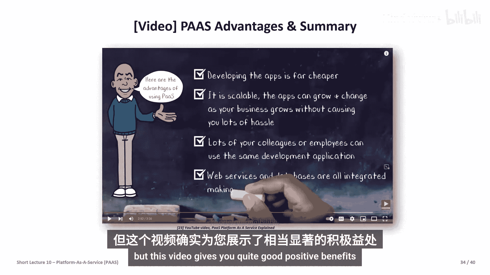

Be close， then also with see platform as a service level today。

 but we'll also continue next time with the stock as a service level at the next level。

 talk to you then。

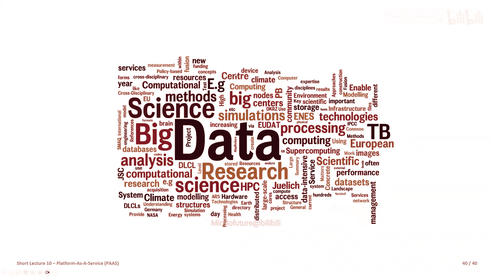