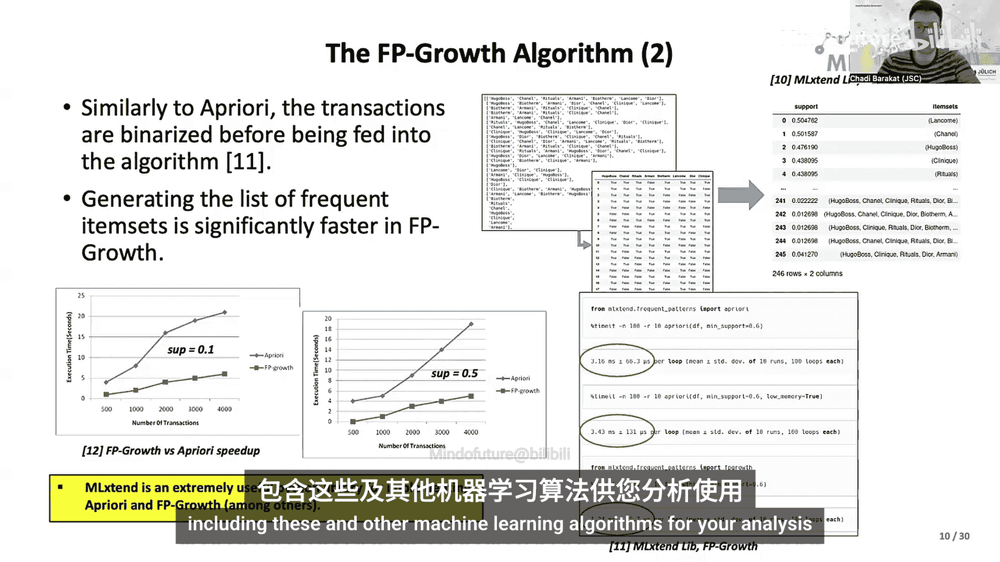
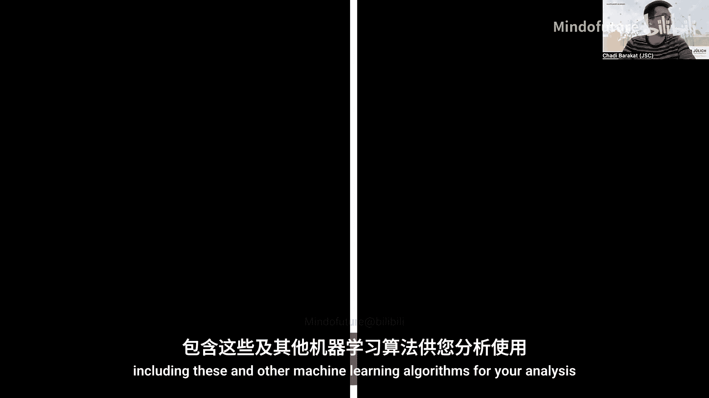
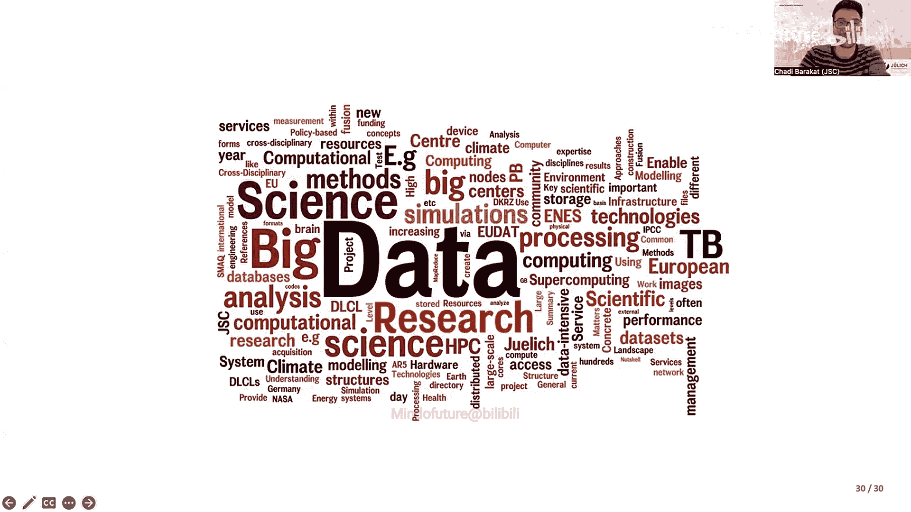

# 【冰岛大学】云计算与大数据-｜-2025-Cloud-Computing-And-Big-Data-Course-p17-P17_讲座_12_大数据分析_云数据挖掘--BV14MB4BjEyZ_p17-

不。Hi everyone， my name is Shadi Vaakt and I'm one of Morris's postdocs currently working at the Uli supercomputing Center in Germany。

I will be giving this lecture of the cloud computing and Big Data course， lecture 12。

 which concerns big data analytics and cloud data mining。So a short background on me。

 I did my PhD at the University of Iceland in bioioengineering and I completed that PhD in 2023。

And after that， I've been working。With Morris as part of his research group。

 my specific field is in applications of AI and machine learning with high performance computing in healthcare。

And yeah， so I'm going to talk a bit about my experience here， not specifics。

 but mostly about the algorithms that I used and the approaches that I employed in my research。

And without further ado， I'm just going to go ahead with the presentation。So in the previous lecture。

 you learned about software as a service， which is provided by many providers online， for example。

 Amazon， Web services， Google， cloud services and the Microsoft this year and all of these will come in handy the research that you do further on or actually currently in your studies right now。

AndThese services。Are multifaceted， but we are going to talk specifically today about applications of machine learning to deal with the data that you have。

So。Big data analytics and cloud data mining is the topic of this lecture。

And specifically I'm going to talk about two different aspects。

 the first one is association rule mining and big data and then after that after going into the details of that I'm going to talk about data mining and deep learning for healthcare。

 which is specifically the application that I did for my PhHD。So。What is associations rulelining？

If you consider your shopping habits， mostly the things that you buy regularly together。

Have an association rule。Liinking them together so that's something that web shops online retailers regularly have Amazon is a big example of that you should see it as people who buy this regularly also buy something else and you get recommendations based on that these are based on some association rules that were built。

Based on people's purchasing habits， yours included。

 and that means that these retailers are sitting on a large amount of data of what everyone else has been buying and based on these regular purchases。

 there is a buildup of something that in the research field is called frequent item sets。

And these item sets are used to develop association rules where one item is regularly associated with another。

We'll talk about in the next slide how these are built。

 but specifically it association rule mining is an unsupervised machine learning method where the researcher or the computer scientist implementing it does not necessarily get involved in how these are built。

 they only guide the parameters of how this algorithm is being set up。

Several examples of these algorithms exist and in this lecture， we're talking about two of them。

 the app priori and the FP growth algorithms。So one famous example of association rule mining is the supermarket。

Baskkeet transactions。 So these are a set of examples from the supermarket。

 And you can see that there's like people buying bread and milk， diapers， beer， cola。

Random stuff that people buy at the supermarket usually。

 but something that immediately stands out is that people who buy diapers also buy beer this happens regularly enough to the point where there is a frequent item set this appears frequently hence the name。

From this frequent item set， we can immediately define that diapers are associated with beer and at first glance that doesn't make sense。

 but if you consider people who would otherwise go out to party。

 suddenly they have kids and they need to feed those kids at home。They can't go out， so hey。

 we might as well buy the beer and drink it at home。Hence， this association room。AndThis。

Famous example illustrates that there are rules governing the purchases that people buy。

 and we can extract these from using algorithms from the data that。A lot of retailers are sitting on。

This gets more challenging the more data that you have， for example。

 online retailers that don't deal on a local scale but rather on a global scale and with billions of transactions every day。

 millions of transactions every day， this gets complicated because then you have to sift through them。

An entire team of researchers working 24 hours a day for thousands of years will not be able to extract all of the information that can be extracted。

Hence， we need to implement algorithms， we need to use large scale computing to be able to do that。

Automation solves this issue and efficient rule mining algorithms also help with that。就。

This is where the ari algorithm comes into play。A priori is one of the most commonly used algorithms for association rule mining。

 what it does is that it iteratively builds these frequent item sets by scanning through the list of transactions。

On multiple occasion and that specific part of the algorithm is going to come back later on as we talk about efficiency。

But what initially happens is that the researcher sets a minimum support value。

 which is a threshold beyond which you can claim that this is a frequent item set or not。

So the first and during the first pass we look at all of the individual items and see how often they appear in the list。

 if they appear a number of times more than the minimum support that we set。

 we keep them and if not we just strike them out of the equation。On a second pass。

 we look at every at every two individual items and see if they if they cross this minimum support and here since the minimum support is。

Three only these items are excluded， the beer and bread combination and beer and milk combination are excluded because they do not have the minimum support and then we're left with beer diapers and milk。

So the combination of bread， milk and diapers。Is a combination that has exceeded the minimum support and that is then a frequent item set and a priority does that。

Regularly on iteratively， until it reaches a number of combinations that cannot exceed the minimum support。

 and that would be the maximum size of the item set that it can build。

So these frequent item sets are used then to build a。Association rules and。

From running through the data regularly on a small data set， that's feasible。

 that's something that you can do locally， but when the data gets large with， for example。

Billions of transactions with millions of items， then you have a problem if you have to go through them every single through every single item with every single iteration。

Millions or billionions of times that's going to cause a bottleneck in your data。

 cause a bottleneck in your computing and from what you've seen in the software as a service lecture。

 this costs money。Which is why researchers developed an alternative method。

 which is the FP growth algorithm， so FP growth。Is defined as the frequent pattern growth。

As defined here， this algorithm instead of doing multiple passes through the data only does two passes。

So on the first pass it identifies all of the individual items in the data and on the second pass it starts building this。

Frequent pattern three that you can see here on the right side。

Where every individual relationship is immediately highlighted and made visible and based on that you can immediately draw item sets and for minimum support。

 you can immediately cut off or trim the parts that do not reach this minimum support you can see it here at C equal one or if you're cutting off at minimum support of two。

 this would be the cutoff line。But you can see that one like a frequent item set would be A， B。

 and C。So what FP growth here helps with is that it immediately identifies the item sets。

 they are immediately apparent in the data in this graph that you see here。

 and it saves on a lot of resources and a lot of data analytics。

This aspect is highlighted in this slide here， where you can see that implementing a priori on the same data set with the basic a priori。

which you can see here in this implementation， a priorotic with low memory and then FP growth。

 you can see that in these cases it took 3。4 milliseconds or 3。

10 milliseconds to do this loop 100 times， whereas for FP growth， it took 1。24 milliseconds。

This is not much of an improvement， at least this is half the time in such a small data set。

 but when the data gets large， this growth is a lot smoother。

This you can see also here based on the number of transactions， how it increases。

 FP growth grows at a much lower rate than a。To implement these methods。

 we used MLX10 which is a library which is a Python library。

 including these and other machine learning algorithms for your analysis。

Examples of this on the cloud services， you can see here on the IBM Cloud pack for data that a priori is already implemented。

As an association rules note。All of these services are available on the cloud computing services。

 all of these algorithms and you can implement them directly from the cloud so you don't have to install anything on your side you can directly do it on the cloud services but again this requires that you know exactly what you need to do and know how to do it and which algorithm to use and。

To be efficient with the resources that you have， otherwise you're going to exceed your budget very fast。

Here is another example of this implementation in Microsoft Azure and using the MLlib for FPG。Okay。

Now， let's move on to the next part of the lecture。

 which involves data mining and deep learning for healthcare。

So deep learning has shaped the world that we live in right now。

 it has many different applications in the cloud and it's usually not these applications are not usually user facing。

But it is used for mining image databases to generate labels for products。

 it's used for improving natural language processing by learning from open access literature and it's used for enrich databases to improve search and recommendations。

I included here the example of Google's recapture， which is used to identify that people are people on the internet and not bots。

 but in the background what it's actually doing is that it's asking you the user to identify images that will later be used to improve Google services。

So you click on these images where that contain crosswalks， for example this one， this one。

 this one and this one， and what happens is that on the database of these Google Street view images。

 these are labeled as images involving crosswalks so when they're fed into the the training material for the Waymo which is which is。

诶。Autom automatedomated driving company owned by Google they already have a labeled data set。

 so they kind of like offloaded their data analysis work to users at the same time it's serving another purpose of making sure that this is a user and not a bot。

All of this recognition is based on。Deep learning and specifically convolutional neural networks。

 which is described here on the lower side in this flowchar and you can see that every individual image is broken down into its individual channels。

 red green and blue， for example， and then it is fed through different convolutional layers that break it down and then try to find relationships between the different layers while also relationship between different。

Pixels。And is broken down further and abstracted further until at the end it is passed through。

Fully connected layers。To identify the individual classes， for example， if this is a car， a truck。

 a van or a bicycle， this is a dummy example here， but all of this information is then fed into the cloud databases and then used for learning purposes。

This is technically a refresher on previous lectures about the difference between shallow learning and deep learning。

 but mostly deep learning specifically requires models that have more than three layers。

Of abstraction， so three layers of convolutional neurons or or other types of layers。

But these deep networks， the deeper they are， the more complex they are。

 and the more parameters they are， and the more resources they require to perform the analysis。

But also the deeper they are， the more likely they are to have better results。嗯。With that in mind。

 let's talk about the process of implementing a neural network or machine learning algorithm to your data。

So in my research， for example， we have to work with medical images and these images。

Are usually for example， a radiology technician would look at the image and immediately detect what's wrong with it or how one image is different from the other。

 but the average person does not at the same time there is a limit to how many images a technician can look at and identify per day before they reach something called the sation limit or the。

And。There was a specific name for it。 I forgot it right now。

 but I think the decision fatigue is the word in these cases。

 it's difficult to diagnose quickly or or it gets difficult to diagnose after a certain amount of。

Analysis， which is where algorithms can can help。 The problem is that the algorithms don't know what they're looking for。

 So you need to have some images labeled by an individual and over a certain amount of time。

 you can collect a large amount of images that can be used for training and then these images are used to train a neural network。

To look at the specific thing that is wrong， to give it well those are labeled data that can be used to train a model and later on that model we judge if it's trained properly or not and then people can implement it into the real world。

This has， like I mentioned and within Waymo that's already been implemented for object recognition in autonomous vehicles but。

This all requires that you understand the problem that you're trying to solve。

 you understand what data that you have， and then you're willing to iterate on this process over and over and over again。

 because what you understand about the problem changes based on what you know about the solutions that you have and the data that you have。

This is going to be mentioned later as we describe the CRPDN process。

 the industry standard for data mining and data manipulation。But this is an independent。

This is a very necessary part of the research process or the problem solving process in our field。

So these CNNNs that we talked about earlier have been used in many different problems and they have solved many problems。

 for example， ever since the introduction of CNNNs， the ILSVRC。

Problem which is a yearly competition for object recognition in images has been only has only been won by CNN since their introduction and there has only been iteration on what CNNs can do so in 2015 this task was won by the residual networks which broke the threshold that CNNs could not could not break what they do is mostly introduced a residual connection which bypasses individual layers when these layers get tired between quotation marks what we mean by tired is that sometimes these networks hit something called an explod gradient or a disappear gradient where all of the layer goes to zero or infinity and just doesn't recognize images anymore。

What the residual connections do is that they bypass this and they feed the original image back into the model at different steps of the process。

To the point where there is still some value reaching the end， which is the classification there。嗯。

These are in this example specifically， these models are trained on the 1000 classes of the IageNe database where it's a database of animals。

 objects， images of plants and shapes and different breeds of dogs， for example。

And since then this has also been overtaken， these models have also been overtaken by the vision transformers which build on the transformer infrastructure developed by Vaswa at Al for natural language processing。

But before we get to talk about the transformers， you have to consider that the only way we researchers manage to develop this residual network is by iterating over what has already been done in the CNNNs and the only way CNNs were developed was by understanding how neural networks originally worked and how that can be changed to or adapted to the current problem。

So again， the idea of understanding the problem， understanding the solutions that you have。

 and then changing the problem or further adapting the problem to your solutions or further adapting your solutions to the problem that you have。

This is the iterative process of slowly getting to a proper solution that is well adapted to the problem that you have。

So transformers， which were initially without power Laswani at al for natural language processing。

 as I mentioned before， and then improved by， I think。I forgot the name of the researchers。

 but Dozoviky mentioned here。Both teams were working as part of Google。

Both of these teams developed transformers， so Dosovisky developed transformers for images in a very important paper called an image is worth 16 by 16。

Pixels or something like that。 The reason this is the what the groundbreaking part of this research is that。

They were able to translate the natural language processing aspect of the initial transformers into something that fits the images and they were able to break images in to encode the information and images into something that these transformer architectures can process and by doing that they were able to。

Build something that exceeds the performance of CNNs and residual networks。

The problem with that is that。Their paper clearly highlights that on a small number of data。

 a small size of data， this model performs equally or worse than CNNs。But as the data grows。

As it gets larger and larger and larger， the model gets very much better and performs better and does not reach the limits or does not overfit like CNN models do。

That introduces a problem because these models get very complicated very quickly。

 they require more data， which is a problem to store and process and require more resources to train and that causes them to have a very high impact on resources but also as we are seeing currently it has a high environmental impact。

However， this does not take away from the fact that they are currently being implemented everything because they are so good at doing what they do。

嗯。For sometimes what you have is not enough data， and this is something that we dealt with when we were working with a model that classifies COVID 19。

We wanted to implement it for a condition that is very common in ICUs。

 which is called ARDS acute respiratory distress syndrome。

 and the reason we thought about this was that ARDS is one of the outcomes for people who get sick from COVID-19。

 but also it's currently a condition that is very difficult to diagnose in the ICU and doctors are still unsure how to diagnose it or disagree how to diagnose it because everyone based on their experience does this decision process。

So to have an algorithm that can detect it at an early stage is very good or can detect at least like the initial markers is very good because this condition benefits from being detected early and has a higher survival rate when it's detected at an early stage。

So since they are from a similar domain， we can use this model that was trained and proven to be successful at detecting COVID 19。

Take it as is pretrained and then remove the classification layer that I mentioned earlier that does the decision process。

 remove it and replace it with our own and then retrain it。With new data that we have。

This new data doesn't need to be a large data set。 It has to be sufficient enough to introduce some learning。

But it can be a small data set。 What we are benefiting from here is that the knowledge that already exists in the model within the weights of each layer。

 each hidden layer inside the model can be slightly tuned。Enough。

To make this model successful on our new data and to make it a good classification layer for the data that we have。

This is especially good in the medical field because we're constantly dealing with the lack of data and people aren't necessarily sharing their data easily because this is very sensitive data。

😊，So with transfer learning， you can adapt something that is preexisting into a new problem。

And as long as the application fields are similar and this transfer learning is also similar to the process that's being used currently with Transer models。

 so you would have models like GPT4 being implemented as is for language language tests。

 chat bots and stuff， but also you can have it fine- tuned and that's something that for example Laurara does at ORA。

 which is the Low rank adaptation algorithm， it does something very similar to what I described here in the transfer learning process where you take a pretrained model。

 and instead of retraining it from scratch， these models have billions of parameters。

So to retrain it， you need。A large number of resources。

 a large mostly you need a supercomputer to retrain it instead of retraining the entire thing。

 what you do is you only retrain specific parts of it that fine tune it towards the goal that you set for it。

And with that， you reduce the amount of resources that you need。

 reduce you can implement it with the pretrained knowledge that it has into a new application field。

 given that you have maybe small data sets there。And that's kind of the best of both world in this case。

And this is very useful because not everyone has access to large scale resources。

But specifically talking about parameters， is this slide here shows that for a basic CNN based model。

 this is a five layer CNN。嗯。You have already reached。

25 million parameters to retrain them you definitely need to have access to large compute machines HPC is on a small a small scale cluster like the one that is available at how E or maybe one of the smaller supercomputers at the U supercomputing center would be necessary to train this efficiently you can try to train it on your local device that's going to be very difficult。

But this is the basic technology from 10 years ago。

Current models require way more resources to train。

 you have large data centers and large compute centers during this training and they are centers that have very efficient connections。

 very efficient network connections among them and still it requires weeks of training or thousands of GPU hours for training。

So that's not something you can do at home that's where these cloud services come into play。

 something like Google Cloud， Amazon Web Services and Microsoft as your because they already have something like this already implemented where you sometimes they also already have the GPT models。

 for example， built into their methods and all you have to do is just adapt it to your application。

They also offer storage resources for your data。If your data is safe enough to share。

 ours is unfortunately not that we for that reason we have to develop our own methods for doing the work that we do。

Sometimes you also have to deal with sparse data， which is one of the problems that I had in my data in my research and to do that you have to think about the different ways that you can deal with this data problem。

And you get more data， if you can， then we don't have a problem here， just get more data。

Can you train over the same images， please don't， that's a bad idea。

That's just how you get your model to overfit and then it's just going to be very good at recognizing that one image that you gave it or those like a set of 10 images。

 but then it's going to be really bad at generalizing。

You can generate your own images as long as these images are good。

 they are similar enough to your origin data or better yet from the same data set。

 just shifted slightly， maybe to the left， maybe mirrored if that makes sense。

 maybe slightly rotated as you can see here。These images are all generated from the same image。

 which if you've walked around Tierin， you can probably know these two guys standing next to the light bulb。

嗯。So data augmentation， this is called data augmentation。

 and it's useful when you don't really have a lot of data or you have data。

 but you need to push your model a bit further into generalizing better over your data。

This doesn't negatively affect your training results， it might on a large scale。

 but it's not as bad as training on the same data or training on data that is worse than the data that you already have because again。

 working with data requires that you understand this data and know how to work with it。

And know what you can do with it， know where you can apply it。

So all of this that I've mentioned right now falls back into。The ch process。

If you already know this the crispy hand process， then ignore。What I explain right now。

 but CRN process is one of the most important tools that you have in your toolbox for working with data and working with models in our field。

嗯。It constantly asks you to understand every part of your implementation。

 so first you understand the problem， then you understand your data。

 then you go back to your problem and see how you can adapt it to the data that you have then you see how you can adapt the data to the problem that you have and you keep doing that back and forth back and forth until you understand enough of what you're trying to do。

Then you adapt the data to what you have， then you do the modeling phase you implement which you adapt the algorithms。

 the tools that you have to the data that you have， see which tools apply and which tools do not。

And then。Test it out， evaluate， is it good， is it bad？

Go back to the beginning and redo the entire process。

ThisThis iteration process is the only way you can guarantee that your method works。

 the only way you can guarantee that you are having good results and having you are extracting as much information as possible from the data that you have。

 but also using it in the most efficient way possible。This process is。

This process in a way forces you to understand your approaches better。

 to understand your data better。But also it gives you the chance to test new things along the way。

 this is where the modeling aspect comes into play。

And always remember that the simplest solution is often the best。In these method。

 so you can try a complex way of doing the thing， it might yield good results。

 but going back to the idea that it might cost you resources and you need to be efficient with the resources that you have。

 this might be a hindrance。So find the optimal solution for the thing that you have。

 even if you waste a lot of time testing different things。

But try to find the simplest way to do the task that you have。嗯。So。

You can see here in what I described that all of them require understanding， understand your data。

 understand your data distribution， statistics and all。

 understanding the problem to find the best solutions and understanding the different modalities of learning。

 so understanding whether you use unsupervised or supervised machine learning。

 if you use convolutional neural networks or something more complex like transformers or residual networks or using just the basic feet forward network。

嗯。And with that， I just want to also highlight the fact that a lot of the work that we do is about cooperation。

 so as I mentioned in the beginning。I'm currently a researcher at the U Supercomputing Center。

 but I'm also involved in the Icelandic HPC network and specifically in the data lab for AI and machine learning in healthcare。

But that doesn't mean that I only work in healthcare。

 I've helped my colleagues in different projects that are related to earth observation or related to the transactions in retail。

So。The knowledge that I have in machine learning in healthcare might help someone who is working in retail and the knowledge that I gained from working with these people I can then implement into the healthcare field。

So all of our work is based on collaboration， building international connections and working with others。

 trying to share ideas because you never know maybe what seems obvious to you might not seem obvious to others。

This is highlighted in the fact that。The last year， the Nobel Prize。

 two Nobel Prizes were awarded to computer scientists， but they were in physics and in biology。So。

This is where collaboration comes into play。 These are researchers who。

Made groundbreaking research in computer science， but ended up solving problems in different fields。

And with that we get to the end of our lecture， I want to thank you all for listening and here's a brief look through our bibliography。

 but you can see that in the lecture notes that will be uploaded。

And this is just a short slide about the current researchers in the group and who are currently working as postdocs or PhDs soon to be finishing PhDs。

And with that， I thank you all for attending the lecture and for your attention。And yeah。

 have a nice day and good luck with your studies。

