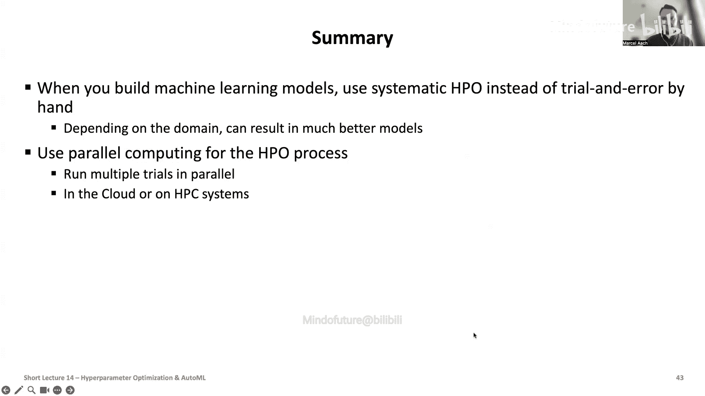

# 【冰岛大学】云计算与大数据-｜-2025-Cloud-Computing-And-Big-Data-Course-p18-P18_讲座_14_超参数优化_AutoML--BV14MB4BjEyZ_p18-

Hello and welcome to Lecture 4 team of the Cloud computinguting and Big Data courseur。

My name is Marcel R， I'm a former PhD student of Morris and now working as a postdoctoral researcher at the UD supercomputing Center in Germany。

The topic of my short lecture today will be hyperramate optimization and automated machine learning。

But before we do a short review of the previous lecture。So in the previous lecture。

 you've learned about containers， which contained units that basically contain all the dependencies an application needs to run。

And the large benefit of this approach is of course， the portability。

 so you can take your application from one system to the next system without having to rebuild all your dependencies。

And of course， you have these big tech companies like Google that offer lots of tools for running and managing such container workloads。

As I said today， we will be dealing with HO and Autout L。

And the short overview of what I will be talking about。

 So we're going to start with an introduction into these two topics covering what actually are hyperparameter。

 which algorithms are there to search for optimal hyperparameter。

And then also which of these algorithms you should use in which occasion。And then in the end。

 I will also show you two tools you can use to run hyperpermeter optimization， Ra and A blue1。So。

 let's start。What actually are these so called hyper parameters？

So the hyperpar are the parameters that influence the behavior of how your machine learning model performs。

And they're usually set by the user， so by you as the one who programs the machine learning model before the training。

And this can include architectural parameters such as the general type of machine learning model you are using。

 the number and kinds of layers you' are using。Or the types of activation functions。

But more prominently， it also refers to the parameters of the optimization process。

Such as which type of optimizer you want to use and which learning rate or which momentum value。

But that's not all。 Sometimes also the parameters of the whole machine learning pipeline can be included。

In your hyperparmeter optimization workload， so this， for example。

 could also include the image pre processingcess steps you do when you work with computer vision workloads。

So of how much you rotate your image， how much you crop them， how much you normalize them。

 these things are hyperparait as well。To put this all into perspective。

We now have three predefined areas where we can tune these predefined parameters。

 one is the so called neuro architecture search that just deals with architectural parameters。

Then we have the classic hypercrmate optimization。And then if you do add pipelines of the pipeline on top。

 you get what is commonly referred to as automated machine learning or AutoML。

Maybe you already know how important finding the finding good hyperparameter is for the success of your machine learning model。

AndJust to visualize it again， here's an overview of the learning curves of a very simple reant model。

 which will strain on a on the Cypher 10 dataset set， so a very simple machine learning dataset set。

And what you see here is the accuracy of the model plotted along the epochs of training。

And you see just by choosing the correct learning rate basically。

 you can make a difference and just as one parameter decides on if your model actually learn something and gets some classification accuracy way above 80% or if your model completely fails and learns nothing at all。

 which would mean 10% validation accuracy， there are just 10 classes in Cypher10。

 so in this case your model is just randomly guessing。

And actually these plots actually give you a first hintt of why the problem of selecting the best hyperparameter is so hard。

 usually there is no general prediction possible， so usually you cannot say oh。

 a large learning rate is good or a small one is good so you really need to find the correct value or be close to the correct value to get good performance of your model。

To make sure everybody's on the same page， a bit of terminology。

So when I talk about the search space， I mean the hyperparameter and the interval that they are sampled from。

When I talk about a configuration， I mean one set of these hyperparameters that was sampled from this search space。

And then when I'm talking about a trial， I mean the run of one training run of such a sample hyperparameter configuration。

Now the main reason why HPO is hard is that usually the search space that your hyperparameter are sample phone contains lots of different types of parameters。

 so the number of layers of course is a discrete value。

 while the learning rate is usually a continuous value。And in this setting。

 you cannot compute gradients like we do in gradient descent to find an optimum。

So we need to rely on other types of optimization methods here。

And one of the main reasons why HO can be computationally expensive is that you can only with total certainty。

Evaluate the performance of the configuration of hyperpara once the model is completely trained。

 So basically， you have to run all your different models completely train them completely to find out。

Which one of your parameters are actually the best ones？

And because there is still lack in general guidance on how to approach this problem。

 it's probably at this time still done a lot by Tri and errorero so you have a human who tries out different types of combinations。

And then based on his or her intuition， looks to find a good type of parameters。But of course。

 we want to do it in a more systematic way now。And that brings us to the algorithms we can use to approach this problem。

The easy or naive way when you want to do HO is to either do random search or grid search。

In random search， as the name suggests， you sample randomly from your hyperparmeter search space。

While in grid search， you evaluate every possible hyperparameter combination you have。

The interesting thing is here that especially random search is actually a very good starting point。

 So when you know nothing about your problem， at least you should do a bit of random search。

And both methods are actually。Just by definition， embarrassingly paralleled。

There is no communication required between your different type of primary optimization trialss。

But of course， you're wasting lots and lots of computing resources on trials that probably already very early on give some bad performance。

 so you're wasting lots of computing resources that you could spend in a better way。So。

The question is， how can we accelerate this random search process and of grid search process and make it more efficient？

And there are two ways to approach this。We can either do an adaptive selection of configurations you want to evaluate。

So this means using Bayesian or evolutionary optimization just to pick better configurations。

The main problem here is again， that the search space is very high dimensional。

 which can make it hard for some of these methods。And the other option。

 which we will focus on mostly here today， is to perform adaptive scheduling of your trials。

And adaptive scheduling means that you stop trials with bad performance and instead use their computing resources for trials that have a better performance。

And the main problem here is， of course， how do I decide what is actually a bad and what is a good trial when I don't have much information about my problem and verable。

Here I've shown a few learning curves。Again， of some computer vision model that was traineded。

And just from looking at these learning curves and comparing at each other。

 we can already get an idea of how we can decide which is a good trend and which is a bad try。

So what you see here is that。Pretty early。 So within the first 50 epochs or so， in this case。

 you can already decide。On on呃。If the learning curve you see here is a good one or is it a bad one just by comparing it to all the other learning curves you have。

 So when you have multiple trials running at the same time。It becomes possible to do a。

A comparison between your different trialss。And this is where something called successive having comes into play。

The basic idea here is very simple and again， in this case。

 based on the concept of the early stopping of bad trials and allocating their resources to the more promising ones。

And actually you can do this in multiple points in time。

 so in practice it would look like this actually。So we start out with an initial number of configurations。

Train them for some epochs and then do a relative ranking of all your trials， for example。

 by validation loss or accuracy。And then terminate the worst 50% and continue only the best 50%。

Then we train for some more epochs and repeat this process and then in the end you will hopefully end up with the one single trial that has the lowest loss。

And from the figure here， it would actually be the line in the dark ring color here。

The main question is then here， how do we balance our computational resources so should we run more trials in the beginning here？

To get more exploration， or should we run our best trials for longer to get more larger focus on exploitation。

And this is where Hyperband extends the classical success of having approach by performing a so called success of having with different levels of aggression。

So while in the first run， for example， you make a。Cut every 20 epochs。

 you in the next round make it cut only every 40 epochs and so on。

And the hope is then that by running different configurations with different levels of aggression。

 you also catch lots of the trials that start out week， but get strong later on。

Now especially when moving to a setting where we have lots of parallel resources available。

 for example， on high performance computing systems， but of course。

 this is also the case in the cloud。You can run into performance issues with this classical hyperprintt approach。

And the reason is that at each of these decision points。😊，Where you want to measure how。

Good the trial is。You have an implicit time barrier because in order to decide on if your trial is good or bad。

You need to wait for all the other machine learning training runs to also reach the same level of epos。

So you need to wait until all of your trials have reached EpoP 20， for example。

And in case you have some， or it's usually the case that some of your trials may run faster because they are smaller models or because the GPU is more efficient and some tile trials are running slower。

And you don't want to waste time here by having some of your trials idling and waiting for others。诶。

So we actually do need an asynchronous version of this hyper band。

ToTo work in order to really take advantage of parallel computing resources。

And the idea here of this so called Aure algorithm is very simple。

Which says in the asynchronous setting， the algorithm does is that at each。

One of these decision points。It looks at the current status， so it looks at the all of the threads。

 it has the performance information already available on。

And if the trials belongs to the best part of these current available trials。

 it will be allowed to continue。And if it's already from these early results in the bad portion of your trials。

 it will be stopped， and of course there is also the case where the algorithm could be unsure。

So where you're not totally sure if you have a good trial or a bad trial and just to make sure you're not terminating good trials too early。

What Aher does in this case is to continue training so you can be sure to。

Not early terminate a fast trial， which has maybe a good performance because AA is always continuing。

The training yeah。A brief overview of the adaptive selection method。 So we talked about lots of。

Adappttive scalinging methods now a bit of adaptive selection methods。嗯。

One of the most prominent selection method you can use is Bayesian optimization。

And the idea here is to build a surrogate model that is cheap to compute。

 but can mimic the performance of your original big machine learning models。

And there exist many different algorithms and libraries that use different Asian approaches such as Smack。

 Dragonfly， Optuna or Dpiper。嗯。And the main challenge they all have to deal with is how to actually handle lots of parallel results coming in as Bayian optimization is usually a sequential process。

And also， as already mentioned， page optimization sometimes has problems in very high dimensional search spaces。

But these libraries smack， dragonagonfly and Opuma， and especially the pipeper， they are very much。

Focus also on the parallelization of the workloads。

 so they actually can also run in a parallel computing environment。And of course。

 it's also possible to combine this patient optimization approach with the Hyb approach we've seen earlier。

And this algorithm is called Bob。Now that we have seen some approaches to HO， the question is。

 of course， when should I use which algorithm？And I have an overview that was adapted from a colleague。

 but this also sprinkled with some of my own experience from doing HPO on large scale system for quite some time now。

So the first thing that you actually need to look at。

Is the dimension of your hyperparmeter search space？

In case your hyperparameter search space is very small。

 let's say less than you have less than two hyperparmeter， you two or less you want to optimize。诶。

In this case， probably it's still feasible for you to do grid search or random search。

The grid search is a more structured than random search， but of course computational anymore。

More expensive， but both of these， as I already said， are surprisingly good starting points。

 so if you don't know what to do at least do this。And again， both of these methods run。

Very nice in parallel settings as they have very low communication requirements。However。

 if your search space is large， so if you have more than three hyperparameters to optimize for。

 which is usually the case， I would say。嗯。The next thing you need to look at is the computing time that is required for treading each trial。

If you have lots of HC resources or lots of cloud computing resources。

You can probably even for larger search spaces， still do random search if the computation time is less than five minutes。

But as you maybe know， especially deep neural networks that you're training usually train for several hours。

So usually our computing time per trial is much longer than these five minutes。

Probably even much longer than 10 minutes。But in this case。

What happens is that we need to look at these adaptive scheduling methods to still be computationally efficient。

And one of the things that you need to look at then is to decide if your machine learning trials are so called late learners。

And late learner means that the largest improvement of your。

Of your trials happens in the second or the final parts of the training。

Because then even though Hyband and AsA have these methods that try to defend against terminating good trials to early on。

 it can still happen that you have。Have some cases where you don't catch the optimal combination with these。

In case you have something or in case your problem is very much defined as such a late learner problem。

I have to say， though， again， if we look at how usually learning curves look like in。呃。

In machine learning is that usually you have the largest amount of improvement during the first parts of your training。

 So most of your。The problems you will be looking at are actually not dis so called late learners。

And in this case， it's very safe to use Hyband or OSsha if however。

 you have such a type of challenge。The next thing to look at is the number of trials you want to run。

 so how。How many trials you you want to sample from your configuration search space。

 if that number is relatively low， let's say less than 200 trials。

Then it's actually very efficient to rely on Bay optimization approaches。

Or even couple them also with some adaptive scheduling methods such as hyperband。

 so using the bo algorithm。However， if your search space is very large and you also want to run a large number of trials。

Then in this case， you are actually again back to random searching or。呃The the Asia algorithm。

Just because the computationally requirements you have。

It mean that you need to rely on one of these adaptive scheduling methods。

There actually are also some totally different approaches to the problem。For example。

 you could use reinforcement learning where you have a reinforcement learning agent which selects the。

Happy parametermeter combinations and then gets the performance of that trial as a reward。

We can also use a special representation of our architecture search space because in this case。

 then it becomes possible to compute gradients and do gradient descent。嗯。Which， of course。

 is a very efficient method of doing optimization in general。

Some very interesting work is looking at so called zero cost proxies and how they relate to the final performance of a model。

And one example is just taking the total number of parameters of the neural network and make a regression model and use that as a prediction。

Which is working actually surprisingly well。And now we live in the times of very large foundation models where you can basically only afford one big training one。

And if you want to do hyperpermate optimization here。

 what you need to do is to your only option to do this is to run a few models which are much。

 much smaller in size。To find optimal hyperparameters and then use some way of transferring these hyperparameters that you found on the smaller models to the larger models。

So。Finally， I also want to give you some more some hands on practical insights for doing these optimization runs。

One is。Don't do neural architecture search or classical HO alone。

 but if you can afford it computationally， try to optimize both at the same time。

As one of S's parameters usually influence each other。Then also。

 you should try out different levels of aggression for successive having。

 So as I've shown you earlier， you can choose to keep only the top 50%。

But what I've seen in practical applications is that it's usually enough to keep。

Only the top 30% and terminate 70% of your trials or even just keeping the the top 25% of your best performing trials and throwing out all of the rest。

Which then of course means you can save lots of computational resources if you are stopping a large portion of your trialss。

One important point is to not treat the batch size as a hyperparameter。

The idea here is that of course， generally smaller batch sizes give and better generalization performance。

 but do also require much more compute。And the idea here is to instead increase the batch size to as much as your one GPU can handle。

And then focus on optimizing the learning rate and as there is some relation between batch size and learning rate。

Another point is to actually select your search space intervals with care。For example。

 weight decay is one hyperparmeter in gradient decent， which is extremely sensitive。That so。

If this parameter is much too small or much too large。

 then actually all your trials will give bad performance。

 even though your other parameters such as the learning weight may be already at an optimal point in space。

Just by having such a bad weight decay， this will actually crash all your your runs and give you。

Yeah， very， very bad performances， so finding the right intervals which to sample your parameters from is also very important。

And the last point should be clear， but just to be totally sure。When you do HO。

 you actually need free data sets。 You need one data set for training your model。

Then you need one validation set for validation of their performance and use this validation set score to pick the best combination of hyperparameter。

And only then， you should still use。A completely untouched test data set。

Where you then evaluate the best hyperparmeter。Heperparmeter optimized model。

 which you found using the validation set。And then the test set is the score that you actually report。

Which of the the final performance of the model。Now， for the second part of the lecture。

 we are going to look at two tools。You can use to run HO and one of them is Ra。And Rayi is a。

AUniversal Python framework you can use for distributed computing。

And it provides you with simple primitives to run。Distributed applications。

 and the selling point of this library is that you need very few changes to your code to actually take it from a single machine。

To running in parallel on a larger machine。And the nice thing is that it actually integrates with lots of different other types of libraries。

Ray itself is open source， but maintained by the tech company any scale。There within Ray。

 there are different frameworks。So there's also， for example， the RL Li。

 which you can use for reinforcement learning。But for us， most interesting here is， of course， Raune。

And the nice thing about Ray is that it can be with very little work。

Configured to run on the cloud on on all the cloud providers。Such as AWS， Microsoft or Google。

But will some changes also be adapted to run on HPC system via SLm？And as I said。

 it can also run on your O machine if you want your local machine。

Rune itself has a focus on distributed hyperparameter tuning。

And supports multiple machine learning frameworks such as Pytor Tenflow。

 but also older ones such as SKL， for example。You can configure it together with weights and biases to get some nice logging plots。

And it actually has。Built in compatibility with lots of these HO algorithms I presented to you earlier。

For example， the AA or Bob algorithm are already implemented here。

And can be used right out of the box。How does Ratune actually work， So as I said。

 the focus is on distributed tuning with Ray。And what you do here is that you first launch a so called head note。

And then launch several worker notes which connect to these head notes。And then what the headn。

 once this connection is built， what the headn then does is to launch actual trialss。

On each of these worker node， so for example， if you have several GPUs。

 you can have one worker node per GPU。And then the headn takes care of scheduling and launching the trials on each one of these GPUs。

Then after some time， the worker notes report back their metrics to the head note。 So， for example。

 the current training accuracy， current validation accuracy。Based on this information。

 then the headnote makes a decision。Runs maybe some optimization steps and decides on which of these trials to actually stop to terminate and which of these to allow to continue。

Actually， it's also very easy to integrate Ratune into your code。

All you have to do is to initialize it in the beginning。

 then set up your hyperparameter search space。As well as the intervals that you want to sample from this you do by defining such a dictionary here。

诶。And then you just need to select the scheduler， for example， you want to use。 so in this case。

 I chose ASsha here。And which metric you want to look at。

You define how many resources you want to allocate for each trial。So in this case。

 because I was running this on an HPC system， I chose to give each trial 30 CPU course and one。

关闭 g p。You define the number of samples you want to try out with your HO run。And then you just。

You just run it。And in the end， shut it down。What you then， after your optimization run has finished。

 can do is to。Pourt these results into weights and biases， for example。

And then you get these nice plots to look at。Which tell you which of your learning rate or weight0k or number of layers。

 for example， lead to low accuracy and which one leads to high accuracy。But of course。

 you can also save them simply to a CSV file in the end， for example。

A nice thing about Ray and the distributed computing setting is。

That you can not only run different trials in parallel。This is what Raytune natively does。

But you can actually also distribute the trials themselves across multiple GPUs， multiple workers。

 for example。So in this case， you combine Raune with Google Vot or Py GDPP。

 which are two frameworks which support running parallel。Deep learning workloads， for example。

And by utilizing these two levels of parallelism， you of course can get very nice speed ups。

Because actually in lots of cases， your neural network might be trained on such a large data set that running it on one GPU will not give you results in reasonable amounts of time。

 so you actually need to distribute the trials themselves across multiple GPUs in order to just be able to finish your computation within reasonable timeframes。

So this was Raune。Another framework I briefly want to show you is auto glluon。

Autobllu on is developed by Amazon。And the special focus of this framework is on tabular data and on time series prediction。

So in case you have or you work with machine learning models that are tailored to this type of data。

 then this might be something that's interesting for you。The idea of auto blue on is to。

Under the hood， combine different state of the art models。Such as different regression models。

Different， maybe different boosting algorithms， also different types of neural networks。

And combine them to a weighted ensemmble， which make predictions at the end。

And the advantage of this approach is， of course， that you get usually very good performance just by combining all these different types of methods。

 the disadvantages， of course， that you may lose some interpretability as you can no longer say why the performance goes up or down。

Just because you have so many different types of models stacked。Into your prediction。

Interesting is also that they have recently included Chronos into their optimization pipeline and Chronos is a foundation model based on the transformer architecture。

That is pre traineded on a large amount of time series data as well as so actual time series data as well as synthetic generated time series data。

And therefore， is。Very good at yeah predicting any time series you give to it because it has this very strong pre training basis。

The nice thing in general about Autobllu on is that its not only gives you one prediction。

 but it also includes a probabilistic forecast so it gives you the quants to help you actually assess the accuracy of your prediction。

Then you get these intervals and can say if your model is actually sure about the predictions making or if there are maybe large uncertainties。

Okay， so those are two libraries I wanted to show you。

Just a very brief summary over the overall electional。So when you build machine learning models。

 I hope you've learned that you should use systematic hyper permitmate optimization instead of trying trial and error by hand。

Depending on where you work， which domain you work at this can actually result in much better models。

And the other thing I also want to encourage you is to use parallel computing resources for this hyperparmate optimization process to be able to actually run multiple trials and parallel。

And with the tools I've shown you， this can be easily done either in the cloud or also on HPC systems。

That's it from me， thank you for listening。

