# 【冰岛大学】云计算与大数据-｜-2025-Cloud-Computing-And-Big-Data-Course-p19-P19_讲座_15_OpenStack云操作系统--BV14MB4BjEyZ_p19-

。Welcome back to cloud computingut and big data today we have our short lecture 15 and we changed a little bit this perspective now basically we're talking about the idea that OpenStack enables us to create our own clouds so we don't use the one hyperscalers from AWS or MS Asia or Google Cloud。

 but rather our task， maybe by the head of IT。To create an known cloud basically somewhere within your own organization。

 And to not start there from scratch， Openstack provides us with a lot of components， really。

 which you can say in one respect， acts essentially like a cloud operating system。

 So very interesting material， again， a short lecture today。For the full lecture。

 please go to the last year's lecture but before we start with the material of short lecture 15。

 let us review what Marcel has teach you a little bit about the interesting topic of hyperpymeter optimization and basically open machine learning auto tom and so on。

 so he started a little bit by making you aware again what we learned already at the beginning of the course that some of the parameters in these machine learning models are not parameters that you learn so they are not the ws。

 if you remember with the perceptual learning models where we summed basically the signals up linearly using weights and then trained this weights until we came to a good conclusion or let's say at least to a good accuracy and we did this over and over again essentially then continuing with artificial neural networks where also And has shown you actually lots of parameters but what basically Marcel then talked to you is。

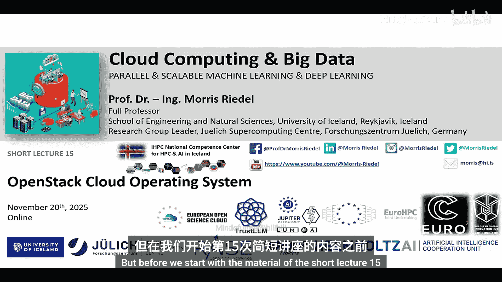

Another set of parameters we call hyper parameters and they're in this sense。

 hyperpar because they are steering the learning process and maybe also influencing the capacity of the model。

 for instance， if you think the number of neurons in each layer of the artificial neural network so these are all parameters that you pick as a human and are not really picked。

 let's say by the learning process or learning algorithm and。

The the interesting benefit that you always have and you use HPC that you see here a little bit is you can do faster training Yes we learned this throughout the course thank you。

 we know that now but thank you very much but the second benefit is really that we have a systematic hyperparmeter optimization that we can use with hyperper computing and in clouds which have a significantly for instance sageMake and some tools in the hyperscalers have these services available to really tune machine learning models better and make them better in performance that's what better really means it's a lower error rate or if you want an increased accuracy and because we have more more GPUs available we can do this very nicely you showed it you a little bit about rightune to do this different let's say trials with different parametermeter runs and I think these interesting element here is a good example of one of these hyperparit called a learning rate。

Which steers essentially then the progress of your learning over the error surface and you know how fast you are。

 if you remember， we talked a little bit about this when we had the optimization recap in one of my lectures。

 But you see here just a small difference， really tiny。

 really in in the learning rate can make a huge difference in accuracy take， for instance， right。

 the green one here of an accuracy， which is perhaps here0，0，0，04。

And this is what you pick as a human， well it's also not really intuitive is it。

 but then suddenly you just say， okay， I've picked 0。

002 and I'm landing in the top accuracy here 90%。

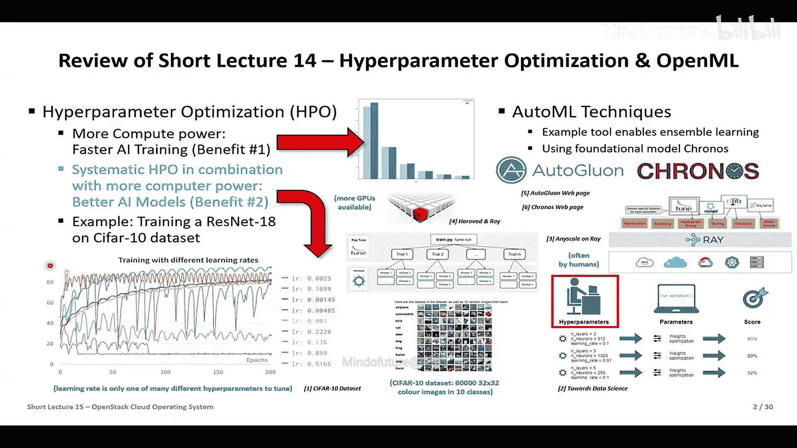

So this is real， so this is indeed something which we humans just set in the Python scripts normally。

And in order to pick this more systematically， there are these tools called Ratune where you can play not only with the learning rate。

 there are many other hyperparmeter， even the optimizes depends of what you want to optimize for。

 you can have a couple of hyperparmeter， really in the game where you can optimize your modeling。

 And with this， you really get then better models。 this reaches a little bit also in the idea of automl technique。

 right， So this is basically an interesting method to do ensemble learning， for instance。

 here is autogluom， for instance， where go away from。

 let's say one particular learning model that knows it all。

Ensemble learning means you combine perhaps regression with support vector machine and maybe a foundation models。

 and we talked also about this foundation model idea was Kronos。

There where you basically have a pretrained model that has already seen a lot of data and you use it for downstream tasks。

 retrain it or for the given problem at hand。And。This is really nicely supported in all these clouds you see it was ray here。

 essentially they are all in the different type of scalealrs or big cloud vendors。

 but also of course can be nicely put you know in Kubernetes kubes and then shipped around and are really portable So in the end this is basically just a tool it's not a new。

AI model。 It rather helps the existing AI models you want to do to really do this while autogluon then provides you with a new model。

 essentially， you know， but you use ensemble learning， for instance。

 based on chronos and have another set of that regression and support vector machines。

 These are different things。 but of course， they are related in the sense that how to pick then automatically。

 these parameters or which learning model， there's a。

 let's say not a really really very complete difference of saying， well。

 when I change the number of neurons right is that already a new AI model。

 or is it something which is autol if you know， make it automatically with auto glu on。

 So hence this is a little bit where you see heres a very nice short graphic。

 very interesting an area where you also often as a human just say， well， let's put。

 you know the number of neurons 512。And then this was not good enough。

 maybe we take much more parameters thousand。Okay， 80 score。

 even less not good than you would say maybe and continuous with 2000。

 3000 networks and we'll see you maybe actually do something which is not so intuitive。

 but rather say I increase the number of layers and then do less neurons。

Where you suddenly end up with a quite good performance，92， but you picking this as a hyperparmeter。

 let's say， manager and systematically over the whole search space， right。

 we're talking here about three hyperparmeter， number of layers。Three， okay， maybe five。

Number of neurons， iPhone found at 12 or 1256， depending on how many layers。

And then I have a learning rate， Should I put 0。1 or maybe 0。01， You get the story。

 So there are more and these combined， which makes it very hard for humans， of course。

 to get to the right ones。And hence， there's an optimization that you can do by using then this Ra tune。

 or if you go the full force。Make auto M anonics， then basically you have automatically the chance of maybe you know that these parameters are picked for you from this auto glu and auto anitonic。

I leave it as there， also think about that this was a short you know basically lecture in previous years。

 we had also longer lectures on this without the industry project taking so much time。

 but please feel free to go as the YouTube channel to the old lectures and then the review the full lecture if you want for more information。

The same goes today as we basically now conclude the course almost。

 let's say at least formally with this lecture we have another APO coming where I talk a little bit about jobs and from another perspective of the course what you have learned and what hopefully stays in your mind for a long time。

So today we will reveal this OpenSt cloud operating system。

 which is important to have at the end of the course， because essentially you can now flip the view。

 as we said in the beginning of saying now you are in the role of creating a cloud right of course we can here just cover just the basics for you know understanding all the wide variety of openSt components you need really again a complete course either in the university or let's say a training from Monday morning to Friday afternoon。

 what is actually in industry commons so theyre actually trainings on this way you can take them and。

And in the end， you have a certification even but this is something what we can't provide here just one university lecture。

 So I give you an overview as usual。 and then you have to let's say keep that hopefully in your mind。

 And when your boss comes in the door in some I company and says might be not even an I company might be another company that just needs computing right pharmaceutical industry。

 whatever So then they come in your door and says， well， and we do some Amazon。

 please but we also want to have our private cloud inhouse， we have very sensitive patient data。

 you know， we want to try out a new medicine idea this is something which is really sensitive don't put that into AWS。

 So and then you are starting or thinking there a lot of。Components I need， right。

 and talking then about scalability。 That's what we also will review today。

 So horizontal scalability was clouds， all the benefits we learned right up down in demand。

 how I provision this in the multitenant way， virtualualization to the rescue。

 All of these different components we had in the whole course， infrastructure of service ideas。

 platform as a service ideas， software as a service ideas for the pharmaceutical engineers or for the researchers should be pretty simple to use on the software as a service level。

 Then you have let's say private hybrid cloud idea， right， So how do you have the interfaces， right。

 for S3， maybe to have some public data pulled in into the private cloud and etc， etc。

 So with this we fill also a lot of promises we always had And it was important to first go through the whole materials so that you can now nicely always revisit actually what we did。

And make the basically combined idea of thinking， how would it look like if I have to do it as an Openmst engineer？

So。Let's go with some things we already know with revisit a little bit。

 the Google Cloud example where we talked a lot about Kubernetes。

 you talked about the benefits of using containerization。 if you remember right。

 across basically the whole idea of having these applications because you don't carry around the hypervisor and so on。

 So you would do rather maybe lots of containerized applications。 But for some ideas。

 virtualization in the old traditional way， here could be still useful。

RightAnd we explored a few in lecture4。 But when you then come to the idea what we discussed basically in the couple of last lectures。

 especially platform as a service Kubernetes， you have the Google Cloud platform， yes。

 you can use other cloud platforms。 And here's the idea now that you really think about what happens if your data center should be there alongside。

 And the idea is， of course， using this， then maybe with Kubernetes with Kublets and so。

 so that you actually able to even shift this when you have similar algorithms。

 let's say public data， you try out on the Google Cloud platform。 But for sensitive patient data。

 which is private， you don't put in the public clouds。

 you can use the same algorithms and the same idea you have tested basically in the public data now on your private data。

 It's just one use case out of the medical domain。 But there are many of these use cases。

 car manufacturers the same way。 should also mention that actually。

 Openstack is not just one open source tool。It's actually an open infrastructure foundation tool。

 which is sort of a top level project supported really。

 so that means if you pick this open source tool as openSt within your。

 let's say data center to create your own cloud。The chances are that will not disappear very quickly right so this is really stable this is sort of the trust that we put into this and luckily as an open infrastructure foundation project you can be very certain that this will not disappear which is of course important because it can take quite some time if you create the own OpenSt infrastructure in your organization so let us review a little bit when we come across all this different challenges that you need to address of course now when you are in charge to create this。

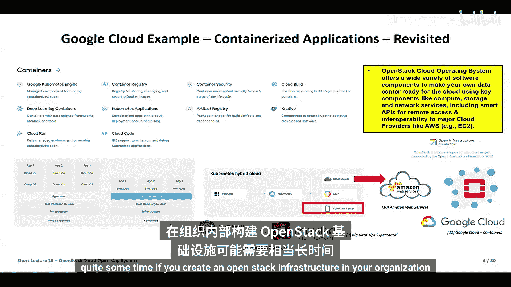

So， and， and we want to do this， of course， also with scalability， right。

 Do you remember all the scalability metrics that we will also review of it。

 We want to have that included。 So hence。We want to pick these components and you know。

 we look in the huge set of OpenStick we'll provide a couple of examples。And of course。

 the basis that we discovered in virtualization is still the same。

W actually you have this visualization that helps you from basically enables us then here to abstract from the physical hardware。

 So the same concept still apply。 But what happens with all of these components here to create a virtualized infrastructure as infrastructure services we discussed already。

 This is something what we want and does this also enable this what you see here quite nicely horizontal scaling right going more and more if you need more or less computing and so on it should be also all supporteded a special increase in users or maybe you know。

 sometimes also decrease in users， but your you know infrastructure should be still let's say。

 working quite good with the components at hand So how does it look like and you quite nicely see here a little bit again in a review。

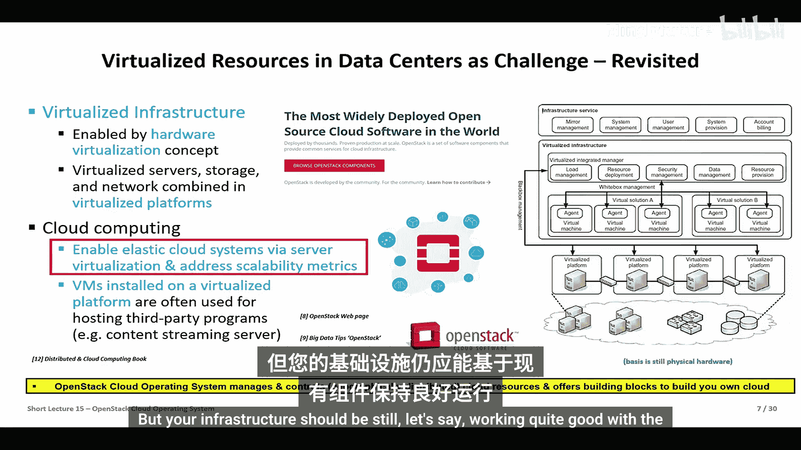

What we had a bit discovered in the last time that you have this you know bare metal idea that you know you can do。

 which is essentially almost infrastructure as a service if you want or you have virtual machines that you can support you know we discussed about this and of course the containers that we discussed as well so and there's components for all of that how you basically create this。

Um。And of course use Kubernetes and what we already discussed or you basically create your own you know。

 let's say Oi， for instance on top of it and this is something which all gives you basically now openStack and you can manage of course your direct hardware however。

 of course when you have a rear view like here you see OpenSticksha services in compute network and storage。

 don't forget that you have your hardware still。RightObviously we need always this physical hardware otherwise you can't do anything so this is of course there it just helps you to manage this infrastructure and to build it as you like because you don't maybe need everything examples could include that basically you just need compute and networking。

 but you always use the S3 storage because you always work on public data so and you don't want to have your own system in a very flexible storage scale created you maybe just don't need that and you know take the S3 interface which is an external in another cloud there are all these mechanisms of combining then what you want to do。

But。It it's really an active open source project。 And this also gives us the the good view that many people work on it。

 which is good for the sustainability， for the functionality。

 It also basically captures then so many real worldor applications。😊。

And this is mostly done with so-called sample configurations because many people work with Openstick and contribute to Openstick。

 Of course people in return also use Openstick a lot because of that。

 So you have seen that Openstick is now used so broadly and with this come。

 let's say this Opentick marketplace play sample configurations where you don't have to start from scratch and a good example that we know is the mapre right I will conclude today but you think about Hadoop right and one of the lectures with state analytics we had this that you know we have this work paradigm or divide and conquer where you increase the number of workers scale up and down and so on。

 So this is just beautifully provided already as some sample configuration with this scheme of divide and conquer so you can basically then tune this for your own needs in your own organization So you also don't have to you know pick the components you need this all already set up and we go through a couple of those today So hence。

I encourage you to go a little bit of， you know， into the idea of the marketplace and see what it can do。

And for Openstack really it's important to know that always the resource pools are important that you have which are the three here compute networking storage in a certain abstract sense。

 but of course if you dive into the different services landscape of Openstick you will see that computer is not only compute there's lots of key functionality remember EC2 versus AMI the Amazon machine interfaces already virtualization in the game the others is just basically EC2 so just essentially computing but's scalable and the AMI had already some tools inside。

 so all of that this is of course important to have the benefits of the cloud is or scalability that already discussed in also the other scalability metrics we basically have revealed it in one of the earlier slides so we go not tell in details into it。

 but you remember it was also software the technology you know remember Pey I do versions they change。

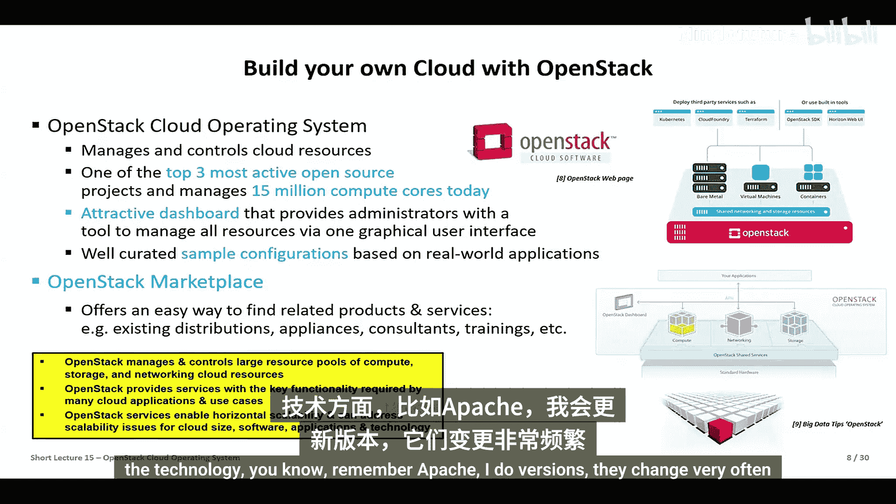

Often there's all the different deck around it， so it's quite a challenge to this。

Now when you think about some application examples， just impact and business on the left hand side。

 you know some of these are very wellknown like Lizard。

 I think this is probably what everybody of you know or the majority is really one of the best you know performing I think game builders and you know this is there are lots of success also doing this in the cloud and theres let's say many that also use some of the OpenStack elements for it and Walmart basically in US is quite well known using also a lot from OpenStack then Open metal is another one a very more specific one。

You can of course go to the website and then you see how many essentially you know users are using it and the million of course which you see on the top as an indicator gives you also an night idea you know is that you something which is really stable for you to use hence we as an example。

 you know I am also in the U supercomputing center and that's why also quite nice to be here now in the supercomputing conference here in St Louis because we reached access scale finally with our Upiter system so very happy I'm still sorry that I can't not be physically with you in the course right now but I'm definitely with you in the spirit of concluding the course nicely now today and also is inover with the industry project we're soon going to the end but here coming back to the cloud you see that the U supercomputing center has basically done the same it created this own Openstack environment but essentially is called the JC Cloud which is based。

On OpenStack so it has of course interesting interfaces to go to the HPC machines it's very close to it as a data file systems and so on。

 but here we reuse different components on OpenStack and of course this took some time to get let's say really up and running。

 but also this enables us to provide you know the flexible services you have seen also in the let's say。

Previous lectures every now and then when we talked about Jupiter and all of that。

 which is then also you know an access methods to the JC cloud。

 so lots of services are around this and this should just show you that you know if you're in business or in academics Opent can be still very interesting for you。

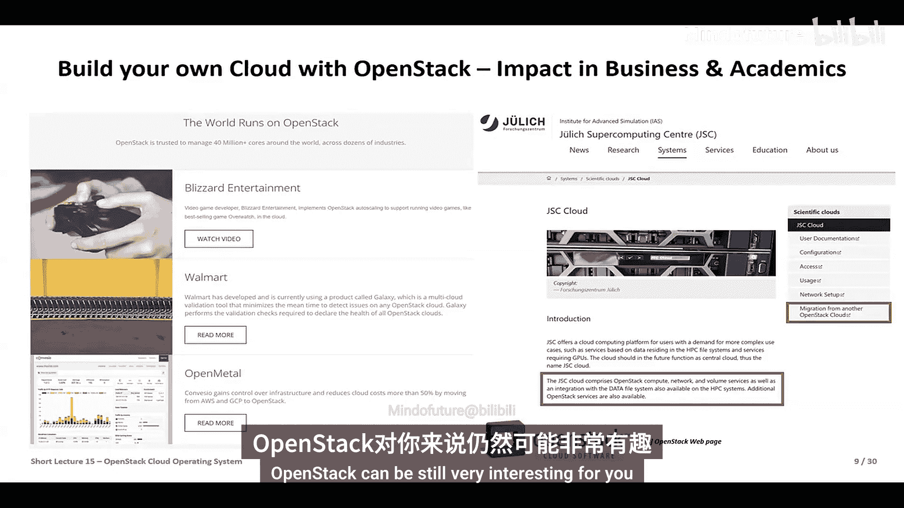

So looking a bit back to the data center metrics and we have discussed this already so I don't want to go completely after it just to remind you that if you want to do it in your own organizations。

 you have to fulfill this right so in many cases maybe not in all the cases that you see here but the size add remove processor to it and you know add more and more storage to it。

 whatever you you know think about that you have physical hardware is really you know increased or decreased so the size is really something you have to take components to it。

 if you develop that from scratch then know this is really a lot of work and you can do this but it doesn't make sense because open sense that can work with the size scalability very nicely。

And。Then the software scalability we discussed as well you have to deal with lots of different libraries you have to they have to play together in all the different programming environments and the tools from machine learning the coa libraries must match the GPUs that you have in your physical infrastructure if you want to do deep learning This is not the only thing and there's also you know coDNN and lowerle networking drivers you have to combine with it and then maybe even some other engineering mathematical libraries you want to use also then Pytorch with Wkua with GPs hence software scalability means it needs to scale of course and deploy it across your cluster to work but then also there you know the different marginss have to really also maintain work done and so on So all of these metrics you know is something where Opentack can help a lot Of course there's still some work to do right I want to not do you know and say you know it just。

It's stall and then there's opent everything is fine there's still lots of configurations with these components。

 but instead of rewriting all of these components to fulfill the scalability metrics here and address them。

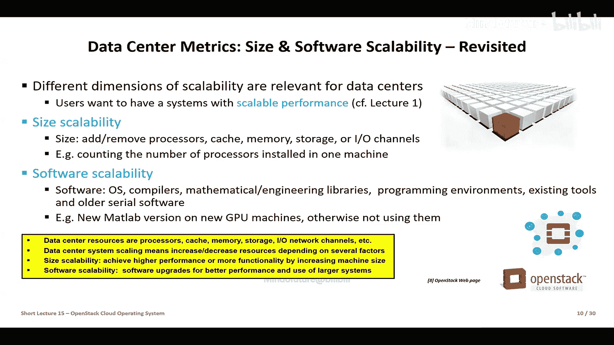

This is quite a challenge and it makes sense to use OpensStack for it。

 Also anything about the application scalability again， we said about the example。

 maybe here with mapre we come always again again to it you want to scale that maybe you know also the data is too big suddenly and then suddenly we see okay。

 we need much more worker So we scale up we see application with a computing and you know in this divide and conquer or if you remember it was map sort shuffle reduce。

Then essentially， you add more workers dynamically， right。

 depending on how much data this time you have to process with a mapre technology。

And this is also an important factor and finally technology scalability in itself。

 you can imagine the new generation GPUs CPUs coming into in basically coming in the infrastructure。

 often it is a mix， maybe in your own infrastructure。

 let's say from A100s and now you get another funding within your organization and another idea。

 maybe another grant， whatever it is， but investor money that says okay now we can basically have a couple of black wells。

 maybe B300s very new material from GPUs which are excellent for AI， for instance。

 there maybe not good for others things， but B300s would be very nice to have for this project。

 so let's put it into your infrastructure。And then you have a mix of different technologies。

 you know， to work with and this is also something where you then as a developer to branch。

 you know have different technology parts for this particular technology。

 for that particular technology so it adds to the complexity again and you know is really in a challenge in order to scale with technology in particular I name here a GPUs because you know they are very quick then very new。

And come along very fast right where while a100s and pair was just very good a couple of years ago now that was then suddenly Grace Hopper and then now we're talking basically about blackwell all the time so this is all generations of you know NVD GPUs of course I don't should say it's just Nvi you know also the instinct cards for instance from AMD are also developing and so on and have different versions and this also all is something which Et can work with so let's have a look on the on the overall view particularly of course also compute components we will look in a little bit now and review them again we will not go in all the different details。

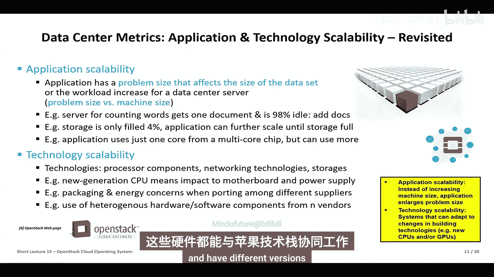

But that's why we have to think a little bit here now on you know the time also in this let's say little lecture for such a big topic。

 but you see a very nice overview the core components if you want what we already said is compute and heres you see it now nicely broken down and different specific functionality so compute what means that。

Vture machines or even containers already you know we have this different type of storage if you remember we talked about this with the S3 and also the elastic block storage object storage block storage file storage then networking is something I leave a little bit out here but of course this comes very much quicker then also when you think about outside inside protection of your clouds is also very important topic but not the focus of this course。

And there are lots of different components。 another one。

 which is important is the identity management， you can of course。

 think about that many of this cloud， you our users are maybe in different divisions in your company have different rights to do certain things。

 So we do the proper identity。 and then gls， for instance。

 is there as an example that you also learned that we have this， you know。

 images that we have prepared for virtualization。 So then lets let's use this and have a essentially an image storage for that。

 So there's lots of that， let's say which are the opent core components and a lot of them is also to look at the lifetime management of it。

What you see here a little bit， but also here to see a little bit what means when you have to scale up。

 scale down， orchestrate different services together and of course would you think you're running it let's sayIT department you also want to have lots of tools right so monitoring is it really working you know do we have good performance what about the number of users etc etc do you have a billing strategy right maybe within the company not really real money but at least core hours or something where you say you value a little bit what the people are used so to see the usage and to put it in perspective。

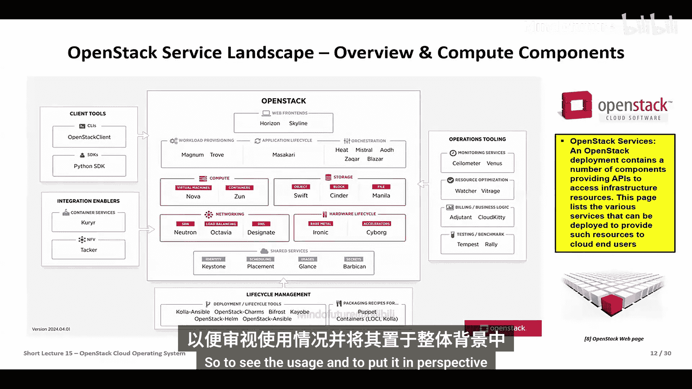

So there are lots of these tools and we picked now a couple of these to remind you what we learned earlier。

 for instance， here on the infrastructure a service level very early in the course we talked about the EC2 interface from Amazon。

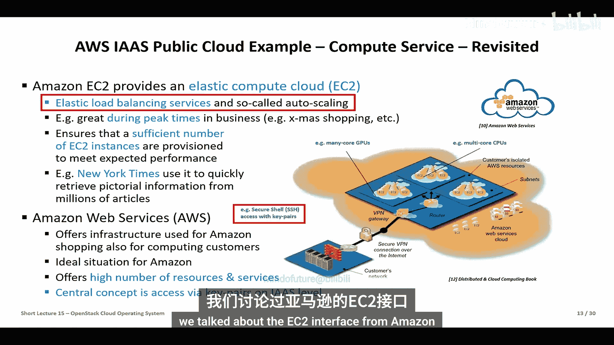

Right and I don't talk about this again， you know by now how it works。

 so but point is what we have to do when we now want't have something similar。

Right because now you can imagine that we need several different services actually to create something like this right when we think an EC2 with a virtualization you see here an example how that could work。

 you know having the different core services where you have you know in the end something you want to have as a VM but you see there are lots of different services around it which need to be there and。

And all you need a computing service that is and provisioning the VM， and you need to。

 let's say some storage services where， you know， basically this gland is the images right that we have it that stores images in a Sw。

Component which then gives you the opportunity to have you your image stored or provides the image of course。

 to run then the VM in this particular use case in this certain moment when you want to let's say provision it via the Nova service so in other words put really computing to it。

And then you know have the neutron this is basically the network connection and for orchestration of all of these different services you need。

 for instance here an optional service which is quite helpful called heat giving you then also interesting triggers monitoring possibilities combined obviously you need two other things which is of course and the identity management we discuss provide the authentication we can access the virtualization management you remember in EC2 we talked also about the SSH right we have to do before we do any EC2 instance or image we always have to upload first SSH key it's very low level infrastructure as a service。

 but that's how it works and similar here we need first some way of authenticate ourselves that we can actually use something of this and then you want to have a UI don't forget this so this is plain let's say computer science stuff in a very provocative way right to say so this is lots of components。

Working somehow together configured， but know when you now want to have something like the E2 interface that we have seen in Amazon。

 you need a UI that basically people can understand。

 let's say go through the lens here and select the image you need I it the deep learning image you need or with lots of deep learning installed packages or is it maybe also something else。

 maybe more CPU oriented physics libraries， number cruncher libraries we need at this particular example So using these services really together you see brings the benefit of OpensStack and when we hear now look at another example for the Nova virtual machines。

 for instance you see here nicely how this then again works together it's similar like you have seen before we see gls basically providing you then the image and so on and you have some you know idea of using then this compute and here you see then the nice scaling of it you see hypervisor that then in the endVN。

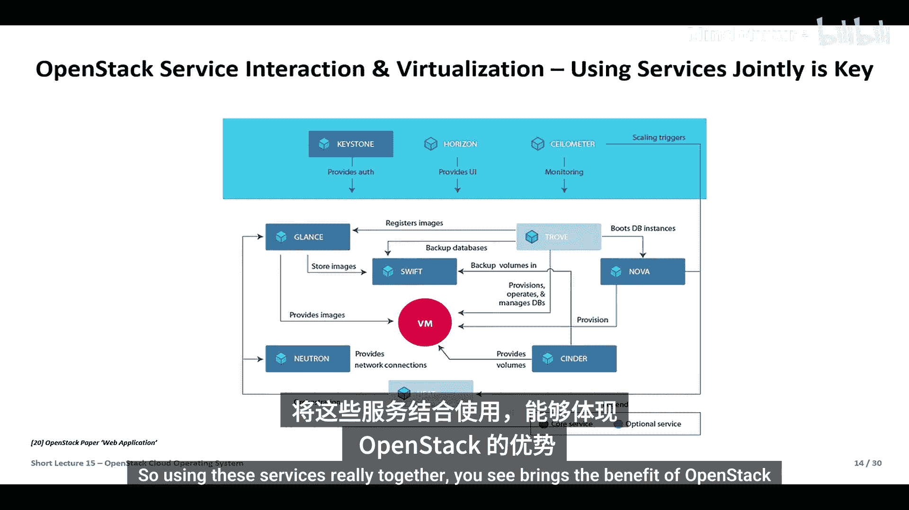

Instance it on your or computing infrastructure。Vi the neutron and so on provides a network connectivity。

 Keystone， the API for you know， having your authentication done and the identity management。

 and then you have really a sort of small way of operating the cluster can have the scheduler alongsidesided and it has lots of building blocks really that you can use if you really dive into one of these component physicists Nova compute service right you see it gets more and more complex。

 the more you go from the abstract level， as we said。

 just compute into a very specific service called Nova。And。Of how it then， of course。

 can work in different contexts。 Here is something where we want to do， for instance， again。

 thinking about mapreduce This could be one set of using this for mappreduce or any other idea how you use normally easy to in Amazon。

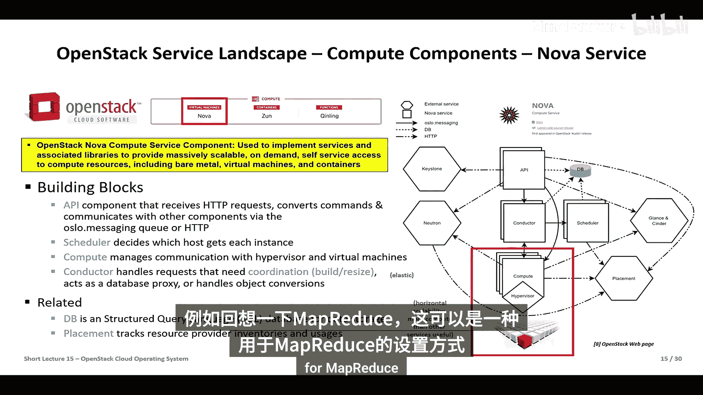

And this is used in different use cases so basically here you have one we had also earlier already been discussed where you know basically have the idea from ourwe kind of car manufacturer。

 which then combines， you know basically the hybrid cloud with a private cloud but also using Amazon EC2。

 and Google， maybe but you know I have also their own cloud inside。

That is basically the idea of creating then this hybrid cloud。

 and they also use OpensStack for that in this particular example。

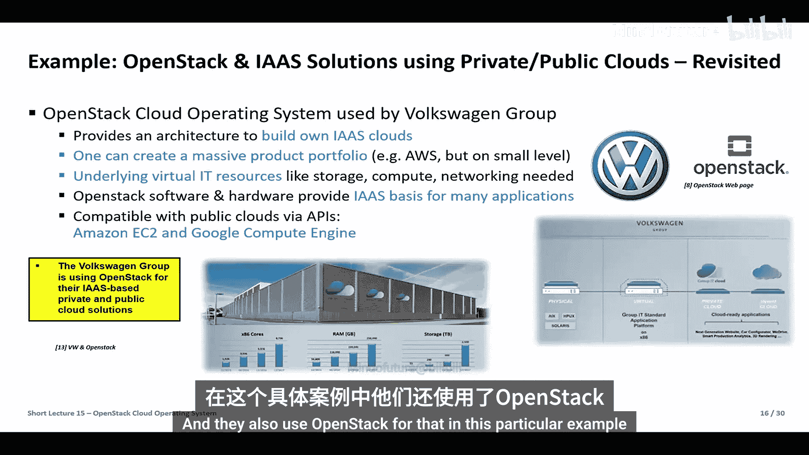

So you see， it's basically used across different。Industries and again from a car manufacturer point of view。

 you know that some of the ideas of new cars or new functionalities in cars are very sensitive to these kind of rapid vectors。

 so they want to keep these rather inhouse and you know I have other things that they can you know I have in the public that's not a problem I mean public cloud doesn't mean that of course everybody can access it but it still leaves。

 let's say the boundary of the organization and can be tricky with some sensitive data like we also discussed in hospitals。

Now， going one step further， we basically said now K E2 is what we can do。

 There was pretty much infrastructures of service。 And then we discussed a lot in our previous lectures around the benefits of Docker and containerizations。

Have discussed already about Kuberators。 and of course。

 there's the other computing service called Sun， which is actually in OpenSt exactly for this。

 which is not surprising us， is also helping us a lot with images， but then happening also。

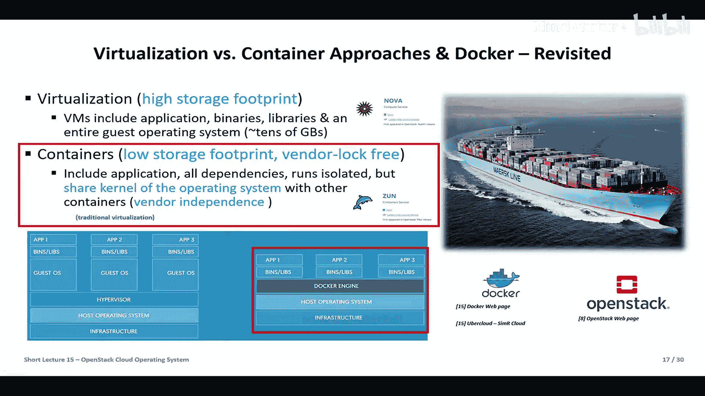

You know， basically the idea of having a different service to it with a Docker and you know this container service using then these directly you know in parallel this component so again a good example if you go into details it really provides you let's say a lot of different ways how you can deploy then these containers right remember we call them lightweight because there's not anymore more this operating system in it and essentially you can manage now these component together in this infrastructure and basically combine it if you want even then with Nova right and having them the virtual machine this compute if you want。

 but this is something where essentially also this sun compute environment helps you a lot in this idea。

Again， for this we'd probably a whole day to go all through because you also would be interested now how this works together with Kubernetes would be next example。

 and this is something also but you know is of course something that you can combine， but let us。

We view also a little bit of storage needs object as a storage as a service so S3 we discussed a lot of time so I can also up here automatically over it we have discussed the EBS elastic block storage also in Amazon you know what we have to do there and what the benefit is there that you just think in blocks and you can do up and down and scale up your infrastructure again and can be you know having benefits from replication and so so this is of course all something you know plus in the file idea that we had in Amazon you see Elastic file system these are all different usage scenarios how you actually work with data。

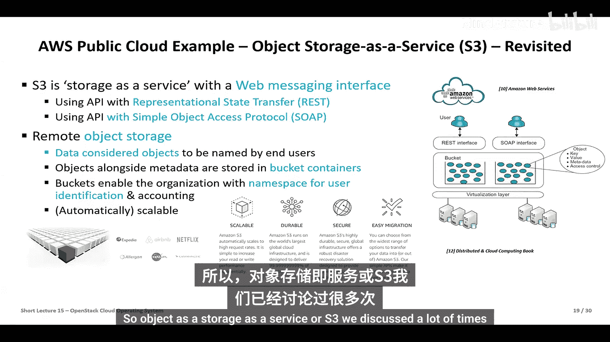

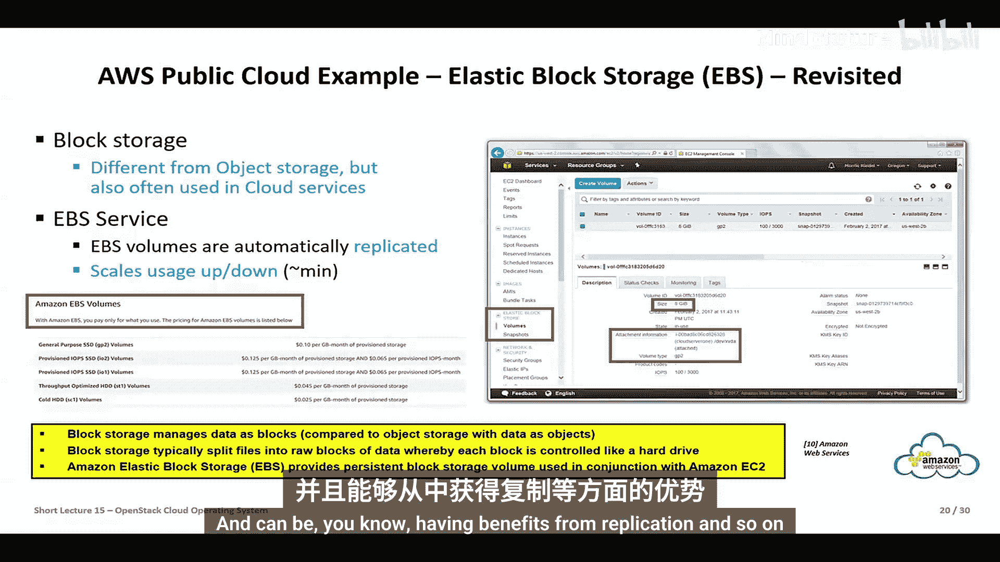

So hence， this could be something where your boss wants to have this in your own cloud at home。

 in the own organization。 So how you do this， You know， the answer。

 you look what's openstack and providers in the similar space。

 And you will see more or less a direct mapping of what we just have seen。

 So there's a Sw service or object storage。 There's a cinder service for block storage and Manda service for files。

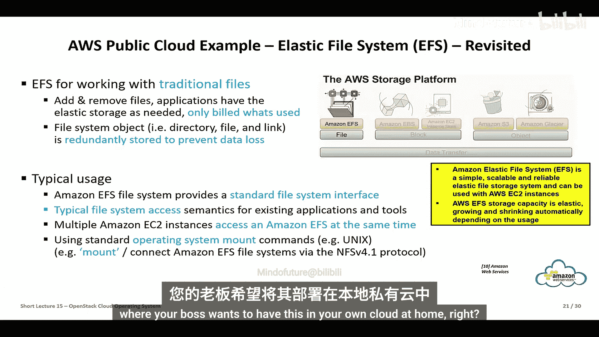

So of course it's not exactly the same that you have in Amazon and also you have to combine it with a nice UI we discussed right so horizonoriz。

 Ui， whatever on top but you can do have similar functionality basically provided with you inhouse of using this and by this also benefit essentially then again from the scale out function of storage dynamically you know the four tolerance was for us a big topic also in the mapreduce lecture where we talked about what happens if you know maybe one storage is actually failing。

 so do we have a replication somewhere from the same data so this could be quickly also be very important for companies that rely on this data for their business。

And。It's an important factor。 And what you otherwise would have to implement is all given you already in all these components。

 right， so you basically can configure them to your need and use them。

 And this can basically mimic almost like you have Amazon services。 But， of course。

 this would because free for you， because it's inside your own basically organization。

And then we discussed a lot about the big data analytics already。

 also here is a very good example of how you can use an existing part from OpensStick already。

 you see here the master and worker paradigm history we discussed this is name node that knows a little bit and the resource manager is scheduling all the tasks you know and the name node knows about the different data node and where you basically have what data and so on in order to schedule this map tasks and the reduced tasks close to the data。

So this would be one usage scenario where really basically spark the MLL。

 you can nicely combine this with OpenStack。And by doing this。

Have all the components you need in order to do maybe frequent pattern mining you have seen this with Sdi is the FP growth algorithm。

 for instance that was important， I don't repeat this here because basically that was provided by Sdi already。

 but if you now want to implement it you can nicely see that this mapping is almost again you know one to one mapping using of course a lot of compute services hence we use a Nova service from OpensStack。

You know that was what boss me making for instance easy to and then we had the Nova and Sinnda basically so here the name node needs of course a little bit of storage aligned right to know a little bit about the data blocks not the data blocks themselves but where the metter data but basically gives us the information then where are the data nodes that we need so this notes of course and again Sinda storage and the node manager is again pretty much related to computing so managing the nodes or tasks and so on with the instruction then from the resource manager basically for the scheduling what to do with the application and in the end you have this data node here on the lowest level which was very important if you remember for Apiaoop to basically puts the task where the data is and not what we do maybe for instance HPC a lot we put a lot of things to the HPC services or centers and then compute there and then take the data again away here we talk about a little bit of different scenario if you have the Apiaoop。

terface you rather accumulate data， maybe in different branches of your organization。

 maybe even geographically dispersed， but then you come back to this and combine it versus mapreduce you know over all this organization boundaries with the idea of you know divide and conquer that we discussed already in one of the lectures So you see also because we at the end of the course reusing a lot of these lectures that we had before。

 we starting to repeat ourselves because it is also of course then the point of Opent because essentially you have again and again similar requirements even if you do Apache Spk Peache Hadoop theyre very similar in the in the upsetting you know for instance。

 dividing conquer mapreduce tasks you remember then of course we should have probably a nova service on tops of some hardware that has lots of memory because you remember Spk was living a lot from good memory compared to Apache Hadoop。

But if you don't have much memory， then maybe also doop is good enough for you to do this infrastructure。

 as we described here。

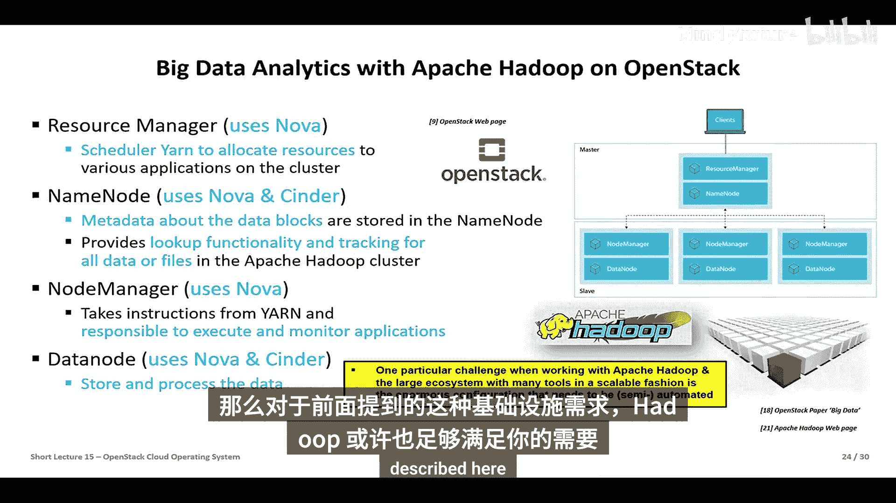

Now， as I said in the beginning of the lecture， OpenStack is a tool that really needs a course from Monday morning to Friday evening。

So really a long long let's say training course maybe from industry or so and as a university course it would be let's say also very feasible to have。

 especially if you want to go with some details of usage some examples。

 some assignments but we have to always pick carefully what we put in our you know course to give you a comprehensive overview what cloud computing is but I think OpensStack now summarize it nicely also that you things you can do yourself in your own organization and remember don't start from scratch there's lots of things already implemented the only question is how you combine that。

And here's a nice video for this a little bit again to summarize that up and with this I'm also stopping now the last。

 if you want real content lecture， we will continue with a final lecture 16 which is also a short lecture where we then summarize course a little bit and see what you have learned and also see how that works with job descriptions if we can map the topics so talk to you the end。

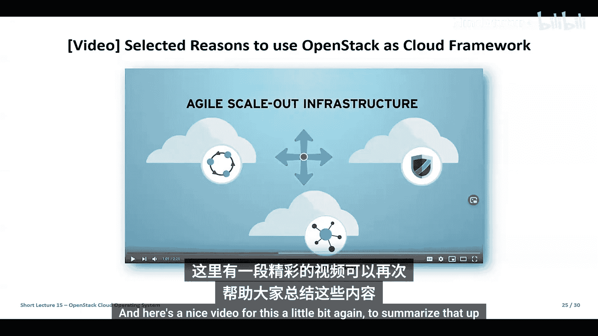

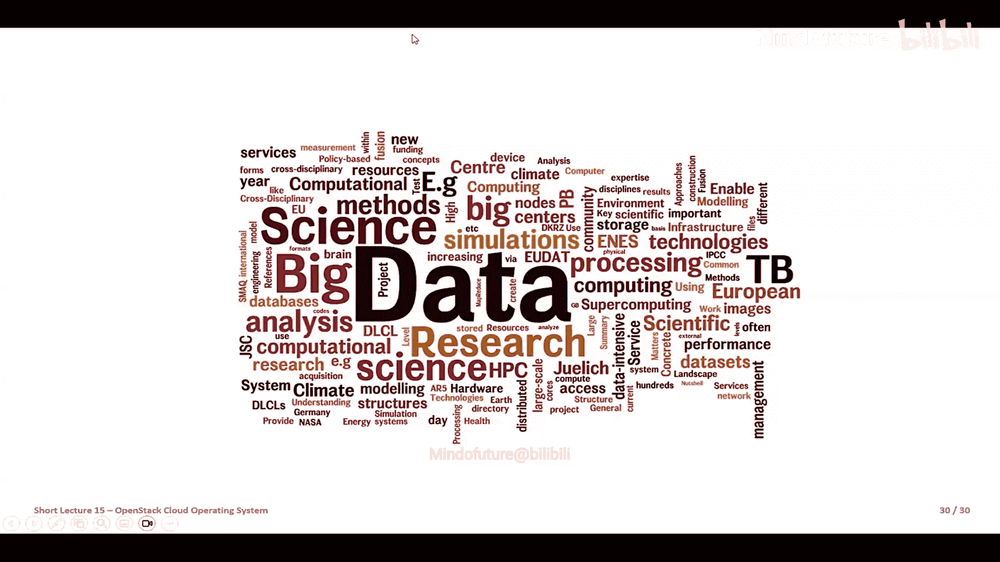