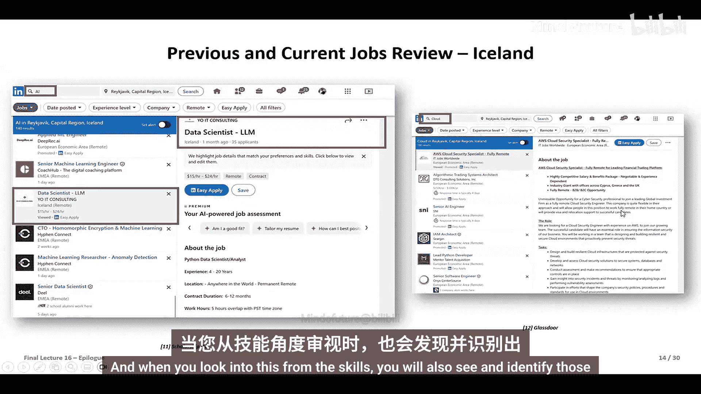
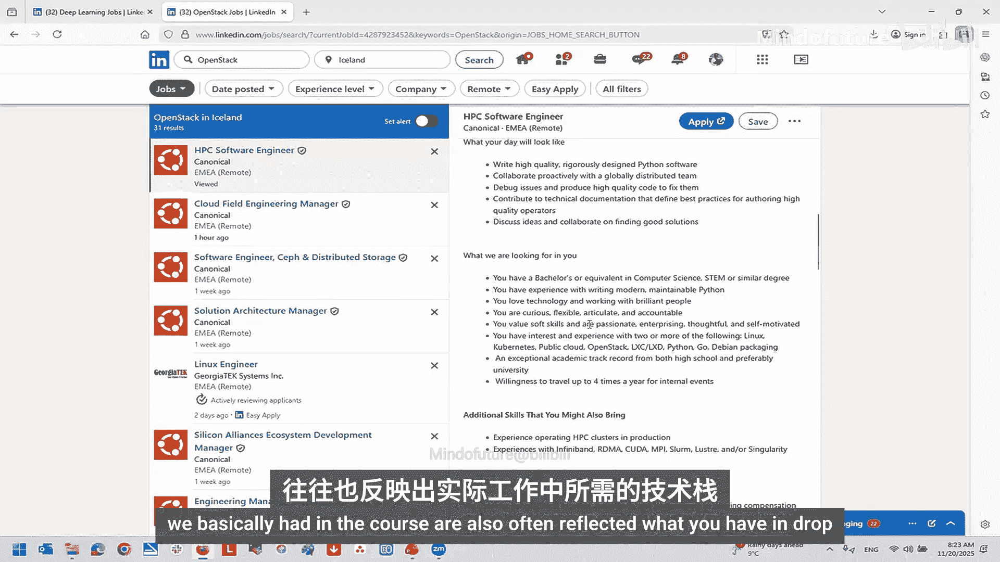
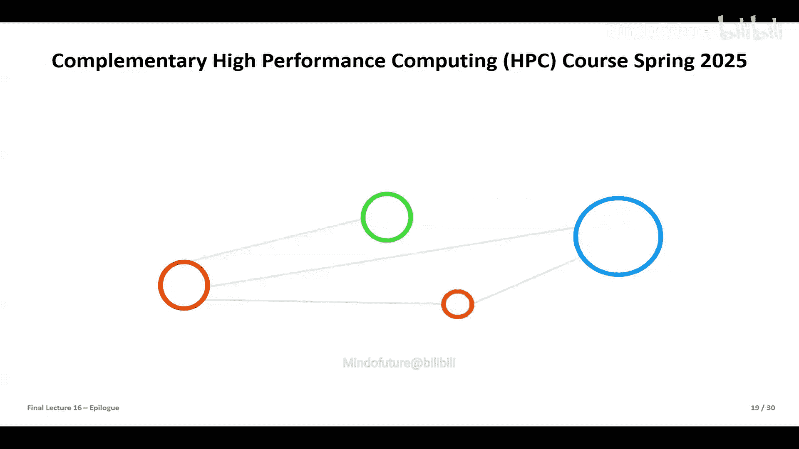
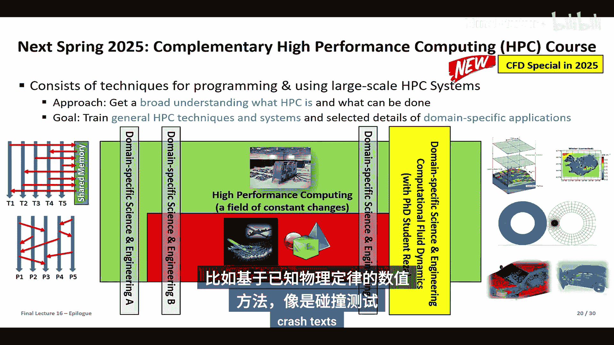
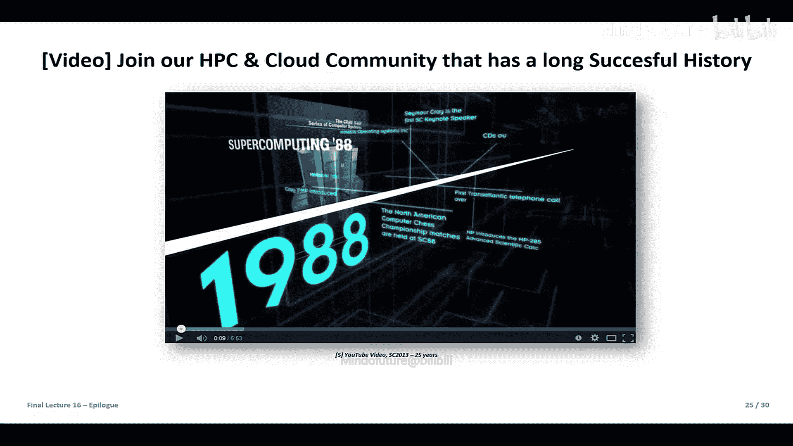
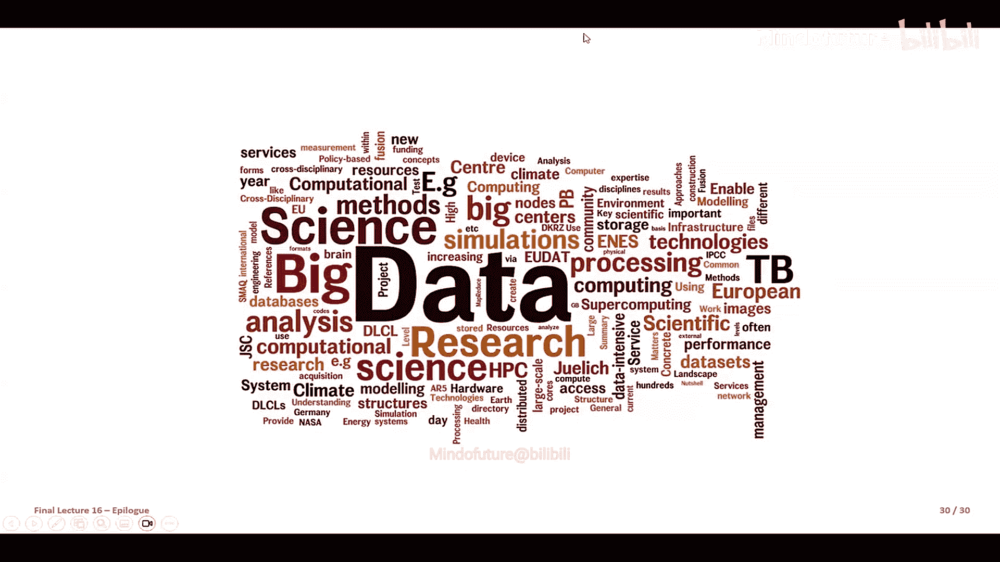

# 【冰岛大学】云计算与大数据-｜-2025-Cloud-Computing-And-Big-Data-Course-p20-P20_最终讲座_16_结语--BV14MB4BjEyZ_p20-

Welcome back to cloud computing and big data now we arrived at the final lecture of the course and that allows us also to reflect a little bit what we had in the whole course。

But we want to do this in a different way is you know， typically going into direct content and so on。

 but rather thinking on what are the long term ideas you can get out of the course。

 how basically the course material is reflected in job descriptions， which is。

 of course an important topic for many of you。So we will see that much of the content we had here is always a little bit incorporated on job descriptions。

But before we go into the material of the Epilo， let us couldn't briefly review what we had the last time with Opentack。

 because we will come back to Opent today when we look on some job descriptions。

 So we have learned that this was in the lecture essentially also flipping the view again at the end of the course。

 similar like today。that we have to think about a situation when you know basically your boss comes into your door and in a company and says well create our own cloud in house right there could be different reasons we discuss like sensitive data。

 medical data， for instance。Or even the car manufacturers we discuss with the new car designs。

 you know new car features which are usually also often simulated， often analyzed with AI and so on。

 that this is all basically a little bit you know coming into the play when you rather want to have an in-house cloud。

 that doesn't mean also that the public cloud vendors that we know like AWS and MS Asia and Google Cloud platform。

 etc， etc ce， that they are unsecure right of course。

 but it could be also reasons where you know medical patient day of one country should be not leaving the country in the regulation。

 so it could be also these aspects that you know influence the decision of creating a private cloud。

And。Of course， that doesn't mean that there are hard boundaries。

 as we know with Kubernetes with docker containers。

 you can ship them around for some application that may make sense to， you know。

 first use a public cloud， maybe for testing on public data before you then ship the same container with all the same algorithms or all the same source etc。

 then to your private cloud with private sensitive data to analyze。

 So the different use cases where you can think about a hybrid cloud。

 which also basically now the idea with Opentack， you have a private cloud combined it maybe with some services which on the public world。

 and then you have a hybrid cloud。 So but let's not talk too much about these things。

 you have seen that before， also the opentack you know that this is a very huge topic。

 there's also cloudt these days， another let's say interesting building block we would discover if you would have more time in the course。

 But the time is extremely limited in the course。 that's why we could not you know review everything。

 but we have。Actually， carried some of the Bnamentals。Of opents where we said， well。

 it providess you nice components for compute networking and storage。

 which is a very nice view from the top， enabling you then essentially the infrastructure as a service here with virtual machines bare metal。

 but then also enabling your going platform as a service software service with fancy containers perhaps a very good UI there's whoi couldn't components also opentack which then actually can mimic pretty much and you can recreate it if you want a little bit how it really looks in the public cloud vendors which are sort of very professional because it's lots of money there。

 but maybe some of them you know are also overdoing this feature So you here you can of course build your stack with the features you need while in the open you know open cloud public cloud vendors。

 you have often 3004 and 500 services which may be all not needed in a company So here you can tune your basically cloudt to the needs and we have also seen last time in the lecture that when you dive now in this fundamental building blocks here。

With the OpenStick shared services， you will have really jointly services you know combined to be deployed。

 you have also building blocks like Nova， like Z for containers on the computing side。

 but then you also remember like AWS had a little bit the object storage block storage file storage。

 you can also basically create this in-house with Swifts and then Manila。

Around that needs to be quite some orchestration of all these different services。

 for instance with heat， you want to have some monitoring and one key component also is the identity management think about that many people probably will use a cloud inside your organization and you don't want to maybe you know add the manually here and there。

 that would be also interesting mechanisms where you know basically you maybe connect to an identity management system etc of the whole company that make us an also easier using。

 for instance， a keystone component here。But you see when I start talking again。

 we take lots of time away from OAP look because this is a huge topic Let let's just bring， you know。

 one example here where we said， okay， containers is with some very nice supported。 and with this。

 you have also the beautiful interoperability now with Docker containers to the public cloud vendors。

 You know that the Google cloud platform， Amazon Web services Amazon A they all support basically Docker containers And with this。

 you can ship them around on the public cloud and you take the Docker container back basically put it on a sun compute。

And then you can basically get the idea to also compute that at home or in your own organization。Now。

 of course， always remember when I tell thee things。

That yeah there is a physical infrastructure below， right， also like here， you see hardware。

So of course， when you build your inhouse cloud， you have lots of hardware to have。

 it's not the cloud can exist on itself。And also always consider the costs coming with this。

 we talked about when one of the lectures see upfront investment of hardware。

 maybe it's more smarter for some of the service to keep them in the public cloud。

 that's what I'm saying because also there's hardware to be bought while maybe some of the really sensitive aspects where you think that's really neat to stay in house。

That might be something where you then buy hardware for because you know we have seen。

 remember the GPU， you know， example within VD， if you haveumppairre cards。

 suddenly grayhopper cards， suddenly blackwell architecture cards。

 there there's a certain way of going forward if you for instance want to have cutting HD learning applications supported in your company for all your staff members。

 which could be in the hundreds or thousands。And they really won't be， you know。

 having cutting edge hardware， you have to upgrade your hardware again and again。That is， of course。

 something you have to consider。 So there's a tradeoff to say。

 do you want to recreate really the complete public service offerings。And some of them。

 you can maybe make cheaper with it， right， We have seen， for instance， the GPU costs， right。

24 hours， you know， or one hour， you know，$40。 It depends really what what type of GPU you want。

 but this can quickly accumulate to a lot of costs。

 So maybe sometimes one motivation is that one off news services。

 let's say on cutting edge GPUs can be've done here， basically also inhouse。

 But this is really something where you have to be a bit careful， not just starting this。

 It would be better to analyzes go you know， with your company applications。

Think about which applications could still remain in public clouds and which of these are more sensitive and then talk to your boss that came into your door and said。

  we want to have everything private。Then you have to show him the cost and say or or whatever。

Show the costs， you know what could be， really then a problem of getting the new hardware again。

 you need a proper room for it， cluster management， et cetera， et cetera。

 probably two more persons that manage the hardware and instead what you all get basically you know in a way with the public clouds。

But I stop here because you also wanted to talk about theO a little bit more。

 so on regulationss to everyone you have managed to finish the course。

At least from the content of the lectures， the industry project is still going on and maybe one or two assignments。

But essentially， that was the content we wanted to bring across and we do today with the APO at different perspective。

See thiss rather as an informal final lecture so of course here you see preparation for final exam that's a bit outdated。

 sorry for this， here's no final exam。And so on， this is the older slide maybe。

 but it carries the essence still of what we had done here in the course on the mindset。

That we go through the job offers。In the market， because we always have to think what we do in the course。

And what we learn， we want to do this in and put this into action right so and with a mindset we have at least here now the ideas of all the components。

 all the different facets we looked， we will also review a little bit on the paradigms。

And then the skill sets is of course something where you have really knowledge now of concrete cloud system services and they also will be reflected in job offers and you know basically this。

 but think about that now you have also skill sets that you can directly apply so basically you know exactly how to get an EC2 as Amazon you know an MS asure how to do HD insight cluster to the Spark all of of that you know knowledge could be very practical and is required in industry today but also of course in the academic environment hence with your skillet you have probably also the port now to look for PhD positions or of course would also offer you masters thesis topics we discuss a little bit but that's something to consider。

And then， the tool sets。Is， of course， something which comes and we see more lower level where you think really you have seen many tool sets now right and this is important that you not just stay with the view of AWS。

 you have also explored MS Asia， you've recently seen Google Cloud platform。

 but also the limitations of Google Col。There's lots of these。Which are really tool sets。

 you have essentially known。 But with this comes also this disclaimer that， of course。

 they will advance significantly， right， So this is something where you have to be， you know， really。

 if you're interested in these topics， you have to basically follow this。 And， you know。

 Amazon provides new services， we have seen this a lot language models， right。

 the big topics suddenly， and all the cloud vendors provide services there。So then of course。

 with this comes maybe a couple of future topics to study related to this， if you're interested。

 things like quantum computing， neural networks on the chips， neuromorphic computing。

 there are really， let's say lots of future topics where this will have also an impact in the service offerings of clouds at some point in time。

 for instance， cloud computing。So。Let's look at the outline。

 so that's why from the different perspective， we look on the whole course comprehensively。

 I give you a couple of further readings and drop reviews also live here LinkedIn。

And then briefly discuss that their master and PhD fields topics available in the area of， you know。

 deep learning， machine learning in cloud computing and high performance computing。

A small peak review to the HPC course in 2026 who in the course is actually plan as a summer Aurora of course in the moment at least so that means I will be not lectures all the time。

 but you will be together with other students from the Aurora international setup this is in the making so to speaks not really finalized yet。

 but at least that's a plan。And then of course some acknowledgements and upcoming events， you know。

 from our EHPC workshops。🤧。So let's look cloud computing from another perspective。

 also think what I promised you in lecture zero in the prologue。

 I mean part of the processing distributed computing you have really now fully you know understood。

 I hope so this is of course something where when you add more and more EC2s and you automatically have distributed computing in a sense that it's not only your computer anymore you also combine this in you know remote in the distributed setup。

Some of the algorithms we have explored are then doing parallel processing on this distribution。

 so basically distributed deep learning， you have heard right to speed up the process or parallel processing with Ratune if you remember all the trials so yeah lots of different examples of this let's say approaches in cloud computing which really makes it feasible to use。

And we tried to get a comprehensive approach， So not just forecouring。

 let's say an MSs Asia and get you in all the facets of MSs Asia so that you can directly get a certificate there for this particular cloud。

 we try to really go into different cloud vendors， I mean that's for the start right So we really covered。

 I think cloud Google Cloud basically from one perspective of the callop。

 but also then of course of the Google Cloud platform。 we looked in several AWS services。

 SageMake infrastructure a services E2 S3 we looked into Ms Asia。

 really interesting platform for H inside Apache Spark， Apachedube， the kind of open source tools。

And with this， we always had also certain， let's say， theories and information technologies。

 also by the invited lectures from Anddi and Marcel in Chardiu。Remember。

 there are also some interesting aspects related to this， also the scalability by design。

 which is an important approach here in the out course， really， right horizontal scaling。

 more users and more hardware is required and the whole stack should work still now and provide high performance。

So here and there， important was also to give you relationships to high performance computing。

 right It's a topic overlapping。 Some of the high performance computing systems are very well in the cloud。

 others are actually not really in the cloud yet like our Upiter system that was just here now in St。

 Louis getting the access scale you know， rank and is' the first European Accessscale computer and usually that we have。

 So this is something what you don't find in the cloud， rights an accessscale system so easily today。

 However， more and more topics of access like Upiter notebooks to these systems and so getting a little bit what we call cloudified。

 So we would see more and more integration in the next years for usability and for practical concerns to also integrate more HPC systems in that say cloud infrastructures in a way。

 but still think about the costs and all of that is also an important part。and啲。

Course addressed here and their really latest advances。 So we looked in Spk in our new developments。

 also in GPUus。 have I have tried to get you across。For instance。

 with different generations really of NV and remember I'm not paid by NV it's just they have a huge market share so also development pace which is quite interesting you know I did you know my initial machine learning。

 let's say lectures perhaps on Keplla he techs now we talk about you know Uair and Grace Hopper and then also Blackwell。

We have also shown you updates on the commercial clock ecosystem。

 So you see basically if you take the slides from last year and and compare them a little bit。

 you will see certain changes， not only because we provide short lectures。

 but also the look and feel some of services have changed and new versions came across， but still。

 of course， the key ideas and the paradigms you will explore very soon on one slide will remain。

 So it's also for you what you learned that if not everything will dramatically changed。

 it will be just that maybe the new GPU generations of Blackwell will be soon incorporated for instance。

 in AWS services with interesting price tech I can tell you that probably。But。

This is something which we also have to see that the latest advances is yes and the course now。

 but you also have to observe this further if you want to stay in the field。

 especially deep learning is a good example we have explored cutting edge trust， I mean trust LLM。

 the U projects we have seen with large language models。

All the different types of large language models， you know Mistral and maybe tillde that open that actually actually are really following European values right so this is also an interesting concern that will be coming up and is coming up is one of the latest advances of this so people don't want to have the large language model of deepse and so on because then it maybe don't follow you know the European values so close to heart and we have this example of book chapters right。

 I don't say here you know how that is now being you know taken。

 but if you use large language merge models to get a book chapter。

 you will see if copyright concerns for instance， are really you know into account and then we had some you know researchers cloud systems we see European Open science cloud U that services be to find be to share and so on which also are interesting services to be evolved over time。

But we at least covered as best as we could what the open science cloud has to offer today。

So from the learning outcomes then。Then we will see here essentially similar aspects we have just seen just that for you as a student。

You can now get better into a job interview because we want to prepare you for the job market right so this means not that you cannot do academic job interviews。

 of course it's the same， but this is what you now understand and really should put on your CV as I said with the hackathton we have done as the assignment right this is really something which is experience right and do you have to put that in your CV you understand what the hackathton is。

 what the challenges are， but also what the benefits of the hackathtona。These are examples。

Of really doing， you know， interesting deep learning machine learning events today and of course。

 using underneath high performance computing or cloud systems like Google Col and so on and so on。

And。Here and there we looked really also more on big data centers。

 we looked the difference between high throughput， let's say systems with documents right where there's not as very tight interactions between the different let's say。

 tasks with the map reduce framework， for instance。

 right you gradually do a divide and conquer strategy。

And what you're really aiming for is a high throughput of documents， analyzing them for。

 you know classifying them maybe into political sports， other categories doesn't matter。

 but this is high throughput oriented， hence the whole course has this notion a little bit while in high performance computing what we also learned a little bit。

等。We have a high interaction usually between these， let's say。

 different cores between the different nodes and so on。So。In a way， youre basically。

I'm ready to use machine learning， deep learning tools in the cloud。

 but I also give the disclaimer as you remember as in the deep learning course parts。

If you really want to be in our working in that field。

 I recommend you to take really machine and deep learning courses。

This one course is based on cloud computing and big data and deep learning is a very nice way of leveraging this machine learning at scale as well。

 but you're not really ready when you don't have a machine and deep learning course right there's many topics I couldn't cover here which are important I mean to the most ones you know to combat overfitting is definitely something like regularization learning all these concepts about that。

Validation cross validation model selection also to combat overfitting the biases and so on。

 so these are all core topics I actually addressed very very limited also Andy and the others couldn't do that much hence。

We have now the knowledge of using these tools but to understand the algorithms better and the capacity of learning a little bit of machine learning theory and more conceptual aspects are needed like the course you know stay for instance and so on but also there are beautiful other courses around just say this is important however big data mining you know is maybe not so tough to understand you have seen FP growth for instance provided by Shadi where you don't have the large let's say machine learning theory necessarily behind it you just look on data shopping lists and have a smart algorithm doing this so this is something what you can basically straightforward do you know let's say Chone and hire you and says let's go through our sales please can you do that in a scalable manner because were actually quite big and you say yes I know how to do it。

And， you know， you need a little bit of budget， maybe for the cloud systems from your bosses and so on。

 whether， you know some of the algorithm is frequent pattern mining， S grows and so on。

 So these are the data mining strategies you also learned。

And you know basically overall in the course， which was now the important facet you can handle big data very well if you're using the cloud right it scales up and down with your requirements and usually all the big cloud vendors have that inherently。

 or if you boiled it with openSt then of course we have to think a bit about the hardware itself。

 but at least a software stack can also handle basically this dynamic demands that really are there to handle this big data。

Then when we look from a summary perspective now。A little bit what remains right I mean a university lecture and one respectspect should also provide you with some paradigms recall call that maybe stayed the test of time right so and techniques and theory which are basically now a bit revered with this particular cloud vendor with that particular cloud vendor。

 but they will probably stay even if cloudwins will change or will be bought or will go bankrupt。

Rights other business provide。 So let's look on it on a little bit on a perspective。

You know what we did in theory， so here and there we had parallel algorithms we discussed for instance distributed deep learning how to use a parallelization there。

 you know， to have the gradients exchange between the different notes then that was really the learning a parallel algorithm that is today use a deep learning significantly to speed up deep learning you need parallelization and with speed up then what's the idea really to make it faster right the training process using more GPUs and parallel with these parallel algorithms gives you speed up is also a word or theory part which is limits maybe somewhere in the serial parts right so theres some laws to it which we also more explore essentially And did this a little bit but of course an HCQl to talk a little bit more about than some limitations there。

And and so on we have seen the scalability right of course it is also a theoretical aspect of a cloud that will be remaining so this is this is a core heart of it or thinking okay。

 it should be scalable but this means lots of impacts right so more and more users which then in theory use more and more storage and more and more compute so how is all that reflected in your service offerings。

Fort measurements we have seen there a couple of elements which really are important replication。

 What happens if let's say a node goes down we have the blocks right that we have in the name node and then we know okay there's three times replicated So if this is unavailable I can shift the task still to another replica So all of this fault measurement is an important facet technology will always fail。

There will be always some aspects in it which are overheating or it could be human errors even that are somehow getting the cluster down or liquid cooling。

 you maybe have also problems there or whatever it is in the New times。

There will be definitelyly error by design。 And you have to work with it。Data mining algorithms。

 of course。Would be another complete course right Sta data mining it was a course I teach once here at the university was Thomas Philrunnason and this was something you know where you know there are lots of algorithms what be shown here is FP growth and so on was just one of it there are many other months things like clustering algorithms K means D scan very interesting material but would fill completely another lecture series and however。

 many of those of course are available in the clouds and some of them are even paralyzed like HPD scan is for instance。

 a parallel version of the D scan we have here developed at the University of Iceland with one of my PhD so there are many of these。

mountund。And I would encourage you， especially for the three topics you see here in the three read down there。

 we have talked about this a little bit。When you think about the statistical learning theory we said about the hypothesis set right that you have a support vector machine to sew from or artificial neural networks with two layers or cutting edge transformer。

 these are all you know basically very interesting models but you have to put it in the relationship what data you have at hand because you learn very quickly in the course right it was machine learning deep learning means learning from data。

So in other words， when you basically have very little data。

 very little data set of a couple of megabytes and want to have a very high adding edge transformer to it。

 this is a mismatch you would rather maybe go through support that the machine for classification or regression tasks for logistic regression even so this is a lot what you learn in the statistical learning theory that's why I also say to you combined in obviously notion of saying overfitting warning so too much training。

 that's why we have regular and validation， these are all topics in the machine learning course 101 and this is something you have to understand which could fully cover but we also be remaining whatever learning algorithm of fancy new models come up with large language models you have seen that。

And we talked about large language modelss and I， They were quite nice with English。 Yes。

 but really of Icelandic or Fares， not much text corpora around， right， So very little text。

 actually think about Iceland has 370000 people。 So very little speak the language。

 Then you transform as only problems， right， and there used to be other mechanisms。 hence。

This is important and this is what you also learned then in the machine learning course much better Also when you think about the wide variety of deep learning algorithm I had convolution neural networks shown you here a little bit And had a couple of examples with transformers there's so much more in deep learning right there's really outend quarterss for specific problems a very interesting you field that I think will come in the next five to 10 years will be physics informed deep learning so putting constraints on the learning with physics so basically interacting with lot what we would say simulation sciences。

From the past， doing numerical methods and， you know。

 on based on known physical laws and combining that knowledge in the constraints in the deep learning knowledge to basically or learning process in a way to really constrain it and then maybe be more accurate。

And we call that physics informed machine learning or physics informed neural networks。

 you know there are different ways how you call it。

 but it's still a very interesting new topic when much things are still to come。

So this is for the theory。😊，When we look on the techniques that we had。

 this is also something where you would say this is something which will remain。

 the economics of scale， we have seen the idea of these large data centers right with the cooling infrastructures at scales。

So this is， of course， where you can put the cost down of many of the operations instead of。

 you know， I would say if you have all at home， a small cluster or let's say all at home in the sense of the organization。

Right， so where you work。 So think about it。 We are so many， you know， companies in Iceland。

 and they all would have their own cluster downstairs。Everybody would have administrators。

 everybody would have， you know to buy GPUs every now and then but economics of scale。

 you can talk to the hardware vendors and say， well now we create a big data centers。

 we actually buy not two or three GPUs， we buy maybe 3000 or 5000 GPUs， with investor money。

 and then you get the prices down。One example， but the operational costs as well， right。

 So these are all things where you have to see that economies of scale will probably remain for many different reasons and many different views on it from the operation perspective。

 If you looked on the videos with the Google data center people roll through it to change hardware。

 maintain hardware， This is a very important factor， the generations， right， new generations。

So this will be there， then of course in memory optimizations。

 well an interesting topic at the beginning of the course。

 if you remember Apache Spark and you can transfer this to the basically world of GPUs with HM high bandwidth memory as it disc calledd。

 so which also basically fuels GPU with much more memory。

But you also have to know why there's a limit， memory is very expensive。Right， of course。

 it's the best performance you can have。 But you also go there and pay the price for it。

 as we discuss in the Apache Sp lecture， right， So if you want to have this。

 we looked at the E C two prizes with， you know， high memory。 And suddenly， you pay much， much。

 much more for your cluster set upright in H D inside。 And this on a 247 basis。So hence。

 the inme optimizations are of course crucial to performance。

A crucial and will remain giving perhaps the best possible performance that we have。

 but it will also have always this cost aspect to it in the moment at least maybe there's new technologies in the future that would be very interesting but this in memory making it fastest of course an important technique。

Then the idea of distinguishing between computer data data to compute What I mean with this。

 you remember computer data was mostly the idea now of mapreuce。

 you accumulate data and different repositories across the organization and you want to have small summarization statistics tasks shipped to it and get it back the high throughput idea really in HPC you have always rather the opposite you would say you have large you know youpi now is extrascale here and usually and then you would say yeah。

 well I have to ship my data there to compute it there and then I take it away So these are different techniques that you have to think about So the one is much more optimized for accumulating data maybe geographically dispersed especially and then the data to computes of much more basically centralized models and so on you have learned the techniques of private public hybrid clouds is another example here。

What you know was stretched across a course， but really at the end with the idea of OpenStack you also got the tool set to really realizing this right because we started a lot with public cloud vendors to know a little bit how the services are looking like today。

 but with the private cloud maybe with OpenStack or cloudSt that are different stacks today available。

 you can create also these hybrid clouds combining the best of both worlds in a way。

The distributed file systems replication schemes again goes a little bit with the thought measurements in a way that you want to have。

 let's say， data in different locations， you want to replicated。

 protected from loss because as we said also this is techniques which are need to be there because we can always assume that the real hardware will fail at some point in time somewhere right so it's always good to have also techniques like replication or distributed file systems available so that you can carry on working without interrupts and then infrastructure virtualization was a very interesting techniques to get you know the system load up if you remember right if everybody would have his own GPU。

And we don't share it in a virtualized infrastructure， So or CPU or other hardware storage。

 Then maybe you know， sometimes the GP is not used。

Because this particular person goes to vacation for， let's say， three weeks。

 And the other developers would love to have more computing power。

 but they're stuck to their own GPU。So this load management right is a very important technique factor leveraging this infrastructure virtualization at a glance and of course you have to think about this directly covers and also in a sense Docker approach。

 by shipping not only anymore more VM images but maybe also Docker containers around would be important also there are interesting news with filess mounts maybe by shipping too much around having some dedicated libraries always at hand。

 but this is of course something where virtualization still becomes in handy。

And then from the paradigm perspective， this is really now from the 10000 feet perspective。

 That's something where you think。This will definitely not change in a 10 to 15 years perspective。

 right？These are paradigms which remain the difference between high throughput computing and high performance computing in high throughput computing。

 really， thinking about the data you have， you want to analyze it with the best throughput。

 you don't care if there's not you know there's not any interactions between the simple steps that we have seen and divide and conquer right so the worker they work on their own。

 they generate result and then you do a summary out of it and you optimize the whole system for throughput of the data now in high performance computing。

 we have run rather number crunching algorithms that we want to really you know speedup。

 we use many of different course at the same time and parallel and so on。Divide and conquer。

The map reduce goes a little bit into the same direction as high throughput computing。

 but is still an interesting aspect， because I said to you also。

 it's this map thought shuffle group reduce， right。

 So it has this interesting idea of at some data needs to be in between also sorted or shuffleded group to do something。

 And， of course， infrastructure as a service platform as a service and software as a service。

 There were whole lectures on it。 These are different levels。

 really infrastructures more for the administrators platform rather for developers and software for the really。

 you know， users。So just a couple of slides before we close for the further readings and before I show you some you know drops here online。

 but of course you should do that on yourself if you're really interested and you will just give you some couple of pointers。

 this would be quite some interesting books to read however I gave you so many bibliography and all the different lectures that I would also recommend those。

Of course， my teaching， you know a little bit selfmarking sorry here you will see we were further do social media and all the platforms LinkedIn and so on and also have the website you know with new aspects you have seen the YouTube channel will be you know continue with new lectures so if you are let's say go out of the university probably there's a chance as the cloud computing 2026 course would be also on YouTube YouTube。

So the material will be there available for you and then let has come a little bit also on previous and current job reviews here in Iceland。

 you see here for example covering also cutting edge ideas now of this large language models we discuss the data scientist here in Iceland was used so if you now go essentially to LinkedIn and you type in here you know where you want to have the job。

 but also what topic it is I put here just AI but AI today is a lot with large language models but you see also senior machine learning engineer and so on and so on。

 so this is a topic we have here introduced in the course because it's really of relevance but also there you know natural language processing is also another course you might take if you're really interested in this。

And。You can go on and go on cloud computing， you know AWS cloud security specialist and when you look into this from the skills you will also see and identify those things we have learned in the course so I give you a couple of examples here really when you think about you know deep learning for instance。

 what I search here for this is LinkedIn jobs right theres something what I could recommend you not only to enroll in LinkedIn。

 but also because of jobs is quite interesting there and now when you search and find a job like here a machine learning engineer as a remote contract So from IN maybe you will see deep understanding of data modeling。

 feature engine algorithms， so things we did in deep learning machine learning。

 but also here experience with cloud platforms AWS Google Cloud platform or Azure。

And deploying machine learn models in production。Of course。

 you cannot or maybe have everything correctly assessed， you know， But I think some of the skills。

You know， is something where， you know， this would be probably something what the machine learning course will then tell you。

 right， using Tensorflow Pyths， we just did this very limited。

But of course the machine learning course will be all about this。

 but at least you had another checkbox here with a cloud platforms and you know more of data modeling what we had was a CR DM。

 how to work with the algorithm selection， selection of diagram。

 you remember the different hypothesis and so on and so on。

The same is true maybe for more cloud topics if you search for it。

 so OpensStack is an example I promised you to come back to right you see lots of different jobs here and also when you look now on them。

 if you click on one HC So engineer， you see HPC and clouds are very close to each other but here you see also I mean Python is now everywhere。

 of course this is something also I recommend you to really look into but you see also here the topics we have covered you know you have interesting experience there two or more the following Kubernet this is here what we had in the course public cloud vendors this is again AWS now Google Cloud platform。

 maybe others like Alibaba or so， but I think the three main ones we covered in the course is MS Asia as well that you really should know but you see also OpensStack right as mentioned here。

And you go on and go through the others that you will see again and again。

 I don't do that now more and more because I think you get the message。These topics。

 which we basically had in the course are also often reflected what you have in drop offers。 Hence。

 we introduced that into the course， also for changing the course every now and then， for instance。

 putting the containers more in and Kuberus more and more in over the years。

 than we had now large language models introduced。 of course， we have to always update a little bit。

 right， So of course。

So let us come then to。Let's say， yeah， here's another example of OpenStack if you remember right。

 so you see this is， let's say again in Reykjavik here was having Kubernetes OpenStack。et cetera。

 etc， and familiar with challenges of large scale， multi cloud platforms， right scalability。

 more users， the metrics we discussed growing maybe be shrinking over time So this is all you know what you learned hopefully in and remain in your heads because Autogonar we had the industry project which of course can also not cover all what is here always required right so this experience and so on and Boos points but you can say that you know we have some of these things we see Haathton that was a very good example but you know you always would mentioned when you apply somewhere because then you have really practical experience done something。

Even if it's not the whole cloud stack， you have done other things with machine learning and so on。

 but still it's valuable experience you should mention。

Just a short remark that basically we have also around these topics in this cloud vendors and so on lots of machine learning。

 deep learning topics with interesting data available for you for you know master thesis。

 PhD thesis topics are also available， so maybe large language models if you're interested please talk to us。

However， it would be always a combination mostly in my team， as you know。

 from you know parallelization， so we will really use at scale clouds or high performance computing right you know there's some overlapping。

But this is something when you have interest and let us know and I think it's also for you as masters to see this or PhDU is important that this data scientists that can really use cutting edge infrastructure like HPC clouds and good algorithms。

 machine learning deep learning together are really wanted on the job market。

Then staying up to date with us and you know connect to us， you know。

 basically not only remote sensing here is one example of the lab has constant new PhD open positions。

 also from Professor Gabriely Cavalar Roau， who's also with us here at the University of Iceland。

 finally， luckily， so giving also lots of opportunities for collaboration。

And in the Icelandic HPBC community you have seen we have done these events now a couple of them there's one coming up at the 10th of December in the evening from5 to 7。

 which I would encourage you to take this is a little bit an era sorry for this is of course the next 2026 course which is not anymore special in CFD a moment it looks like we do in our Aora special course in summer so if this not works then we were back well be back to the CFD special but you know it's a little bit this university dynamics that is what we live here and we are every now and then you know have to stick to this。

But there in the summer course would be equally these topics， so much more。

 let's say physical topics where you think about you know America methods based on non physical laws。

 like crash text， CFD stands for computational fluid dynamicss we have this in one course already very briefly touched。

 but should be also then going of course， to much more details when you have the HPC course。

So finally some acknowledgements right through my research group， of course。

 so this is something you know many of these members you have seen in the lecture from myselfel。

 you have seen the lecture from Shadi from my previous PhD students。You know。

 Shadi Rocco Marcll is missing here because he also finished now， you know。

 of course Professor Cavallaara I collaborate with him a lot in many facets。

 so make sure you connect to us in the IcelandichpC community we have still post every time you know in LinkedIn we have now also a community page in LinkedIn。

 but also we have the website EhpC do I where we will further announce the events and activities like New hackathtons。

 for instance， the next years。Here's just an interesting timeline video for you that just maybe want to understand where HPC and cloud computing started。

 where it came from with a nice timeline and having some highlights in computing really shown so I don't play that now but wish you all possible success in the job market let it be academic or business。

And of course， I'm also there for recommendation letters if you want to， you know。

 just contact me then please make sure they include my assistant。Then finally。

 thank you very much for taking the course， it was an interesting course a little bit here up and down as the industry project。

 which we introduced a little bit for the first time at the beginning of the course we learn from that for next courses to maybe optimizes a little bit also with different lectures and so on。

 but of course it's also for us a learning experience in the end how to do these courses。

 especially if you have different teachers involved in that。

So this is also something to really work on and we will do。

But thank you very much And talk to you next time。Yes maybe something I forgot also the YouTube community right I see that this is actually looked up and I got very good comments from the YouTube community at large which goes far beyond the reach that I have here at the University of Iceland I also would like to thank you on this very much these is actually also used here and there and European projects to show that these slides are actually used much more broader you know the logos that also give the manpower between some content that you see in the course here so thank you all also in the YouTube community for that and chances are we see us maybe also some time at an event I actually was once at。

I think event it was see the international you know HPC conference we have regularly every year in summer。

 and there was actually someone looking my YouTube lectures already in the training that I gave on site。

 So it was interesting to really meet some of the remote viewers really。

 in person and chances are we will meet also if you are part of these interesting and beautiful HPC and cloud community。

So to you then。

