# 【冰岛大学】高性能计算课程-｜-2025-High-Performance-Computing-｜-Prof-Dr-Ing-Morris-Riedel-p22-P22_讲座_2_使用MPI并行编程_第二部分--BV1k34zzaEK8_p22-

。Welcome back to High performanceance computinguting。A lectureect 2。

 power programming with MPI and our second part。So the first part was talking about really really core basics on NPI so the question was at all why should we care and why this is now related also to C programs so we made of it the elements in different applications making it feasible to think about these topics so many of the scientific and engineering applications today。

They really are C plus plus C applications， maybe even forron。RightAnd so with this。

 we have the base for many of these， let's say， natural phenomena we want to understand。

 or we have seen also better crafting of aircraft。Or airplanes。

 So all of these have questions which are really computational complex and one processor is not enough for it。

 That's what we did also in the introduction of the course already。

 So Melby not even the processor in computing power is a problem， but also memory。

Hence we have a possibility with MPI then to extend this memory and extend the possibility of using different processes really to an application program。

 hence we switch from serial programming to par programming。This has several challenges。

 as we also will now see in the second part， and it's not at all the most trivial thing to do because also if you think about higher and higher scales。

 there are factors。That can hamper your performance so while I here show you well we can scale from one to two to four processors and in some of the application examples maybe to 512 or024 there are applications in the thousands of processes used and you will see as Udos law later in lecture 3 and another let's say lectures coming up that there are certain other limits。

 hence power programming is something we you often need also a sort of understanding on the basics which we will carry along now。

 but also a certain understanding of the hardware or a certain understanding of what we also call performance analysis so we will see that there are some bottlenecks when you do power programming this is a topic we carved out over the last couple of years more and more in order to give place for AI so in one respect we should probably also have more and more let's say courses on HPC on AI and H。

We see on that same more physical simulations and we put that all here in the course so we sacrifice some of the lectures。

But power programming goes along also with something we called performance analysis and MP performance analysis as well。

So。From the basics you learned then in the first part， like collectives which are different。

 let's say from point to point communication， we will move now a little bit to the overall idea of MPI to basically thinking about the environment。

 so from where to where we think about a parallel execution。

 something which we call MPI ENe and so on and MPI finalize。

And then also elements where everything is not always computing right and message there's a lot of IO in these parallel applications and hence one of the major seas also in this second part here when we talk about MPI is also MPIAO。

Needless to say that this is a conceptual lecture so many of you will say now well we miss a little bit of source good examples there will be a practical lecture 2。

1 that will basically be alongside this lecture， also to reacting some of the student feedback of saying well it's quite some repetitions of lecture2 versus lecture 2。

1 so we really condense this this year a little bit of saying the practicals are in the practical lecture 2。

1 as the name suggests while we keep it here more to the conceptuals of MPI at large。

So fast new seatbelt for another Toory MP on different facets。

And the first thing is really understanding again this parallel environment。

 We always have to think about that this is just the specific space where processors know。

What role does this one processor play in a bigger picture right if you don't have this and you see that a little bit here in the area where we call it maybe the serial part of the code right this is all source code that say a see program we have the MPI include file but it doesn't make it parallel。

So we have done prototypes， we have declarations and somehow the C program begins。

 but is's still serial code， but there are some certain statements and this is the MPI in it and also the MPI finalize here that we have where we have the parallelization that can take place through this message passing involving all the different processes I have let's say to my disposal now。

Another thing I wanted to bring across with this slide is that usually usually what we do in a parallelL environment is we program the code as if we don't know how many processes we might get。

And this is an explosive statement both， I mean， in terms of how much I get， but also how I do this。

 when we think about practical lecture 2。1， because this is now depending on an external element called the job script。

If you remember， we had practical lecture 1，1 in the job script。

 I could steer how many times something should be executed。How many processes I want。

 So this is something I steer from an external element。

 which is a job script and should land in my sea executable。

And this is a bit now the MPI environment it will be knowing what exact and now number of processes you have at your disposal by asking the scheduler and that makes now the picture complete all to say there's this amount of process you have now。

 but if you specify something else in the job script， let's say instead of 12 processor， you have 10。

 you have eight， then you have just those。In other words。

 we're talking about having always the same source code。

 being able to dealing with an amount of processes we don't know。

Right so you would not code towards I mean we always know that hopefully there will be more processes right so in an India case maybe even more and more although we see of course many applications have some limits like the data itself is maybe not enough to put in memory anymore or it doesn't make sense to really use it in so many processes because the computing is so trivial at some point in time so there's certain limits in scaling we will come to this bit when we talk about different scaling laws and this also brings back the point of Andal's law and so on in Gustavson's law things we will basically hear later in the course and polarization fundamentals but this is an important now part to understand this dot dot dot here right in this center of the slide seems trivial。

 but for you。To understand， this is alluded deliberate to the point that we want to program a PAL program in a way without knowing how many processes I will get。

So from the more implementation perspective also I brought across in some abstract base already the buffer right and many of you are not maybe directly familiar with the buffers and so on。

 it's something more related to C， maybe when you have essentially。

 let's say data you want to send of the network which is in one variable in order to send it off the network you would have a buffer using that。

To receive it basically at the other process， because there's essentially no space for it。

 hence you need a buffer to to make space for it to then overwrite。

 let's say your variable you have maybe already set across。

 but in that time where you do the messaging。You will see you need this certain type of buffer right to bring it across the network and with this。

 this is a much more detailed view on all the message exchanges you see here。

 which can be misleading am that because you have seen there also for instance。

 a broadcast right to many others or a gather you know from many others to me so。

This is just more to get you more and more aware of the ourL environment and what message passing in place there。

 and the source could then， of course， well make it very detailed in practical lecture 2。1。

 where we then really allocate buffers where we use them and message exchanges。

 We keep that out here to really focus on the conceptuals。

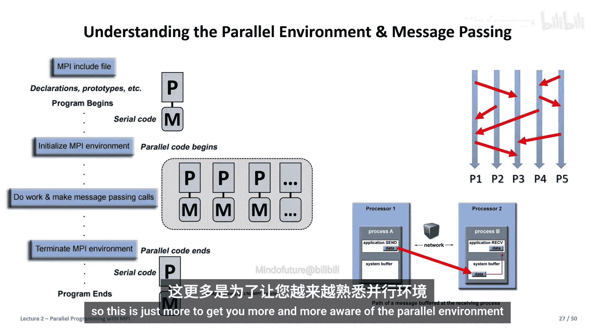

Now another interesting thing is when you have the MPI program and a little bit this was already in the hello world example that I had the last time right it was very easy hello world。

 that's it。So and we could execute it a couple of times I did S batchch。

 if you remember a couple of times with a job script we could a couple of times fill the world independently。

So independently means it was just a program executed， done。Now。

 what this slide brings across you a little bit is this difference in terms of awareness。And output。

 do you see one interesting and very important addition to this。Right， which also sells， you know。

 it says a bit the stories of solving a problem in a cooperative way， of course。

 hello world in a cooperative way。It's a tutorial， it's the first。

 let's say training lectures and MPI， but think about it that every of the processes that you have now when you use this MPI。

We'll execute the hello world， no doubt and we'll bring a beautiful output。

 but it has a certain awareness that actually I am one or four。

RightAnd this brings back this idea of ranks that I brought across in the first part of the lecture today。

 so the MPI environment。When you have initiated properly and will execute the job with MPR run。

 for example。The schedule will make sure to schedule that on different processors and will' bring back to the MPI environment that you have。

 let's say， asked for four processes in the job script。 hence the processes that know。

 although they're completely independent。 Now that's important right to understand， in a way， it's。

 of course， one MP program on four processes。But they still run their source code as it would be basically independent。

So hence there still was a rank they heaven awareness that I'm just zero out of four or I'm one out of four。

 so theres a certain identity and this will be an important part later down the road when we have more complex applications we will start already in practical lecture 2。

1 if you think about the simple ping pong between these two。Right。

 you would say you need an identity who is implementing the ping and was listening for the ping and who is actually then implementing the pg and who is listening to the pong。

So basically this is something which will be the first， let's say。

 more elaborate application example if you want between you know hellello world and the more explication example。

 but this is now important to realize that this is what MPI brings you as an environment。😊。

And of course， this is in collaboration with the scheduler right because the scheduler then that we learned in lecture 11 will be the one that says。

 you ask for eight， there are no eight。Sorry。So in this sense。

 your job will wait until they ate processor， and then you get what you ask for。Alternatively。

 many others have asked for 16 processes。And you come along and you know there's I just need four and the scheduler will say。

 well there's a whole of four， I mean everybody ask for 16 but there's a whole of four processor now in the schedule。

 I can schedule you now and your job gets immediately scheduled because you just ask for four。

However， of course。It's not that simple in applications usually right you of course ask for a certain amount which scientifically makes sense which engineering wise makes substance to your application let it be the turbine we learn so hence this is just the more abstract way of thinking about it。

 but it should capture。For you， the the benefits of using MPI in parallel on different processor。

 not only getting computing， not only getting more memory with distributed memory and the message passing。

 also the whole environment。 and we will learn more about this about communicators。

 So there are certain amounts of processes are grouped in communicators as there was alluding to in the certain part。

 one as well。

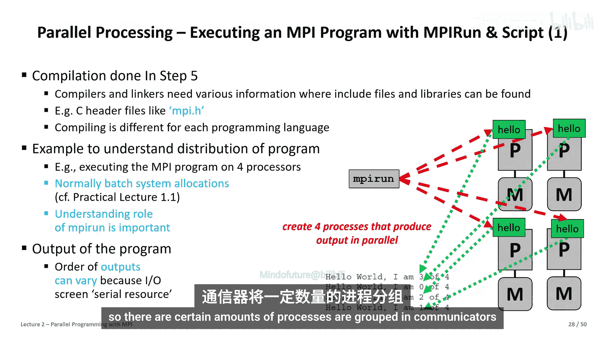

There's another way of elements and let's say quite a fraction of the MPI standard that is talking about so- calledled nonblocking communication and I think it's also important to mention this already。

 needless to say we have a small demonstration in practical 2。1。

 but here I was always in the beginning now in the first part and now always saying there's a cent and then there's somewhere a receive。

Right， and if you do this。You have certain waiting times right let's say the processor which is the timelines that you see here involved in having the receive operation and processor having the send operation they will do this at a certain amount of time as they you know basically compute so this could be a waiting time which is a loaded term actually in exactly what I told before in performance analysis isn't what you want to avoid right because in other words you know some processor are idle though this processor here in the waiting time sorry for that basically aing and doing nothing it is already ready to receive nothing happens。

And then this comes an MPI send。At some point in time now I can proceed。

 now I can work as the data I need from the MPend and can work on my received data。And of course。

 you can stretch this across different processor， hence there different ways of doing also nonblocking communication where you will say。

 perhaps I can do something else in the time and keeping the。

 let's say that the waiting time smaller is some nonblocking communication。

RightSo that I can still do something maybe with the MP I sent here。And however。

 this goes along with the MPI weight operation， so they have a different weight operation that needs to be in combination versus let's say non-blocking operation and you have different really scenarios where this makes a bigger impact you know also waiting sending and one way to understand it is really that the computing or what the different processes can do are not always a very extreme equal load。

 although you have the same program you maybe compete on different data sets which are much more complex in one than in another。

 so one processes may be much more quicker done and then receives and waiting for the receive long time while the other one is still working a lot in the computing。

It's alluding to a problem we call load imbalancing。

And this will be something in lecture three we will target， so here bear is me。

 we don't can you know cover everything in one lecture。

But this is something where also here and there， you can mitigate this。

 Or you will see also an application example that this is often used in practice as well。

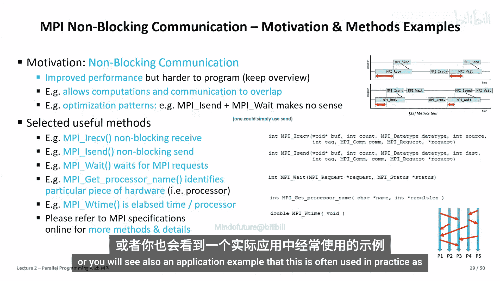

So in a way that's saying a little bit how I already you know explained it here the practical example and then also the understanding of this domain decomposition is sort of essential to understand it a bit hence instead of using this light I would rather put you an emphasis on this side。

 considering that you maybe have even or neighbors you want to talk to right and this brings back our example of the waves of the ocean。

 we want to simulate you know maybe it's the coast you know the from UK over to Iceland here in the very coarse grain scenario but you want to understand a little bit what's happening。

On the alt of this different ocean tiles。And for this， you basically need all your neighbors。

 and this is a little bit alluding to the source code here that you can actually now exchange information between your different neighbors and you would do so maybe with an I send and I receive a non-blocking send and receive because a computing itself might be very different in time might be very different in terms of application logic even I was mentioning that some maybe have the sailing board to some other tiles not。

 or let's say phish， the amount of phish might be very different to compute on one tile on one tile knot。

So this would help still by exchanging this information， and you would do this in every time step。

Right to let's say， give the information to your neighbors with ancent， but of course。

 you can imagine now if I want to compute in the next time step， my wave height。

The water in the my neighbouring tiles that actually are swapping over if you want。

 and their wave height will influence me。So I have also certain received to it right and hence for let's say nearest neighbor communication。

 this is an essential paradigm and we will come back to this in lecture three when we talk about domain decocomposition more。

Obviously。And by doing so， this is just one application example where it's I think more clearer why you need this sort of non-blocking communication。

 but also why you at some point in time basically also on to weight。

 perhaps for all of these have taken place so that you can basically give an informed answer you see here。

 what I basically have received from you know all the different ranks from all my neighbors here。

 zero to， three， basically， smaller than four and so on。

Hence you see more and more to really understand it fully every now and then source code is really a bit much more better to tell and those application examples that I will bring in lecture 2。

1 and lecture3 then with domain composition so in the moment just be aware that it does not need always to be you know a blocking send blocking receive I can do nothing else。

So in that time where maybe have initiated the receive。I can do something。

 but there's an NPI wait if I really wait for it that I got to resent in the end。

It's a bit abstract understanding， but I think also the graphics here gives you a little bit more an understanding why that is an interesting concept。

Hence， the practiceus will follow huge。Let's say another important part in this lecture。

 especially in the second part should be now IO。So I owe input output very trivial。

 usually you would say， well I usually have it on the screen， if not on the screen it's in a file。

 big deal。So in parallel Leo， there are certain complexities。

 and this has to do with a parallel in nature on the processes living on their own。

So basically I told you once to think about the processors here in the HPC system。

 then I told you shift the view on the networking where I said this now makes HPC important right because have extremely well interconnect and now you better understand why。

Right now basically the interconnect is always used when I want to you know。

 talk to many processors at every time step， except the wave propagation， you know。

 approaching from Iceland， the UK and other parts of mainland Europe or whatever。

You would have this at every time step having exchange of neighbor information to understand。

 you know， different physical variables。 wave height is just another， maybe even fish population。

 whatever。 So this is information again and again going over the wire。

 Hence I told you shifting the view to this。 This is high performanceform computing。

 This is very important。 The same is true for climate for weather prediction right So here I ask you again to shift now the view again and not so much only on this interconnects which carry the data but also then the storage right So data needs to be somewhere stored and that's where we talk about certain parallel O techniques that actually adopted from many。

 many different applications as well。 these concepts。

And you will even see that more and more you know applications are actually sort of IO bone。

 so you could even throw of them more and more computing power， more and more processes。

 but the IO still dominates the overall execution time so it's more harder to read all the data every time step so that the IO performance is crucial for the overall performance for most notably if you think of I scales。

RightThe same is true even in deep learning we will learn right if you want to let's say give the GPUs more and more data you have to get the bandwidth for it or you you have to have the data for it to also fuel the many GPUs with more more data hence you would say the deep learning algorithm should be no faster and faster training。

 yes， we can do that with distribute deep learning but it has limits of course from the available data that you can stick to GPUs and also the speed that you can fuel GPUs with。

And this is all an I O challenge and a point I was doing before a little bit in the introduction。

 but we will come back to as well。 You can mention。That of course， certain elements like rate levels。

 data duplication， replication of data， there are many topics as well。

 which sort of play an indirect role for HPC。 We tackle them more in the cloud computing and big data course。

 right， So where we have also you know different approaches to several of the data problem。

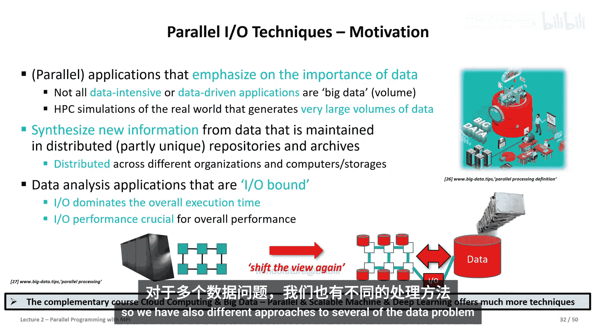

So what means IO really is something what you see on the left side。

 we have some beautiful memory very fast， lots of data to be computed。

 we have beautiful MPI can exchange messages， compute。

 but at some point in time the applications just ready or needs data right。

 it could be experimental data that we talked about before from observations。

 so real life data that maybe helps the simulations to get back on track or to have important initialization data but disks are still sort of important。

 so don't get carried away that HPC just can solve everything just by more memory。

Hence we need disks， we need IO， and this is now something where a so-called parallel file system also becomes an essential part of it。

 so something like luster and so on there's specific file systems that basically treat the you know concurrent access to a file as a common event。

So again， concurrent access to a file from different users is a common event or from different processes。

 really。RightSo hence the parallel file systems are made as a name suggests for parallel access to files to data。

 and that's what we're going to learn based in the next couple of slides。

 how that is realized and why this is so challenging。

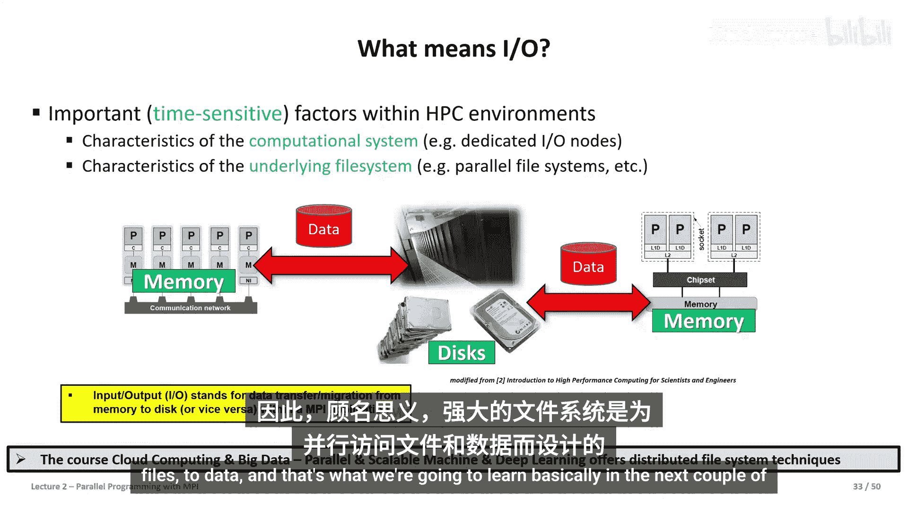

Right。And。Another point in this is of course， that although it suggests that just put more capacity。

 more storage to it and you see here also storage robots right you see here tape archives getting you know into something we call tertiary storage where you then have you know huge capacity。

 but it's incredibly slow。To me or basically files back to your disks takes a lot of time。

 especially if many smaller files， hence you cannot just run an application。

And then assume that you get many terabytes out of a tape robot。

So this is one of the pattern aspects of it another one is of course。That。

You have to instilled the network interconnectivity between the different nodes。

 That means not all of these nodes are maybe one to one with a perfect line interconnected you have something like three networks and nowadays also dragonfly networks since we also don't tack in this course intensively anymore we talked about this in previous iterations but because of AI we also had to sacrifice some of the topics hence the IO is also a bit dependent on the network interconnect right so how well is that are there certain IO nodes that play a specific role that we have seen。

 for instance， a blue gene in our systems IO nodes that handle IO for many different processes and of course they can quickly become a bottleneck if you have an IO intensive application。

So you see more and more is you know this IO a challenge in MPI applications and the most dominant challenge if you want to a little bit is probably how you access the file many of you know that from your serial processing on a laptop you have a text file open and you open it up again。

Right on a laptop。 So you would have twice the text file open。 So when you edited in one editor and。

 you know， you don't save， then you go to another editor， you sort of have a problem。

 If it's a smart operating system where I think the laptop will actually tell you something will say。

 well， this text file has been edited or this text file is not saved。

 Do you want to save it before the other text editor editor。

 So we talk about a serial access right to a file done by one thread on your laptop here we have the same problem of serial access。

 We have one process。

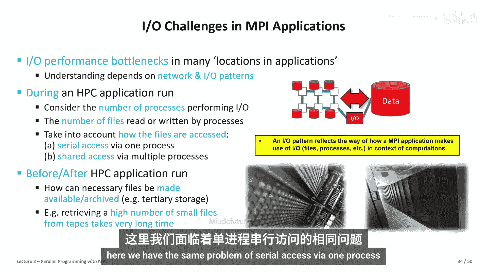

That I think is trivial to do right so it opens the file writes to the file or reads from the file done closes the file so shared access we have multiple processes now if you think we run 512 processes in parallel and all have to need you know have to have the access to the file right to the file in parallel the shared access is of course now a challenge and this is where you know basically parallel IO comes in that's where parallel file systems are good in the storage。

 let's say the single file basically more distributed and something we call file blocks so in the end you have to think about this is also then giving you the scalability right so that we have many different file blocks of potentially you know many。

 many different you know bytes terabytes even also so so advantages is then that you know you have this combined benchs of all the network to it and the physical drives right。

In the certain fire blockss that many processors have still， let's say， different access to it。

 although logically it's still one file and we will make the case in one of the slides for it。

Of course， and the disadvantage is it's you know the file system in a way then it just stores blocks and if there's let's say one block lost could be。

 let's say vulnerable to problems， disc failures that actually happen in the HPC center almost it's so weekly in a large center。

Yeah， different areas where you can improve this and wonder of it is than the redundant area of it。

 the inexpensive disk， the rate systems with different levels where you then have to think about how much you store versus。

 you know the benefits you get of getting your data safer and safer。

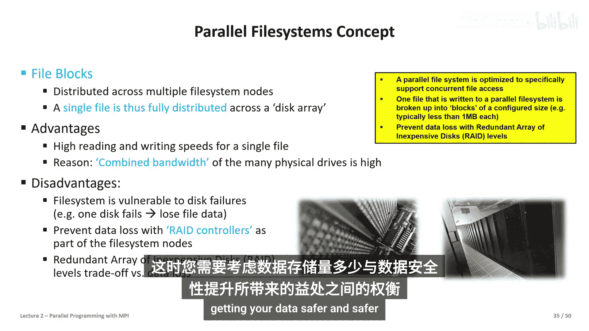

So this is one way of doing it and examples of this parallel file system then to。

 it's say treat concurrent access to files and rather is a normal point would be in the past maybe GPSFS and which has been now renamed to EVM spectrum scale developed by EVM。

So not， let's say directly an open source solution。

 but there's also lusre as an open source solution that is often use these days。

Whi essentially is in the power file system that really supports on the file system level our MPI applications and there's also MPIAO that I want to bring across that then leverages these functionalities。

There was also PVFS quite known in the past， although I have to say lus is quite commonly used today and of course also EBM spectrum scale。

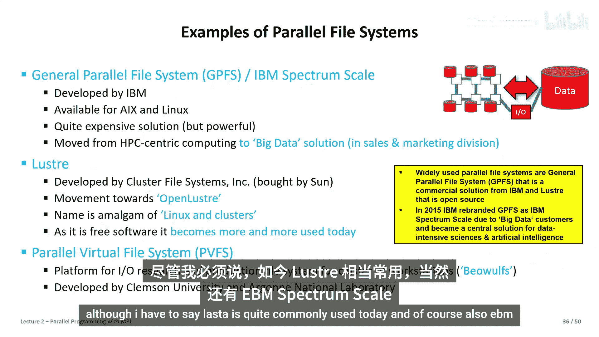

So。Coming back to the logic， however， how that works。

 And this is an important idea because we talked about that now we have， let's say。

 par access to files。 So we see that here has different threats。

From different processors accessing one single logical file。However， if you now。

 and that brings into two mappings， if you look on the block idea and the IO notess that we discussed。

This is going to a very distributive computing setup。

And this is a key to really is now the understanding of it why it can be having a much higher throughput than let's say really a single physical file right because otherwise then one thread has to wait for another to write and then another has to write and if they are5 or 256 or whatever 512 processes that want to access one file or even thousands then you are in deep trouble。

 hence this mapping of blocks and compute nodes is an important factor where we basically also striping through the different available possibilities and the striping is a little bit shown here。

 two different IO nodes in terms of a logical file so certain areas are always mapped you which is striping technique to one IO node or to another。

And for the application domain scientist or the people implementing MPI。

 it still looks like a logical file， but underneath。

Let's say parallel IO and the IO libraries take care of quite some mapping to really get it in a distributed fashion right so hence we should call it a parallel and distributed file system in a way。

Distribut not because it's distributed among many hosts。

 so not on the internet on location A and location B。

 but rather on different locations within your storage you know system and you see here one of it that we had in Yuli this is just not computing this is storage right in all of these different racks so showing you also that computing is not always about CPUUs GPUs it's really about data as well hence our complementary course is called big data cloud computing these are all topics very close to each other hence with a shift the view we have done this interesting facets of saying data is important and we still have to have the point that also the network topologies are important right so。

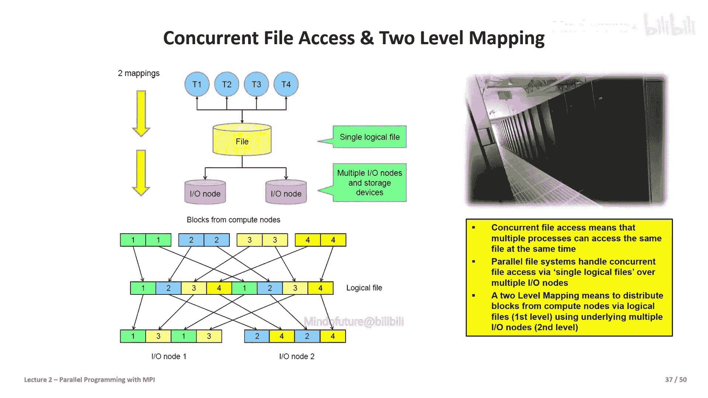

Usually you would have when you have now MPI or maybe a Tos network that you see here that means every processor is very nicely connected with its neighbors。

 supporting a little bit what we have seen across the ocean。

 right at every time step I want to get information from my neighbors and they are just let's say from the network interconnect always directed connected to me however。

 you know some implementations maybe have rather if you want to see here a tree sort of network with oversubscribed connections so not everyone has a full let's say bandwidth to the other processor。

Which is not a problem for toy examples I have here in the course。

 But if you have a real big application， this can be already creating quite some bottlenecks。However。

 coming back to MPIO， you see how that works a little bit in the bigger scale of communication you learned a lot different from point to point。

We said a little bit with weight right with non-broing communication as well。

 there are some ways of synchronize and then with MPIIO we entering a new facet of MPI and that's what I want to do in the last couple of minutes。

 however， take away the message that there will be also practical lecture 2。

1 examples and some of them are so easy to understand that we can go relatively quickly。

 I think through through some of the examples。

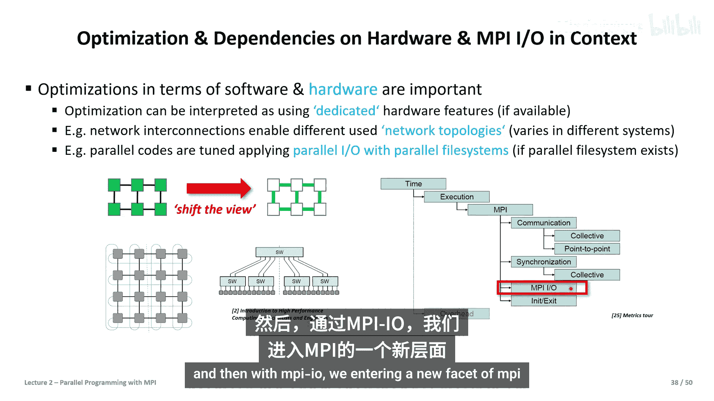

Also to contrast it now， what might be more performance or less performance？So MPIO in principle。

Means we have done something in our timeline as a processor。

And I have a result I want store right now immediately come to think， okay， then I have my own disk。

 I store something。Same for processor too I have my disc as do something and so on and so on so in a way now when you see the anecdote and this is also one point of this slide it is a bit similar than maybe sending messages to an IO device。

Right， hence， if you look on the MP I I O standard， it looks a little bit like。

Messaging right just to IO hence there's a send receive sort of understanding and also collective information that I want to put everything now to one file。

Instead of communicating everything to all the other processes。

The API is a little bit supporting the idea of collective operations that this makes sense because we want to scale right we want to use now 512 processor in parallel and I don't want to implement now that everybody actually please store your result。

Its logical right that's 512 processor。 I don't want to make the effort。

 I just want that one source could line saying for all processes please write all your results now in this file let it be for what we call checkpointing。

 maybe assuming that you maybe even let's say computational intensive climate operation you want to simulate or climate simulation of some sort it runs for 36 hours。

 So maybe checkpointing every four hours is good because if the job fail at any point in time you have wasted maybe 24 hours and this is an error in the last you know couple of hours。

 so checkpointing is also a very important concept motivating MPIIO again。

We don't have big slides on it， just a sort of more motivation around it。

And MPIO and this is then also something we lose a little bit perhaps by bringing in more AI now in previous lectures we had also MPI derived data types。

 so you can actually have advanced concepts to have big arrays struck different data structures really also send around as messages and defined in the MPI environment。

And this is something we don't tackle much more in the course。

 so here I would point you to basically the last couple of years。

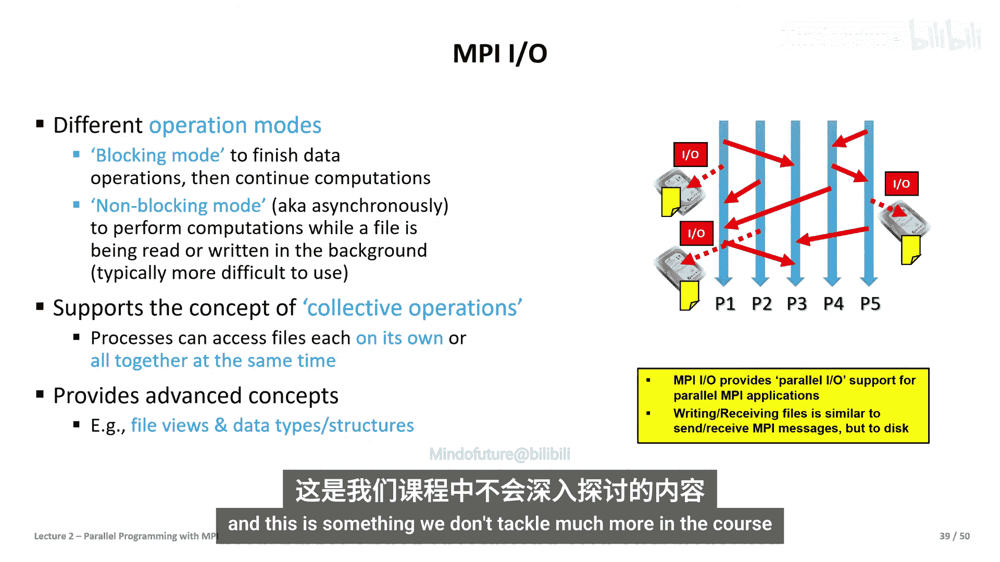

However， now think about AO， what you can do is， of course， a sort of serial approach to it right。

 so and this is now needed to really understand the difference what Paul I is doing。

 So hence don't do this。 Its not that I teach this。

 I just say it's important to understand the difference。

So when you now think about 512 processes and say， well。

 there's one fellow that we determine basically as a master worker concept if you want。

To say you're the master OL or we sent you everything， you put things to file。

So one process in a way takes care of all the other processes。

 what you can in a sense do depending on the application logic。

 but obviously there's no scalability remember the buffers。

 remember it has to be all communicated to the memory before this processor then can take the memory and drop it to disk。

So let's assume we have 512 processor and they have all used their memory intensively， so maximum。

 the processor has not even space for it。Hence， or basically he has to serialize this so know after one after another。

 you know everybody comes send some data and then write it to file。

 so this is something where you can imagine automatically this will take a long time。Right。

 as it suggests， right， So youll see， that's a timeline here。 So first， the first processor。 Okay。

 the second， the third to fourth。 So there is a long timeline。

 So this is really an increase in communication and also has lots of load imbalance risk。

 So everybody else is waiting here all the time until the Iowa is done in continue processing。

Hence there's a smarter way to do it and now you would say。

 well that's sounds of logic everybody is you know doing it on their own one file per process in a way that's what we can call also par LeO it's fair and square so you would say everybody has its own share on the on the IO and then。

it's just dropped the data we have maybe from AI applications reading in different data sets sort of things So in a way it's also practically here in they' applied data you have data parallel but also there there are different ways how to make it better using really parallel is one file but this is something we come later to when we learn about distributed deep learning。

 but when you think about traditional let's say sciences here in terms of physical sciences you would have different results during the all two different IO on their own let's say discs might be interesting but the problem is usually that then the file system often gets into trouble for instance the number of inots that are then available on the file system right because many。

 many different files let's assume we run it for 25000 processor that means at one point in time we create 25000。

At once。Because everybody has its own file， everybody has its own thing to write in。

 but the file system remains the same。Right， it's all for one the file system。

 So hence suddenly dealing with， for instance， Linux derived derivatives are usually on HPC system。

 So the i notes， which is a concept then storing all the information about files。

 directies and so on is then let's say in a serious trouble， creating all of these files hence。

We call that a bit sort of contention withci file system it's also not really scalable this parallelo。

 although it is sort of suggested by the way of doing it so。

But the way really to really scale in a wayale would be then the shared file So this means that you know of course every process each perform still its IO so obviously I have my memory and in my memory all the results from the data I want to store have' computed I have exchanged messages physics whatever it is and now I have lots of data I want to store but I do so with is one big shared file and in a way you would also say file pointer right so in previous  course we were going a bit more you know closer to the details with so-called file pointers within the disk that you basically need in order to know you know to write this logical file and so on so hence we're talking here about that this is you know feasible in terms of scaling however obviously when you have many。

 many processes and now and I'm leaving the。The thousands， but rather talking about 10，00000。

000 processes， this gives still some contentual of file systems right for several different purposes。

 but this is something where。This MPIO then would take the way of programming of saying。

 let's have a collective operation。Something that almost like you know sent like the broadcast operation sent to everyone。

 but the send of broadcast I want to write right but every process is involved at that point in time to write the status for instance for checkpointing right it's now four four hours of computing let's make some checkpointing where are we with the weather was a climate so and then continue processing so in a way then the current result is put is parallelileo into this disk。

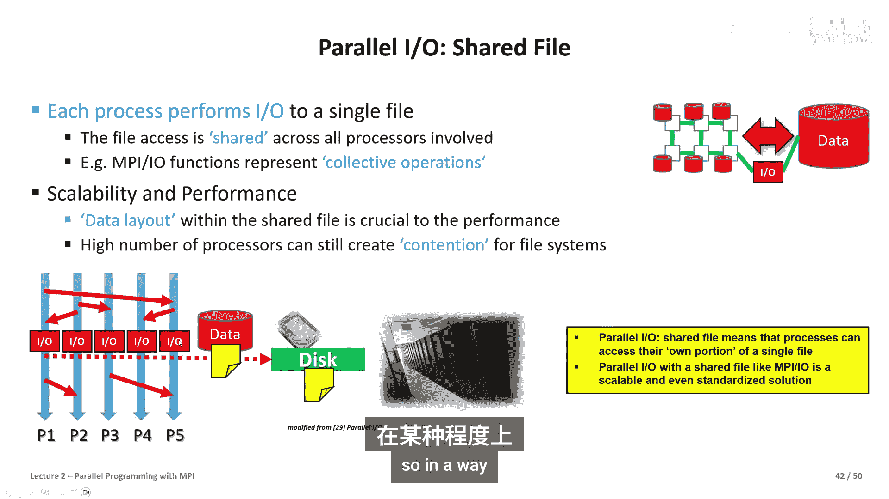

And this is an enormous benefit in terms of time， and obviously it's just a conceptual idea here of the course I will give you one example in the practical lecture 2。

1。But how it is used is also with significant extensive options of so-called higherlevel libraries right you will see that the way how it works with applications accessing IO hardware is truly not just the parallel file system usually you have a highlevel IO library like HDFI for instance these days or net CDF which really have you know different facets that we will only cover a little bit in this course here because also that is something we sacrifice a little bit more in terms of getting AI in。

 but this works together we see let's say runtime of MPIIO quite well in order to abstract them from the parallel file system in ways that you see you can still program let's say the IO as it would be message exchanges to the file almost right so write read and so on but collectively across many。

 many different processes you don't want to do this for each of the processor and then。

If you have a certain standard how to write this information is another point data structures hierarchical data format can be seen a little bit like a file system in a file right so you would say you have slash something slash data slash names slash phone numbers s so it would have within one file and idea of a file system for example。

 netCf is good with arrays， multidimensional arrays used in climate weather simulation so they have all their modelss oforundi if you want even a certain community standard behind it and to abstract from this they base on the IO library from MPI in order to make the read and write happening in a scalable fashion。

And。This is， I think， the most key elements I could bring you across from MPI at large。

 admitteditably leaving many things， one of it is Elgather。

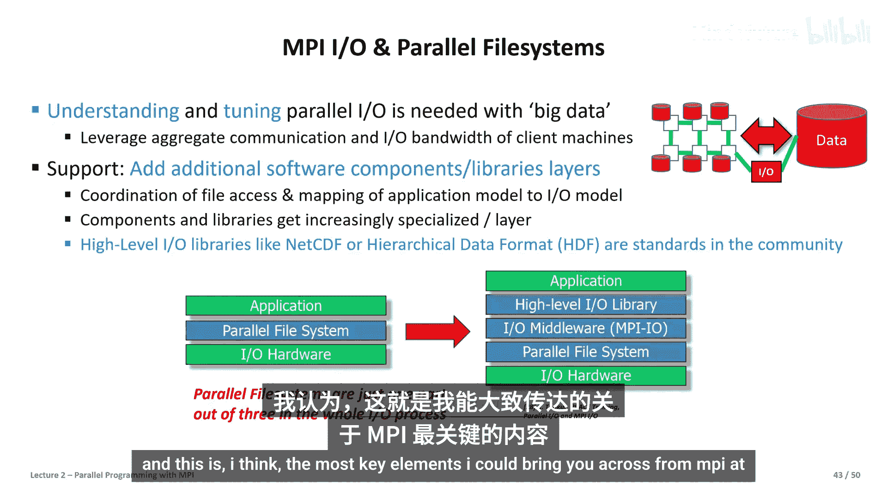

That I didn't cover it， but it will come back to us when we talk about deep learning right so hence I would also encourage you to look a little bit on this video it nicely summarizes again zero versus parallel and also this different let's say communication paradigm we have seen。

So we continue this practical lecture 2。1 with really bringing source code to the game。

 doing some practical examples on HPC system， using schedulers。

 asking for different amount of processes， which is the other part of the story， so talk to you then。

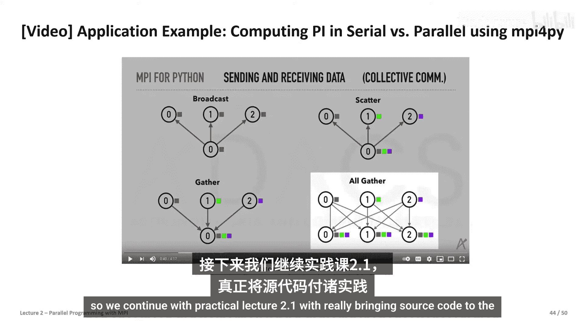

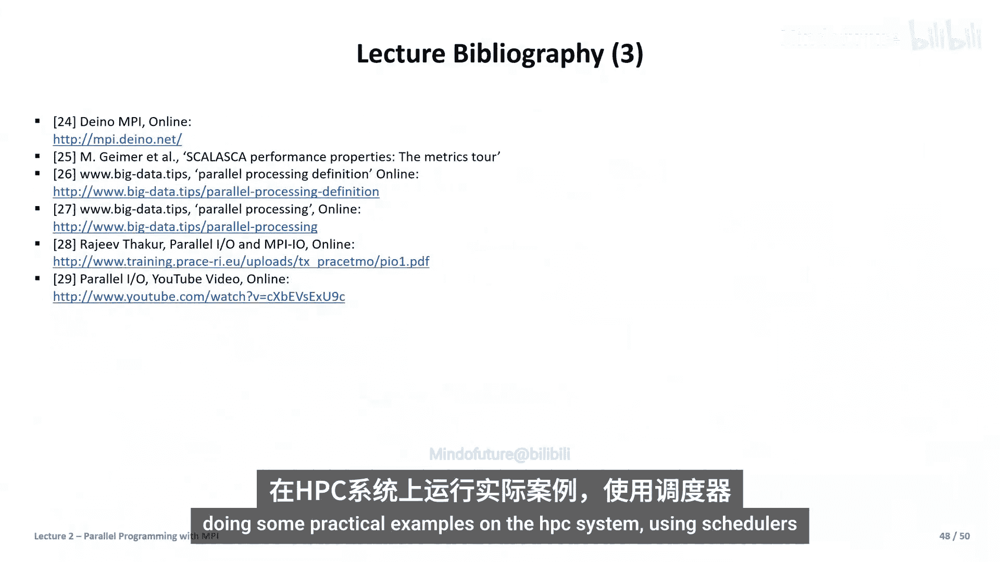

