# 高性能计算课程：2：使用MPI并行编程（第二部分）

在本节课中，我们将继续学习MPI并行编程的核心概念，重点探讨并行环境、非阻塞通信以及并行I/O等高级主题。我们将了解如何编写能够适应不同进程数量的程序，以及如何通过优化通信和I/O来提升大规模并行应用的性能。

---

## 并行环境与进程意识

上一节我们介绍了MPI的基本通信模式。本节中，我们来看看MPI程序是如何在并行环境中运行的。

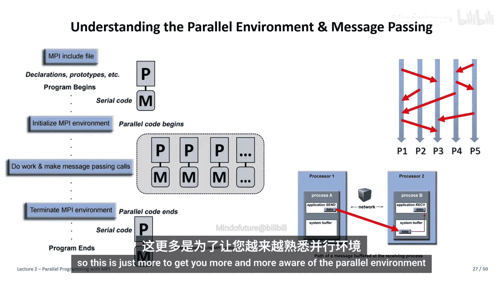

一个MPI程序在启动时，会创建多个独立的进程。尽管它们执行相同的源代码，但每个进程都拥有一个独特的身份标识，称为“秩”。通过`MPI_Init`和`MPI_Finalize`，程序在它们之间划定了一个并行执行区域。关键在于，我们通常编写程序时并不知道最终会获得多少个进程，这个数量由外部的作业脚本（如使用Slurm调度器时）决定。这使得同一份源代码可以灵活地运行在不同规模的处理器上。

```c
#include <mpi.h>
#include <stdio.h>

int main(int argc, char** argv) {
    MPI_Init(&argc, &argv); // 并行区域开始

    int world_rank;
    MPI_Comm_rank(MPI_COMM_WORLD, &world_rank); // 获取当前进程的秩
    printf("Hello from process %d\n", world_rank);

    MPI_Finalize(); // 并行区域结束
    return 0;
}
```

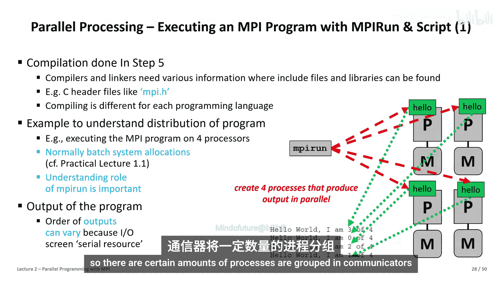

---

## 非阻塞通信

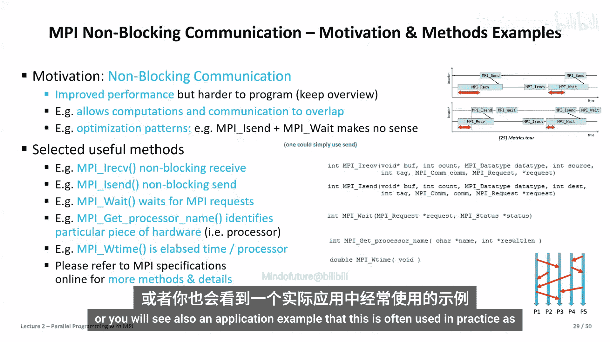

在点对点通信中，发送和接收操作通常是阻塞的，这意味着进程在操作完成前必须等待，可能导致空闲时间。为了更高效地利用计算资源，MPI提供了非阻塞通信。

非阻塞通信允许进程发起一个通信操作（如发送或接收）后，立即返回并继续执行其他计算任务。之后，再通过`MPI_Wait`等函数来确认通信是否完成。这在计算负载不均衡或需要与多个邻居进程通信时（如模拟海浪传播）尤其有用，可以减少等待时间，缓解负载不均的问题。

以下是使用非阻塞发送和接收的基本模式：

```c
MPI_Request request;
MPI_Isend(&data, count, MPI_INT, dest, tag, MPI_COMM_WORLD, &request); // 非阻塞发送
// ... 此处可以执行其他计算 ...
MPI_Wait(&request, MPI_STATUS_IGNORE); // 等待发送完成

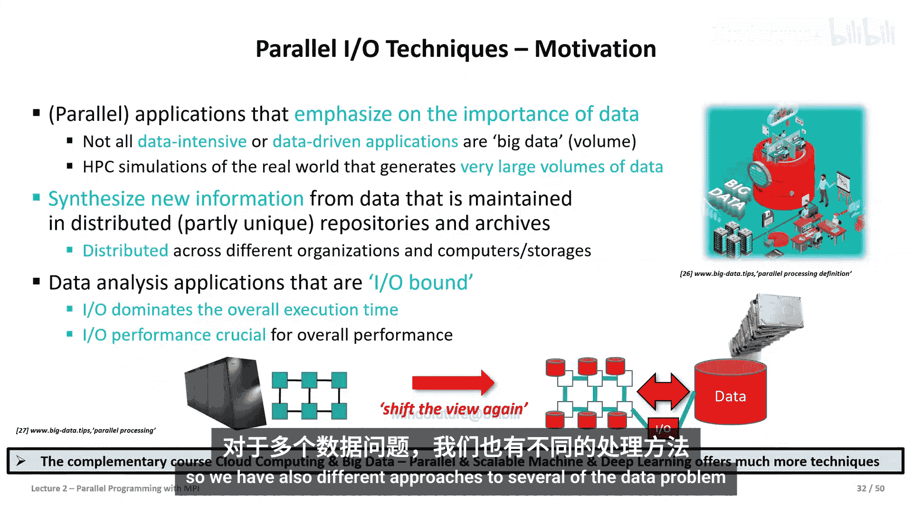

MPI_Irecv(&buffer, count, MPI_INT, source, tag, MPI_COMM_WORLD, &request); // 非阻塞接收
// ... 此处可以执行其他计算 ...
MPI_Wait(&request, MPI_STATUS_IGNORE); // 等待接收完成
```

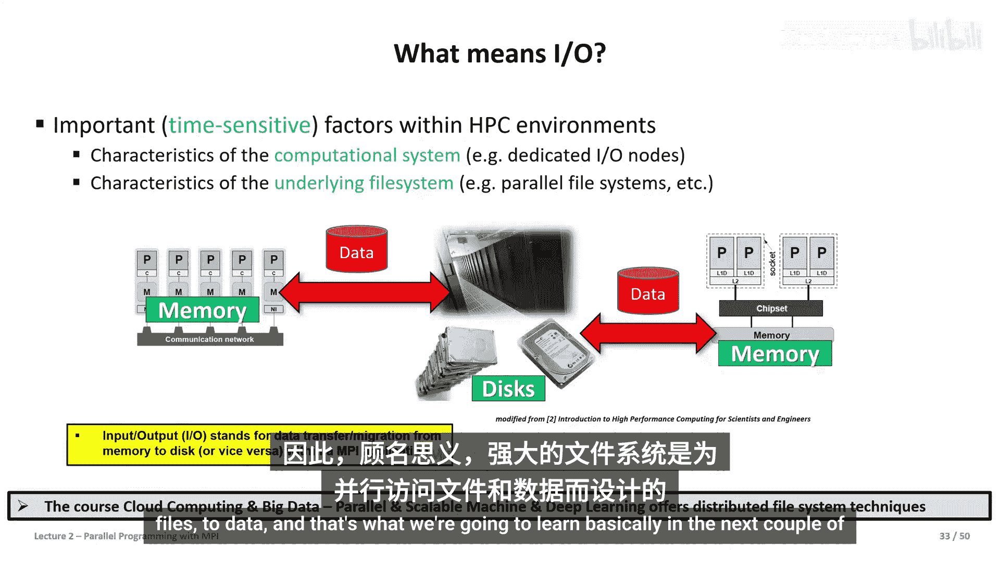

---

## 并行输入/输出（I/O）的挑战与解决方案

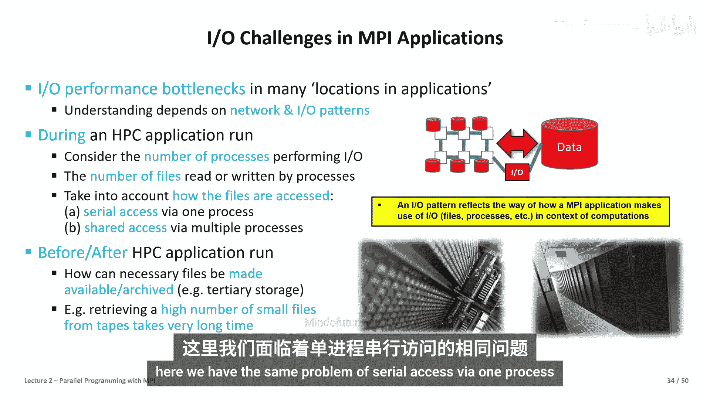

当并行应用扩展到成百上千个进程时，数据输入输出（I/O）成为一个关键瓶颈。与串行程序不同，并行I/O需要处理多个进程同时读写文件的问题。

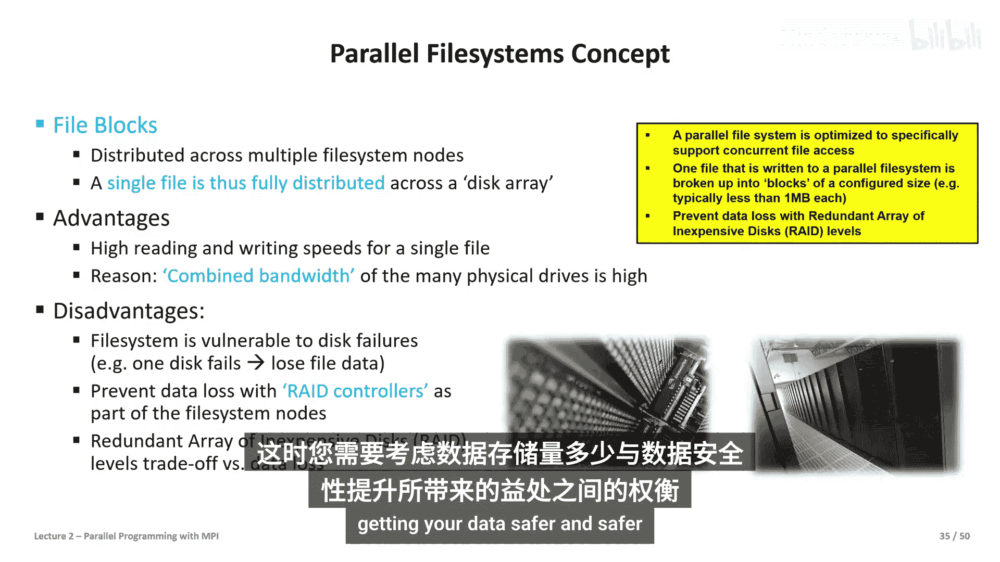

### 传统I/O方式的局限

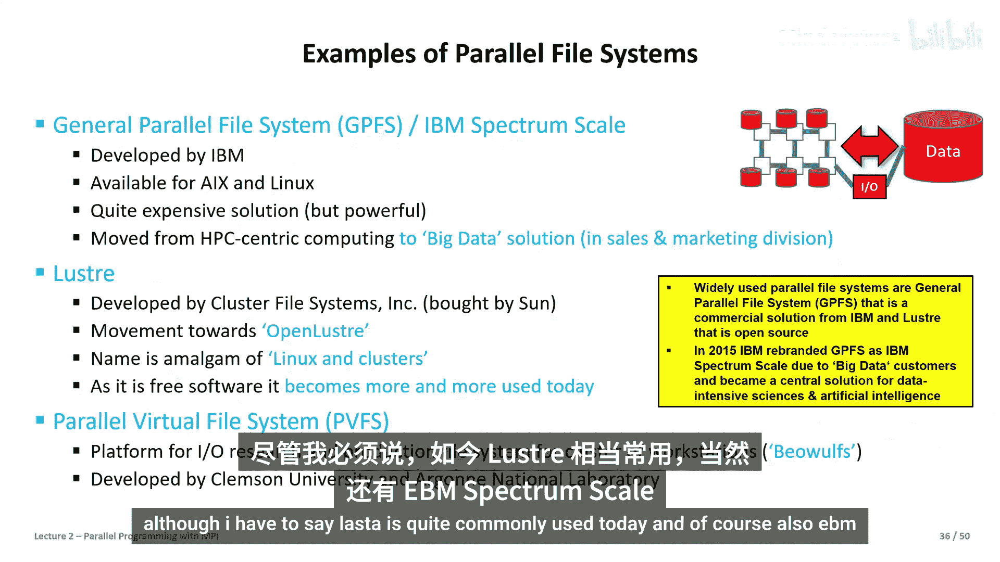

如果让所有进程将数据发送给一个主进程，由它统一写入单个文件（串行I/O），会造成严重的通信拥堵和负载不均。如果让每个进程写入独立的文件（伪并行I/O），则会给文件系统元数据管理（如inode）带来巨大压力，同样无法扩展。

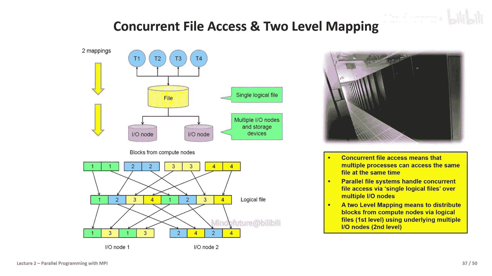

### 并行文件系统与MPI-IO

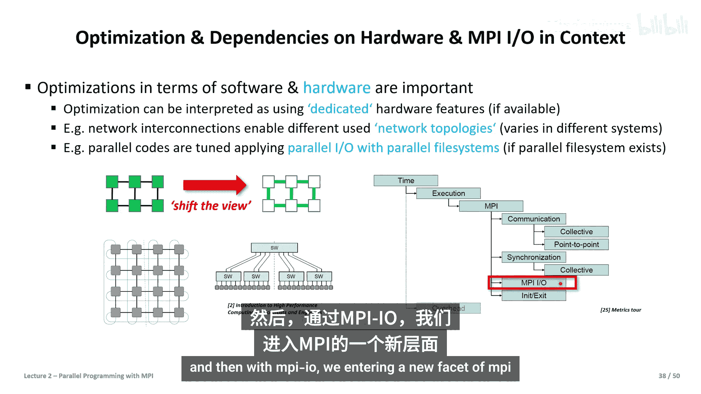

解决方案是使用**并行文件系统**（如Lustre, IBM Spectrum Scale）和**MPI-IO**接口。并行文件系统将单个逻辑文件在物理上分割成多个“块”，分布存储在不同的I/O节点上。MPI-IO则提供了一套API，允许所有进程以协调、并行的方式共同读写这个逻辑文件。

这种方式结合了集体操作的思想，例如使用`MPI_File_write_all`，所有进程可以高效地将数据同时写入文件的不同部分，极大地提升了I/O吞吐量和可扩展性。这对于需要定期保存检查点的大型科学模拟至关重要。

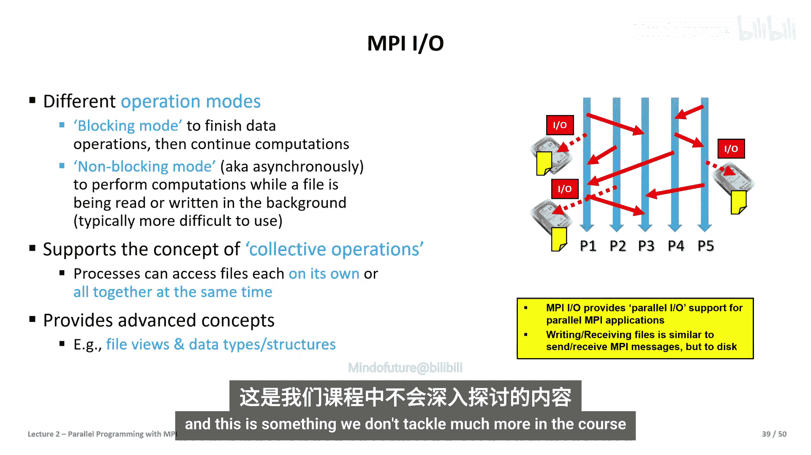

```c
MPI_File fh;
MPI_File_open(MPI_COMM_WORLD, "shared_data.bin", MPI_MODE_CREATE | MPI_MODE_WRONLY, MPI_INFO_NULL, &fh);
MPI_File_write_at_all(fh, my_offset, my_data, my_data_size, MPI_BYTE, MPI_STATUS_IGNORE);
MPI_File_close(&fh);
```

### 高层I/O库

在实际应用中，科学家们常使用基于MPI-IO构建的高层I/O库，如**HDF5**和**NetCDF**。这些库提供了更友好的数据模型（如层次结构、多维数组）和社区标准，进一步简化了并行I/O的编程。

---

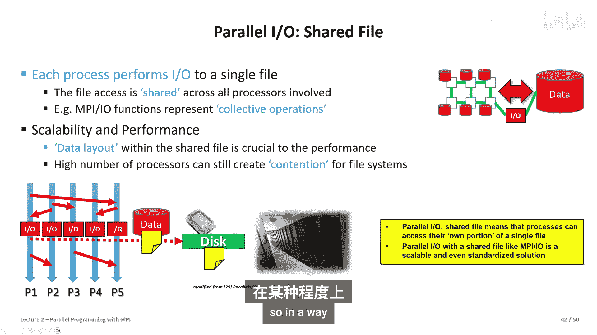

## 总结

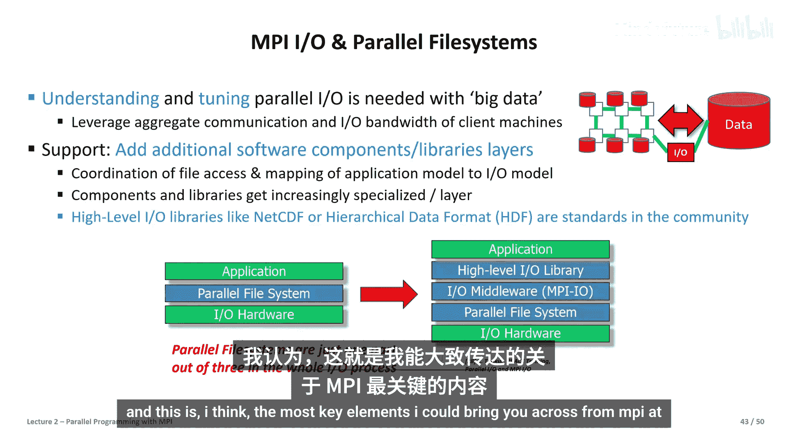

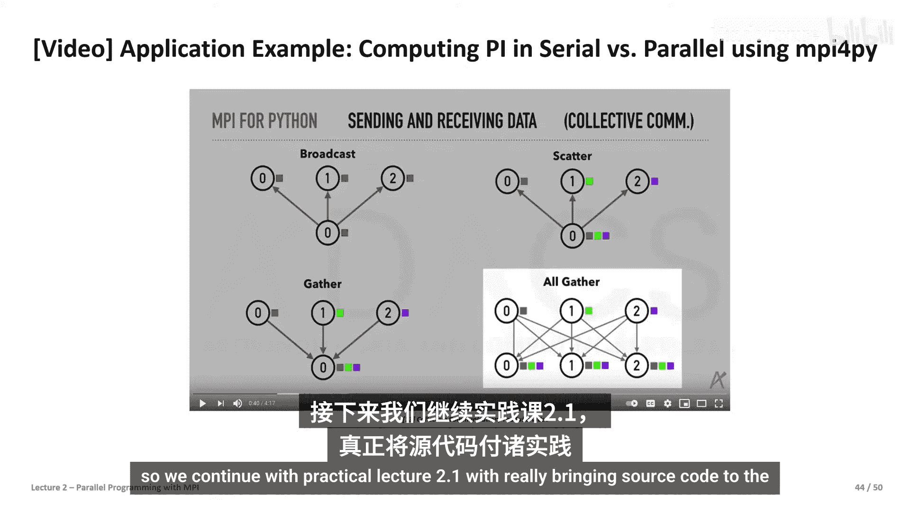

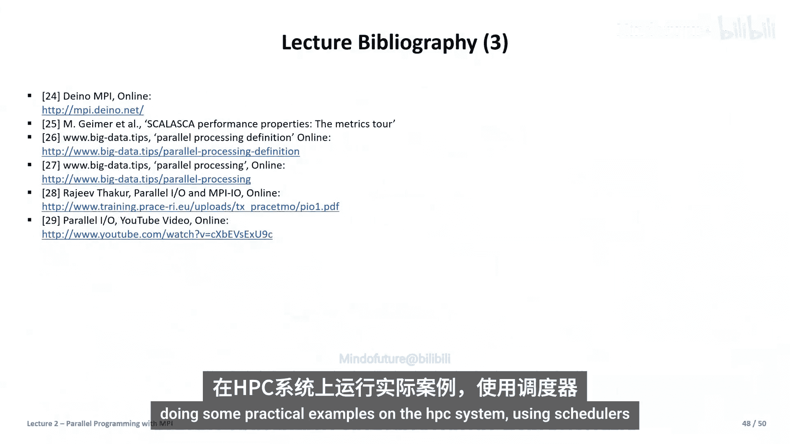


本节课中我们一起学习了MPI并行编程更深入的内容。我们理解了MPI程序如何在动态的并行环境中运行，并通过进程“秩”来标识自己。我们探讨了非阻塞通信如何通过重叠计算与通信来提升效率。最后，我们认识到在大规模并行计算中，I/O是主要性能瓶颈之一，并学习了通过并行文件系统和MPI-IO来实现高效、可扩展的并行数据读写。这些概念是构建高性能科学与工程应用的基础。在接下来的实践课中，我们将通过具体代码示例来巩固这些知识。