# 【冰岛大学】高性能计算课程-｜-2025-High-Performance-Computing-｜-Prof-Dr-Ing-Morris-Riedel-p23-P23_讲座_2_使用MPI并行编程_第一部分--BV1k34zzaEK8_p23-

Welcome， everyone for high performance computing， advancedanced scientific computing。 Today。

 we have lecture 2 with a conceptual lecture on parallel programming with MPI。Hence。

 it will demonstrate in generally what MPI can do， a broad overview how this can be done and how it supports Par programming reader is an open standard。

 and then we have a practical lecture 2。1 where we'll show much more source code examples。

 we will run together these source codes， of course in HPC that means in other words。

 we have to compile it as mostly C programs。And you will understand a little bit then in this conceptual lecture today。

 but also then in the practical lecture 2。1， how you pilot little program let's say and using this HPC standard really what you would call MPI。

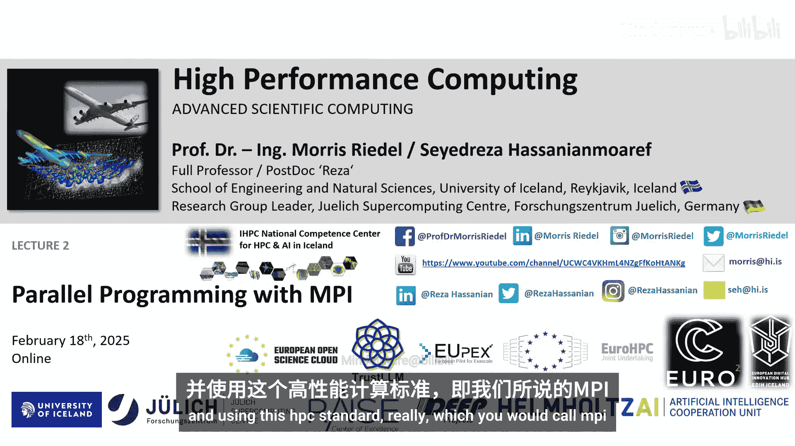

So before we go into the material of this lecture， then let us review what we have the last time。

And the last time was another practical lecture where I showed you a little bit the， let's say。

 relevance really of C and C++ programs， why are we talking C not Java。

 why basically Python is just very new in AI applications and has traditionally not played a role in high performance computing rather C++ and maybe even Fortron right when you have weather simulations。

 climate simulations， Fortron is really still used and in many application areas as well。

If you go to these many application areas， they are depicted a bit here if you want with all this。

Ideas here from many different areas of science and engineering。

You will see that many of them really have the CNncC++ codes in action and also implementations on it。

So from the traditional sciences in terms of HPC or that leverage HPC。

 you would say that would be numerical methods using known physical laws。

 it would be elements really which are not directly AI Mechanistic modeling perhaps so different areas where AI is really new。

 but there's a strong， let's say user area in HPC of using physics applications。

 multiphysics applications even which is quite fascinating if you think for instance。

 here in this groundwater modeling where you have to understand the groundwater really from different perspective。

 you have an atmosphere code called Cosmo for instance。

 a land surfaceface interaction code called C and then the subsurface really understand then the groundwater is pathflow。

 and that all fits together to understand and simulate what the future will bring。Hence。😊。

One important application of HPC as an example that would be scheduled somewhere because if you remember the second part of the lecture last time was really on scheduling hence in researcher in Earth system modeling or here basically in this ground water modeling would be perhaps getting one fraction of this HPC jules at the same time and this is now the importance of the scheduling。

 you have this whole U will cluster here you have some notes that are not really in service。

 there's a problem you know the maintenances working on it but the schedule shows there are many different researchers at the same time there's a brain researcher using the nest code right if you remember neural networks in spiking at the same time there's actually someone exploring earthquakes with a code on this fraction。

And there's another one that is doing cutting HAI and deep learning and machine learning applications with maybe a convolutionary network or now to encode and these different AI models are also scheduled at different portions here on the HPC system。

And this is really the。Let's say lessons learned out of the scheduling。

 hopefully for all of you this。The Moorandi of a shared HPC system which is very large there are many。

 many GPUs in Juve boost that be talking about around 4000 GPUs。

 they are not just used always with one person with one researchers or even one research group hence this needs to be shared and in order to share this effectively also thinking about backfils。

 the scheduling algorithms we heard first come first surf， but if there's a hole in the schedule。

 is there's space enough for a job that can be you know even if it has been submitted very late comparison to many others waiting。

But if it fits now on the HPC machine， why not using it， right。

 which is the concept of backfilling if you want， it's not really unfair because it doesn't block anyone。

But you use the resources and this is a key paradigm also if you think about scheduling。

 they want to utilize HPC resources to the maximum degree。

 so we're talking about that HPC resources should be you know in the utilization around 89% 99%。

 100% will be never achievable you see as is already right because here for an example some of the hardware will not follow you。

 there's always maintenance somewhere 100% is hard to get but the HC systems and the administrators and the centers that offer these systems drive always to the best utilization to get the best out of taxpayers' money and this are the situation is in the data centers right commercial data centers that want to have a long uptime also want to satisfy their users and of course have you know their hardware used to the maximum degree to also earn money from the customers so this is going into the segment more of cloud computing and big data where we talk about this。

More in detail， but then this is an important part to think about as well。

So this was sort of the idea of， let's say， putting CC++ programs in place and also thinking about scheduling。

 but we also a practical lecture。And we have seen that basically doing this with a very simple hellello project or source code in C was not really at all complicated。

 right， a couple of source code lines， but the more important concept was really not using it like this on the lockin node。

 but using the scheduler in order to get access to the compute nodes here on earlier。

 but the concept is true on jewelves it has exactly also lockin nodes， it has compute nodes。

 the same paradigm， just on an order of magnitude of scale。

 and with this then you would actually compute your jobs。

Depending on how much resources you ask for in the scheduling script。

 you can then actually create a speedup is one of the benefits really of using this HPC systems you see here 16 GPUs in parallel much more faster if you use deep or drups booster hear different。

 let's say HPC systems， but that's why you also want to have more and more compute nodes in order to have access to more and more GPUs。

Now， if you want to do this to the extreme and say， well， you cannot here， you know。

 have better speed up， but maybe in many other applications， you can。

 This is just one example of one of our papers here。

You always can think about let's have more and more on the machine。

 but you see also then of course you have to share the machine with others and they have equal requests or resources。

And we will come to this back when we talk about lecture2 to one now and also later in lecture6。

 lecture7， when we talk about deep learning again， so let's take a little bit to the idea of scheduling from the practical perspective side you have seen the source code was not really touched in order to submit the job in changes so you could always ask basically for more task for more notes you just submit the same executable and this will bring us a little bit a motivation now for MPI what we have here now you would program an MPI application to be scalable and this will be an element coming up now actually in this lecture。

 but it's important to understand the basics in scheduling still because they will actually be with us almost the whole course there's just a Upiter notebook which is a bit an exception that we will learn in deep learning a little bit still many deep learning codes are also used with job scripts so don't get carried away with Upiter notebooks or Google。

Let's say things when you do really let's say deep learning at scale with really big real applications。

 you need HPC at scale and this is not done with Jupyter it's rather done with distributed deep learning things you will learn in lecture seven。

However。We learned that this jobscript is basically also very trivial it has trivial information starting this is Spatch here。

 it's a separate file from the executable that we have you know compiled out of the C code right so important differentiation to Python for instance。

 we still have to compile C code here。But then we use this compilation in order to do an MP run here。

 but before we do this， we capture you know the essence what we learned in practical lecture 0。

1 of saying， hey， we have this module environment， so we have to have the right environment and hence we want to use MPI。

 although admittedably for the last lecture here we had in one1。We could do it otherwise。

 but this was a preparation for this lecture and Pra lecture 2。1 into your assignment。

 hence we stick a little bit to the MPI and open MPI for and then also the possibility of using then the MPICC for compiling to actually also digest。

 let's say the MPI statements that we're going to learn today。Finally。

 and this is another long in our feedback to the other lecture because it's incredibly important to understand scheduling otherwise you will not survive long in the HPC system does the final remark think about that it's a batch system you're somewhere in a batch queue hencey output when you submit when you' so to speak submit and run it is not given to you on a screen。

If have razly remembered， you got this in an output file。

 depending on your job ID that you get back when you submit this job。

 you have basically an output file。And this is the essence what we learned。

 I think in Pra lecture 11 to have a sort of really basic standing now in high HPC so now you're ready。

 so you can now think about much more how I actually use all of this computing capacity at scale and when you think about MPI that's a way to do or let's say it's one way to do so that we will cover in the first really the MPI concepts。

 a basic terminologies， what means message passing。

 what's the difference between point to point and perhaps also some MPI collectives sore very powerful implemented on a more treebased structure。

 hence a very also highperant and as our course suggests via high performance seekers hence this is important for us。

There will be some terminologies which have been， let's say always a bit complicated for students。

 MPI ranks， what is the world of communicators， this will be coming up also in lecture three。

 so I will make the first parts here， let's say some examples but we will of course we'll reuse this concept then in domain decocomposition where we'll learn lecture four and so on and so on。

Then。😊，Once you have the MPI basic concepts， it's good to think about some power programming basics and some smart students are always asking me So what's the difference between。

 you know， the course we had the last time and last year。

 And here's some difference now that we already include MPI I O before。 If you remember。

 we inserted some new interesting。Let's say topics into the course hence the situation is that our lecture is changing。

 so basically you see here that we have already looking a little bit about blocking and non blocking MPI communication。

 although some examples will come in the next lectures。We have IO challenges。

 which is another important factor traditionally was more later in the course。

 but now we put that all together in order to have more AI， more machine learning。

 more deep learning for you later。Hence here is a little bit the compact conceptual lecture today where we talk about what MPIIO can do。

 what the role of parallel file systems is， parallel applications leveraging this。

 and then basically community standards using HDF the hierarchical data format or NeCF， for instance。

 a so-called higher levelIO libraries， all of these topics， no doubt。

 especially if you think MPIIO and higher level IO libraries like HDF or NeCF can be complete topics of a course。

MI is very rich and we have in Uli， for instance， trainings that cover the whole week。

And similar aspects were three days， at least of MPIIO， RLIO， HDF， net CDF and so on。Obviously。

 what I can bring across here in the course are really basics， as it suggests here in the outline。

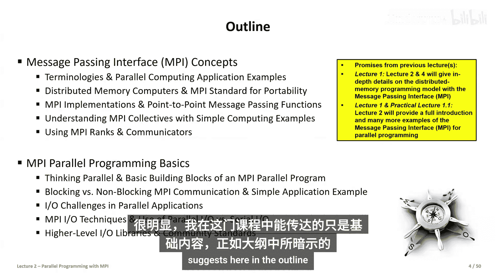

But afterwards you still have， I think it's a little bit understood the complexities of parallel programming。

 why it is a little bit different than just programming a little bit in Java and basically the different abstractions that you see on different various levels where we also address so we have computing we have data between compute entities from memory for instance this message passing elements but also the IO elements right so if computing is done we also want to think about what happens to the data that has been computed or which data actually need to compute can be both directions and with this you will see concepts with MPI and parallelIO that have been adopted by a wide wide variety of scientific and engineering domain applications right so you're really ready to understand this concepts in basics of course using it then in that communities really at scale and with socal。

De facto standard ways how to use HDFI for instance or how you use NetCDF in several different simulation areas。

 but you've got the concepts and really understand how that works and with this you really have a sort of HPC programming paradigm understood and can program in MPI of course our practical lecture 2。

1 that will come next will follow suit with some real source code and some real execution not even mentioning your assignment one which will be about MPI and power programming so you will be doing this hands on。

And so you should be able to understand MPI， at least from a certain way， obviously again。

 if you're interested in that， you should rather attend a five days course from morning till evening。

So。Before we get started a bit on this， let's see a bit what the differences between the typical concepts you may already know from your let's say。

 university studies in the beginning or wherever you come from from the YouTube audience So we have several concepts。

 arrays， variables you already know we have several different languages。

 you know C Pythonbo mentioned Java Fortron is still in use in HPC I was mentioning that。

 and then you have different implementations of certain standards of certain concepts。

 you have the Java C you know you have the GCC for compiling So these are all。

 let's say different areas how you deal with serial programmings and this is something which still remains in a way if you do power programming。

 but if you do message passing， there's an additional complexity and additional elements you have to think about。

And this is really about concepts like processes we think now about。

 we have just not one process as's many threats， we have several different processes that we want to work together and when they want to work together they have to send and receive messages to exchange data or if you want collectives。

 which we will talk about in the course， something like one processor wants to talk to everyone。

 for instance。Then there are certain groups， SPMD will be an abbreviation we will learn seeing program multiple data。

So these are all elements we will talk about and libraries。

 of course as a key concern here we will focus now because of the MPI lecture on MPI and MPI in it and all of the different facets why MPI in it is also so important and then different implementations of the MPI standards are existing right we use open MPI but many others in the system here for instance missing powertation MPI I using different implementation of MPI MP here。

 for instance another very popular one。So all of this means to be a bit motivated so why I'm talking to you that this is important。

 why MPI is necessary， you see， for instance， here an application example that sticks with us also through the course a little bit is now if you think about the wave propagation on the ocean。

 you have a 3D grid on the coastal ocean here， let's say somewhere in Iceland not sure if there these high waves in Iland that you can surf here in that scale。

 even close to Vic， the Blackbe would not have maybe these high waves。

 but still the question here is the time you know， simulate this over time to understand how the wave propagates through an ocean would be one of the application examples I would put here because it's relatively easy to understand that the wave height from let's say one point in time going maybe to the next grid in the next area because that's what we will learn an extra 3 domain decomposition right so how you crunch this big ocean into several different pieces。

To assimilate maybe the wave propagation over time， like exploit。

 like shown here or here more conceptually， right， over the different in our time。

 also over the different location。So this is something what would be a perfect example and if you want to do this on a large scale。

 let's say the whole south coast of Iceland， then you definitely need HPC if you want to do this maybe on a couple of centimeters you don't need HPC you can do this easily with guide GiLn or other let's say more other computing tools。

 but if you want to do that as scale and understand the bigger picture。

 usually what you need is high performance computing and you would use probably something we call it distributed computing which MPI。

Meaning that all this information， the wave height at a certain point in time at my heart。

 if you know， would say that this do composition and we will have a all lecture on it about it in lecture3。

 so these grids would be maybe assigned to different processor right to compute all the waves at the same point because there's lots of physics involved maybe you want to have the interaction with the surf as well。

 so how is this speed of the surf over time， you know simulated and predicted。

So this is something where there needs to be lots of message exchanges to the other memories of the other processes to understand well your wave heightight was there in this gridit。

 so that means in my wave height in the next time step this is important too hence there will be lots of message exchange to inform the other processes what's going to happen on the different areas。

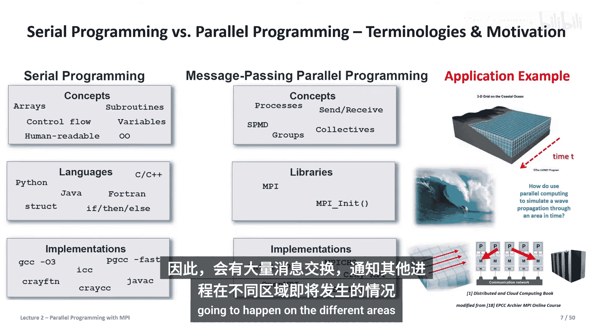

So this is something which we will you know go back of course also to lecture3。

 so in this sense we cannot teach all in one big lecture right hence the whole week in NPI usually but we've tried to hear focus now on the message exchanges what messages are possible another application example you see here from the I caring in one of our research is a similar element now with a video better understanding perhaps that we have a certain time dimension。

Right and this is also allludeed here in these arrows right so also in the processes they have a certain time where they run over this time I want to simulate this ocean and over this time I want to predict overall with all the processes how the wave height will be perhaps over all this time you know over all this tiles or the locations hence you have a complex problem to solve and you see with the glacier clving it's much more complex hence you have a much more deep down workflow really what to do in parallel what to do in Syria。

 what to do in parallel， you see an example the clving of the glacier here you see in the video is 560 course right lots of computing power where maybe others parts of the workflow are just more 16 core and even some of them can be done in kind of Syria runs so this has a relationship to HPC as well workflows。

But we focus here rather on simple starts where basically message passing matters。So in a way。

 something we talked already in lecture one， right we want to now solve this problem really in a cooperative way and the cooperative way needs se exchanges。

 needs essentially different processes to really solve that complex problem。

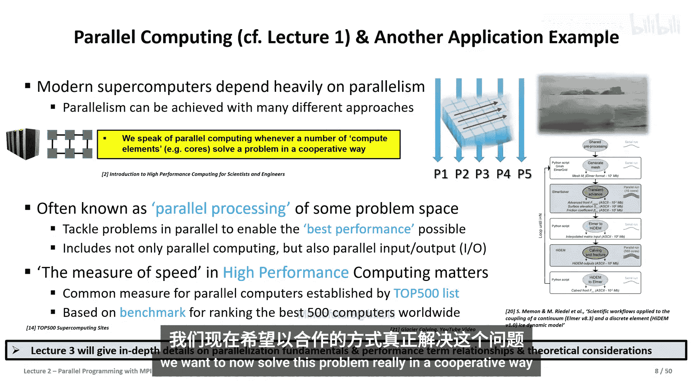

Other application examples you already know from Pra lecture 11 and before I talked to you already in the reminder so I don't want to take more much more time on this。

 we have seen this is of course interesting to F3 codes and you see already the domainposition illustrated in the different codes that's the only statement I want to give here in order to have a really large area here of the region you rather want to put that in this different interesting blocks while the blocks then actually are the processors that we have seen abstractly before and the processors are just you know thinking about themselves in a way computing this。

 but there are message exchanges between them to understand what my neighbors have done as well。

So this would be a concept that is quite known in many of the physics engineering applications and just to contrast it a bit what you already maybe also know from other courses there。

 of course lots of experimental data right we observe the nature like for instance you see here a very good example。

Is the birds flying right where we learned then over time from the experiment， how to craft aircraft。

 right So how we build this the theory to really have Benulli's laws and so on， you know。

 going over the wings and so on that in the end will help actually， to get the aircraft fly， right。

 if it's not the major principle， but in the end what we do in HPC And there' many of the simulations is sort of building a bridge right。

 So we're building a bridge， we don't neglect experiments and we also not say theory is not important。

 but we take experimental data， we simulated to validate theory。

And and this is really a common theme in all over parallel programming here right and and as you can understand。

 maybe still some things are not understood as well， like let's say as everybody knows。

 we still not have aircraft that flap wings right well actually maybe this might be very energy efficient thing to do what birds are doing hence。

Lots of things to learn， we model this with many different approaches。

 This is just one example for you know giving all the rise to the logo of the course as you see now where let's say HPC is of utmost importance not only for letting aircraft fly also they're all air conditioning everything within an aircraft with Anis things you will learn actually much more with razor and the second part computational fluid dynamics and so on not only turbines that you see here that are of course a masterpiece of engineering they all require HPC and all use sort of numerical methods based on you know known physical loss over time that's a video suggests here to understand maybe the stress on different wind turbine elements how can we craft them better how we can make them greener it's a big topic these days and all of that where we also captured much more in8 and 15 with applications hence I stick here a little bit intentionally。

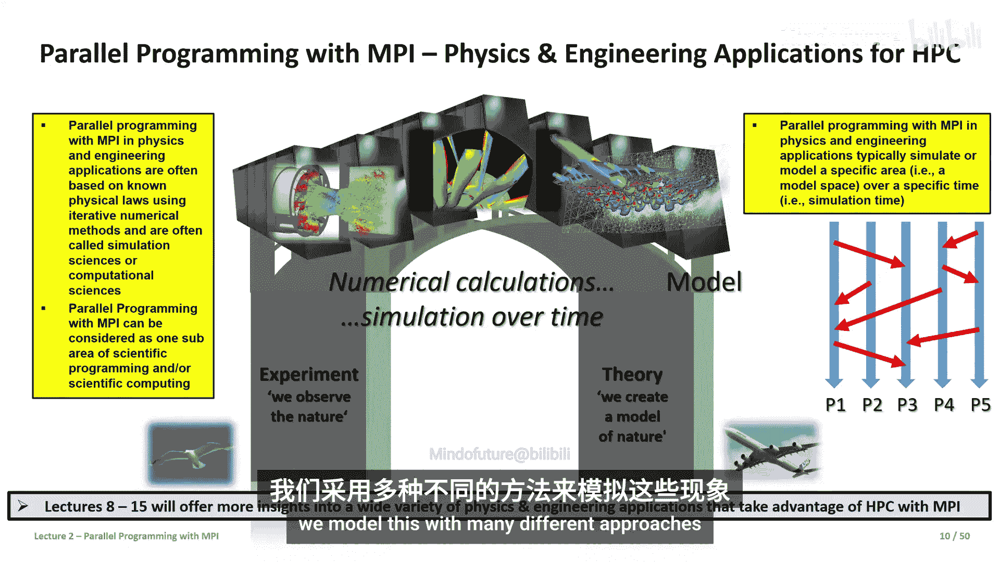

In the basics tool what MPI can do on itself， how AI， then a lecture 6，7 come。 Of course， later。

 the applications will give you more application details。However。

 focusing only on numerical loss and essentially then you physics。

We should also point out that in the last coming years really we saw in the last 10 years something like a tremendous momentum around AI machine learning。

 deep learning also data mining if you want clustering cluster this has been a huge element and almost making the point of it already in the prologue and in the first lecture so and we're not go back to it just to let you know that here's a clustering algorithm that is also based on the MPI standard right so it is MPI in its source code in order to cluster different elements。

Like for instance， here you see a point cloud of downtown Bramen that has been relustered then essentially from lasers coming to some interesting 3D data set to buildings。

And the same is true for all countries you see that here in the Netherlands it's something what well one of my X PhD students that graduated was doing creating this HPD algorithm and you see also then what we do is increasing the number of course more and more and more so using power computingut at scale to really tackle those problems or you see here the clustering of the brain image and hybrid remains to be a seen in our course we will see how that materialized when we have done lecture4 with openmp shared memory because hybrid here stands for we using openmp shared memory together with distributed memory but of course here in the course today we focus on MPI just to give you some motivation that MPI is really useful when you go to applications hence the whole cluster part and modular supercomputing architectures is sort of created for it number crunches using MPI at scale the cluster module that we learned already in earlier。

In the deep projects have been a bit， let's say， looked at two and designed in that fashion so that we can really support these applications and the applications are quite known in all these different areas of science as you see on the right hand side。

 they all have codes， source codes， well established software based on MPI。

So another example and this brings us again to lecture three is of course a race car or the heat dissipation in a room。

 that's something also we will learn in lecture three a bit more。

 hence there's a certain note of programming it， you would say you would always have a good parallelization method to domain their conversation for short。

 how to basically think about functional areas like maybe the different tires of a race car or the shis and the driver and something。

 or basically how you basically create a room。And then put the room in different pieces in order to create a heat map that you see here over time simulated right。

 so how the heat is basically getting in the room or how the airflow is changing when you open a classroom。

 things like that。So however， that gives me also the important point to say that the domain input composition will come in lecture three right so hence wed give out lecture two a little bit earlier in order to start earlier with your assignments and to do practical right one feedback from students they want to start earlier。

 hence you still need to learn a little bit lecture three all the time。

 right the problem domain that you want to crash down into little pieces to really use parallel programming。

Hence。😊，Some of the aspects I will just you know tackle abstractly and we will revisit them in lecture three。

Now coming back to distributed memory that's something what I already was presenting so also here we can give you a little bit faster。

 we said the distributed memory paradigm actually assumes that you cannot access a shared address space here or so from memory from another processor so it's not shared hence distributed it every time I want to communicate in data element that we store in memory usually needs to be going over the wire to be communicated hence the idea of message passing you see one example and of course during the time of similar race car there's lots of interactions between the different materials between the air that you see facing the the race car and other issues like liquids may be on the road So this is something where distributed memory really living from this message exchanges hence there's a standard for it that also was alluding to this already where you see a little bit here how that works。

 you have a memory space of one process that。

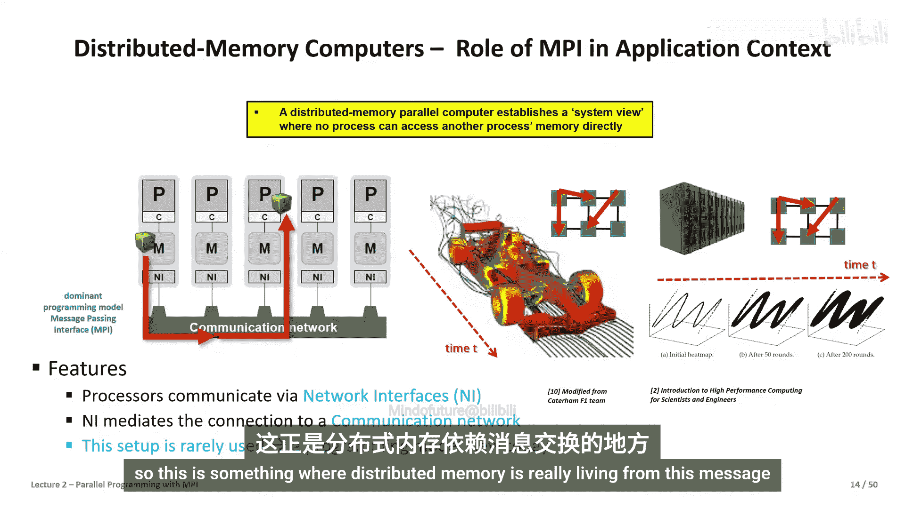

S is variable a23 as an example， and we want to send to someone that is the second process。

You know this variable。 So in order to do this， it's not shared memory， this process， too。

 cannot just go there and get it， right， you need to send it， Hence you have a buffer。

 we will learn later as well， of sending you know， in this the 23 and the receiver process needs to actually allocate some space for it in the in its own memory in order to do so and only then once I did the send receive hence the first message exchange you see here right abstractly。

You were basically able to do a equals b plus one because otherwise you would not even have you know。

 basically these variable。So。That gives us an interesting thing because a here in this is chord 24 or the value is 24 and here is a23 hence the processes are completely。

 let's say have their memory space not connected。Hence。

 making them distributed and the messages change is then the relevant part to do。

 There are different MP applications。 We use outcome and in the course。

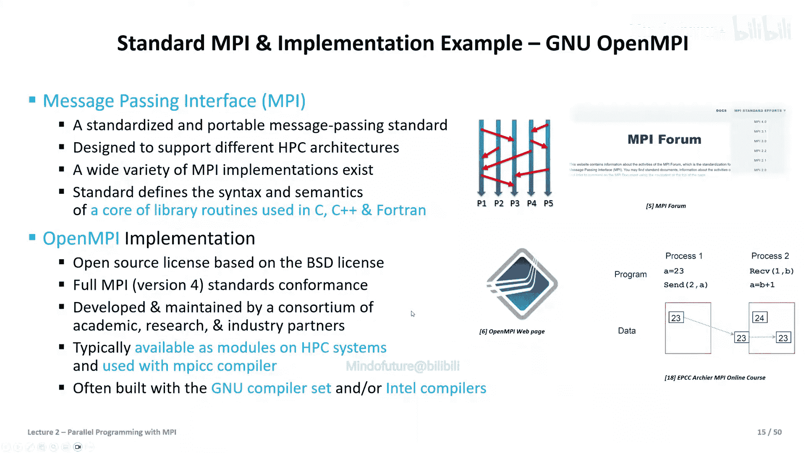

When it is from the technical perspective you would say that different ways of communicating it's a communication library with a lot of functions。

 I would say around 20 are of used， maybe 12 really hardly used。

 but there are very many nuances of how you can communicate hence we have 500 plus maybe in the standard and on top of that is even parallel oh I was alluding to this。

 but we will see all that material lies in the second part today。

 not in the first parts so we focus a bit on the communication aspects how many you know processes I want to involve in the communication。

It's not always sent， receive as we will learn， and then also thinking about how we can implement this best。

And。Just from the MPI from the technical perspective is the third element then is that portability so once you have MPI applications running on one system。

 chances are that you can relatively easy port them to another HPC system right because we have many of them in the union you have seen that in your HPC in one of my earlier lectures there's you know Leonardo marronosstrum and so on and the idea is bring us to the portability。

 hence the idea of a standard so you have let's say computing time on all these different resources。

 let's say HPC machine A and HPC machine B as a researcher。

 so it is a shame if you would spend a lot of time of really porting this MPI application。

 hence this MPI and adhering to the standard using the standard。

 your chances are much more higher to use you know your source code you use on this HPC machine also on HPC machine B given your computational time grants。

And and this is really true， even if there are maybe different MPI standard at implementations。

 right， so this is also another part， maybe someone is using Open MP。

 others are using power stationation MPI， but this is one of the benefits also to go to MPI。

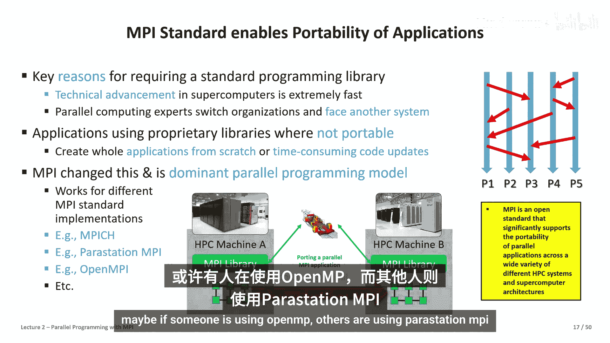

However。A universityivers lectures should also tell you a little bit about what MP is not。

And MPI is not a network library for the internet right it's not TCPIP Soet programming。

 you know another chat client you want to implement across different holes within the global internet so this is really a par programming within one machine optimized library right it has many scientific engineering abstractions that you use in these applications a lot for mathematics of physics for let's say condensed representation。

 maybe of data of par data using binary data， not readable data you know there's lots of these elements where this is something where you don't really want to use MPI right so this is important to show it's really for good high performance communication within a cluster between computing nodes on one system and this is something which you need to really understand。

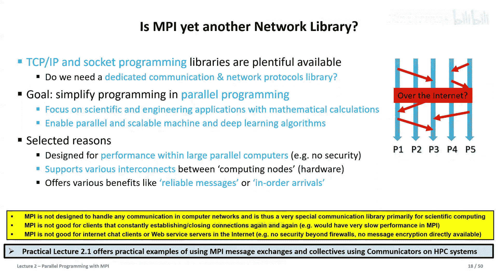

Coming now to an overview again when we think about typical message passing so that's now again a kind of more element to the idea I already showed you with this simplified idea so I think it's pretty obvious there's one compute node is a process and memory and senses data now to someone else in the buffer that means there's a new 17 arriving at some processor but his own variable is data 80 right they all have their own values in that and hence。

This is what we call point to point communication because it's just one other processor involved whereas has maybe completely other data。

 want to overwrite this data just depends on the application logic。

But this is something what we call now point to point， and it's important to understand this。

However MPI is not you know what all about that we have collective functions and they are also incredibly used because they save a lot of source code if you want you can say this could be also easily implemented with a fall loop send receive send receive send receive right？

But the broadcast function has avoided this by implementing an MPI communicator things you also learn much more lecture three。

 where you can use this communicator to really send the same data item now to all other processors in the same communicator。

Hence， this is much more easier to write it is one call of one function and you define with a communicator which are the processes that actually should get my data。

Broadcast， so we call that MPI broadcast incredibly often used。Now。

 you can think when you have an area of sort， which is often in data structures and science and engineering。

 you can say also maybe different weight heights for different tiles or grid parts。

Then you would scatter them across the different processor so every processor gets something else to do right which is then the scatter function MPI scatter and don't worry if you don't get complete the idea and always a function and so on practical lecture 2。

1 will be all about examples on broadcast scatter gather which is one of the next and the scatter we have this so-called approach one too many right so again。

 all of this data should be scattered one too many this array hence you can also see the inverse gather So what we can actually get from all the different processes that maybe have worked the last hour on their own come to some significant result and I want to gather this in order to maybe do some other calculation or the next iteration for visualization that depends again on the application logic but you can imagine that this is another often used function and indeed it's true gather is often news that even all gather is one of the keys also。

from deep learning， as we will learn in lecture six and seven later on MPI。And finally。

Here is let's say simplified ideas， how to use collectives。

 how to use MPI and let's say abstractly is like the reduce operation this has the additional let's say advantage of having some operator with it so you can specify for instance a global sum right you would say like in Gaza I want to be interested what you all have been doing in the last hour and what your data is right now but I just interested in the summary statistics and you know having the global sum。

And this can already， you know， avoid lots of four loops， you know。

 adding the values that are received， maybe then again。

 together another loop or an iteration of a whole array。

 things like that that really makes the source code。 Let's say more digestible。

 It's basically for the program is convenience a little bit if you want this MPI and still hiding lots of the complexities right as you see here。

 we just call a function， we're not actually bothering around IP about a UI that I want to contact a port that are maybe contact to like in web services or so。

 This is all。Basically hidden here what we communicate by just calling these functions because the MPI environment and this will be some things that we learn also in the part two。

 the MPI environment already knows certain things about your parallel program and this is something what we will talk in the second part。

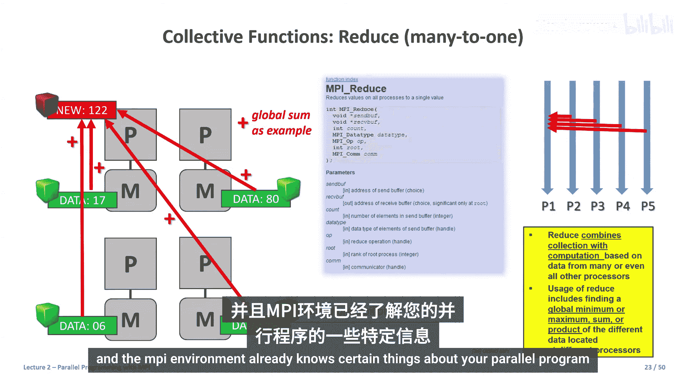

However， I want to end the first part also on some other very fundamental aspects。

 which is for students often a little bit more tricky to understand。

 but it has something to do with the identity of the processes Now you can think about that we have as an example you see here and processes that we can use。

And they all have that different identity。 And we have to know the identity， right。

 So this is now the idea of using MPI rank。 So what processor I am in the bigger picture， right。

 This would be sort of a way of thinking about it。And you see that the ranks are assigned from 0 to 9。

 always starting with zero。 So it's a very important concept。 And with this ranks。

 you can really in app parallel program that has always the same source code。 right。

 we will come to this back and practical lecture 2。

1 understanding ping on by different roles maybe into the process。

 But you have to have now away with ranks to differentiate in your source code， the different roles。

 hence as in example while some of the processes calculate maybe the wave heights， the waves。

 the stream alongside the river。 Some others actually have the boat itself simulated and its interaction with water and other processes。

 again， maybe calculate the wind， you know， getting， you know。

 into the sail and the sail then translate in always communicating to the other communicators how quickly you are going over the tiles。

 So hence。Rs incredibly important in MPI， we will make the case for it。

 not only in lecture 3 as it here suggests we will start with is even indeed already in Pra lecture 2。

1。And then you'll see here a little bit and that will be the last part here really in this lecture two。

 part one。We can be more flexible in this so there are communicators that then can create different groups。

 the only one that always remains in the MPI environment is the MPI con work versus process or let's say the communicator of all processes。

 the world of all processes if you want hence the analogy but you can create different groups and subgroups in order to streamline communications maybe between the tiles on the ocean and maybe also on the sailing boat right because they interact heavily and so on hence there will be also different elements of creating subgroups and processes。

There's a good summary of all what I said， maybe from a different view of perspective。

 I think it's also good and incredibly good for you to look that video and we will continue with a second part of the course in a couple of minutes。

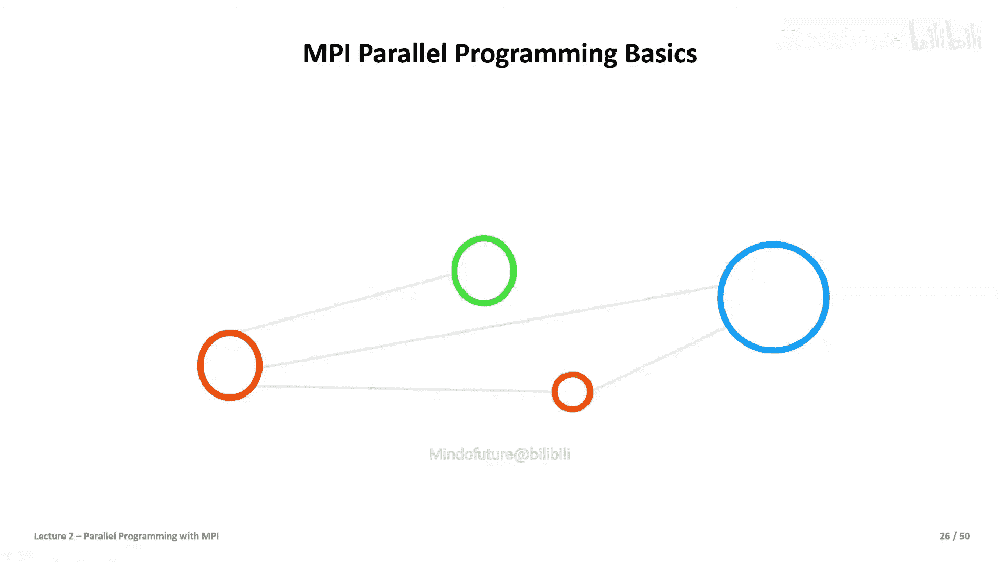