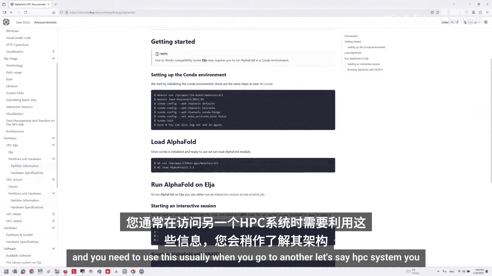
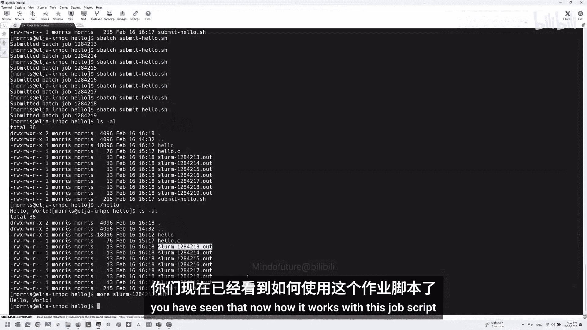
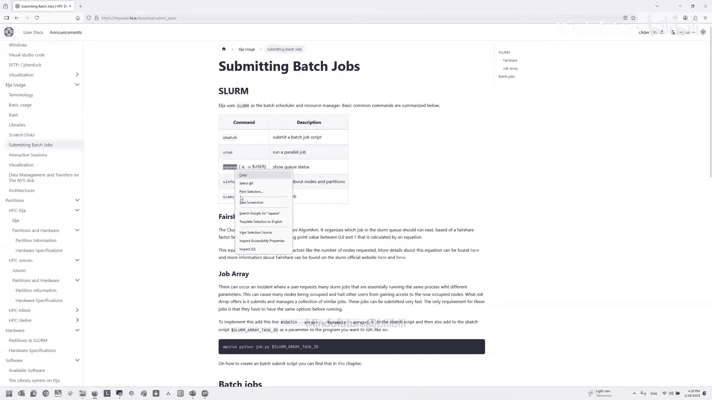
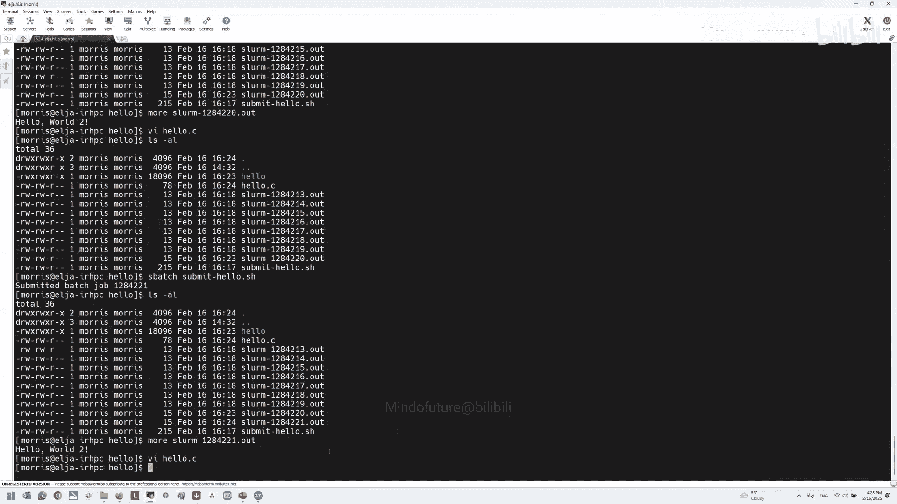

# 【冰岛大学】高性能计算课程-｜-2025-High-Performance-Computing-｜-Prof-Dr-Ing-Morris-Riedel-p24-P24_实践讲座_1.1_C_语言编程导论__调度_第二部分--BV1k34zzaEK8_p24-

Welcome to High Perform Comp， advancedance scientificentific computinging。

 this is practical lecture 11 and the second part of it。

So the first part was introducing us a little bit to see programming on HPC systems。

 so admittedly that was a very short introduction to see because essentially we had a very little program called Hello World。

And we learn to include a small header， standard Na O。

 and you know do a print S statement and return a zero saying it was a good execution。Hence。

 one of the most， let's say， smallest probably you can get in in terms of an C program。

 but it captured the essence of compiling at first before you can do anything with it。

And when we do this on HPC systems， we need HPC system software for it。

 hence it needs to be installed compilers， or the MPI environment。

 the libraries needs to be installed and we learn for instance， in our example。

 we used open MPI for an implementation of the standard of the MPI interface and libraries that's called the message passing interface。

 it's basically standard in HPC that covers almost all HPC systems today。

 so chances are if you take one H program and you know compile it work with it do research with it on System A。

 then you basically can use the source code MPI， you maybe you have to recompile for the environment there。

 but still the program would run on a different HPC system because a message passing interface is really a standard as well as C。

Hence。😊，This was the first step to's going to an MPI program that will you know come in later lectures。

 we will start with lecture 2 then MPI later and then do a practical lecture 2。

1 where we then enhance essentially the C program that you have seen to a proper parallel program with MPI statements。

But before we do so， we learned a little bit at the end of the first part that executing and then a C program which has been properly compiled that is reasonably ready to run is it not good to do this on a so-called lock in node and hence starting this practical lecture here in the second part means we should go a little bit back to the descriptions of the systems because we want to use earlier。

So let's do this a bit， very instance， you remember in one of the lectures I told you there's a user documentation where you essentially have a description what's happening on El。

Right so this is all about you know the environment， what you do there。

 you have some specifications of the hardware here in different parts of the system and with different。

 let's say vendor elements here， for instance， you see an a 100 card from Nvidia and so forth。

 but quickly when you do so and look at the idea what essentially El can do and what idea of partitions there are to use。

Which has different parts and U Tus， for instance， one of them that we're going to use for our。

 let's say， teaching adventures。Then。😊，It is important to understand that everything is always giving you an indicator there's a sLm right is the submitting batch jobss idea which you see also here for instance explained similarly like I will do a little bit today。

 but of course here you have a bit more elaborate discussion what you can do and information should be always available you know on the web for these systems usually hence what we do here now is relevant also for other systems such as those in newly for example。

 hence let's go a little bit into the example here just to understand now why also these systems are so much multius environment。

RightSo here we have the idea how we and newly created the systems since 2004 and it's a little bit outdated maybe。

 but was growing through the， let's say， generations here and you see 2015， 2017。

 all EBM systems quite a lot actually， which are now not anymore in action。

 the same with jewels and jewel scalable， these new modules or based on this modular supercomputing power and idea that we let's say。

 have already explored a little bit in the last lectures， hence。

The modular supercomputer architecture ideas really serving the needs of different users。

And this is now the key point， obviously these systems are not like your laptop right you're not alone on them at the same time。

 they are many， many different users。And on top of this this different users want to use the supercomputers differently。

 they have different needs and here you see quite nicely figured out essentially two needs on the lefthand side。

 the Juves cluster is a module which has high single rep performance CPUs。

 number crunches like we have seen with lots of multicoships and then you have the Jubal scalable module。

 which is named as a Juves booster these days， which essentially means highly scalable codes and modules and also lots of many courseships of a GPUs。

Right， so hence。The applications that this different uses。Do at the same time， on the jewel' cluster。

 on the dualbal scalable system， the booster is essentially different applications with different needs。

 hence this modular supercompia he has been created for this。

And the reason is that of course not every user can have his own big supercomputer right we share these big systems with many。

 many different users and to give an indicator how many we're talking about。

 I show you a little bit here a command。And control center if you want from the Uli supercomputing center you see a little bit here also the whole。

 but this is not so important as's a whole with big computers you have already seen in the last lecture here were talking about so-called monitoring systems that show the load on these systems here we see LLU right this is a historic system grown in Uli but can be also used in different HPC systems hence you can see a little bit this is wide variety of colors here and the details for you are not so important to understand but all the different colors dance for different jobs or activities。

 tasks， applications that you know all different users have you know run or running now on these different systems here as an examples of the Jaureica cluster for instance。

 or the Jareica booster again modular supercomputer different needs。

And then also the Jewveile system， for instance， and you clearly see with all the different colors here that there are many different jobs at the same time now running on these large supercomputers。

Right， so this hands means。We have to have a system that not only showing this like the monitoring system。

 now， this is beautiful because this enables us to understand what's happening on the system。

The other point is we have to make sure that they can actually run jobs at the same time that there's capacity。

 for instance， that there's enough， let's say room for these applications because if everybody can submit every time their jobs and say please run now。

 chances are that at the same time there's not so much capacity available label right。

 especially if you talk about you know cutting edge deep learning algorithms what we do here。

Of what you quickly understand when we go into later lectures also is that we not stay with one node right or with one let's say GPU here you see we want to have more GPU that usually brings us into the different blocks here so we don't want to have just one node we want to have more nodes and with this you can see already that the colors are not in one small box but rather bigger blocks like here the jewelves are nicely seen。

 you see there's also the Jaureica booster here with the jobs spanning quite a lot of the fractions of the whole system。

But to order to let's say manage this load right for users， that's an important part。

 and that brings us to what we call then the scheduling system So this enables us then really to。

Let's say run different jobs at the same time while each of these jobs are run in parallel also you would say。

 of course they are all run in parallel， but each of the applications has and this parallel programming insight that also executes in parallel。

So a bit more detailed view as an example and that this is Jewves and not earlier doesn't make a big difference。

 so Jews essentially says here that you know there's a sort called job list here you see that here many different users have here now submitted a job and we will submit a job to earlier so that you understand a bit what that means。

And using scheduling。And this is basically what's happening right now in the system and you have a timeline also below you will see okay。

 it's quite filled and you see that as a normal HPC system protection element。

 so especially in the large system which costs a lot of money。This system should be used。

 hence you will find the utilization， which is almost 99% in many cases。

Right because also these systems are needed by researchers and required they're often oversubscribed even in order to get access usually also have to write computing time grand proposals and these are granted or not granted depending on your scientific excellence on the tasks you want to do on the application。

 so in a way these systems are usually costfr if you are in academics if you are basically in the scientific engineering fields which are more less in research。

 of course you have similar aspects in clouds some of you know that from my cloud computing course。

 but these are usually not these big systems that we have。

 for instance in the UHpC joint undertaking and so on。So。😊，The concepts， however， are all the same。

 so all the U HPPC systems I was showing you already Leonardo modernosstrum Lomi in the north。

 So this is all multi-user systems， very many systems uses different modules in these systems for different applications and we have usually two of these elements。

 monitoring systems that show you a little bit what the load is and then also the scheduling system。

 which is very essential to make so-called batch processing and the batch processing is a bit good understand when you think here about the batch queuees what you see here is that someone has already submitted different jobs。

All the future should work。RightSo or some basically here will be started because they submitted at some point in time and it's already scheduled。

Basically here in the timelines of different processes and with this， you see that， of course。

 the batch is so to speak a kind of queuing mechanism of， you know。

 letting the people submit their needs on the HPC systems。

 how many notess you need and depending on the space you can get basically scheduled in a certain amount of time In other words。

 it's not really always interactive access right so this is sort of the difference between batch systems where you have a batch queue waiting for you and we will see the queue later when we use it and also。

 of course， in lecture 2。1 and so on throughout the course in your assignments。

You will see that there's quite many systems in that many users in these queues。

 And this is an important factor of it。And the name of these could be very many。

 So some call them computational jobs。 some call them batch jobs。

 You will see more and more people working in HPC， they just say jobs or tasks Nowadays。

 we say AI tasks or AI load you know from the load of the machine from the amount of AI algorithms。

 applications running from different users。 So there are different names for similar elements。

 but all have in common that they use a scheduler usually for some purpose。

 Nowdays a sort of bypass called Upiter notebooks， which we also explore later in the course。

 which enables you interactive excess， but it's a different element from just doing this batch submission that we see here Now。

 hence we turn our， let's say， perspective to the Upiter notebooks rather than we do deep learning from lecture6 on。

 So in the moment we stay with a batch submission。As the one that is basically used also for highly scalable aspects。

So。Hence this LV tool hopefully enables you to better understand that these are all different jobs。

 different users at the same time executing on these large systems。

 you see a full haul of computers used by different ones and that we also of course。

 want to have a load quite you know， high， like 99% would be EDL of course。

Some of them don't have that like our university systems is maybe sometimes only 20% because this is also not。

 let's say a costly system like juveles here， right， it's a smaller systems。

 not so much research done there on the one hand and also partly used for teaching and the complete different。

 let's say auto of magnitudes and these supercomputers that we have seen， for instance。

 in Euro HPPC and the genna taking Wima no from Leonard the Lumi and so on。

 and this will be also a case for the Upita HPC system。

 the first Xscale system coming up where we also talk later in the course about more。

All of them will be still using scheduling and hence we want to understand a little bit more of it just to summarize what I said。

 you know you have this different monitoring systems that you already know now LLview was one I also have this ganglia on Ellia here I will not make a big tour on this just that you know that we have here in Iceland。

 this ganglia system for instance to understand the load what is happening for instance in the last hours you see our two hours。

 four hours and you see a different you know CPUs the nodes you know what is running there really the peaks and so on and so on so you can you know see a little bit what's happening in these systems you can search a lot can tune a lot and I don't want to make it ganglia editorial out of this so you see also this is maybe quite interesting we said a little bit the called load。

It was around 20% as I was mentioning in normal supercomputing centers where you have really large production machines for huge research projects。

 there would be rather a load of you know 98 or 99% because these are very expensive systems here we're talking more about a smaller let's say regional system and with this。

 I think the load is okay。And there are many other systems， as I said， LLU could be also here。

Can be something maybe installed in the future on earlier。

 but it helps you to understand and also other elements that we didn't talk much about it。

 One example is， for instance， broken notes right sometimes could be that you know CPUs overheat and they have to exchange the note cards whatever so or the network is down so you sometimes have also the system health checks and the information is basically all the notes and all the note cards in the note really active that means essentially when you come back to one of these that sometimes some of these might be you know empty and the reason might be for instance maintenance or you see very clearly that there's a you know X or that this particular node is broken so。

It enables you not only the load， but also the system in our view and monitoring。

 which enables us to see this kind of errors in hardware as well。Coming now to the scheduling system。

 what this lecture is primarily about， although monitoring you have a sort of view that this of course is quite related right monitoring systems often show the schedule or the batch queue all the users that are using the batch queues hence these are managing really the concurrent excess of the users of the computers and we want to do it here a little bit in practice so we would go a little bit also to the idea now of submitting hello world on these systems。

For this， I would start maybe just practically by looking in to earlier and by now I mean this is something that you basically should know by heart now right we need the host name we need to specify certain username that you have and of course we use a private key to get access and my public key is already uploaded Ea。

The usual wait a bit before we log in， we use that to explain a little bit the different commands that you see here。

 which is then now the scheduling script， so there is another file that goes along the specific job that you have。

 let's say you have a Python you know file with some Python code you want to execute but it doesn't really matter it could be also C program。

The point is that your top of the file from the so called batch script has some certain information which needs to be filled。

And is basically informing the scheduler of what you need。And here's a good example， you know。

 we have one note and we want to have 48 core per note。And it depends now on the system。

 you know what type of course we have dual course etc。

 so you have to look around exactly what the hardware architecture is in this hence these kind of overview for instance partition Utu if you remember comes now to the point that you always need to understand a little bit on the eye of the HPC systems right it's a different partitions and so on and this also sets it a bit apart from some of you that know my cloud course right which is a bit easier you don't need to have this lowle details rather you know rate just one cloud service executing it maybe knowing a little bit what you want to buy in terms of GPU type or CPUU type for different costs but here you have different specifications and you see here the partitions that are available on yourtu。

Which is for us for teaching and you have here in the you know four U turn computing notes which have then。

 let's say two times 24 in each you know course per note and then the different memory。

 what type of vendor and so on and also a GPU is available in a100 from Tesla。

So with this information， then you know there's a part available for us in teaching and it's also for you in the assignments about to understand that please stick to it because we also have your let's say。

 your username are ready for this particular part and not for others。We have the number of notes。

 the number of task per node， you can also request for different memory。

 then we have a so-called time that we you want to have for a certain amount of running time before the job gets against the wall if this is things I will also explain you later a little bit in the course you cannot press everything here inside this one。

And then a little bit on output and error， which I also want to directly show you when we come essentially to the practical example。

 and when you submit these so called job script because it describes the job you do。

The scheduler will handle this will read this and then also be able to schedule your job according to your requirements at the point of time where the requirements are fulfilled。

It could be also that you request something which is not doable right。

 let's say your overall system has just that's 100 notess。

 but you require 120 notes for your job then you should be rather going to another system because Sloan will know that 120 notes are not there。

So， hence。Again， you need to consult the description of the different respective resources and to understand also what type of jobs are used in which partitions。

 especially if you think about the mod computing architecture again right if you want to have a couple of CPUs just used for a small MPI run with or CPUs but submitted to a large booster。

 which is usually starting with maybe jobs starting with you know 512 or even 1024 CPUs。

 that's an important part hence。We talk about here something which you really need to consult in。

 let's say collaboration with the administrators which often give you really a page like this。

 you will find a similar page for instance， in the Uli supercomputing center for all the different HPC resources。

 if you remember from the last time Jaureka Jew Wills and so on and here's our system earlier。

And it also describes the partition information， but it gives you also the idea of how to submit batch scripts。

 how to basically have the commands here that I will demonstrate now a little bit and again and again。

 of course connecting SH or something we know before。

 also software that we have seen a little bit with the mod environment right here you see software for different you know areas of sciences vast。

 for instance in chemistry and so on， what do people are using in different areas of science。

 even Al fold is quite interesting because it's an AI tool that was recently created and used。

 if you know， basically this is quite some interesting set of software and information and you need to use is usually when you go to another。

 let's say HPC system you will inform yourself a little bit about the Ie and the partitions and so on。

How the jobs are scheduled is sort of a huge scheduling theory。

 there are lots of different algorithms， how to do scheduling and it's a whole research area actually where people publish in one of the most uses maybe first come first serve。

Where then also a certain technique called backfilling is applied。

 So let's say as the name suggests you have submitted a job early。

 that means you're somewhere in the queue and then you should be also， you know。

 handled earlier than others is submitted after you。 However， if， you know。

 your job specifics will find a gap that fits to the number of CPUs or GPUs or memory what you need。

And it's maybe， let's say too little for the other one that for all the others that submitted。

 maybe before you and still wait， it can be taken in front right， backfil。 So in this sense。

 the gaps should be filled when there's free computing capacity。Good。

 but let's come to some practical example so。And the remaining part， I also here now on earlier。

 logged in as usual and not will explain how I did this and think and now you get the heck of it。

We go to our directory that we had already created if you remember MPI and then our beautiful hello you know simple idea for some fun。

 we remove the hellello again and we remember right we have to do the modularveil from the last part we see okay。

 now we have an MPI open MP implementation that's nice it's convenient I want to know that。

I module by this just to repeat a bit from the last time I see no dependencies。

 So I can just beautiful module load this here， right click fantastic。 have this。

 And then I do this MPICC， minusos  all4 hello with the hello C source code。Just repeating a bit。

 having the executable。But we have also learned， and this was the stop of the last part that this is not the way to do。

 right， The reason is now that we are on the log in note。And this is something which is not good。

 And know we have some host name information。Name that we are essentially on one of the systems on area that is good。

 But you see also clearly we are on a so called log in node here。

 which is not the way to really execute。 Now， when you execute hello world， no one is hurt right。

 But if you execute now a climate simulation with， you know。

 lots of lots of computing power that goes into it， chances will fail anyway。

 if you start because you have not a round of memory in the log in node and so on and so on。

 But basically running on the log in node that's a no。Compiling let's say。

 sometimes even you know doing smaller modifications to the code and then compiling longer P compiling and so on will be then rather than on the compute notes。

 P execution will be done on the compute notess。Because there our computing is possible right here the lockin node is really a note just for compiling smaller elements like we have here now we see hellello see program and hence this brings us to the scheduler right if you remember this was a one important element of the graphic that you see here we want to use now the scheduler in order to come to the compute notes right and I come to all of this which is here on the slide it's a complicated slide but we will get the message when I go into the example。

And the slide before just basically shows the submit， hello。I dear。

So hence here's a job script already we go into it， it's prepared。

 it looks a bit simpler what you have seen on the other let's say slide in the presentation where we have much more options here we keep it to the necessary ones in the beginning so we have a job name we say it's an hello example you know that we have to specify the partition U turn as part of our teaching cluster。

Then we specify for the simple trivial hello world， indeed， just a one。Note and then even of course。

 one task per node is also one to make it you know， very simple。

We will change that later and when we have MPI and so on， we will use of course。

 more tasks per node and then maybe even more notes that's important。

But then other elements here are just my you know username。

 this enables us to get you know information is the job is done for instance。

 if you say mayor type and then you always get a confirmation that the job is done now for this let's say small running hello world we sort of expect an execution of the job which is very fast so this is so not really need it here but of course you get the message when you have。

 let's say a 24 hour run of your climate simulation somewhere on the server and you don't know really when it starts because it's cute so you go happily shopping。

 you go sleeping and in the morning you get an email and saying hey your job was actually run it's finished at three o'clock in the morning Congratulations then you're happy of having this kind of notification hence many of the aspects we teach here in the small scenario we do for teaching it probably doesn't make sense but this is the way how you would do it also for proper。

Sentific applications for large applications that really require HC。

Now another aspect of the job script is the right module environment if you remember we have。

Load the module。 and that's why I wanted to demonstrate this again， right。

 I'm talking about that We have been on this host name here。

Which is our log in note and we did here before module load。

So that is now that this lock in our session， lockin node has now this module but。

Ween into a file and we want to look into this file and this file is no big surprise。

 I guess everybody of you can already I think expect what's inside hellello world。Now。

 this is not so obvious。 It could be also errors。 right。

 Let's say that the C program may be compiled， but during runtime， it misses some inputs。

 for instance， an input file or so could be so， so some errors。 and we will do this later in MPI。

Comes along， Then we will do some other examples and demonstrators and also in the assignments。

 it could be very well that you also get some error messages out of it。 So here we keep it simple。

You have seen that now how it works this is job script again。

 many of the things usually are also really nicely described by the administrators on the system right here have the S patch here。

 for instance， we have the SQ information showing the Q status that is maybe quite interesting as well to do briefly。

So SQ， who is running which jobs and so on？And of course。

 our drops are so small that they're not visible you see the whole system。

 know who is running on the different nodes and so on。

And different user names so you can understand a little bit you know who is really using this system。

 but you see also from this SQ information that somehow it's not so intuitive like the monitoring system but of course gives you quite details right so well the monitor systems was more an aggregated statistics view or so if you want。

So because later in this we will also have some sleep jobs where we then also will see how we later will use the HPCQUs and so on we'll see our own jobs and so on we don't do this today because it would be just a very simple way how to execute C programs。

 of course here and there you can also get more information about the jobs it's quite useful you see E as control showed job ID for instance。

 as control。Show drop I D。So shop ID D。 And here you essentially have different levels of outcome at Minos DD。

And this is not forever， so once you've finished the job， you have to be， let's say。

 relatively quick of getting more information。And here you see now more information and that。

 you know， the job is completed， for instance， and that's important which part is using。

And for us now， to understand the difference again， to the。Sort of log in node。

 we see now clearly it was running on a note called compute one。

Right and as I told you YouTube has compute 1，2，3， etc。

 So this is an important part to use really it has used one task automatically two CPUs because of the dual core and we just state on onen So this is something which you know changes dramatically with the job script now when you do for instance。

10 nodes obviously here would be a long node list with 10 node or you know also the amount of CPUs are and so on so obviously this job script steers a lot what's happening in your job and you can always control this a little bit here and check what's happening which is as control job ID however。

Often we of course also just want to get the output， what we have done here， also if you use。

 for instance， you know another output， there's no surprises， right， hellello world。

This is something。Another element I wanted to show briefly before we close as if if we remove。

 hello now， just to understand again， see in combination now with all of this。And， you know， well。

 we'll do hello world and we'll do， I don't have slides on this， but I think that's here for you。

 Hello world too， now we change this in any way， you know， then we have to also recompile it again。

 So as we have already run。Essentially the the kind of， you know， the module load， this is all easy。

 so we do hello and hello see again。And I don't need to change the job script in any way because you know this is now hello。

 still there， so let's say if there's a same job script， I just say submit hello。

And now with a new job coming out of this， we be more。

 let's say let's make it more simpler we sayel and this one is now having an out。

 you see already it's slightly bigger， very tiny bigger， so to speak。

 but in this sense we have learned showing us now， of course hello world I on the other end。

 of course what's also important to understand now if we have the HelloC program and if I turn this into a three and say now we have changed it for the third time。

But I sort of forget。Now here intentionally to compile my source code is in the version three。

 but the executable is in version two， hence when I now S that it。

There's no other choice then it will be the same output and I think that's so should be obvious to everyone。

 you know when we do this now the last submit was it 21 here at the end。

This is very clear that this stays on two。Because it didn't compile it and this is an error sometimes happening to developers in HPC。

That， of course they change the source code and then somehow get distracted and forgot about the compilation。

Or basically the compilation failed even and they thought it was going through and so on there are many facets to it。

 hence the naming and later on also in versions and so on is a big scheme and should be also properly done so that you always that say have a good understanding that the source code that you have there is also like the kind of executable you have there。

Hence， I will change this back in this simple demonstration now to hell world2。

 just to be sure that we know， okay， this is the same。

And in a way that's all I wanted to leave you on the table today。

 obviously just a very short introduction to see and a very short introduction to Slom job scripts。

 but it carries the essence how you do bigger jobs。

 how we will integrate MPI once you understand what MPI is。

And that we have used now finally as the MP the HPPC system， as we should do， right。

 we using the compute node to compute the hello world， even if it's not very time consuming。

 but this is how it should be done and I just use the login node for compiling and submitting the job to the scheduler what we have done。

And this is a learning outcome， hopefully for all of you understanding this different batch procedure in terms of how we execute on HPC。

 we continue tomorrow then with our lecture2 on MPI and then come back to practical lectures later on。

 so talk to you next time。

