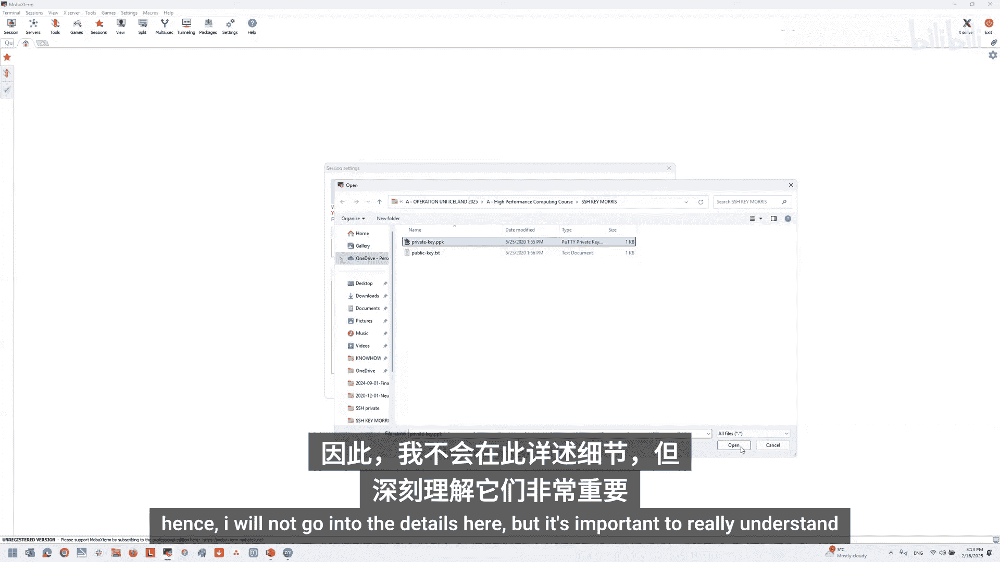
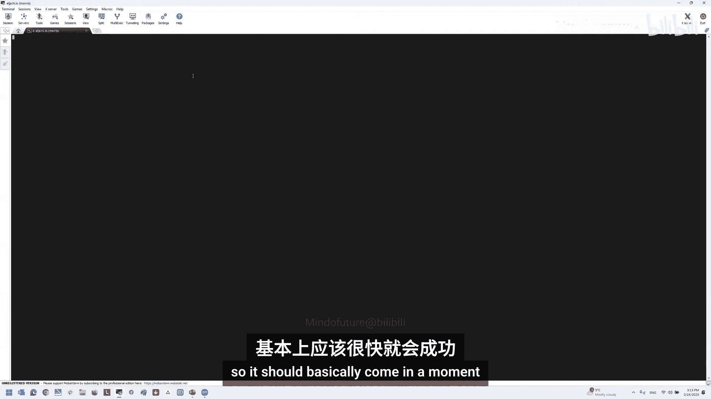
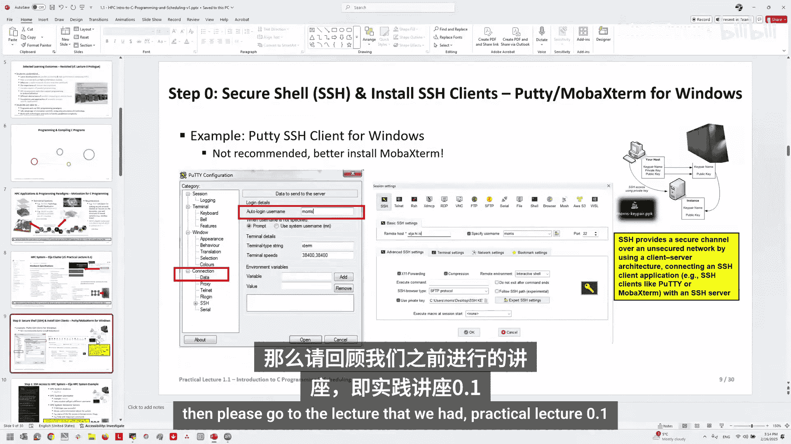
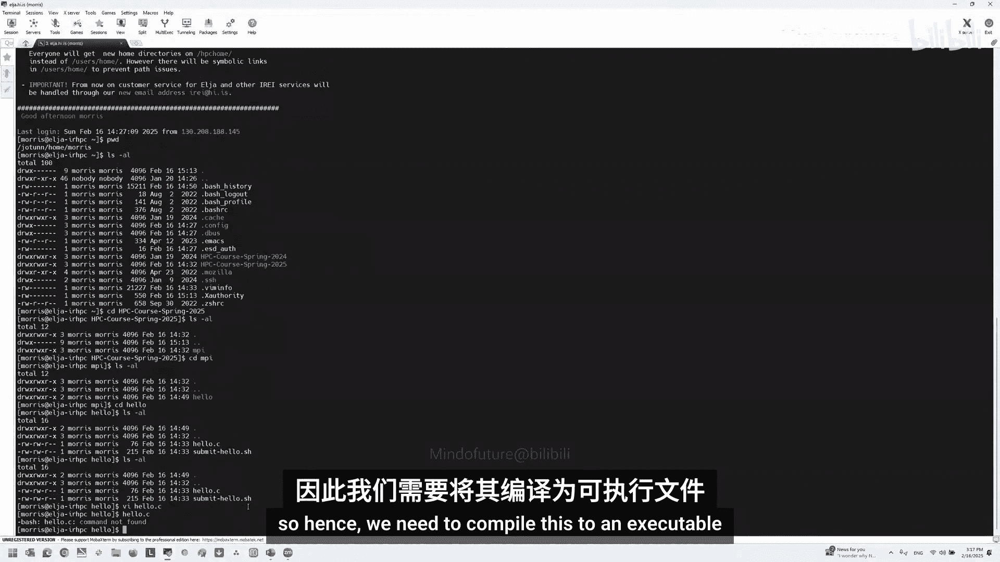
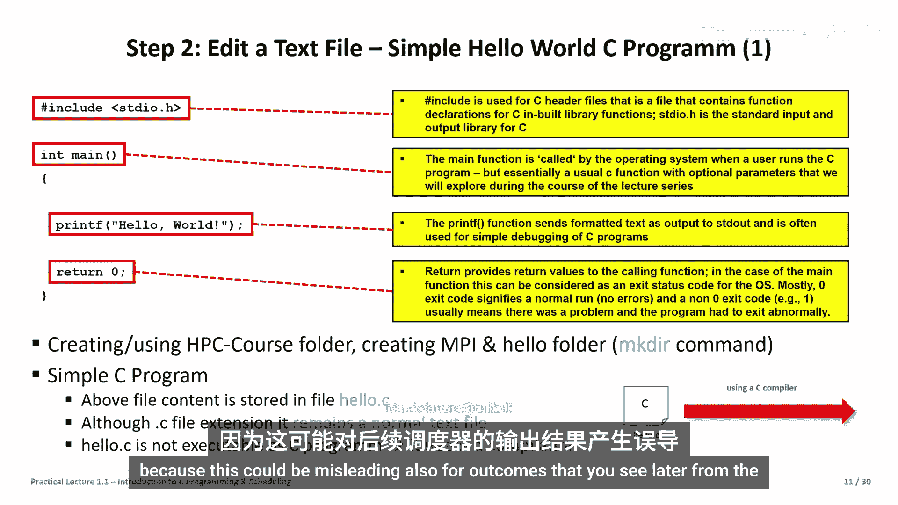
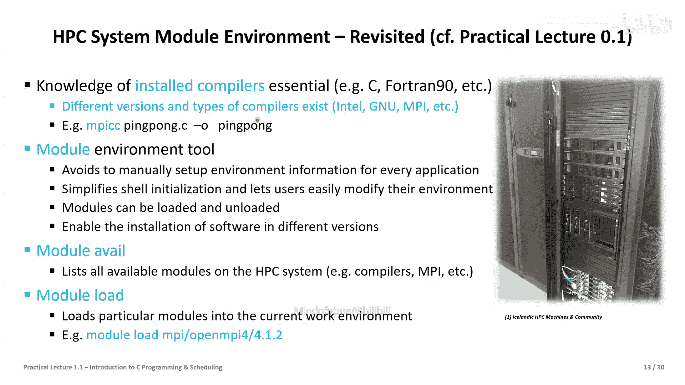
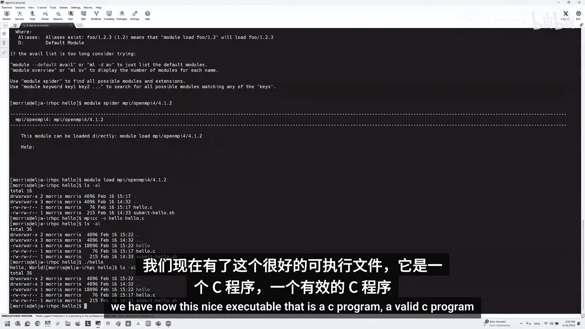
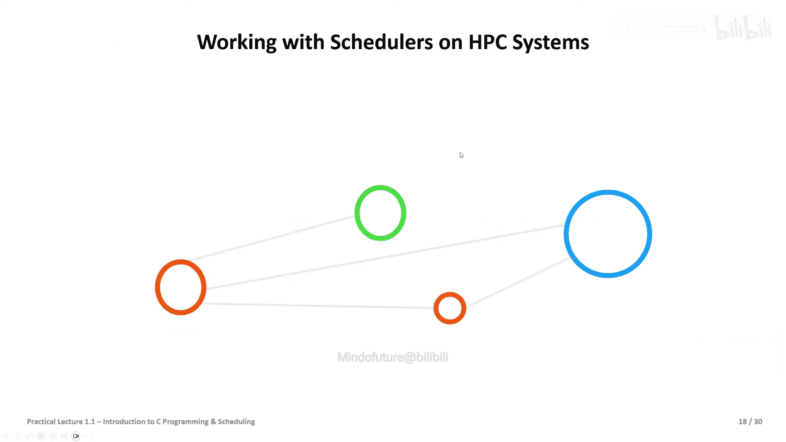

# 【冰岛大学】高性能计算课程-｜-2025-High-Performance-Computing-｜-Prof-Dr-Ing-Morris-Riedel-p25-P25_实践讲座_1.1_C_语言编程导论__调度_第一部分--BV1k34zzaEK8_p25-

Welcome to High Performance Comping， advancedance scientific computinging Today we have our practical lecture 11 about an introduction to C programming and to scheduling。

So basically both of them are really let's say very short introductions so we continue a little bit what we learned from Pra lecture 01 if you remember a little bit on unique skills module。

 the whole environment that we have in HPC and we're built on this and use a module environment to compile a C program and obviously this course is not called C programming but high performance computing so we keep the C programming details really to the necessary few。

 mostly because we want to later then after we have seen the conceptual material of lecture2。

 then also the Pra lecture 2。1 where we will have our first MPI program if you remember MPI was a message passing interface and so on scheduling then is an important concept that we will also learn in the course essentially today in the second part where we understand that we have a multi-us environment。

HPC and we need dedicated HPC system software to make that work together with other users。

But before we start to go into the material of this lecture， let us review what we had the last time。

So this was really a high level if you want introduction to high performance computing the last time lecture1。

 really the first time let's say looking what HPC has to offer and of course also in a very condensed fashion only on the material we have in this course so you can go on and go on with HPC there are so many topics and here we keep it to the let's say essentials in HPC and some of them that also even have standard the test of time and with this we basically have seen the basics from a CPU computing entities no matter how big the HPC system is you remember the Rex we have seen in little bit seen already with this element we have the ships but of course we have them very condensed together in one machine and we learned a little bit about the so-called multicore processor so these are all course basically on a chip with highces rep。

So number crunches， really good cash here he that fuel the course。 then also with data very fast。

 So cash is， you know， very expensive， very fast。And with this we have really a power horsese in terms of a computing entity and many of the laptops you have today have of course multi core laptops and if this would be all what HPC can do。

 then that is of course not at all what we consider， let's say par computing with HPC hence。

What we learned a little bit is then that basically in the last lecture that we want to use these in parallel and many of them。

 which essentially looks a little bit like this， you have different processes that then would you know be running on this and of many others that are integrated really and Res。

 you have seen also the other elements like midplanes and so on and where you then can see that we have many。

 many of those available， but they have also very good interconnect and these was an important。

 let's say element in HPC as well， for instance in FNni bandand and so on， these are all。

 let's say integrations into a HPC system which makes it really fast to communicate between those processes。

Hence， the idea is also then to have some computing or more better saying programming paradigm of how to actually program these parallel processor。

 And by doing so， we use the standard message passing interface。

 And as the name suggests this means you send lots of messages right between the different processes。

 and this is an important part because we cannot access in the larger system the memory from another processor。

 right， Hence we call that distributed memory。 you see that a little bit all looting here。

 that every time when a processor here and a core has to， let's say。

 access the memory space of someone else， it would need to communicate right。

 it would need to go over the own memory is， of course， the address space that you can reach。

 But as soon as you talk about another processor memory space， it's not basically accessible， hence。

In order to use data from another processor， we have to send messages and this data can be many things。

 It can be simple integers could be， let's say MP strokes really larger。

 let's say data that we will also see later in the course that you can create in the MPI environment and so on and so on。

 So I think business you'll notice and you will see also in lecture to how we realize this then the lecture2 will be based on MPI where I show you all the details。

 but in the moment， I think it's important to just understand this concept that we have this message passing between this different processes that run in parallel at the same time。

 Now however， another， let's say computing paradigm that also sent the test of time if you want in high performance computing is shared memory programming。

Shared memory as the name suggests is quite you know suggests it's easy so you have one shared address space you see that a little bit here and then you have many lightweight threats that run。

 let's say on all these processes here。In order to， you know。

 wisely write and read and write and read for memory and， you know。

 do something with the data in between with a program。

 but you can always store it in the memory and another threat。

 as we call them in shared memory programming， can then simply read it。Now。

There's this Numa and CC Numa which is now having the Ke currency here on the memory interface link so that it actually looks like it is a one shared memory system。

 but in the end it is a similar entity like the shared memory have you on the left side for the programmer。

 but the reality is that this cache current link here we're also will basically then enable us to see that one shared memory address space。

 so it is basically distributed memory if you want from the real implementation perspective。

 but it's hidden from us users that's why we call still。Yeah。

 no call is essentially shared memory now。The reality is also we combine this both often right so there is a kind of distributed memory programming using MP between different nodes and then within the node where we have multicore processor。

 we used then essentially shared memory programming was a standard called openmp we will also learn later in the course about this and then you basically can combine the power of both and people make the case later in the course so this where basics and there were many others but I think also important to understand this then the ecosystem technologies that came across as well and some of the applications really that we have and I think for instance the multicoship was very different from the many coreship which is important for you to understand especially today is a money more accelerators as we call them GP GPUs general processing graphical processing units so this is basically something where today。

We have quite a dominance of NVDdia but AMD and others are catching up Intel and Sora also many core processes what theyre in the moment of all。

 let's say as a shortcoming is that they often need these CPUU to fill the main memory and to fuel the device memory of this GPUs in order to do let's say data processing but we have learned because it's as many core architecture and you have thousands of processors this is very beautiful for some applications like deep learning networks you see here for example a convolutionary networks or autoenrs and so on and the reason is that many of these many core processor is thousands are basically not really you know high signals red performance as we had in the multi corere these are moderate let's say paced processor that's why you can put so many on the chip because otherwise it would overheat that were the limits。

The multi core processes， which were nicely， let's say now， you know， changed in the GPU setup hence。

This is now beautiful to achieve throughput and when you have something which is a little bit。

 let's say as we call it nicely paralyizable like the array for instance here matrix vector multiplication or vector vector multiplication does matter and so on you will see the mathematical rule to here do a matrix vector multiplication is here the orange and everything else can be independently done from the colors right in order to fill the whole result and if you go deeper into deep learning what we will do also late in the course we will realize that many learning steps that a deep learning network will do is a section nothing else than multiplying these matrix vectors and so on hence the GPUs are just beautiful for AI applications and also for many of the let's say simulations we see in earthquake simulation that we have discussed the last time as well and more packages coming on supporting GPUs because here and there if the same instruction。

arere repeatedly again and again and again done then with other data then this is also a beautiful technology and we will have a whole lecture about GPU so I don't need to you know basically talk too much about it we have also talked about big data which is now handled in several ways in HPC systems with parallel file systems but also you know in different areas we have seen that the HPC system already can digest quite a lot of data because we have parallel computing we don't have this stereo limits anymore so in a way there would be no end tocal but of course we will also face in the core in the course here and there some practical examples where scaling is not unlimited although it suggests a little bit by just adding more more and more computing processors with storage and caches and so on we will also face other limits in scaling。

One final point here。And that's where also HPPC is good and is not only training deep learning networks faster。

 That's what we also will realize in one of the lectures later coming on。

We also can learn them better in HPC and the reasoning is that we can do so-called hyperpymid optimization in a more systematic fashion。

 having all this computing power so you see here some of the hyperparmeter I will not go in all the details you see a typical one is here the optimizer you use or learning rate and so on these are things you pick as a human and with this you have a large pool of elements to choose from right so is it SGD or atom is a learning rate instead of one maybe 0。

1 or something else so these are things where the human is making already some configurations and basically when you do this you are not sure that's real the optimum or this particular deep learning problem it could be maybe that this was the best for the convolutional network you see here but when you then switch to an outerenr for another let's say study that you see also here in our publications。

Then it is might be very well that these parameters are nonsense or basically don't give you good accuracy。

 hence we have a way called hyperpymeter optimization and if you notice we integrated this nowadays in the course as one of the most newer lectures because it gets more more momentum why HPC is also useful in AI basically to pick this hyperparit well instead of just the human。

And of course you could go on with HPC I just make the final comment on the quantum computing which is now active。

 we have several quantum computers already procured within Europe so they are existing and people do their baby steps on them we have first initial applications also my team we publish a lot and you know dewave these days。

 for instance one specific quantum computer there are many others， many other types。

 but of course we also cannot go in an HPC lecture very deep into quantum it needs a complete different lecture as well。

So this was a little bit more longer than usual just because it is the basics and you need to know the basics so when we come now to all the lectures which will be know following you will see we will dive into power programming the next couple of lectures together here with MPI distributed memory but then also quickly go to shared memory programming with open MP so this is all building on lecture one that's why it was essential to actually see that and also when we do then this five six7 lecture together you will see what we just discussed with the many course will be an important aspect of it。

 why basically deep learning is so powerful。Hence let us go to the idea of the lecture today and this is really briefly having you know an idea of how you program and compile a C program this will be of course parts of your assignment later but it will be let's say not see programming for the sake of C programming but rather for the understanding of power computing hence you don't be afraid if you're not a typical C programmer and the Java programmer or Python here we do really basic steps。

 the importance is that you understand the HPC systems module environment that you have to load the relevant compiler for instance and I know that some of you maybe not even use the compiler before you many people use Python these days so we will execute and basically also compile the C programs on the HPC system then we understand that doing this on the login node is not a good idea something coming into place when you think about that you have a multi-user space and that's why we。

Also the second part of the lecture where we then talk about schedulers on HPC systems。

 so we have this huge multi user systems where maybe hundreds of users use the system at the same time。

Hence we use some HPC systems software environments to understand that better schedulers are one of them like SLRm。

 for instance， but there are many others here and of course we use SLm examples on our earlier system。

 but if you go for instance， for the deep systems that we already used for instance。

 also in the practical lecture 0。1 if you remember it would be very similar to execute the jobs there。

 hence it's a sort of modal perani， which is a sort of standard or de facto standard in HPC systems to use such a scheduler。

 even if it's another one in EVM systems we had load levelr for instance。

 a long time and there are many other schedulers， but SLm is quite an active one and often deployed in HPC systems today and then you also understand executing these C programs and with these schedulers enables you that the job is actually run on so-called compute nodes hence we will make also the first distinction between different nodes in HPC systems which is a lockin node and the。

ute note and I will show you the difference as part of this lecture。

 So let's go and start with the practical。 I mean here it's really an idea that you get some practical knowledge of using essentially Uniix again for C programs for compiling using the module environment and with this you can use high performance clusters internationally and of course also the programming of it right many programs are in forron。

 many programs are in C。 So if you are let's say in the area of physics applications。

 this is still a dominance there。 if you go to AI applications you we see of course。

 much more Python these days。Hence， what I teach you should be a little bit the basics here so that you can build on that later when you want to maybe compile other C programs。

 which others maybe have provided to you for different applications in engineering。

 sciences and so on。 We have some examples of those， of course。

 later in the course when raises also partly taking over。

So let's go to the practicals programming see programming here again the kind of。

Link to the lectures that we have later starting from CFD computation fluid dynamicss。

 but there are many others you see here in Earth science application。

 terrestrial systems to understand the groundwater modeling you have basically three different codes here that are used together Cosmo CLM and powerflow and this is not obvious to you how this is actually all implemented important is just to understand that they're all primary written in C。

 And then there's a ways as cutplr。Which is a fourth MPI program connecting these three with each other and sending。

 you know， also the variables between all these different codes。

 But you just to understand that all these different areas of science is similar like we have in our national HC computing。

 you know， in Iceland， the national Compnce centers， you see there are many simulation data labs。

 things that you have seen in our Icelandic HPC workshops。 they have many of these codes。

 which are still see and here is also N， which is from the brain sciences， for instance。

A kind of simulator for spiking neural networks and it's also in itself implemented in C plus plus just to show you that。

 of course， this programming language still has basics and if you go to Earth sciences weather forecast ECWM it's basically the center that gives us see European forecasts and so on there still many codes running in Forron right so it's a very older programming language still people using it today and it gets some momentum still today just that you know that these is still relevant in scientific computing if you are thinking about that C might be old or that Java should be everything just because you learned that in your first couple of semesters here so in the end。

this is about performance right so and as the name suggests from the course we are after high performance computing hence here and there software engineering。

 let's say best practices are a little bit ignored to also get to the best performance hence reusable of code there are lots of things needs to be done here in the scientific domain still if you look on some of the codes to be let's say in proper software engineering and the NAS code is a good way towards this I think it has good you know Gitlase and so on and if you want you can have a look and in generally that is of course something to consider that C and the compilation is a very fast entity of execution and doesn't have this ra virtual aspect that you have basically from Java or Python as interpreter languages but again we come to the basics of programming and that's not the idea that you come out as perfect programmers here the ideas rather to understand。

And what's the difference when you program HPC systems？And when we do so。

 we need documentation and when you see documentation， we do the earlier cluster， we understand。

 okay， this says lots of multico CPUs for SA labor where we can execute a C program and you see already here what I'm saying there are different compute notes on the one hand different elements and here's a lockin note right and this is something what we also will explore later when we have the second part of the course。

Today let's go really to practice and lock into earlier if you remember a little bit I have here this mobile X termm which was an SSH client but it does not have to be this one so they have all similar elements I need to specify my username Morris and then you remember our lecture intensively on private and public keys I will not repeat this I think by now you should know what's up with these keys hence I will not go into the details here。

But it's important to really understand them。

So when we use a private key， sometimes there could be a password request。

 depending on how long you not have used it or you know how long you basically had the last session away from the current lockin that you have in this sense you know this can take a little bit of time and in many cases you would say the password is not again needed。

So here we wait a little bit on the access to earlier now so that we should basically come in a moment and all what I will present。

 of course you can imagine is already here here's an example also on Putti if you want to use this one I would still recommend to use the Mo X service and you have seen here the keys again if you're not sure yet what was a private key one of the ideas of assignment one will be actually to understand this better then please go to the lecture that we had you know practical lecture 0。

1。

So with any luck we could now log in and you see here by now we have actually our public key was accepted。

 we are in the welcome screen as it is called， I will increase the font size a bit further recording。

So we had earlier now。Like we did before， with CS SSH keys So no surprises。

 a short glimpse on what are the latest news， Perhaps there's a file system problem or out of。

 you know， system or basically a kind of， they call it also system maintenance windows。

 which is important for us to understand， you see here home direct immigration。

 There's a different aspects in infos。That's why it's always good to at least skim over it also when you think about support here this is basically that our systems administrators are not anymore in the field office in ASA and now we have a new email address here from E at how even this if there's let's say trouble with the system but in the moment it looks everything good basically so let's get on with some more details what we can do。

Again we are landing in our home system， print working directory， you know that。

 so I'm basically on U here in my own directory from one of the last lectures we had the HPBC course spring。

25 already created。 And that's where we want to go in。And then when we go and check what's there。

 there's already directory MPI that I created for you here for the recording with a very interesting cuttingtting edge Hello World program。

 so this is obviously in computer science first that you have to do a see program this hellello world。

嗯。So let's move into and you can do this， for instance。

 by using the VI right so when you have the VI editor。And hello Poi。

 you see here it's a very trivial C program， it has one include of standard IO header files。

 but then there's a main program which will be executed so we don't even do many functions or anything else。

 this will come in later lectures down the road when we have existing software explored but all we do is basically here print F hellello world and then return zero that the program has actually work fantastically。

So there are a couple of things to note here， firstly， that this is a proper program。

And an MPI program that we wantt develop out of this later is a parallel program which should be also a prop program。

 hence this is not in conflict with each other， but you see here clearly that there's not parallel anything right so the main will just print out something and then done。

So the simplest， if you want maybe of kind of actions that you can do。

 but it's already carries some of the essences to use radio HPC environment。

And this is something what we also want to explore today in the first part。

 And then late in the second part。 So ignore in the moment。

 the submit hello jobscript that's something which will come in my second part here we want to now see what we can do with a hellello C。

 you know， basically program for those that are knowing a bit about more Uniix。

 you see also here has no x。 So it's cannot be executed。

 when I now say hello won hellello don't say nothing you know， is working here。

 So hence we need to compile this to an executable。

And this is of course， also documented a bit in the slides moving。

 perhaps also here a bit parallel ahead， so we had the welcome screen。

We have the simple C program that I explain you here in all detail。

 it makes sense to have this folders right so when you do your own steps in the assignment I would recommend you do similar things。

Where you basically have a structure， not put all in one directory because this could be misleading also for outcomes that youll see later from the scheduler。

And hence， we need now an a C compiler。That you have seen because we cannot execute just the C program like that。

Hence we come back to our elements we already learned and this is a system module environment if you remember we had that it's the last time in the practical lecture 0。

1 where we have different modules and if you remember one way of doing it make first clear and maybe increase the font size still a bit。

 we can do for instance modular whil。

What you now have is all the modules which are installed on earlier here on the system。And。

While many of them are important in media for KUa to use GPUs properly， for instance。

 or you know different elements for applications are there。

 which is for us important parallel IO viewer HDF so here are heQ data format and this is a parallel IO on HPC you know system to really enable a throughput with data and many others that you see here open form will be something whereasasor will talk about later so this is computation fluid dynamic codes that you can use for different areas。

 for instance in the Me Office they do other launches with open form right so many of these are a bit like application oriented。

 but many of them are also let's say low level libraries that you need really for getting the system up to speed examples。

arere from the QUa environment， for instance for GPUs already mentioned， so for us important however。

 is MPI hence we see there are different versions of MPI and one is an open MPI which we basically also will allude to in the next lecture lecture too。

But this is the one were interested in， so。Here， apparently， this comes already， you know。

 with a C element in it。 So we want to module spider this。Hence， you know。

 you could of course go ahead now and say use another C compiler。

 but I use basically this environment already to go to the next step in practical lecture 2。

1 where we basically do the same thing in order to。

Then really how to say compile an MPI program out of a C program so and I don't want to give you several different ways as a beginner of this course at the beginning I think it's good to have one modules operaundi so that we can see here now that we can directly load this module and that is what we should do module load remember the the marking here and then the right click for instance。

 it enables us to copy paste that we want MPI in the open MPI for version specifically for 4。1。2。

Now I've load this module and can go ahead with compiling and this is all of course also yes somewhere on the slides documented。

So what we now do there is MPICC or compiling a program here， it's not the ping pong C。

 it's actually the hellello C and the minusO option here is essentially for us in hints to a proper naming scheme and I would recommend to do the same when you do your assignments and so on。

 because otherwise you lose a little bit track if you don't have a specific output how this executable should be named。

So we have done this module load。And we' use now， essentially MPICC。As we had seen。

 but before we have to maybe look again what's happening in the directory。

 so we have the HelloC program here， so now we can use MPICC because we have load the module we use essentially here the means O option for Hello。

And what we want to compile is the hellello C program right so by doing so we should see now that there's an executable created which looks a bit different。

 not because it's green， but you notice that the X are here so this is basically marked as you know an executable so hence there should be something happening if you do it and for instance。

 if you do now let's say hello in the same directory hello。Bum。

 you see Hello world is given out directly on the screen。

 That is also important now for us to understand when you're not using a scheduler。

 when you're not basically using the HC environment， as you should do。

 You actually work now on the lock in node。And executing on the locker node and of course this is also sort of a serial execution because there's no parallel computing yet and we're also not on the compute nodes。

Hence we miss still a couple of things that will come in the next couple of lectures like MPI then we use the scheduler in the second part of the lecture so let's look a little bit what we have done。

 we have now this nice executable that you know we is a C program a Val C program and this is already a big achievement for us in the moment。

In a way， this is， of course。As I said， missing with the MPI。

 we will do this after we have now learned the conceptual details and lecture to what the MPI is really。

 you just go to high level intro， so we will look in this more detail a short glimpse for it it's that it's a standard for message passing as a slide suggest。

And that there's an implementation to it， right， so this open MPI implementation that we have seen and loaded in version4。

And。We use this with the MPICC compiler and you can also use when it's prepared with other environments and compilers。

 other tools， but here we want to keep that in order to make a relatively streamlined access for those that are never programmed and see for those that never use the HPC system before。

 to keep the learning curve， let's say not too steep。We have also done this。

 so just a slide for summarizing here really again the no module avail and the module spider commands。

 which are very essential right you see here something which is very easy to load mostly because you have also the point that it has no dependencies here so you see that be module spider it this MP or MPI4 there's no other modules that you necessarily need to load in normal system software that's not usually the case you would have let's say for advanced programs really a long dependency list hence you end up with many module loads and we will see that throughout the course when we come to more applications also an AI for instance。

 you need to load a couple of different elements not just Python you need also for instance tool sets like Tensorflow that are basically enabling you with a Python then program to enable you also to use a learning network。

And so on and so on。And。This is really done in many of the applications in format times we had also。

 for instance， HPDP scan as one of the module available and since we do more and more deep learning in the courses we skip a little bit this clustering as technique。

 but this is also a C program which is used for let's say。

 unsupervised learning where you cluster then for instance here in the brain slice that you basically have as an image。

And then you cluster essentially different areas of it and come to different cortical layers。

 And this is just to show you an example again from， you know。

 brain sciences but a complete different example from N right So N was more let's say a code which was for the spiking networks。

 And here we have really just an idea of how to use a clustering algorithm。

 which is essentially usable in all different fields and engineering and science。

 But here we're using it in brain sciences。 And this is sort of a distinction also a little bit from the AI perspective。

 So this AI tools， machine learning， deep learning， but also here。

 more traditional algorithms like the Da scan algorithm， for instance。

 that one of my PhD students that also paralyzed really effectively。

 So I would say it's still one of the most scalable Da scan algorithm on HPC systems。

 So this is something where you know where。HPC then is used in C programs and is also making use of MPI and shared memory as well as Openmp and I will keep this lecture example a little bit so that you get a better understanding what you do usually with all this different codes and that not all of it maybe these days with AI deep learning and machine learning that there's still some algorithms like clustering。

 for instance， very essential in science that you know。

 enables us also to understand the broader portfolio that HPC is not just used for deep learning。

So we have used the right modules for the MPI compiler。

 we compiled essentially the C program we have seen is in the executable。

But what we have done there then was executing the hello on the， let's say， login node。

 And this is my last statement for basically the first part of the course here。 This is not the idea。

Right so here we compiled and this is fun and this is okay。

 but the execution should be usually never done on a login node right you will see that when we log in with SSH。

 we are here located hence everything we do is automatically operating on this login nodes。

 but when we want to run jobs， let's say in a typical production system thousands of CPUs in parallel with MPI maybe。

Then we talk about compute nodes。RightNow El has also compute nodes， maybe not in the thousands。

 but still a reasonable number to get the teaching done and with this you have basically the opportunity to use this compute notes for execution of applications。

 but this requires so-cal fellow called scheduler。Hence， you can think about that。

 Our next course part here is really called scheduling。

 where we understand how we actually use this compute nodes instead of doing everything on the login node。

Now when you do， for instance， complex you know climate simulations， for instance。

 you would be on the login node and you started there and you know basically you would even maybe call get calls from administrators which say what nonsense you are doing there。

 right so。Please hang on and。See also the second part of the lecture where we then do it properly。

 the L world execution on the compute nodes by using the learnm scheduler。So see you then。

