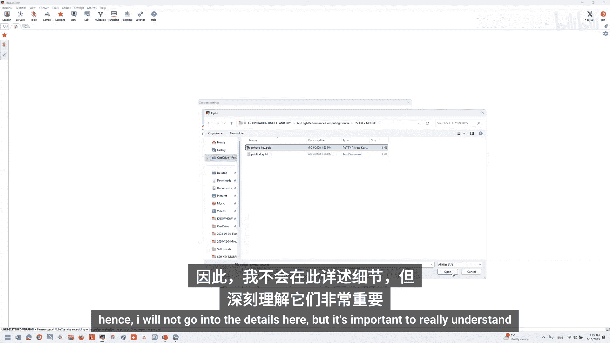
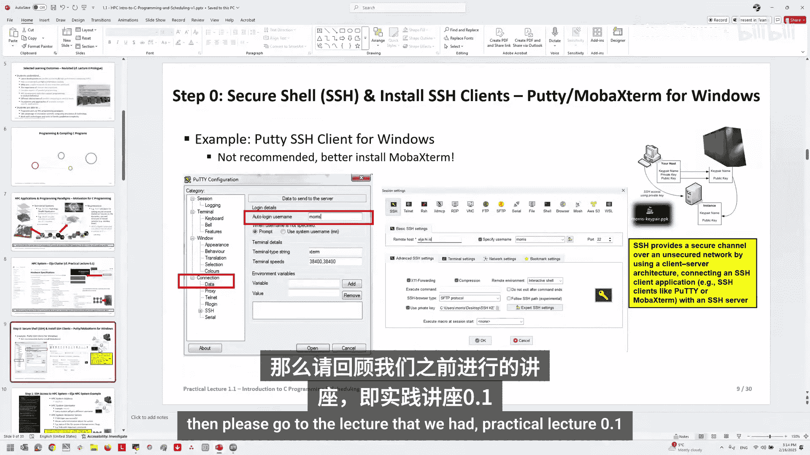
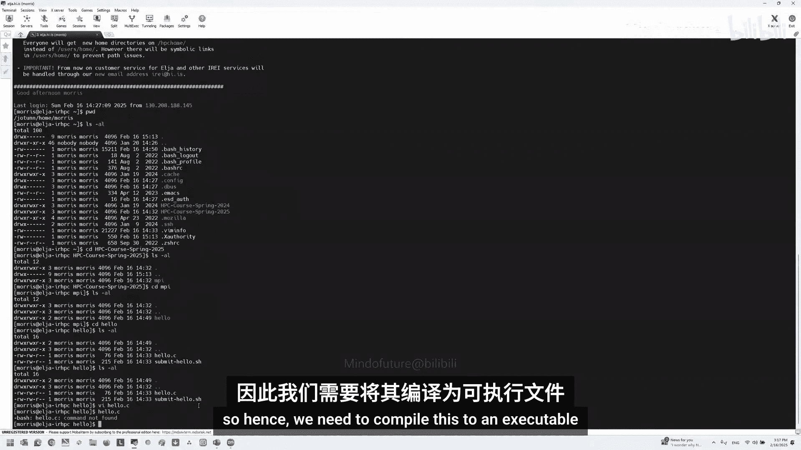
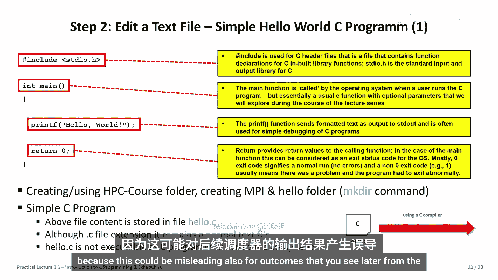
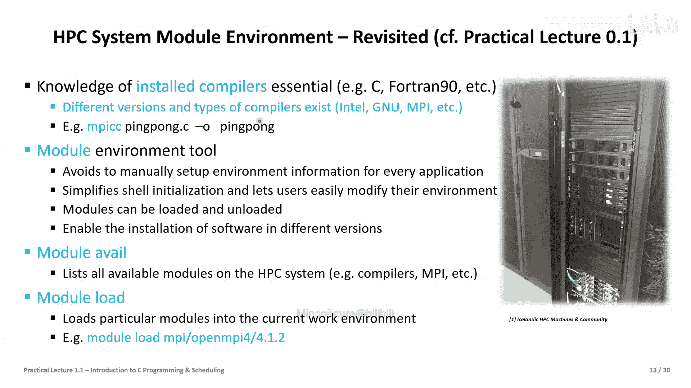
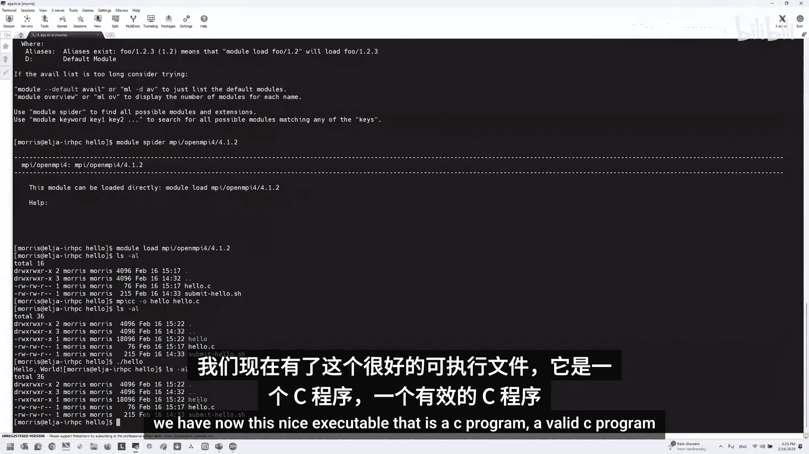
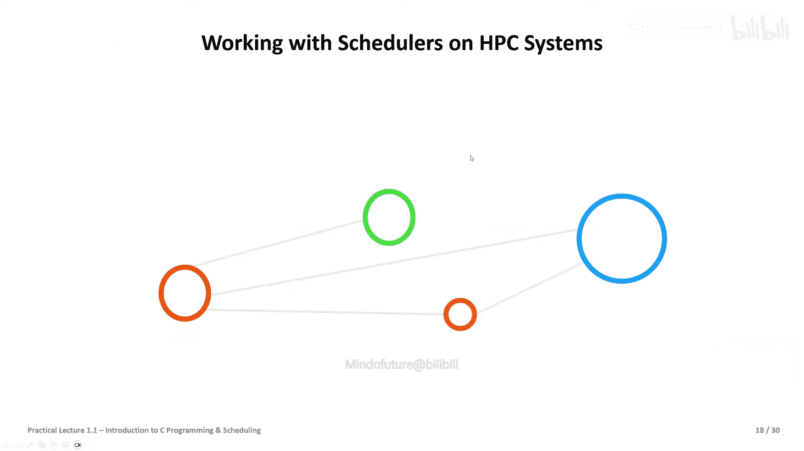

# 高性能计算课程：1.1：C语言编程与调度导论 🚀

在本节课中，我们将学习两个核心主题：如何在HPC环境中编译和运行一个简单的C语言程序，以及如何通过调度器将计算任务提交到专用的计算节点上执行。我们将从回顾上一讲的基础概念开始，逐步深入到具体的实践操作。

## 回顾：高性能计算基础

上一讲我们介绍了高性能计算的基础概念。我们了解到，HPC系统的核心计算单元是多核处理器，它在一块芯片上集成了多个计算核心，拥有高速缓存，是强大的“数字运算引擎”。

然而，仅有多核处理器还不足以构成我们所说的并行计算。因此，我们进一步学习了如何将许多这样的处理器单元连接起来，形成一个庞大的计算集群。这些节点之间通过高速互联网络（如InfiniBand）进行通信。

为了在这种分布式内存架构上进行编程，我们使用**消息传递接口**标准。其核心思想是，不同进程（通常运行在不同的处理器上）之间通过发送和接收消息来交换数据，因为一个进程无法直接访问另一个进程的内存空间。其基本通信模式可以抽象为：
```
进程A 发送(数据) -> 进程B 接收(数据)
```

另一种重要的编程范式是**共享内存编程**。在这种模式下，多个轻量级的线程可以访问同一个共享的内存地址空间，一个线程写入的数据可以直接被另一个线程读取。在现代多核处理器上，这通常通过诸如NUMA（非统一内存访问）的架构来实现，它对程序员呈现为单一的共享内存视图。

在实际应用中，我们经常混合使用这两种范式：在节点间使用MPI进行分布式内存编程，在节点内的多核处理器上使用OpenMP进行共享内存编程，从而结合两者的优势。

此外，我们还简要介绍了**众核处理器**，如图形处理器。GPU拥有数千个计算核心，虽然单个核心的性能不如CPU强劲，但其巨大的核心数量特别适合处理高度并行、计算模式统一的任务，例如矩阵运算和深度学习。

## 课程概述与目标

基于上一讲的基础，本节课我们将进行首次实践。主要内容分为两部分：
1.  **C语言编程实践**：学习在HPC的模块化环境中编译和运行一个基础的C程序。请注意，本课程的重点不是教授C语言本身，而是理解在HPC系统上进行程序编译和执行的流程。
2.  **调度器介绍**：理解HPC系统作为多用户环境，为何需要以及如何使用调度器（如SLURM）来管理计算资源，将任务提交到计算节点执行，而不是在登录节点上直接运行。

现在，让我们开始第一部分：C语言编程实践。

## 第一部分：编译与运行C程序

在HPC环境中，我们通常不直接运行源代码，而是需要先将其编译成可执行文件。我们将使用系统提供的模块化环境来加载所需的编译器。

### 连接到HPC系统并准备环境

首先，我们需要通过SSH客户端连接到我们的HPC系统（本例中名为“Elja”）。连接时需要使用之前配置好的SSH密钥对进行认证。

成功登录后，我们会进入自己的家目录。我们可以创建一个专门的工作目录来管理本课程的文件。

以下是创建并进入工作目录的命令：
```bash
mkdir -p hpc_course_spring25
cd hpc_course_spring25
```

### 编写一个简单的C程序

我们从一个经典的“Hello World”程序开始。使用文本编辑器（如`vi`或`nano`）创建一个名为 `hello.c` 的文件。

以下是 `hello.c` 文件的内容：
```c
#include <stdio.h>

int main() {
    printf("Hello World\n");
    return 0;
}
```
这个程序非常简单，只包含一个 `main` 函数，功能是向屏幕输出“Hello World”字符串。它目前是一个纯粹的串行程序，不包含任何并行计算元素。

### 使用模块环境加载编译器

在HPC系统上，软件通常通过“模块”来管理。我们需要加载一个包含C编译器的模块。这里我们选择加载一个MPI实现（OpenMPI），因为它自带了C编译器 `mpicc`，方便我们为后续的MPI编程做准备。

以下是查看和加载模块的命令：
```bash
# 查看所有可用模块
module avail

# 查看特定模块（如MPI）的详细信息
module spider openmpi

# 加载指定版本的OpenMPI模块
module load openmpi/4.1.2
```

### 编译C程序

加载模块后，我们就可以使用 `mpicc` 编译器来编译我们的C程序了。`-o` 选项用于指定生成的可执行文件的名称。



以下是编译命令：
```bash
mpicc -o hello hello.c
```
执行该命令后，如果编译成功，当前目录下会生成一个名为 `hello` 的可执行文件。在Linux系统中，可执行文件通常会被标记为绿色或以“x”权限显示。




### 在登录节点上运行程序（不推荐）

编译完成后，我们可以直接在终端中运行这个程序：
```bash
./hello
```
此时，程序会在当前的**登录节点**上执行，并输出“Hello World”。然而，在HPC的最佳实践中，**任何实际的计算任务都不应该在登录节点上直接运行**。登录节点主要用于文件管理、代码编辑和作业提交等轻量级操作。长时间或高负载的计算会占用登录节点的资源，影响其他用户使用系统。

因此，我们需要一种方法将计算任务转移到专用的**计算节点**上执行。这就是我们第二部分要介绍的内容：使用作业调度系统。

## 第二部分：使用调度器提交作业

HPC系统是典型的多用户环境，可能有成百上千的用户同时使用。为了公平、高效地管理所有计算节点上的资源，我们需要使用作业调度器。



### 调度器的作用




调度器（如SLURM、PBS等）是HPC系统的核心系统软件之一。它的主要功能是：
*   接收用户提交的计算作业（一个脚本或命令）。
*   根据作业的资源需求（如CPU数量、内存大小、运行时间）和当前系统的资源空闲情况，进行排队和调度。
*   在合适的计算节点上分配资源并启动作业。
*   管理作业的运行状态，并将输出结果返回给用户。

### 编写作业提交脚本

我们需要创建一个作业提交脚本，告诉调度器如何运行我们的 `hello` 程序。创建一个名为 `submit_hello.job` 的文件。

以下是 `submit_hello.job` 脚本的示例内容：
```bash
#!/bin/bash
#SBATCH --job-name=hello_test   # 作业名称
#SBATCH --output=hello_output.txt # 标准输出重定向到此文件
#SBATCH --error=hello_error.txt   # 标准错误重定向到此文件
#SBATCH --ntasks=1                # 启动的任务数（进程数），这里为1
#SBATCH --time=00:01:00           # 作业运行的最大时间（1分钟）
#SBATCH --partition=normal        # 提交到的分区（队列）名称



# 加载运行所需的模块
module load openmpi/4.1.2

# 执行编译好的程序
./hello
```
脚本开头的 `#SBATCH` 行是给SLURM调度器的指令，用于设置作业参数。脚本主体部分则与我们之前在终端手动执行的命令类似：加载环境，然后运行程序。



### 提交作业到计算节点

使用 `sbatch` 命令将作业脚本提交给调度器：
```bash
sbatch submit_hello.job
```
提交后，调度器会返回一个作业ID（例如 `Submitted batch job 12345`）。作业进入队列等待调度。

### 查看作业状态与结果

我们可以使用以下命令查看作业状态：
```bash
# 查看当前用户的所有作业状态
squeue -u $USER

# 查看指定作业的详细信息
scontrol show job <job_id>
```
当作业状态从“PENDING”（等待）变为“RUNNING”（运行中），最后消失（表示已完成），说明作业执行完毕。

作业完成后，输出文件（本例中为 `hello_output.txt`）和错误文件（`hello_error.txt`）会生成在当前目录。我们可以查看输出文件来获取程序运行结果：
```bash
cat hello_output.txt
```
如果一切正常，文件中应该包含“Hello World”这行输出。至此，我们成功地将一个简单的C程序通过调度器在计算节点上执行。

## 总结

本节课中我们一起学习了两个关键实践：
1.  **HPC环境下的C程序编译**：我们编写了一个基础的C程序，利用HPC系统的模块化环境加载了编译器，并将其成功编译为可执行文件。我们了解到，直接在生产环境的登录节点上运行计算程序是不被允许的。
2.  **使用调度器管理计算任务**：我们认识了作业调度器在HPC多用户环境中的核心作用。通过编写一个包含资源请求的作业脚本，并使用 `sbatch` 命令提交，我们将“Hello World”程序正确地分配到了计算节点上执行，从而符合了HPC系统的使用规范。



这些操作为后续更复杂的并行编程（如使用MPI和OpenMP）以及在HPC上运行大型科学计算应用打下了坚实的基础。在接下来的课程中，我们将深入MPI编程，学习如何让多个进程协同工作，解决真正的并行计算问题。