# 【冰岛大学】高性能计算课程-｜-2025-High-Performance-Computing-｜-Prof-Dr-Ing-Morris-Riedel-p26-P26_讲座_1_高性能计算_第二部分--BV1k34zzaEK8_p26-

Welcome back to high performance computing lecture 1。

 a general overview of high performance computing And in the first part already。

 we discussed several aspects and in this end。We can of course also acknowledge that you。

 having a big overview in high performance computing will probably fill much more than two times 40 minutes。

But still， the key methods to take away that I bring you different topics that we will handle in the course and also refer to different lectures。

 but here and there we also you know look around already in details， really。

 when you think about system Iects， knowing about multico is important that the network interconnect is important and so forth。

So。Having now understood a little bit in the first part， these things and also。

Several let's say terminology is really so what makes the supercomputer why the top 500 is important and why maybe also HPC is basically a kind of element of four different aspects not only you know hardware what many of the people think is HPC so HPC is equally about theories using basically physical loss with numerical methods limits Amd's law you will basically consider in terms of data that would be important part later in the course and of course then also the whole idea of the different technologies that matter so we see heterogeneity in technologies I was mentioning loommi with instinct cards versus N mediadia perhaps in many other JU supercomputers so there's lots of variety really and then of course on top of it you have all the software libraries that have to follow suit。

Right， so it's a wild mix of different technologies。

 hence the ecosystem technologies it will be also now the second name here。

Will basically be built on these basics from part one while this here is part two going here and they're a bit more in detail。

 but also in two different areas which have in the last couple of years gone significant momentum and this is again the deep learning then really fueled by GPUs we will talk about this again。

 although we had already some insights in the prologue to also show you the course content here we will still build up a little bit of knowledge in order then to also dive later in other lectures。

 as I said with lecture 567， we will then go to GPUs deep learning machine learning but as this course is just starting that's built one by one So by HPC ecosystem technologies we want to understand a little bit that the system software that you have on this HPC systems is not at all something that is directly comparable to a laptop of course there similarities and one of it is of course an operating system。

So。That's what all of you mostly know， you have some Linuxux， Windows or Mac。

And it runs the whole system， but HPC system has some edit elements and one of it is for instance a scheduling system。

 we will talk about this， basically in the next practical lecture 11 I will demonstrate this sLurn。

 basically cluster access and the reason is here that you have concurrent access to supercomputers from many different users at the same time。

So this has to be digested， many different users at the same time use a computer。

So this is something as if you would give your laptop away in class and 40 people want to use your laptop at the same time。

So hence， this would be not so easy。And of course， the supercomputer or HPC machine or cluster in smaller terms might have the capacity。

 but you also also need to have the software environment and the， let's say。

 the idea that you don't interact with each other don't overwrite code and have the capacity to really run at the same time。

Because that's something someone has to keep track on so hences we're bringing us through an idea of a system called scheduling which has large theoretical parts a different scheduling algorithms some are better than others some have of course benefits of you know backfilling for instance where you can have holds in the schedule field if you want and the whole approach is also a little bit alluding to the idea of doing batch processing so that's also something which many students don't really have a grip on so many people use windows or laptops and so on so batch queuees refers here that you submit a job to this cluster and you are scheduled in a in let's say queue until their space for you to run on this HPBC system in other words。

It may be take an hour before your task， your application。

 whatever it is the HPC system should do actually is running。And this is something， you know。

 which needs the proper system to manage all of that。 So not only the different users。

 but also the idea of how I can arrange that all the nodes， the CPUs。

 GPs have time for your application at a specific point in time。Not affecting other users， of course。

 that actually do the same thing。 They also submit to the queuees and awaiting。Hence。

 this will be also something we look into deeper and this is a whole range of different systems that are available there。

 we put a bit and emphasis in the course on the SLurRm scheduling system and we will make some demos already in the next practical lecture。

Then the whole approach of ihiects that you have seen combining very， very different。

 let's say technologies in one huge rack， for instance， already bears lots of problems。

 So not only is the system load， how many people are using the system right now。

 but also perhaps are there errors you know， we call that system health checks。

 is there the system still alive or how do we have overheated CPUs do we have a problem that the storage is not connected anymore。

 So also here we have different systems that we all would count into the HPC system software like LU。

 ganglia and so on。Hence。😊，Also a larger idea of a system which you can maybe of course compare a little bit to your process list right that you would have on your computer on your laptop。

 but here we talk much more across different nodes， memory usage across different users， etca， etca。

 so much more bigger scale again。And then there are some others where， for instance。

 performance analysis in previous iterations of the course。

 we had there much more emphasis on performance analysis systems， Scalaska of VR。

 all those that you would need if you program in parallel to then really get the best performance hours because it will do an analysis of the performance。

 does it really use let's say the system efficiently or do we have bottlenecks and the power programming which we can fix actually by program a little bit different。

 So these are all large systems like Sca which of course is then therefore the experts in power programming。

 we put more and more emphasis in AI giving its growing let's say momentum in HPC but if you are in HPC chances are you will also see these systems performance analysis systems to really try to get the best out of your code and then。

The whole notion of SSH gives already to you one of the aspects which is often also seen as a problem in HPC if we talk openly about this and this is that the access to HPC systems given Uni given you know the whole variety of SSH keys and the whole system idea of sLurm job scripts that we will learn also practical lecture。

 one one it's not obvious to you， we will that materialized when I show you how to schedule jobs。

 it's not that they just come and say hi I want to run this application so you have to do a specific job scripts which can be tricky knowing already very much the underlying or lowlevel details of the HPC system。

 hence there's a whole range of so-called middleware or more recently also maybe cloud access for HPC systems which enables us to simplify the access so you would pick an application and then run it without having the need to really basically。

craftraft large sm job scripts right so they're basically on top of scheduling systems if you want like the rescale system。

 but there's also the Unior system， for instance， many of them Unior will show you in a moment because there's also the so called Jupiter that you can also see a little bit in the class of middleware making it easier to have the access to HPpC systems hence。

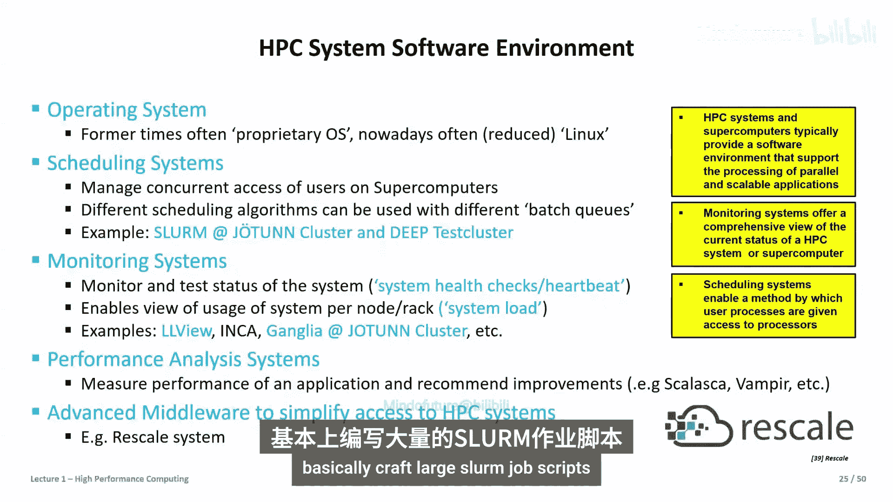

This slide should show you that a HPC system software environment is not at all easy and this is particularly true also because of the batch that you will learn in practical lecture 11。

 so I think it's for many of you not directly obvious what that means with a batch I know that from experience that's why we do immediately after this lecture 11 where I show you the aspects of scheduling。

And what we see is more and more also a momentum with AI and machine learning。

 deep learning and several different， let's say， more Python oriented codes to really go to interactive supercomp approaches。

 So this has several benefits。 So you see here the Upiter， for instance。

 in Uli that we will also use in the course， Upiter lab access。

 which means we can go there by username password。Essentially and lock into such a system and another element is that once you have。

 let's say， started such an instance of the UpiT notebook。

 some of you know that already from my cloud course， of course。

 and we go back to this here also in the HPC course。

But you see that you're basically directly scheduled on some of the nodes hence it's sort of interactive right there's no batch waiting for that and in the background lots of things are happening to enable this hence we talk about this middleware term I was auding tool you see here one of the middlewares called Unior which is actively working together with a so-called unity identity management project and program and tool which is essentially one of the challenges as well because if you remember where had the user name right associated with some of the public keys and then you're matching private key gave access hence there needs to be a whole range of identity management for different users if they want to access the system and then also submit jobs here you see one of the example jobs which is also interesting to explore with enabling interactive supercomputing if you want to maybe explore the breathing through the notes here in order to understand medical。

Operations essentially then an interactive access to basically interact with assimilation during the runtime can be quite interesting and the same is actually true if you do AI modeling on Upiter it's much more comfortable than submitting again aslom job script again as slo job script etc Of course if you are scaling very high you use maybe thousand GPs and par then chances are that you already master at this and some of my PhD students of course use that that way and combining then for instance。

 Tens offlowvis Ho over many different GPU notess and then you have the application submitted via batch so still for exploring for the initial baby steps having a U access which is really a simplified access as you will see throughout the course when you do the practicals and my demonstrations is。

Of course， also more and more requested and also more and more possible。 However。

 I would say here and that has still of course， scalability limits。

 So when you talk about the interactive access particularly。

 but I will show you more on these aspects of scheduling and slumm and so on on A on deep in the next particular lecture coming up。

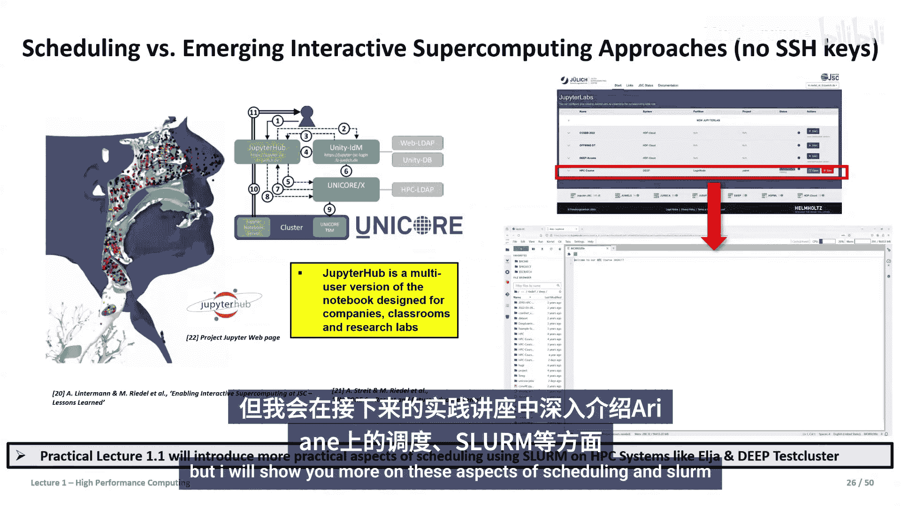

For the HPC system I hes there are lots of words and terminologies and even if you have here an older systems。

 a supercomputer blue gene line which is actually not anymore you know available from EBM it was quite a long period where they had the blue gene L Q and P different systems which we also had in usually but the benefit here is really to have very good graphics and that's why I would like to stick on this to understand some common wording so what is a note card。

 what is rack and so on hence you will see always these big boxes here and this is I think very good examples。

 very big bold racks there's lots of blinking lights it's always nicely also in the media when there's something around computing but what it doest really mean and this is really different data access levels storage access we have seen already network topologies hidden perhaps also in the second floor that we will see there you know is below these racks。

And， you know， there's also。Different levels of catches， caches， you have CPUs。

 basically multi course or many core inside。And they are really different complex machines they live in a hole usually because then also you want。

 for instance， if there's a fire that there's a gas protection and not a water coming on this fire。

 so take away the message that these is of course a very complex system design right so combined of course we see whole infrastructure enabling huge power lines to have certain amounts of watts that actually also have to few of these systems these days when we talk about excessscale systems I show you in a moment you know larger systems and also throughout the courserus we talk about many。

 many watts so you need the infrastructure for it， you need the whole with the you know protection and also then the cleanliness of the environment is also helping here a little bit of course and and this is all important ingredients really to this HPC systems and now when we then see this big monolotic monolithtic blocks really you。

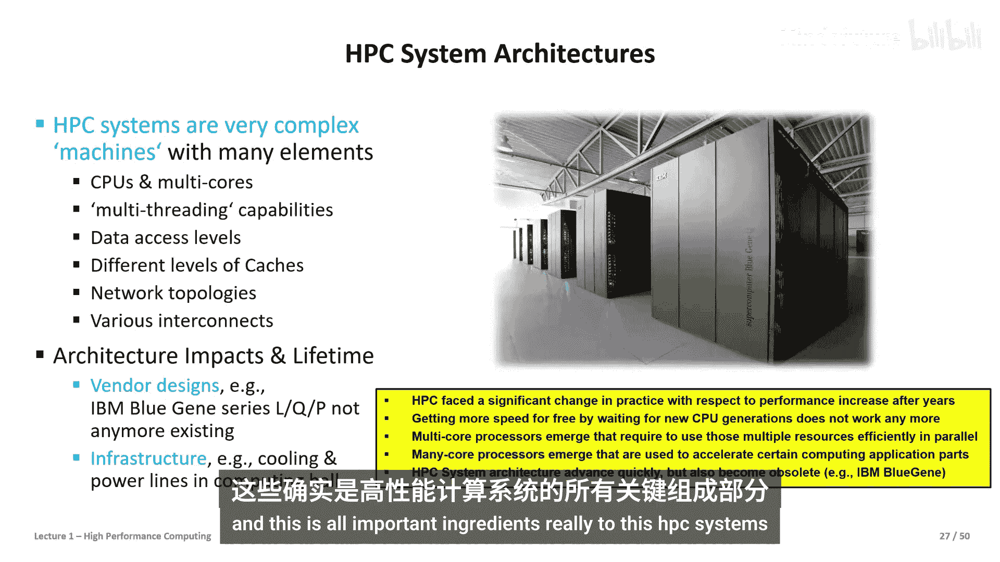

See that this can be， of course， you know。Put into much more smaller pieces and we usually start with calling something that chip before processors could be multi coherre and so on。

 then you would put them very condensed in compute cards。

RightAnd then all of these different compute cards would then also you know。

 would be sticked very dense on a so called note card。And these note cardss。

 which is now really a big difference from what you know from laptops right or from your desktop machines。

 these note cardss are now very compressed， you see 32 compute as an example here for the brin P for the brging Co there was later than even more elements in it and still the the kind of terminology remains what I wanted to say you to this right then they introduce something called a mid planee。

 which were let's say something like a number of note cardss but still the message is like you have different note cardss from the compute cardss and then they fill the racks and then the Rex is what you see here in this nice buildings all the time are then interconnected to the whole system eye interconnected。

 as you have seen in the prologue video is all the cables and so on these days we have even more infrastructure here and there in other systems you will see here。

 pipes meaning there's more water cooling these days。

Elements we will also discuss later in the course how essentially the infrastructure also affects the running of the systems you can imagine we have to cool down these systems and there must be different ways do it some are basically air cooling but also more and more we have liquiding quite interesting technologies but for you to take away the message really these eye detectors change a lot while in the kind of terminology with ships。

 note cardss， compute cardss， res rather stays right but there's of course mixed with different entities nowadays we have accelerator cards with it and then this is important。

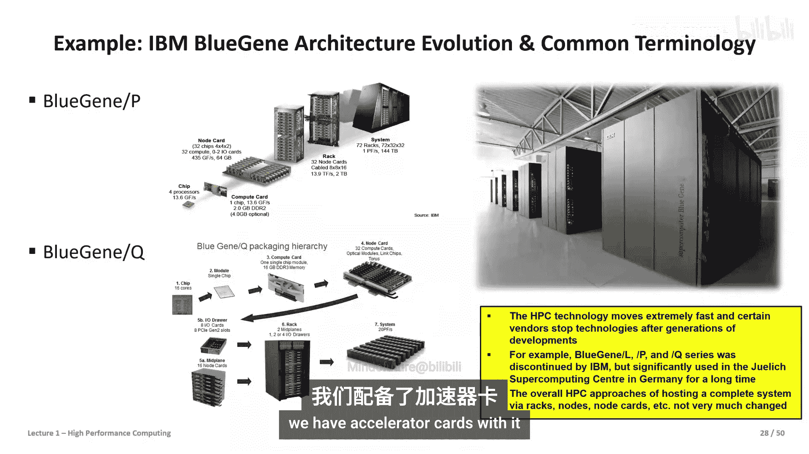

Equally， as I was said。The network topologies so they are terminologies which you also should let's say if you want to in deeper in HPC also should know there's for instance's a Tos network mesh and then also aspects we cover later in the course about IO but here you see a little bit the compute notes again that we have discussed being connected then to so-called switches also to the file service that you see here a little bit the bottleneck situation hence we also should not think only what computing also when you run a bit large。

 let's say earthquake or lava simulation， you want to dump some point in time also the data right or the results hence all of these applications that I'm euding here from different areas of physics and so on this is also something to consider they are not only computing hence there's not only the interconnect important between the different notes that you see here。

And you see also that not only the neighboring here on the top， they're directly neighboring also。

 then the next enabling us interesting shifts， for instance in the MPI commicator I will looute you later with very high performance moving through the systems if you want to have a wave propagation。

 for instance and so on。So。This is of course challenging in terms of task mappings on the exact communication and in previous let's say iterations of the HPC course we had a bit more on this。

 so we also have to sacrifice some of this。Because essentially we cannot put everything in the course and we do more AI with HPC these days。

 but if you go later in some of the old recordings on YouTube you will see much more on the network terminologies as well。

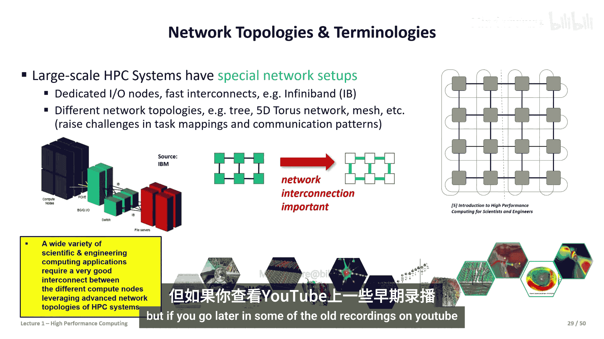

So then coming to the developments which is of course now and you see the big AI here and I think it's everywhere in the media you know that but we have really good results with AI so it's a point why HPC these days is very close to each eye to AI particularly in the areas of deep learning almost all of the successes we see in transformer models language large language models all of that is basically enabled by HPC right so this is an important statement today there's a key ingredient which is general purpose computation on graphic processing units so the GPUs I was alluding to indeed has its origin in computer graphics。

 some of you know that for gaming there were always GPU cards and gaming computer。

 but now we talk about not using them for gaming but rather for general purpose computation and has certain benefits not only being energy efficient but also you see that the throughput corrector of how。

PUs tackling the problems is something what many scientific libraries also need and deep learning is just a very good example of something we call matrix。

 matrix multiplication， matrix， vector multiplication， some mathematical operations。

 which can be nicely paralyzed and with this GPU is just beautiful。

They are different programming models and is not only openCL and NVDA Coa as I was alluding to we have AMD instinct cards as well with a different rock toolkit we have also approaches of standardization with H and I will talk about this in the GPU lecture。

 a little bit how you programmed with them and this is definitelyly one of the accelerators now that you have to put to the HPC system eyes today to make them as supercomputers as we have seen in the top 500 list。

But we've seen also a really increasing number of more heterogeneity there， not only GPUus from。

 let's say， AMD and NVDdia we can see now also soon from Intel and others。Hence。

Let us just quickly go over some other sort of special units in this processing， which is FPGAs。

 which is basically circuit that you really configure for a specific type。

 so this is a very specific way how you would program them。

 hence I would say these days it's not that far used especially not in combination with GPUs。

And also cell processors is something where has been you know quite a promising line。

 but still the GPUs remain these days as one of the most dominant let's say new technologies。

 also because the GPU is not like a GPU， you have seen that when I talked about the top 500。

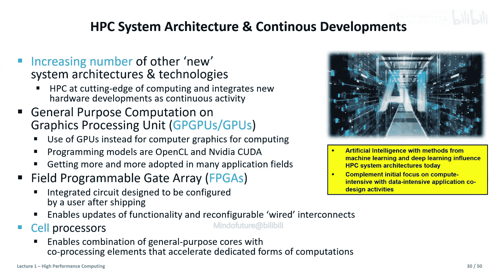

So NVdia started from a long， long list from， you know。

 maybe Keplla architectures then coming over Pascal and Umpe。

 Alta and so on to this cutting edgeship， they called now Grace Hopper cardss， which are very。

 let's say， powerful， some of them are particularly tuned for deep learning， so-called Tenza cores。

And we will make the case for it， but you know that also the technology is not just across all the different technologies。

 but also within this category of GPUs， hence it is more and more complicated to program these systems。

Now let us， let's say formalize a little bit what we now mean with such a many core GP GPUs Yeah。

 so it means for general purpose graphic processing units。

 although you will see in the HPC community that we just talk about GPUs usually so very rarely people talk about GP GPU still。

RightIt's all just cheap you。 but the origin and the original。

 let's say idea is really this general purpose， which is in a very important part。

 And here in contrast now to what we learned with multi core。

 we have now hundreds of his processor there。 now immediately would say， well。

 didn't we set we overheat and the trick to do this to put them all on chips is essentially to have them not as high single threat performance CPUs。

 but rather moderate performance。 So they're actually having a less clock speed。

 but you put just lots lots of them on the chip。And with this you have and of course lecture5 will go much more into detail into this with this you have a really high throughput that you can put through these processes。

 although they're not the big number crunch CPUUs， they essentially can tackle lots of different problems and actually today really one of the reasons why we have HPC in many different application areas so this has solved something a little bit you know coming with smooth law that we cannot have higher clock speeds and stuff that had some important element in the past but now with the GPUus we see really you know different impacts in this at the kind of speed and system let's say scaling of potential capability is really enormous however the point of using a GPUus and still still a little bit limited by these two elements we will also learned than more of course in lecture5 that you always have to have。

Really the host CPU to fill the main memory in order to go to the so-called GPU device memory and then use a GPU so this is a paradigm that has been a long time now used in GPs and is's also kind of a bottleneck but people work on this and have some solutions for this。

 but still it's not really let's say that a GPU as accelerator as we call it stands on itself so it always has to be part or basically connected to a node and we will make the case also in subsequent lectures hence。

Here we see several ideas how to use a GPU for different specific applications。

 so it's not that we use for everything a GPU， but if you have something and this will be also part of lecture five much more which you can nicely paraize right then it's just beautiful to do so and here's a good example here of the color coding when you want to have。

 for instance， this matrix B you know multiply it by vector C in order to get to vector A you can follow this kind of color pattern。

Mr。 Orange， she， I provided to you and then you see that essentially what you do in a deep learning network。

 which you will learn in a moment， is nothing else and lots of lots going through layer and layer。

 and then you have metrics， matrix， matrix， vector modificationplicationcation。

 So you have just a lot of them。The beauty however。

 in the color coding suggests I don't need the whole array or sorry the whole matrix for it right it's enough that you know based on this mathematicalmatic rule。

 I have just this part of you know the array B this part of the on the matrix B and this on the green just part of the matrix B so hence I can crunch down maybe a huge matrix and a huge vector into smaller pieces without having any problems from the mathematics because it's conveniently parallellyizable sometimes also called nicely parallellyzable。

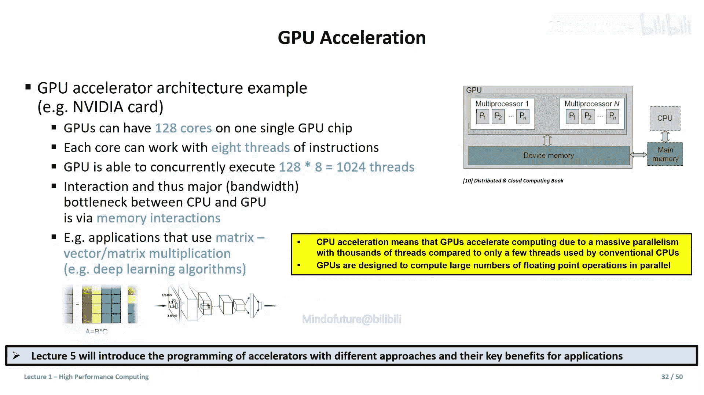

And we will learn more about this in the。Licture 5。 and why this is so， let's say。

Impactful in HPC todays and really this deep learning that I also was already describing a little bit when we had let's say the prologue so I don't want to go into this very detail anymore just to have the point of course that when you have this deep learning networks what I was suggesting is here is lots of matrix multiplications matrix matrix matrix vector multiplplication taking place and these can be all quite nicely for instance in image recognition here you know used to scale up on different GPUs and with this obtain a significant speedup in really training those networks that's not obvious to you we see how that materialized when we come to lecture6 and then also much more in lecture 7 when we use distribute deep learning so we don't just use one GPU we use maybe0 GPUs and parallel to solve a problem and then you quickly see that you know we can speed up significantly。

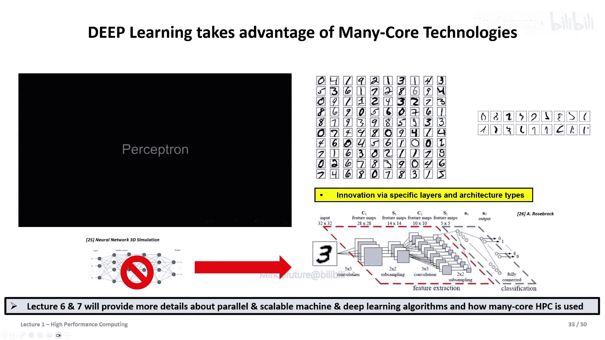

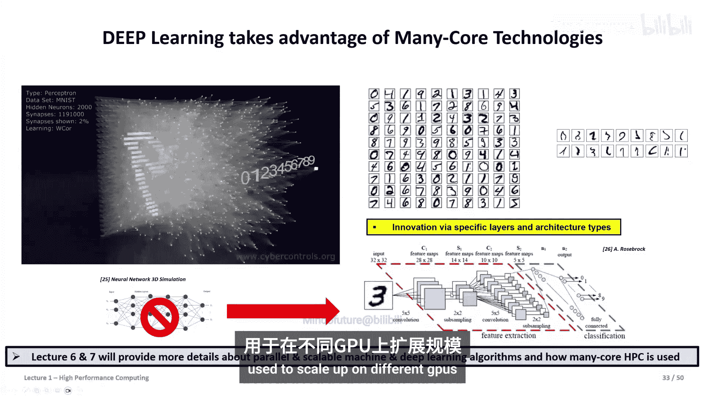

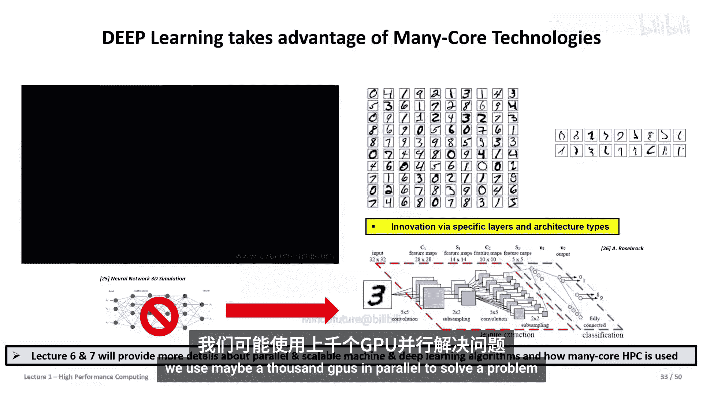

Problems， which way may be much more complex actually like this 10 digits here that we identify right this is of course not at all what a typical application problem is this is just a toy problem in order to make you understand a little bit the key principles and what we discussed now is really the difference here we come to this in a moment is not any more what you see here the different layers。

 what used to be the typical， let's say artificial neural network time。

 let's say hidden layers that you see here， the idea is really not now putting more and more layers of the simple design after each other。

 but rather as a video also will show in a moment， having a kind of smart idea really in these different layers in order to perform feature extraction and this is what the convolution neural network example shows here quite nicely it its features and has feature maps essentially to detect features in images So the layers you see are still feasible。

And existing。And also， of course， are basically from neurons and have connections and are trained over time。

 but it's not at all anymore so simple to have just the neurons or number of neurons there。

 but also different setups， convolution operations and things we will learn in lecture 6 and 7。

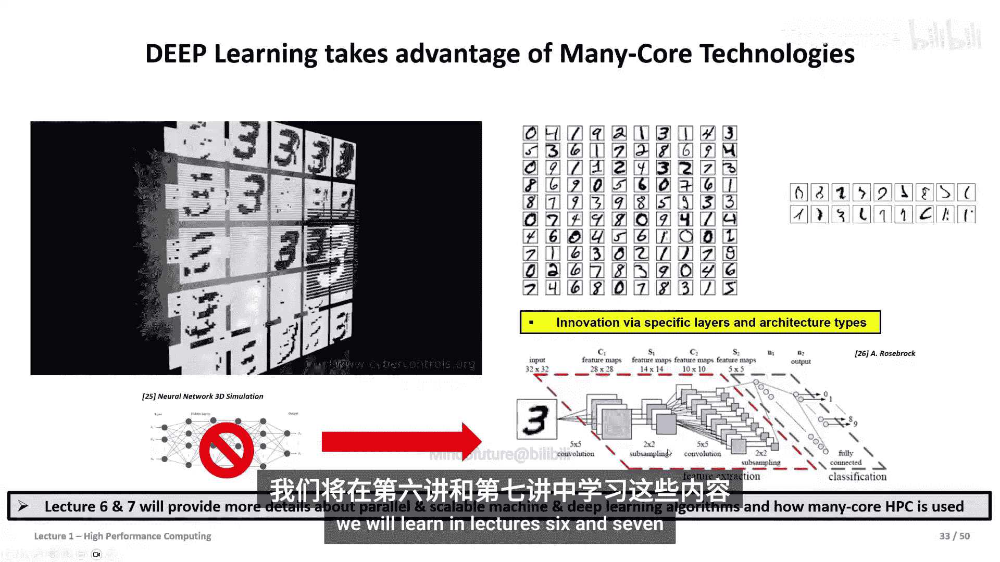

Now the point for HPC here is really that this is computation expensive right and these networks are now very huge。

 especially if you think that cutting edge transformer models that fuel many large language models and also in the end than the language translation that we see is getting better and so on in many languages because we have now computational capacity available in order to train these you know deep learning algorithms really。

 and with this comes a requirement for more technology innovation hence fueling again let's say the different iterations of technologies from NVD GPUs as we have seen right so not standing still at the Keplla architecture or pastscal architecture from NVD but evolving over time really this Volta thisumpair then now to the gray Hpper which is a fascinating ship we will see actually lecture5 already and which is brand new from NVdia。

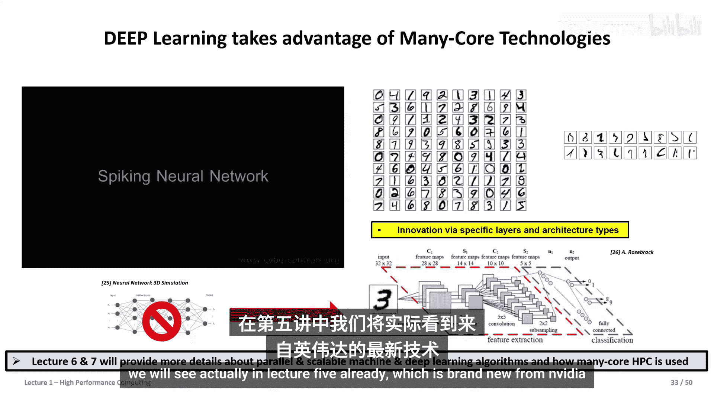

So。What can we do with it so applications I said is the drive of HPC so that's why we all do this it's not just for fun and to be fast and to be the first in the top 500 or in the top 10 the idea really having applications you see here one that is around Earth's observation and this should also bring you to make you sensitive for another challenge and deep learning that you can't understand fully today but it's also important to understand that HPC is can help you there as well so we have lots of data the satellites that you see there nicely on the video。

Are then also， you know， taking lots of pictures。 But these pictures are not just from the land cover。

 I was saying these are different spectral channels up to 200 dimensions， really， you know。

 and this become much more sort of a block。And with this sort of 3D convolutional neural network that you need in order to understand this。

 and this is just an example of a couple of publications。

 I wanted to show you how you really need them this and real application。

 because here we want to understand the land cover is at the forestest the river and we will do their window tenser。

 so basically a little bit around the surroundings of this pixel so nine by nine。

 for instance which we described here， for instance， in this one paper of us。

 which is you know some time ago， but also you see the combination， for instance。

 of these technologies which is another example here of this convolution operations which traditional classifiers called support vector machine。

Henceence。😊，There are two things here firstly you need lots of images and data to train them hence your laptop might have not a problem you know to do this in a small scale problem like MNIS right what we've seen as a character recognition this is what you can do but if you now come to satellite images and you have 14 million images for instance also an imagenet which is not a satellite imaging but also let's say a cutting edge benchmark then this would be the end of the laptop as well。

 not only from computing capacity but alone from the storage you need to train these deep learning networks and this is because there are so many parameters to learn the weights that you have between the different layers this is all not totally obvious to you we how that materialize in lecture  six and7 again when we have deep learning because these weights are essentially then these matrix matrix vertplications the learning of them improving the weights is nothing else。

And doing lots of these operations where GPUs are very good。Now， the trouble and why H PCC， again。

 is helpful is there are lots of these configuration parameters。

 We call them hyperpar in these deep learning models that you have to find and do the right。

 let's say， a justification for the different applications in order to have good performance。

 Hence you see here a couple of them out of one of our papers。 You know。

 you want to understand the convolution layer filter size。

 You want to see a little bit which optimizer use stoastic gradient descent。

 or you want to have maybe some some newer ones。You have different loss functions。

 what activation functions you choose the rectified linear unit or others。

 the batch size is a very important configuration parameter for us as well as the training apos so how long you actually train and these are all elements which are not obvious。

 especially not the learning rate So these are all names which is of course for you if you don't have taken a machine learning or deep learning course a little bit of question mark but take away the message that there's no very clear models of perundi how to choose them right there are some let's say best practices here and there the rectified linear unit seems to be quite strong but there's also others these days which are often used and you can basically over many runs of the applications get a feeling for batch size is important although they depend now how significantly how high you scale into different notes So this is the complete let's say hard thing to do and hence they are systematic。

how you can select and find these superpar using HPC again。

 which is now saying that in one respect GPUs have a big benefit in HPC to speed up the training right that's clear we can do it quicker because we have just lots of GPUs where we can parallel little program。

 this training and with this have a speedup， but it's not only the benefit the other benefit we also communicate to our SMEs industry partners when we try to celebrate why you should use HPC is really the accuracy improvement by you know picking the hyperpar right and we have a new lecture even on this inside the course because it's getting so enormous momentum where we then understand hyperparmeter optimization much better than I can convey here at the beginning of the course because we lack still some basics that we have to learn for this。

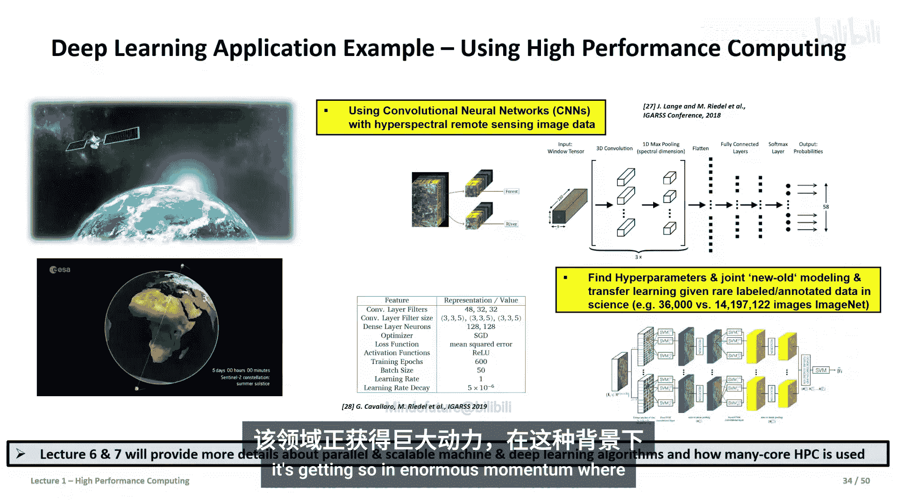

Hence， this is also something that I already talked to you before。 it's not only that。

 you know you have then the idea of this computing that is only the training time in terms of speeding it up the large deep learning networks and you really need this and also cope is big data as we talked in the prologue about it Now the point is also that this training time means training on different hyperparmeter potentially so you need let's a couple of times trained the same model is different hyperparameter in order to get really to this high accuracy you see one small change in the learning rate。

 which we will see then in the hyperparameter section can drop the accuracy significantly。

RightJust because your choose a stupid or know you don't even know if it's stupid learning rate。

 it just doesn't work and this is something which you know hyperpyramit optimization then we go into and that's why we use supercomputers like Jubils and all these different racks in order to speed up and then better the AI modeling as well。

Wwhich has now grown， I mean to a huge， let's say， I would say even more than a hype right so in AI we have seen significant impacts。

 we have chat GT which we will talk about with large language models late in the course many of you probably using that on a daily basis。

 but you know this is not really a hype， it became more and more really in life impact for us right so it's really affecting our lives since there's also AI ethics as an AI office in Brussels coming now with also more and more regulations in the union and in Brussels what how we can use AI and should ethically use AI and so on。

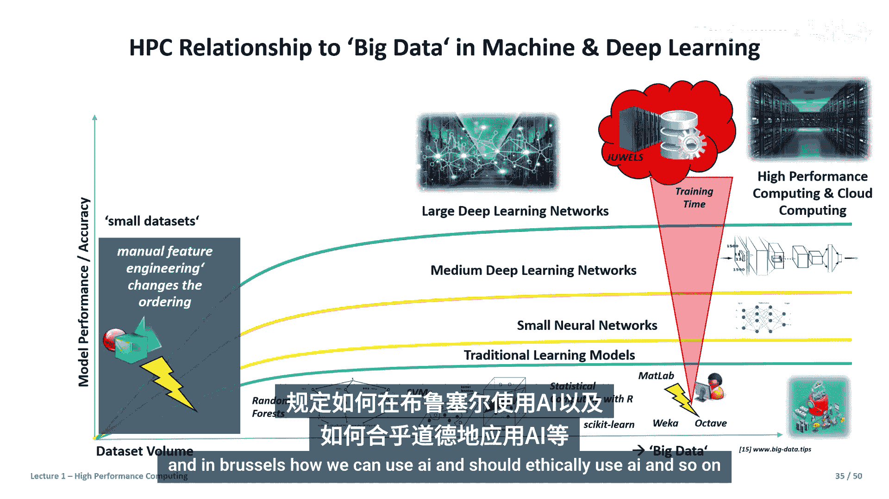

So basically saying that you know this is something where essentially this HPC is you know required for these。

 you know also from the cloud computing course that you know there's different ways how you can really access this computers。

 here you have an example of a cutting edge out encoder from deep learning networks and you can also do this in cloud computing because there's also the way of having more and more GPUs available but in HPC we just talk a bit different in terms of how you would you know interconnect the course for instance。

 in HPC the Apache sparkar that we have a across different work or not that some of you know from the cloud course that have been part of it that is something but we see rather unlikely on a HPC systems because we have other means to really communicate very quickly like for instance。

 using the MPI that we will learn in the next couple of course lectures。

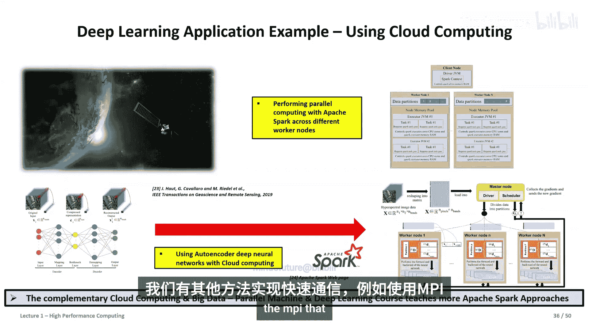

Just a little bit more to the data part before we close for today the HPC relationship to big data is a bit indirect but also probably a bit clear to you so when we have a let's say earthquake simulation here we talk about the terra shake here for instance。

 where the surface data is in the terabytes or the pay shake where the surface data and volume data is in the payytes so of course bigger simulations right where the inner scale is much more in the pay scale fine grained which means much much more calculations and with this also you know much more data where we talk about petabytes output really for this。

That means automatically more computing but also more data。

 hence your HPC system needs to also be ready for you know this big data and you could see that in HPC we basically talked always about big data even 20 years ago it was already large data sets that normal PCs could not really take care of and the reason that simulation sciences always in a way have a demand for more and more accuracy right more better earthquake prediction and so。

The trouble， however， is that technology is not really coming and follow suits perfectly。

 so we have seen that with GPUus brilliantly in the computing。

 but what we have still a little bit to tackle is a so- called Drram gap that you see that main memory is very fast Ca is very fast。

And。What happens then afterwards so basically the trouble is that our large capacities we call that tape archives and so on there's really where the petabytes can be easily stored they are incredibly slow right and we will talk about this in other lectures too but then you know we have just disks but they also still too slow to really think about that we have more and more computing and the reason why we cannot just have lots a lot more main memory also the cost it is just very expensive compared to disks。

Hence there's a so-called you know data challenge here where we have a huge trouble in this data element。

 especially if you have these applications which are you know as a symbol reaching out here which are really big data compared to many other applications you might have so this also drives the design of more data intensive HPC architectures here it sometimes a bit older system。

 this grave of architecture， but you have dedicated server for dedicated problems essentially where you then do a bit like hierarchical storage management and this by design。

And this brings us to a whole world of data just alluding to the point that essentially CPU speed is not our problem these days。

 we have rather IO problems right so with existing HC resources so how we maintain the GPUs with lots of data in a highscale production run that should all come somehow sometime from disk and there's HM theyre good let's say memory architectures now on GPUs available。

 but still if you think about many applications and many users and of course not all systems can afford these and you basically have troubles more on the data side which I wanted to convey with this hence the application coredes of HPC architectures we learned already in the prologue with modular supercomputing example is taking this a little bit into account as well as modern chips with NVD as I was saying with the HM memory which is a very fast memory to fill the GPU with quite some data。

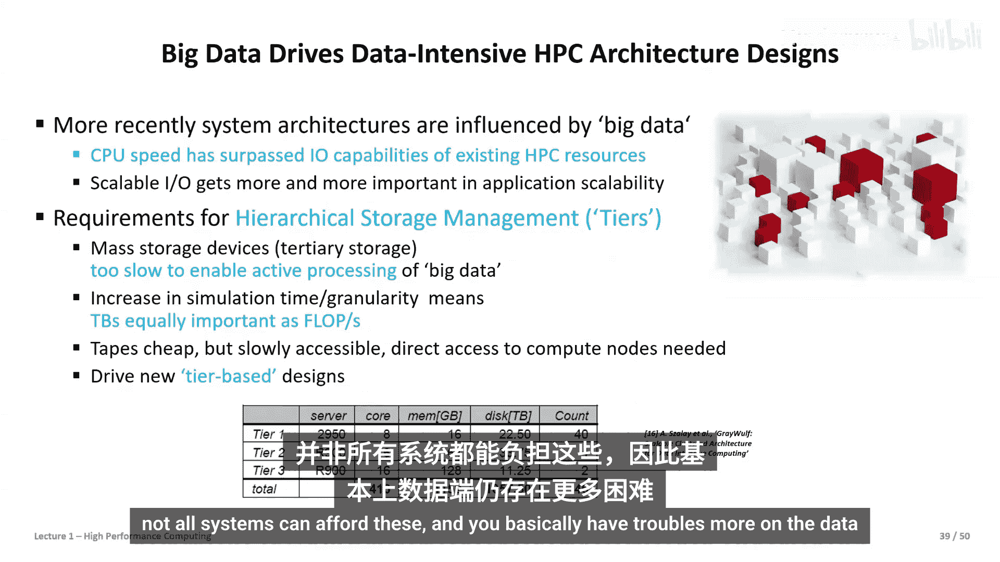

Because the capacity is going bigger， but we'll also learn that there's still many gaps and that's why it still says application core design of HPC architectures。

 we still need more。And towards the end of the lecture also just a hint there will be soon I L HPPC workshops where would you invite you from the Compent Center here。

 please have a look on the EHPC webpage to find out more here I just wanted to make the case also that applications are still from you know utmost importance it sounds so much technology and it's important to masters that technology but you see with our simulation data labs and they have that also in the supercomputing center that's where we learn from this design of a successful design really of application support and application usage of these systems we have different application domain specific labs you will see them on the webage different experts in different labs that also have then the application domain experience which is also very important in HPC to really scale up the problems that we have in all the different research projects。

 let it be large language models or in race here for instance we had also lots of engineering and AI。

Problems， hence。We're working also in this you know national competence and that have this you know HPBC community extended building a community here in Iceland and if you are going back you know somewhere to industry to jobs and so on make the case that everybody's welcome to join our community here finally I should just give a little bit of historical breakdown that of course。

 now that we have the UHBC joint undertaking is a far development， which has been built on many。

 many years of praise， the partnership for advanced computing in Europe have seen the video。

 which was the supercomputing infrastructure before。

 essentially UHBC joined undertaking took over where now the membership countries are basically directly involved in funding decisions together with the JU and the European Commission。

 often in a 50-50 case， where they decide also about the fundings。

 which supercomputers to put where you know what technology emerging technology to fund in terms of quantum and so on the same is actually true。

us at the at the good fortune to be part of this the extreme science and engineering discovery environment HPC infrastructure in the US of the past and then some aspects even go back to grid computing a very old concept that was derived essentially from early ideas how you can do distributed computing and then combine this with middleware in order to solve bigger problems you see here the Higgs boson was for instance one of the results that the found of this was just really working also not only from the accelerators and experiments at C but also because they had combined this old computing they called grid computing in the past obviously today with X scale we are going to much much other dimensions of scale and hence it's getting at least with the your HPC journaltaking let's say more professional really if you want in the sense of provisioning of computing you can。

L for computing resources， there's a peer review， others will judge if you should really get the system access。

 so it's a fair access system in a way to the demand and with this。

Also the pointer that of course the cloud Comp big data course talks a little bit more about this。

 although you know praise has ended exceed has ended。

 so now we have the UHPC JU here and we will focus much more in this HPPC course particular of course。

 on some of the UHPC related aspects。So take away the message HPC has come a long way。

 a long tradition where we're going in the future just as an overview lecture of HPC that we shouldnt miss。

 there's a nice let's say short lecture from me from 2020 which is still I think relatively up to date on YouTube which gives you a little bit an indicator of something we called qubits and quantum computers there's also quantum cryptography as a kind of course here you have heard this probably and you know seeing basically that quantum computing could be and is considered as one of these accelerators not like a GPU perhaps a bit different but optimization problems in machine learning like here SVMs for instance。

 or deep learning that we have learned in the previous lectures is really something where also quantum computing can make a difference and this is of course something which goes beyond the scope of this course。

 but it's definitely something where your HPC joint undertaking but also in generally the HP。

Community is very close to。The most that I wanted to convey today。

 please have a look again on this raised video it captures the essence of many physical applications and I would say that's all for today so we'll talk about the practical lecture 11 next time。

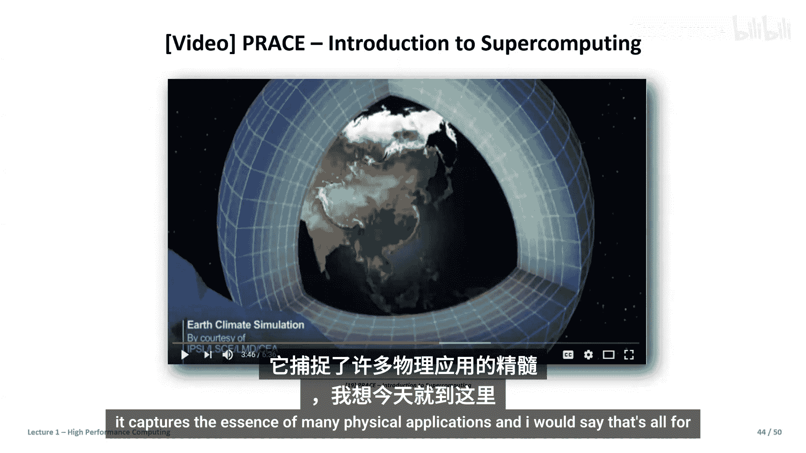

taallk to then。

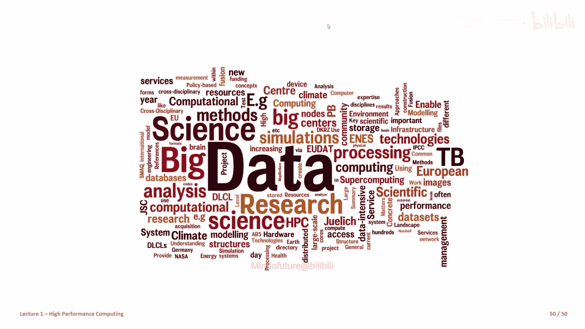