# 【冰岛大学】高性能计算课程-｜-2025-High-Performance-Computing-｜-Prof-Dr-Ing-Morris-Riedel-p27-P27_讲座_1_高性能计算_第一部分--BV1k34zzaEK8_p27-

Welcome back to high performance computing， advanced scientific computing。

Today we have our lecture one， the real start of the course。

 if you will before we had a prolo with lecture0 showing you a bit the course content and then a practical lecture 0。

1 which was a bit like looking to SSH and Uni but today we really want to basically kickstart the course with an understanding of high performance computing and this is sort of an impossible task one lecture to give you a grand overview this has been now growing tremendously in the last 20 years high performance computing from a more niche you would say in scientific engineering fields to much more mainstream usage of HPC and we will make the point of it in the course however。

 I tried to bring you the most important topics to get overview and then also will refer of course here and there to lectures where we have deeper material in different areas like distributed memory shared memory but also deep learning distributed deep。

Learning and so forth。However， before we go into the topics of highperform computing itself。

 let us review what we had the last time because it's sort of really essential to understand that we had this SSH and this is still the models operani to use basically the most systems that you have around the world。

 many of them have more and more easy access paradigms。

 but if you need access let's say on a very lowleve basis。

 SSH is usually always supported hence we did this as a sort of war up for the course。

 both UniX and SSH are usually taught rather in operating systems courses or let's say in other basic courses so here I just brought with the last lecture hopefully you a little bit。

 you know the idea how that generally works and when you want to access。

 let's say as we had the last time the deep system。

 this test cluster we going to use in the course or。

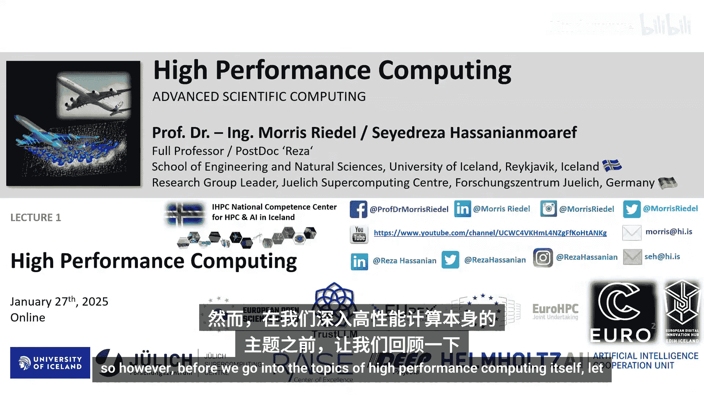

Own system here in Iceland earlier， then the way how you use it with the SSH would be usually we are so- calledled SSH keys right or as the people refer to it as public private key pair right but you basically this is a more official name if you want if you are in a center。

 you know European supercomputing center， you would always call them SSH keys and of course I could told you much more about it。

But we keep it to the essence to understand how to look into the systems what you should also do during the course so if you remember we used one of the mobile Xterm SSH client for instance for those that are on the Windows let's say operating system for others for instance Mac users in the course you can also use of course。

 then the normal client that you have in Mac usually there's an SSH already available via the command line or of course this goes as well with all the Linux derivatives that you have whatever brand you are using。

However， we learned also that they are initially kind of setups to prepare in order to basically connect to such a system and this is a little bit explained with this graphic here that should be giving you a quite overview without going in too deep details what the secure shell protocol is and so on。

So you have your host and in order to access in some point in time in the future， the HPC system。

 it's essential that you create first， this interesting private public key pair and our first assignment。

 one of the first， let's say， task is ready to do that。

And you will see it's not a big deal to do this。 However。

 there are a couple of things that you have to understand。 And that is first and most notably。

 perhaps。That the private key remains always on your system。 Hence， don't send that around in emails。

 Don't transfer this to many different systems。 Usually。

 we say the private key stays at your host at where you created it。

And as the name suggests the public key is completely different。

 so the public key is something you can share with many different administrators。

 you can give it to the deep test cluster administrator。

 you can give it to the earlier administrator because the public key is something which。

They need in order to prepare the system so they will give you a username usually on these seven systems。

 if you remember what we had the last time was that it was readal one here in the Yuli hemisphere in Germany and the de testestluster and I was Morris here in Iceland and this is the first ingredient you have as a let's say。

 important element how to access such a system。However the public key pair。

 you know public private key pair now is the key to really then access it and with this you also need of course。

 a host name in order to basically access it and this is what the administrators will do they will make you know the username accessible with a certain public key。

Wherere you supposed to have the private key， that means every time you go to submit system and there's a public key from you already uploaded or you basically gave it to administrators。

 they upload it for you。It is expected from you that you have the matching private key right not any private key。

 the matching private key and then you can see basically how that works。

 you essentially want to contact such a system and you know on your host you have of course the private and public key sometimes even it's in a key store as I has demonstrated last time so you have to give probably also a password at least the first time you use it in a session and then the public key is already upload on the HPC systems or when you establish a connection the public key will be used for the instance of this connections and will check do you have really this kind of now private key available label hence when you connect to such a system like in Mo exterm you have usually also this link or this private key and this is then the second ingredient and of course a final ingredient it's the host name right so we want to compute remote。

And this is an important takeaway as if we don't use eclipse this Java on our own system or something we don't programme C here on our own system。

 basically， the ideas always。Go to the remote site and then use remotely this HPC machine。

 That also means you don't need any more GPU in your desktop machine or in your laptop because we have seen in some of the examples from the joint undertaking。

 for instance， from all this different HC systems， but also the one from you we have many thousands of a labels。

 So there's no point of having a as we call thick line anymore。

 because you are basically relatively fine to just use a private key private public key in order to connect to these remote systems and the remote systems are very powerful。

 however， they have， of course， one element which is sometimes a bit a hassle for people and this is a Unix operating system or say any Linuxux derivative。

So Uni skills in HPC are also important again， a topic for operating systems and other courses in a university So I also kept it to the very brief elements of it。

 so we did something like host name this is an important to understand oh。

 I'm really remote right so when I looked into deep using for instance。

 here there deep do Fet Menos U and then the username with a matching keys I was on such a system and could check it also with some Unix command because that is known as host name Unis are giving you here also the location somewhere in Germany under you know the name deep or if we went to you know with a complete different username to El here in the EhpC in Iceland with the host Imuns RV also the domain of you know the university here hence。

Unique skills are sort of important。There is momentum with many AI users and others。

 let's say around data science to use more my Ubitter notebooks。

 we will come to this in one of the later lectures when we talk about deep learning。

 machine learning and so forth， but this is really the key essence in the beginning of the course to handle this because if you want to work in the area of HPC。

 you usually are required to have usually SS agent and unique skills at least to a very basic degree。

The final point because it's also very important is the module system here。

 so module load Python was an element where we said okay there are different modules already pre-installed applications。

 many different elements， some of them we will learn in the course。

 Pythtorch and so on for deep learning for instance。

 or basically net CDf or HDf like parallel data formats etc， etc。

 but this is something where administrators have already pre-installed elements and we will come to this again and again in the course so I showed you just a little bit how you handle the module system。

 how you can see which modules are available by using module avail。

So I spent a lot of time here because I think the SSH key point is always something which is not completely understood by everyone and also the remote execution is not completely understood by everyone。

 that is of course something which makes HGPC a bit。Different。

 maybe from other subjects in the university where you do everything on your own laptop and assignments on your own laptop here we will go remote。

But when you learn and master this， this is my final statement。

 you can also see that the U HPCJU undertake the machines。

 you're ready to use not only the EHPC from our Icelandic HPC community clusters or the test cluster and usuallyly。

 you also basically have the basic skill set to also use the systems in the union with U HPPC joint undertaking machines。

So。Let's go ahead and think about high performance computing as a whole so we see it's sort of an introduction lecture where I will be perhaps a little bit sometimes be still from 10000 feet perspective looking on some topics but then give you already some examples to concrete lectures where we dive into the details So high performance computing means of course we want to understand a bit the basic building blocks is it just about hardware or is it perhaps also about many other aspects and I think that's an important part to say including applications which I would like to elaborate on but also different other key elements to it like scientific visualizations for instance。

 then the whole idea of performance why we call HpC machines partly supercomputers and what are architectures that are a little bit you know important to understand also here we will go in some of the other directions later in the course but we start with。

General understanding of multicore processors and parallel computing。

 Hence we have to talk a little bit about shared memory and distributed memory programming and and also the I textures of the system while。

 of course， lecture 2，3 are all about it。 So we will also lecture for then with openmp learn about shared memory。

 but before that we start really with distributed memory to really understand why it can scale up to many different nodes why do message exchanges and so on。

 Finally， just some pointers to hybrid I picturess， of course， which we see more dominant today。

 and also the enormous programming complexity that we are facing now in HPC。

 because we have not only let's say MPI across the node shared memory and openmp within the node。

 we have also accelerators these days that are attached to the nodes。

 So theres lack of threeway programming if you want right and this makes it quite complex。

 This will be the first part in the second part we again， take a。

A bigger look and and this is about HPC ecosystems at all for you。

 it's important to understand in our practical lecture 11。

 we also will then go directly and in more examples of the soft environments。

 So in a way you have already learned one with a module system in practical lecture 0。

1 but then we quickly go also thinking about you know soft environments than the technologies we have coming up in the last 10 years。

 really with significant speed many core GPUs， we have a whole lecture on this。

 but of course we give you some sneak previews also why it's so essential today why we need GPUs for machine deep learning。

 which is really then able to tackle big data at scale。And then also a little bit。

 which might be more the community aspect in it of our Icelandic National Competnce centers， again。

 why making the connection also to applications is so important in this HPC national Comp center a so-called simulation and data labse and it will make the case for it also because we will see as a modular supercomput Arch you learned a little bit already。

The supercomputing core design with applications is a key point because these systems are always a cutting edgech available right so these is still if you want a little bit of research in a way how you build these systems in the moment in Germany we build the access scale system of Europe called Jupiter and this is something which goes back to quite a modular supercomputing I research in the last 10 years for different deep projects and all manifesting in first European access scale system that we see in Germany also co-funded of course by the European HPC joint undertaking at the end just some let's say related work elements in HPC on the one hand we would say large scale infrastructures is something what is very important for us so it phrase at a certain history in HPC we should look at but also looking into the future when we think about what is also quantum computing in context as a。

important part in HPC so when you want quantum computing is of course in a way a discipline of its own。

 but it's really closely related to HPC and in many cases somehow very closely combined with HPC machine because what we see is in the moment that the quantum computers are still not really general computers so to speak。

 they are rather accelerated of a certain type。So fast new seatbed for the first real lecture on HPC and afterwards you really have the latest developments and power processing in high performance computing again we look into arey picturess of these high performance computers。

 clusters， supercomputers so you will be understanding you know these and also how to basically create them from scratch when you have them different note cardss up to racks and so on。

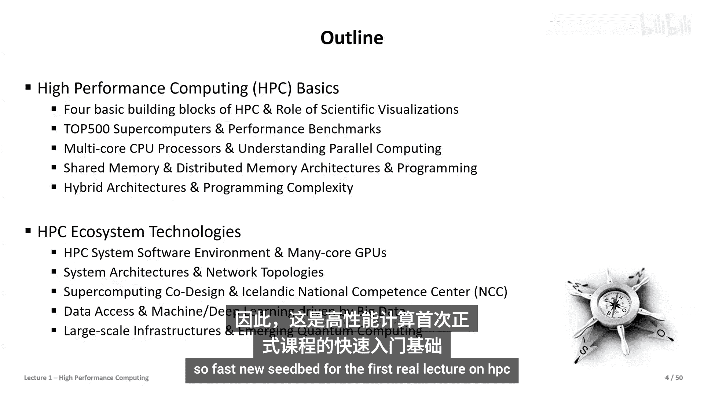

We go a little bit into the complex aspects of parallel programming already to warm you up for our upcoming lecture two。

 three and four， so parallelization is a key that also will give us and of course。

 indirect insights in later lectures of domain decomposition。

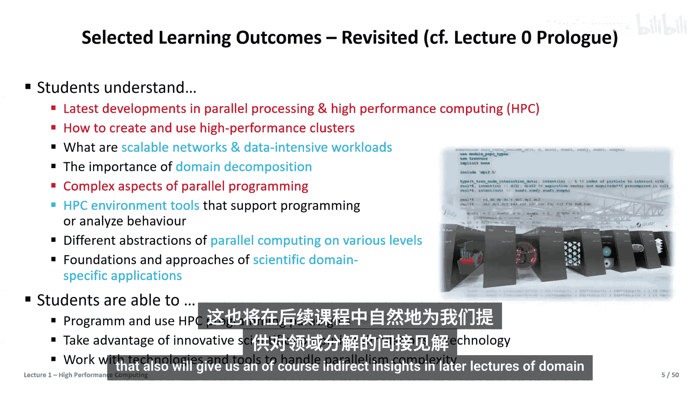

So coming to the high performance computing basics。

This is quite an interesting term because it also redirects directly to supercomputer so these are very much close to each other supercomputer now questions today of course remain at what point in time you would say it's HPC machine。

 how many GPUs have to be in a machine to be rather a desktop you know variant of having four GPUs。

 maybe in a very special system you can still put under your desk provided by NviDdia solutions。

 for instance， but also the idea of a supercomputer， so where that starts。

And I think one of the general themes you see in this in supercomputing is that we are the formula one right of computing in one respect。

 we always use the latest greatest of NVdia GPUs to create the modern and more let's say powerful supercomputers almost on a half year basis I come to this it's called top 500s or than have list of all the top supercomputers in the world that are known of course there would be some computers that maybe don't submit to the list and might be somewhere potentially even in military systems we don't know it classified whatever but still this is something where we really at the cutting edge of processing and another one is often also that HPC is characterized and I was making the point before in the prologue and before that we have this interconnect between the different nodes you will have questions what exactly is more is now and you are referring to nodes and I will come to this。

In the next couple of lectures where we then also learn this。

 but think about that you really use these notes and that's by making emphasis here on the Interconnect really is lots of message exchanges as will come in the next couple of lectures。

 even deep learning is losing the interconnect a lot。

And we are not so high throughput computing as I was alluding to before。

 and then when you think about high performance computing。

 what it entails is really not just hardware。Right。

 and this is another aha effect I see often in students。 So everybody thinks just HPC means， well。

 this， right that you see here on the picture， lots of racks in a long corridor putting lots of hardware。

 So there are lots of theoretical elements。 We will learn many in them in the core speed up。

 actually limits of speed up numerical laws based on， you know， known physical laws。

Multi corere versus many core， you have network interconnects。

 you all have to store some data somewhere， so this will be also one facet in some of the lectures so cutting edge technology plays in not only theory and then all the IHects you would say well HPC machine is HPC machine is absolutely not the case some use let's say accelerators from Invidia and you have here good examples from Lomi that is actually if you look closely what it entails to have let's say the GPUs you see it has an AMD instinct Car set of system with GPUs。

 you know being not from InVDdia so you have heterogeneity in the hardware that constitutes the IH we will learn about shared memory distributed in a moment。

But still take away the message that the IE textures can be very different。

 although they're all maybe HBC machines， they're all here and they are partly called supercomputers。

 but they are so much variety and technology IH Tech and so on that then of course gives us also the fourth ingredient which is a wild you would say jungle of software。

 right the module environment I showed you already in the last practical lecture was pointing to it。

 lots of libraries and things， but also applications。

 you know there are different applications we will learn a you today in this lecture。

 but then also during the course， especially with the CFD special computation fluid dynamicss later by Raza。

 you will see even one application domain like CFD can have many faces。So hence， applications。

 libraries plays a big role。 and then。We will learn also in the next practical lecture that there's lots of this system。

 let's say ecosystem or you know what we learned already with' a module system in its scheduler to have multi-us access and also monitoring in the system when you have large systems like 3。

000 GPUs for 4000 GPUs in the system， you must be able to monitor those system in case of errors。

 failures and so。So。Practical is of course， here for us also and in your let's say generation is that you can always access your HPCJ HPC systems that's an important part that we hear and they will also give you as a point so these systems are not accessible so even companies when you ready here with university studies can apply in order to get HPC time and we come back to this during the whole course and also with EHPC workshops we run in parallel and encourage you to attend or also make cases for it。

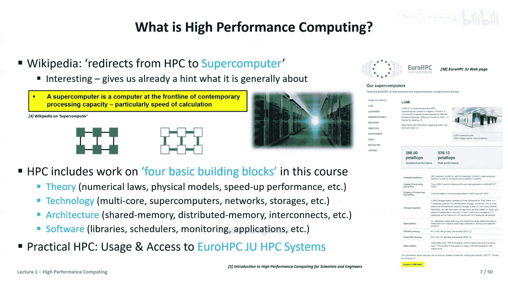

Just to revisit what I had in the prologue， so I don't spend much time of it。

 I think everybody has now understood that the network interconnect in HPC systems is sort of very important。

It might be not so important for teaching clusters。

 you will notice our U is a little bit different still we consider HPVC system because all the systems software is on it modules we schedule withLm。

 we monitor it ganglia and Somtop essentially of course we talking a bit different if you have a cutting at supercomputer right where scientists use it maybe at full scale to solve Can or other applications that you already got from I hope the price video from the last。

 from the prologue lecture as an appetizer and this is of course an important part compared to maybe teaching clusters which are a bit lower in performance and of course if just a couple of GPUs。

 but still fulfill its purpose of being a teaching cluster。

Differentfferiates also then quite easily to the HTC world where you know we basically have the interconnect not so relevant。

 you would solve a problem in parallel， not interacting a lot so the interconnect is not so important and I took this much more with mapR and other concepts in the cloud computing and big data course so not for here but some of you are from this course you know going now into the HPC course so here you have the connection in HC what we do much more is looking more into parallel computing。

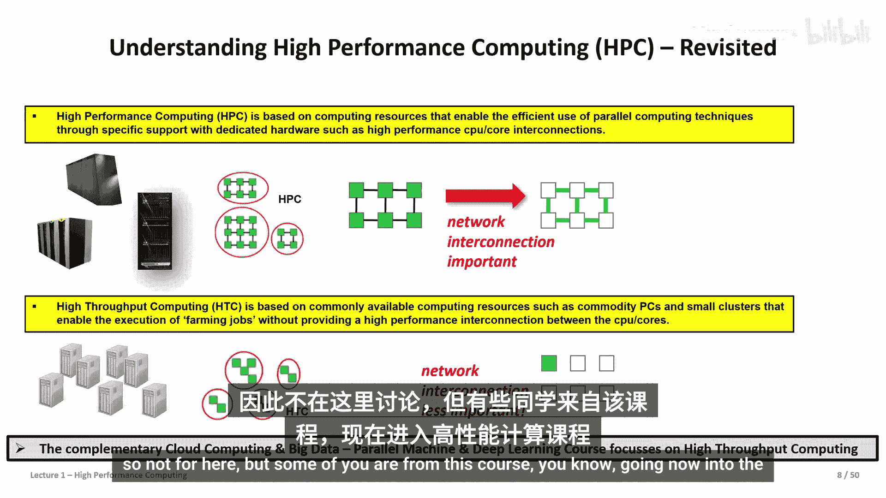

Right， so。Powllil in a more lower level sense， right。

 And this means whenever we want to basically solve a problem in a cooperative way。 you see here。

 basically， the idea now mapping from the node that you have or the different CPU that are available here。

 We have different processes that live。At the same time in parallel and we want to make use of it right hence this is a basic for parallel computing we have not only one or two in our core setups that we have in a laptop that you basically see these days have quite some number of course here we talk a bit really scaling up then much more than just maybe five processes right it' just more for an illustration here hence parallel processing is now the idea of combining these different processes and the best performance possible to solve one problem in a cooperative way and we will learn in this again and again in the next couple of lectures coming and the high performance in this means that we have their benchmarks ranking the best 500 computers or supercomputers if you want and they should be also then very much capable of enabling this parallel processing because this benchmark needs it we go more into this on parallelization for thes the performance term but means now high performance。

In some theories also in the lecture3， so I keep it as there rather give you an impact in applications and with this automatically is a nice connections to scientific visualizations because HPC simulations can be quite abstract。

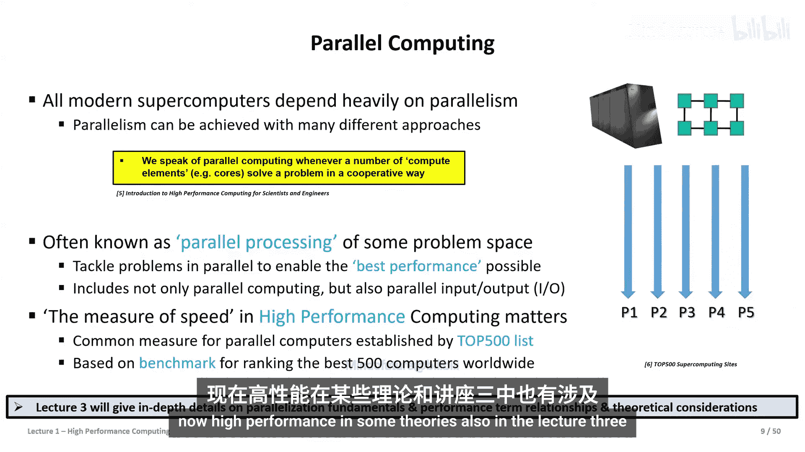

And you see here quite nice examples， you know， of an airplane flying alone。

 this turbine is already a very interesting problem in engineering and challenge in engineering。

 of course， and if you see there what that is that is a simulation over time right of this one little turbine and not speak of the whole airplane。

There's turbulence to assimilate and you see really that there Bennoli principles coming。

 there's domain and composition， this is sort of mesh you see here。

 which is also a term we will come too late on。But it can be complex。

 hence you want to do often this physical， let's say， process to be understood with visualizations。

 we come back to this again and again， and the same is actually true for AI。

 You would say it's also quite complex。 You have your land cover from satellite images where you want to understand the land cover and classify it with AI。

 but there you see suddenly that， of course， the satellite looks a little bit into the earth is different spectrums or spectral channels really of light。

And and so on， so we have rather block instead of just let's say the surface we come to these topics and also to these many often in the course。

 here's another example of the IFF you couldvolcano and the eruption if you remember and the plum has taken out lots of the you know kind of airplanes over Europe and here you know why because essentially lots of that was affecting Europe hence this visualizations it says as as it is often named right。

 it's more powerful visualization than thousand words， Also when you understand no parallelization。

 you want to have a race car in parallel is simulated you were put in mesh you want in parallel give you the processing to this very complex airplane to many different processes using a mesh。

When you want to assimilate maybe the ocean basically that we have around Iceland you would basically have here a domain decomposition we come to this in lecture three which is again a mesh and then would solve this in a collaborative way the wave propagation perhaps here and so on and so on so here you see a blood pump another element of a physical process than interacting with the environment and the blood and also the engineering of this is of course understanding stress on blood vessels and so on then you have particular simulations where you rather talk about points but these have points have you know basically lots of particular interactions as we call it long range short range and this is also something where lots of computational capacity is required but having visualizations enables us to better understand these let's say different data types and also the different laws of physics which might be affected。

Coming now to the top 500 lists， so again， this is more about having a benchmark that is listing these systems so some argue it's not really。

 let's say application specifically performance， but we see here also now in the top 500 list and the lists so of course you provided in one of the references。

That there is the top 10 in the list and you see that the US research laboratories have already access scale systems。

 you know this is Lawrence Livermore， this is Oak Ridge and also Argon National Laboratories。

 so these are really big large US facilities with lots of money。

Really fueled was very powerful systems today and also you see a little bit then the U HPBC joint undertaking still being in the top 10 with Lomi in Finland and Leonardo in Italy then of course down in the list is one of those Uli systems I was giving you the example last times already was older and pair 100 cards from NVdia because the reasoning is that Uli is of course preparing a little bit for the Upiter system now with Grace Hopper Cars in VDdia cutting edge technology to become the first excessscale system in the world sorry in Europe in the world we have seen that already here with U research laboratories An interesting thing with the top 500 list that is given out every half a year is also that you can look into many different statistics of the list so this is an interesting one vendor system chair and how this changed over time Lenova one of the big provider evident was actually Attos before and of course NVdia some that you know。

But also then into technologies， it is possible to look at so you see here the different。

 let's say generations really of NV cards， how they basically are mapped to the top 500 systems is is the line。

 the Volta line for instance， and then the H is now the new ones。

 the Grace Hopper or Hopper cards which are now interesting all NV cards。

 you see quite the market dominance of NVdia， but also the aimedD instinct as we were suggesting also in Lomi is their presence。

 so it's not all in Vdia but you see clearly that N V here some dominance。

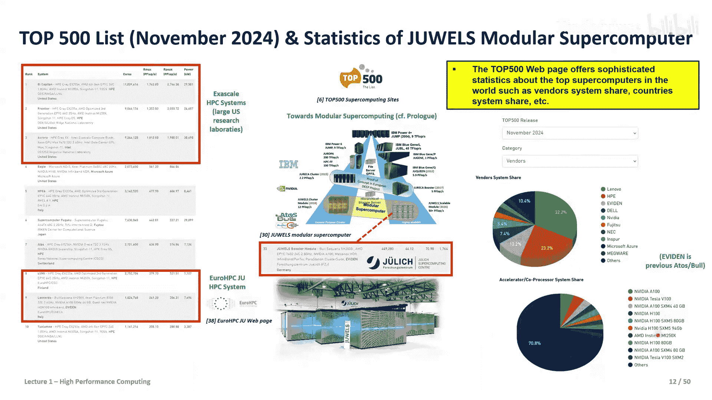

So。The way how it is computing this top 500 I was alluding to is a little bit sometimes in critics it's quite yeah linear equations that are solved dense system over time and this is not really how several applications work right so there is more and more realistic application benchmarks uses that we also use for instance in Uber benchmarks uses and so they HPC challenge benchmarks which are much more application specific so even if you have a top 500 systems and you' higher in the list chances are that the applications running better on a system which is a bit lower in the list just because the application may not need exactly what this made it to the superduper top 500 system hence the applications are important and that's also the reasoning why so much money is put into the supercomputers today because the power computing BS。

To solve many problems and with this we see also that of course。

 more and more there's a requirement to solve more different users and you have learned how we do this also with different modular supercomput system approaches hence this can be maybe better to support the applications because in the long run its that what we want to do to be just it's say number one and top 500 is of course a good political statement and say。

 well US has definitively delete， but the applications are equally important and how you use and make use of the system。

You see also in the area of artificial intelligence， as now MLP for benchmarking become available。

 we will talk about this more also late in because course when we have a better understanding what really machine learning is。

 but you see here a little bit the areas with image classifications， speech recognition。

 you know natural language processing and so on and so on these are all topics which are heavily AI related and there's also more or less a change now that we have seen in the last 10 years are using HPC。

 more and more AI， machine learning and deep learning is entering I talk about this more when we talk about GPUs in the second part today。

But let us let us come still to some basic terminal terminologies if you want。

 so multicore CPU processes something but you probably almost all know or should given you know from the one0 one computer science course in our university or even in operating systems again。

 but here you have of course a multicore system different cash here he's like it is suggested here on the right side and。

Here we usually think about cores as high single threat performance so these are really number crunches they have a very high clock frequency and there's a sort of limit to it so you cannot make the heartbeat as it is called sometimes right this kinds of hats higher and higher and higher because then the chip will overheat and we'll just give arrows and have a problem so hence here the idea then that we discuss in the second part is then having this this many core processes but this is an important for Se for understand that this is the multicore CPU processor they are still very relevant there applications that require these CPUs instead of GPUs and we will see in the course how that material lies。

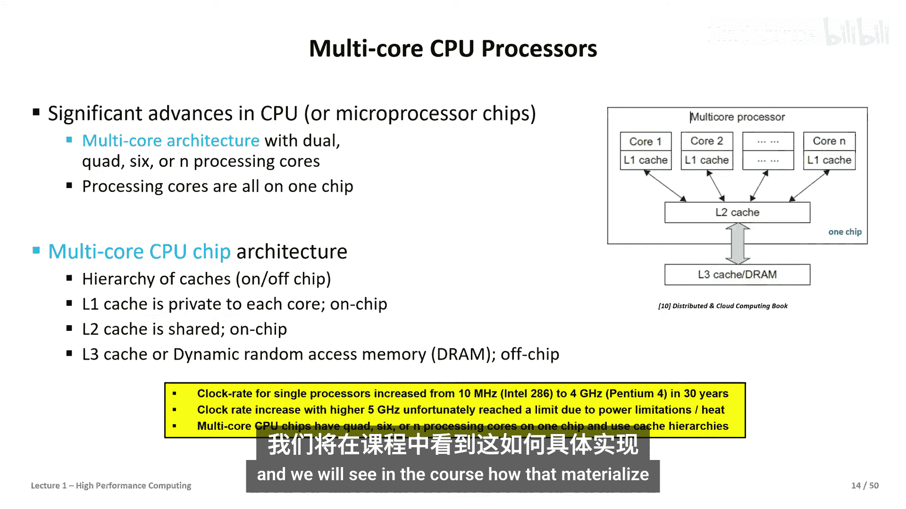

Hence。😊，Let us talk now in the remaining time a bit about dominant architectures now bringing these all together。

 this kind of CPUs on different cards and racks and so on。

 the way how you would see as such a system is essentially that you have this two dominant traditional types。

 so shared memory computers and dis memory computers。

 but the reality is of course today basically both in practice you have hybrid systems that are there and that can be combined of course。

 of course in top of this we have now the accelerators， so N GPU chips and so on as well。Hence。

 the programming models is basically the idea how you rather see that instead of shared you know memory or disagree memory iH textures so let's dive into this a bit more of a shared memory computers and also here I just give you an initial view because we will have in the assignment in our lecture4 also much more details on shared memory here the standard to operate on is openmp it's a standard for programming shared memory and here you would have one note for instance with shared memory and many different threads you kickstart in order to solve one problem in a collaborative way and you would have not message changes you rather as name suggests you communicate via the shared memory so you put variables into the shared memory and you read them from other threats and so on hence we have synchronization problems critical areas where lost updates are and so forth。

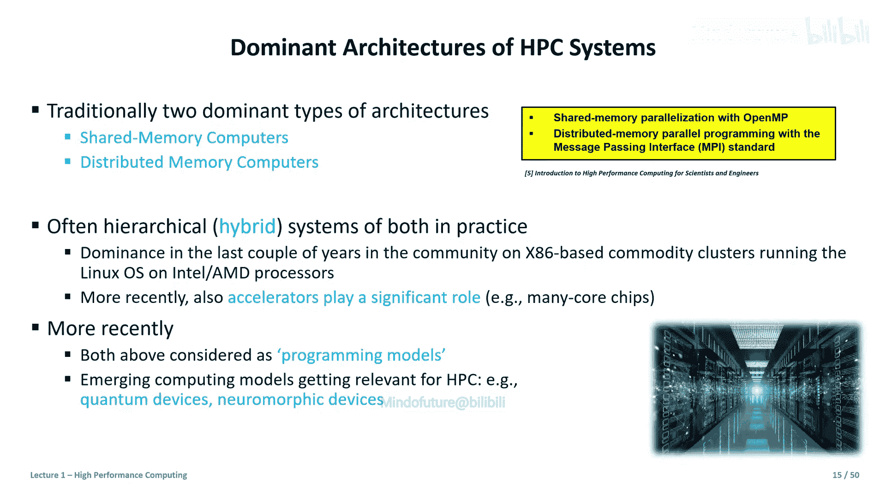

And there are different varieties， unified memory access and cache Koreanin， nonform memory access。

 which is essentially distributed memory but we don't see that because they're so-called cache Koreanins protocols that avoid this but long story short every task can basically access a memory making it relatively easy to program and that's why you see the MPI sorry theM compiler directives that mark those parallel regions like loops for instance。

 are usually relatively easy to understand and this is of course available in many different languages and usually it's done a lot in C++ and Forron because many of the scientific applications are in that however to differentiated from distributed memory which we will have later think about that the threats that you see are rather lightweight processes right they are not really full processes as we learn in this kind of。

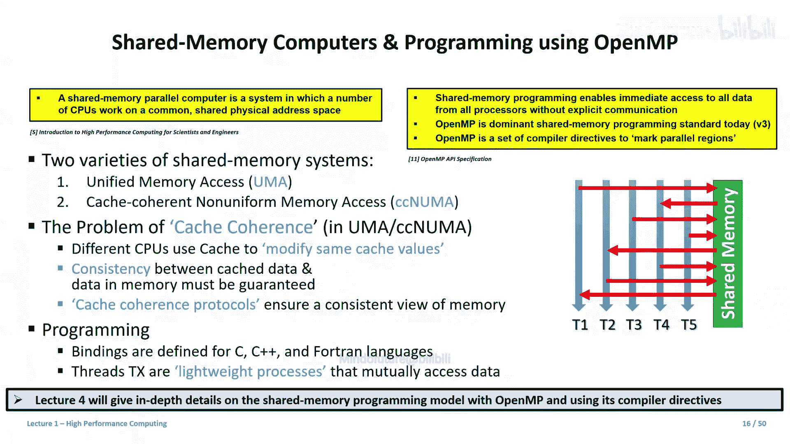

Called Dis memory programming。Just shortly to show you this UA Uma。

 as they call the flat memory model here， you see the different processes we discussed with all the different level of caches have really access to the memory directly right so this is an important for set when we want to do shared memory the cache makes it very fast to read and or have this access to this different memories but it's also as you can remember already to a fourcore system here so it's very let's say yeah limited because you just have shared memory access with a couple of course bind to this memory now you see here a sort of system called CCUma which effectively is a bit like a distributed memory system but it has this cache coherency procedure in it so it still feelss for all the processes that you have here as if you have your shared memory and local memory hence you would still program it with shared memory and it is still as we。

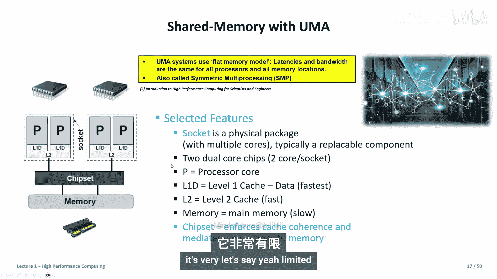

Would maybe call it a single address space right so you don't have to care about this essentially that it's distributed as a developer and with it makes us aware of it and it would extend a little bit。

 let's say the possibilities that we can have a shared memory but again， it's very limited。

 and why I'm saying this limited thing is， of course。

 when you now go to this large systems that we have seen here in the picture。

 Now have rack after rack after rack after after rack and and etctera， etc ce。

 So here we talk about that this looks much more like this right。

 you have different nodes with processor， memory on its own distributed and the other processor cannot access the memory。

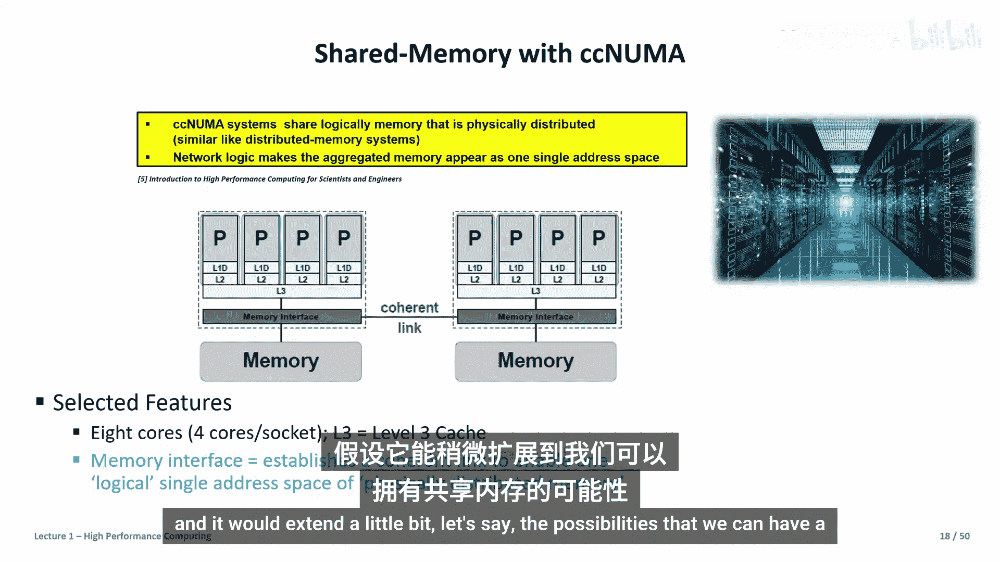

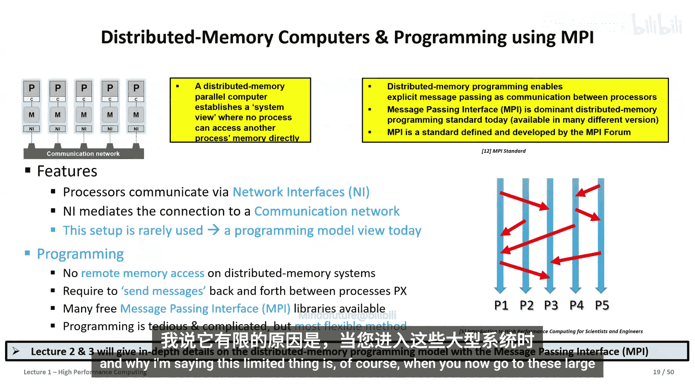

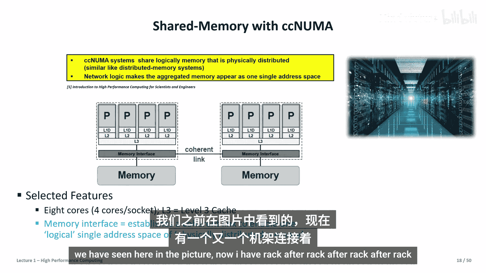

Of the other processor。 so all of the other processors in the node。

 hence you always have to go over the network interconnect。

 That's why we say the network interconnect is so important to exchange messages to put this into the memory space of another processor to work on and then basically work on other results from others to do some result or if you want to go send the message。

 work on it， send it back done。 So here you see already something which we will now continue in the course also lecture 2 and look to 3。

 it's clear that you maybe don't understand all at once。

 but here you can see directly that you have to communicate in order to get information。

 receive information or send information to others。 you cannot just put it in memory and done。

RightNo one else can access the memory so you basically have to have this message interaction and we use the MP standard for it。

 it's very well known the message passing interface as the name suggests message passing a lot in parallel and the beauty is it is very scalable right so even if I suggest only five processes here that are interacting with each other here we go up to to thousands of process over thousands of node and then well make the case for it when we come to lecture2 and three this is the introduction so we cannot do everything in detail there are also different implementation of this standard for instance。

 open MP that is also powert MP and different others that have implemented this and we're going to use that in the course for one of the assignments hence if you have a real computer these days which is really filling the hall you have a picture much more like this and even this picture you have to augment now with having here and they're accelerators along the way。

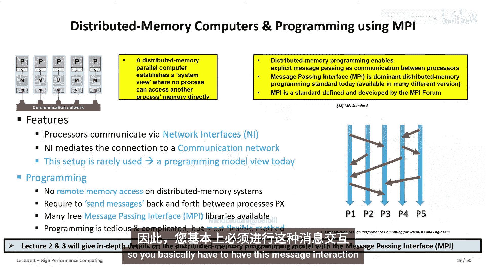

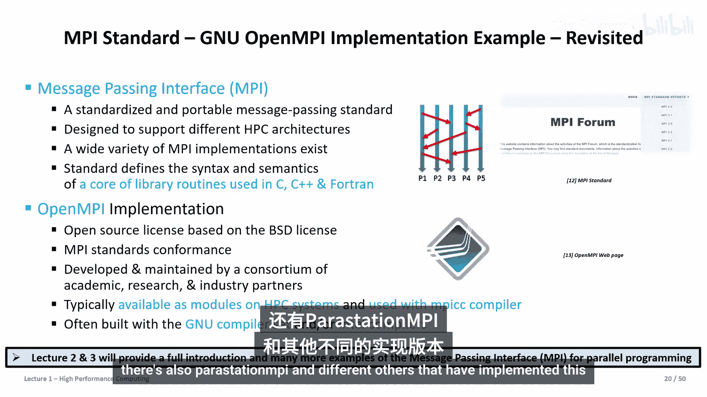

So here we talk about the processors having their own shared memory and then you would have another set of processor with their own shared memory。

 but if they want to collaborate or solve a problem in a collaborative way。

 we have to use a communication network which could be in Finninni band or another let's say type of interconnect where you have this message exchange so what you can do is essentially in this hybrid computing today do shared memory programming inside a node here。

And here and here， But maybe time you want to communicate and work together with another note。

 you have to use MPI so you would use distributed memory programming across the notes。

But shared memory programming within the notes。 And then on top of it would also consider GPU accelerators。

 But this would be all too much at once to teach。 Hence we will。

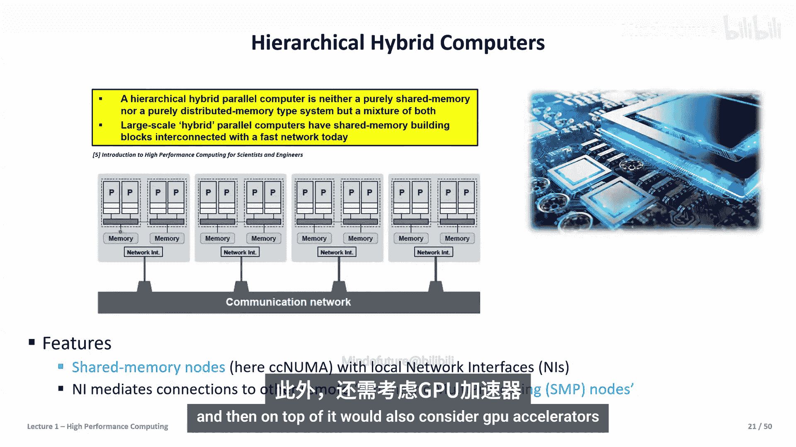

Not going so much and programming the hybrid systems， as I was saying here。

 MPI for parallelization is probably the most dominant programming paradigm now in general。

 but of course the GPUs with their Quda and libraries which are now leveraging many course that we will learn in the second part of the course is also now getting more more dominant right so it's really increasing in many application domains as well。

So， in this sense。We will learn several challenges。

 also what it means to program in parallel and in both actually in dispute memory and shared memory programming。

 but if you understand this and you're also well prepared to， let's say。

 have the HPC systems in the union from your HPC programmed with some nice applications or understanding application codes which are based on MPI and MP。

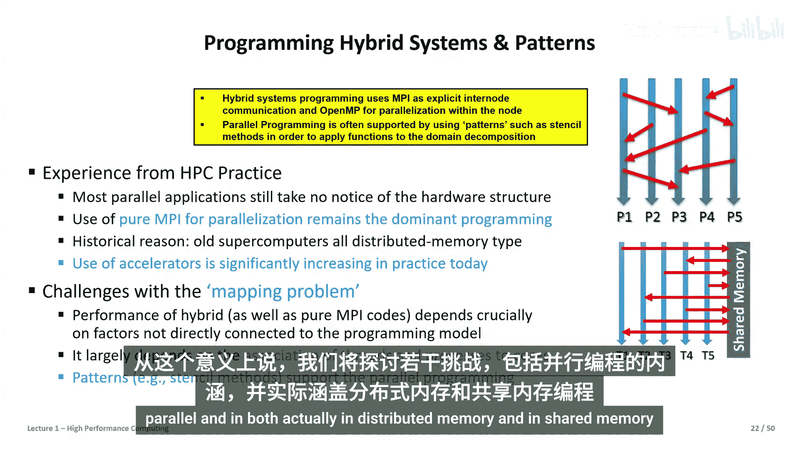

So to summarize a bit on the supercomputers that you have seen。

 the different application requirements to one supercomputer。

 you see that a little bit here and also how we see quantum computing yet as another module here。

 I encourage you to look at this video and we will continue then with a second part of the course we see HPC ecosystem technologies in a couple of minutes so talk to you then。

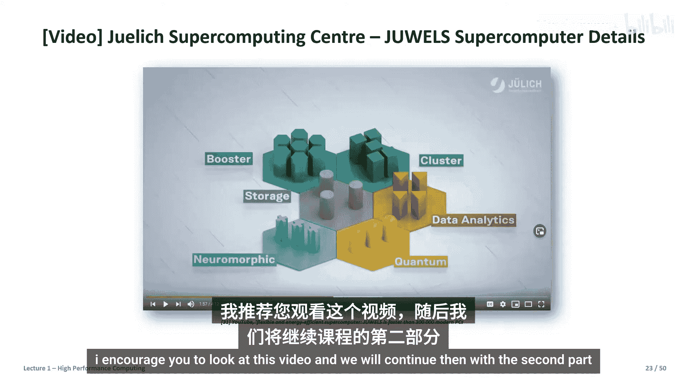

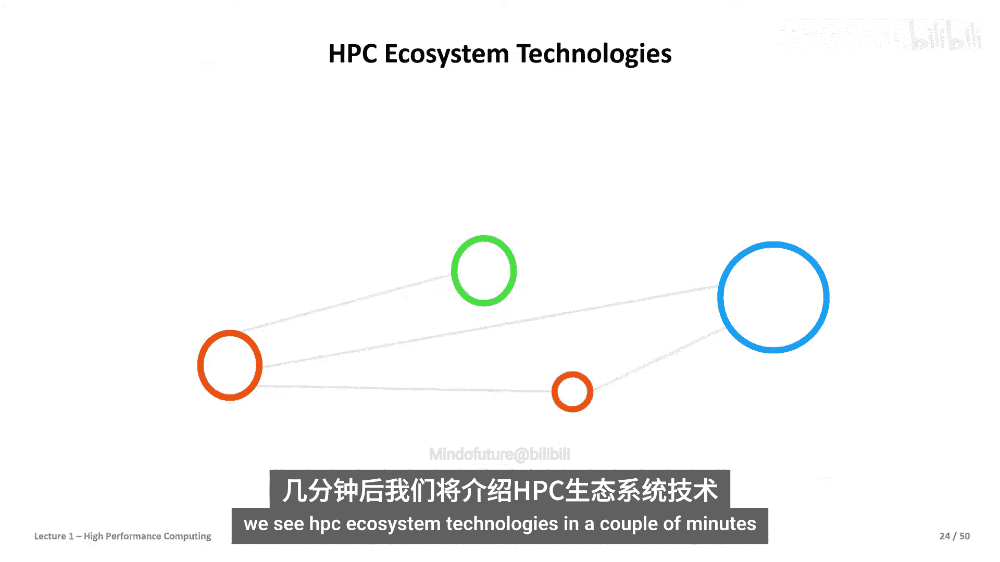