# 【冰岛大学】高性能计算课程-｜-2025-High-Performance-Computing-｜-Prof-Dr-Ing-Morris-Riedel-p28-P28_实践讲座_0.1_SSH__UNIX_简短介绍_第二部分--BV1k34zzaEK8_p28-

Okay welcome everyone to High performanceform computing our practical lecture 01 short introduction to SSH and UniX for those that have not previously used that before it's a second part of the lecture and in the first part we actually looked a little bit more into the SSH into the secure shell we try to understand why public and key pairs are so essential for this and why SSH is really a key technique really with those keys to access HBC systems today。

 we did some practical experiments of actually logging in with SSH key pairs to the deep test cluster but also to the earlier system we have in Iceland and of course it's not a big introduction to SSH is rather that basically people need in order to fulfill the requirements of the assignment so there to understand an SSH and usually that should be part of an operating system course equally is true here。

For the same part now I will revisit briefly as I said of course to look into the systems but then show some practical UniX commands just more or less as a preparatory lecture for the course for those of you that are Mac users that know that a little bit more than maybe those that are in the Windows environments or even just you know iPhones or iPads to study so in this sense these systems what we hear as a practical lecture。

 demonstrate， let us come then also to the first one we had use a the Tesla is of course a demonstrator。

 but it also carries a sense of all other systems we have in HPC hence when we go maybe to again the system we have here the UD supercomputing center in Germany is basically one of our closed collaboration partner enabling us really to have a good system already in order to compute the assignments so we have。

Here a note code of 50 for the cluster module dual high signals rate performance CPUs。

But then the booster module， the modular supercomputing approach means there's also a booster petition that usually has lots of GPUus you see here 75。

 And the reason why we call the test cluster is if you go now to a production machine like for instance。

 Jubilles， it is the modular supercomputer as well， but this is really a power horse， I mean。

 this is something which really is a production machine and you see here alone the jubille cluster module again。

 has over 2000 something standard compute nodes right and and many log in nodes。

 So here we talk about around 120000 CPU core available in alone the cluster module。

Also's important for the course and we will revisit this in later lectures。

 the Interconnect that I was alluding to in the prologue right marking a bit the difference between HC and HTC if you want is really the melanox infinni band demonstrating you for instance a very good interconnect between the nodes making it possible to use this machine then for prediction numerical numerical weather prediction and these kind of elements Also this will be late explained in the course。

 but it also shows you that the Unix and SSH is the similar elements that you also need in order to go to the production machines that's by retelling this also if you go now to all the your HPpCJU machines that we have explored in the first part。

 this is something by Unix skills usually and also SSH is a mod operadi。

Just briefly here the Jubil booster module also production machine in terms of scale we have here over 900 compute nodes if you remember。

 of course it both really oriented towards GPU processing scaling out so maybe not let's say moderate single threat performance on CPUs but for us it's really important to have4 and VD GPUs per node and you see that here there's already the next generation there' a100 not the ones that we have in D is V100 so hence this is quite interesting Chs are also that and I just believe that here that of course you will see the Upiter system that will come you see that a little bit essentially as the Xscale system for Europe as an arrival it will soon be available in Yuli and chances are it will even appear during or a course so that's exciting times for us let's a little bit to this practical lecture here of course。

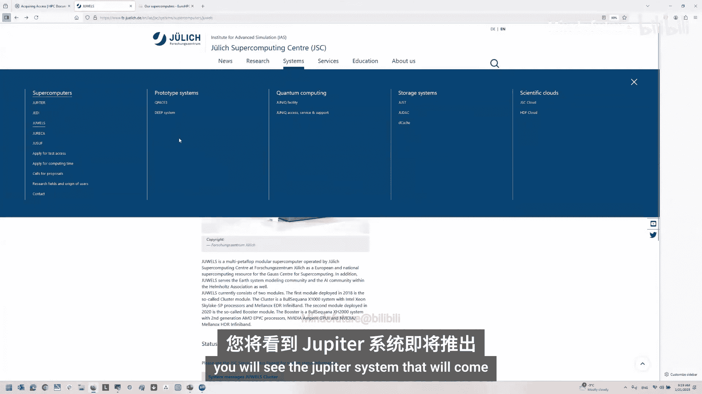

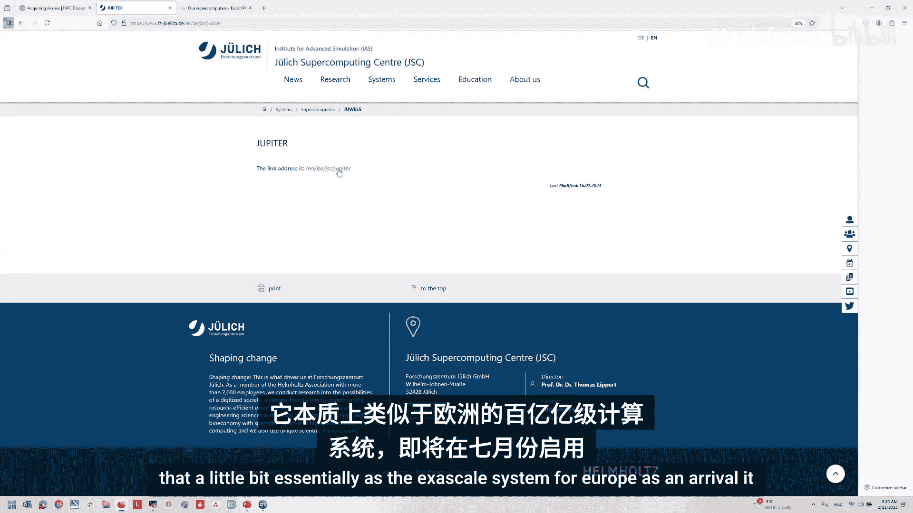

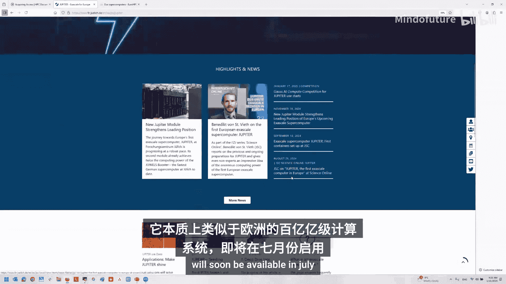

Elier now is not far away from the Mo Saorandi it's a smaller system。

 it's a university system basically used for teaching， but it has also let's say good NVDA GPUs。

 you see a pair line here with a100 cards and the GPU nodes。

 Of course it's a much smaller system it's not a European supercomputer if you want rather a university system for doing research here and of course researchers and engineers can do their many steps on the systems here like earlier and then apply for your HPCJU computing time and have also the possibility to get to European large supercomputers and then can scale up their problems。

Very high still coming back to the practical idea of the lecture。

 many of the things I say will be also repeated in some of the other coming lectures with much more detail。

 So what is a GPU you don't know really for sure yet。

 it's an ecosystem well talk about and will differentiate it also from multi ecosystems So fully in the course will go earlier so that it should be not a problem to also now touch metal。

 as we say， So really have a rack explored how that looks like and also we plan to maybe have another visit like we did in the cloud course to the Boreales data center or in another data center in Iceland。

So。But let's come a little bit more to the practicality。 So we want to go back to our Moab external。

 So this is the mobile X I was alluding to again， I will not do this now， you know。

 slowly but rather quick because we have learned this in the first part， we need post name。

 we need a specific username that was given to me in my case， read one。

 and we have to pick a certain private key in order to get the access。

 which is usually then now protect it from let's say a password in my case， I have used that before。

 So in this case， I don't need to put this password in again。

 but I have to show the private key that I have this。

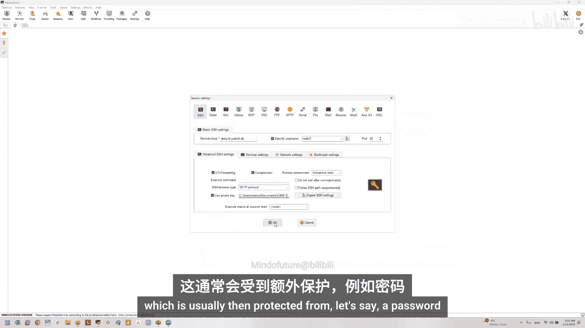

Now we are in deep so what we want to do is now to understand are you really remotely and there are different ways how you do it a host name。

 for instance Minos F is one opportunity to see okay。

 it's already another name it's probably on your laptop command line or but your user on a laptop but you know the host name is already giving us an indicator it's not full yet so there's an opportunity with host name Minus a to show you all information where this is map2 and here you see clearly we have here a host name that is somewhere in the Uli do domain ca I means an older name but that doesn't bother us it still shows us in that it's quite remote Additionally。

 of course we are the SS agent you remember you can also SSHs command line in with having a user name at this host name and then you present the key and can also access it so we also sometimes interested who am I so just to understand。

Then okay now i'm really read one so in other words also here my laptop identity is not there anymore it's of course that identity that I have there basically on that machine so simple un commands really and and this is a key message also briefly what I put you on the slides right some of them of course are let's say also to earlier here and we can do the same exercise to honor we'll do the same setup briefly going into earlier for instance but what I do here is actually simple Unix commands that you can also execute on any other HPC system。

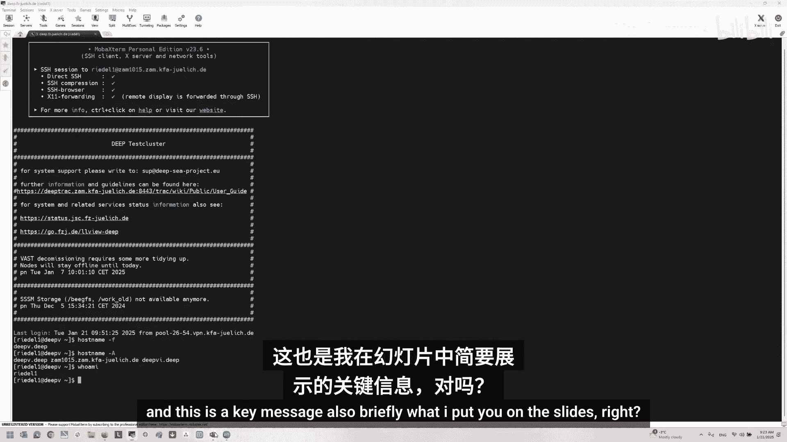

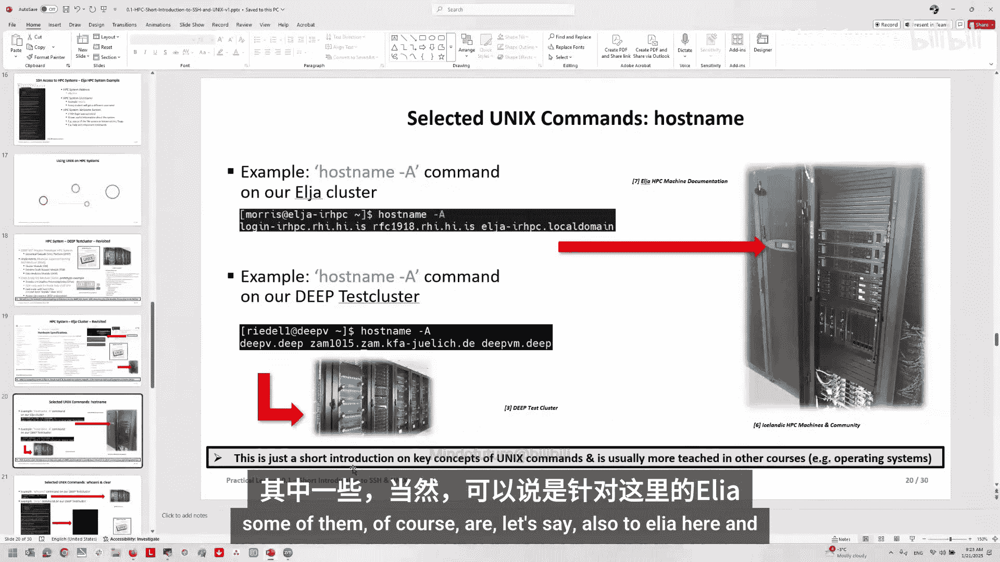

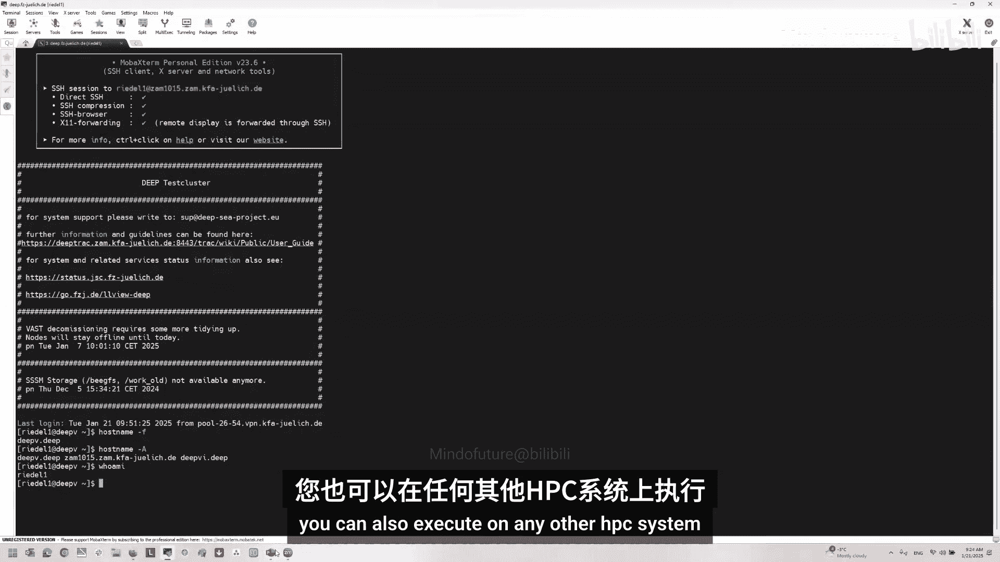

So when we continue to think about what else is there， who am I I did already。

 another practical one is essentially then the clear that is quite useful so when you have the screen let's be working on it and there's a different simple commands that we will look in and you have the whole full whatever。

 have the different workers directories and change them。

 maybe have a look at the old directory path that we have here and then you see different elements or we have here。

 the idea to to really think about yeah how to clear the screen and then clear you get overview again。

 it's another interesting kind of idea how you can。

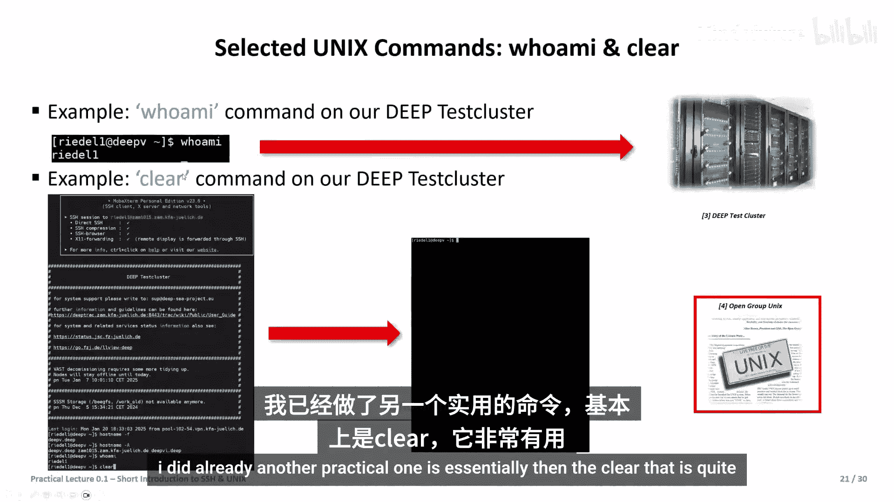

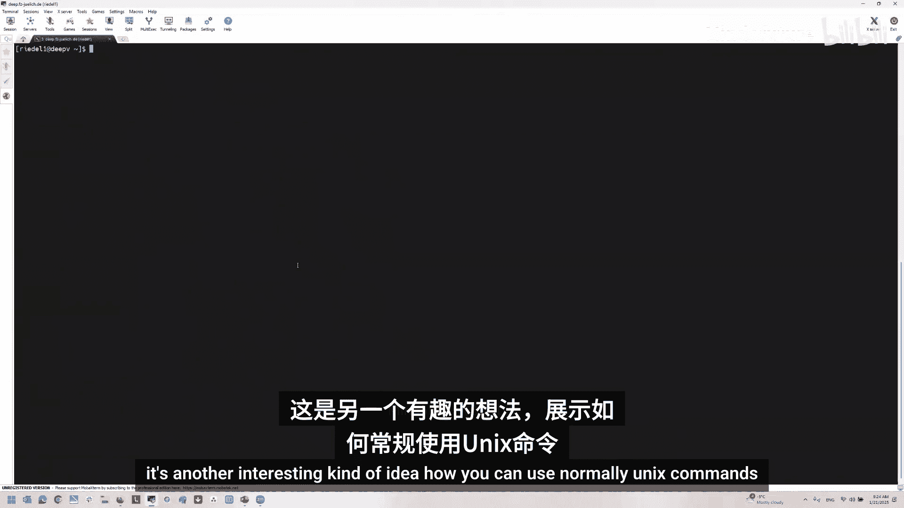

You know use normally UniX commands then of course we can think about the MC D folder command so we can basically go back here。

 there is also what I documented so in our case already did this basically then that means we can go into this one for instance and look that there's already a test file that we're going to generate but can also remove this test file。

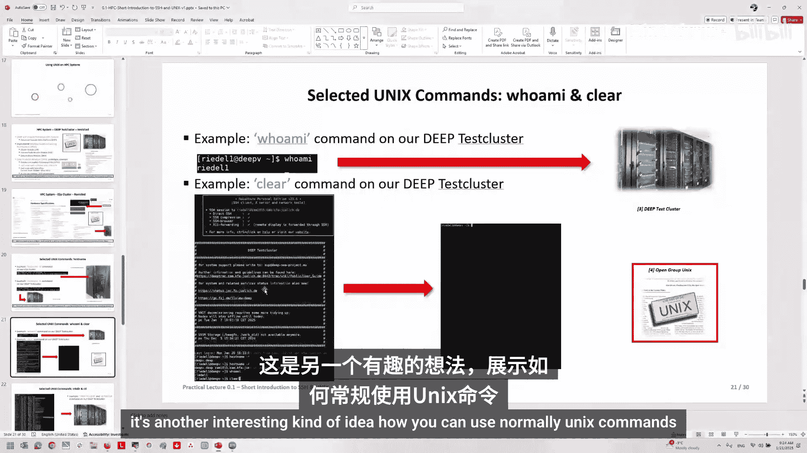

So I will do this later with RM and with MCcaier we could do now。

 let's say another element that we have inside the course now the interesting thing is that we are already in the HPC course spring 2025 directory so when we here do now again let's say double this and say well。

 spring and then 2025。Then I make another directory in the directory。Still， I can do this。

 There's no problem in this When L S Mu is L， you always see what's happening。

 But you also want to you now， basically remove this。Directy。

 perhaps and remove files which you can do in this RF。And here maybe for instance。

 star is something where you be careful， you know， cannot remove a directory that's a good protection in a way。

 so remove means you basically do remove of all types of files when I say touch test。

File touch means it creates a test file and when I now do Rm。St then you know， I can remove this。

And file， but not the directory and I think that that is very good to understand if you do this be careful。

 especially in your home directory， of course that is not good So there's a specific command which is even more powerful which we often use something like this you need minuss Rf these command and let's say Uniix command would have also different power and now you see suddenly we cleaned up the mask be created iss a directory in a directory for instance it's clear and we could even directory remove right with this command or minus RFf star right it's very powerful so there are man pages available for you during the assignments and so on where you can learn essentially about these different power me a sort of small help of course those of you are more inclined to the internet fear free that of course you always can go and。

Essentially。Yeah， browse in Google and so on， and you will find also similar pages explaining your what happens。

Having done this， having created directory， remove files。

 so these are a couple of things not all of that is maybe perfectly documented now here because it's a practical lecture but very similar things should be essentially now here in this particular one the CD1 and so on Yeah another interesting thing is maybe apart from thisD and L will come back to this and here is of course now think about that we want to maybe have working directory where we in now you see when I list here this asset we have in particular directory we want to know where exactly this is so we can do something called print working directory where I see exactly here on deep I'm in this directory for you know users under my let's say user ID for deep Z and now back to these lights。

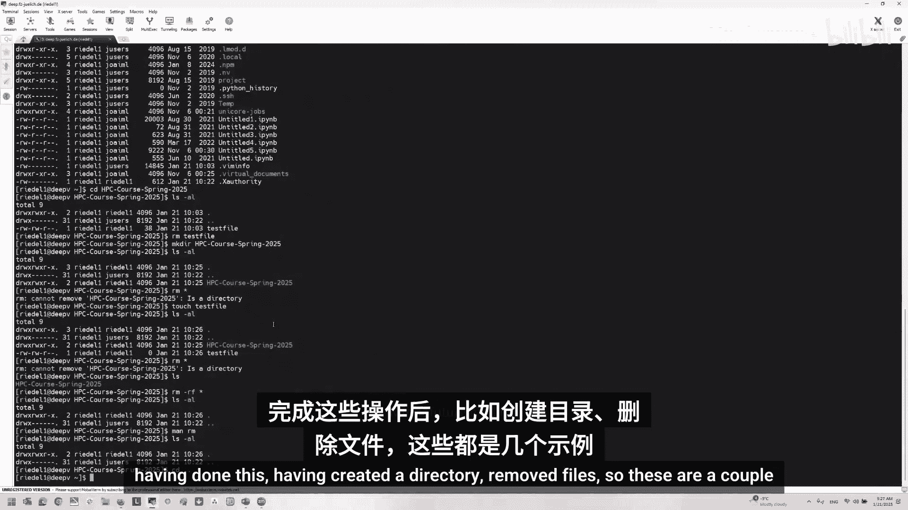

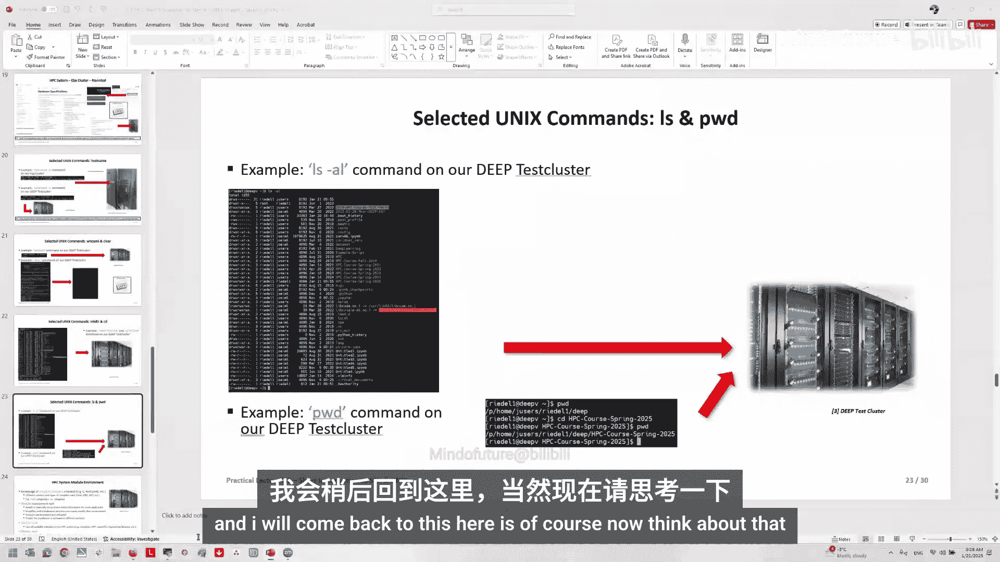

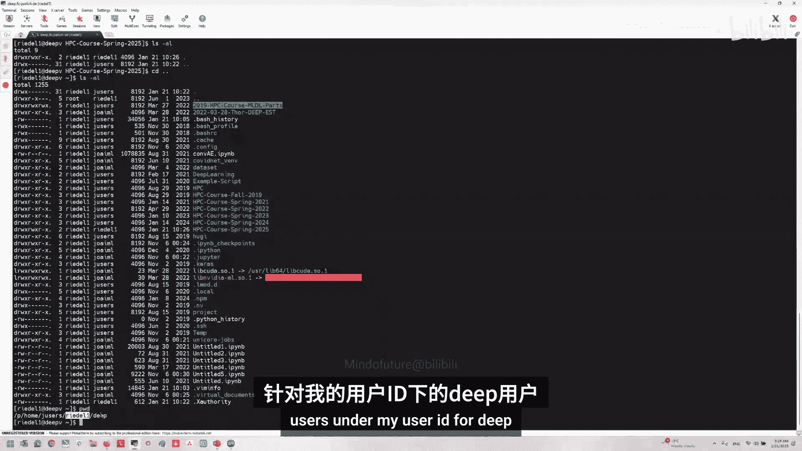

Yeah， essentially everything I have demonstrated you have in one way or another here and there on the slides and of course here and there the main pages will also help you forward and having unique skills is definitely to be something I think which every computer scientist to have a little bit at least which we also teach in the yeah operating system course。

 for instance， but there are also many courses outside in the field。And on the web。

So there's one thing I also wanted to show you as part of this before we go to El and repeat some of the elements which is a little bit more towards also the environmental tools we discussed so we said there's lots of hardware you see this nicely in our pictures here there are res there you know CPUs storage there's you know interconnects and so on。

 but of course there's also the point that we need the right system environment really and one of the crucial things really is the modular environment。

 another one is scheduling because it's the more to use environment and that's why scheduling will be a practical lecture after we have clarified our normal lecture one or conceptual lecture1 what HPC really is。

Then we will go to more and more environmental tools that are basically there。

 but today we start a little bit here with the system you know module environment and this is something which is also available on the white variety of HPC systems around the world it's almost the fact to stand that the rarely packages handled differently。

But the module environment is something where you have essentially all different compilers that you maybe need。

 if you program in C， C plus plus forron， et cetera。Normally。

 Java is not the world of supercomputers。 So you will find rarely Java and， you know， interpreter。

Based Java somewhere as an application in HPC， rather MP for Py。

 maybe Python would be something used， particularly also using HPC with AI， there， of course。

 Python is still Mo operaorundi But coming back to the compilers。

 there are lots of them was different。 let's say capabilities。

 one of it is also to support then the message passing interface implementation which will be also coming is one of the next lectures。

 If you remember programming and parallel with MPI and then later was openM will be also lecture 2 and 3 and so on。

 Hence we will have here the right environment to have on these HPC systems to use codes like you see here。

 a C code called ping pg we will analyze later in the course and compile it and to make an executable that can actually run on a supercomputer。

Hence。😊，There's lots of software infrastructure as we call around the HPC systems as well。

 it's not just hardware， there are lots of different compilers， yes。

 and let's say message passing libraries like MPI and so on。

 but also scientific and engineering specific and application specific libraries are there if it's for molecular dynamics or if it's a lot of low simulations based on mechanistic modeling that different packages that you can actually load and many of these will have also。

 for instance also in the AI environment and they will come to a demo shortly。

 they will have also dependencies and the dependencies are usually lower level libraries like for instance。

 if you use NVDA GPUs you have often let's say couda requirements in packages because this is see basically interface or the programming language really how GPUs are programmed from Nvidia。

And when you have AMD GPUs and you have， of course， another toolkit， so long story short。

 you come to a situation that you have a multius system and these multi users is loaded。

 All of these different users have almost different requirements， Of course theres an AI team。

 maybe this five or six people having exactly the same requirement P to or tens of low or what whatever。

However， if you look on the overall usage of HPC systems。

 which could be in the cases we discuss with Uli in the hundreds right of different user groups there different applications that have to be supported and with this many different libraries and how this is managed in a proper way is basically the module environment tool and this really simplifies a lot of things so we will look at this also when we use for instance。

 the compilers in a practical fashion down the road。

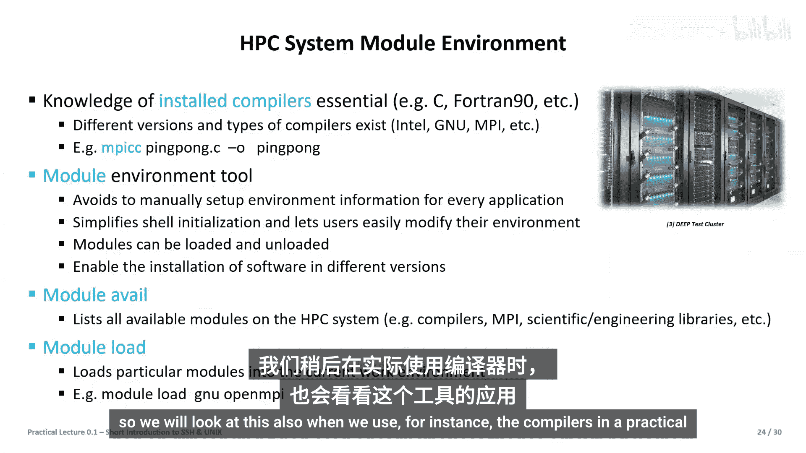

But I just introduce it here a little bit and demo it now when we go back to our deep environment。

 So I clear here again and one of the things what you could do in the beginning is really to get an overview when you look into a system like deep and and do something like this module avail。

So this already shows you quite something， so this is the the package here that you have now for many。

 many different application from Eigen， your So， you have HDF5 parallel LIO libraries here for instance and also how to view them。

You have， if you go down the road， Julia as one of a specific programming language。

 UpiterL is a sort of interactive access to HPC systems we clarify this when we come to the AI in the course later。

You have lots of different tools like MATLP， for instance。

 that some of you know maybe from the standard scientific computing， they have also parallel toolbox。

 so you can work with MatTLM also in parallel。And you know you go on and go on。

 you will find more and more libraries that some users will use in their。

 let's say daily work with HPC systems and you see here also one particular one we will also come later back into the course。

 Pytororch， for instance， is a very popular tool for AI for artificial intelligence notably deep learning models is something what you program usually in Pytororrch or you have also as another you know package the tens of flow。

 basically available label that you use and then also is horror what going there。

Now this already advanced libraries and the requirements there is of course having also standard libraries and standard libraries could mean something like for instance。

 the usual Python that you would have right so it's not this is just highle libraries you see also here lower level the standard Python distribution or the standard R it's basically also for data scientists a very known tool are available in this modules。

 you also realize they're coming with different versions right and we don't have time to go into the complete setup of deep they will take a whole lecture to go and you know to go through all of the different packages also netCF is here actually something for parallel IL formats but also you have SkyKt learn here as something that many of the data scientists will be again familiar with have lots of serial implementations of AI meaning machine learning models and also basically。

popular data science techniques that you can use so all in all that is very nice for asset users because the essentially the administrators of these machines have prepared all of these libraries。

 they compiled the libraries against the right let's say lower level libraries you see there's often here when the Kuda is basically coming to the situation here you know that this is linked to this particular Kuda here Nikel is a lower level network library from NVdia with a specific version of Kuda compiled and ready for us to use。

 which then gives the ingredient for using NVDdia GPUs on a higher level than with something for instance。

 that we have in Pytorch or so。嗯。There are lots of details on the module environment and of course the idea is not that we have now you know go through this in the complete detail that that you know this command and if you go now to some other HPC system you will see it has a similar command available for this to use and。

Then when you want to basically understand and load one。

 you would also have then you know the ability of module spider elements。

 so if you would say we want spider for instance is Pytorch then we want to understand what is it all about with Pytorch what is the information about it having also let's say dependencies you see that here very nicely。

 I mean first of first of all we know it's a neural network library but will come to this later in the course。

 but also of course it's related to several different pieces like Python for instance。

 it's built for GPUs it's a very important part that deep learning is essentially just possible with GPUs in HPC machines and it's Python so hence the name and you will see now different stages in different let's say elements that you will have to need to load these modules if you want to load torch。

Eassiness that in the stages you have here， many of the basic libraries that Pytorch needs are already。

 let's say preinst。 So we module spider。Maybe on different of these different libraries in order to get a better view what actually is all inside this and then we can basically go and see there more。

嗯。啲。The key message is to take away that of course you can also not only use this。

 you can also talk to administrators right and say。

 could you please install different elements of it and then also have a look of if they can you know when you have maybe a research group of 10 people or 10 students doing similar things。

 they can maybe prepare that better for multius usage of having this once installed so that everybody of you have to know install that a little bit on your own and with this chances are that you really you know can help your team because then they just have to do you know module load and can do this easily。

So yeah， we module load with a command， we can also you know module unload the slight example I had。

 I think I have to look at it was you know we can load， for instance。

 a Python package which we have here Python something that gives me also the opportunity to introduce a tap。

 so if you do the tap under module load Python maybe and in general in UniX。

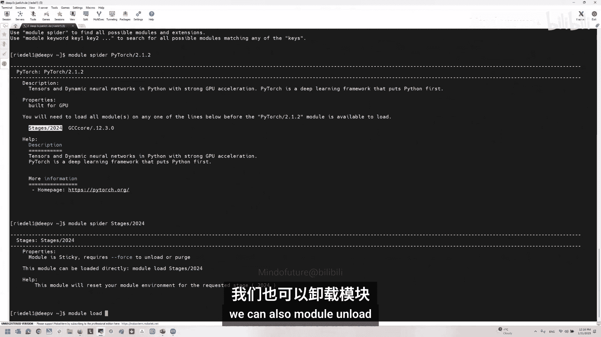

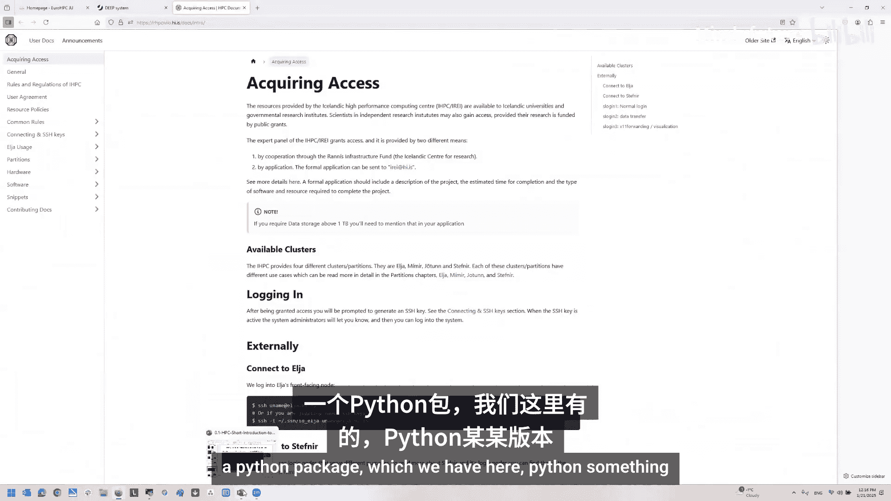

It will give you options。 what you can do。 And I will demonstrate this maybe as a directory as well with the tap。

 Now， you see the different options you would have， how to continue。

 so we can run Pon the very specific version， which is sometimes required like this one here。

 for instance。In order to support let's say a very specific tool set that is you know against Python 3。

 but of course older codes might be requiring Python 2 and older versions so there might be also older versions installed so this is a really nice helper tool and just to demonstrate the tap again if we say now we had our HPC codes right directories so we say what was HPC codes but what was it called again I do tap a couple of times tap here。

And then all the options come sub right you go even go back when the HPC course was in fall 2019 because this is all the directories that you have here and then we can with tap you know continue all the time in order to go in。

 this is a quite nice thing。And can help you a little bit not only in this module environment。

 but also here in the idea of browsing through directories， opening files， etc。

 this is all something useful in this manner， of course you have to be precisely these things。Yeah。

 what else？This is a bit about the rights you see here now maybe the elements we should also discuss is not only when it was created obviously today at some point in time。

 but we have also the username that is actually creating it and then also you have indicator that this is a directory here is D in front and then the rigidly is it a read write or executable rights to do so in this particular directory and you know this is important when you have a C code。

 you compile it， for instance， then you need the X to where the execute something and we will make the case then when we have really something to execute in part of the compilers but this is essentially the information you see here also the size obviously of the different files and directories。

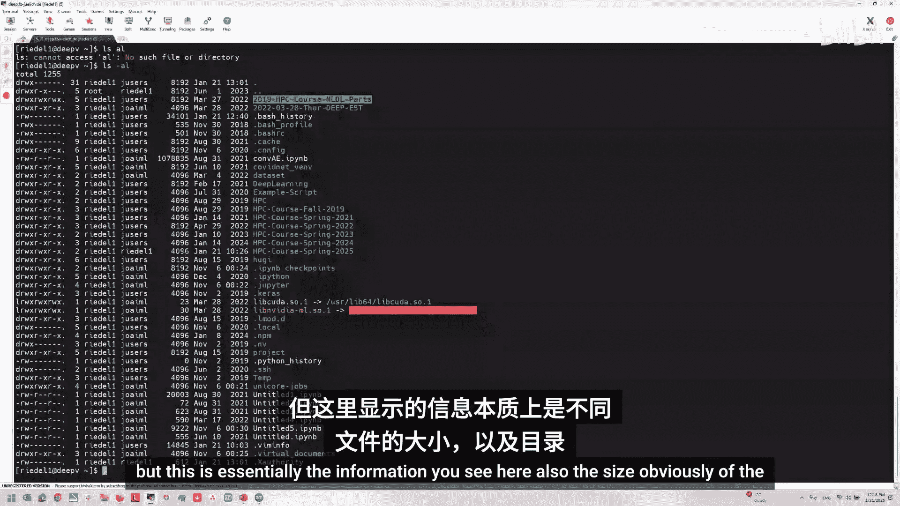

And with this， let's go a little bit back to the slides。

Having now understood perhaps a little bit the module environment again。

 this is not completely obvious to you it's clear how that material is when we will go and really use it。

 for instance， visit a C compiler also where we start from perhaps in one of the MPI lectures where we then have our first C program from MPI compiled and so forth there you need already a specific type of compiler and things like that。

Good， but let us now move a little bit further coming a bit to the idea of using VI that is also an important tool。

 which is a bit tricky to use for some， but it has also of course the possibility to be used on many of these different systems it's really the most basic in a way editor you can find of course in the course you also fine to use nanono I think many students use that in my course but also Emex of course some of you know that especially those that are in the UniX territory more there are different editors or files。

 but the VI has the advantage a little bit in the sense of saying it's always almost always this tool you know that that is basically on the HPC machine available so if you go to 2025 maybe or think we can do something as I said to you we can create a file touch and say test file。

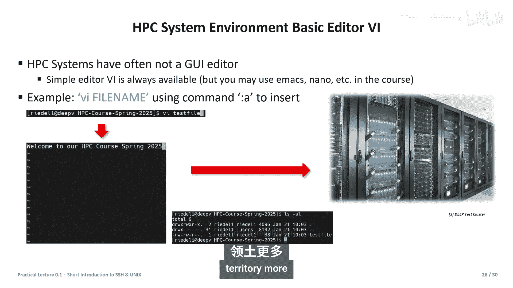

And when you look at it， it has zero in size， obviously。

 because we just created a file which is empty。But we want to fill it and let's say we have BI test file。

And we'll basically say then welcome to our HPpT course spring 2025。We come in Iceland。

 something like this。Now we have this insert command， and this is now the interesting thing。

 so you put exit or escape here really and then column。W。

Quue and c mark saying like we want to write and then quit。Right。

 so hence the commands are a little bit when you do the man page with VI that you have these two modes。

 really， One is an editing mode， an inserting mode。 There's also a pending mode。

 If you go again to this file and here， we just say a。Right。

 just say then we are already in the appending and inserting again， welcome。

And then I do escape and then column again， that's an important part to mark now the the kind of commands that should be done with a file and then write and create and so on。

So using this a couple of times will of course help you also to get familiar with you see now by filling it。

 we already have a couple of bytes here and also see who can actually read and write in it。

 which is the owner basically and then the group users can be in groups which is not totally obvious so it is basically something which has to be configured of course。

 with people that are administrators and then to the whole world is again also one right。

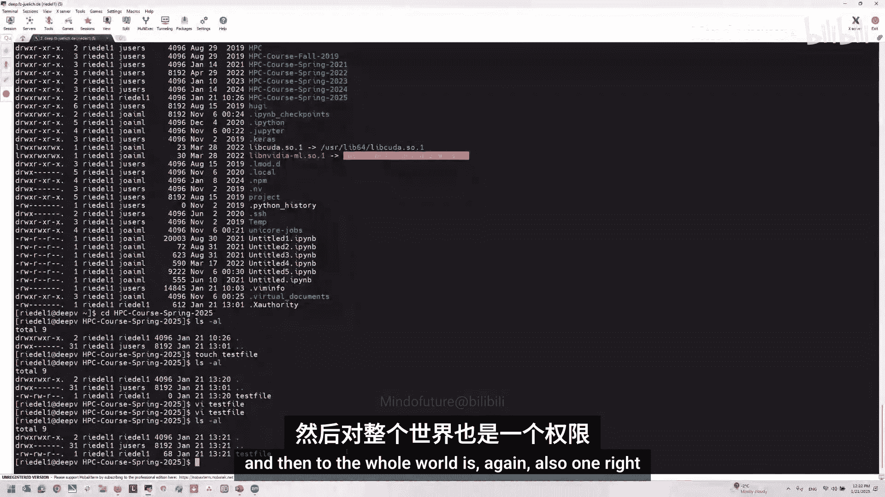

Good with this you have seen on deep a lot now I can go on and go on with different UniX commands。

 but that's also not my job because we want to understand more on HPC but before we let's say finish for today I just wanted to make a quick walkthrough again and finish here with our deep system remember with our host nameos a or what I demonstrated it to you was more or less on the deep machine right then now the idea what can we do on earlier right for this we exit here。

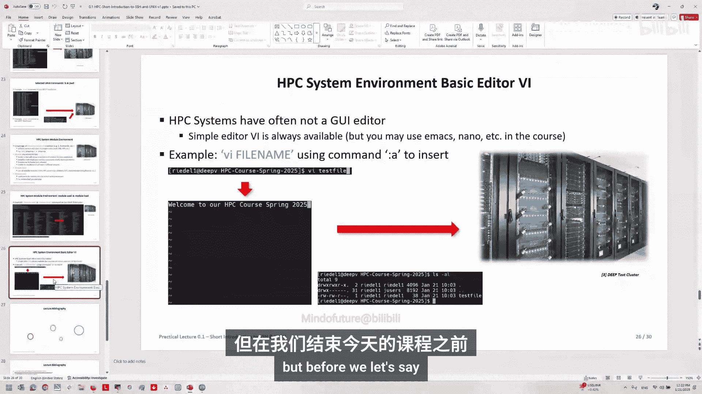

And want to go of course， with an SSH section。

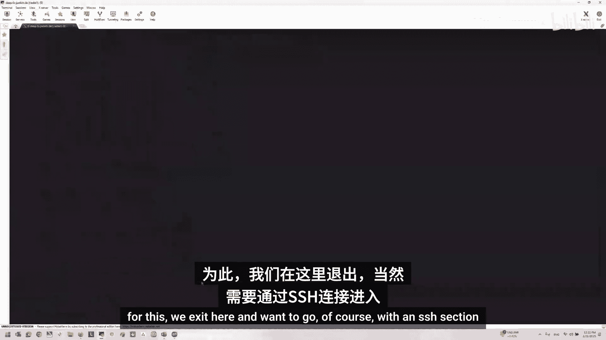

Elements I just get it here concerning but it will not be automatically saved that's not a problem we don't need that so we said earlier。

 oe do how is and you remember my user name if you come now back to the beginning here where we said everything I just demonstrated on deep we can actually also do on earlier and my name on area was actually Morris said earlier if you remember so not real one。

 which is an important thing so a different username。And if I would put real one here。

 it would not work， equally， I need， of course， my private key here to actually get into contact of this。

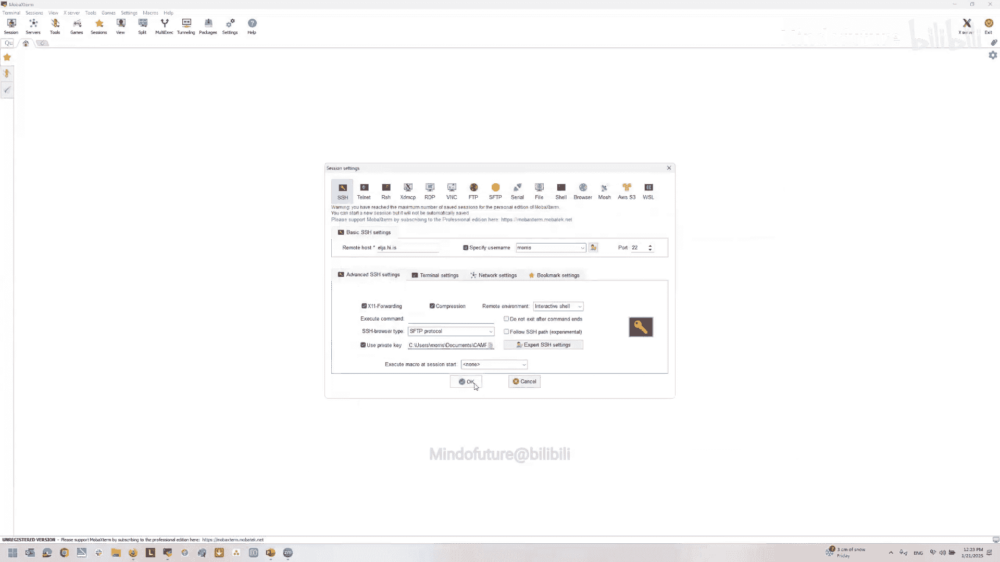

And we'll make a connection this as is age to earlier。Now。

 the question is if they are happy with our passport or the key store。

First it was quite a while ago where I have used a you know could be that they force us to reenter the the key password。

If you remember area was always a little bit， let's say longer there I find we don't have to provide the password right now so obviously more or less you see already we are in earlier right the welcome screen looks different as I was also demonstrating you in the first part of the course。

 but now we want to go into some of the aspects for Unix so that you notice that actually we are on a different HPC system now you know now we are on this system here in Iceland so not anymore in this deep system in Yuli in Germany we are now essentially here in the area and you would have lots of documentation here if you want the overview of the petitions and also here U turn is something we use for teaching for instance。

 that will come back to you in one of the assignments when we use it but essentially that's important to understand that the UniX commands we did like for instance which is now crucial for us the host As A for instance shows you。

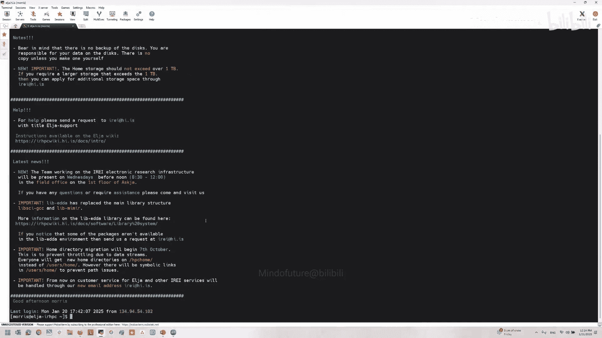

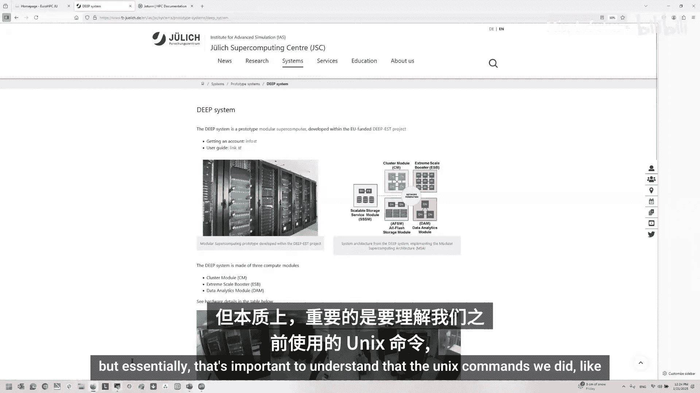

Very clearly， we are not anymore the host of deep dot FZiv Ros Yute or so in the German domain we are now in Iceland。

So this is important for us。So hence all the commands you learned are basically still working L less minosil。

Right now you see there's a directory of HPC course spring 2024 and we are in a completely different home directory you see here I'm actually mapped to the Utu area because we are in our teaching lectures here and Ut is our teaching area on this and this is our working directory that works we can also create now which makes sense basically a directory here we' see usage of MCca De you create this HPC course spring 2025 you know directory we can also remove that again and use this trick if you remember that's important to realize with is element again with the mouse and then maybe just change the last one so you can be a little bit more faster in several elements equally the idea of this tap works so if you say this's was a HPC' let's see about you you're moving through directories like now you know we're somewhere okay I'm there in my home directory so there was。

Some HPC course， but I don't know what was it exactly called。

 you can say something like HPC and tap it。And you know。

 you see that's the most common option that was not in deep because we had a fall actually。

 here we just have two spring courses。And when I do in continue tap。

 it will give me the two options I have and basically of course we would be now interested in the 20251。

Right so。With this， we have the same in our functionality on the Uni as I said。

 also when we would create files like for instance touch test file here。

 you will see equally like deep， it's a zero file， we can remove the test file。

Oops sorry for this test row that's why tap use is sometimes quite useful you say test and tap and have the right name and just say a typo。

And equally we have here also this powerful， if you say make directory test here in this。

 you know HPC course and you know the protection if you now want to remove the test is a directory that will not work because there may be many files in it。

 hence you have to do a strong command if you for instance have you know test file to you know have a kind of thing where you can say RM。

Remove everything， it will remove the file， but not the directory。

 which is sort of a nice protection and if you too fast now， sorry。

 but if you want to be so to remove everything in one director you have to do RM minus RFf star。

 but then you please go carefully with this command because you could also crush your own directory with it。

So in a way， that's all， I guess， what we had roughly in the slides on deep or the normal es host name we have tackled。

 of course， who am I， I forgot a little bit。 That's good to understand。 But you， I think。

 could also understand already， what that would be， Who am I would be， Morris， my user name。

 which is essentially already incorporated here。

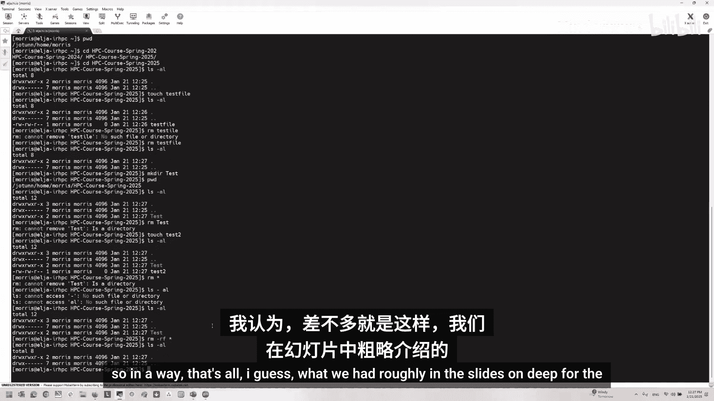

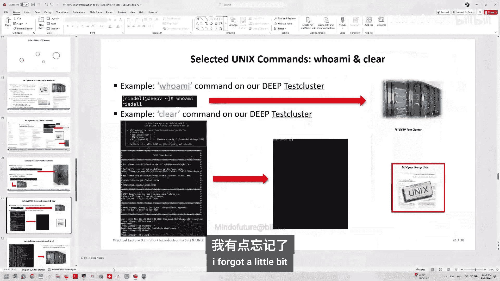

But of course， still is also realized， you know， as a UniX command to understand what is a concrete block you used here。

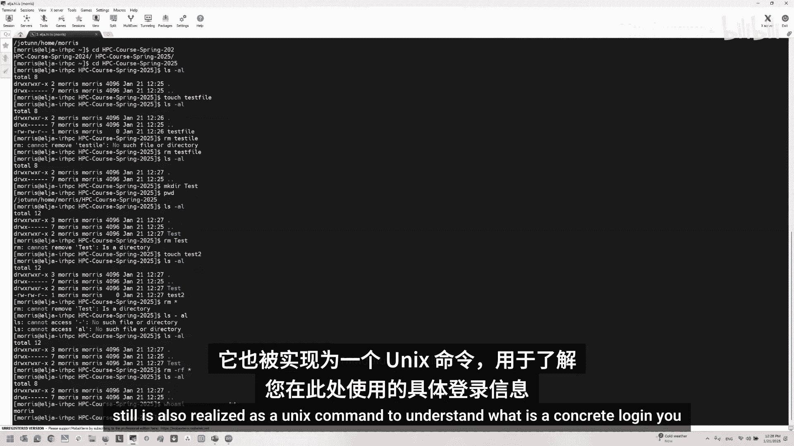

For more information also on software hardware on these it is basically all written here in our Wiiki page in Iceland however。

 as you will also know， and I think that's what I also want to finally demonstrated a little bit before we come to a close。

 we have now clear， we have directories， all the essential commands you need to go get going。

 but I also wanted to bring quickly to you the idea that this mod environment that we had now nicely on the other side。

 basically on the deep system is also of course something clear again maybe a bit modular avail。

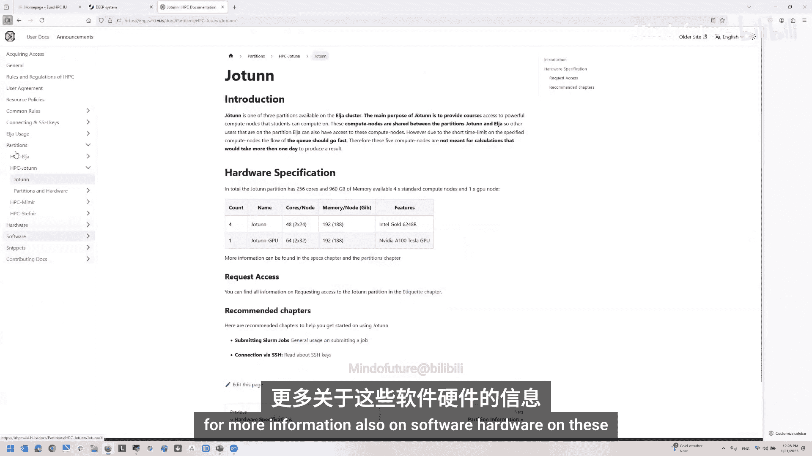

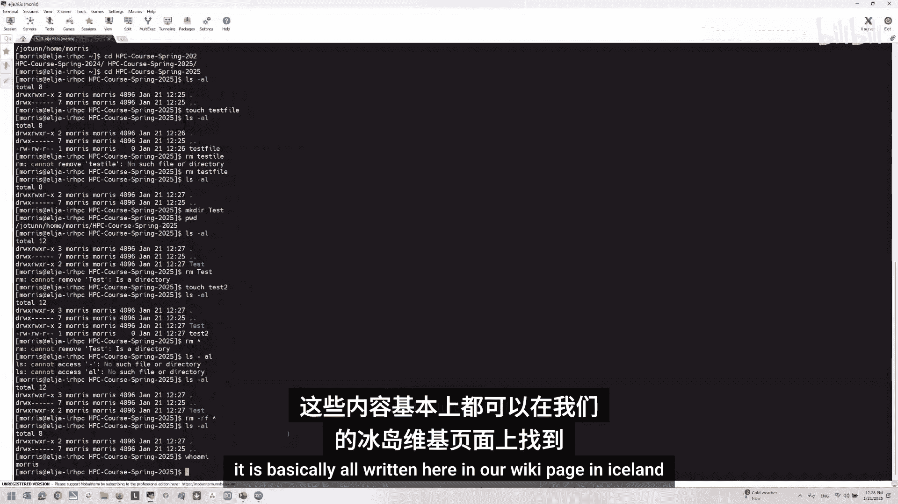

That we would have here on this particular HPC machine as well and you know the story is basically the same so obviously this is a university cluster it has probably less systems software installed firstly because it's a relatively smaller cluster not used by so many applications maybe not hundreds and hundreds of users but rather maybe 1 hundred0 users or so in students which is a teaching environment which is also sometimes really a difference between the production systems and the teaching or prototype systems again if you think about usually remember deep for sort of a prototype system so even there's not so many applications on if you would move now to jewelves right that was a big system here we see configurations of thousands of thousands of CPUUs and also thousands of GPUs we had to hear the booster with 3700 GPUs roughly so this is a completely different story。

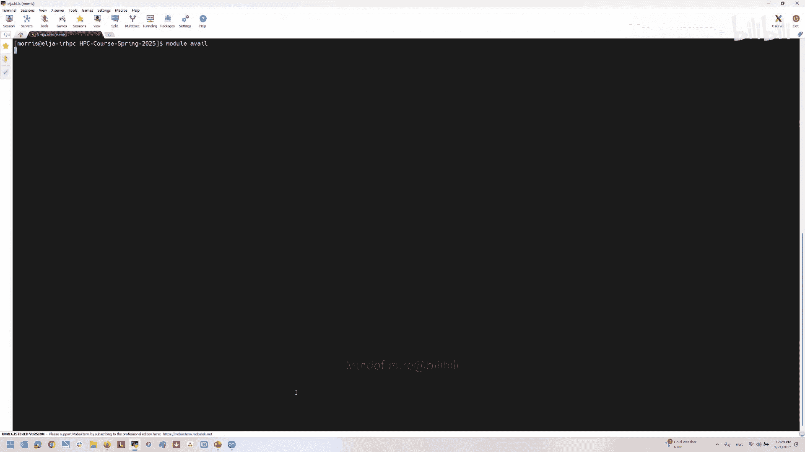

And there you have also container technology， you have you know different big， let's say。

 application module systems available for almost all the application users that use the system hence。

And beyond， of course， if the new people coming to these systems chances are that the tools are already installed on this machine。

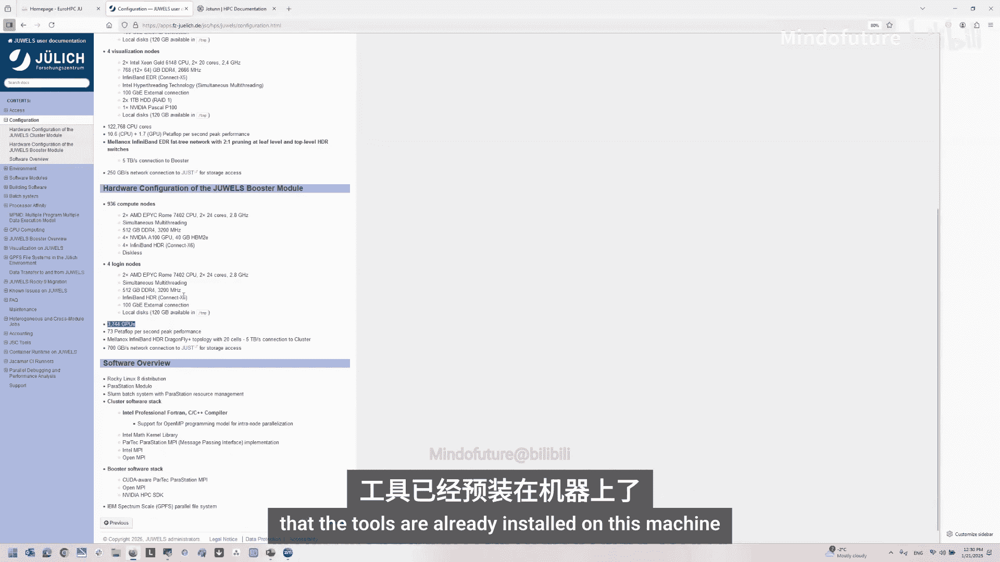

So hence this is a production system， but earlier is basically just a teaching cluster and there such cannot be so strong。

 however it has some of the interesting tools that we're going to use like the GCC compilers for instance for C。

 it has also several Python versions and here of course the idea is the same module load a specific Python that you can have here or you want to understand if I want to have R。

 so statistical computing with R is an open source project which many people in data science。

 for bioinformatics use often， so if you want to understand you know what is the situation versus R。

 what then basically let's have a look with module spiders or even this command is also there working telling you it's a free software environment for statistical computing and graphic statistics of course。

 so free and you know it has several extensions and apparently already installed。

Which is also for us very good。And the interesting thing is this can be loaded directly。

 So it's not dependent on Python because R is it， let's say its own language and we don't have to have to compile it or something。

 So it's a real ready to run software whereas of course。

 Python is just basically then the Python the printer and everything on the environment。

 and then you have to have to still use your。

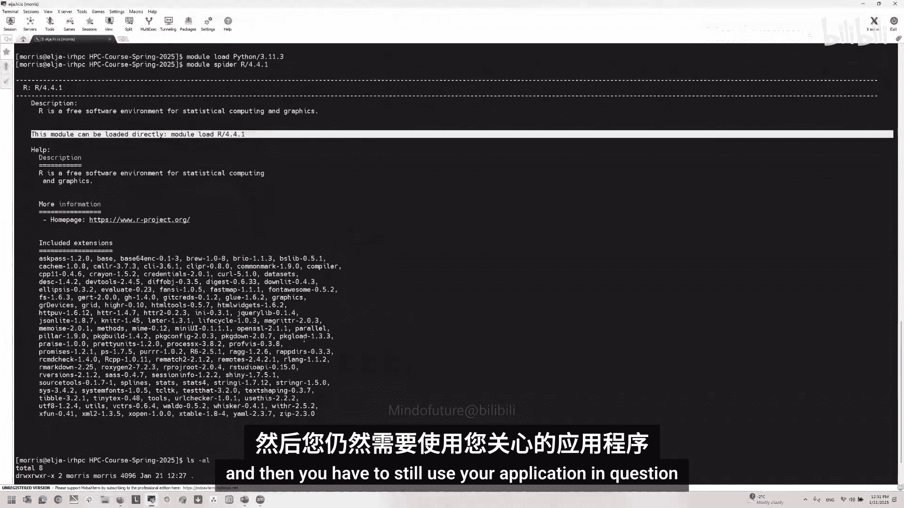

Yeah， your application in question。You have also interesting aspects we come to MPI you see here's MPI4 Pi already installed that also gives us the insight that yeah some packages are really very specific while others are really more。

 let's say general libraries， general compiler maybe here in different versions。

 Kuda was alluding to the different remember versions of how to use an NVD graphic card。

 hence when there's KUuda installed on such a system。

 we already can understand there are an NV GPUs and if you go no to the configuration of our system here。

 you see basically with a partitions we have。And the hardware that of course the NVDdia GPUs will be their available to you and you see here we have。

 for instance， I think you put it also on the slide。

 but here it's the NVDA A100 Tensza core that is available and you need these different libraries to use these a 100 card。

 for instance， in this particular partition。

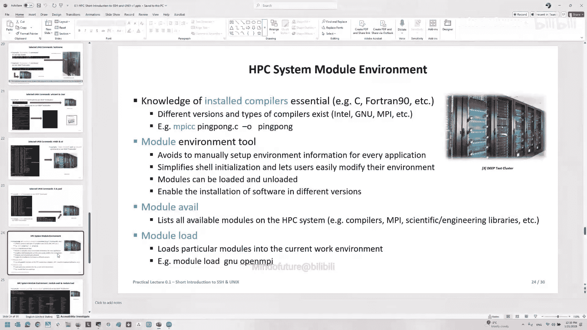

So hence for earlier I didn't provide all the slides。

 I think that's clear because in a way this is almost the same so it would be not adding too much insights to really do more on this。

 so in this sense we would say we have been now on earlier remember again we could test this with source and amino a that we're really there and I Morris is there。

And that's all what we want to do is earlier in the moment the basic on UniX you see that this is working on deep and on essentially the UI system。

 but my key message to take away at the end would be now thinking about all the supercomputers that your HPC joint undertaking is running if you maybe explore this a little bit if you have a bit of time you will see lots of different systems with different hardware very heterogeneous Lumi for instance doesn't have any GPU graphic cards right so that just maybe interesting for you to understand they are basically AMD instinct GPU cards so another vendor means another software stack there's no couda and so on this would mean way too long to demonstrate this all but this would have an effect on your mod environment however the way how to load the modules so to see which modules are available to spider them to get information out of it as well as SSH into that system。

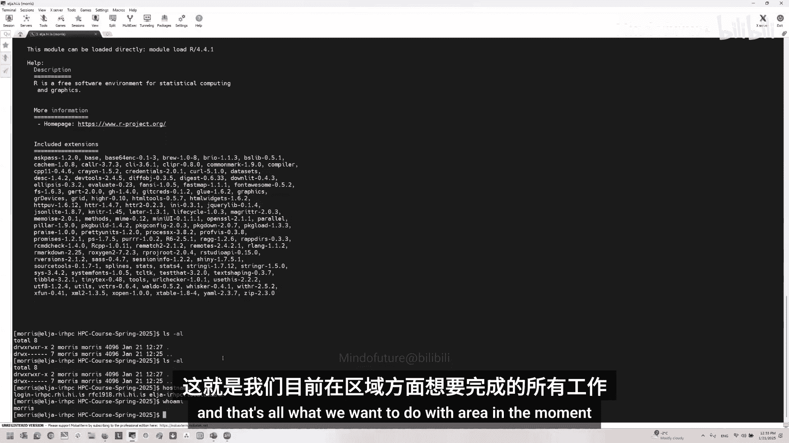

And using these， let's say UniX commands I was demonstrating today is similar in all of these systems right。

 of course the specific application libraries are different or the vendor libraries are different。

 but still and of course also the partitions what we will learn later in scheduling and so on。

 but this hopefully has shown you now some basic skill sets that when you would have， for instance。

 also access on these systems which you can apply to for getting computational time。

 you would be able to make your first baby steps on these systems in order to get not lost in the UniX environment。

So I hope it was useful for those that have not experienced UniX before in this sense let's turn back to the slides and that's all also I wanted to leave here on the table for you as part of this practical lecture and we will continue with lecture one really with a bigger overview a more detailed overview if you want on HPC in the next lecture so talk to you then。

