# 【冰岛大学】高性能计算课程-｜-2025-High-Performance-Computing-｜-Prof-Dr-Ing-Morris-Riedel-p29-P29_实践讲座_0.1_SSH__UNIX_简短介绍_第一部分--BV1k34zzaEK8_p29-

Welcome everyone for High performanceformance computing advanced scientific computing Today we have our practical lecture 0。

1 which is essentially a short introduction to SSH and then also a few Unix commands for those of you who have been not previously working with the secure shellll or with Uniix in the past。

 So in a way it's also a practical lecture that support your assignments and is not really a full introduction of course to SS agent and Uniix hence a short introduction。

So before we step， however， into this， let's say， short practical lecture。

 Let us review what we had the last time。And the last time was essentially the start of the course with a lecture zero warmup if you want with a prologue clearing lots of questions that you had around the course content around the course organization but also why this course is so interesting why basically high performanceform computing a field of really constant changes and technology changes most notably and why this is basically related to applications and we see that a little bit here in the idea of the HPC course again HPC itself is a very large topic so we cannot possibly include all topics but here and there we will have the essence which is essentially then here the red part of it and we will also cover some domainspecific science and engineering applications which are very relevant to the course and they also motivate the need for high performanceform computing and this will all come up all。

So in lecture one where we experience this a bit more than even the proloed it。

 but you see already if you want to simulate at scale a car crash here or the fluid and liquid and wind around cars。

 a domain called Comp fluid dynamics and even on a scale on airplane that's get very heavy computing intensive hence。

We need high performance computers where we basically leave the field for normal laptops and really enable us using very much。

 let's say， computing powers in parallel， many CPUs， and also many GPUs in parallel。

Hence you see here not only these examples you see also here the smoke in a tube as for example。

 how that propagates in time and also here the interaction when we now basically want to understand the groundwater modelling then you have the landfi surface interactions。

 the atmosphere as well and the subsurface， and all of that interacts to really understand then the groundwater modelling in a particular area that you have on earth or you basically have also other simulations like here wind and Iceland and so。

So of course this is more a physics domain in many cases but we see also more recently that these domainspecific science and engineering applications leverage artificial intelligence。

 hence this year we do as in the two last years basically computational fluid dynamics special in the course。

 not covering all of these different applications and also do a special more or less on AI because it gets momentum and we include more of these topics as you will see in the outline again。

 like hyperparmid optimization for instance， or distributed deep learning。

 hence there's some updates to the course that we had in the last year that's supposed we basically learn in lecture zero and then of course we discussed a bit more what you can expect in terms of the course content so we start really with a let's say introduction type performance computing then we quickly dive into two paradigms how you can parallel compute and you will see that would be the message pass。

Interface， you see that here a little bit where let's say different messages are you know doing inter processcess communication and we use a standard called MPI that significantly leverages the network between this different processes running all on different CPUs or even on a larger scale you see here is distributed memory on different nodes or different racks。

 So here we are able to scale up very much high to many high numbers of CPUs and GPUs that we will understand in the course。

 but we have also the power programming in terms of shared memory where we stay inside the node but still can leverage the same shared address space with different threats that you see a little bit here。

 So here we don't communicate with one threat explicitly we put something in memory to be read by another threat at some point in time。

 and the standard we will look at is the openmp。And hence we begin really withpower computing and then we dive in into deep learning networks。

 that's what we learned， distributed deep learning at scale would be some lectures before we then come to this computational fluid dynamics domain。

And may I。And some of the I detectors you will learn in the course is hardly basically driven by CPUs these days as rather GPs or graphical processing units。

 hence the course will also talk about why you high performanceform computing has this massive interconnect。

 which is very powerful low latency between the different nodes here that we also leverage with MPI。

 then across the nodes while shared memories rather within the node and you can even combine that making hybrid computing and then also understanding a little bit the difference through cloud system and rather high throughput computing oriented systems。

Finally， to also motivate basically the time today。

 we will learn that the access to the supercomputers in many cases is given with the SSH protocol and we will talk about this of course in the first part of the lecture today。

 but we also have learned a little bit that all of these you know supercomputers and large clusters not only of the UHBCJU also many others and the national level have still you know UniX under the hood might be a special derivative of UniX but they all can be accessed via SSH and then you can work your way through it with Uniix and hence it motivates a bit the lecture that we have today it's more or less an additional lecture with practical content to help you with a little bit。

To get up to speed with Uni and SSH for those that have not been， let's say using that before。

 hence we will use this protocol this SSH with you know different HPC systems。

 we will connect to them the examples I brought to you as a deep system in Germany from the U supercomputing center that you will use in the assignment as well as the earlier HPC system we have here in Iceland。

 a smaller system and also there we have the U2 basically partition where we can use jobs and this is not all to you obvious we will see how that you know materialize when we come to the content of the lecture in order to access this in a secure manner we will talk about the secure shell and a certain key pair。

 public private key pairs as it basically is called and then of course as practical demo I will not only show you here a couple of HPC system or website so that you can relate to it better also the sheer size is very important for you to understand here。

Atlea the realm of one GPU like you would have maybe in your laptop basically here we talk about partly thousands of GPUs with unwanted one system making it the HPC system and then I will basically here and there will give you some demonstrations of the lock into using different systems this Mo bakes term but also essentially put if you want you can use that as well。

The second part of the course today we're going to use Uniix a little bit on these HPpC systems just to have some key commands understanding again that you're in the remote HPC system how you can understand is commands like host name etc that you really are remote and then of course some practical UniX commands。

 something like creating a directory for the course if you're there for your assignmentsignments and some demonstrations how you basically understand the username and and different aspects really of UniX Another important factor today will be the module environment for software so that's also something which is actually available in many of the HPC systems today we have the basic editor of the eye and different demonstrations I will do also there。

 how you can create you know text files and so on and so on just to final a remark for those you know from the YouTube community maybe landing on this think about that this is part of lecture series and this is in no way a complete。

Introduction to Uniix nor it is a complete introduction to H。

 This is just a little bit of practical support again for getting let's say the people in the course to make them understand and you know。

 prepare them a little bit for the assignments。 So let's get started with you know SSH to connect to this HpC systems So coming back to the learning outcomes。

 This is really the idea of using high performance clusters here today。

 So we will have already as a you know really second lecture。

 very practical one where we use real HC systems that's important in the course。

But it also means and this is an important fact as well that you more and more understand that the HPC system is not pure hardware lying there with lots of GPUs。

 CPUUs， network interconnects， memory， there's also lots of HPC environmental tools。

There will be things like scheduling down the road in another practical lecture。

 there are elements today that we will have is the SH access， for instance。

 which is a very practical HC environment， as well as essentially also the module environment。

 are really interesting lecture which has relevance for almost all HP systems worldwide。

 It's also important for you to understand there rarely any HPC system that you cannot access this SSH。

Hence we put that today to use in order to look at the so-called deep system just to understand the deep system a little bit。

 this comes out of a couple of projects and here I would like to give you a small view on essentially this website that you see here now please feel free to also move through this website。

 this were a couple of projects and the deep sea projects was really just the last of the series you see here the deep deep deepest and deep sea projects essentially for European funded projects that were exploring the excess scale as we call it10 to the power of 18 floating point operations per second idea of how to create a supercomputer so essentially you will see these novel HPC systems are also research in our context we were part of deepest for instance with the University of Iceland so we were really exploring how we can leverage a so-called research vehicle called moduluular。

Supercomputer architecture， which actually nowadays is really in production at the Uli supercomputing center in Germany。

And where we also will use the deep system， hence the research have been creating initially some you know prototype systems。

 if you come to the Userv computinging center， the center I'm in it for 20 years you will see we have many different supercomputing systems and the deep systems really just the prototype system that was exploring the mod as supercomputing architecture that we had in the prologue just as a remember here。

 the idea is that different applications have different needs。

 So the cluster module has I seen threat performance， lots of CPUs。

 the extreme scale booster enables U GPUs to scale quite high and the dumb data analytics model has lots of memory for memory intensive applications of data analytics and then you can think about we had and the last time also potentially quantum computing as a quantum module。

 another type of accelerator maybe instead of just GPUs。

And this is a system you use and each of these different modules has different capabilities you see here now what makes it perhaps a little bit of HPC system。

 even if you would say high performance computing and having just 50 nodes and here 75 nodes of the booster module might be still a smaller system and as a name suggests the prototype。

 but still it captures the essence of HPC system you see here different capabilities and important part is the node consideration。

 of course we have 50 nodes here， but each of these nodes has you know certain number of CPUs。

Or certain type of CPUs and also different elements， which will be important for us down the road。

 Hence you see here， the cluster module， as I said， has powerful CPUus。12 year course， for instance。

 at 3。2 gigHz versus and the booster module。 if remember。

 much more GP oriented with 75 notes where each of them has a you know Nvidia Vol 100 cards So for those of you are a little bit more into graphic cards。

 you know， already that the V 100 is a bit outdated， we have unair 100。

 we have now even the new gray Hopper Iect of GPs。 And we will talk about this much more reviews will be one part of the lectures with accelerators。

 So of course you cannot understand the deep down details in the initial lectures。

 but you will see the different modules have different capabilities。

So hence we have their different partitions available over the De system。

 but before we really use it， we want to understand when this deep system is now in Yuli。

How can I access it in Iceland from the University of Iceland right or basically worldwide hence there needs to be a way how you can actually access a system and for us we have already explored I think the lectures here and there of course in the practical lecture shows you what I also show you in practice so they repeat itself sometimes so I think this is what we covered already on the website so I go immediately then also to the next system and I will you know show you how you can look into it。

Then the next system is really the earlier cluster。 So here we are now within Iceland。

 but of course you would say， well， I'm sitting somewhere in Iceland， not necessarily in Rekjavi。

 I can remotely access this that must be a way to do this。

 And if you go to the website here you see there's also the SSH that we usually use with you name a username at area do how this and then you need a specific SSH key。

So that's what they tell you and that's the same actually for the deep system in yourly the SSH keys are much more safer than using passports and of course I urge you to look a little bit here on the Hyismisms。

 it also shows you essentially how to create you SSH keys connection with SSH keys and so on it's important to see how you create keys because it would be part of one of your first assignments in order to create a key and we have to talk about the keys in the lecture today a little bit more to understand this public private key pair。

But here you have now two systems really in the course that we're going to leverage also to make the understanding that not all HPC systems are equal。

What makes early and HPC system is admittedably not maybe the number of many， many GPUs。

 which you see just a couple of nodes have here really GPU cards， but they have already。

 for instance， the a 100， so it's the next generation already the MPI architecture of NVdia is 10 the course。

And a couple of notes， of course， these are not as strong and as many as we have in the deep system。

 still they are couple of notess and much more powerful than a laptop。

You have also certain consideration of this idea of having standard compute nodes。

 where you would say， okay， these are ones for CPUs and you have 28 nodes here where each of them has。

 of course also this， you know， 24 cohorts and so on。Hence， different types， even。

You see different elements of architectures， even AMD CPUs， you know， there's intermanufs。

 AMD and manufacturers today。 and a certain， let's say typical specification is Also the idea of having log in nodes。

 right So you will see that these are compute notes and these are log in node。

 It's also something we will discuss much more during the course and that you then also can basically explore when you do the practicals。

 So in one respect also this will alluding to necessary other lectures called scheduling where you then learn that you are actually located on a login node。

 but you send a job to a socalled compute node， right， Let it be the GPU notes。

 All the compute notes that's something， of course。

 that you steer with so-called partitions that you see a little bit here。

 Also partition Mimeemia or partition mimi IM in your case will be also partition YouTube。With this。

 of course we are very much remote， we are very much just seeing software。

 but there's an idea in the course that we will also visit earlier to touchuch metalals。

 so we will really go essentially to our system and see a little bit that there's a rec and that you know how that looks like some of you have already visited my cloud computing course so you know when you have been visiting the Borealis data center here essentially in Reykjavik so this is something what we also can do later in the course。

 so we maybe revisit for those of you here in the HPC course which are new this is really a larger data center then that we will also explore a little bit when we talk about green energy and later about data center eyes hence the ideas also really received term touch metal that you see that in real practice。

 at least once to understand that behind all of that that you see a nice software is of course also real hardware。

Coming now to the secure shell again。So all these different ideas of using SSH can be done with many different SSH clients。

 so here don't be mistaken， especially if you're a Mac user you don't necessarily need putty you don't necessarily need mobile Xterm which I would recommend at least for the Windows user rather than putty it's a bit more comfortable can save certain elements so I would recommend you to use a mobile Xterm it's also free available and that's yourI but these clients of course can be on the command line as well。

 so as we have seen in the description of the you know earlier system here this is also something of course how you can access on the command line but with mobile Xterm and these kind of gois you have of course also a little bit。

A much more nicer interface in the end， they will still give you access to a sort of command line we will explore this in the moment。

Also important is the different elements that you need for it and this will give us now this interesting view so I told you we have to create a key pair and when you do this you put them in so-called you know key store which is protected from a password usually so in order to unlock the private key that is somewhere in this key store you have to have a password and when you create this public private key pair there's a certain element at Moi which is of utmost importance to understand hence I will be slowly here so that you can follow me so there's a host which could be a laptop could be any desktop where you have your private and public key pair you have generated this and that's okay So the point is to go to the HPC system。

You need to upload usually a so-called public key and as the name suggests the public key you can share right it's public there's no problem you know showing this to someone else because only those and that's important only those that have the corresponding private key that's why they call it public private key pair can really then use this private key pair during a connection request so you upload the public key in the beginning。

 you have a certain name for it that's not so important。

 of course a key that you have in your file should match。

What you upload it from the private key perspective and anytime you want to establish a connection then to the system。

 you know， basically when you do an instance as a record of a connection or you want to have an instance accessed。

 then you basically present the corresponding private key that should never leave your laptop or your computer to the system。

 and then you basically are granted access。And in order to do so。

 you need firstly also the information essentially where to put the public key。

 sometimes you have to upload it like we do it at Uli who is a so-called EUU Do system where public keys are already uploaded to certain projects。

 you will do the same when we do the practicals whether sometimes it's also enough to talk essentially to to the administrators。

 we will collect your public keys also for the system administrators， one by one pair group。

 that's why it's also good that you create this groups very soon。

 and then of course the first part of the assignment will be all of that the private public key generation and so on。

The second ingredient is not then that the key is uploaded。

 obviously we need a username and that's something what the administrators will give you or they actually already now in the process of doing this we gave already the course list so we will have very soon you're basically given you the information about your account。

 a user accounts for me that is here for instance， Morris on this EliEA system that you see here。

 hence we need also the host UI or the host you know host name really of the system EliA。

 how EPoUC is。Now in order to use a private key in this key pay。

 you also have to do a specific private key pair you know。

 location that you should have somewhere on your system。

And the same is actually true then when you do the test clusterster for HPC login example that we have in the deep test cluster there。

 as the name suggests we have a complete different UI。

 obviously the system name or host name is different and we will demonstrate that in a moment and also my username is different however。

 and now that's the important part。Even if it's the same key。

 I use it for the public basically uploaded already to youly。

The same concept also applied with a private key， I basically have to you know switch the system completely here from Iceland to Germany and the whole concept of SSH stays the same all whats of course is changing is my username and the corresponding host name。

Hence。😊，It's time also to think about to do this a little bit in practice as I said。

 of course this will be related to your assignments so you will have to do this partly as well and we want to test this now parts of this is now of course also here in the different slide so don't worry when you when this is a little bit fast and we can do first of course the idea to go to the deep system so hence we use in a new session here and Moex and we can say that the remote mode host would be deep。

 F set rhs un D。And then my username is real one this particular one。

 and I will have to use my secret key。That I have here basically in my file system in this key store and then I will just say okay and now we'll try to log in on the other side youre usually what comes and this I also document here on the slides for you the first time you will do this usually your password would be you know required to unlock the key in this key store to get access to the private key in order to establish a connection here I was just testing this and hence it's not needed and you see here now something we call the welcome screen for all the deep test cluster where certain high messages are usually there that also shows you you know some important system messages。

 some information related where you can find more information about deep and so on and so on so this is something where you know you have different information could be also here and there。

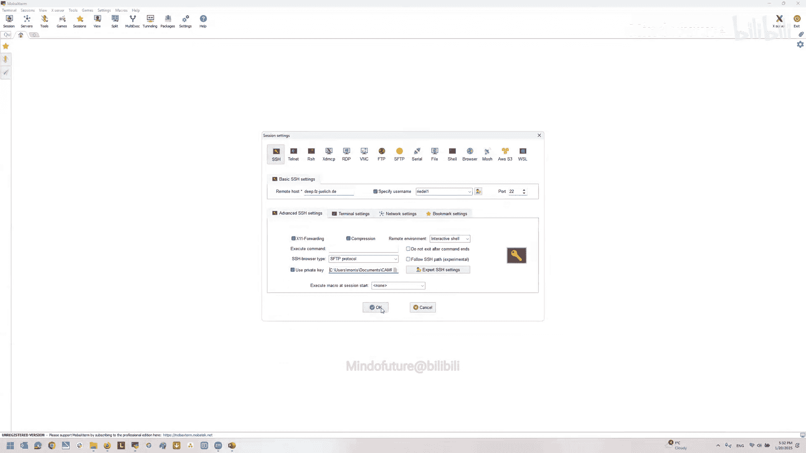

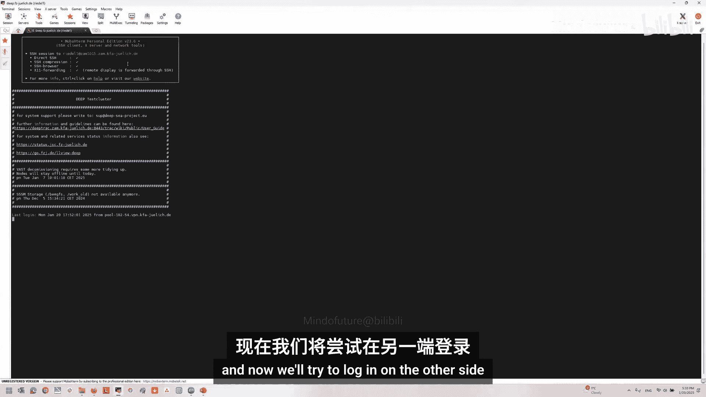

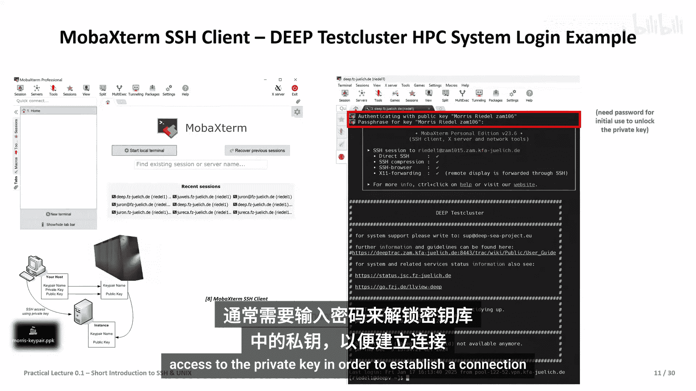

Support requests or let's say there's some problem business a system you get immediately knowledge basically out of this welcome screen if you can connect at all and other information like for instance。

 Windows for support and maintenance and so forth。So hence。

That is something which now is quite interesting for us so I make a big default set bigger we are now really locked in into the deep cluster and I will show you in the second part also how we can test this one command you should learn is also then essentially here the exit or if you want we can also do quickly in LS minusosL which shows you all the files that will come to this more in the second part of the course that you see already the old HC you know kind of course folders and so on and many other files which are related to work on this particular cluster but more about this we will learn essentially then in the other lecture maybe we can still have this host name Minos F for instance there's also host name the different ways how you can find out that you really now essentially in。

The remote system you see here， the deep system that is basically now in Germany at the Yushaba Computing Center。

And there will be different modules environments we will come all to this in the second part of the course Now important is to again understand how that worked so we come back to our beautiful Moics slide here these are really the key ingredients that you have seen how it worked so you need to understand the host name the remote host name right that is available here we have to talk to administrators first to get the certain account there's also essentially you just don't go to a system without never talked to the responsibilities you the responsibility people at the centers at the HC system administrators you will ask or you will basically have support mailing list somehow clarifying you and there are very different ways but essentially getting a username is also very important and with these two you already can then also go to these systems and use even commandline interfaces if you。

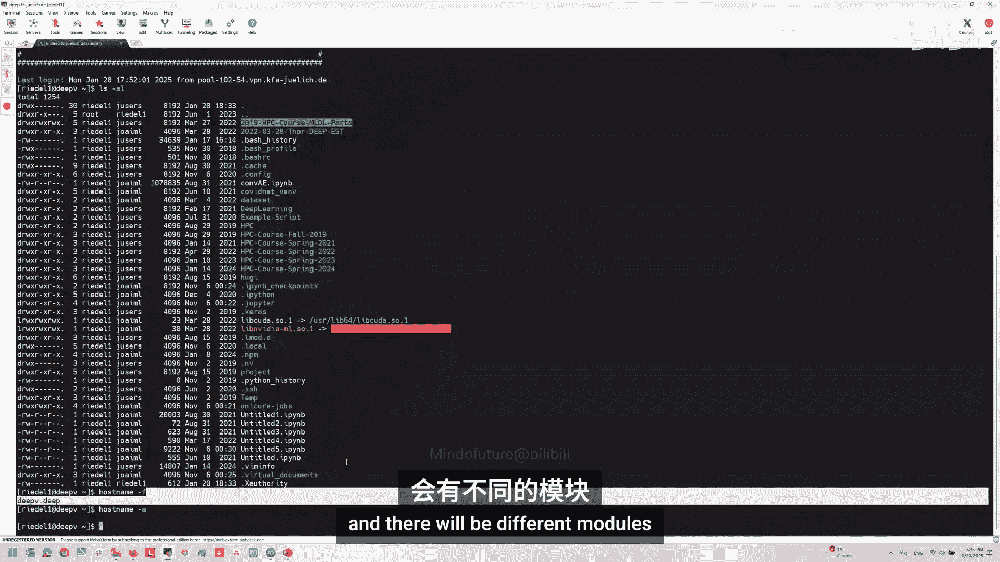

You don't have to use a queryI that I presented today here you can also use SSH with a username at。

 for instance， a read one at deep。tfet municipality， however。

 for this would be still very important this private key。Right location at least so of course。

 this is important as you understand what we just did was really nothing else And going to this deep testla that is exactly what you see here on the bottom I used essentially public key pair and you see that on this slide the public key pair I can show this here freely because the public key is for the public as the name suggests is not a problem but never share your private key right that needss never my laptop。

So you will never see it and I have the only one that actually has this matching key and then with this can configure that the way essentially has here for the SSH keys and you know manage them。

And can upload this SSH key or administrators will do for it do it for us as we have also seen and earlier basically there you will have this in the course that of course this will be something the the the administrators will do hence in this sense there would be something。

That。We can you know also see that this is very different from all the different systems hence when you go now。

 let's say to the EurohC joint undertaking right and if we have discussed this a little bit in the prologue already。

 we come back to this again again through the courserus， you see here different system。

 Lommi located in Finland， for instance， Ya the Leonardo supercomputer located in Chneica which is actually within Italy。

 Marronosstrum 5 in Spain。And they are all very large supercomputers， different technologies。

 Melloene and Luxembourg， Carolinaina， they all offer USH access normally and for all of them you first need user names you need basically access and on top of that you usually need computational time grants。

 so it's not that these systems are always free and everybody can access them。

 they so-called access policies where you can have then access to these systems but you are reviewed so these systems are peerreviewed systems where essentially others have to review if what you want to do on these systems is let's say sound in terms of science in terms of engineering so that you not wasting。

 let's say computational resources and you can go on and go on through these are the systems small and bigger we await also the approach of Upiter this year that would be an exciting time。

 maybe even within you know our course period that would be the first access scale system。In Yuli。

 also in Europe， and in this sense， very exciting moment， perhaps also for you。Today。

 well because this X scale was， let's say， an aim of very many projects， hence a deep projects。

 if you remember， and now we see that coming up in Upiter and it would be also very modular systems so the modular supercomputing architecture will be also part of it。

Now we have done this have done the deep system example now I think it's time to look a little bit on Ellia what is changing now right and with El no surprise we need a new host name here the system address and then a new username which is just Morris and also of course SSH key and I had already my public key given to the administrator so they uploaded it gratefully I can now access and El and the important thing to take away is really it will be the same way how I do it hence time to leave deep you see that here you can do this nicely with exit so the session stopped and with this a whole mobile X let's say command line has stopped because we don't have any more remote access of course we can reopen the SSH channel if you want again and again if you have a different let's say password if there's a problem is a wrong key don't do it too many times because。

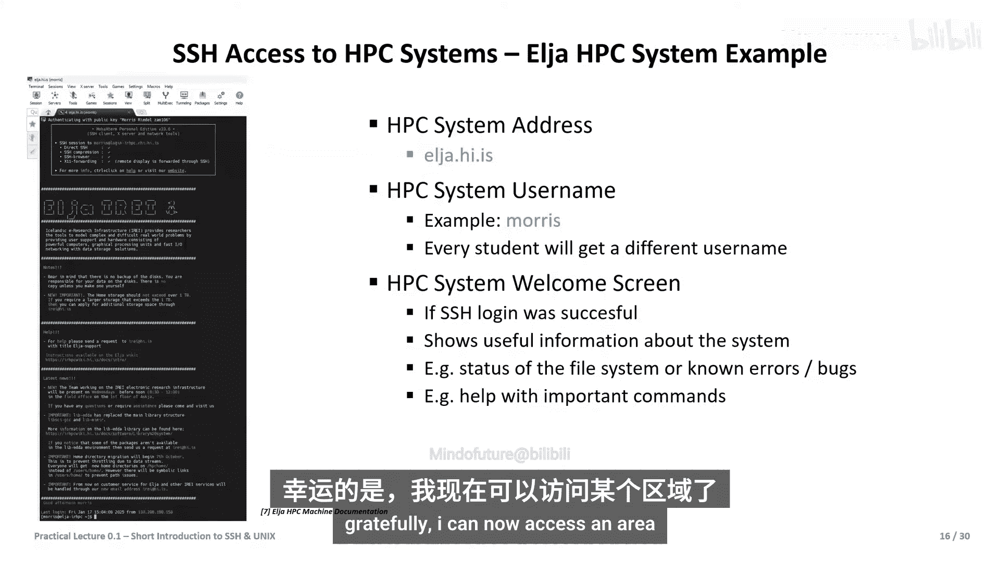

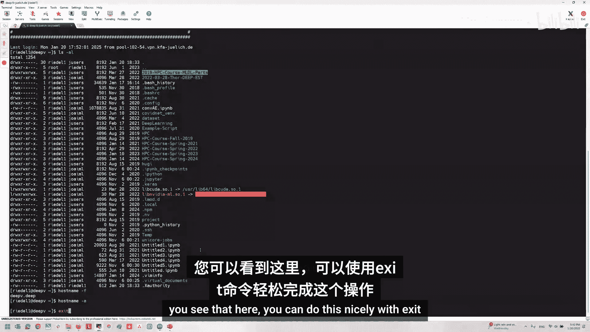

After three times， it could be also that your， let's say userA will be blocked and then you have to again go to the administrators and check that they can unlock you。

Perhaps also now let's look at the session here， we do this SSH session as we have done before。

 so the difference now to understand again is that there will be a different host name we say earlier at howE。

On is which is essentially here in Iceland and I have also another username I'm not read one anymore here on this system。

 my name is Morris。And however， I use basically the key。

 you know that we have preconfigured here and basically want to have the same excess that we had before Obviously you can do many different let's say settings here or the expert if you load X11 forwarding here's another one which gives you an also graphical use interface basically with the X11 protocol。

 so this is something where this is much more advanced。

 you don't need to understand that within our course and now when we press on this it will take a little bit longer。

 the system is a little bit slower here。

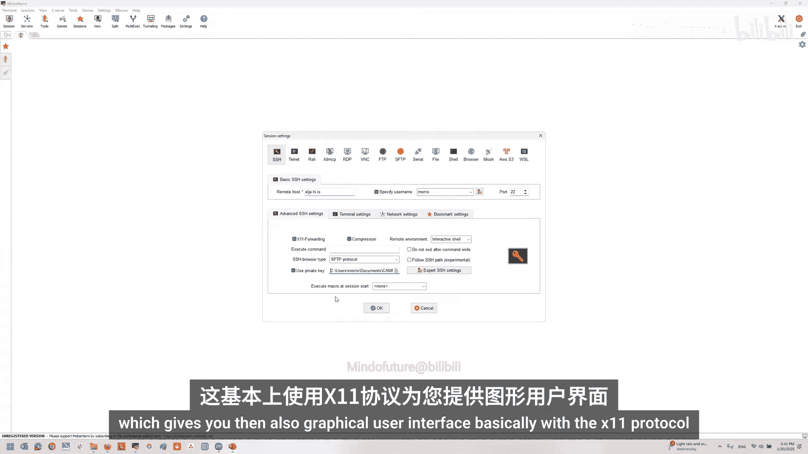

But then you will see that we basically also get access with the same idea of the SSH access here。

 and that is， you know， the idea is also what you then will explore within one of your assignments。

The assignments will be then using of course， more。

 not only the SSH and your username and so on we will explore in future lectures down the road really scheduling so how we use learn for instance in order to access systems down the road is also the UpiTter interface to HPC a more graphical way to access it but all this really then the idea of understanding that you are in a remote execution right you see earlier is the HPC system of Iceland part of the so-called Icelandic Ere infrastructure E and you see the same principle again that when you do it for the first time you need to unlock the private key with your password。

Right here I already had done this before then sorry basically it's a little bit here in the system。

 then what you have also is that there's this kind of news， notes。

 information about the system where you can find wiki information and so on and also important information from the administrators to you and so on and so on。

嗯。This is in a way already all that I wanted to leave you on the table for this let's say more practical lecture today。

 the practical lectures would be all a little bit like this so you see there's no YouTube lecture。

 something I have demonstrated here lots of practical insights I would still encourage you to look at these websites that I was referenced the U HPBC joint undertaking that you had here with all the different systems then you have a little bit the earlier description here really on this particular wiki page that is also within the bibliography in the lecture and then of course looking at our deep system that we're going to use down the road understanding a bit the different configurations here of the different modules would be important and of course understanding a bit that the modular supercommdia detection Ex scale really took some research to really come to that level of scaling to this large sizes that we have today also of course given。

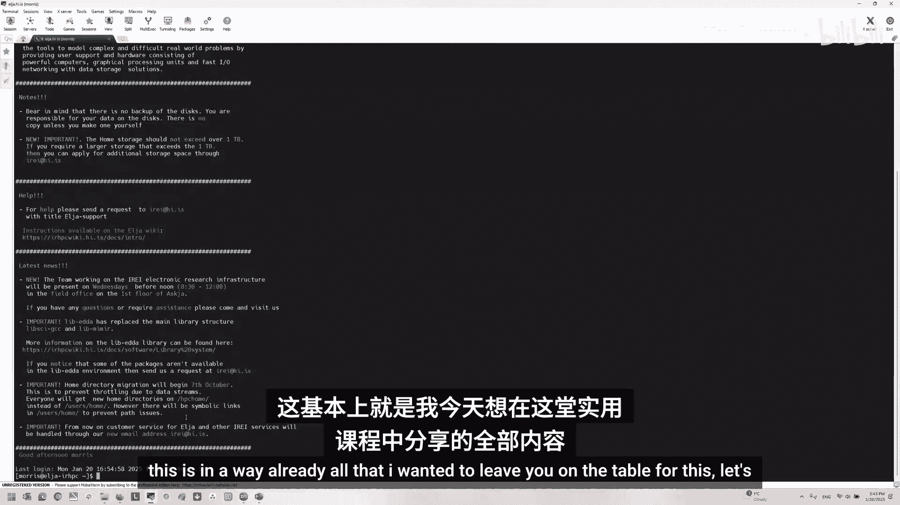

The new and constantly evolving architectures of GPs， of different CPUs and so on。

So very exciting journey and we will basically now go back to the screen well understand that we can。

 of course you also see his host name os。

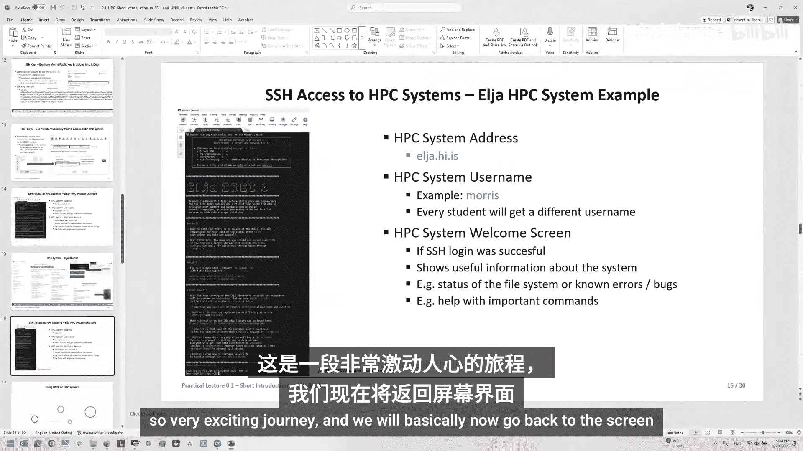

For instance， that we are on earlier EHPC now that is then also giving you here the information that you on a log in node from this and all of this difference between batch processing login node versus computing notes where we don the road in a lecture called scheduling which are also practically basically demonstrate you though that you get a better feeling about this and that you can also better than you know use said in your assignment so here we exit now for the time being and we will be in 10 minutes you know coming back to these systems and understand really a little bit of Uni with some core let's say yeah commands so talk to you then。

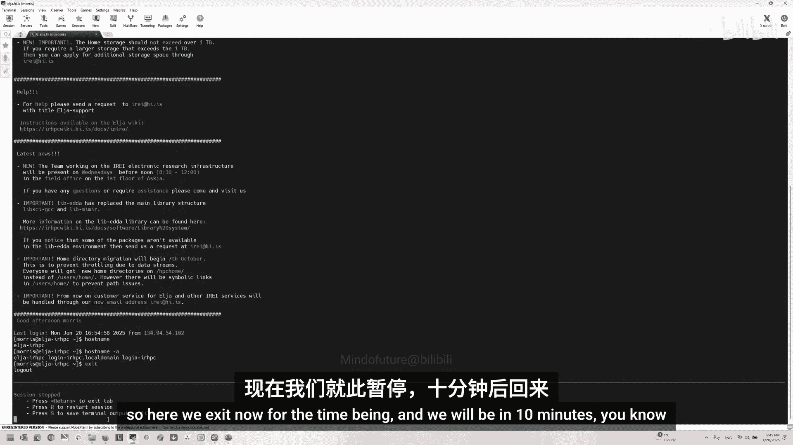

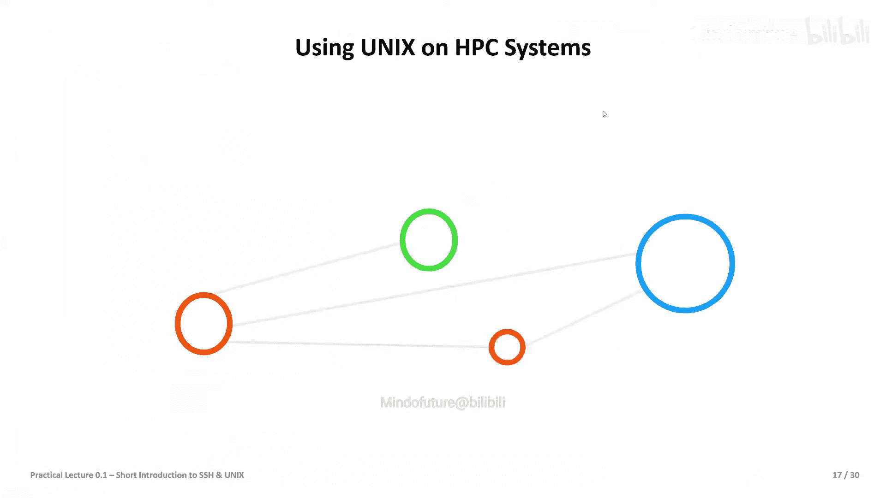