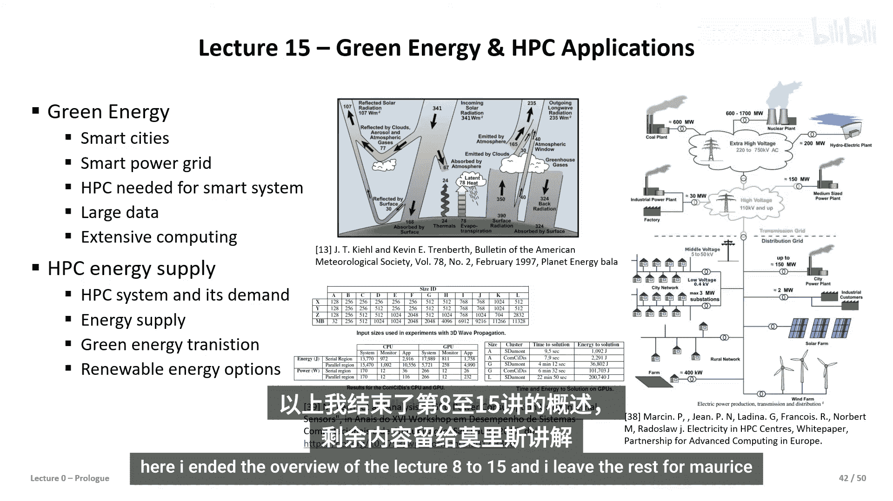
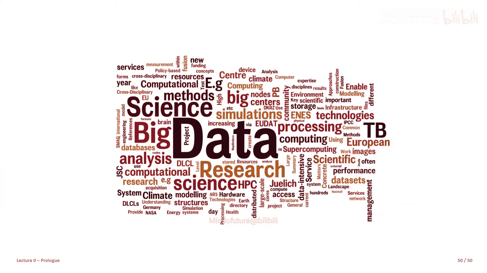

# 【冰岛大学】高性能计算课程-｜-2025-High-Performance-Computing-｜-Prof-Dr-Ing-Morris-Riedel-p30-P30_讲座_0_序言_第二部分--BV1k34zzaEK8_p30-

So welcome back to High performance computing， advanced scientific computing。

 our lecture Ze prologues the second part。And this is first part we basically have an idea of HPC already convey to you。

 of course there will be more lectures having much more information about it。

 but you should have first glimpses on how basically the high performance computes will be。

 what topics are related to it， we have seen eyeH textures of different CPUs with GPUs。

 we have seen distributed memory and shared memory roughly。

 but of course all of that will come to your mind。In the subsequent lectures。

 but then there's also the idea of applications we talked a little bit about physical sciences to CF ifD special that we will have to this year in the course for you also thinking about more numerical numerical methods and you know based on physical laws where HPC has lots of applications with but more recently we also changed the course and topics again and again based on requirements we get from students based on students feedback but also on the YouTube community and also industry that looks our lectures。

 so we integrated some more aspects of AI because basically HPC systems are also more and more used with AI and we clarified a little bit that AI means basically deep learning and there will be also lectures on distributed deep learning leveraging multiple nodes and with this also multiple GPUs hence of course blends in。

Let's say lots of different ideas we cannot cover the whole HPC domain I also was alluding to the U HPC master in HPC if you interest to learn much more that is existing today so one course cannot possibly cover everything from HPC but we try to make it as interesting as possible to learn about the different facets starting from parallel programming with MPI and openmp and distributed memory and shared memory up to GPU programming using AI and then you know tuning AI models even with hyperpymit optimization and out L techniques as a special this year we have also razor Co teacher that will also be part of the second part now of the prologue discussing with you a little bit more detailed course outline so we talked a little bit in the outline at the beginning of the prologue part one but now also we want to have some substance behind it so what you can expect from these let's say different lecture types so before I。

however， let me tell you that this course has been grown since quite a while now。

 so you see it dates back here to 2017，2019 in the you know in the in the versions that we have roughly today。

 but we always basically we're updating several lectures。

 we changing the course depending on let's say more frequent aspect like we have now with distributedbutive learning or hyperpermit optimization Autoal techniques。

 you see also in previous part like 2017， we have much more applicationster restial systems systems biology and so forth。

 so I encourage you also to look at the old resources。

 if you want to learn more about hyper performance computing and。

In order to get a better understanding now what all the different lectures entail when you enroll in the course。

 I would like to go now lecture by lecture， and I will do this from lecture 1 to lecture 7 beer in mind that there will be practical lectures also alongside those。

 So we put here the emphasis on the conceptual lecture parts in a sense。

 But as you understand from the green that we had in the beginning。

 when we talked about the structure， there will be practical lectures alongside each you know in in this initial parts and also in raise us part。

 So lecture 1 high performance computing as a name suggests is rather than introduction lecture。

 So what actually means high performance， you must have many questions。

 So what are the basic building blocks that you can see in HPC， What is the top 500。

 What makes really a supercomputer in HPC machine， Why is parallel computing。

 let it be shared memory or distributed memory or even GPUus。With high throughput ideas today。

 what is the idea of parallelization and so on will be a little bit closer before we then go later on to the parallelization techniques with MPI doing this on distributed memory that you see here essentially where you need explicit message passing or you have shared memory as open MP having the opportunity really to address the same shared memory space so memory is another part of HPC architectureit which is important。

Not only CPUs， GPs and the strengths of the CPU is important。

 so all of that count in like the interconnect as well， especially if I sent， let's say many。

 many of these messages in physical applications like weather prediction。

 you can imagine that the interconnect also matters Hence we talk about HPCI architectures driven by coredesign needs of applications of parallel applications in physical sciences。

 but also integrate a little bit of AI， as I was alluding to at the beginning。

 these are also having here and they similar structures。Also reusing MPI。

 what we will see how that materialize in lecture seven。Now。

 the HPC ecosystem is equally important because the ecosystem as such is the way how to use one HPC system or many。

Right， so there's a software environment， meaning there's S H access， There's schedulers。

 There's a Uni derivative， usually as operating system。 So all of that is not like what you know。

 maybe just from Java。 and there will be somewhere a kind of。You know。

 kindin of visual system allowing the programming of it。 So here we talk about low level access。

 S H access。 And also here and there， we make the case and of C programs during the first couple of course parts also to get you closer。

To MPI and OpenM programming， but we as I said earlier also we will keep this programming of a moderate degree and then on the let's say more broader。

 let's say view of the course we would also of course go to a little bit of the U HPC joint undertaking what is the ecosystem at the larger scale。

 what are the supercomputers that are in high performance computing within Europe and that can give you resources once you are in a company on another research lab so this is also important to target Finally just a couple of point really to the quantum computing systems that are emergingrg under the umbrella of high performance computing as well a new form of computing but that is also considered to be one of the sort of special accelerators we have in computing today。

 Hence it makes sense to integrate them HPC systems。So lecture2。Will be much more practical。

We will be you know doing things which you also will do in your first assignment programming in parallel this will be still。

 let's say smaller projects， smaller idea so you will not have the big bold sea programming to do。

 but rather understanding distributed memory why is message passing so important because it cannot address the address space of another processor it's really distributed as a name suggests so there will be different standards we will look at and one of the most important will be the MPI。

 the message passing interface concept and also there there's not only a send and receive pattern that this graphic here suggests between the different processor they also collective that you see here a broadcast from one processor to all the others' sharing data across the HPC machine。

So then King we will start there and also with some parallel programming practicals in diving into two parallel programming with C。

Using MPI the libraries modules available on this HPC system will be important to understand so which compilers are there。

 then a little bit of thinking and powers also something which we will tackle So what are the basic building blocks of an MPI program。

 what is the MPI runtime and why we can basically program these days MPI applications。

 not knowing how many CPUs we really get。 So there's some bad coding examples versus's good coding examples。

Then。😊，After having started with a practical so that you can soon start your assignments。

 we will have a deeper look into parallelization for thes and this topic is loaded。

 understanding load imbalance understanding the idea of what you see here。

 for instance as a max of an array to do this in parallels so how we ch down basically a big problem into little pieces there's also different communicator techniques in MPI like the cattasian communicator that is quite useful in order to enable this domain decomposition。

 different ranks， different ideas how to use this cattasian communicator and we will talk about this when we talk about parallel applications。

 there's also some let's say。Important strategies for parallelization that you should know。

Not only is the reasons why you should do it also limits like Moore's law。

 and then also perhaps later Amal's law that brings us really into theory and some terms。

So the idea there is to understand a bit load and balance speed up why basically the scalability of a program is always limited in the serial parts。

 there will be some scalability metrics and performance。

 but in the end still the theory will be not so intensive。

 so don't worry about this it's much more to understand a little bit about the parallelization aspects here in the course。

Then coming back to the practicals， one part of the assignment will be openmp。

And here we go to shared memory programming so that means that instead of processes we have different threads that can all address the same shared memory space so there let's say scalability sort of limited you have to have shared memory hence we will also look a little bit on how to program in hybrid and parallel meaning combining shared memory with distributed memory。

 we don't do that too much in the course given new topics like deep learning and hyperparit optimization and so on。

 but this is of course the way how then how you really go big， but with openmp。

 the focus first would be on so-called Sinel with prapma statements that you see here to do something in parallel just by essentially marking parallel regions and this is an interesting different concept than we have seen before with MPI doing explicit message exchanges between the different processes because here everybody has access to the same。

Variables in the shared memory。So by doing this。They're sort of different。

 let's say building blocks also for openmp and shared memory programming。

 we should talk about why it is so easy in a way to do parallelization on loops still to have a look on local and shared variables。

 why it is important to have sometimes critical regions so that not we have a lost update or of a variable or that you know there are race conditions we have to think about synchronization as such。

 and of course we always will differentiate it with MPI which is another。

 let's say parallel programming paradigm。Alongside will be always applications that is basically true for almost all lectures here。

 bringing us also to lecture five。So lecture5 is on accelerators and graphical processing units and this is something that when I would be sending it class would you know ask you to raise your hand who knows about GPUs and the most will answer yes。

 I know them from gaming I have them somewhere in some desktop machine doing beautiful graphics for my games but here we talk about a special breed of GPUs called GP GPUs which are much more for general purpose processing right so the concept of GPUs is very good enables quite nice scalability and we will talk about why this is so interesting you see the color coding here how you can actually chop down big matrixx vector multiplications or matrixx matrix multiplications according into mathematical rules quite nicely on GPUs and that makes really big difference if you now think about deep learning I will talk about later。

So with this， we also think about different architectures。

 what is the difference between a so-called manyco that we have in GPUs to multicore。

 so essentially saying there's a moderate powerful processor， but very thousands of them compared to。

 let's say processes with single performance or high single rep performance that we have in multicore。

 so there are differences， although they're all CPUUs and GPUs at some point in time。

 and then we have of course different architectures。

 Keplla Pascalvoltaumpair now we have even Grace Hopers inV。

 but we not only look at NV there will be also GPUs from other vendors。

 which is important in this particular lecture。Of course。

 some GPU applications will stimulate already on the uptake in the scientific community on simulation sciences libraries。

 but also more dominant in the machine and deep learning。 Hence。

 what's next introduction to deep learning。 And this by far is not。What the name suggests。

 so this is rather really one lecture in the HPC course giving you all the foundations of artificial neural networks very quickly。

Giving you an idea what deep learning is and mostly why it is so computational complex。

 And there we talk about lots of matrix matrix multiplications， matrix vector multiplications。

 depending on your architecture， we will talk about this and how this alludes to many parameters to learn and the more bigger and bolder the deep learning architecture。

 the more HPC is required。Hence we talk about some of these models like convolutionary network。

 long short term memory for time series that for images。

 and we will also talk about the HPC advantage a little bit of training this deep learning models essentially from from the basics。

 but then lecture 7 really goes into much more detail on why HPC is then really。

 really important and do you see that a little bit here when you think about。

These different HPC system jules to reka that are existing and how basically by adding more and more notess we can have really a speed up this distributed deep learning enormously when using cutting edge let's say neural network or more notably deep learning architecture to see a residual network used in one of our papers by using really high performance distributed learning techniques now。

The devil is in the detail， you can do this with different concepts。

 so often the concept of data parallelism is used， you see that a little bit here there's a data and the training is done on the same model actually on different notes and then there's a message exchange at some point in time you know having the learning。

 the gradients， we will talk about this lecture six and lecture 7， what gradients mean。

 which is essentially the learning taking place， then distributed in this with all the other。

 let's say training processes to improve the model。So over time。

 you can come then to this kind of idea of speeding up the training while still keeping the accuracy。

 which is also of course very important for us or a low error rate。

Now other model ideas is pipeing model parallelism， we will talk about this briefly as well。

 as well as covering different tools in lecture 7 which are tensorflow Pytorch or robot robot which are commonly used for it we do lots of research in remote sensing using this parallel and scalable deep learning hence there will be some applications around this that really leverage this multi node training on HPC system like you see here in order to get a significant speedup of the whole training time usually the inference once you're trained and you have the model and then using it for a particular classification task is very quick so we talk about this and inference node training necessary anymore the model is already trained then GPUs are still good but not so necessary as training and we will talk about this also in this particular lecture。

Nothing now I would like to leave the table for Razor to contribute and start with lecture8。Hello。

 everyone。 thank you， movies。I'm Rea， currently I'm a post sectoror researcher at the University of Iceland working with movies research group。

 my interest area， it's a competition flight dynamic and my focus on the turbulent flow。

I am using the machine learning and deep learning and HPC and the CFD to understand complexity of the turbulent flow。

 which is an unsolved problem in the physics。I will take over the second part of this course from lecturec 8。

And it's my pleasure to be in this course this year also。

So let's go back to the lectures and we can have overview on them in lecture 8。

 we will have introduction on the Comp of F dynamics is called CFD。In the fluid dynamic area。

The most of the problems in the real world does don't have。The analytical solution。

 So we are using the numerical approaches。From the computational of the CFD。

And dealing with this type of the problems。From the other side， CFD for the most real problem， it's。

requiredquired high competition。 Most of the problem are。

Yeah required to I have access to supercomputers。 So that's why the H PCC is's the。

key player in the CFD application in the industry。The CD is about the area。 However in this lecture。

 we will have a short background and well talk about the range of the application about the na stocks equation。

 which is one of the fundamental concept in the fluid dynamics。

 We will talk about the different schemes it's used in the。Flight dynamic。

Also we will talk about the classification of flu in the fluid dynamic we have two main regime of the flow。

 laminina and turbt and most of the flu are turbent。

 as I mentioned in the beginning the tut flow is an unsolved problem in the physics and thats why the CFD could help us to understand this complex phenomenon。

We will talk about the solution methods in the CFD when we're creating the algebraic equation and how we can solve them。

 also we will talk about the machine， how we make the composition of the domain of the problem and how we are using this approach in different software this。

We will have some tips about the boundary condition and its effect on the。CFD problems。

 then we will have overview on the three main categories of the CFD used in the turbulent flow Reinos arigiin of various stocks around large E simulation areas and direct numerical simulation。

 DNS。 we will talk about the accuracy of this method about the limits。

And how we can use them for different type of the problems。

And we we will have some example to make comparison of the accuracy of these different categories。

Then we will move on to lecture 9。Which is present the parallel computing for the CFD since in the lecture 8。

 we will talk about we will talk about。The CD and how it' required computation。

 Then in the lecture 9， we will show how the parallel computing could work for the CD domain since we have。

A domain of the。CfD， we need to make a decomposition and then we need to use a different topology to solve this kind of the problem we will talk about them we will have an introduction about the vector computer superscale computers and how programming working。

Also mentioned the explicit and implicit methods in the CFD。And why for the MP seat， for example。

We can work with the power computing to present the accurate solution for us。

 then we will present some example of the structured explicit on structure explicit。

And the iterative schemes for public computing。And as you can see in this slide。

 we are presenting the structure chart on the structure chart meshes。

 which is depend on the type of the problem and accuracy which is needed。In lecture 10。

 we will have a example of the open form software。 Open form is open source software。

And it's used broadly in the CFT， especially for the research and also in some kind of the industry。

呃。Since it's open source， So it's make it。Easier to make geometry for different type of the problem。

And how we can make the machine modifying the boundary condition and using the relevant solve。

We will discuss how the laminar and turbulence flow could be。

Simulated in the open form and we will run example on the open form。

 however the first example will be small， which we could be run on the single computer and then we will move to see how we can run the open form on the parallel computing。

We will present the the composition approach in the open form。

 how it works and how we can decompose the domain of the problem。And around the simulation。

 and then collect the。Tar properties and the problem in the end。 And we can visualize the solution。

Of the open form。 here you can see。Beautiful of the visualization of the open form application。

 So there is a great capability that we can use the open form and present this solution。

AndThen we will continue to reach 11。Regarding the deep sequential models。

And the application in the CFD。As we mentioned。In the F direct。

 most of the fluid turbulence and turbulence is un public。In the recent years。

Since deep learning and artificial developing in many area。

 there is a lot of interest of this capability to be used in the fluid dynamic。

 especially in the turbulnet flow。One of the apple is making prediction for some propertiesties。

For example， when we have a flow with a turbulent regime。

 we can have some data to turn the deep learning and make a prediction of that data with specific properties like the pressure velocity。

Or temperature。In this regard， we will present one of our research which used the turbulent flow data with a long short term memory and get the required unit to predict the velocity of the turbulent flow。

 which doesn't has known pattern。And we will talk about the design of the model and how training of this model。

 we will present the comparison of the LM and go of this model and it will be practical course with running these model。

 and we will see how the HPC is required in this type of the application which combined of the application intelligence。

 CFD experimental data and high performance computing。In the next lecture， which is lecture 12。

 we will have。Introduction for the lattice Spsman。It's an approach which could be alternative for the additional of the CFD method。

 which is working with a Ja equation in the lattice Voltzman。

Basically working with the streaming and collusion of them。Particles。

We will talk about the history and the concept of this approach and the Bolsman equation。

 then we will see the bonding condition， how it's working here。

 we will present the advantage and disadvantages of this approach。And what are the limits。

For example， in the turbulence flow， we need to use some tips to run the lattice boltman based off the coence。

呃我 will呃。Explain the。In terms of the Boman equation。And how we can。Use it for different problems。

There is a methodology to model the problems with the lattice Voltzman。

 which is usually work with particle tracking， also will present some example from the lattice Voltzman for turbulent flow and also how the lattice bolttzman base of the large dissimation。

In fact， lattice Sportssman has a great capability to be used with parallel computing and we will discuss this matter。

Which is a great advantage of this approach in the C。In lecture 13。

We will present example of the deep learning in the CD from the attention mechanism Trans。Basically。

 this model working with encodeder and decoder architecture and the self attention and positional。

 including it's the great capability of these models。

We will talk about these a great advantage and also in the beginning we will have introduction about how this mechanism is relevant to the cues。

Of the human body and how it's LED to this approach。

We will talk about the transform architecture and how we can use it for the CD。

 Then we will see practical example。For data set from the turbulent flow， as we said。

 it's complex and doesn't have non pattern， So well present it practically we the model with the data。

And then make a prediction for the velocity of the turbulent flow。

Then making comparison with some other models like Eest and Google。

 which previously use in our research， and it will present great validation of this approach and this approach presenting a really good。

Abil of the transformer to be used since a transformer working with the encoder and decor， it seems。

Regarding the pilot computing。Work has a good performance and make it possible to have efficient high performance computing with these models。

For the turbulinate flu。Then we will continue the lecture 14。

 which is will be a new topic in this course this year。Heper permit optimization and AutoM。

 we will have invited a lecture Marcelov from our research group at the Ju supercomputer in Germany and。

This lecture will present the hyperparmeter optimization。 The hyperparmeters are。

Affecting the performance of the deep learning model。

And they are very important to get the accuracy of the。Prediction， for example。

 in the deploying model。 And you can we can control the elevatorle。

However most in the traditional approach， the hyper performmeter are usually used by the experts and。

We can say in some way they are a real and evil。But in these days， there are tool set。

Could be used to make hyperpoameter optimization and optimize the model like Ra and in this lecture it will be presented so these tool set would help us to find the hyperpar in the。

Better way and make the model much more efficient。Also in the part of this lecture will be presentation of the autoML techniques。

Usually as we know， for a specific problem， we are using one model when we are designing it and we see how it's working。

 but automated machine learning helping to make a combination maybe with different model and find the best one。

So we have， we can have this performance in the practice。

One of the other the goal of the automated machine learning， sometimes。

The user of the deep learning maybe doesn't need to be expert in the machine learning and these system tool sets。

 helping this kind of the researcher to use the capability of the machine learning。

The example will be from the auto balloonon toolet to presenting this capability of the autoomy。

Then in lecture 15 we will present the green energy and HPC application。

 this lecture will present two perspectives of the energy resources first one it's in the green energy。

 the idea in the most development countries and city to have the smart cities。

Which is required to have a smart power grid when we are looking to power resources in this kind of the power grid。

 which could be from the wind energy， hydropower or solar energy。And some other new idea。

 like the hydrogen。It could be one idea to use the deep learninging and machi learning in this area to have a prediction for the power production which currently has a lot of interest in this area。

So when we are talking about the deep learningic and large data。

 H PCC is the main player to make a prediction of this type of the power production。

To be able to have a forecasting of the production and make the power grid smart we in the smart cities。

 from the other perspective， the H PCC have a power demand。

 And it's very important to be able supply these demand from the green energy， which make the。

Comput supplied from the green and clean and renewable energy resources。

 We will present some computation calculation of the demand of the H PCC system and how a renewable energy option could make these supply from the green energy。

Here， I ended the overview of the lecture of8215， and I leave the rest for movies。 Thank you so much。

So thank you very much Raza for these interesting lectures of the course。

 computational fluid dynamics very interesting topics blended also with artificial intelligence these days not only based on physical laws。

 very instant very interesting and also timely topics we hope we provide you as students including also of course some green energy considerations that me just close with a couple of elements here。

 especially final lecture 16 what you can expect from the IPpiO。

 that is rather informal final lecture at the end in April where we can answer remaining questions also think about further studying topics that might be useful going deeper in AI going deeper in HPC and so on。

 then of course the course projects we have together that we will also talk to you with more in the next couple of weeks。

 really we have lessons learned to brief them together a summary。

 everybody if you have to have a short presentation。And so。And。

The ideas like of this lecture 16 is really thinking from the course materials from a different perspective。

 So really mindset skill set tool set level。 So what are potential job offers， where can I go。

 what I have learned， what I want to do how I can use and know how really now in in job offerings。

 but then also the skill sets or reviewing some of the different。

Let's say elements that stand the test of time， so power computing methods。

 HC versus HTC programming skills， MPI， Open MP， GPU programming。

 and then of course also thinking how I can put the skill set maybe into PhD positions or even do a master the this project with us in HPC。

And finally on the tool set level， of course we have also now gained at this lecture 16 and throughout the course significant insight in different tools and scientific computing libraries。

 you're going to find them again in job descriptions but also understand how I can employ them maybe with other parts of courses and of course then reveal a little bit from the toolet perspective。

 what could be future topics again， so quantum computing is around。

 it's a little bit different to program neural networks on the chip， neuromorphic computing。

 these are all different tools sets and model as supercomputing which are very close to these content of the lectures。

And with this we covered all the course you lectures per se as an appetizer。

 which is a bit maybe also a funny perspective of the course I would to close today with the high performance computing in the view of dreamWork so the pguins of Madagascar。

 I hope you know them， this is a quite nice video， but it captures nicely the essence in a way that everybody can understand why high performance computing is necessary。

So just at the end of each lectures as I said to you。

 there's a lecture bibliography usually with all the references you can find from my part。

 but also here you see razas bibliography which has basically the same numbers we didn't manage to join that completely but I think you can see from razas part but are the corresponding bibliography elements and then finally acknowledgegments in each of my courses of course。

 given the fact that as professor you rely really on PhDs working with them together on doing many of the aspects actually you have seen here in part of the course and that you will see as part of the course and in this sense it's also good to credit them also very highly in this course and I stop now the recording and would say we see us the next time with the next lecture so to you next time。

