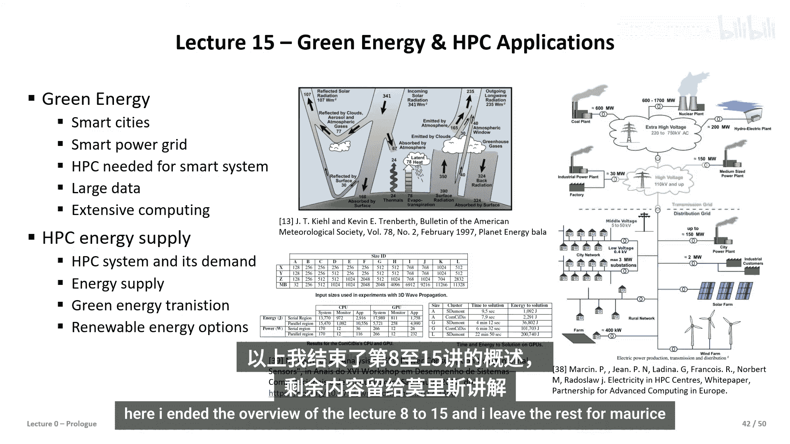
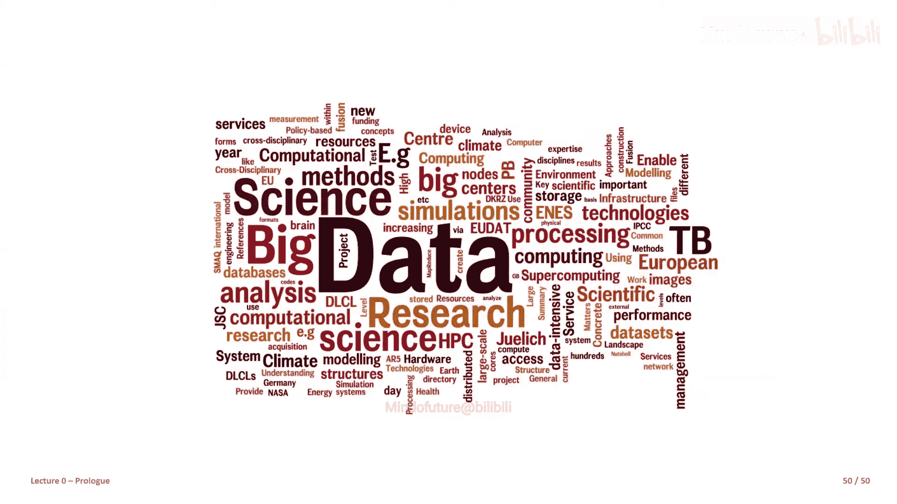

# 高性能计算课程：0：序言（第二部分）

## 概述
在本节课中，我们将继续介绍高性能计算课程的完整大纲。我们将逐一讲解从第1讲到第16讲的核心内容，涵盖从并行编程基础、GPU加速计算，到计算流体力学、深度学习应用以及前沿的自动化机器学习等主题。通过本次概述，您将对整个课程的结构和重点有一个清晰的了解。

## 课程内容详解

上一节我们介绍了高性能计算的基本概念和应用领域，本节中我们来看看课程每一讲的具体安排和核心知识点。

### 第1讲：高性能计算导论
本讲作为入门课程，旨在解答关于高性能计算的基本问题。我们将探讨高性能计算的基本构成、衡量超级计算机性能的Top 500榜单、并行计算（包括共享内存和分布式内存）的必要性，以及GPU的高吞吐量计算理念。课程还将介绍HPC的生态系统，包括软件环境、SSH访问、作业调度器、Linux操作系统以及低层编程接口。此外，我们会简要提及欧洲的超级计算资源和作为新型加速器的量子计算系统。

### 第2讲：并行编程实践（MPI入门）
本讲将进入实践环节，通过较小的编程项目帮助理解分布式内存编程。核心是学习**消息传递接口（MPI）** 的概念。MPI之所以重要，是因为在分布式内存系统中，一个处理器无法直接访问另一个处理器的内存地址空间。我们将学习MPI的基本通信模式，例如点对点的发送（`send`）与接收（`receive`），以及集体通信操作如广播（`broadcast`）。同时，我们会介绍如何在HPC系统上配置编译环境、使用MPI库模块，并区分良好与欠佳的MPI编程实践。

### 第3讲：并行化理论与策略
在初步实践后，本讲将深入探讨并行化的理论与策略。核心目标是理解如何将一个大问题分解为多个小任务（即域分解）。我们将学习MPI中的笛卡尔通信器（Cartesian Communicator），它在处理网格状数据时非常有用。此外，课程将涵盖负载均衡、加速比（Speedup）等概念，并探讨影响程序可扩展性的理论极限，如**阿姆达尔定律（Amdahl‘s Law）**。该定律指出，程序的加速受其串行部分的限制。

### 第4讲：共享内存编程（OpenMP）
本讲将转向共享内存编程范式，使用**OpenMP**。与MPI的进程间通信不同，OpenMP通过线程实现并行，所有线程共享同一内存空间。这使得编程在某些方面更简单，但可扩展性受限于单台机器的共享内存容量。我们将学习如何使用OpenMP的编译制导语句（`#pragma`）来标记并行区域，特别是如何并行化循环。课程还将讨论共享变量与私有变量的区别、临界区（`critical`）的作用以避免数据竞争（race condition），以及必要的同步机制。

### 第5讲：加速器与图形处理器（GPU）
本讲专注于通用图形处理器（GPGPU）。我们将探讨GPU为何特别适合处理大规模并行计算任务，例如矩阵-矩阵乘法，这正是深度学习等应用的核心。课程会对比**多核（Multicore）** CPU与**众核（Manycore）** GPU的架构差异，并介绍不同厂商（如NVIDIA、AMD）的GPU架构演进。我们还将讨论GPU在科学计算库和机器学习中的广泛应用。

### 第6讲：深度学习导论
本讲是高性能计算课程中的深度学习入门。我们将快速介绍人工神经网络的基础，重点解释为何深度学习模型（如卷积神经网络CNN、长短期记忆网络LSTM）的训练过程计算量巨大，涉及海量的矩阵运算和参数优化，从而凸显了对高性能计算资源的迫切需求。

### 第7讲：分布式深度学习
本讲深入探讨HPC如何加速深度学习。我们将学习分布式训练的核心策略：
*   **数据并行**：将训练数据分割到多个节点上，每个节点使用相同的模型进行训练，然后同步梯度。
*   **模型并行**：将模型本身分割到不同节点上。
课程将介绍实现这些策略的常用工具，如**TensorFlow**和**PyTorch**，并结合实际研究案例展示如何利用多节点HPC集群显著缩短模型训练时间。

### 第8讲：计算流体力学（CFD）导论
从本讲开始，课程进入计算流体力学专题。CFD用于求解现实中无法获得解析解的流体动力学问题，通常需要超级计算机的支持。我们将介绍CFD的应用范围、控制流体运动的**纳维-斯托克斯方程（Navier-Stokes Equations）**、数值离散方法，以及层流与湍流的区别。课程还会讲解CFD求解流程、网格生成、边界条件设置，并重点介绍用于模拟湍流的三种主要方法：雷诺平均纳维-斯托克斯方程（RANS）、大涡模拟（LES）和直接数值模拟（DNS）。

### 第9讲：CFD中的并行计算
本讲探讨如何将并行计算应用于CFD领域。核心内容是如何对CFD的计算域进行分解，以便分配到多个处理器上并行计算。我们将介绍适用于CFD的并行拓扑结构、向量计算机与超标量计算机的概念，并讨论显式与隐式求解方法及其对并行计算的影响。课程将通过结构化和非结构化网格的实例进行说明。

### 第10讲：OpenFOAM软件实践
本讲以开源CFD软件**OpenFOAM**为例进行实践。我们将学习如何使用OpenFOAM设置几何、生成网格、定义边界条件并选择求解器。课程将演示如何模拟层流和湍流，并展示如何将OpenFOAM从单机运行扩展到并行计算环境，包括域分解和结果收集与可视化。

### 第11讲：深度学习在CFD中的应用（序列模型）
本讲探索深度学习在CFD，特别是湍流预测中的应用。我们将介绍一项具体研究：利用**长短期记忆网络（LSTM）** 学习湍流数据，并预测其速度场。课程将涵盖模型设计、训练过程，并展示LSTM与传统方法的对比结果。这是一个结合人工智能、CFD实验数据和高性能计算的典型案例。

### 第12讲：格子玻尔兹曼方法
本讲介绍一种替代传统CFD方法的数值技术——**格子玻尔兹曼方法（LBM）**。LBM基于粒子碰撞和流动的微观模型。我们将讨论LBM的历史、玻尔兹曼方程、边界条件处理、其优势与局限性，以及如何将其用于湍流模拟（如基于LBM的大涡模拟）。LBM本身具有良好的并行计算潜力。

### 第13讲：深度学习在CFD中的应用（Transformer模型）
本讲介绍基于**注意力机制**和**Transformer架构**的深度学习模型在CFD中的应用。Transformer采用编码器-解码器结构，在捕捉复杂序列依赖关系方面表现出色。课程将通过一个湍流预测的实际案例，展示Transformer模型的设计、训练，并将其性能与LSTM等其他模型进行对比，验证其在处理无固定模式的湍流数据上的有效性。

### 第14讲：超参数优化与自动化机器学习
本讲是今年新增的前沿主题，涵盖**超参数优化（HPO）** 和**自动化机器学习（AutoML）**。超参数（如学习率、网络层数）深刻影响模型性能，传统上依赖专家经验调整。课程将介绍如**Ray**等工具集，它们能自动搜索最优超参数组合。AutoML则能进一步自动化整个机器学习流程，包括模型选择与组合，降低非专家用户的使用门槛。

### 第15讲：绿色能源与HPC应用
本讲从两个视角探讨能源与HPC的关系：
1.  **HPC赋能绿色能源**：在智能电网和智慧城市中，利用深度学习预测风电、水电、太阳能等可再生能源的发电量，需要HPC处理海量数据。
2.  **HPC的绿色运行**：超级计算机本身是耗能大户。本讲将计算HPC系统的能源需求，并探讨如何利用可再生能源为其供电，实现绿色、清洁的计算。

### 第16讲：课程总结与展望
本讲是课程的非正式总结环节。我们将回顾整个课程，从**思维模式、技能组合、工具掌握**三个层面进行梳理。课程将讨论HPC相关的职业机会、所需的核心技能（如MPI、OpenMP、GPU编程），以及如何将所学应用于硕士项目或博士研究。最后，我们会展望未来计算趋势，如量子计算、神经形态计算等，为学员的持续学习指明方向。

## 总结
本节课中我们一起学习了高性能计算课程（第二部分）的详细大纲。从并行编程基础（MPI， OpenMP）、GPU加速，到与人工智能的深度结合（分布式深度学习、HPO/AutoML），再到计算流体力学（CFD）的专业应用及绿色能源议题，本课程旨在提供HPC领域广泛而实用的知识图谱。我们希望这门课程能激发您的兴趣，并为未来在科学计算与人工智能交叉领域的研究或工作打下坚实基础。