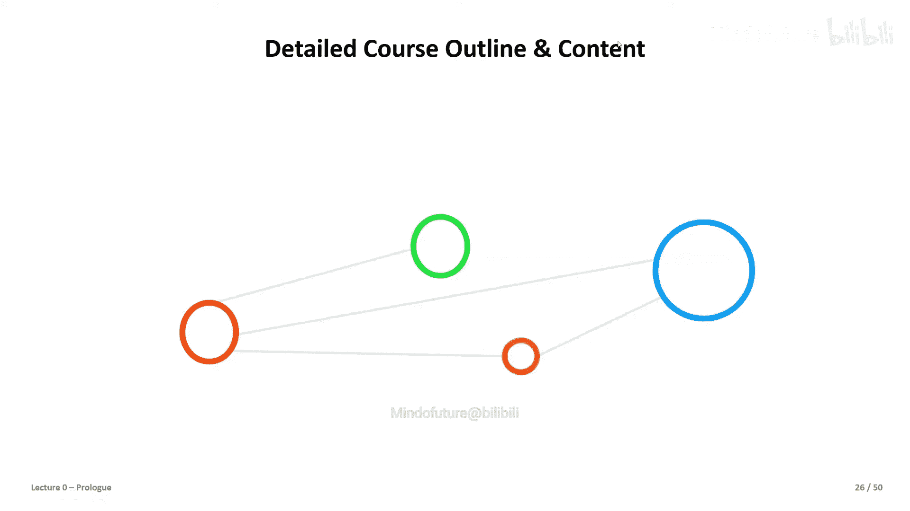

# 【冰岛大学】高性能计算课程-｜-2025-High-Performance-Computing-｜-Prof-Dr-Ing-Morris-Riedel-p31-P31_讲座_0_序言_第一部分--BV1k34zzaEK8_p31-

Welcome， everyone to High performance Comput。 My name is Morris。

 and I'm teaching this course together with my colleague Raza and I will talk a little bit more about it。

Today， we have our lectures 0， actually the prologue of the course， a slow start， if you want。

 that explains you a little bit why there are so many logos， for instance。

 here on the slide and what the content is and many other questions you probably have around the course。

So when we look a little bit into。The outline of the course or what you can expect is that we start after the prolo with the high performanceance computing introduction so gives you a much more detailed introduction than I can provide today and then we dive already in practicals as you see here with practical topics and then more conceptual topics that run the understanding and the ideas really to bring practical topics early for your assignments so the green ones here are mostly also related to your assignments that you have here we learn a little bit about parallel programming with MPI and openM and by this also have to learn a little bit about parallelization fundamentals which is essentially your first assignment and normally we would go to much more。

 let's say， technicalities here to aer us maybe and others but we learned over the last 10 years of course。

 a lot about this course so that we have to give out the practicals early the assignments based on student feedback we therefore go a little bit different than we。

would usually go with parallelization fundamentals and other conceptual topics first。

 but instead you start reading with some practical topics and all of those also usually have here and there are some additional lectures so practical lectures where will demonstrate or well raor will also demonstrate one part which is then also directly related to your assignment。

So when we have clarified the parallelization for thes and we can understand how you basically do parallel programming on high performanceformance computing machines。

 we dive into something which came up the last let's say five to10 years more and more which are accelerators and graphical processing units。

 I'm sure many of you have heard about GPUs already。

 and then we also dive directly in the next practical aspect in the course which is then an understanding of deep learning and distributed deep learning specifically fueled also with some applications which we brought in as a new element in the course given the momentum that really the topic deep learning these days gained in HPC and there are lots of applications that cannot be done if you don't have HPC resources so a very interesting topic and a new topic really hence again also more practical and then as a special basically。

This year and maybe also as the last year's we did CFD as a little bit more of a focus coming also with the other teacher razor that is my postdoc that we will hear a bit but more about it later but here is really an expert in fluid flow and he will dive with you basically this conceptual topics called CFD it's not obvious what that means it's basically understanding this physics a little bit the fluid flow and so and then we will learn quickly also whypar computing is very important and there's also software for it like open foam and given the momentum that open form also has we have also included this in the course for instance simulating avalancheches in Iceland or basically there's also other areas where we work on。

Then the idea of having also of course a blend of CFD with AI is given also in the momentum these days in HPC we call that partly also physics informed form deep learning or deep learning based you know on partly physical laws taking them in constrained by physics so this is an interesting new domain where we will learn about deep sequence models so time series data and how that reflects in CFD applications and then also some fundamentals again are necessary to understand better what CFD is all about that is Balmann idea and so。

More recently also transformer models in deep learning have gained tremendous momentum。

 we do a lot of research in that area， hence we will have also there some practicals for you。

As a new topic also we integrated hyperparmeter optimization and auto ML this is also not obvious what that means to you but this means largely that many of the HPC benefits of course can not only be to speed up the training of these deep learning models as you will learn but also to better the models so the hyperparameter that choosing them in a very good way is often a big difference between you know lowerarrow rates or better accuracy and we will learn about this in this lecture and then finally the green energy is a point that is more and more discussed when we talking about excess scale in HPC applications these days that of course green energy is a topic also to be considered in a course like that the epilogue is rather formal close or if you want rather informal partly when we go through job description clarifying your questions。

 mapping the course material。A little bit of job description and see what we teach here is directly relevant to jobs outside。

Of course， the second part today will go in all of these different lectures in more detail so that you can understand a bit better what it's about。

 that's why I want to also continue here。Hence from the motivation of the course。

 let us review a little bit high performance computing as such。

 of course we know that the first lecture will be all about it and you will understand more but many of you will understand that it's about these interesting systems。

 they are Res and a whole all basically full of these computing resources and this is a huge field a field of constant changes and with this these days you can have actually a master in HPC a specialization that your HPC joint undertaking as a specific project that enable students to take a master in HPC so hence what I can teach here in a small course like this is really just the basics and a general understanding of the techniques of HPC and so on and this is in two facets really more from the physics perspective here and there where we say here CFD is a good example here is car crashes and basically also how here smoke is actually in a pipe。

Proagating through time so these are all often numerical simulation based on known physical laws and the same as with Earth's observation and here you see also water flow in the ground water modeling combined with rain in the atmosphere and loss land surface interactionss so。

Lots of applications that drive the design really off this high performance computing machines that are really heavy in terms of computation and as such have given race to the let's say whole field of high performance computing in the last decades really So hence in the course you see the red one here the logo is basically alluding to the airplane flying and being simulated inside the computer we will learn more about this a little bit later in the course。

 but you see we covered with some of the basics here， some elements。

 but also will try to go with you to some domainspecific applications like the domain of CfD here。

 but also some others domainspecific science and engineering and those are often also if viewed by AI these days hence we also change some of the materials really and towards the artificial intelligence distributed deep learning this HPC will be a topic and so on from programming it still。

Sot of a basis。 you can program these machines from shared memory and distribute memory。

 You see that a little bit here。 And also this will be explained later a little bit in the course。

 but still important that you learn these concepts， although we keep this， let's say。

 to a moderate degree because in a sense， you have the whole course one week， for instance。

 in yearly where you can just learn about MPI， the message passing interface to do distributed programming on this HPC machines。

 So in a way， it's a well blended course based on student feedback based on news that actually come inside the community。

Hence。The logo of the course should be maybe also a little bit updated towards more AI though we don't do it only physics。

 but the key message to take away is really that you learn about parallel and processing distributed computing。

 so going away from one GPU use many GPUs and with this we are also in an area where we say we are not any more scientific computing。

 what you know maybe from other courses like Male， Matlab。

 Skyki learn and AI where you essentially use one laptop or one desktop machine here in advanced scientific computing we really think about the large scale。

 so computation simulations， physics but also deep learning which require much more computing power and hence we have to stop the serial computing and engage in parallel computing and of course this has lots of implications not only message exchange that you have seen the slide before also technology so how much memory do I have how many multi corere。

 many courtships I can actually use。In my application and you know how it can basically use all of these technologies with physical or numerical methods always AI tools so this is something then of course whereby in this course have also CftD as a special and a little bit of AI if you want making you ready for the jobs because they are also screaming more and more for high performance computing and understanding of sync big go in parallel processing so at the end of the course you should have really an insight on the latest developments。

 maybe not everything that high performance can do especially not if you think about that the domain sciences you see here。

 from plasma physics up to solid physics whatever there are so many of them that we cannot teach that all in one little course。

But still you get the basic understanding how this parallel processing works and how also this high performance computing clusters are built that networks interconnects play an important role and also data intensive workloads will of course tackle when we talk about deep learning and AI the important concepts we will basically teach you in the beginning of the course especially with domain de composition。

 how I really crunch a big you know problem into smaller pieces。

 this will be an important part when you think about parallel programming。

 so solving smaller problems jointly together to solve the big problem if you want and then you will also learn throughout the course and especially in the practicals alongside the HPC environment tools which means scheduling or even compilers when you want to have C programming。

 don't worry we don't do much C programming it's rathers say a couple of C codes just to understand a a bit on MPI and then we have AI and Python and so on。

And we will also learn that Den this parallel computing has different levels where you can target it。

 especially if you think about using MPI yourself or open MP with shared memory so thinking even about variables and parallel versuss。

 maybe larger tools like Tensorflow Pythts at doing AI these days。And。Again， I think。

 of course this is not a course completely on CFfD， it's not a course completely on AI。

 you basically need to take these courses if you have interested in this also。

 but you know the basics of how to do this in parallel after this you know course and also understand the foundations。

 what you have to think about for instance， like the domain incomposition we talked about hence you are able to really program HPC systems after this course and then of course take really the advantage of using the scientific computing simulations much more than you maybe know from Skyki learn or Melab and smaller。

 let's say serial technologies and to have your rip on the parallel technologies and of course those really have a you know by design idea of handling the parallelism complexity as well that we will also learn in the next subsequent lectures Just a brief point why I should be having the right talking to you about this in HPC。

Essentially now 20 years in the field more than 20 years really having a PhD in Comp science on C Institute of Technology in HPC and grid applications。

 I am still at the Uli supercomputing Center， one of the largest centers for HPC in Europe and we will talk about this more later。

 I had there many different positions before I came to the professorship here in Iceland。

 but it's still a very good collaboration between Iceland and Yuli。

 so hence my student in the research group we have around 20 in the research group going back and forth to Germany and also here。

There were many different other elements where I have basically experienced HPC and even also cloud computing in the past a lot at CEN director strategic director of U Middleware for instance。

 but also being an Iech in Ac， which is the US HPC infrastructure at some point in time and of course also then on the data site。

 I was here and they involved in many different EU projects so more for this course。

 a bit relevant you will hear a term called Europe HC joint undertaking more often than in the past because it was more or less recently formed and I will talk about this in a moment。

 I'm also the governing board member for Iceland so also thinking about strategic elements of Euro HPC for Iceland。

And again， the university courses you will see on YouTube， many of those in the past。

 this course material really grown from many different courses like statistical data mining。

 but also the earlier HPBC A and B courses， and like all the years it will be all you know everything open is essentially also available on YouTube if you want。

Coming quickly to the U supercomputing Center， this will come up again and again because we are also using some HPC systems out of this system landscape really that is in Uly they have many different HPC systems and we make the case for it largely speaking。

 this is a research center that you see here with 5000 these days probably more than 5000 people even under the umbrella of the Helms Alliance that you see here is different centers really some of them are very domain specific like the geoFE for instance more for remote sensing and other Earth observation elements so but this is let's say some of the concrete collaborations we have and I also told you that we have another lecture in the course that will take over then when it comes to CFfD for the later parts of the course when we have the basics and also finish the deep learning introductions then essentially raza here。

A postd of mine recently graduated actually at the end of 2024 who is really a computation engineer in this you know areas of physics of fluid。

 fluid flow and so on and there's excellent candidate to show you this interesting application area he will also introduce himself a bit later so I will also basically continue here to the University of Iceland。

 I think many of you have probably already read up much of it otherwise he wouldn't be studying here but of course also for a general audience on YouTube it's quite a important university in the field of remote sensing so in the higher rankings that we have there the times higher education and so on these are all elements where remote sensing is very important for us but also many other sciences of course and we have really many friend students irration movess Moony and so on。

We also the coordinated of the Isic National Competent Center for HPC and AI under the so called U C umbrella。

 So that's the mouthful。 So that's a lot。 So we have to talk about this because this is now directly also HPC related。

Hence we talk a little bit about the UHBC joint undertaking。

 which really has a mission to support you know the development re of HPC together with the European Commission and the member states of the EU and the of course FFTA states like Iceland and Norway and so on to really have their different projects。

 different resources available for research engineering and also industry we have a couple of these projects。

 the UCC project is quite important you will see that on the EHPC website if you want where Compent Center is there will be also events where you will be invited through the course we call them workshops where you can also get some bonus points or the final project so we are quite active in Iceland in all of these different research projects that you see here also in cloud projects。

 some of you that took the let's say complementary cloud course know that already the European Open science cloud is also something where we're in but also in other activity。

Of cloud computing。Pence。😊，The Icelandic HPC umbrella of let's say this competent centers is something which you see in all the different member states so there's an NCC Finland there's an NCC Norway in the Nordics but also NCC。

 Germany and so on and we modeled the competencies in so-called simulation and data labs。

 you see them quite in different topics on natural language processing which is essentially something driven by my colleague Hafstein Eisson but also different chemistry labs from Han Yonson computational fluid dynamics Riraza that of course is teaching with you soft engineering Matts Bo Noyke and so on。

 remote Senensing， Profess Gabrielle Cavalarro so everyone who is using HPC in one way or another is really let's say part of this Comp center and we structure them a little bit in the simulationim data labs to have domain specific experience to essentially。

Users from industry， you see are two examples also with me then a language company in Iceland。

 we have worked together you see a short testimonial and we actually have developed another EU project called Trust the Lem with them and also AI Swedenden and others where we now actually have also language models or large language models for Icelandic trained with HPC resources and this will be also part of later courses or you see more from the physics perspective is treble here in the acoustic and Tactile engineering lab led by Runno and Tson here in the engineering department that work together is treble in this lab to also use HPC systems with the Comp center enabling them much better simulations of acoustics let's say for instance in a classroom but also in an opera and so on and we have also here of course getting a nice short testimonial Chs are if you come to our EHPC workshops that I will of course announced。

In due time that you meet some people from travel， from Mid then or many other industry collaboration examples。

 So we have， of course， many different。Collaborations with many different partners。

 not only SMmes and industry， also statistics， Iceland。

 we had a very big event just recently with them。 So more talking about public administration organizations that also are part here and there of our national competence center activities。

 So one example I would like to point to you as simulation data lab remote sensing it's quite large because as I said to you earlier。

 remote sensing is quite an important factor for Iceland。

 there's a lot of deep learning and machine learning models performed in this And for some of you it's maybe not obvious what that exactly is。

 So here you can see with machine learning you can understand a little bit the Earth's cover right so but we don't do this just with pictures from let's say satellites that you see here taken on a daily basis and our spaces。

 but also basically with hyperpectral and multispectral channels a bit reaching into the earth。

 So this will be also。Expects here and there we will give some examples right when we want to understand is it now a building is it a river is it trees so this is something where the remote sensing lab is for instance working on for example and also there we will have some examples out on the course。

Coming briefly to the terminology because I want to make a point that HPC is required these days also for deep learning specifically so when you not heard about this before you can see the large world of artificial intelligence including robotics is really huge say mimicmic human behavior and it's really a topic that has to be broken into smaller pieces and one of it is to focus on the area of machine learning where you learning from data so you don't really have let's say source code everything explicitly programmed but you rather learning from data and we will of course have course lectures about it how you do it and then a specific sub fractionction of this is what we call today deep learning so these are actually then neural networks which are relatively large and have let's say specific properties in each of the different layers to make them extremely successful for learning tasks and one of the learning tasks as examples see a。

so you have two groups of data for example， a new point is there and you want to understand is it you know to be classified in this or that group or if you don't have any group information。

 you have maybe distances like here you have the Euclidean distance making them a bit closer together than this group it's something what we call for instance clustering of data and all of these are machine learning data mining algorithms and some of them are even regression techniques where you want to have certain trends。

 for example， in the data shown。But all of this will come in different lectures just let me briefly give you the video here which nicely explain the complexity really of new you know deep learning models and machine learning we did you know features and then the machine learning models like support vector machines etc was learned here is deep learning we have also feature learning insight or the models are much bigger bolder have more capabilities and it's not like that you see here that a deep learning is just deeper in terms of layers and layers it's not the only thing right so deep learning also has what you see here is convolutional layers。

 pooling layers， subseampling layers different logic to do this particular feature learning and we have a whole lecture about it。

 but with this deep learning we have been seeing lots of success for instance learning know whole phases just from fractions of images or basically also new innovative approaches in which transformer models and so on what we will also learn in the course So when you look now the video。

brieflyefly， what is a neural network？嗯。🎼，🎼So here we see the classification of digits。

 right that you see here， human written characters that you see here on this side。

 and you use a perceptron learning model， which is essentially one of the earliest machine learning models you can have。

 then not particular layers。 and we will talk， of course， in one of the lectures about it。

 But you see now the evolution when we go now to a fully flexged neural network。

 which is basically based on perceptron based on the neuraln idea that we will talk about。

 and then maybe make more hidden layers that will come next in the video。🎼Yeah。🎼。

🎼So here we can nicely see these layers right that you hear making it a multilayer perceptionceptron and if you combine this respect propagation of error。

 an algorithm we will talk about briefly， you actually at artificial neural networks with different hidden layers making the classification task even more accurate and this is still not deep learnings let's say still shallow learning as we would say has been there before and all of these connections you can see here our weights you have to train you have to learn and the update process of this learning is quite computational expensive hence more and more HPC is needed and we will also make the case that GPUs are just beautiful for this。

🎼，🎼Yeah。🎼Yeah。🎼，🎼Oh I think here you can see nicely now the difference so convolution neural networks is in the realm of deep learning networks already and you see also instead of the previous one that you have seen putting more hidden layers hidden layers in layers that is not where deep learning really points so you see nicely here with the character the different feature maps that are actually build it you know the convolution process having then also you know different layers here to carve out features really of the digits so small round。

 small element parts during this subsequent let's say layers that you have there at the end you have still a fully connected network that you have seen before for the decision making that actually performs in the classification task but many of the deep learning elements that you will see in the course will have the property to also learning features and that's where they are really good in。

🎼Yeah。🎼，🎼，嗯。So spiking neural networks is something that we don't really focus in the course on in this more。

 let's say an advanced topic in machine learnings I would like to stop here coming back to the idea why we need HPC so you talk about a lot moreris about machine learning deep learning bring that all on one slide and what is the data aspect to all of that and what is the you know model performance accuracy we are all interested in so this was sort of a question I got when I have to talk in the Deutsche Buddhist type the German federal parliament where they said to me rather you know for politicians you have to make that on one slide okay so not long slides just explain everything in one slide bring everything together and I think that's what I got good feedback in is essentially this slide and hopes to understand the basically point of combining all of these terms if you want。

So you have seen data volume is a key element in machine learning and deep learning。

 the more big data you have， the more realistic it is to do deep learning and so on。

 but you will also see serial limitations， So when you use。

 let's say statistical computing is R Sky couldlen Vecar， matla octave at some point in time。

 they will not be able to do this anymore with let's say traditional classifiers like Svms。

 random forests， there are parallel Svms that we also research。

 but essentially talking that when you have more and more big data。

 your small laptop will become the key limitations。

 So you need something what we call highperform computing and cloud computing。

 the more you go to the new networks we have seen small neural networks already can benefit from the amount of GPUus we have in highperform computers today。

 but if you then really go to medium and large deep learning networks， large transformer models。

 large language models and others then you see the footprint。

Of the training time for those will be significant。

 And this is not what you can do in a laptop anymore in a sensible way。

 So hence ear high performance computing is really needed。

 and we will make the case with GPUus particularly why is that so successful。

 it enables me also to say that， of course， these deep learning networks have now so passed。

 the accuracy and performance we had in previous computer vision algorithms and smaller approaches or traditional learning models。

 if you have larger data sets。 So if you if the data volume is still small。

 that's also important to understand random forests and SVms are maybe still better than deep learning。

 So the ordering that you see here is not valid in the first part when we don't have enough data because deep learning and HPC really need lots of big datas。

Right， with see important differentiation also from high performance computing and type throughput computing。

 some of you know that already from the cloud course。

 it was much more high throughput computing here we talk about large machines really well interconnected together here you know this is something we talk about and what we see as a major difference between those machines and that makes them also very costly because essentially this you know cables that you see a little bit when we put here in the upgrade of this machine is's the most an expensive factor to date together with the GPUs and here you see some interesting idea of flops or floating point operations one second what is a bit a matrix how quickly you can actually you know essentially can compute these things。

And then you essentially have also the idea here of the Ju supercomputer and the Ukraine。

 these are all systems which came a little bit， you know up to the idea over the last let's say 10 years and you see here now with Jus one of the cutting edge machines。

 936 compute notes with lots of CPUs and GPUs here overall 3700 GPUs and then we will talk about a modular computation concept later on。

Just a couple of things before we close about the Can tool。

 the office hours and so on please send to my assistant you see the email here any requests for office hours everything else will be really on Can except I think final grades are done via Ugla and all of that will be basically published around this from the overall course organization there are three assignments which make 40% of your grade plus of course and there will be a course project was 10 to 50% of your grade so the assignments were already talked about in the beginning the practical lectures will be quite related to it for the assignments and the course project it will be important to form groups of two to three people and also send and please to me and my assistant the course project will be 50% of your grades or a major part hence essentially we have a report in April and start with this in February but there will be a midterm report necessary which gives you additionally 10%。

Great if you start early because many of the students always start the final project more or less very very final and we want to try to work around it there will be also invited lectures throughout the course and for the knowledge the yellow blocks really captures a key sense that we have in each of the different slides for question answers we have usually at and also of course Can can be useful commenting again also the grading submissions of your assignments all will be done on canvas and with this I would like to just point you also that of course in YouTube you will find the recordings of the previous courses so if you're interested you know from the beginning today are changed here and there some topics given of course the more important these days like hyperparmmed optimization for examples but the old lectures are also there and the new highperform computing course where we also of course be available for you there we also are very active in social media。

Very important for U projects for funding no one wants websites anymore everybody is looking on social media so there's also possibility to engage with our community there if you want we on Linkedin and many other platforms finally an anticipated question so associated literature bibliography is usually something where you know if we have there's in each of the different lecture so in this sense you see here already that the bibliography also in this would be something to look at if you want to know more about a book for instance here Gka or this would be might be an interesting book to look at。

And also the courses you have on YouTube you see we have here got extremely good feedback all over the years for the lectures。

 putting them on YouTube from the YouTube community far beyond the Icelandic University and in every lecture I will give you a video to look at home and here we start with the course is a prologue today。

 I would encourage you to look at this YouTube video from Pra before we start then the next part too about the detailed course outline and content together with Razor so'll see you very soon。

