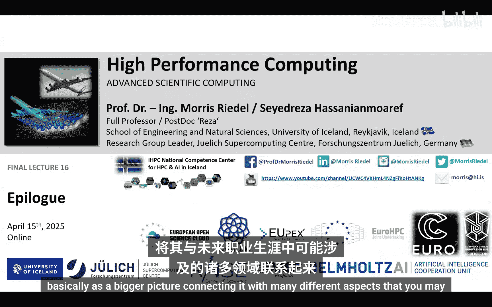
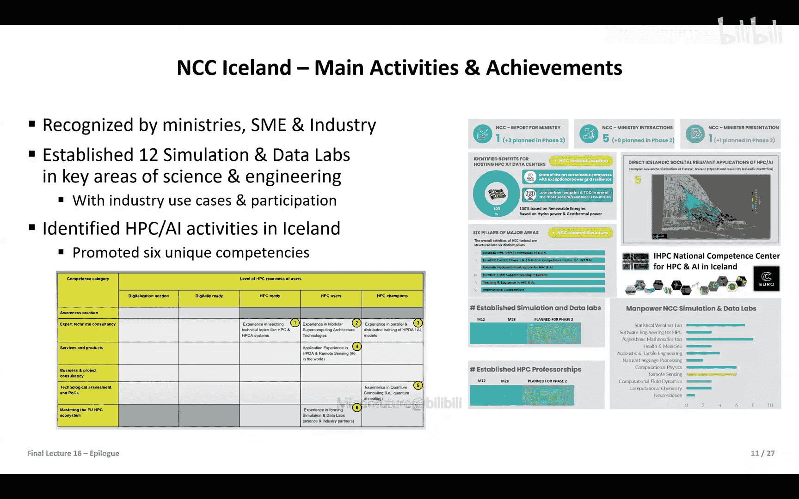
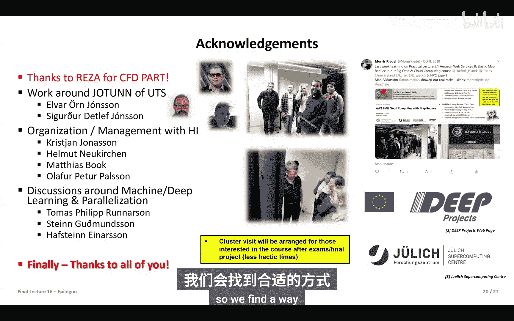
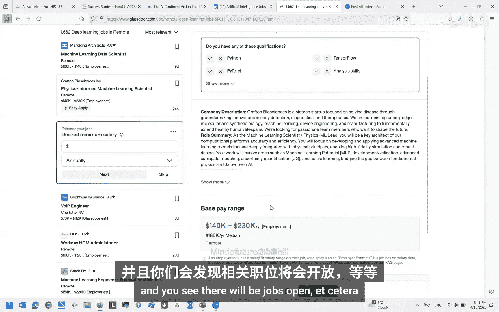
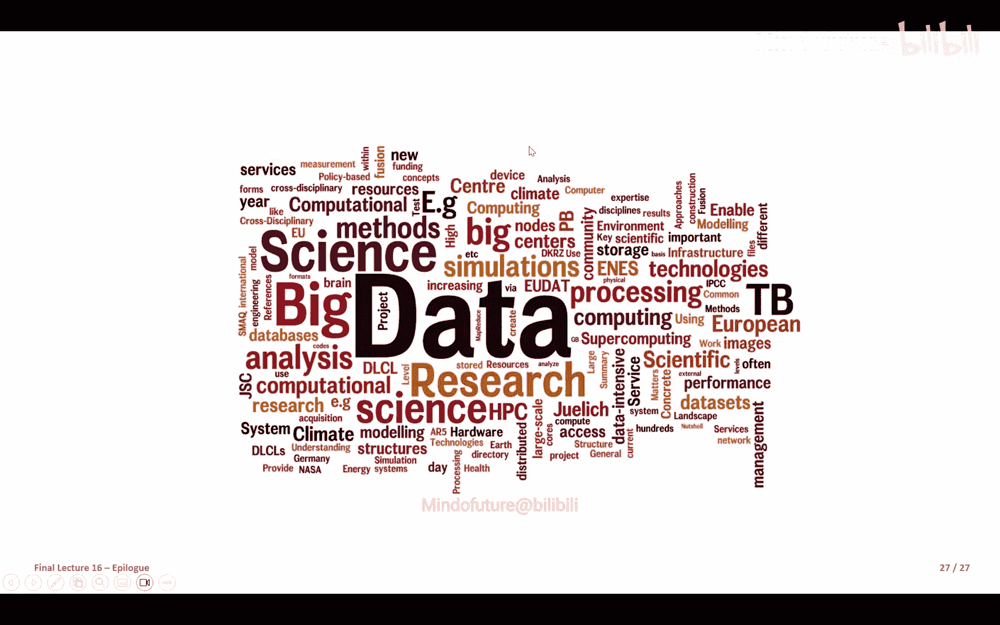

# 001：结语与展望

在本节课中，我们将对高性能计算课程进行总结，并从更广阔的视角探讨HPC的未来发展、相关技能、社区资源以及职业机会。

上一节我们完成了课程的技术内容学习，本节中我们将从理论、技术和范式三个层面回顾课程核心，并展望HPC在学术界和工业界的应用前景。

## 理论、技术与范式：HPC的持久核心

在课程中，我们学习了高性能计算的不同层面。以下是构成HPC基础、并将长期存在的核心要素。

### 理论层面
*   **并行算法理论**：将大问题分解为小问题的思想是根本，不会过时。这包括团队协作等理念。
*   **可扩展性理论**：我们学习了强扩展（增加算力）和弱扩展（增加工作量）。通信开销和**阿姆达尔定律**（`S = 1 / ( (1-P) + P/N )`）揭示了串行部分的瓶颈。**古斯塔夫森定律**则从不同角度阐述了扩展的局限性。
*   **数值近似理论**：真实世界的模拟（如天气预报）依赖于偏微分方程和数值方法，存在数值不稳定性。
*   **统计学习理论**：对于机器学习和深度学习至关重要。它解释了为何只能从数据中进行概率性近似学习，并强调了验证、交叉验证和正则化的重要性。

### 技术层面
*   **通信技术**：**消息传递接口（MPI）** 历史悠久且仍是分布式内存通信的关键。**OpenMP** 共享内存模型也因其在高带宽内存访问上的优势而持续重要，但受限于内存规模。
*   **问题分解技术**：通过网格划分或离散化区域（如在计算流体力学中）来分解问题，是并行计算的基础技术。
*   **机器学习与深度学习**：这是一种从数据中学习而非依赖物理定律的技术。它处理具有相同输入可能产生不同输出的概率性场景。
*   **计算流体力学**：这是一个专门的物理领域，但课程展示了其与AI/ML结合的可能性，引出了物理信息机器学习等新兴交叉领域。

### 范式层面
*   **高性能计算 vs 高吞吐计算**：HPC强调节点间频繁通信（如天气预报），而HTC（在云计算课程中详述）任务间通信较少（如词频统计）。
*   **计算建模**：这是一个历经数十年的工程范式，从桥梁设计到基于气流和传感器数据的智慧城市建模。
*   **从数据中学习与人工智能**：这一范式历史悠久，并将持续发展。它涵盖了超参数优化和自动机器学习等关键主题。

## 延伸学习与社区资源

为了深化理解并跟上领域发展，以下是一些推荐资源和社区。

### 进一步学习材料
*   **欧洲高性能计算中心网络培训**：提供关于MPI、OpenMP、AI等主题的深入培训（通常为期数天）。链接：[https://training.prace-ri.eu/](https://training.prace-ri.eu/)
*   **YouTube频道**：课程相关讲座和更新材料会发布在YouTube上。
*   **参考书籍**：对于想深入底层HPC的学习者，推荐社区专家撰写的关于OpenMP和共享内存的书籍。

### 行业成功案例与社区参与
*   **UCC网络成功故事**：该网站收集了欧洲各地中小企业应用HPC的成功案例，包括冰岛的企业。这有助于了解HPC在工业界的实际应用。链接：[https://www.ucc2.eu/success-stories](https://www.ucc2.eu/success-stories)
*   **冰岛高性能计算研讨会**：定期举办的社区活动，欢迎继续参与。注册网站：[https://ehpc.is](https://ehpc.is)
*   **仿真与数据实验室**：提供与工业界合作的专家支持，并可通过欧洲数字创新中心等计划获得帮助。
*   **公开项目示例**：例如，利用开源CFD软件模拟弗拉泰里地区的雪崩。
*   **大型语言模型项目**：涉及冰岛语语料库和下游应用（如翻译、聊天机器人）的欧洲合作项目。

## 学术深造与职业发展

课程所学的技能为学术研究和职业发展奠定了良好基础。

### 学士/硕士/博士论文课题
潜在研究方向包括：统计方法、机器学习、科学计算、数据挖掘和并行化。这些方向融合了软件工程、统计学和领域知识，旨在培养计算科学家或数据科学家。

博士研究生会定期举办研讨会，以团队形式进行研究。

### 云计算课程前瞻
秋季的云计算课程将涵盖更多面向超大规模云平台（如AWS、Azure、Google Cloud）的框架（如MapReduce、Spark）。课程将探讨服务化范式、企业应用以及与大数据、机器学习的结合。虽然底层算法相似，但资源供给和使用模式与HPC有所不同。

### 职业机会与市场需求
*   **求职平台**：推荐使用**LinkedIn Jobs**和**Glassdoor**寻找机会。
*   **热门技能**：职位描述中常要求**人工智能**、**机器学习**、**深度学习**、**Python**、**TensorFlow/PyTorch**、**NLP**、**大型语言模型**等技能。**物理信息机器学习**专家需求也在增长。
*   **云计算技能**：**Docker**、**AWS/Azure/GCP**、**Spark**等技能在云计算课程中会重点涉及，能显著提升就业竞争力。

## 未来展望：欧洲AI工厂计划

欧洲委员会正在大力推进“AI大陆”计划，未来将投入约2000亿欧元。其中的核心是建设专门为AI优化的**AI工厂**（即超级计算机）。这将创造大量就业机会，不仅需要硬件专家，更需要软件、服务和运营人才。HPC是这一战略的关键支柱。

## 总结与致谢

本节课中我们一起回顾了高性能计算的核心理论、技术与范式，探讨了进一步学习的资源和活跃的社区，并展望了在学术深造与职业发展方面的广阔前景，特别是欧洲AI工厂计划带来的新机遇。

最后，衷心感谢所有参与本课程的同学，以及为课程做出贡献的讲师和助教团队（Razor, Christian, Chris, Hemo, Oliver等），以及保障Atla/Ua系统运行的幕后技术人员（Zgaro, Elva）。也感谢在线观众的支持和反馈。

课程幻灯片将公开提供。如有兴趣参观数据中心（Borealis或气象局新址），请发送邮件，我们可组织活动。

祝大家未来一切顺利，期待在未来的社区活动中再见！