# 002：绿色能源与HPC应用 🌱

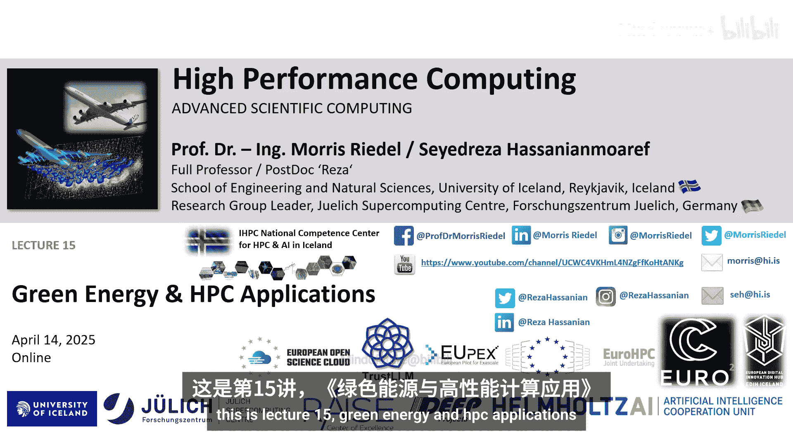

在本节课中，我们将探讨绿色能源与高性能计算之间的关联。我们将了解HPC如何帮助研究和开发绿色能源技术，同时也会审视HPC系统本身对能源的巨大需求及其对环境的影响。

上一节我们介绍了超参数优化与自动化。本节中，我们来看看绿色能源领域与HPC的交叉应用。

## 课程回顾 📚

在第十四讲中，我们讨论了超参数优化及其自动化。主要内容包括超参数的重要性、它如何提升机器学习模型的性能，以及传统方法与自动化方法在寻找最优超参数上的区别。我们还探讨了在HPC环境中进行超参数调优的实践。

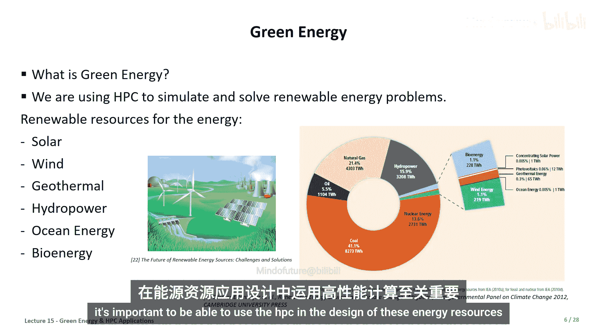

## 绿色能源简介 🌞

绿色能源，即可再生能源，是应对气候变化和全球变暖的关键。其主要形式包括：
*   **太阳能**：通过光伏板将太阳辐射转化为电能。
*   **风能**：利用风力涡轮机将风能转化为电能。
*   **地热能**：利用地球内部高温高压水或蒸汽驱动涡轮发电。
*   **水能**：利用水流或水位差发电。
*   **海洋能**：利用海浪、潮汐等海洋动力发电。
*   **生物质能**：利用有机物质转化能源。

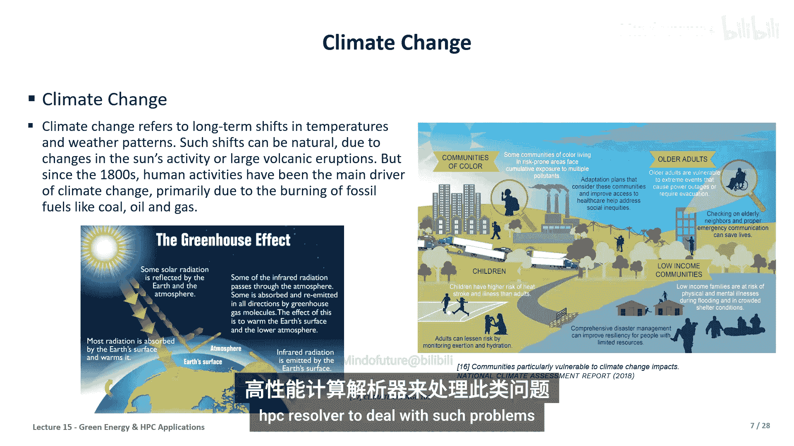

一方面，这些能源可以为包括HPC在内的各种应用供电。另一方面，优化这些能源设备（如风力涡轮机叶片形状、光伏板材料）的设计以提高效率，也离不开HPC的模拟计算能力。

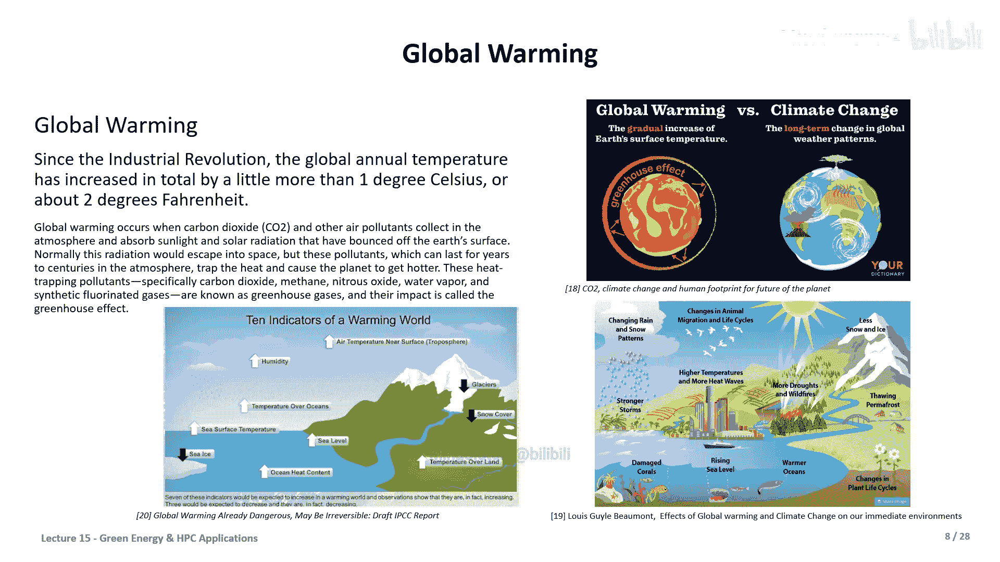

## 气候变化、全球变暖与HPC 🌍

理解以下两个概念的区别很重要：
*   **天气**：短时间、局部地区的大气状况。
*   **气候**：长时间、大范围天气模式的统计特征。
*   **全球变暖**：特指工业革命以来，因化石燃料使用导致全球平均气温上升的现象。
*   **气候变化**：指全球范围内长期气候模式的改变。

研究这些现象涉及海量参数和复杂的物理过程（如计算流体动力学 - CFD），因此必须依赖HPC进行大规模模拟。同时，HPC系统本身消耗大量能源，使用绿色能源为其供电，有助于减少其对环境的负面影响。

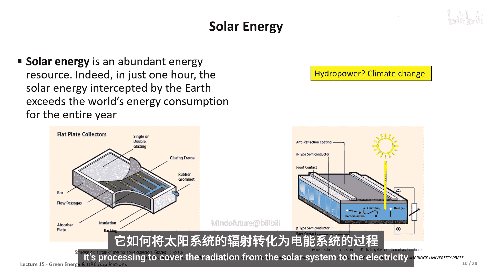

## 绿色能源应用实例 💨

以下是几个绿色能源领域依赖HPC的具体例子：

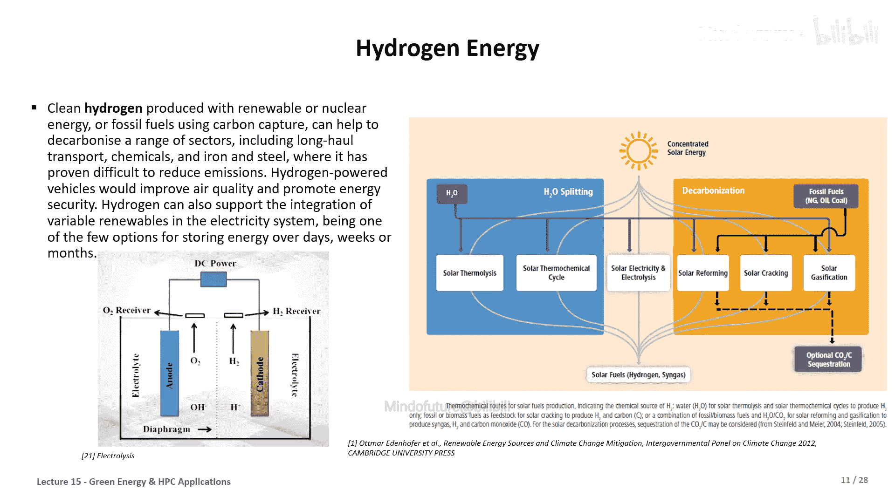

**风能**
风力发电场的布局至关重要。上游涡轮机产生的尾流会影响下游涡轮机的效率，这被称为“尾流效应”。使用CFD进行大规模模拟，可以优化涡轮机布局，减少效率损失。此外，垂直轴风力涡轮机因其灵活性和较小的尾流效应受到关注，其设计优化也需HPC支持。

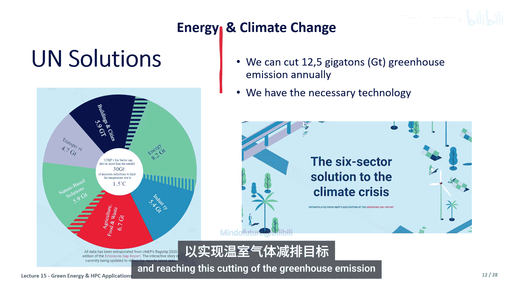

**太阳能**
太阳能在理论上潜力巨大。研究表明，一小时的太阳辐射能量足以满足全球一年的能源需求。提高光伏板的转换效率是核心挑战，这涉及到材料科学和光电过程的复杂模拟，同样需要HPC。

**氢能**
氢能是一种清洁的二次能源。通过电解水制氢是主要方法，但其“绿色”与否取决于驱动电解的电力来源。理想的方式是结合太阳能或风能发电来生产“绿氢”。设计和优化这种风光氢一体化系统，需要进行大规模的耦合模拟，对计算资源要求极高。

## HPC的能源需求与循环 ⚡

HPC与绿色能源之间存在着紧密的互动循环：

1.  **HPC助力绿色能源**：通过CFD、分子模拟、机器学习等计算手段，HPC帮助设计更高效的风力涡轮机、光伏电池和能源系统。
2.  **绿色能源供给HPC**：HPC是耗电大户，一台E级超算的功耗可达25兆瓦。使用太阳能、风能等为其供电，是实现可持续发展的重要途径。
3.  **HPC的冷却挑战**：HPC运行产生大量热量，需要高效的冷却系统。冷却系统本身也消耗能源。优化冷却设计（如液冷）同样需要借助CFD模拟，这又回到了第一步。

以下是HPC能源管理的一个策略示例，展示了不同控制策略下CPU使用率与功耗的关系：
```
策略A：功耗随负载线性增长。
策略B：采用动态调频调压（DVFS），功耗曲线更平缓。
策略C：激进的任务调度与休眠，在低负载时显著降低功耗。
```
为HPC中心供电需要稳定、安全的电力传输网络，并考虑连接功率、设计功率和合同功率等关键参数，以确保系统稳定运行。

## CFD在绿色能源中的大规模应用实例 🖥️

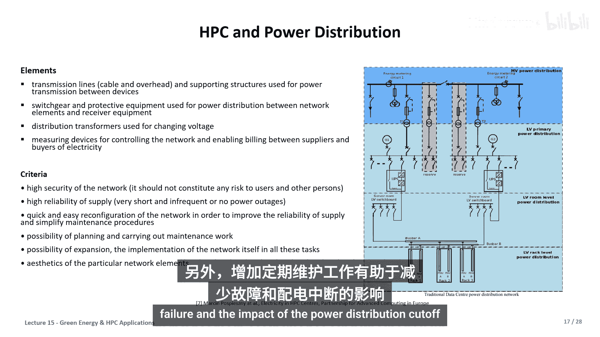

CFD模拟在绿色能源的研发中扮演着核心角色。以下是一些典型的大规模应用场景：
*   **风电场**：模拟大气边界层流动与涡轮机相互作用。
*   **地热井**：模拟地下多孔介质中的热-流-固耦合过程。
*   **太阳能集热器**：模拟复杂的光-热转换与流体传热。
*   **氢燃料电池**：模拟电化学反应与多相流。
*   **HPC冷却系统**：优化数据中心的气流组织与液冷回路设计。

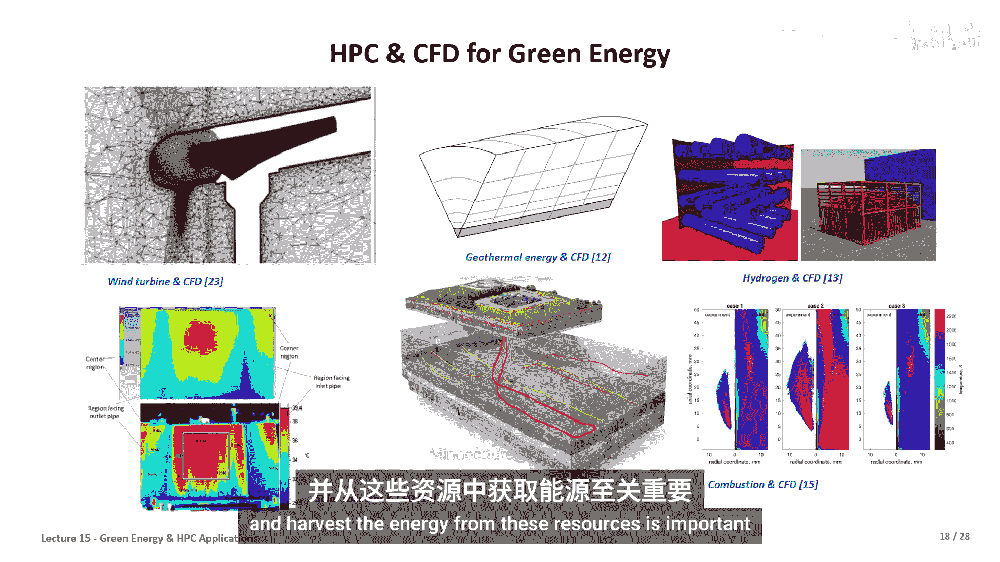

这些模拟通常涉及数亿甚至更多的网格单元，必须在HPC集群上并行运行才能完成。

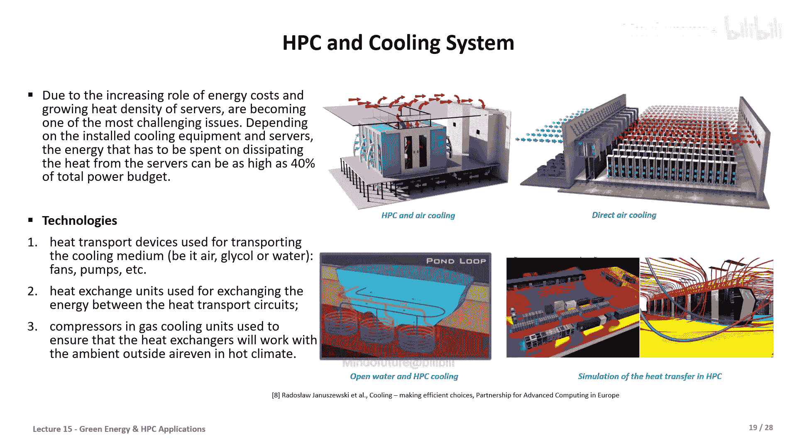

## 总结与展望 📈

本节课我们一起学习了绿色能源与高性能计算之间多层面的关系：

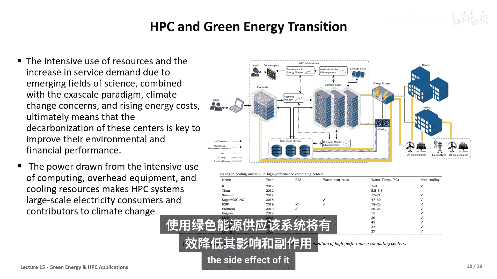

*   **HPC是绿色能源研发的加速器**：在设备设计、效率优化、系统集成和气候研究等方面不可或缺。
*   **HPC是能源消耗大户**：其巨大的算力需求转化为对电力的稳定需求，并产生热管理问题。
*   **绿色能源是HPC可持续发展的关键**：使用可再生能源为HPC供电，能有效减少其碳足迹，形成良性循环。
*   **两者构成协同闭环**：HPC帮助改进绿色能源技术；绿色能源则为HPC提供清洁动力；同时，HPC还用于优化自身的能耗与冷却效率。

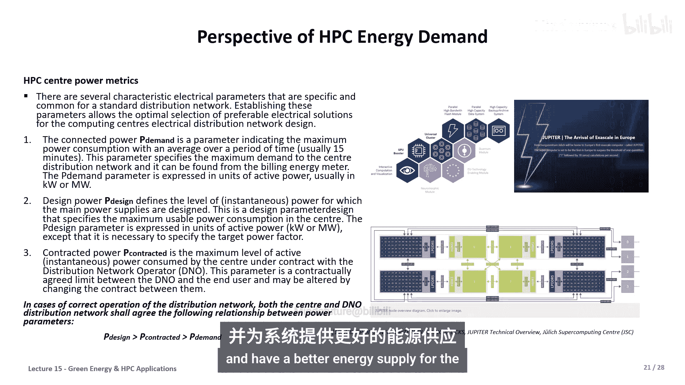

随着计算迈向E级（百亿亿次）乃至更高规模，如何利用HPC推动能源革命，同时让HPC自身运行得更“绿色”，将是未来重要的研究与发展方向。

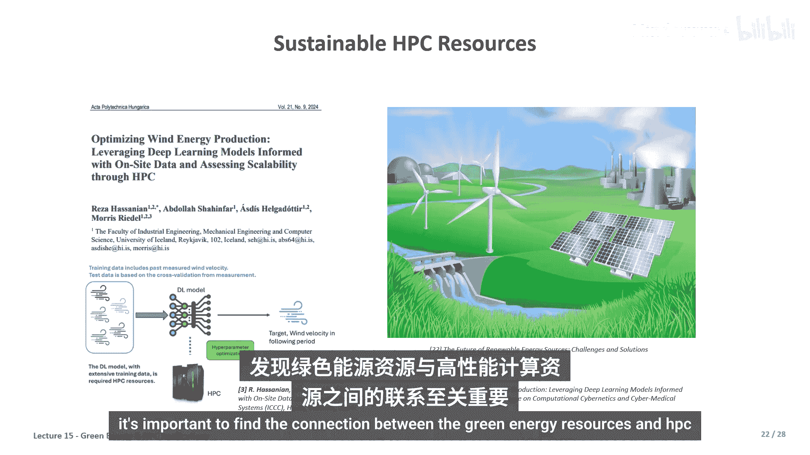

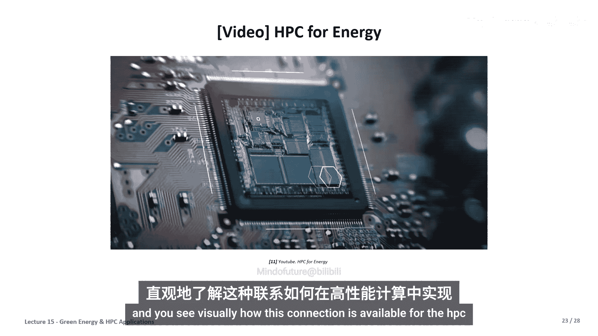

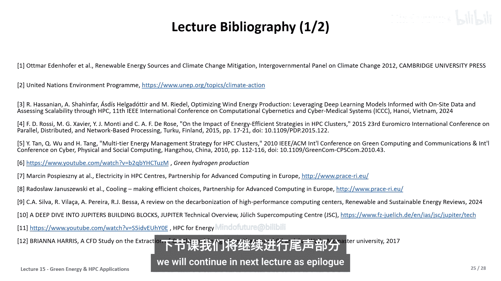

---
*课程结束。祝你好运！*