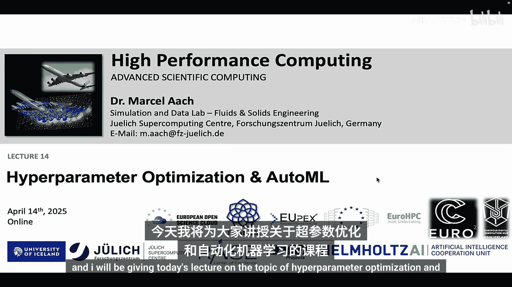
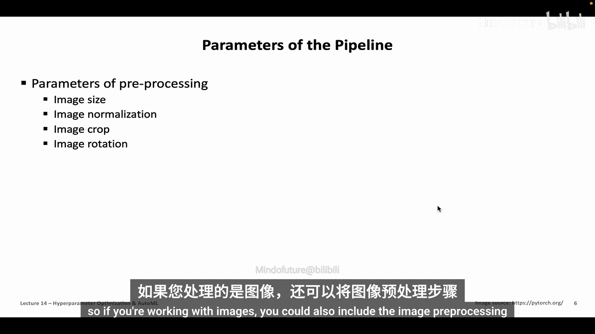
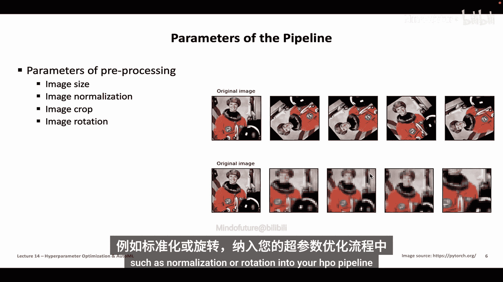
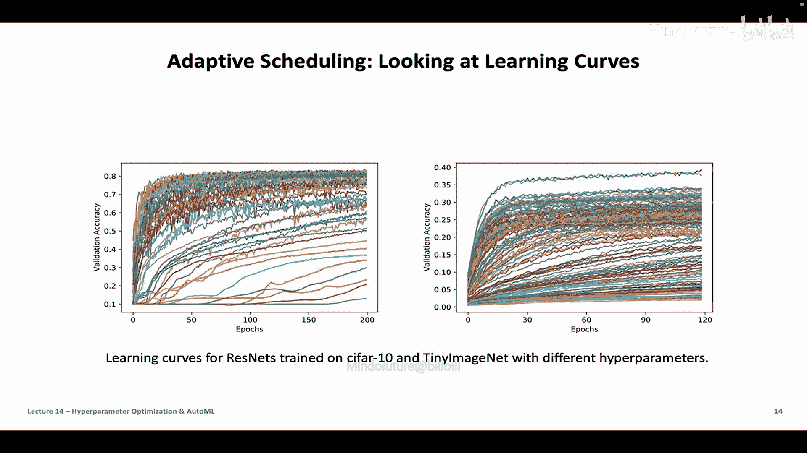
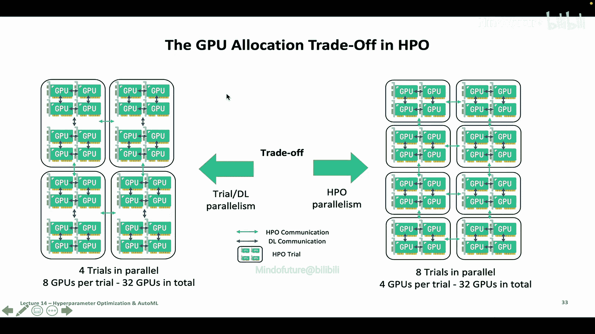
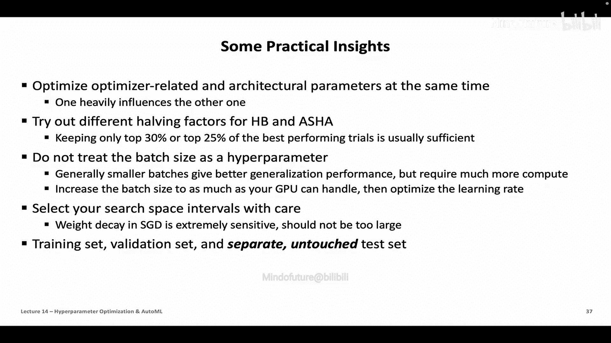

# 003：超参数优化与自动机器学习 🚀

在本节课中，我们将学习超参数优化和自动机器学习。我们将了解什么是超参数，探索不同的优化算法，讨论如何根据情况选择合适的算法，并学习如何在高性能计算系统上高效地进行超参数优化。

## 什么是超参数？🤔

超参数是影响机器学习模型学习行为的参数，通常由用户或开发者在训练开始前设定。它们包括架构参数，例如使用的机器学习模型类型、网络层数和种类或激活函数。更常见的是，超参数也指优化过程的参数，例如优化器类型、学习率或动量值。此外，有时整个机器学习流程的参数也可以被包含在内。例如，在处理图像时，可以将图像预处理步骤（如归一化或旋转）纳入超参数优化流程。

为了更全面地理解，我们可以从三个层面来调整预定义的参数：
*   **神经架构搜索**：专门处理架构参数。
*   **经典超参数优化**：处理优化过程等参数。
*   **自动机器学习**：在经典超参数优化的基础上，进一步包含流程参数。

超参数对于机器学习模型的成功至关重要。为了直观展示其重要性，下图展示了一个在CIFAR-10数据集上训练的简单ResNet模型的学习曲线。从图中可以清楚地看到，学习率的选择决定了模型是能达到超过80%的分类准确率，还是完全学不到任何东西（准确率仅为10%，相当于随机猜测）。

这也揭示了为什么选择超参数如此困难。观察这些曲线，我们发现无法做出通用的预测。通常不能说“大学习率好，小学习率坏”，这些决策往往非常精细。

## 术语与数据准备 📚

在深入之前，我们先明确几个术语：
*   **搜索空间**：指超参数及其采样区间的集合。
*   **配置**：指从搜索空间中采样得到的一组超参数值。
*   **试验**：指使用一组特定超参数配置进行一次完整的训练运行。

进行超参数优化时，需要准备三个独立的数据集：
1.  **训练集**：用于训练模型。
2.  **验证集**：用于评估不同超参数配置的性能，并据此选择最佳配置。
3.  **测试集**：一个完全未参与优化过程的数据集，用于最终测试所选最佳超参数配置的性能。

## 超参数优化的挑战与基础方法 ⚙️

超参数优化之所以困难，主要原因在于搜索空间通常是多种不同类型参数的混合体。例如，网络层数是离散值，而学习率通常是连续值。在这种设定下，我们无法像梯度下降法那样计算梯度来寻找最小值，因此需要借助其他方法。

这也是超参数优化计算成本高昂的主要原因。只有在模型完全训练完成后，我们才能确定某个超参数配置的性能。在缺乏系统指导的现状下，超参数优化通常仍由开发者通过试错法手动完成。

为了找到更好的方法，我们现在来看看能更系统地进行超参数优化的算法。

最基础或朴素的方法是**随机搜索**或**网格搜索**。
*   **随机搜索**：如其名，从超参数搜索空间中随机采样配置。
*   **网格搜索**：评估搜索空间中所有可能的超参数组合。

有趣的是，随机搜索已经是一个非常好的起点。当对问题一无所知时，至少应该进行随机搜索。从并行计算的角度看，这两种方法都是“令人尴尬的并行”任务，因为不同试验之间几乎不需要通信，可以独立运行。但同时，它们也会浪费大量计算资源在那些性能可能很差、本不该完全训练完的试验上。

## 如何加速优化？自适应调度与选择 🚀

我们如何加速并提高效率呢？主要有两种途径：

**1. 自适应配置选择**
使用贝叶斯优化或进化优化等方法，来挑选更有希望的配置进行评估。这里的主要挑战是，如前所述，我们的搜索空间通常维度很高，这可能使某些方法在如此高维的空间中难以工作。

**2. 自适应试验调度（本节重点）**
这意味着提前终止表现不佳的试验，并将计算资源重新分配给表现更好的试验。这里的主要问题是：在缺乏足够信息时，如何判断一个试验是好是坏？

通过同时观察和比较多个试验的学习曲线，我们可以获得一些信息。下图展示了在CIFAR-10和Tiny ImageNet这两个计算机视觉基准数据集上训练的ResNet模型的学习曲线。因为我们可以同时获得许多学习曲线，所以可以开始比较它们，从而猜测哪条曲线更好。

## 逐次减半算法 ⏱️

这就引出了**逐次减半**算法。其基本思想非常简单，同样是基于“提前终止不良试验，将资源分配给更有希望的试验”这一概念。我们可以在多个时间点进行此操作。

在实践中，流程如下：
1.  从一定数量的初始配置开始。
2.  训练一段时间（例如几个周期）。
3.  根据验证损失或验证准确率对所有试验进行相对排名。
4.  终止排名靠后（例如最差的50%）的试验，仅用较好的一半继续训练。
5.  再训练几个周期，重复此过程。

最终，我们希望只剩下一个损失最低的试验（在下图中是深绿色线）。

虽然这看起来不错，但核心问题是如何平衡计算资源：是应该在开始时运行更多试验以进行更多探索，还是应该让试验运行更长时间以进行更多利用？

## Hyperband算法：平衡探索与利用 ⚖️

**Hyperband**算法通过以不同“激进程度”执行逐次减半，扩展了经典的逐次减半方法。如下图所示，在第一次运行时，可能每20个周期进行一次削减；下一次则每40个周期进行一次削减，依此类推。这样做的希望是能够捕捉到那些起步较慢但后期表现强劲的试验。

在实践中，这意味着同时进行多组不同激进程度的逐次减半：一组试验完全不进行早停；另一组进行一次早停；再一组进行两次早停；最后一组则非常激进地进行早停。Hyperband同时执行所有这些操作。

## 异步优化：ASHA算法 🔄

然而，当转移到拥有大量并行计算资源（如HPC系统）的环境中时，经典的Hyperband方法可能会遇到性能问题。问题在于，那些需要比较试验性能以做出决策的时间点，同时也是同步屏障。为了决定哪个试验更好，你至少需要两个试验的结果。但如果试验的运行时间不同（例如，神经网络神经元数量不同会导致运行速度差异），那么运行较快的试验就必须等待较慢的试验，这在高并行环境下会严重降低性能。

因此，我们需要转向**异步**设置，这就是**ASHA**算法的作用。该算法在每个决策点，会立即根据已有的信息，对到达的试验进行评估并决定是否继续训练。如下图所示，左侧的Hyperband在每个决策点都需要等待所有试验到达后才继续；而右侧的ASHA则会在每个决策点直接继续训练部分试验，即使它们最终可能不是最佳选择。这样做虽然可能继续训练了一些最终表现不佳的试验，但避免了同步等待问题，并且如果继续训练的试验最终表现良好，你就能更快地获得结果。这是ASHA在计算上非常高效的主要原因。

## 自适应选择方法：贝叶斯优化 🧠

现在，我们简要概述一下超参数的自适应选择方法。其核心思想是构建一个**代理模型**，该模型计算成本低廉，但能够模拟原始机器学习模型的性能。有许多不同的算法和库可用，例如基于贝叶斯方法的SMAC、Dragonfly、Optuna或Hyperopt。

它们面临的主要挑战是如何处理同时产生的大量并行结果，因为贝叶斯优化通常是一个顺序过程。此外，如前所述，贝叶斯优化有时在非常高维的搜索空间中也会遇到困难。当然，也可以将贝叶斯优化与前面介绍的Hyperband方法结合起来使用。

## 动态超参数与基于种群的训练 🧬

一个特殊情况是处理**非平稳**或**动态**超参数，即在模型训练过程中发生变化的超参数。典型的例子是随着训练周期变化的学习率。虽然已有许多预定义的调度器（如余弦退火或指数退火），但你也可以优化自己的学习率调度。

这就是Google DeepMind最初提出的**基于种群的训练**的用武之地。其流程如下：
1.  从一组初始试验（种群）开始。
2.  训练一段时间。
3.  测量试验的相对性能并相互比较。
4.  终止表现最差的一半试验。
5.  **关键步骤**：表现不佳的试验会复制表现良好模型的状态（包括所有权重），然后对其超参数进行小的突变（例如将学习率改变一个小的因子）。
6.  使用这些模型继续训练。

这种方法通常被称为**进化优化**。同样，也有其他库实现类似功能，例如Nevergrad或ProTune（一个为HPC系统使用而优化的超参数优化工具）。

## 如何选择算法？决策指南 🗺️

既然我们已经了解了一些超参数优化方法，那么问题来了：何时使用哪种算法？以下是一个决策指南，它结合了他人经验和我在大规模超参数优化方面的实践。

首先，考虑**搜索空间的维度**。
*   如果维度很低（例如只有两个超参数），那么最好进行**随机搜索**或**网格搜索**，采样配置并完整训练。这是一个简单的起点，如果你不想处理复杂的优化，我始终建议至少进行随机搜索。通常，当只有两个超参数时，从计算资源角度看也是可以承受的。

如果搜索空间变大（例如超过三个超参数），那么下一步是看**每个试验的运行时间**。
*   如果每个试验运行时间非常短（例如少于5分钟），并且有HPC资源可用，那么可能仍然可以承受随机搜索。
*   然而，深度神经网络的训练通常需要数小时，而不仅仅是几分钟。

接下来，判断你训练的模型类型是否属于**“后起之秀”**，即模型性能的最大提升发生在训练的后半段。
*   如果是这种情况，使用像Hyperband和ASHA这样的方法可能会过早终止非常好的试验。但根据经验和观察典型的学习曲线，性能的最大提升通常发生在前25%的训练周期。因此，通常可以安全地认为机器学习模型不属于“后起之秀”，从而可以安全地使用Hyperband和ASHA等方法。
*   如果确实是特殊情况（模型是后起之秀），则进入下一个决策点。

下一个决策点是看你用计算资源能够负担的**试验总数**。
*   如果总数小于200，那么使用**贝叶斯优化**或**贝叶斯优化与Hyperband结合**的方法是有意义的。
*   如果你有大量的计算预算，可以运行成千上万的试验，那么你又可以回到最初的方法，即**随机搜索**，或者更高效的**ASHA算法**。因为试验数量如此之大时，通常不会出太大问题。

此外，对于**非平稳动态超参数**（如学习率调度）的情况，你应该切换到**进化方法**，如基于种群的训练。

## 其他方法与注意事项 💡

当然，还有一些完全不同的方法来解决这个问题。例如，我们可以使用**强化学习**，让智能体选择参数组合，并使用这些组合的性能作为奖励。当你使用特殊的架构搜索空间表示时，实际上可以计算梯度，这被称为**可微分架构搜索**，然后你当然也可以在架构搜索空间上进行梯度下降来寻找最小值。

一些非常有趣的工作正在研究所谓的**零成本代理指标**及其与模型最终性能的关系。例如，仅使用神经网络的参数总数进行回归预测，这种方法效果出人意料地好。

在大型基础模型时代，即使使用HPC资源，可能也只能负担一次训练运行。一种选择是训练一些比大模型小得多的模型，然后研究如何将这些小模型的超参数有效地迁移到大规模模型上。**μ-Transfer**方法就是一个常见的例子。

另一个需要提及的问题是**过拟合**。通常，你在一个固定的数据集上评估超参数配置的性能。如果运行大量试验，你也可能对该验证集过拟合。避免这种情况的技术包括构建集成模型，或在训练后对一定数量的模型进行预测平均。你也可以使用交叉验证来代替在固定验证集上测量性能，但这计算成本非常高，因为你需要为每个交叉验证分割重新运行训练或评估。

在我的研究中还发现，使用低于单精度的计算（如半精度）也可以提高超参数优化循环的泛化性能，这是由于低精度方法固有的正则化效应。

## 在HPC系统上进行超参数优化 🖥️

现在进入最后一部分：在HPC上进行超参数优化。我们已经看到，像ASHA这样的方法在并行计算环境（如HPC系统）中具有很好的可扩展性。但当你在HPC系统上运行机器学习模型的超参数优化时，实际上需要做出一些选择。

其中一个选择是如何分配你的GPU资源。假设你总共有32个GPU。你可以选择在**试验层面**或**分布式学习层面**施加更多的并行性。
*   如果将更多GPU分配给分布式学习，每个模型的训练速度会更快。
*   但这意味着并行运行的试验数量会减少（例如，每个试验用8个GPU，则只能并行运行4个试验）。
*   另一方面，你也可以在**超参数优化层面**施加更多的并行性，即每个试验使用较少的GPU（例如4个），从而可以并行运行更多的试验（例如8个），但每个试验的训练时间会更长。

你可以通过结合**逐次减半**的概念来缓解这种权衡。文献中通常是在**时间域**应用逐次减半（如左图所示），即表现更好的模型被训练更多周期。然而，也可以为逐次减半循环增加一个**空间分量**，在时间上进行逐次减半的同时，在空间上进行**逐次倍增**（如右图所示）。这意味着我们不仅终止表现不佳的试验，还将这些被终止试验的GPU分配给被允许继续训练的试验。这将加速表现更好试验的运行时间，因为它们现在有更多的GPU并行运行。

如果只采用左侧的时间域逐次减半，迟早会遇到GPU闲置的问题，因为被停止的试验不再运行，而闲置的GPU没有新的试验可以分配。这会导致计算资源使用效率低下。而采用右侧结合了时间减半和空间倍增的**资源自适应逐次倍增**算法，则可以通过将空闲GPU分配给继续训练的试验来避免闲置。理想情况下，经过多次倍增后，一个试验可能最终在16个GPU上运行，相比最初在4个GPU上运行，可获得4倍的加速，这非常显著。这种方法非常适合在拥有大量GPU的高性能计算系统上应用。

## 实践要点总结 📝

最后，我想根据在HPC系统上运行超参数优化工作负载的经验，分享一些实践要点：

1.  **同时优化**：将经典的优化器相关参数和架构参数放在一起优化，而不是分开进行神经架构搜索和经典超参数优化，因为它们通常相互影响显著。
2.  **尝试不同的激进程度**：对于高效的逐次减半或倍增算法，可以尝试不同的削减比例（例如保留前50%、30%或25%），而不仅仅是50%。
3.  **谨慎对待批次大小**：通常不将批次大小视为超参数。较小的批次可能提供更好的泛化性能，但计算效率较低。最佳做法是将批次大小增加到GPU内存所能容纳的最大值，然后专注于优化学习率。
4.  **精心选择搜索空间区间**：例如SGD优化器中的权重衰减值非常敏感。如果区间设置过大，可能导致所有配置性能都很差，从而无法从优化运行中获得有效信息。
5.  **严格使用三个数据集**：这是最重要的一点。你需要**训练集**来训练模型，**验证集**来评估不同超参数配置的性能并选择最佳配置，以及一个完全独立的**测试集**，用于最终测试从验证集中选出的最佳配置的性能。测试集分数才是你应该报告的模型最终性能指标，因为训练和验证性能在进行大量超参数优化后可能存在偏差。

本节课中，我们一起学习了超参数优化的核心概念、主要算法（如随机搜索、Hyperband、ASHA、贝叶斯优化、基于种群的训练），了解了如何根据问题特点选择合适算法，并探讨了在HPC系统上高效运行超参数优化的策略和实用技巧。希望这些知识能帮助你更系统、更高效地优化你的机器学习模型。