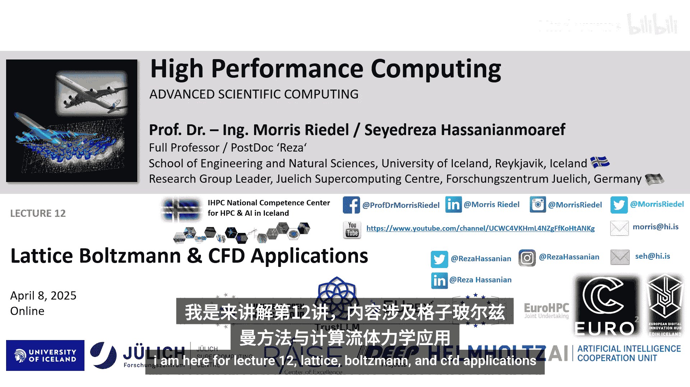
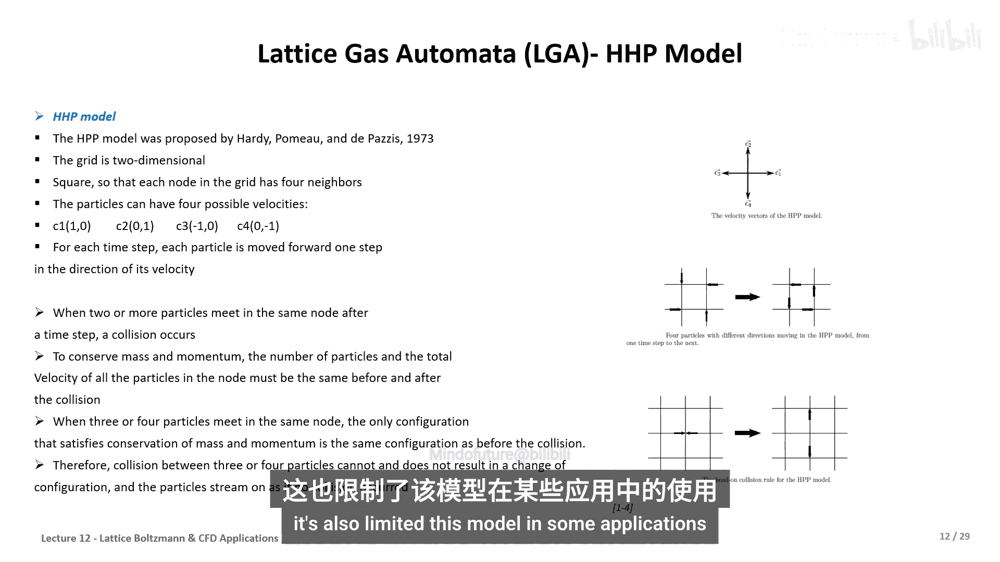
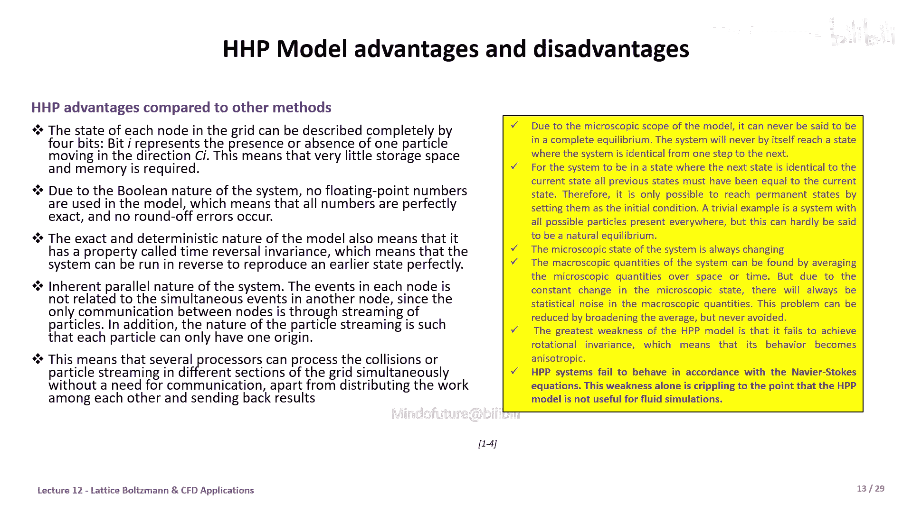
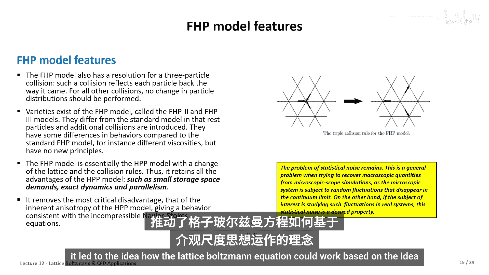
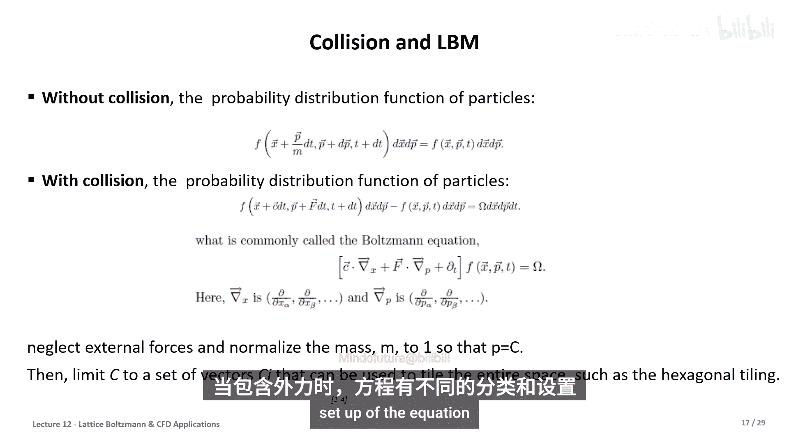
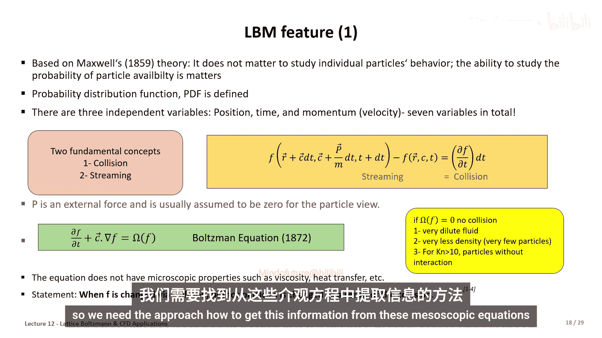
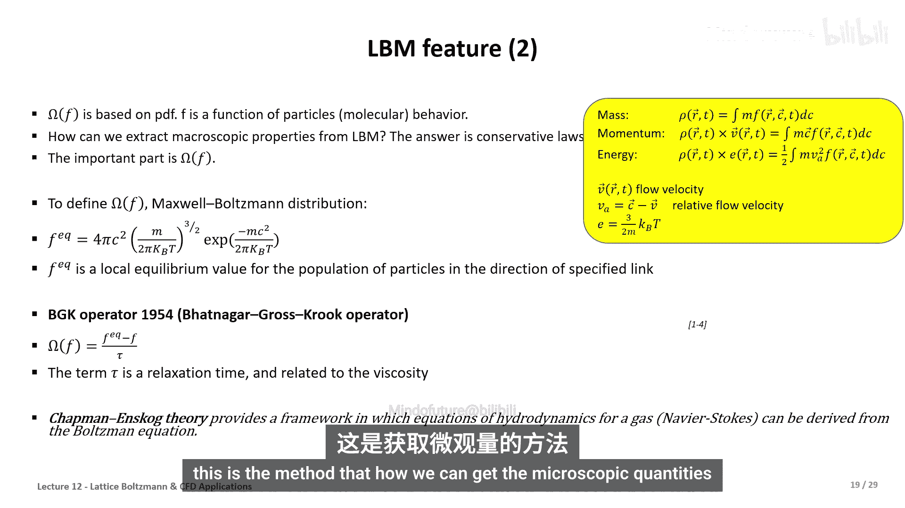
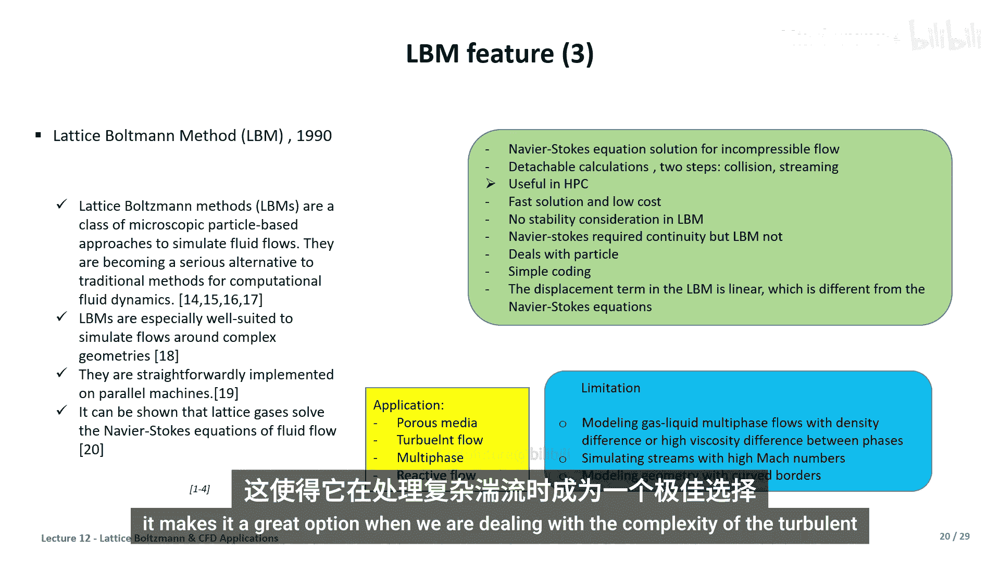
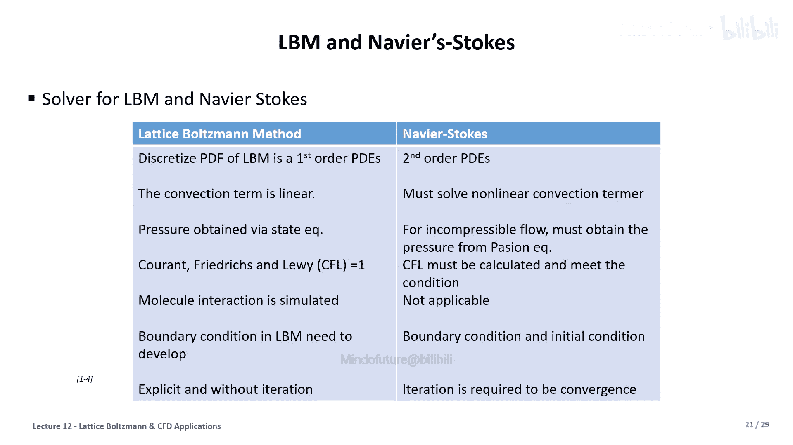
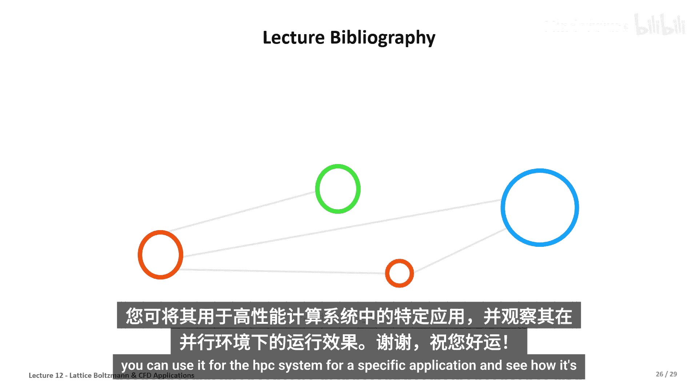

# 005：格子玻尔兹曼方法及其CFD应用 🧮

## 概述
在本节课中，我们将学习格子玻尔兹曼方法。这是一种用于流体动力学模拟的介观尺度方法，尤其适用于传统计算流体力学难以处理的复杂问题。我们将探讨其基本原理、与HPC的关联以及在实际湍流等应用中的潜力。

---

## 回顾上一讲：深度学习与湍流
上一讲我们讨论了深度学习中的序列模型及其在流体动力学和CFD中的应用。这些应用与高性能计算紧密相关，主要原因有两个：处理大规模数据需要强大的计算能力，以及训练大型深度学习模型本身就需要大量计算资源。

我们探讨了预测在流体动力学中的重要性。流体动力学中有一个未解决的难题，即湍流。我们从课程第二部分开始介绍了CFD，并指出当前研究使用有限的分析方法、实验方法和数值方法（CFD）。结合这三种方法，湍流问题仍未完全解决，对其认知仍然有限。

1941年，Kolmogorov提出了一个假设，解释了湍流中不同尺度之间能量如何从大尺度传递到小尺度。然而，该假设有特定前提，例如流动应是各向同性的，而大多数实际应用中的流动并非如此。对于最复杂的大尺度湍流，目前所知仍然甚少。

我们解释了如何利用深度学习研究湍流。关键在于建立流场数据与深度学习模型架构之间的联系。我们介绍了湍流中的拉格朗日框架，即跟踪流场中单个质点的运动。质点速度与位移、时间存在关联，因此这些数据可视为时间序列或序列数据。这样，我们就能建立这些序列数据与深度学习序列模型之间的联系，并利用这些数据训练模型进行预测。

我们还强调了统计学方法在湍流研究中的适用性，这在文献中已有充分论述。该方法通过处理湍流的不同实现样本来利用统计数据进行研究。我们提到，在湍流中，由于高雷诺数下湍流的高度敏感性，即使在相同实验设置下，我们也无法获得完全相同的可视化结果。

此外，关于深度序列模型，我们需要数据来训练模型。在流体动力学和湍流中，最可靠的数据来源是结合了实验和直接数值模拟（DNS）的数据。我们提到DNS是一种计算代价高昂的数值方法。因此，如何获取大规模数据以使用深度序列模型研究湍流，是一个挑战。

本讲中，我们介绍了一些该领域的最新研究。目前，我们研究小组的湍流团队也正在致力于开发此类应用模型。

---

## 引入格子玻尔兹曼方法
现在，让我们进入第12讲。在本讲中，我们将探讨格子玻尔兹曼方程。我们将了解这一方法的基本概念、如何在流体动力学建模中应用它、它在湍流研究中的应用，以及它与高性能计算的关系。

我们将看到，格子玻尔兹曼方法在并行计算方面具有巨大潜力。这正是近年来该方法得到发展的原因之一。借助强大的计算能力，它可以作为传统CFD方法的一种替代方案，用于湍流模拟。

---

## 流体动力学中的数值方法
CFD属于数值方法。当我们研究湍流时，我们介绍了三种主要方法：RANS、LES和DNS。我们讨论了每种方法的局限，特别是DNS对计算资源的需求极高，以获取精确解。

在流体动力学领域，我们还有多相流和颗粒 laden 湍流（即流场中包含固体颗粒的两相流）。颗粒与流体之间的相互作用非常复杂，再加上湍流本身的不确定性，使得这类模拟极其困难。此外，在多相流或颗粒流中考虑重力效应，会给问题增加更多复杂性，在方程中求解重力项也需要更多的计算资源。

由于这些原因，某些CFD应用仍存在限制。对于CFD，我们需要能够定义问题的边界条件和初始条件，而有些问题目前仍无法做到。我们讨论过边界条件，例如周期性边界条件和非周期性边界条件。

所有这些限制都存在于数值方法中，而实验方法也存在局限和障碍，特别是成本和扫描范围。我们无法为许多研究进行实验，尤其是考虑到成本、设备、尺度以及需要为实验创造的特定环境。

当然，解析方法是最好的，它为方程提供了更通用的解，但它仅适用于湍流中非常有限的情况。

面对这些限制，人们一直在寻找替代或更优的解决方案。正如上一讲提到的，近年来机器学习和深度学习进入了这一领域，为流体动力学研究提供了新的可能性，并有望帮助我们更好地理解这一复杂现象。

此外，我们还有玻尔兹曼方法，这将在本讲中讨论。它是一种额外的方法，在文献中常被视为传统CFD的替代方法，适用于一些无法使用CFD的情况。

更重要的是，由于其特定的工作方式（我们将在下一张幻灯片中解释），它非常适合并行计算，与HPC协同工作效果良好。

---

## 尺度范畴：微观、宏观与介观
要开始了解格子玻尔兹曼方法，让我们先简要介绍一下与之相关的尺度范畴。在处理偏微分方程问题时，通常使用三种尺度范畴来定义方法。

1.  **宏观尺度**：基于连续介质假设。例如，在流体流动中，我们将物质视为连续体进行研究。
2.  **微观尺度**：基于离散粒子。在这种尺度下，我们研究问题域中的每一个粒子。
3.  **介观尺度**：基于统计粒子群。简单来说，它基于粒子群，研究粒子在特定状态下的概率分布。

这三种尺度在计算需求和问题研究视角上存在显著差异。例如，在宏观尺度下，我们可以基于连续条件对问题域进行离散化（如第8讲所述），定义空间域大小和时间步长，然后求解并获得信息。而在微观尺度下，我们需要观察域中的每一个粒子或点，这需要巨大的计算量。介观尺度则提供了不同的计算方式和研究视角，用于研究流体等问题的行为。

---

## 从微观到介观
当我们谈论宏观尺度时，正如前面提到的，我们研究的是偏微分方程中流动的体积元。因此，网格离散化使得研究这一尺度成为可能。关于连续性，平均自由程远小于最小特征尺度（如网格尺寸）。这里使用一个称为克努森数的数值。当流动满足克努森数的特定范围要求时，我们可以使用纳维-斯托克斯方程。然而，在CFD中求解NS方程或PDE成本高昂，此外，离散化可能导致求解误差，并且为这类复杂问题生成网格的计算成本也很高（有时可占计算的50%）。在某些环境（如多孔介质）中，可能无法使用这种方法。

深入微观方法，正如所述，我们观察粒子运动，因此有粒子运动控制方程，进而可以得到整体流动运动。它基于分子动力学方法，依据牛顿第二定律解释单个粒子，并以高精度求解问题。然而，计算成本非常高，因为我们需要对每一个粒子进行计算。因此，这种方法仅限于短时间的研究，且只能处理数百万量级的粒子。这是该方法的一个局限，无法用于所有问题或大规模问题。微观方法的优势在于易于理解和实现，因为我们对每个粒子进行处理，然后推广到整个流动。但由于这些限制，让我们看看介观方法。

因此，我们可以看到介观平均方法。正如所述，它既不基于流动的体积元，也不基于单个粒子，而是基于统计视角。实际上，微观方法基于单个粒子，而这里基于统计视角，不完全是单个粒子，它处理长时间和大数据集，从而解决了微观方法中的一些问题。

其目标是理解属性的平均值和概率分布，这引出了概率粒子分布函数的概念。这是格子玻尔兹曼方法的基础概念，也是它如何用于流场和流动运动的核心。

---

## 格子玻尔兹曼方法的基础
那么，我们可以说介观方法介于微观和宏观方法之间。它不基于粒子，也不基于流动的体积元，基本上是从统计角度看待数据，因此可以用于更广泛的领域，并解决我们讨论的其他尺度范畴中存在的一些限制。

基于上述讨论，我们可以说格子玻尔兹曼方法与早期的格子气自动机（LGA）模型有关。在LGA中，目的是模拟气体中许多单个粒子的相互作用行为。其思想是将气体建模为稀疏粒子，它们沿着规则网格以一组可能的速度（我们称之为速度集 `c_i`）运动。粒子之间的碰撞通过一组弹性碰撞规则处理，这些规则必须守恒系统的质量 `M` 和动量 `P`。

这是解释LGA的基本思想。因此，在这张幻灯片中，我们可以看到如何基于特定的网格定义粒子的运动，并找到它们之间的碰撞，以及碰撞前后发生的情况。我们将基于格子玻尔兹曼方程来解释这一点。

关于LGA方法，有不同的模型被提出来模拟气体粒子。其中之一是HPP模型，由Hardy, de Pazzis和Pomeau于1973年提出。该模型在二维而非三维中工作，因此被称为二维模型。对于每个节点，有四个可能的方向，使得粒子在四个方向上具有完整的速度选择。在每个时间步，当粒子移动到下一个时间步时，如果节点中的粒子数量和所有粒子的总概率在碰撞前后守恒，将会有一个关于质量和动量守恒的决策。这是该思想的基础。

然而，由于一些限制，例如三个或四个粒子之间的碰撞不会导致构型改变，粒子会像没有发生碰撞一样继续运动；或者当三个或四个粒子在同一节点相遇时，唯一满足质量和动量守恒的构型就是碰撞前的相同构型。因此，HPP模型需要一些特定陈述，这也限制了该模型在某些应用中的使用。

---

## LGA模型的演进：FHP模型
因此，正如所述，HPP模型有一些优点和缺点。缺点大多与该模型的微观尺度有关，不能说是完全平衡的，系统具有完全平衡。此外，HPP模型通常面临各向异性条件，这是该模型可用性和弱点中最重要的问题之一。同时，系统的微观状态总是在变化。因此，你可以看到该模型的更多弱点和缺点。然而，在某些应用中，它仍然有效，并且具有此处列出的一些优点。

可以说，LGA的下一代模型是FHP模型，于1986年提出。实际上，我们看到HPP的一些限制，它改变了网格，从方形格子变为六边形格子。这使得它适用于可压缩方程。正如我们在这个模型中看到的，在FHP模型中，速度矢量根据模型中定义的格子获得了严格的方向。这是该模型中呈现的差异。然而，它有一些道德优势并解决了一些限制。例如，FHP模型的一个弱点在于获取宏观量。实际上，因为这个模型基于微观尺度，所以找到宏观尺度的量将是困难的，因为在微观尺度下，系统受到随机波动的影响。这些随机波动在连续极限中会消失。此外，统计噪声的问题在这个模型中仍然存在。然而，它解决了先前模型的一些限制，正如我们所说，并且它比HPP有更多的应用。但是，格子的定义引出了介观思想下格子玻尔兹曼方程如何工作的概念。

---

## 格子玻尔兹曼方程的核心
因此，在这里我们可以看到格子玻尔兹曼方法的一个模型。我们可以看到每个粒子具有不同的速度。它基于概率分布函数 `f(x, t, p)`，其中 `x` 是位置，`t` 是时间，`p` 是动量。我们关注这些量的守恒状态。

这里的核心概念是，如果没有碰撞，粒子的量在受到外力前后是相等的；如果发生碰撞，粒子在碰撞前后的量将会不同。这是格子玻尔兹曼方法中最重要的基本原理，用于观察基于此方程的构型如何工作。

那么，正如所述，这里的碰撞是关于碰撞前后发生的情况。如果碰撞发生，会有一个概率分布函数，这是由于碰撞前后的差异造成的。但当没有碰撞时，碰撞前后的函数是相同的。因此，这种条件之间的差异将定义一个函数或方程，从而引出格子玻尔兹曼方程。在这个方程中，实际上忽略了外力；当存在外力时，方程的分类和设置会有所不同，我们将稍作讨论。

---

## 玻尔兹曼方程的数学形式
我们可以说，格子玻尔兹曼基于麦克斯韦于1859年提出的思想，即研究单个粒子行为并不重要，如果我们能够研究粒子的概率，那才是关键，它帮助我们理解情况。这就是为什么它使用概率分布函数 `f`。

需要定义该函数，并且在这类研究中，有三个独立变量：位置、时间、动量（可以是速度或动量）。由于位置和动量在三维中各有三个分量，因此此类方程总共有七个变量。正如我们所提到的，存在碰撞和平衡的基本原理来得到方程。在这张幻灯片中，我们展示了平衡是碰撞前后不同条件以及碰撞后发生的情况。这种差异引出了方程。

在这个绿色框中，你可以看到玻尔兹曼方程的样子。分布函数 `f` 的梯度如何导致一个函数，该函数表示碰撞前后分布函数 `f` 的差异。关于定义格子玻尔兹曼方程的函数 `Ω`，如果它等于0，我们可以在格子玻尔兹曼方程中说右手边为0，这意味着没有碰撞，即粒子条件在碰撞前后状态相同。这种条件可能发生在某些流体中，例如，这里有一些例子：密度非常低时（粒子非常少），以及当克努森数大于10时（意味着粒子没有相互作用）。在非常稀薄的等离子体中也可能发生。但我们应该提到，这个方程没有诸如粘度 `ν`、热导率 `κ` 等微观属性，这些属性很重要。因此，我们需要一种方法从介观方程中获取这些信息。

---

## 从分布函数到宏观量
因此，观察玻尔兹曼方程，我们可以说右侧的概率分布函数 `f` 是该方程的关键概念。定义这个函数将为每个问题求解方程。例如，麦克斯韦-玻尔兹曼分布就是为该函数定义的，你可以在这里看到它，它使用了粒子的局部平衡。还有另一个算子，称为BGK算子，于1954年提出，作为定义碰撞发生时该函数的算子。

另外，关键点是我们如何定义流动的属性，即宏观量。我们可以看到，通过对概率分布函数 `f` 进行积分，我们可以得到这一点。你可以看到我们如何计算质量 `ρ`、动量 `ρu` 和能量 `E`，并可以从这个方程得到流速 `u`。那么，这就是我们如何获取宏观量的方法。

---

## 格子玻尔兹曼方法的特点
让我们回顾一下格子玻尔兹曼方程的一些特点。实际上，格子玻尔兹曼方程基于粒子类别，我们可以说是介观的。它基于粒子，但着眼于它们的概率，因此定义了介观尺度。正如所述，它是传统CFD的替代方法之一，适用于无法用常规CFD解决的问题。它也适用于复杂几何形状，这很好。并且，正如所述，由于该方法包括碰撞步骤及其目标，它在并行计算中运行良好。

对于一些使用CFD的特定情况，传统CFD处理存在一些障碍和困难，例如多孔介质、湍流、多相流和反应流，格子玻尔兹曼是一个很好的选择，并且运行良好。然而，在某些方法中，我们需要使用其他东西，例如，当我们处理高雷诺数的湍流时，正如在这个定义中所说，粘度没有定义，并且湍流中的粘度定义仍然是一个问题。

正如我们之前关于湍流的讨论，当流动从最大尺度到小尺度时，粘度的行为不同，因此在最大尺度定义粘度是一个问题。所以，这是将其用于湍流时需要考虑的一些关键点。然而，格子玻尔兹曼也存在一些限制。例如，模拟具有密度比和高马赫数的气-液两相流具有挑战性。模拟具有曲线边界的几何形状也有一些困难的应用。

然而，研究湍流中粒子的能力使其成为处理湍流复杂性时的一个绝佳选择。

---

## 与纳维-斯托克斯方法的比较
因此，我们可以看到纳维-斯托克斯方法与格子玻尔兹曼方法之间的比较，特别是当我们在PDE上工作时，我们可以看到在某些层面上格子玻尔兹曼工作得更好。然而，它在应用中仍然有限，许多研究正在进行中，以发展格子玻尔兹曼方法在流体动力学领域，特别是在湍流中的应用。

例如，在常规CFD的纳维-斯托克斯方程中，有一个称为CFL条件的项，必须计算并满足该条件才能使用CFD，但在格子玻尔兹曼中，它始终为1。关于压力，当处理可压缩/不可压缩流动时，必须从单独的方程获得压力，但在格子玻尔兹曼中，可以通过状态方程计算压力。

---

## 格子玻尔兹曼与高性能计算
格子玻尔兹曼计算也在这里展示了一个例子，说明问题域如何离散化，以及我们如何使用格子玻尔兹曼。例如，这里当然可以使用不同的模型，这里是二维的。D2Q9是一个二维模型。正如我们所见，每个粒子在每个时间步的状态取决于相邻粒子。这导致属性在局部更新，从而减少了计算槽和时间。

格子玻尔兹曼非常适合在并行计算中使用，正如我们之前提到的。关于可以使用的模型，对于二维或三维有非常不同的定义，基于问题的维度和几何形状，我们需要选择合适的模型。

正如所述，基于问题的维度选择合适的模型很重要，我们还需要查看这里应该定义多少速度矢量。例如，我们可以在示例中看到格子玻尔兹曼方法的性能评估，称为特定后处理上的流体模拟。

在右侧，我们可以看到弱扩展结果。例如，当我们说D3Q15时，3是维度，所以问题是三维的，15是速度的数量。当速度数量从15增加到27时，我们可以看到性能没有太大变化，并且较低速度数量的性能优于较高的。因此，在弱扩展中变化不大。然而，在左侧的另一个示例中，我们可以看到在单个节点上的计算，使用一个MP后处理，例如处理三维问题，速度数量再次从15增加到17。我们可以看到，当核心数超过14,250时，具有较多速度（19和27）的模型比15的模型工作得更好。因此，这里需要进行一些评估，以确定哪个在性能上更好。此外，我们可以看到并行计算对此类模型的影响。

这里还有格子玻尔兹曼在椭圆形气缸上的另一个应用示例。它在一个封闭的狭窄域中下落，并研究了不同的效应。文献中有一些近似公式，这项研究使用格子玻尔兹曼进行比较。当然，对于这种情况，使用格子玻尔兹曼是处理这种特定气缸情况的绝佳选择，这展示了格子玻尔兹曼在此类研究中的能力。

---

## 总结
我们完成了关于格子玻尔兹曼及其CFD应用的讲座。正如在简短讲座中所说，我们尝试介绍了这种方法。

这里有一个展示介观尺度样子的视频，我建议你观看这个视频，链接在讲座的Earthmans中。当然，格子玻尔兹曼是一个需要更详细研究的方法，这里只是一个简短的介绍。如果你感兴趣，有参考文献集，你可以查阅并了解更多。当然，这是一个开放的研究领域，如果你感兴趣，你可以将其用于HPC系统进行特定应用，并观察它在并行计算中的表现。

祝你好运！