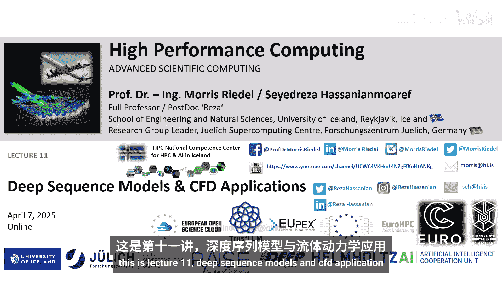
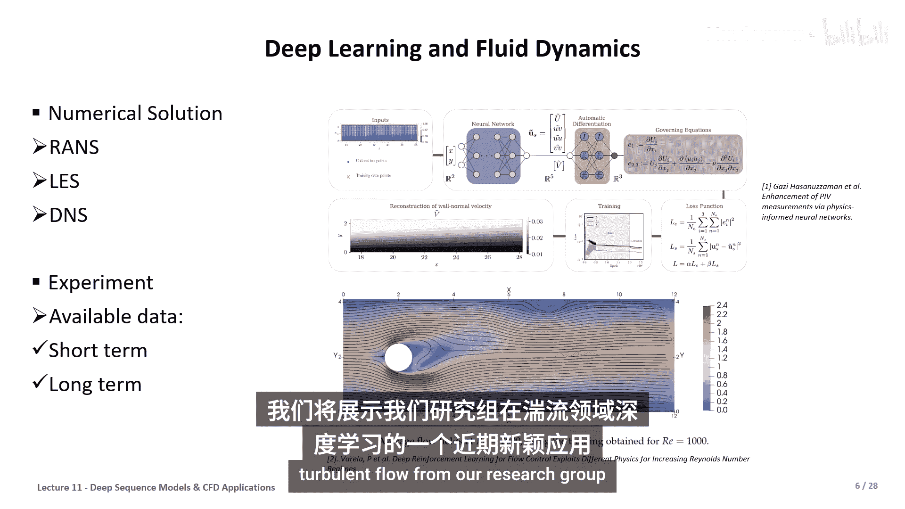
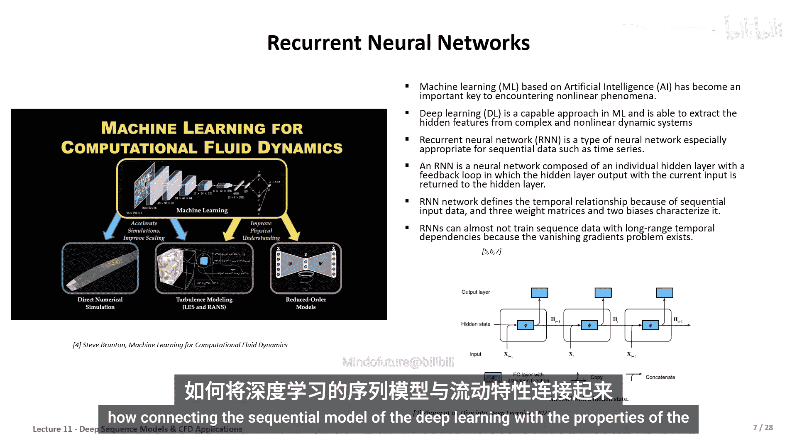
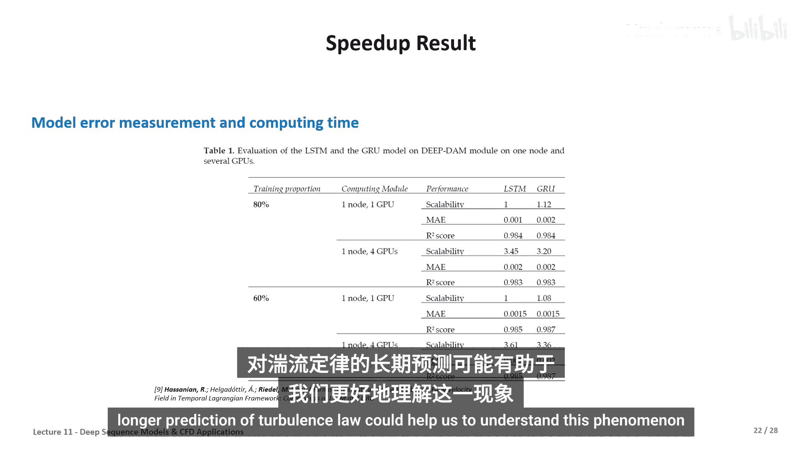
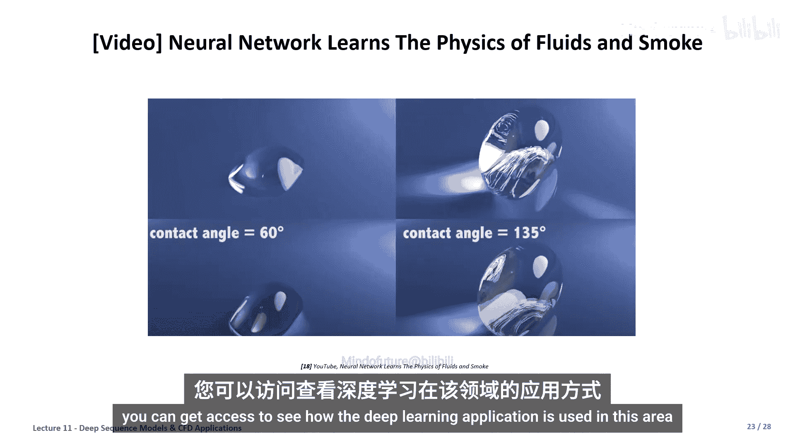
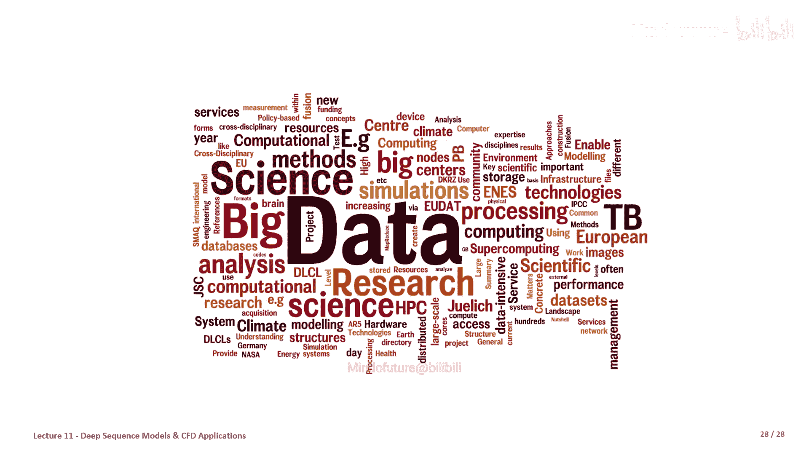

# 006：深度序列模型与CFD应用 🚀

在本节课中，我们将学习深度序列模型在计算流体动力学领域的应用。我们将探讨湍流预测的重要性、可用于预测的方法，以及深度学习中的序列模型如何在此领域发挥作用。同时，我们也会了解高性能计算在这些应用中的角色。

上一节我们介绍了OpenFOAM软件及其在并行计算中的应用。本节中，我们来看看如何将深度学习技术，特别是序列模型，应用于流体动力学中的湍流预测问题。

## 湍流预测与深度学习 💨

在流体动力学领域，处理问题的方法主要有实验、解析和数值模拟。对于湍流这类复杂问题，数值模拟方法包括雷诺平均法、大涡模拟和直接数值模拟。这些方法，尤其是后两者，需要巨大的计算资源。

与传统的数值方法相比，深度学习在处理湍流这类非线性、时空相关的复杂现象时展现出巨大潜力。流体动力学中的数据通常是空间和时间的函数，具有时空特性。因此，我们需要找到深度学习模型与流场物理特性之间的连接。

## 循环神经网络与序列模型 🔄

循环神经网络是专门处理序列数据（如时间序列）的深度学习模型。在流体动力学，特别是湍流研究中，我们可以利用RNN来处理湍流数据的时间序列。

以下是RNN在湍流预测中的优势：
*   **处理非线性现象**：深度学习擅长处理像湍流这样的非线性现象。
*   **提取隐藏特征**：能够从复杂数据中提取隐藏的模式和特征。
*   **模型组合提升性能**：通过组合不同的深度学习模型，可以进一步提高预测性能。

## LSTM与GRU：解决长期依赖问题 🧠

标准RNN在处理长序列数据时，会遇到梯度消失问题，导致无法有效学习长期依赖关系。

长短期记忆网络是RNN的一种变体，它通过引入门控机制解决了梯度消失问题。LSTM的结构包含输入门、遗忘门和输出门，能够有选择地保留或丢弃信息，从而记住长期的序列模式。

门控循环单元是LSTM的一种简化变体。GRU将LSTM的输入门和遗忘门合并为单一的更新门，减少了模型参数和计算量。文献表明，GRU通常能达到与LSTM相近的性能，但训练速度更快，这在计算资源有限时尤为重要。

## 连接序列数据与深度学习模型 🔗

在流体动力学中，我们需要建立一个框架，将物理问题中的序列数据与深度学习模型连接起来。这涉及到如何定义数据的时间序列，以及如何找到不同物理量（如速度、位移、时间）之间的相关性。

在流体力学中，主要有两种描述框架：
*   **欧拉观点**：在空间固定点观察流体的变化。
*   **拉格朗日观点**：跟随流体质点，观察其属性随时间的变化。

对于序列模型，拉格朗日框架更为合适，因为它天然地提供了质点属性（如速度、位移）随时间演变的时间序列数据。我们可以用这些时间序列数据来训练模型，例如，用过去的位移和速度来预测未来的速度。

## 数据来源与实验案例 📊

训练深度学习模型需要可靠的数据。在湍流研究中，数据主要来自实验和CFD模拟。其中，直接数值模拟能提供最精确的数据，但计算成本极高。

本节将介绍一个研究案例，该案例使用实验数据来训练LSTM和GRU模型。实验在一个水箱中进行，通过粒子图像测速技术追踪示踪粒子的运动，从而获得位移、速度等时间序列数据。

该数据集包含了大量粒子的运动信息。我们可以将其按比例（如60%或80%）划分为训练集和测试集，用于训练和评估模型。

## 模型性能与HPC角色 ⚡

实验结果表明，LSTM和GRU模型在湍流粒子轨迹预测上表现良好，预测结果与测试数据吻合度高。

在计算性能方面，使用CPU时，GRU通常比LSTM快5%到12%。然而，当使用GPU进行计算时，两者的速度差异变得不明显。这可能与数据规模有关，当数据量不够大时，GPU的加速优势可能被数据传输等开销抵消。这凸显了在处理大规模数据和复杂模型时，分布式深度学习和高性能计算的重要性。

本节课中我们一起学习了深度序列模型（特别是LSTM和GRU）在计算流体动力学，尤其是湍流预测中的应用。我们探讨了如何将流体物理的序列特性与深度学习模型相连接，并分析了一个使用实验数据成功预测湍流粒子运动的案例。理解模型选择、数据框架以及高性能计算的作用，对于在该领域有效应用深度学习技术至关重要。

在下一个短讲座中，我们将继续探讨CFD与高性能计算的其他应用领域。