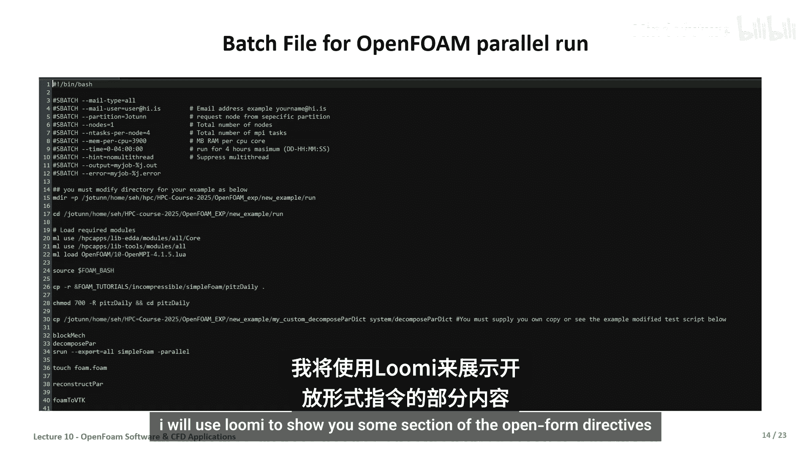
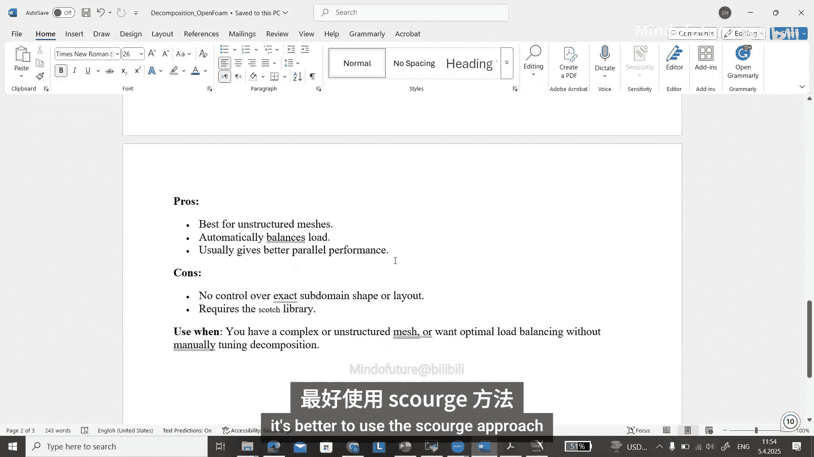
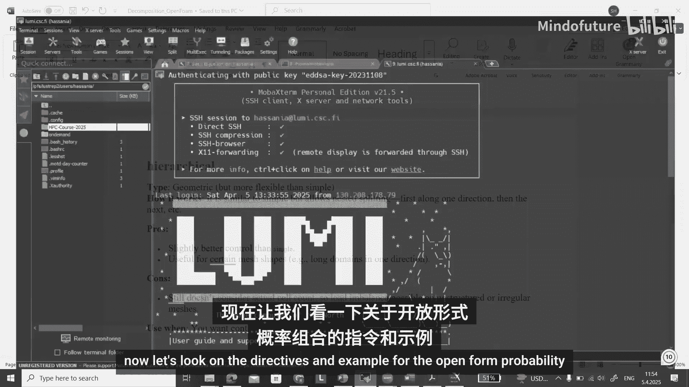
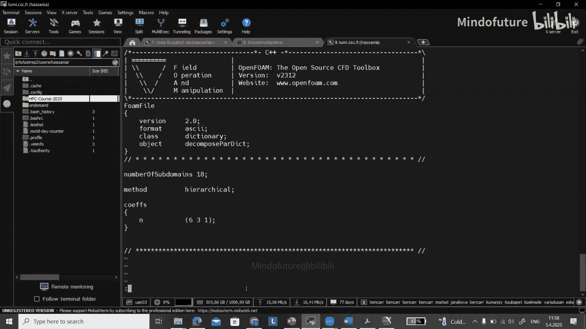
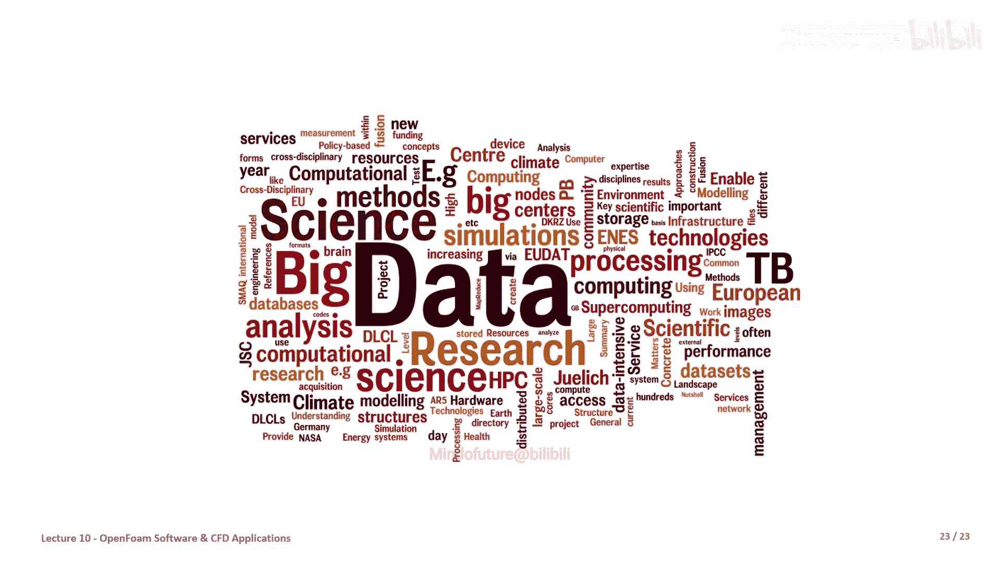

# 007：OpenFOAM软件与CFD应用 🚀

在本节课中，我们将学习开源计算流体动力学软件OpenFOAM。我们将了解其基本概念、如何在HPC系统上进行并行计算设置，特别是域分解方法及其与MPI的关系。

上一节我们介绍了CFD应用中的湍流模拟方法。本节中，我们来看看一个具体的开源工具——OpenFOAM。

## OpenFOAM简介 🧮

OpenFOAM是一款用于流体动力学领域的开源软件。由于它是免费和开源的，用户可以针对新的问题设计计算域和边界条件，编写新的求解器，并进行修改以用于高性能计算。

以下是OpenFOAM的一些关键特性：
*   它是开源代码，允许用户进行定制和修改。
*   它适用于层流和湍流等多种流动状态。
*   它支持可压缩和不可压缩流动的模拟。
*   它具备在并行计算环境下运行的能力，这对CFD模拟至关重要。

## 软件结构与能力 🏗️

OpenFOAM基于C++工具箱构建，用户可以为其定制代码。这意味着研究人员可以为特定的层流或湍流问题从头开始创建代码，使用其工具箱语言指定问题域、几何形状和条件，从而建立新模型。

OpenFOAM还具备以下能力：
*   它与可视化软件连接，可以进行后处理和数据可视化。
*   它能够在并行环境下运行。
*   除了核心的CFD应用，它也可用于解决量子力学等问题。

在工业界，它被广泛应用于汽车制造、工艺工程和环境工程等领域。在基础物理研究中，它也被用于流体动力学模拟，以帮助理解湍流等复杂现象的内部过程。

## 并行计算与域分解 🔄

在CFD中进行并行计算和高性能计算应用，需要对问题的计算域进行分解。

上一节我们介绍了并行计算在特定问题域上的工作原理。本节中，我们具体看看如何在OpenFOAM中实现。

域分解需要为问题的计算域创建子域。以下是一个MPI域分解的示例，展示了所需存储的数量以及子域之间的重叠区域。边界数据需要在这些重叠区域进行交换，特别是在非稳态问题中，每个时间步都需要从相邻子域更新信息以推进求解。

在OpenFOAM软件中，域分解方法以标准形式提供。用户可以通过命令运行，主要有以下几种方法：
*   **simple**： 简单的几何分解方法。
*   **hierarchical**： 沿指定方向进行分层分解。
*   **scotch**： 基于图论的分解方法，旨在平衡负载并最小化通信。

用户需要根据问题的几何形状和网格类型（如对称几何、复杂形状或结构化/非结构化网格）选择最有效的分解方法，以在HPC上获得高效的求解和准确的结果。

## 实践示例：在HPC上运行OpenFOAM 💻

为了展示OpenFOAM的并行计算示例，我将分享一个用于在HPC系统上提交作业的批处理脚本。

以下是在批处理脚本中进行设置的关键步骤：
1.  在第二行指定你的电子邮件地址。
2.  使用系统上可用的分区（例如`ua`）。
3.  设置节点数量（例如`1`）和每个节点的任务数（这关系到MPI进程数）。
4.  根据需要调整内存和最大作业运行时间。
5.  指定标准输出和错误输出的文件路径。
6.  在下一部分中，指定要运行的模拟案例目录地址。

关于OpenFOAM示例作业，你需要在脚本中加载必要的软件模块，然后执行一系列命令：
*   `source` OpenFOAM的环境配置。
*   从教程目录复制示例案例文件。
*   生成计算网格（`blockMesh`）。
*   进行域分解（`decomposePar`）。**请注意**，分解方法需要在案例目录下的`system/decomposeParDict`文件中预先设置，你可以尝试不同的方法并比较计算时间和结果。
*   使用`mpirun`命令并行运行求解器（如`simpleFoam`）。
*   并行计算完成后，重建整个域的结果（`reconstructPar`）。
*   将结果转换为可视化格式（如`foamToVTK`），以便用ParaView等软件查看。

我将把原始的批处理文件分享到课程平台，你可以访问并使用它。

## 分解方法的选择与影响 ⚖️

选择不同的域分解方法会影响并行计算的性能和负载平衡。

以下是各种分解方法的简要对比：
*   **simple**： 基于x, y, z方向进行划分。优点是指定简单；缺点是仅适用于均匀的结构化网格。
*   **hierarchical**： 沿单一方向进行分解。它比`simple`方法更灵活，性能通常也更好。
*   **scotch**： 基于图形拓扑的方法，通过划分单元连通性来平衡负载并最小化子域间通信。在处理复杂的非结构化网格时，使用`scotch`方法通常是更好的选择。

## 边界条件的重要性 🧱

在域分解中，边界条件的处理至关重要。

除了了解邻居子域，每个进程还需要知道其边界是否为物理边界。这有助于避免编程错误并正确应用边界条件。主要有两类边界条件：
*   **周期性边界条件**： 任何边界块都被视为内部块。这意味着，位于计算域边缘的子域也被假定为内部块。应用这种条件时，只需为每个进程正确定义邻居映射即可。
*   **非周期性边界条件**： 设置方式不同。对于没有邻居的边界子域（例如计算域的边缘），我们需要明确指出没有来自“不存在块”的信息。在使用MPI时，可以利用`MPI_PROC_NULL`通信子来优雅地处理这种情况，避免向不存在的进程发送或接收数据。

## 总结 📚

本节课中，我们一起学习了OpenFOAM软件及其在CFD中的应用。你看到了OpenFOAM的实际应用，了解了它如何进行域分解，以及如何结合MPI进行修改和优化。我们特别讨论了边界条件的影响，以及如何使用周期性和非周期性边界条件。因此，当使用MPI时，我们可以为此类问题实现高效的并行计算。

建议你观看课程视频中提供的链接，以更直观地了解MPI，特别是针对我们所讨论的CFD应用是如何工作的。

我们将在下一讲继续。祝你好运！