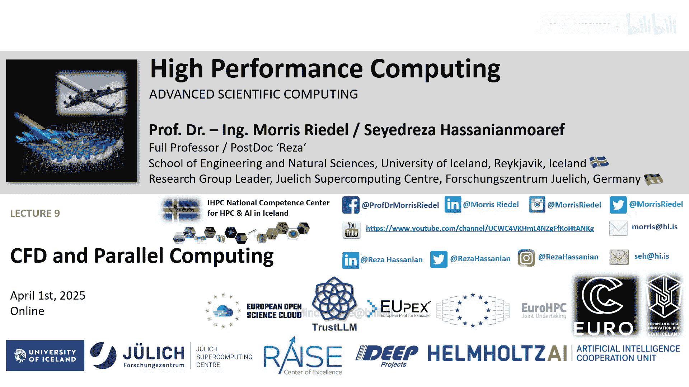
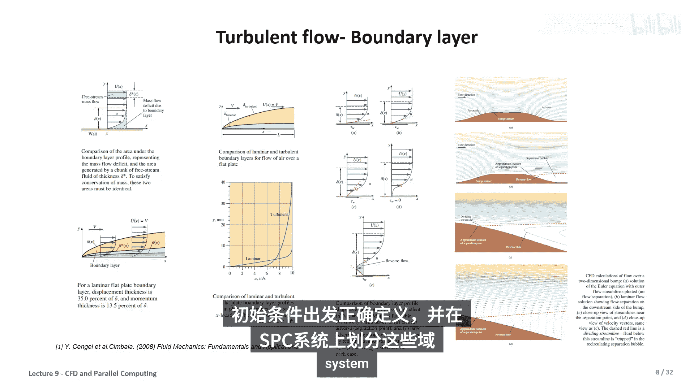
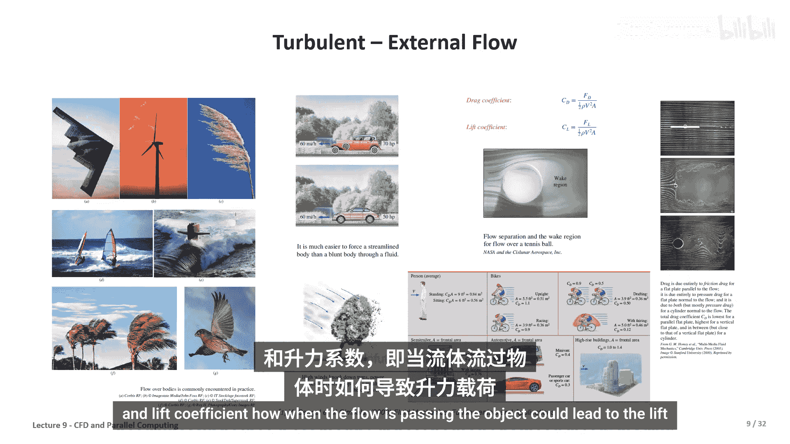
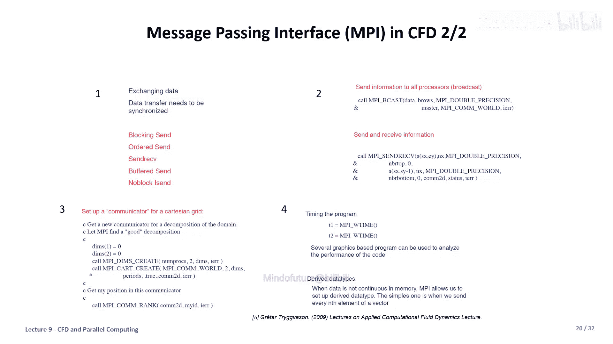
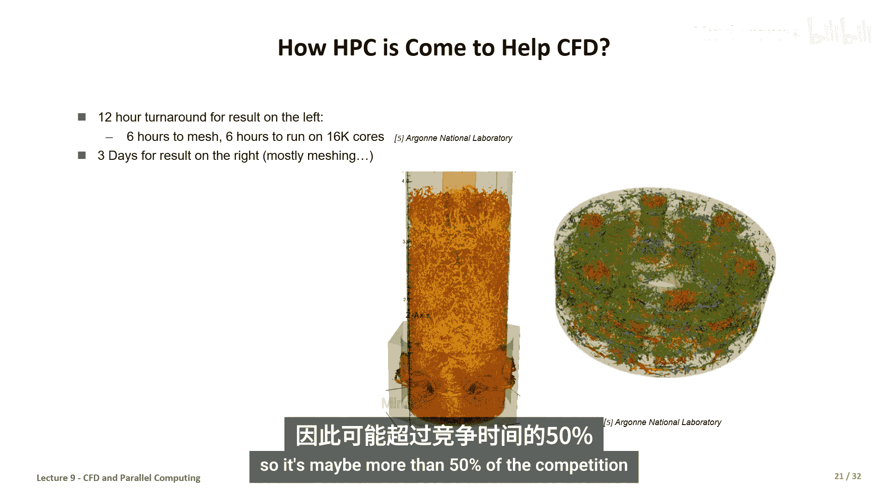
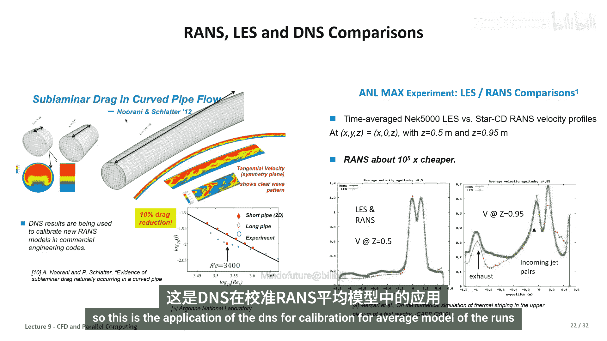
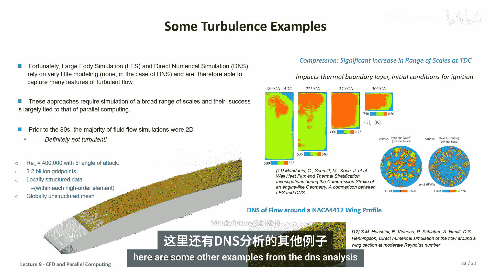
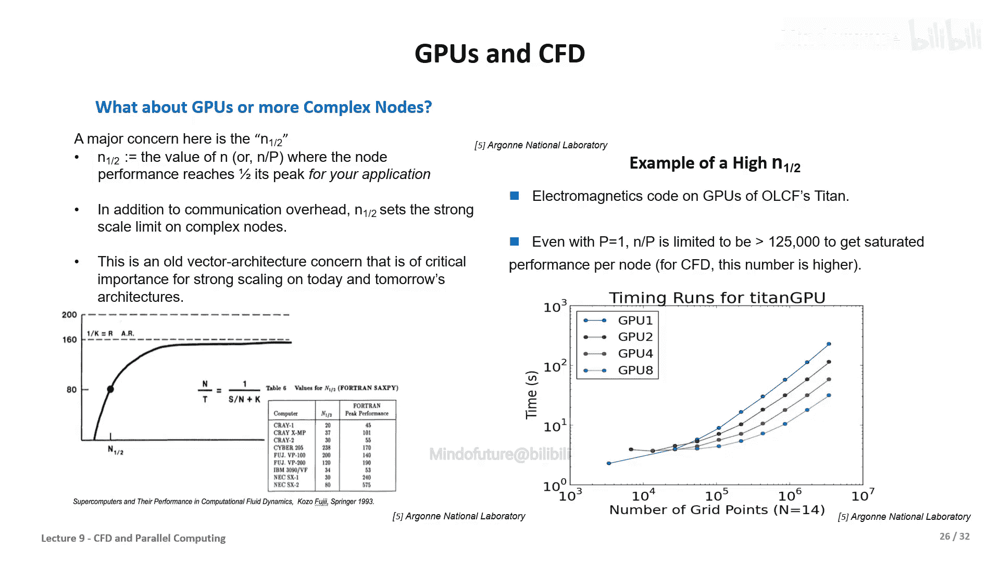
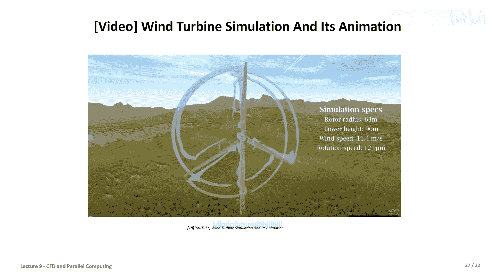
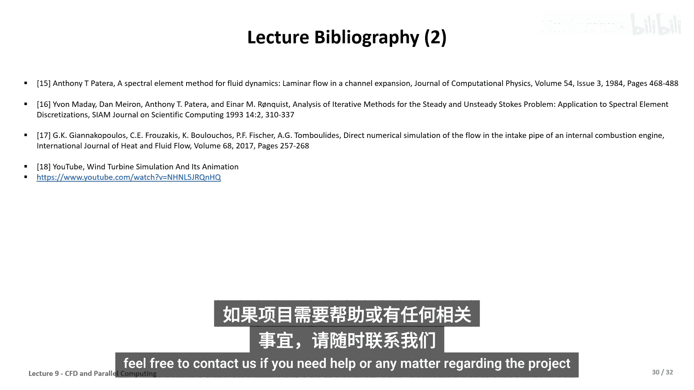

# 008：CFD与并行计算 🚀



在本节课中，我们将学习计算流体动力学（CFD）与并行计算的结合应用。我们将回顾湍流的基本概念，探讨不同的CFD模拟方法（如RANS、LES、DNS），并深入了解并行计算架构的拓扑结构及其在CFD问题中的效率优化。

## 回顾与引言

上一节我们介绍了CFD的基础，包括其历史、基本原理以及网格离散化的重要性。本节中，我们将继续探讨CFD，特别是其在湍流模拟中的应用，并分析如何利用并行计算来高效解决这些问题。

## 湍流流动概述 🌊

湍流是一种高度非线性的复杂流动现象，其特性由雷诺数（Re）决定。雷诺数是一个无量纲参数，定义为惯性力与粘性力的比值。当惯性力占主导时，流动通常呈现湍流状态。

以下是湍流与层流的一些关键区别：
*   **层流**：流动平滑、有序，具有可预测的流线模式。
*   **湍流**：流动混乱、无序，充满了不规则的速度脉动和涡旋。



湍流广泛存在于自然界和工程应用中，因此对其进行准确模拟至关重要。



## 湍流流动示例

湍流可分为内部流动和外部流动。

### 内部流动示例
内部流动指在封闭管道或通道内的流动。例如，在圆管流动中：
*   当雷诺数 **Re < 2300** 时，为层流。
*   当 **2300 < Re < 4000** 时，为过渡流。
*   当 **Re > 4000** 时，为充分发展的湍流。

在湍流中，时均速度剖面与层流有显著不同，近壁区的速度梯度更为陡峭。

### 外部流动示例
外部流动指物体外部（如绕流）的流动。这在汽车工业（研究阻力系数 **Cd** 和升力系数 **Cl**）、航空航天等领域有重要应用。

## CFD在湍流模拟中的应用 🧮

对于湍流模拟，主要有三种数值方法：雷诺平均纳维-斯托克斯模拟（RANS）、大涡模拟（LES）和直接数值模拟（DNS）。

### RANS方法
RANS方法求解流动变量的时均值。它在控制方程中引入了雷诺应力项，需要通过湍流模型（如 **k-ε模型**）来封闭求解。
*   **优点**：计算成本相对较低。
*   **缺点**：对于复杂几何或强分离流，精度可能不足。

### LES方法
LES方法直接解析大尺度涡，而通过亚格子尺度（SGS）模型模拟小尺度涡的影响。
*   **优点**：比RANS能捕捉更多流动细节，精度更高。
*   **缺点**：计算成本高于RANS。

### DNS方法
DNS方法直接解析所有尺度的湍流运动，无需任何湍流模型。
*   **优点**：精度最高，能提供最详细的流动信息。
*   **缺点**：计算成本极其高昂，通常与雷诺数的 **~Re^3** 成正比。

**选择准则**：需在计算成本与所需精度之间进行权衡。工业应用常采用RANS，而研究和高端设计则会使用LES或DNS。

## 并行计算架构与拓扑 🔗

为了高效运行CFD模拟，尤其是LES和DNS，必须利用并行计算。并行计算的效率很大程度上取决于处理器之间的互连拓扑结构。

拓扑结构定义了处理器之间的连接方式，主要分为两类：
1.  **静态拓扑**：连接模式固定，如环、网格、超立方体。
2.  **动态拓扑**：连接模式可随时间改变，如交叉开关、多级交换网络。

理想的拓扑应具有：每个节点的连接数少、节点间距离短、节点间可选路径多以及良好的可扩展性。

## 并行计算在CFD中的实现



在CFD中实现并行计算，通常需要将计算域分解为多个子域，每个处理器负责一个子域的计算。



**关键点**：子域之间需要有重叠的“幽灵层”或“边界层”，以便在每次迭代时与相邻处理器交换边界信息。对于2D问题，需要交换**线**数据；对于3D问题，则需要交换**面**数据。

消息传递接口（MPI）是实现这种分布式内存并行计算的标准工具。一个典型的CFD并行程序结构包括：
```c
MPI_Init(...); // 初始化MPI环境
// ... 确定进程ID和总数 ...
// ... 主计算代码（包括域分解、通信、求解） ...
MPI_Finalize(); // 结束MPI环境
```



## 高性能计算效率考量 ⚡



评估HPC效率有两个主要目标：
1.  在固定问题规模下，减少计算耗时。
2.  在固定计算成本下，求解更大规模的问题。

影响并行效率的主要因素包括：
*   **并行内容比例**（阿姆达尔定律）
*   **负载平衡**
*   **通信开销**
*   **冗余计算**

例如，在一个使用390万个网格的DNS模拟中，若每个MPI进程分配的网格点过少（如仅216个点），则通信开销将占主导，导致并行效率低下。通常，为了达到50%以上的并行效率，每个MPI进程需要处理至少2000个网格点。

## 先进计算技术示例

随着计算技术的发展，一些方法被用于加速CFD模拟：
*   **高阶格式**：可以提高精度，有时在相同精度下减少所需网格量。
*   **多重网格求解器**：加速偏微分方程求解过程。
*   **GPU加速**：利用图形处理器进行大规模并行计算，特别适用于显式计算（如涉及“半时间步”的龙格-库塔方法），可显著减少计算时间。

## 总结

本节课中，我们一起学习了：
1.  **湍流的基本特性**及其与层流的区别。
2.  **三种主要的CFD湍流模拟方法**：RANS、LES和DNS，了解了它们各自的优缺点和适用场景。
3.  **并行计算架构的拓扑结构**及其对计算效率的重要性。
4.  **如何在CFD中实现并行计算**，包括域分解、边界通信以及MPI的基本使用框架。
5.  **评估和优化HPC效率的关键因素**，并通过实例看到了负载平衡和通信开销对性能的影响。
6.  **一些先进的加速计算技术**，如GPU加速在高保真模拟中的应用。







CFD与高性能计算的结合是解决复杂工程和科学问题的强大工具。理解这些基本原理和方法，有助于我们更有效地利用计算资源，探索流体世界的奥秘。