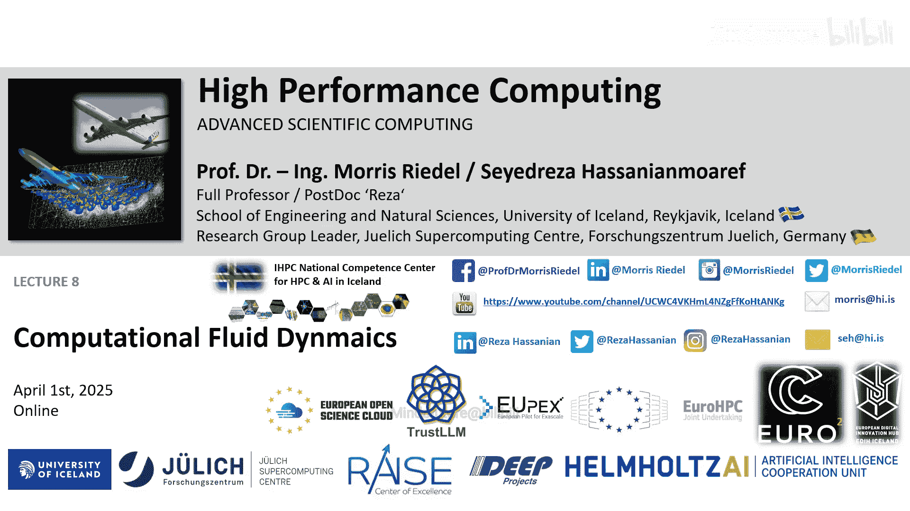
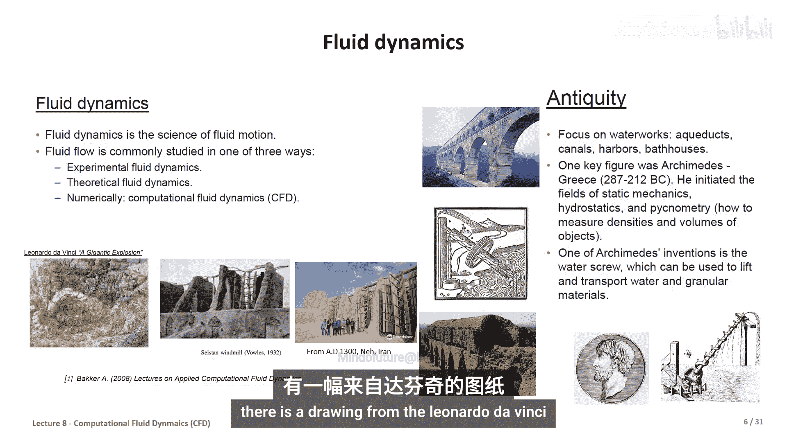
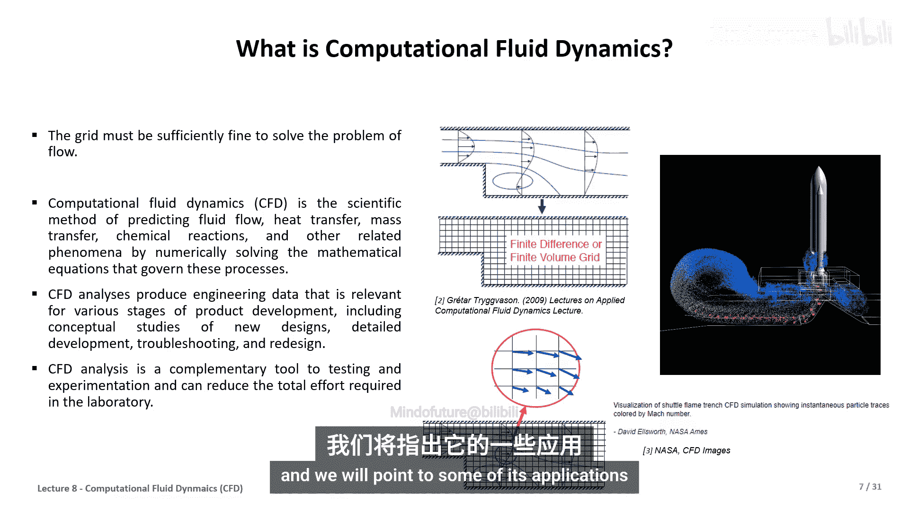
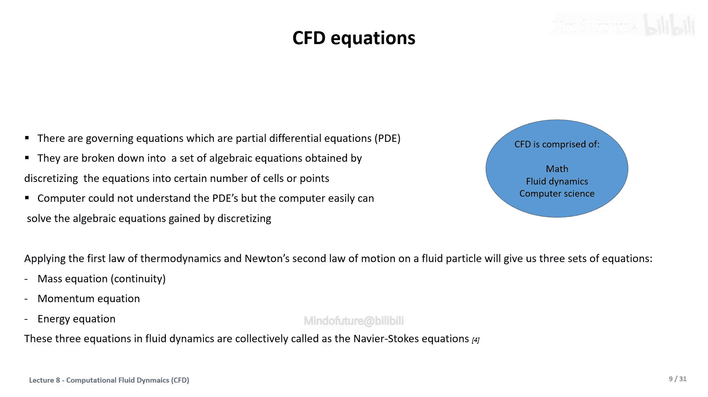
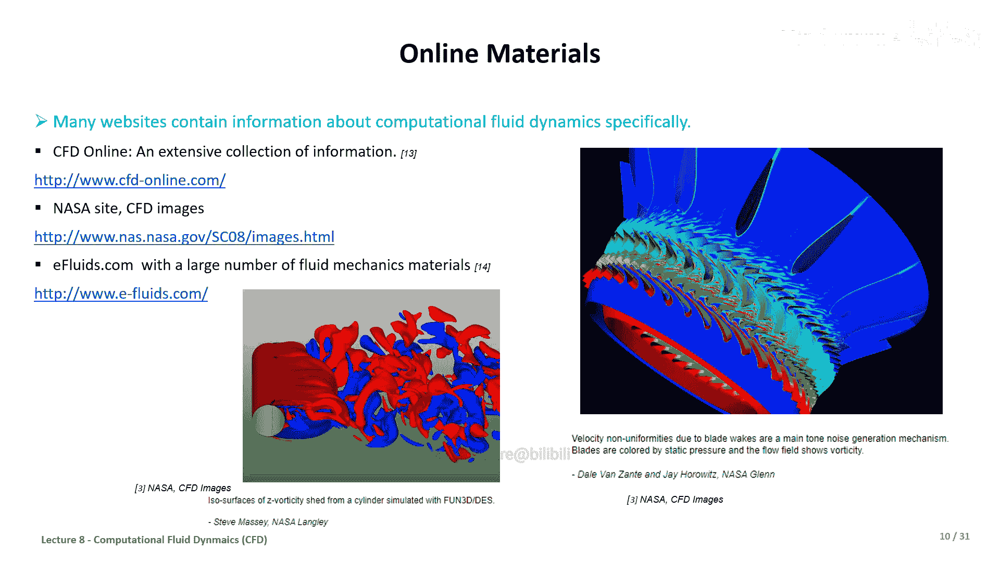
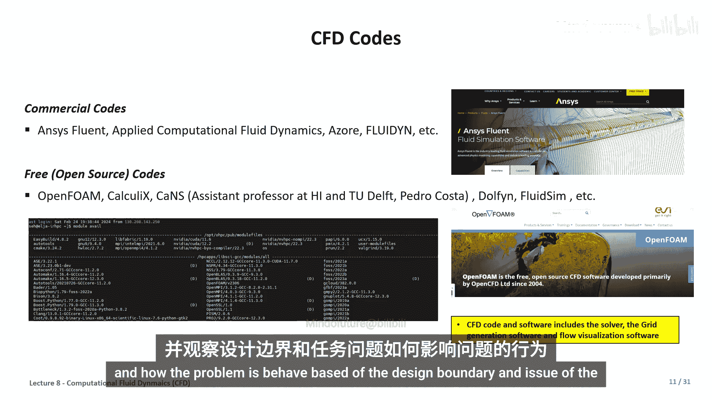
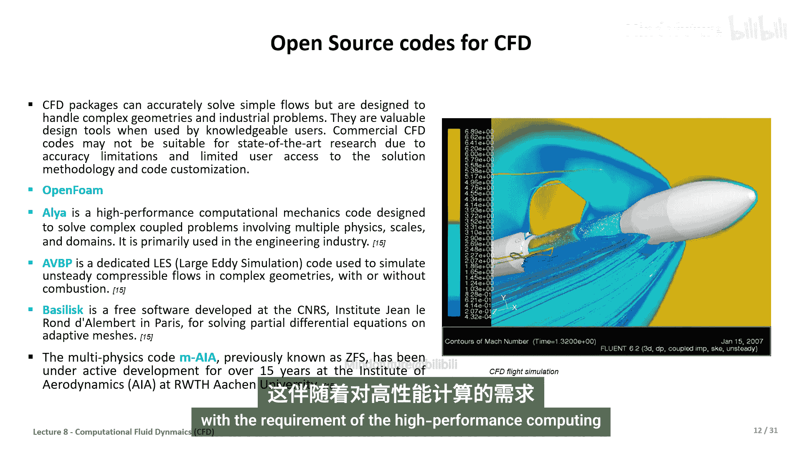
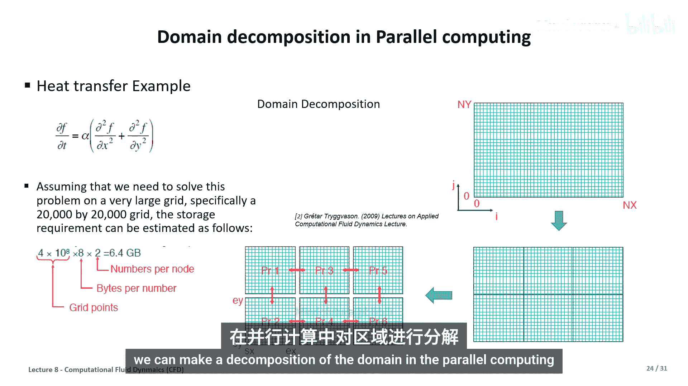
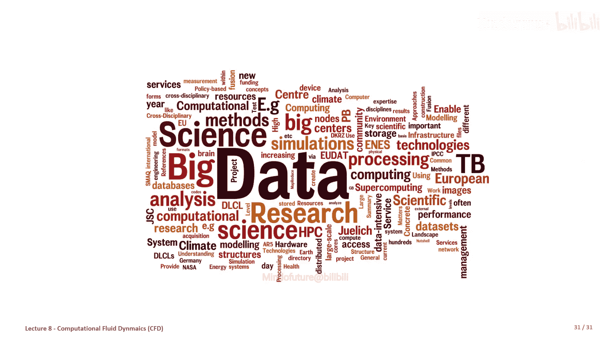

# 009：计算流体力学入门 🚀

在本节课中，我们将要学习计算流体力学的基础知识，了解其应用背景、核心方程、数值方法，并探讨高性能计算在解决复杂CFD问题中的关键作用。

上一节我们介绍了分布式深度学习及其应用。本节中，我们来看看计算流体力学这一传统高性能计算的核心应用领域。

## 课程背景与讲师介绍

大家好，欢迎来到高性能计算课程。这是第8讲，主题是计算流体力学。在开始之前，请允许我自我介绍。我是Valeza，冰岛大学的一名博士后研究员，隶属于Morris Riedel教授的研究小组。我的研究重点是血液动力学，并在此领域应用高性能计算和人工智能方法。我很荣幸从第8讲到第15讲接手本课程的第二部分。由于时间安排和复活节假期临近，同时考虑到学生需要与业界合作完成期末项目，我们将调整授课形式。从本次讲座开始，我们将采用简短的报告形式来覆盖课程材料，以便大家有更多时间与团队成员合作完成期末项目。

## 什么是计算流体力学？

计算流体力学是一种用于研究流体动力学的数值方法。流体动力学有着悠久的历史，例如阿基米德在公元前就利用流体力学原理发明了水车等工具。研究流体动力学通常有三种方法：实验方法、理论/解析方法以及数值方法，CFD就属于数值方法。

当处理流体动力学问题时，我们常常面临控制方程、边界条件和初始条件的复杂性。由于问题的非线性以及初始/边界条件的未知性，通常难以获得解析解。CFD通过将问题域离散化为非常小的网格点或单元，并使用数值格式逐点或逐单元求解，从而克服这一难题。

以下是CFD中常用的几种数值方法：
*   **有限差分法**：简单直接，但通常适用于规则网格。
*   **有限体积法**：常用于不规则网格。
*   **有限元法**：功能强大，适用于结构和非结构网格，但数学上更复杂，计算量也更大。

## 为何使用CFD？

处理流体动力学问题时，我们有三种视角：实验、解析解和数值解（即CFD）。

实验方法可能受限于测量条件（如高温）、特定的初始/边界条件、实验成本以及比例问题。然而，实验对于验证数值解至关重要。

解析解仅适用于有限数量的问题，特别是线性问题。对于非线性问题，解析解非常复杂。大多数问题没有解析解，但解析解能提供问题的通用方程形式。

数值解（CFD）则没有求解上的限制。根据所用方法，有可能降低计算成本。它可以用于复杂几何形状和边界条件的问题，并且在应用前可以进行验证。当然，CFD需要明确的边界条件和初始条件，计算时间也取决于计算机的性能。这正是本课程要讨论的核心：在处理需要模拟湍流等复杂问题时，高性能计算是CFD不可或缺的一部分。近年来，HPC的发展极大地加速了此类复杂问题的求解。

## CFD的应用与软件

CFD在工业和科研中有广泛且重要的应用，例如在NASA的一些成就中发挥了关键作用。

CFD代码有不同的类别。我们有商业软件，如ANSYS Fluent、Altair AcuSolve等。也有开源代码，如OpenFOAM、Code_Saturne、SU2等。选择取决于需求和问题性质，无论是研究还是工业应用。开源代码提供了很好的机会，允许用户开发新代码或添加到现有代码库中来解决特定问题。一个完整的CFD代码通常包括网格生成、问题求解和结果可视化模块，以便观察在设定的边界和初始条件下问题的行为。

大多数可用的CFD代码都设计用于处理简单问题，但也具备处理复杂几何形状和工业问题的能力。一些知名的开源CFD代码包括OpenFOAM、Code_Saturne、SU2和Basilisk。它们来自欧洲的不同机构，常用于处理复杂的湍流问题。

## CFD：一门多学科交叉领域

CFD通常被认为是一个多学科交叉领域。它需要流体力学知识、数值分析知识和计算机科学知识，才能为需要大量计算的复杂CFD问题提供优秀的解决方案。事实上，CFD在传统应用中一直是计算需求最高的应用之一。正是这种高需求，有效地推动了强大计算机的发展，例如早期的单处理器计算机、后来的向量计算机、90年代的并行计算机，以及我们现在讨论的共享内存和分布式内存系统。

在CFD中，我们有控制方程（主要是Navier-Stokes方程），它们被转化为代数方程组，然后利用计算能力进行求解。

## 核心挑战：层流与湍流

Navier-Stokes方程描述了粘性流体和不可压缩流动，是二阶非线性偏微分方程，求解颇具挑战性。流动主要有两种类型：层流和湍流。

层流中，流线清晰、有规律，易于追踪和预测，甚至可以求得解析解。湍流则表现出高度的非线性和随机性，流线非常复杂，难以追踪。湍流是Navier-Stokes方程中的一个项，它使得处理这类问题变得困难。湍流是物理学中尚未完全解决的难题之一，相关研究仍在进行。CFD有助于解决这类问题，但对于湍流相干结构及其能量传递过程，仍有许多未知。

为了区分这两种流态，我们使用一个无量纲参数——雷诺数，它定义为惯性力与粘性力之比。在湍流中，惯性力占主导。当惯性力减弱时，流动变为层流。雷诺数的范围取决于问题类型和边界条件。例如，管道内的内部流动，层流和湍流有特定的雷诺数范围。在这两种流态之间，存在一个过渡区，流动既不完全是层流也不是湍流。

此外，在流体动力学中，我们还有可压缩流与不可压缩流的分类，这引出了另一个无量纲数——马赫数。可压缩流主要涉及气体动力学，而马赫数小于1的流动通常被视为不可压缩流（如液体）。这两种流动行为不同，需要不同的求解方法和知识。

## CFD求解流程与数值方法

CFD应用于偏微分方程。PDE可分为双曲型、抛物型和椭圆型。求解这些方程需要以不同方式提供边界条件和初始条件。例如，在使用有限差分法时，求解格式的**一致性**、**稳定性**和**收敛性**至关重要。

CFD求解问题的步骤通常如下：首先，理解问题的物理背景并建立物理模型。然后，确定问题的控制方程模型，定义边界条件和初始条件。接着进行离散化（即生成网格），这通常在软件中完成，最终得到代数方程组。随后，根据方程类型选择合适的数值方法进行求解。最后，进行计算后处理和可视化。

在有限差分法中，问题域被离散化为小网格。每个网格单元在二维中有尺寸Δx和Δy。这些单元的尺寸需要仔细检查，以确保解的一致性、稳定性和收敛性。当然，有限差分法有其局限性，在几何处理能力上不如有限体积法或有限元法，特别是它通常需要结构化网格。

在CFD中创建代数方程组时，取决于问题的设置。通常，处理随时间变化的非稳态问题时，我们会有显式格式（只含一个未知量）或隐式格式（含多个未知量）。

如前所述，在有限差分法中，我们需要考虑格式的一致性、稳定性和收敛性。有几种已知的方法，例如在显式格式中，有**向前时间中心空间**格式（条件稳定），以及**Dufort-Frankel**格式（无条件稳定）。在隐式格式中，有**Laasonen**格式和**Crank-Nicolson**格式。

将这些不同的格式分为显式和隐式时，高性能计算的重要性就凸显出来了。隐式格式通常具有更好的稳定性，因为代数方程中出现多个未知量，但每一步所需的计算时间也更长。因此，需要HPC来加速计算。有时，如果没有足够的计算能力，我们甚至无法求解这类问题。使用隐式格式可以获得更好、更稳定、更一致和收敛的解，但需要更多的计算。网格尺寸和时间步长都直接影响稳定性和一致性。这意味着，当我们使用更小的网格尺寸和时间步长以获得更好的稳定性和一致性时，就需要更强的计算能力。

时间步长和网格尺寸影响计算时间，尤其是在处理三维问题时。我们必须选择网格尺寸和时间步长，以满足稳定性条件并保证合理的计算时间。因此，在求解某些问题时，拥有足够的计算能力非常重要。

对于求解代数方程组的数值格式，主要有两种方法：直接法和迭代法。例如，**LU分解**、**高斯消元法**属于直接法。迭代法则包括**雅可比法**、**高斯-赛德尔法**和**逐次超松弛法**。对于三对角矩阵算法，也有**托马斯算法**可用。当然，需要根据具体问题和格式选择合适的方法。

如前所述，处理非结构网格时，我们需要使用有限体积法或有限元法。在有限体积法中，我们有用于二维和三维的网格和单元。我们需要使用这些形状的网格和体积来离散化问题域，以便能够求解此类问题，这使得复杂性大大增加，因为我们有时没有对称的几何形状，并且单元尺寸也不完全相同，从而导致更多的计算。

## 湍流模拟与HPC需求

到目前为止，我们已经看到CFD求解如何变得计算密集，以及我们需要HPC来解决这些问题。如果我们想更详细地了解计算需求，例如单元数量、单元尺寸、时间步长等，那么当我们处理湍流时——事实上，在流体动力学中，大多数流动都是湍流，尤其是在工业和大多数自然现象中——情况就更加复杂。

湍流具有宽广的尺度范围、高维度和非线性相互作用。它对初始条件也非常敏感。实际上，初始条件中通常存在扰动。从实验的角度来看，即使我们以相同的设置进行实验，每次运行也永远不会得到完全相同的条件，尽管结果在相似范围内，但初始条件对扰动非常敏感。湍流流动复杂且具有随机性。当我们从平均流的角度观察湍流时，可以看到一些可预测和可重复的特性。

在湍流和CFD应用中，主要有三类方法：**雷诺平均纳维-斯托克斯模拟**、**大涡模拟**和**直接数值模拟**。我们将在下一讲中详细讨论它们，但这里先提一下它们在计算上的差异。

实际上，DNS提供最精确的解。LES在精度和成本之间取得平衡，它比RANS提供更好的解，但比DNS便宜，因为DNS是最精确也是最昂贵的CFD求解方法。而RANS主要提供平均解，是最经济的方法，两者都用于工业和研究中。从计算量来看，RANS通常比LES便宜约10^5倍，这个差距有时不容忽视。然而，RANS有其局限性，例如对于某些特定几何形状或边界条件可能不适用。当使用LES或DNS时，需要了解由于计算成本高，DNS很难用于需要大量计算的问题。LES和RANS在研究和工业中应用最广泛，但工业界倾向于使用RANS，如果RANS无法解决的问题，他们可能会使用LES。

从求解结果来看，RANS为湍流射流提供了平均解预测。LES是大涡模拟，DNS是直接数值模拟。可以看到DNS和RANS在细节上的巨大差异。然而，这取决于应用场景以及对解细节的需求程度。因此，选择使用DNS、LES还是RANS需根据具体情况而定。LES适用于复杂几何形状，且比DNS便宜。RANS则更通用，适用于常规应用。当处理复杂问题且需要细节时，或者RANS无法解决问题时，就需要使用LES或DNS，这时HPC就成为最关键的部分。当然，RANS也需要HPC，但比另外两种方法要经济得多。

## HPC在CFD中的实例

让我们看一个CFD中湍流模拟的并行计算实例。通常，我们可以根据雷诺数计算问题的自由度数量。在实际应用中，雷诺数通常超过10^6。因此，我们预期的自由度数量通常在10^13量级，这是一个很高的自由度数量。如果我们查看计算机的浮点运算速度（FLOPS），我们可以估算计算将如何进行。如果我们以纳秒（常规计算单位）来观察，现在我们达到了艾秒级别，那么可以预期计算能力会强得多。但是，以纳秒为单位，对于雷诺数为10^6的CFD问题，其理论峰值速度需要处理10^17个自由度。每个自由度在一个时间步内需要700次浮点运算。这意味着需要每秒10^6百万亿次浮点运算，这大约需要一台每秒千万亿次浮点运算的超级计算机才能计算单个时间步。这只是一个计算示例，说明我们需要超级计算机，需要并行计算，需要将问题域分解为小的子域，并在不同的处理器或GPU之间分配它们。正如我们所知，GPU可以加速计算，使得处理这类问题的计算成为可能。因此，我们可以说，在我们当前使用CFD的领域中，HPC是处理许多应用中复杂问题的关键部分。

关于区域分解和并行计算，这里有一个简单的热传导示例。我们有一个二维域。当我们需要用非常大的网格（例如20000 x 20000）求解这个问题时，网格点数量是4亿个。这里可以看到每个子域的节点数和字节数，以及这类问题需要多少存储空间（例如6.4 GB）。图中展示了如何将问题域分割成6个子域进行并行计算。子域的数量以及这些子域之间的边界处理是一个重要问题，因为每个子域都与其他子域相关，它们需要相互交互和交换信息。这是在设置和求解此类问题时需要考虑的问题。这只是一个简单的例子，展示了在并行计算中如何进行区域分解。

## 总结与下节预告

本节课中我们一起学习了计算流体力学的基础。我们了解了CFD的定义、应用背景、核心数值方法（如有限差分、有限体积、有限元法），以及层流与湍流的区别。我们重点探讨了CFD求解复杂流体问题（尤其是湍流）时对计算资源的巨大需求，并理解了高性能计算在此领域的核心作用。

最后，有一个视频展示了我们为何需要在CFD中使用HPC，以及近期发展的混合项目模式如何帮助CFD应用。我建议你观看这个视频。

下一讲我们将继续讨论湍流的复杂性，以及HPC如何帮助应对流体力学的挑战。谢谢。