# 010：分布式深度学习应用（第二部分）

在本节课中，我们将深入学习分布式深度学习的第二部分，重点探讨多节点扩展、不同并行化策略（如数据并行、模型并行）的细节、实际应用中的限制，以及循环神经网络和Transformer等高级模型的应用。

在上一节中，我们介绍了分布式深度学习的基础，包括为何需要离开单GPU环境、通信库（如NCCL）的作用以及硬件（如NVLink）的支持。本节中，我们将进一步探讨如何扩展到多节点设置，并分析其中的挑战与权衡。

## 分布式深度学习的动机回顾

我们首先简要回顾推动分布式深度学习发展的核心动机，这对于理解后续内容至关重要。

*   **模型规模增长**：以大型语言模型为例，其可学习参数数量已达数十亿级别，这远远超出了单GPU的内存容量。
*   **数据规模增长**：科学和工程领域的数据集在体量和质量上都在不断增加，例如卫星图像数据，单GPU内存已无法容纳全部训练数据。
*   **计算需求**：训练大规模模型和处理海量数据需要巨大的计算能力，这促使我们利用高性能计算集群的强大算力和高速互连。

因此，结合尖端模型与尖端HPC硬件，可以实现更高的模型精度，这在自然语言处理和遥感等领域都有体现。

## 数据并行技术详解

数据并行是分布式深度学习中最常用的策略之一。其核心思想是将训练数据分割到多个计算节点上。

以下是数据并行的基本工作流程：
1.  将完整的训练数据集分割成多个子集。
2.  将**相同的模型副本**复制到每个计算节点（例如，每个GPU）。
3.  每个节点使用分配到的数据子集独立进行前向传播和反向传播，计算本地梯度。
4.  使用集体通信操作（如 **`MPI_Allreduce`**）在所有节点间同步并平均这些梯度。
5.  所有节点使用平均后的梯度同步更新其模型参数。
6.  重复此过程。

这种方法的优势在于易于并行化，可以显著加速训练过程。它通过使用小批量数据进行随机梯度下降，通常能带来更准确的梯度估计和更平滑的收敛过程。

## 参数服务器与MPI Allreduce

实现数据并行有两种主要架构：参数服务器模式和基于MPI Allreduce的环状规约模式。

*   **参数服务器模式**：在这种主-从架构中，一个或多个中心服务器（参数服务器）负责聚合所有工作节点计算出的梯度，计算平均值，然后将更新后的参数广播回工作节点。虽然直观，但手动管理服务器与工作节点的比例和启动过程较为复杂，且服务器可能成为通信瓶颈。
*   **MPI Allreduce 环状规约模式**：这种模式利用MPI运行时环境，无需中心服务器。它使用高效的 **`MPI_Allreduce`** 集体通信操作，特别是其环状规约实现。每个节点在计算梯度的同时，通过环状通信将梯度片段发送给下一个节点，并接收来自上一个节点的梯度片段，经过 `N-1` 步后，所有节点都拥有全局平均梯度。这种方法通信效率高，是当前高性能分布式训练的主流选择。

## 模型并行与框架支持

当模型本身过于庞大，无法放入单个设备的内存时，就需要采用模型并行策略。

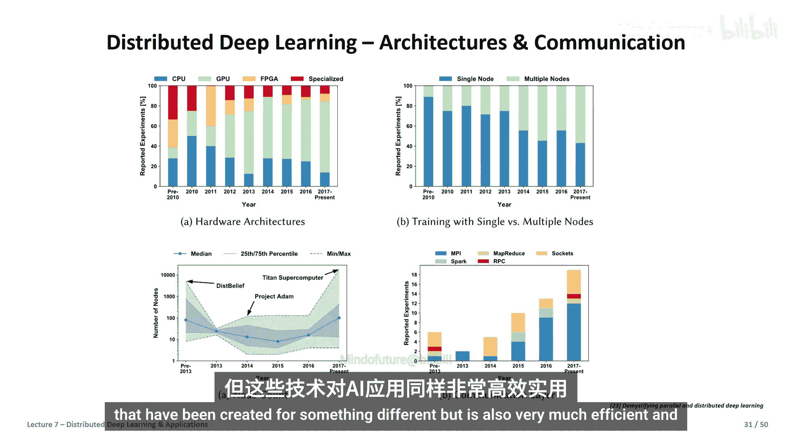

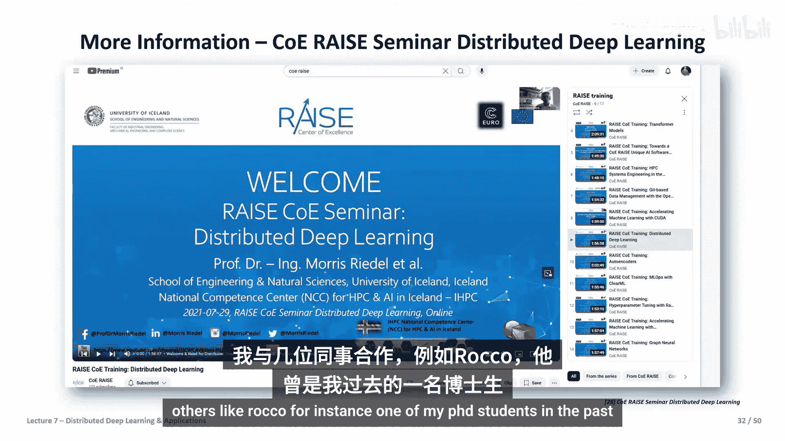

*   **模型并行**：与数据并行不同，模型并行将**单个模型的不同层或部分**分割到多个设备上。每个设备持有模型的一部分，但处理**相同的小批量数据**。这需要在不同设备间传递中间激活值和梯度，特别是在全连接层等部分可能引入复杂的通信模式。

主流的深度学习框架对分布式训练提供了不同层次的支持：

*   **TensorFlow**：内置了参数服务器实现，也支持同步训练策略。
*   **Keras**：作为高级API，构建于TensorFlow之上，简化了模型构建。
*   **PyTorch**：通过 **`torch.nn.parallel.DistributedDataParallel` (DDP)** 模块原生支持分布式数据并行训练，易于使用且性能良好。
*   **Horovod**：是一个独立的分布式训练框架，可以轻松与TensorFlow、PyTorch、MXNet等后端集成。它基于MPI实现，特别是高效的Allreduce操作，通常能获得优异的性能。

## 扩展限制与挑战

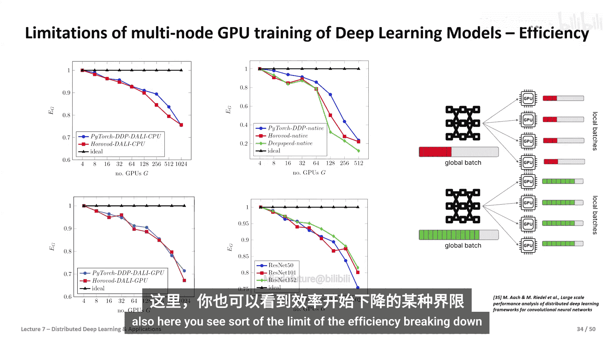

尽管分布式训练能加速处理，但盲目扩展会遇到显著的限制。

*   **大批量大小问题**：当GPU数量急剧增加时，为了保持每个GPU的计算负载，必须增加**全局批量大小**。研究表明，过大的批量大小会导致模型验证精度下降，即使调整学习率也难以完全弥补。这意味着单纯增加算力可能损害模型最终质量。
*   **效率下降**：随着节点数增加，通信开销（梯度同步）所占时间比例上升，GPU用于实际计算的时间比例下降，导致整体效率降低。不同模型架构（如ResNet）对此的敏感度不同。
*   **准确性与速度的权衡**：分布式训练的目标不仅是加速，更重要的是保持或提升模型精度。如果扩展导致精度严重损失，那么加速就失去了意义。

## 序列模型应用：从RNN到Transformer

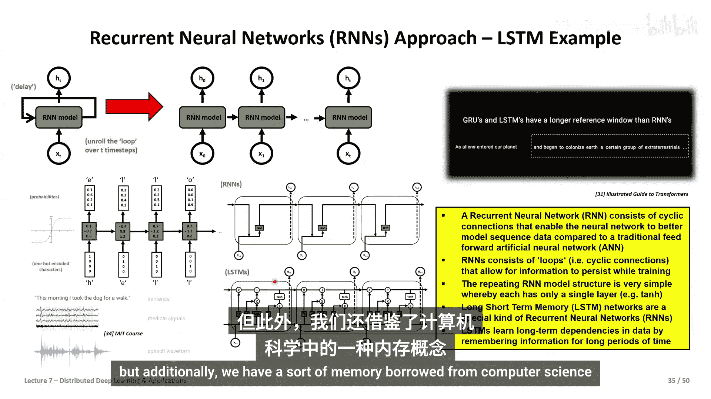

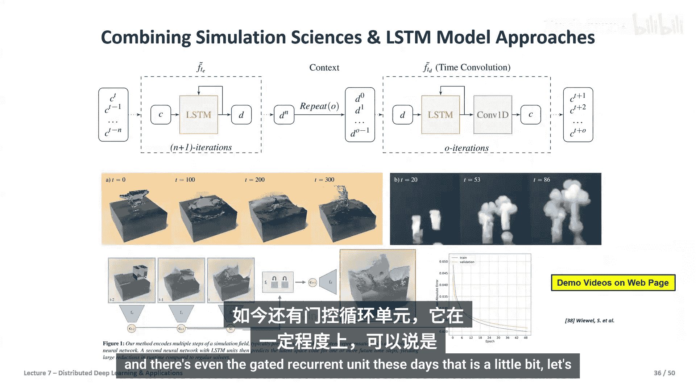

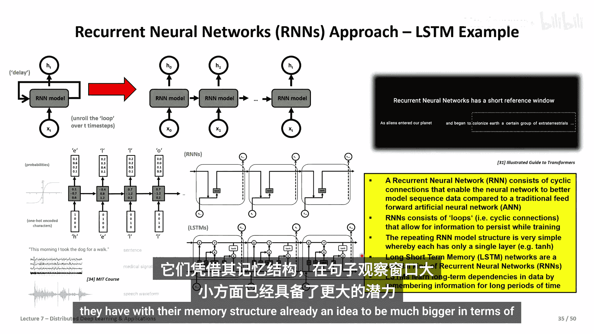

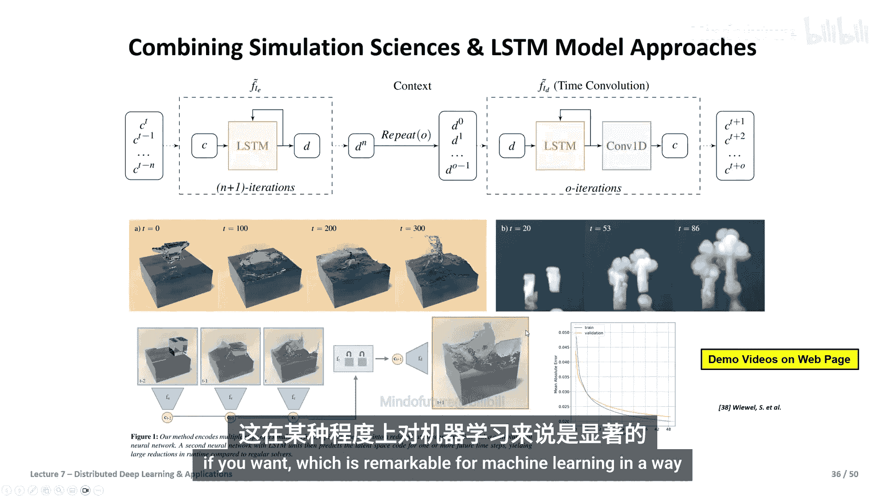

分布式深度学习在序列数据处理（如自然语言、时序信号）中有着重要应用，其模型架构也在不断演进。

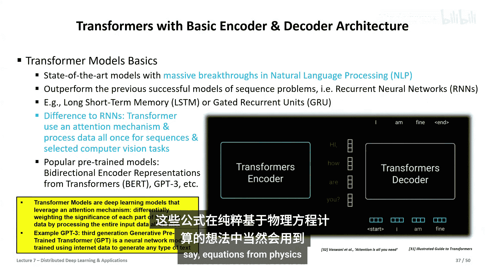

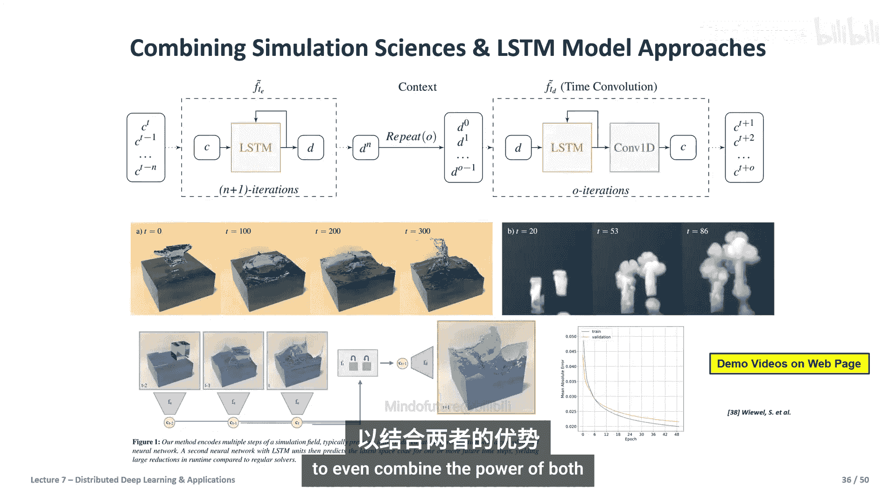

*   **循环神经网络**：RNN通过其循环连接结构，能够处理序列数据，将前一时间步的信息传递到当前时间步。这使其非常适合语言建模等任务。
*   **长短期记忆网络**：LSTM是RNN的改进，引入了门控机制，能更有效地学习长期依赖关系，在诸多序列任务上表现优异。
*   **Transformer**：这是当前驱动大语言模型（如GPT系列）的核心架构。它完全基于**自注意力机制**，能够并行处理整个序列，并衡量序列中任意两个元素之间的关系权重，从而捕获更广泛的上下文信息。Transformer通常包含编码器和解码器堆栈，在机器翻译、文本生成等任务上取得了革命性成功。

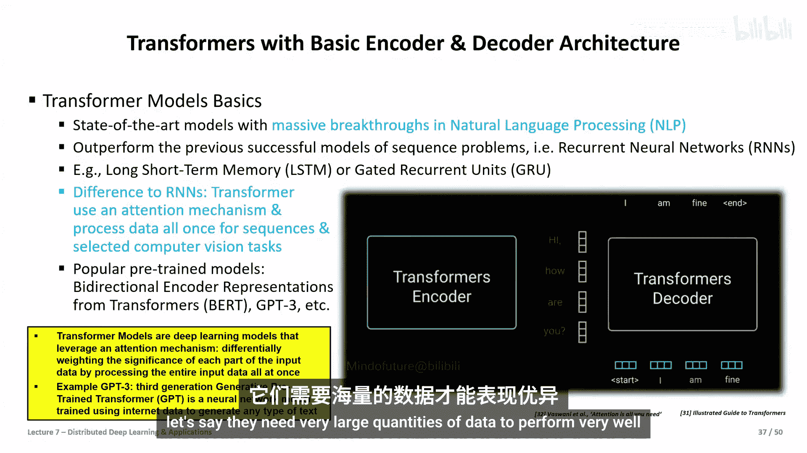

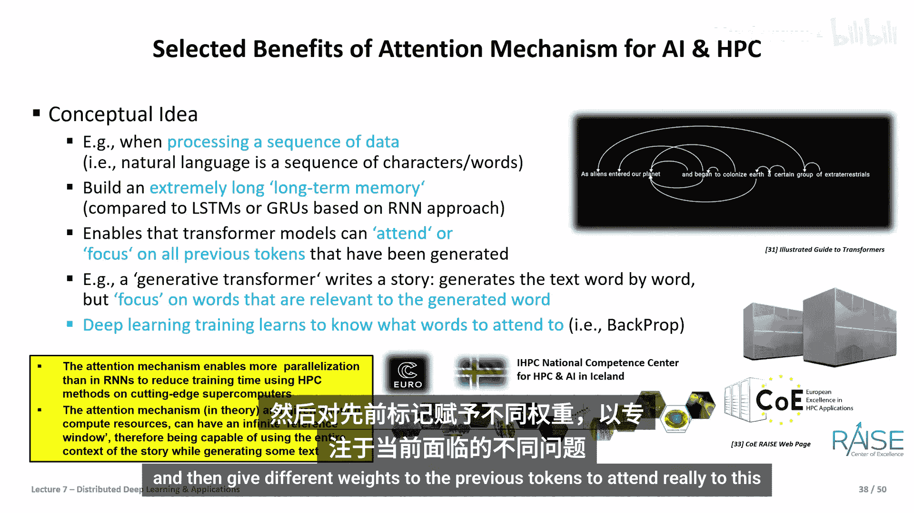

## 新兴框架与总结

为了应对万亿参数级别模型的训练挑战，出现了许多新的分布式训练框架。

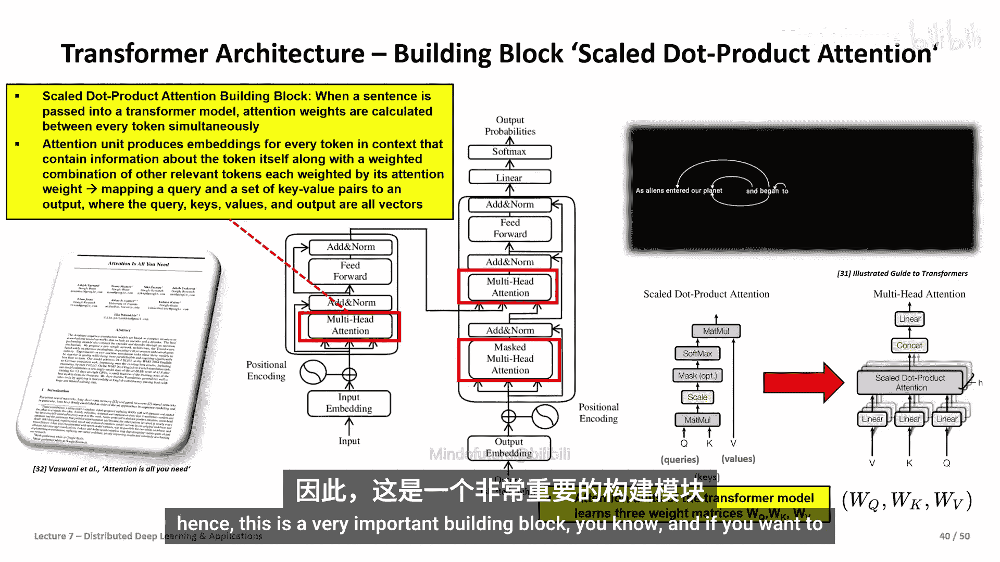

*   **DeepSpeed**：由微软开发，集成了ZeRO内存优化、流水线并行等技术，旨在高效训练超大规模模型。
*   **其他框架**：如FairScale、Colossal-AI等，也在探索模型并行、流水线并行与数据并行的三维组合优化策略。

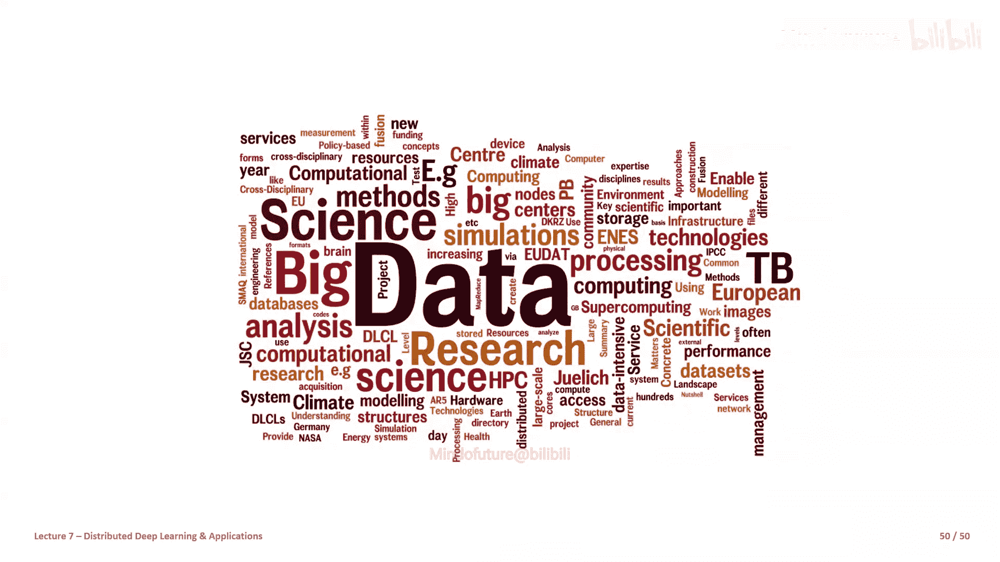

本节课中我们一起学习了分布式深度学习在多节点环境下的深入实践。我们详细探讨了数据并行和模型并行的原理与实现，分析了扩展时面临的大批量大小和效率瓶颈等核心挑战。此外，我们还了解了RNN、LSTM和Transformer等序列模型及其应用。理解这些内容，对于利用高性能计算资源解决当今大规模人工智能问题至关重要。