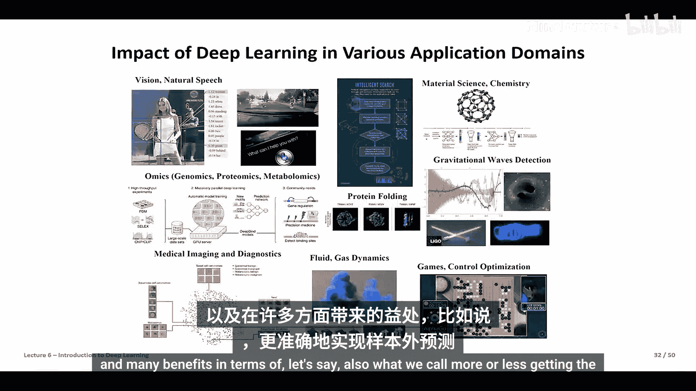
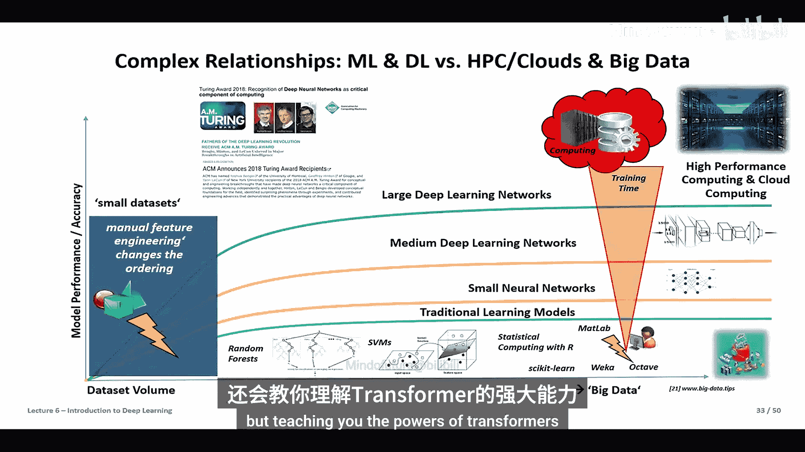
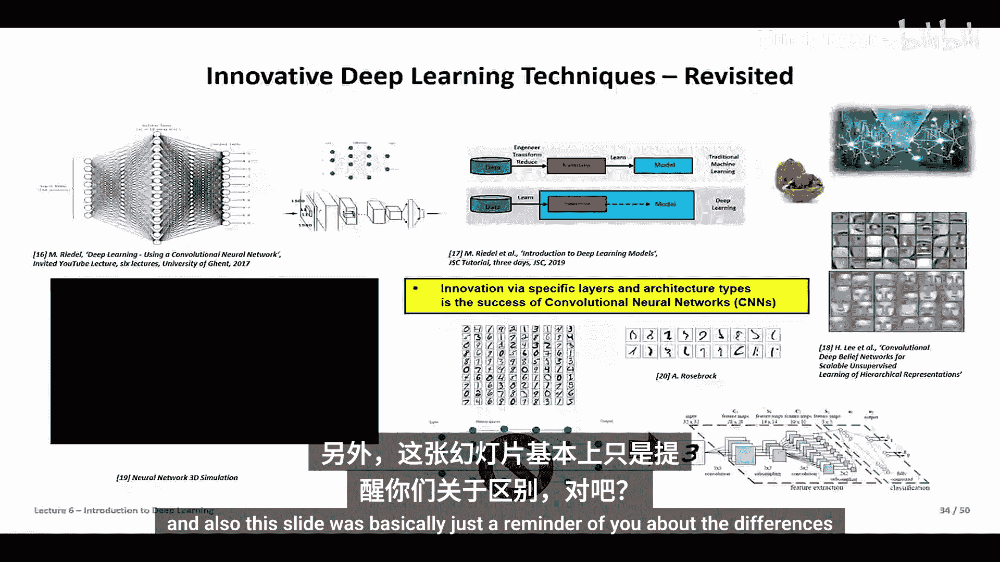
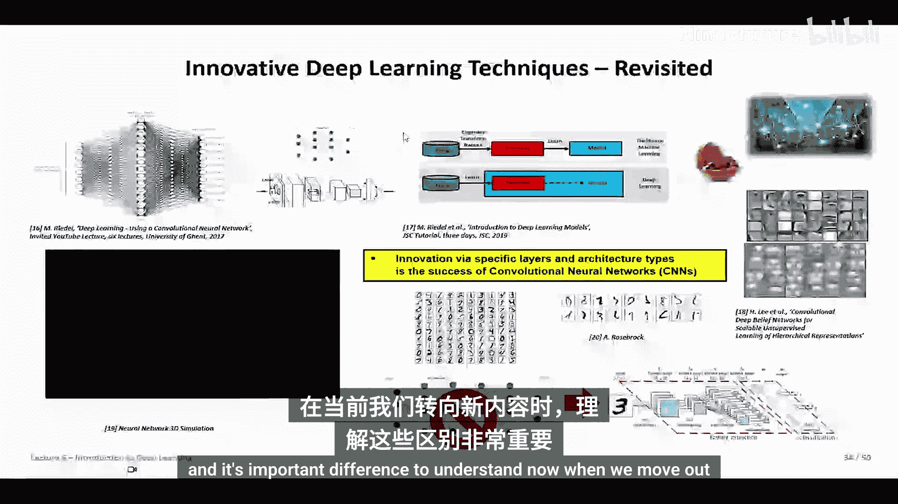
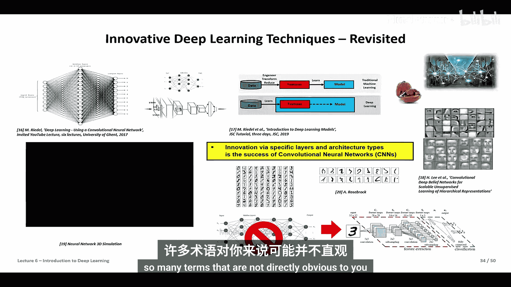
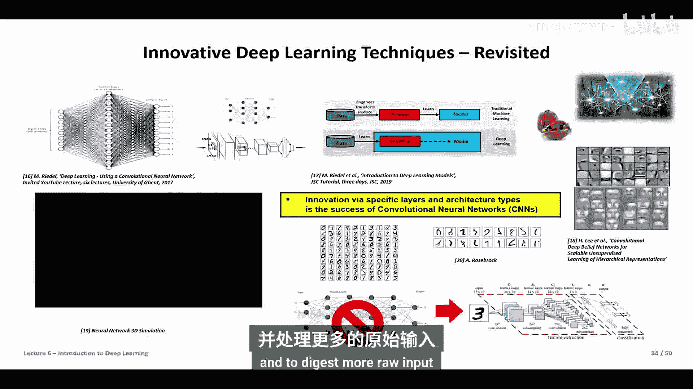
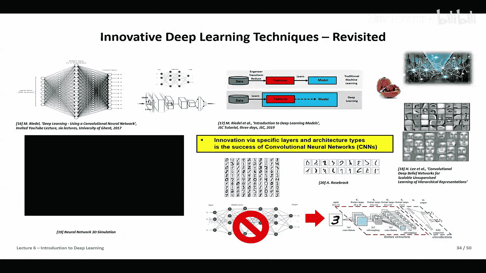
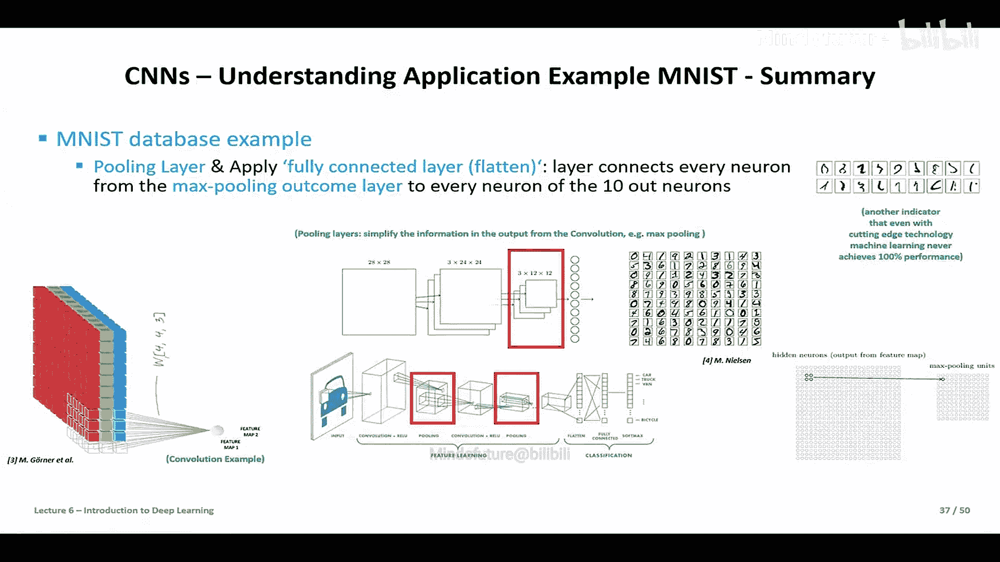
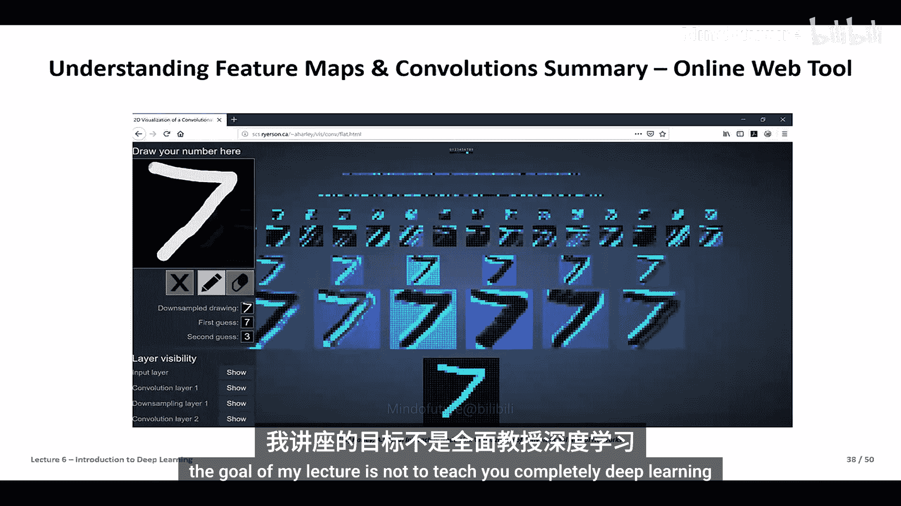
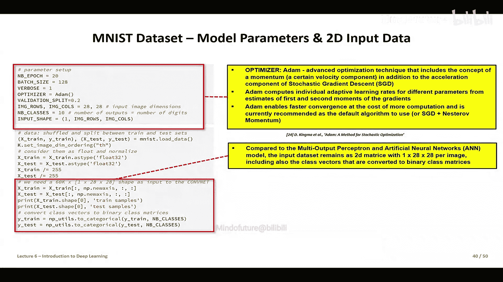

# 012：深度学习导论（第二部分）🎓

在本节课中，我们将继续学习深度学习，重点探讨卷积神经网络（CNN）的基本原理、其与传统机器学习的区别，以及深度学习与高性能计算（HPC）之间的紧密联系。我们将看到，深度学习的巨大成功不仅源于算法创新，更离不开计算能力的飞速发展。

## 从传统机器学习到深度学习

上一节我们介绍了感知器和人工神经网络等基础机器学习模型。本节中，我们来看看深度学习如何通过**特征学习**改变游戏规则。

在传统机器学习中，我们需要进行大量的**特征工程**，即手动设计和提取数据的特征，并将其转换为一维向量输入模型。例如，在识别手写数字时，我们需要手动将28x28像素的图像“压平”成一个784维的向量。

深度学习，特别是卷积神经网络，改变了这一范式。其核心思想是让网络自己从原始数据中学习有用的特征，而不是依赖人工设计。这是通过一种特殊的网络结构实现的。

## 卷积神经网络（CNN）的核心思想🧠

CNN的设计灵感来源于人类的视觉系统。我们识别物体时，并非一次性处理整个场景的所有像素，而是通过**局部感受野**来关注图像的特定区域。

以下是CNN实现特征学习的关键组件：

1.  **卷积层**
    *   **作用**：使用一个可学习的**滤波器**（或**卷积核**）在输入图像上滑动，提取局部特征。
    *   **操作**：滤波器（例如一个3x3的矩阵）与图像局部区域进行点乘求和，生成**特征图**。这个过程保留了输入数据的空间结构（即像素间的局部关系）。
    *   **公式/代码示意**：`output_feature_map[x, y] = sum( input_region * filter_weights ) + bias`

2.  **激活函数**
    *   **作用**：引入非线性，使网络能够学习复杂的模式。
    *   **常用函数**：**修正线性单元**。其公式为：`f(x) = max(0, x)`

3.  **池化层**
    *   **作用**：对特征图进行下采样，减少数据量和参数数量，同时增强特征的鲁棒性（对微小平移不敏感）。
    *   **常用方法**：**最大池化**，即取局部区域的最大值。

4.  **全连接层**
    *   **作用**：在网络的末端，将学习到的高级特征进行整合，并输出最终的分类概率。
    *   **常用输出**：**Softmax** 函数，将输出转换为概率分布。其公式为：`softmax(z_i) = exp(z_i) / sum(exp(z_j))`

一个典型的CNN流程是：**输入 -> [卷积 -> 激活 -> 池化] x N -> 展平 -> 全连接层 -> Softmax输出**。通过堆叠多个这样的模块，网络可以自动学习从边缘、纹理到复杂物体部件的层次化特征。

## 深度学习与高性能计算的共生关系⚡

深度学习模型的强大能力伴随着巨大的计算需求。让我们通过参数数量来理解这一点：

*   **感知器**：约8，000个可训练参数。
*   **双层人工神经网络**：约120，000个可训练参数。
*   **一个简单的CNN**：可轻松达到**120万个**可训练参数。

每个参数都需要通过反向传播算法和优化器（如随机梯度下降）在数百万次迭代中不断更新。这涉及大量的矩阵乘法和向量运算，正是GPU等高性能计算硬件所擅长的领域。因此，深度学习的复兴与GPU计算能力的突破密不可分。

## 模型评估与泛化能力📊

构建一个高性能模型不仅仅是追求训练集上的高准确率。机器学习的核心目标是让模型在从未见过的**新数据**（即**测试集**）上表现良好，这被称为**泛化能力**。

以下是确保模型可靠性的两个关键概念：

1.  **正则化**
    *   **目的**：防止**过拟合**，即模型过度记忆训练数据中的噪声和细节，导致在新数据上表现不佳。
    *   **常用技术**：权重衰减、Dropout（随机丢弃部分神经元）、早停法等。

2.  **验证**
    *   **目的**：进行**模型选择**。在训练过程中，使用一个独立的**验证集**来调整模型的**超参数**（如网络层数、神经元数量、学习率等），而不是使用测试集。这避免了因根据测试集表现调整模型而导致的乐观偏差。
    *   **重要原则**：**测试集只能在最终评估时使用一次**，并且绝不能用于训练。

一个严谨的流程是：将数据分为**训练集**（用于学习）、**验证集**（用于模型选择和调参）、**测试集**（用于最终性能报告）。只有这样，报告的性能指标才具有可信度。

## 总结

本节课中我们一起学习了深度学习第二部分的核心内容。我们了解到，卷积神经网络通过**局部连接**、**权重共享**和**层次化特征学习**，能够自动从图像等结构化数据中提取有效特征。这种能力使得CNN在计算机视觉等领域取得了革命性成功。

同时，我们也深刻认识到，深度学习的强大是以**海量的计算**为代价的。模型参数数量的爆炸式增长，使得高性能计算（尤其是GPU加速计算）成为深度学习发展的关键驱动力。最后，我们强调了正确的模型评估方法（正则化与验证）对于构建可靠、可泛化模型的重要性。

在下一讲中，我们将探讨**分布式深度学习**，学习如何将训练任务分布到多个计算节点上，以应对日益增长的超大规模模型训练挑战。